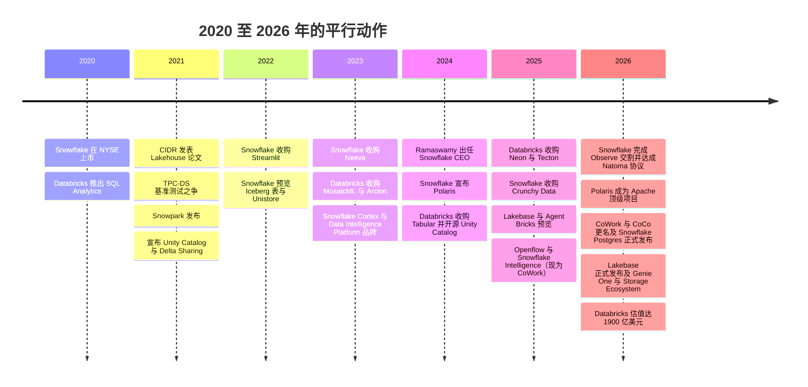
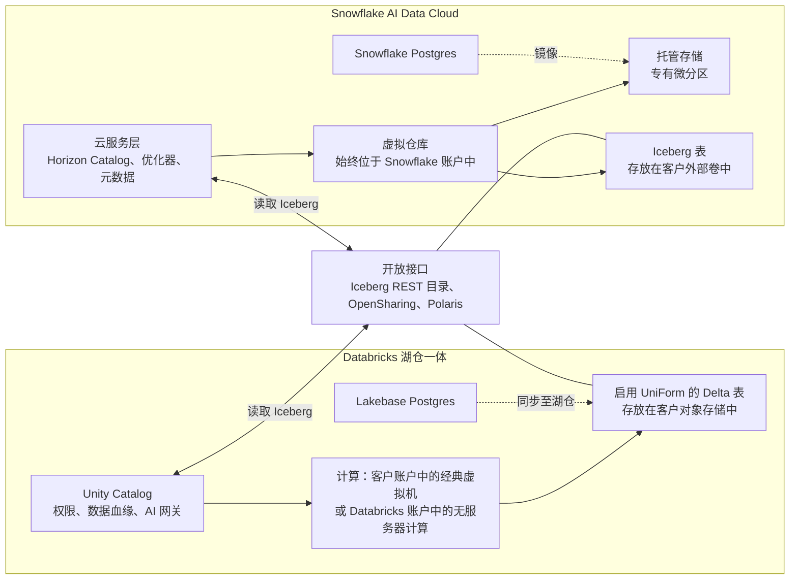

# 27. Databricks 对比 Snowflake：正面交锋
> **状态：** Databricks 为私营公司 · Snowflake 为上市公司（NYSE: SNOW） · **总部：** San Francisco, CA（Databricks）/ 据 SEC 文件为 Bozeman, MT（Snowflake） · **成立：** 2013 / 2012 · **最新估值/市值：** Databricks 投后估值 $190B（1900 亿美元）（公司披露，2026-08-13）；Snowflake 市值 $107.88B，企业价值 $106.31B（2026-10-30） · **最后核实：** 2026-11-01

## 要点速览（TL;DR）

- **起点不同，终点相同。** Databricks 起家于面向数据工程师的托管 Spark，随后"向上"拓展至 SQL 数据仓库。Snowflake 起家于面向分析师的托管 SQL 数据仓库，随后"向外"拓展至工程、机器学习和应用。到 2026 年，两家的产品版图几乎完全相同：开放表格式（open table format）支持、数据治理目录、无服务器计算、Postgres 数据库以及智能体（agent）层。二者仍有差别的地方在于**数据默认存放在哪里**以及**谁掌握元数据**。Databricks 默认使用客户存储桶中的开放 Delta/Iceberg 文件。Snowflake 默认使用自有的托管存储，如今也把 Iceberg 表作为一等选项提供。[^cidr][^sigmod16]
- **规模已相近；但披露的增速不可直接比较。** Databricks 披露**年化收入运行率超过 $7B，增速超过 80%**（公司披露，未经审计，财季 Q2 为 2026 年 5–7 月）。Snowflake 同期三个月报告**产品收入 $1.49B，同比 +37%**（GAAP），年化约 $5.96B。[^db-7b][^sf-q2] 两组数字在口径（年化运行率 vs. 已确认收入）、范围以及"一美元收入"所包含的内容上都不同。在经典计算模式下，Databricks 的收入不包括客户的云虚拟机账单；Snowflake 的收入则始终包含基础设施成本。
- **计价单位不同，标价正在趋同。** Databricks 销售按工作负载 SKU 定价的 **DBU**。Snowflake 销售按版本定价的 **credit（积分）**。在我们的示意性标价示例中，两个平台上最小的无服务器 SQL 单元每小时成本均约为 **$3**。真正的成本差异来自运行时长、自动挂起行为和协商折扣，而非单价。[^pricing][^sf-pricing]
- **估值差距。** Databricks 的 $190B 估值约为**年化运行率的 27 倍**。Snowflake 的 **EV/未来 12 个月收入为 16.9 倍**（2026-10-30）。经增速调整后，Databricks 反而*更便宜*（每个百分点增速约 0.34 倍，对比约 0.48 倍），但这仅基于其自身未经审计的运行率和增速数据。分子也不同：由优先股定价的私营投后*股权*估值，与上市公司的*企业价值*不是同一个对象，而公司自定义的年化运行率也不是 GAAP 收入。[^comps-sf][^db-7b]
- **Everpure 视角。** Everpure 是 **Databricks Storage Ecosystem 的指定首发合作伙伴**（2026-06-10），其 OpenSharing 连接器处于私有预览阶段。在本次研究中，我们未发现 Snowflake 有对等的*计划*。Snowflake 通过其 S3 兼容存储支持来访问本地对象存储。其文档曾将 Pure Storage 列为 S3 兼容供应商之一，但 Snowflake 表示其本身不测试或验证第三方产品，并且现在要求供应商提供"经测试且合规"的服务 [VERIFY: FlashBlade 在这一新表述下的状态]；两家公司于 2022 年 5 月宣布了联合本地部署方案。[^pure-sf] 双平台、格式中立的定位是显而易见值得评估的选项。[^storage-eco][^everpure-os][^sf-s3compat]

## 概览表

| 项目 | Databricks | Snowflake | 口径 / 来源 |
|---|---|---|---|
| 所有权 | 私营；无 GAAP 财报 | 2020 年 9 月起上市（NYSE: SNOW） | 公开记录[^funding][^sf-10k] |
| 创始人 | 七位 UC Berkeley AMPLab 研究人员，包括 Ali Ghodsi、Matei Zaharia、Ion Stoica | Benoit Dageville、Thierry Cruanes、Marcin Żukowski（前 Oracle / Vectorwise） | 公开记录[^sigmod16] |
| CEO | Ali Ghodsi（2016 年起） | Sridhar Ramaswamy（2024 年 2 月起） | 公开记录[^ceo-sf] |
| 财年 | 截至 1 月 31 日 | 截至 1 月 31 日（FY2027 = 2026 年 2 月–2027 年 1 月） | 公司披露[^db-7b][^sf-q2] |
| 最新规模 | 年化收入运行率 **>$7B**（Q2，2026 年 5–7 月） | 总收入 **$1,546.8M**，产品收入 **$1.49B**（Q2 FY2027，2026 年 5–7 月） | 公司披露的年化运行率 / GAAP[^db-7b][^sf-q2] |
| 增速 | 同比 **>80%**（运行率） | 总收入 **+35%**，产品收入 **+37%**（同比） | 公司披露 / GAAP[^db-7b][^sf-q2] |
| 全年指标 | 收入约 $2.6B（截至 2025 年 1 月的财年） | 产品收入 $4,472.3M，总收入 $4,683.9M（FY2026 = 2025 年 2 月–2026 年 1 月） | 媒体报道 / GAAP[^cnbc-25][^sf-10k] |
| 前瞻指引 | 未发布 | FY2027 产品收入 **$6.07B**（+36%） | 公司指引[^sf-q2] |
| 净收入留存率 | >140%（定义未披露） | 126%（过去 12 个月产品收入） | 公司披露的 KPI[^db-54][^sf-q2] |
| $1M+ 客户 | 年化运行率 >$1M 的客户超过 800 家（2026 年 1 月） | 过去 12 个月产品收入 >$1M 的客户 828 家（2026 年 7 月） | 公司披露的 KPI[^db-54][^sf-q2] |
| 毛利率 | 非 GAAP 订阅毛利率 >80%（2024 年 10 月季度） | 非 GAAP 产品毛利率 74.7%；GAAP 70.9%（Q2 FY2027） | 非 GAAP / GAAP[^db-j][^sf-q2] |
| 盈利能力 | 过去 12 个月调整后自由现金流为正（未披露金额；公司披露，非 GAAP） | GAAP 营业利润率 −17.0%，非 GAAP +15.3%（Q2 FY2027）；FY2026 非 GAAP 自由现金流利润率 25.5% | 公司披露 / GAAP / 非 GAAP[^db-54][^sf-q2][^sf-fin] |
| 价值 | 投后估值 $190B（2026-08-13） | 市值 $107.88B；企业价值 $106.31B（2026-10-30） | 公司披露 / 市场数据[^db-7b][^comps-sf] |
| 已披露或报道的并购支出（有金额交易之和） | 约 $4.4B（MosaicML、Tabular、Neon、Arcion） | 按申报数据约 $1.86B（Streamlit、Neeva、Crunchy Data、Observe、Natoma）；若采用约 $250M（Crunchy）和约 $1B（Observe）的媒体报道数字则约 $2.35B | 我们对 `data/ma_deals.csv` 的加总。口径不同：Databricks 的 Tabular 和 Neon 金额为媒体报道；Snowflake 的 Crunchy、Observe、Neeva 和 Natoma 为 10-Q/10-K 中的购买对价（Observe 为初步数字）[^ma] |

*图 27.1 — 概览。各行口径不同：Databricks 的数字为公司披露且未经审计，Snowflake 的数字为 GAAP 或已定义的 KPI。两家的财年恰好对齐（均截至 1 月 31 日），因此"Q2"对两家而言都是 2026 年 5–7 月这同一季度。*

## 正面交锋一览

| # | 维度 | Databricks | Snowflake | 优势方（作者判断） |
|---|---|---|---|---|
| 1 | 起源与核心买家 | 面向数据工程师和数据科学家的 Spark | 面向分析师和财务的 SQL 数据仓库 | 门不同，楼相同 |
| 2 | 奠基论文 | Lakehouse，CIDR 2021 | Elastic Data Warehouse，SIGMOD 2016 | 不适用 |
| 3 | 默认存储 | 存放在**客户**对象存储中的 Delta 表（Parquet + 日志） | **Snowflake 托管**存储（专有微分区） | 开放性上 Databricks 占优；简洁性上 Snowflake 占优 |
| 4 | 开放格式立场 | Delta + UniForm 写入 Iceberg 元数据；收购 Tabular（2024） | 客户"外部卷"中的 Iceberg 表；Iceberg v3 正式发布（2026 年 5 月，二手来源） | 已趋同 |
| 5 | 目录 | Unity Catalog（2024 年开源；Linux Foundation） | Horizon Catalog（内部）；捐赠 Apache Polaris（ASF 顶级项目，2026） | Databricks（受治理资产的广度） |
| 6 | 计算运行位置 | 客户账户中的经典虚拟机，或 Databricks 账户中的无服务器计算 | 始终在 Snowflake 账户中（虚拟仓库） | 正向无服务器趋同 |
| 7 | 计价单位 | DBU，按 SKU 定价（Jobs、All-Purpose、SQL、无服务器） | Credit，按版本定价（Standard / Enterprise / Business Critical） | Snowflake 更易预测 |
| 8 | SQL / BI | Databricks SQL、Photon；年化运行率 >$1.5B | 核心业务；Gen2 和 Adaptive 仓库 | Snowflake |
| 9 | 数据工程 / 数据摄取 | Spark、Lakeflow（Connect、Spark Declarative Pipelines、Jobs） | Snowpark、Dynamic Tables、Openflow（2025 年 5 月正式发布；第二代运行时 2026 年 9 月正式发布） | Databricks |
| 10 | 机器学习 / 模型训练 | Mosaic AI、GPU、笔记本 | Snowpark ML、Cortex Training（2026） | Databricks |
| 11 | 面向业务用户的 AI | Genie One（智能体式协作助手） | Snowflake CoWork（原 Snowflake Intelligence） | 胶着 |
| 12 | 开发者 AI / 智能体 | Agent Bricks、Unity AI Gateway、Omnigent | Cortex Agents、CoCo（原 Cortex Code）、Natoma（MCP 网关） | 胶着；面向构建者 Databricks 更深入 |
| 13 | 运营型数据库 | Lakebase（Neon），2026 年正式发布，年化运行率 >$100M | Snowflake Postgres（Crunchy Data），2026 年 6 月正式发布 | Databricks（更早，可量化） |
| 14 | 数据共享 / 云市场 | Delta Sharing → OpenSharing（Linux Foundation）；Marketplace；Clean Rooms | Secure Data Sharing、Marketplace、Data Clean Rooms（Samooha） | Snowflake（网络成熟度） |
| 15 | 可观测性 / 安全数据 | Lakewatch SIEM；Panther | Observe（2026 年 2 月完成交割） | 为时尚早 |
| 16 | 超大规模云渠道 | Azure Databricks 是 Microsoft 第一方服务 | 在 AWS、Azure、Google Cloud 上通过云市场联合销售 | Databricks（Azure） |
| 17 | 本地部署 / 存储合作伙伴 | 基于 OpenSharing 的 Storage Ecosystem（2026 年 6 月；Everpure 为首发合作伙伴） | S3 兼容的外部 stage/表；供应商自报名单（列有 Pure Storage；Snowflake 不做验证） | Databricks（正式计划） |
| 18 | 信息披露质量 | 公司披露的下限值；无审计 | SEC 文件、业绩指引 | Snowflake |
| 19 | 并购支付货币 | 估值持续上升的私营股票 | 上市股票与现金 | Databricks |

*图 27.2 — SV-13：多维度对比。在大多数产品维度上，诚实的答案是"已趋同"。真正的差异在于默认数据位置、目录广度、披露质量和收购支付货币。来源：第 25 章和第 26 章的资料来源，以及本章脚注。[^dais26][^summit26][^polaris][^iceberg-v3]*

## 起源与战略演进

**Snowflake 率先构建了一体化数据仓库。** 其 SIGMOD 2016 论文描述了一种存算分离（separation of storage and compute）的设计。数据以由不可变微分区组成的专有列式格式存放在云服务商的对象存储（object storage）中。独立的计算"虚拟仓库"负责读取，云服务层负责处理元数据、优化、安全和事务。[^sigmod16] 客户从不接触集群。他们只需调整仓库规格、按秒付费，几乎无需运维。这种简洁性加上跨账户数据共享，使 Snowflake 成为同时代增长最快的企业软件公司之一。公司于 2020 年 9 月上市。[^sf-10k]

**Databricks 以开放理念回应。** CIDR 2021 的 Lakehouse 论文认为，在数据湖（data lake）旁边再放一个专有数据仓库（data warehouse）是代价高昂的双副本设计。论文提出，客户存储桶中的开放 Parquet 文件，加上事务日志、缓存和向量化引擎，可以在单一副本上达到数据仓库级别的性能。[^cidr] 2021 年 11 月，双方的竞争因一场 TPC-DS 基准测试之争而公开化。Databricks 宣称创造了官方纪录，Snowflake 的创始人则以一篇关于"诚信竞争"的博客回应 [VERIFY: 两篇博客的 URL；基于 2025 年前的知识，本次未重新打开]。[^tpcds]

**此后双方互相借鉴对方的长处。** Snowflake 增加了 Snowpark（在数据仓库内运行 Python 和 Java 代码），收购了 Streamlit（2022）用于应用、Neeva（2023）用于获取 AI 人才、Datavolo（2024）用于数据摄取。它还拥抱 Iceberg，并捐赠了 Polaris 目录。Databricks 构建了 Databricks SQL 和 Photon 以争夺 BI，开源了 Unity Catalog，并收购 Tabular 以化解格式之争。[^ma][^tabular][^uc-oss] 从 2025 年起，竞赛转向 Postgres 和智能体：先是相隔一个月的 Neon 与 Crunchy Data 收购，然后是 Lakebase 对 Snowflake Postgres，以及 Genie One 对 CoWork。[^neon][^ma][^summit26][^dais26]

*图 27.3 — 平行动作。一方几乎每一次发布，另一方都会在 12 个月内推出对应产品。这些配对包括 Polaris 与 Unity Catalog 开源（2024）、Crunchy 与 Neon（2025），以及 CoWork 与 Genie One（2026）。来源：`data/ma_deals.csv`；第 25 章；Summit 和 DAIS 回顾。[^ma][^summit26][^dais26][^polaris]*

> **类比：x86 对比 Arm，以及 Intel 对比 AMD。** Snowflake 起步时像一家垂直整合制造商（IDM）：它拥有格式、引擎和服务，销售高利润、客户选择余地小的成品。Databricks 起步时更接近 Arm 模式。它培育开放标准（Spark、Delta、Unity Catalog OSS），让生态系统围绕这些标准发展，再通过最佳实现来变现。一旦双方都支持 **Iceberg**，局面就更像 Intel 对 AMD 共享 x86 指令集。兼容性使切换变得可以想象，于是竞争转向微架构（每 credit 或每 DBU 的性价比）以及核心周边的平台（目录，就像芯片组及其软件生态锁定 CPU 插槽一样）。共享指令集并不会终结锁定；它只是转移了锁定。

## 产品与技术

### 架构并排对比

*图 27.4 — 架构并排对比。两者都实现了存算分离，并由目录/元数据服务统一管理。区别在于默认设置：除非另行指定，Databricks 的表存放在客户的存储桶中；而除非客户选择 Iceberg，Snowflake 的表存放在托管存储中。中间的开放接口正是两者如今交汇之处。[^arch-docs][^sigmod16][^uc-dais26]*

**存储与格式。** Databricks 写入 Delta 表，而 **UniForm** 在同一次提交中生成 Iceberg 元数据，因此同一张物理表可同时服务两个生态系统。[^cidr] Snowflake 的原生表使用其自有的微分区格式，并对其进行端到端控制。这正是其优化器、缓存和数据治理功能一直如此紧密集成的原因之一。Snowflake **Iceberg 表**将 Parquet 数据和 Iceberg 元数据保存在客户自己的存储中（一个"外部卷"）。Snowflake 可以作为目录来管理这些表，也可以从外部目录读取它们。[^iceberg-v3] 这种趋同是真实的，但并不对称。对 Databricks 而言，开放是默认设置；对 Snowflake 而言，开放只是一个选项。Snowflake 的大部分存量客户数据仍在托管存储中。

**目录：真正的主战场。** Unity Catalog 治理表、文件、机器学习模型、函数，并自 2026 年起通过 Unity AI Gateway 治理模型和智能体流量。其开源版本支持 Iceberg REST 协议。[^uc-dais26] Snowflake 分两层应对。**Horizon Catalog** 是 Snowflake 内部的数据治理层。**Apache Polaris** 是 Snowflake 于 2024 年捐赠的开放 Iceberg REST 目录；它于 2026 年初成为 Apache 顶级项目（ASF 于 2026-03-05 宣布）。[^polaris] 战术上的区别在于：Databricks 把其*主*目录开源了，而 Snowflake 开源的是*第二个*目录，并保留 Horizon 为专有 [VERIFY: Horizon 目前与 Iceberg REST 的互操作程度]。

**AI 战略。** 两家公司讲的是同一个故事：智能体需要受治理的数据、语义和权限，而已经掌握这些的平台应当承载智能体。Databricks 以构建者为先。它提供用于模型服务和微调（fine-tuning）的 Mosaic AI、用于构建和评估智能体的 **Agent Bricks**、面向业务用户的 **Genie One**，以及作为智能体写入目标的事务型存储 **Lakebase**。截至 2026 年 1 月，其 AI 产品的年化运行率已超过 $1.4B（公司披露）。[^db-54][^dais26] Snowflake 以业务用户和 SQL 为先。它提供 SQL 内的 **Cortex** AI 函数、**Cortex Agents**、**Snowflake CoWork**（2026 年 6 月由 Snowflake Intelligence 更名）、面向开发者的 **CoCo**（原 Cortex Code）、用于微调开放权重模型的 **Cortex Training**，以及 **Snowflake Postgres**（2026 年 6 月正式发布）。[^summit26] Snowflake 将 FY2027 非 GAAP 产品毛利率指引下调至 74%，理由是 AI 工作负载占比的变化。AI 需求在两家公司的损益表上都带来了 GPU 成本。[^sf-fin]

## 盈利模式

两家公司都采用**按用量计费（consumption pricing）**：客户签订多年期承诺消费额度（committed spend）合同，并在使用计算资源时逐步消耗额度。收入按消耗确认，而非在签约时确认。但两者的计价单位不同，每个单位所包含的内容也不同。

| 特征 | Databricks DBU | Snowflake credit |
|---|---|---|
| 计量对象 | 每小时处理能力，按实例类型或仓库规格缩放 | 仓库规格 × 时间（XS = 1 credit/小时，每升一级翻倍） [VERIFY] |
| 决定单位价格的因素 | 工作负载 SKU：Jobs（最便宜）、All-Purpose、SQL、各类无服务器变体；再加上云平台和层级 | 版本：Standard、Enterprise、Business Critical；再加上云平台和区域 |
| 代表性美国标价 | Jobs（经典）约 $0.15/DBU；All-Purpose 约 $0.55；Serverless SQL 约 $0.70（AWS，2026 年第三方汇编） | Standard / Enterprise / Business Critical 每 credit $2 / $3 / $4，AWS US East 按需 [VERIFY: 2025 年前的标价] |
| 是否包含云基础设施？ | 经典模式：**不包含**（客户单独支付虚拟机账单）。无服务器：包含 | **始终包含** |
| 存储 | 客户直接向云服务商支付对象存储费用 | 由 Snowflake 按 TB-月计费（类似转付），或客户直接为 Iceberg 存储付费 |
| 折扣 | 承诺消费额度合同；超大规模云市场额度抵扣 | 容量合同；云市场额度抵扣 |
| 效率杠杆 | Photon（DBU 费率更高、小时数更少）、无服务器预热池 | Gen2 和 Adaptive 仓库、自动挂起、查询加速 |

*图 27.5 — 计价单位对比。来源：Databricks 定价汇编（第 25 章）；Snowflake 定价页面和 credit 消耗表 [VERIFY: 本次未重新打开标价来源]。[^pricing][^sf-pricing][^dbsql-sizes]*

> **类比：以不同单位计费的两套特许权使用费表。** 设想两家 IP 授权商。一家按裸片（die）收费，另一家按晶圆收费，并且各自既设定单位价格，*又*决定一颗给定芯片会消耗多少单位。拿"每 DBU $0.70"与"每 credit $3"作比较，就像在不知道裸片尺寸的情况下，比较每裸片 $0.70 的使用费和每晶圆 $3 的使用费。唯一有意义的数字是**每个完成的工作负载的成本**，它只能通过基准测试或在你自己的查询上做概念验证来获得。供应商还同时掌控这两个杠杆。当它推出更快的引擎时，可以保持单价不变，让客户账单下降（它希望由需求弹性抵消这种通缩），也可以对更快的层级按每小时收取更多单位。

### 实例演算：按标价为两个工作负载定价（仅作示意）

以下数字采用 AWS US East 的标价，来源及日期见上文脚注。它们忽略了协商折扣（大客户的折扣通常相当可观），并对规格做了一些**假设**，真实的概念验证会替代这些假设。请将其视为对机制的示意，而非价格比较。

**工作负载 A：夜间 ETL，每次 2 小时，每月 30 晚。**

- *Snowflake（Enterprise 版）：* 一个 Medium 仓库每小时消耗 4 credit。2 小时 × 4 credit × $3 = **每晚 $24**，约**每月 $720**，含基础设施。[^sf-pricing]
- *Databricks 经典 Jobs 计算：* 假设一个集群每小时消耗 18 DBU（一个驱动节点加八个工作节点，每个约 2 DBU；此为我们的假设）。36 DBU × $0.15 = **每晚 $5.40** 的 Databricks 费用。再加上 EC2 账单，假设九个实例每实例小时 $0.50（假设值，非报价）：9 × $0.50 × 2 = **$9.00**。合计约**每晚 $14.40**，即**每月 $432**，其中只有约 38% 是 Databricks 的收入。[^pricing]

**工作负载 B：营业时间内使用的 BI 仪表盘，每天 10 小时，每月 22 天。**

- *Snowflake：* 一个 Small 仓库每小时 2 credit × $3 = 每小时 $6。10 小时 = **每天 $60**，约**每月 $1,320**，尚未计入高峰时段的多集群横向扩展。
- *Databricks Serverless SQL：* 一个 Small 仓库每小时消耗 12 DBU [VERIFY] × $0.70 = 每小时 $8.40。10 小时 = **每天 $84**，约**每月 $1,848**，含基础设施。[^dbsql-sizes]

| 最小无服务器 SQL 单元（标价） | 每小时单位数 | 单位价格 | 每小时成本 |
|---|---|---|---|
| Snowflake X-Small，Enterprise 版 | 1 credit | $3.00 | **$3.00** |
| Databricks Serverless SQL 2X-Small | 4 DBU [VERIFY] | 约 $0.70 | **约 $2.80** |

*图 27.6 — 入门级无服务器 SQL 在两个平台上的每小时标价大致相同。一个规格阶梯上的"Small"与另一个阶梯上的"Small"所代表的计算量并不相同，因此工作负载 B 比较的是标签，而非实际工作量。*

**这个例子说明了什么。** 第一，经典 Databricks 模式在定时批处理上看起来便宜，部分原因是大部分账单流向了 AWS，而非 Databricks。这既是价格问题，也同样是收入核算问题。第二，一旦两者都采用无服务器，每小时标价就会趋同。届时账单取决于仓库保持唤醒的时长（自动挂起和自动停止设置）、每小时完成的工作量（引擎效率）以及折扣。第三，转向无服务器会使 Databricks 每个工作负载的收入*上升*，即使客户的总支出并未增加，这一点对下文的增速比较很重要。

## 财务数据

*图 27.7 — Databricks 披露的年化运行率在 2025 年前后超过了 Snowflake 的年化产品收入，但两条线的口径不同，不应解读为市场份额。来源：`data/ch25_databricks_runrate.csv`；`data/company_financials.csv`。[^db-7b][^sf-fin]*

### 为什么">80%"与"+37%"不可比较

表面差距（>80% 对 37%）混合了四种效应。它并不表明 Databricks 的增长速度是对方的两倍。

1. **年化运行率 vs. 已确认收入。** Databricks 的数字是一个年化快照（"超过 $7B"），计算方法未披露（例如上季度 × 4 或期末月份 × 12），且该数字是下限值。Snowflake 的 $1.49B 是当季确认的 GAAP 收入。将 Snowflake 的季度数据年化，产品收入约为 $5.96B，总收入约为 $6.19B（$1,546.8M × 4）。[^sf-q2] 这是最接近同口径的构造方式，但仍是我们的计算，而非公司的数字。
2. **一美元收入包含什么。** Snowflake 的收入始终包含其运行所需的云基础设施。Databricks 在经典计算模式下的收入则不包含，因为客户直接向 AWS、Azure 或 Google 付费。随着客户转向无服务器，同一工作负载会产生*更多*的 Databricks 收入。因此，Databricks 的部分增长来自核算单位的变化，而非新增需求。Databricks 未披露其无服务器占比，因此这一效应无法量化 [VERIFY: 无服务器在 DBU 中的占比]。
3. **范围。** Snowflake 的产品收入不包括专业服务；其总收入则包括。Databricks 未说明其年化运行率是否包括服务或培训。
4. **非内生增长与新业务线。** Lakebase（>$100M）和 AI 产品（>$1.4B，2026 年 1 月）计入 Databricks 的总数。Snowflake 的 Observe 交易（2026 年 2 月完成交割）从 Q1 FY2027 起计入其数据。[^db-7b][^db-54][^ma]

即使做了这些调整，**Databricks 的增长仍很可能更快**。其披露数据的内部算术是自洽的（>$7B 上的 >80% 意味着一年前的基数 ≤ 约 $3.9B，而当时披露的是">$4B"），且仅其数据仓库业务线就在三个季度内从 >$1B 增长到 >$1.5B。[^db-48][^constellation] 更值得关注的事实是**两者都在加速**。Snowflake 的产品收入增速从 30%（Q4 FY2026）升至 34%（Q1 FY2027），再升至 37%（Q2 FY2027）。这是 AI 时代的水涨船高同时抬升了两者，而非一方从另一方手中夺取份额。[^sf-fin]

### 估值差距：私营估值 vs. 上市公司企业价值

| 指标 | Databricks | Snowflake | 备注 |
|---|---|---|---|
| 价值 | 投后股权估值 $190B（2026-08-13） | 企业价值 $106.31B（市值 $107.88B），2026-10-30 | 不同的对象（见正文） |
| 收入口径 | 年化运行率 >$7B（公司披露） | 未来 12 个月 $6.30B（基于指引的估算）；Q2 总收入 × 4 = $6.19B | |
| 倍数 | 年化运行率的**约 27 倍**；未来 12 个月收入约 22 倍（我们的估算，第 25 章） | EV/未来 12 个月收入 **16.9 倍**；EV/年化运行率约 17.2 倍 | |
| 采用的增速 | >80% | 35%（总收入，GAAP） | |
| 增速调整后（倍数 ÷ 增速） | **约 0.34 倍** | **约 0.48 倍** | 粗略；未考虑利润率与持续性 |
| 以 Databricks 的 27 倍为 Snowflake 估值 | 不适用 | 约 $168B（27.1 × $6.19B） | 示意 |
| 以 Snowflake 约 17 倍年化运行率为 Databricks 估值 | 约 $120B | 不适用 | 示意 |
| 以 Snowflake 增速调整后的 0.48 倍为 Databricks 估值 | 约 38 倍 → 约 $269B | 不适用 | 示意 |

*图 27.8 — 同一家公司，三个答案。取决于锚定绝对倍数还是增速调整后倍数，Snowflake 的公开市场定价意味着 Databricks 的价值介于约 $120B 至约 $270B 之间。来源：`data/public_comps.csv`；Databricks 新闻稿；我们的计算。[^comps-sf][^db-7b]*

> **类比：私募轮次估值 vs. 上市公司企业价值。** 上市公司的**企业价值（EV）**是市值加债务减现金，由流动性普通股的边际买家每日定价。私营公司的**投后估值（post-money）**是*最近一轮优先股*的每股价格乘以全部完全稀释股数。优先股通常带有**清算优先权**（出售时优先获得偿付），有时还附带其他保护条款。因此，这一标题数字高估了普通股的价值。Databricks 未披露其优先权条款。它没有每日交易的市场，持有人无法自由出售（适用流动性折价，从业者常以 10–30% 作为估算），而且该估值比 Snowflake 的股价早两个半月。债务也未被扣除：Databricks 自 2025 年 1 月起有一笔定期贷款和循环信贷额度，自 2026 年 2 月起又增加了额度。[^funding] 另一方面，Databricks 的增速高得多，增速调整后的比率对其有利。PitchBook 的分析（经 Morningstar 转载）认为 Databricks 的经营价值要低得多，约为 $68.7B。这表明合理区间有多宽。[^ms]

**CFA 会得出什么结论。** 约 27 倍与约 17 倍之间的差距，经增速调整后比表面上窄，经结构和披露调整后又比表面上宽。Snowflake 因增速较慢、股权激励费用（SBC）高企（FY2026 为 $1,599.5M，约占收入的 34%）以及 GAAP 经营亏损（FY2026 GAAP 营业利润率 −30.6%）而折价交易。Databricks 因增长而享有溢价，而其自身的 SBC 和 GAAP 亏损根本不可见。[^sf-fin] 未来 Databricks 的 S-1 才是把两种口径合二为一的事件。
