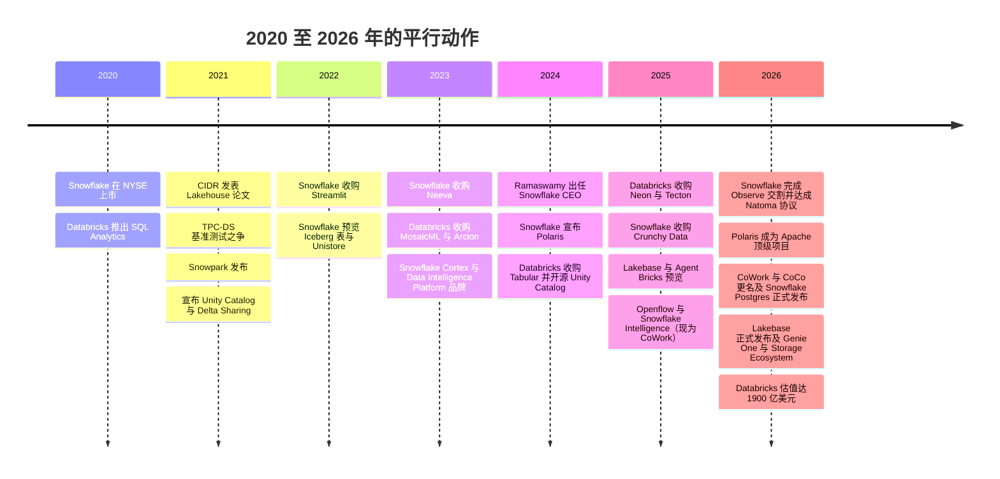
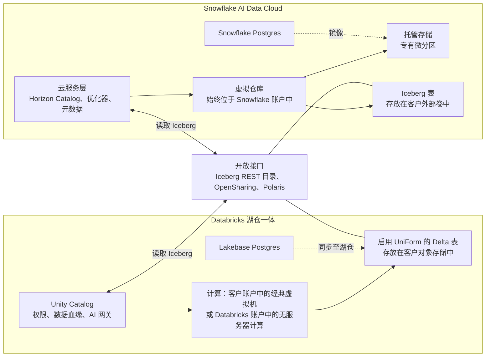
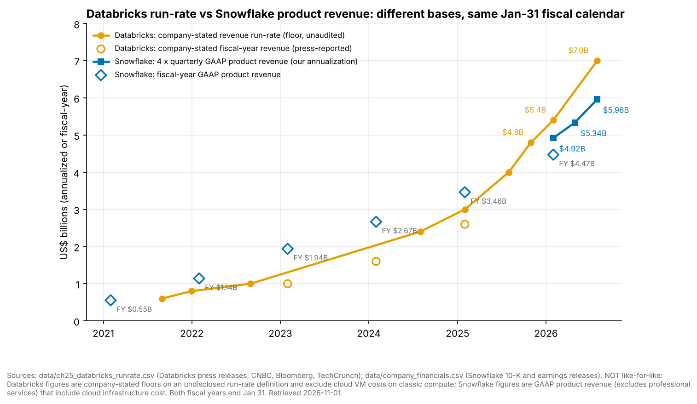
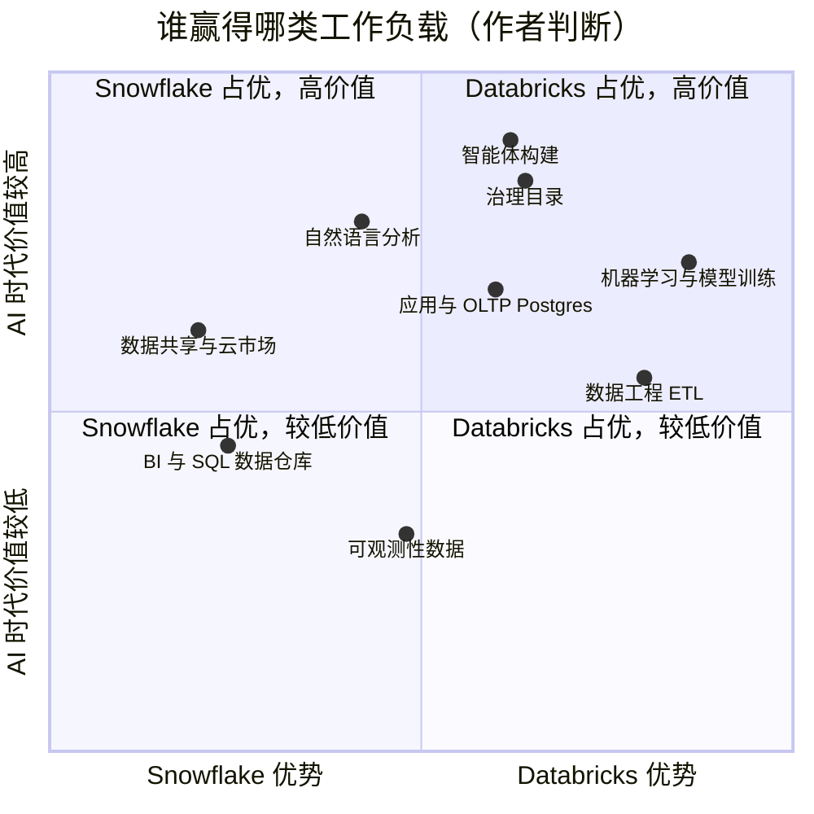

# 27. Databricks 对比 Snowflake：正面交锋
> **状态：** Databricks 为私营公司 · Snowflake 为上市公司（NYSE: SNOW） · **总部：** San Francisco, CA（Databricks）/ 据 SEC 文件为 Bozeman, MT（Snowflake） · **成立：** 2013 / 2012 · **最新估值/市值：** Databricks 投后估值 $190B（1900 亿美元）（公司披露，2026-08-13）；Snowflake 市值 $107.88B，企业价值 $106.31B（2026-10-30） · **最后核实：** 2026-11-01

## 要点速览（TL;DR）

- **起点不同，终点相同。** Databricks 起家于面向数据工程师的托管 Spark，随后"向上"拓展至 SQL 数据仓库。Snowflake 起家于面向分析师的托管 SQL 数据仓库，随后"向外"拓展至工程、机器学习和应用。到 2026 年，两家的产品版图几乎完全相同：开放表格式（open table format）支持、数据治理目录、无服务器计算、Postgres 数据库以及智能体（agent）层。二者仍有差别的地方在于**数据默认存放在哪里**以及**谁掌握元数据**。Databricks 默认使用客户存储桶中的开放 Delta/Iceberg 文件。Snowflake 默认使用自有的托管存储，如今也把 Iceberg 表作为一等选项提供。[^cidr][^sigmod16]
- **规模已相近；但披露的增速不可直接比较。** Databricks 披露**年化收入运行率超过 $7B，增速超过 80%**（公司披露，未经审计，财季 Q2 为 2026 年 5–7 月）。Snowflake 同期三个月报告**产品收入 $1.49B，同比 +37%**（GAAP），年化约 $5.96B。[^db-7b][^sf-q2] 两组数字在口径（年化运行率 vs. 已确认收入）、范围以及"一美元收入"所包含的内容上都不同。在经典计算模式下，Databricks 的收入不包括客户的云虚拟机账单；Snowflake 的收入则始终包含基础设施成本。
- **计价单位不同，标价正在趋同。** Databricks 销售按工作负载 SKU 定价的 **DBU**。Snowflake 销售按版本定价的 **credit（积分）**。在我们的示意性标价示例中，两个平台上最小的无服务器 SQL 单元每小时成本均约为 **$3**。真正的成本差异来自运行时长、自动挂起行为和协商折扣，而非单价。[^pricing][^sf-pricing]
- **估值差距。** Databricks 的 $190B 估值约为**年化运行率的 27 倍**。Snowflake 的 **EV/未来 12 个月收入为 16.9 倍**（2026-10-30）。经增速调整后，Databricks 反而*更便宜*（每个百分点增速约 0.34 倍，对比约 0.48 倍），但这仅基于其自身未经审计的运行率和增速数据。分子也不同：由优先股定价的私营投后*股权*估值，与上市公司的*企业价值*不是同一个对象，而公司自定义的年化运行率也不是 GAAP 收入。[^comps-sf][^db-7b]
- **Everpure 视角。** Everpure 是 **Databricks Storage Ecosystem 的指定首发合作伙伴**（2026-06-10），其 OpenSharing 连接器处于私有预览阶段。在本次研究中，我们未发现 Snowflake 有对等的*计划*。Snowflake 通过其 S3 兼容存储支持来访问本地对象存储。其文档曾将 Pure Storage 列为 S3 兼容供应商之一，但 Snowflake 表示其本身不测试或验证第三方产品，并且现在要求供应商提供"经测试且合规"的服务 [VERIFY: FlashBlade 在这一新表述下的状态]；两家公司于 2022 年 5 月宣布了联合本地部署方案。[^pure-sf] 双平台、格式中立的定位是显而易见值得评估的选项。[^storage-eco][^everpure-os][^sf-s3compat]

## 概览表

| 项目 | Databricks | Snowflake | 口径 / 来源 |
|---|---|---|---|
| 所有权 | 私营；无 GAAP 财报 | 2020 年 9 月起上市（NYSE: SNOW） | 公开记录[^funding][^sf-10k] |
| 创始人 | 七位 UC Berkeley AMPLab 研究人员，包括 Ali Ghodsi、Matei Zaharia、Ion Stoica | Benoit Dageville、Thierry Cruanes、Marcin Żukowski（前 Oracle / Vectorwise） | 公开记录[^sigmod16] |
| CEO | Ali Ghodsi（2016 年起） | Sridhar Ramaswamy（2024 年 2 月起） | 公开记录[^ceo-sf] |
| 财年 | 截至 1 月 31 日 | 截至 1 月 31 日（FY2027 = 2026 年 2 月–2027 年 1 月） | 公司披露[^db-7b][^sf-q2] |
| 最新规模 | 年化收入运行率 **>$7B**（Q2，2026 年 5–7 月） | 总收入 **$1,546.8M**，产品收入 **$1.49B**（Q2 FY2027，2026 年 5–7 月） | 公司披露的年化运行率 / GAAP[^db-7b][^sf-q2] |
| 增速 | 同比 **>80%**（运行率） | 总收入 **+35%**，产品收入 **+37%**（同比） | 公司披露 / GAAP[^db-7b][^sf-q2] |
| 全年指标 | 收入约 $2.6B（截至 2025 年 1 月的财年） | 产品收入 $4,472.3M，总收入 $4,683.9M（FY2026 = 2025 年 2 月–2026 年 1 月） | 媒体报道 / GAAP[^cnbc-25][^sf-10k] |
| 前瞻指引 | 未发布 | FY2027 产品收入 **$6.07B**（+36%） | 公司指引[^sf-q2] |
| 净收入留存率 | >140%（定义未披露） | 126%（过去 12 个月产品收入） | 公司披露的 KPI[^db-54][^sf-q2] |
| $1M+ 客户 | 年化运行率 >$1M 的客户超过 800 家（2026 年 1 月） | 过去 12 个月产品收入 >$1M 的客户 828 家（2026 年 7 月） | 公司披露的 KPI[^db-54][^sf-q2] |
| 毛利率 | 非 GAAP 订阅毛利率 >80%（2024 年 10 月季度） | 非 GAAP 产品毛利率 74.7%；GAAP 70.9%（Q2 FY2027） | 非 GAAP / GAAP[^db-j][^sf-q2] |
| 盈利能力 | 过去 12 个月调整后自由现金流为正（未披露金额；公司披露，非 GAAP） | GAAP 营业利润率 −17.0%，非 GAAP +15.3%（Q2 FY2027）；FY2026 非 GAAP 自由现金流利润率 25.5% | 公司披露 / GAAP / 非 GAAP[^db-54][^sf-q2][^sf-fin] |
| 价值 | 投后估值 $190B（2026-08-13） | 市值 $107.88B；企业价值 $106.31B（2026-10-30） | 公司披露 / 市场数据[^db-7b][^comps-sf] |
| 已披露或报道的并购支出（有金额交易之和） | 约 $4.4B（MosaicML、Tabular、Neon、Arcion） | 按申报数据约 $1.86B（Streamlit、Neeva、Crunchy Data、Observe、Natoma）；若采用约 $250M（Crunchy）和约 $1B（Observe）的媒体报道数字则约 $2.35B | 我们对 `data/ma_deals.csv` 的加总。口径不同：Databricks 的 Tabular 和 Neon 金额为媒体报道；Snowflake 的 Crunchy、Observe、Neeva 和 Natoma 为 10-Q/10-K 中的购买对价（Observe 为初步数字）[^ma] |

*图 27.1 — 概览。各行口径不同：Databricks 的数字为公司披露且未经审计，Snowflake 的数字为 GAAP 或已定义的 KPI。两家的财年恰好对齐（均截至 1 月 31 日），因此"Q2"对两家而言都是 2026 年 5–7 月这同一季度。*

## 正面交锋一览

| # | 维度 | Databricks | Snowflake | 优势方（作者判断） |
|---|---|---|---|---|
| 1 | 起源与核心买家 | 面向数据工程师和数据科学家的 Spark | 面向分析师和财务的 SQL 数据仓库 | 门不同，楼相同 |
| 2 | 奠基论文 | Lakehouse，CIDR 2021 | Elastic Data Warehouse，SIGMOD 2016 | 不适用 |
| 3 | 默认存储 | 存放在**客户**对象存储中的 Delta 表（Parquet + 日志） | **Snowflake 托管**存储（专有微分区） | 开放性上 Databricks 占优；简洁性上 Snowflake 占优 |
| 4 | 开放格式立场 | Delta + UniForm 写入 Iceberg 元数据；收购 Tabular（2024） | 客户"外部卷"中的 Iceberg 表；Iceberg v3 正式发布（2026 年 5 月，二手来源） | 已趋同 |
| 5 | 目录 | Unity Catalog（2024 年开源；Linux Foundation） | Horizon Catalog（内部）；捐赠 Apache Polaris（ASF 顶级项目，2026） | Databricks（受治理资产的广度） |
| 6 | 计算运行位置 | 客户账户中的经典虚拟机，或 Databricks 账户中的无服务器计算 | 始终在 Snowflake 账户中（虚拟仓库） | 正向无服务器趋同 |
| 7 | 计价单位 | DBU，按 SKU 定价（Jobs、All-Purpose、SQL、无服务器） | Credit，按版本定价（Standard / Enterprise / Business Critical） | Snowflake 更易预测 |
| 8 | SQL / BI | Databricks SQL、Photon；年化运行率 >$1.5B | 核心业务；Gen2 和 Adaptive 仓库 | Snowflake |
| 9 | 数据工程 / 数据摄取 | Spark、Lakeflow（Connect、Spark Declarative Pipelines、Jobs） | Snowpark、Dynamic Tables、Openflow（2025 年 5 月正式发布；第二代运行时 2026 年 9 月正式发布） | Databricks |
| 10 | 机器学习 / 模型训练 | Mosaic AI、GPU、笔记本 | Snowpark ML、Cortex Training（2026） | Databricks |
| 11 | 面向业务用户的 AI | Genie One（智能体式协作助手） | Snowflake CoWork（原 Snowflake Intelligence） | 胶着 |
| 12 | 开发者 AI / 智能体 | Agent Bricks、Unity AI Gateway、Omnigent | Cortex Agents、CoCo（原 Cortex Code）、Natoma（MCP 网关） | 胶着；面向构建者 Databricks 更深入 |
| 13 | 运营型数据库 | Lakebase（Neon），2026 年正式发布，年化运行率 >$100M | Snowflake Postgres（Crunchy Data），2026 年 6 月正式发布 | Databricks（更早，可量化） |
| 14 | 数据共享 / 云市场 | Delta Sharing → OpenSharing（Linux Foundation）；Marketplace；Clean Rooms | Secure Data Sharing、Marketplace、Data Clean Rooms（Samooha） | Snowflake（网络成熟度） |
| 15 | 可观测性 / 安全数据 | Lakewatch SIEM；Panther | Observe（2026 年 2 月完成交割） | 为时尚早 |
| 16 | 超大规模云渠道 | Azure Databricks 是 Microsoft 第一方服务 | 在 AWS、Azure、Google Cloud 上通过云市场联合销售 | Databricks（Azure） |
| 17 | 本地部署 / 存储合作伙伴 | 基于 OpenSharing 的 Storage Ecosystem（2026 年 6 月；Everpure 为首发合作伙伴） | S3 兼容的外部 stage/表；供应商自报名单（列有 Pure Storage；Snowflake 不做验证） | Databricks（正式计划） |
| 18 | 信息披露质量 | 公司披露的下限值；无审计 | SEC 文件、业绩指引 | Snowflake |
| 19 | 并购支付货币 | 估值持续上升的私营股票 | 上市股票与现金 | Databricks |

*图 27.2 — SV-13：多维度对比。在大多数产品维度上，诚实的答案是"已趋同"。真正的差异在于默认数据位置、目录广度、披露质量和收购支付货币。来源：第 25 章和第 26 章的资料来源，以及本章脚注。[^dais26][^summit26][^polaris][^iceberg-v3]*

## 起源与战略演进

**Snowflake 率先构建了一体化数据仓库。** 其 SIGMOD 2016 论文描述了一种存算分离（separation of storage and compute）的设计。数据以由不可变微分区组成的专有列式格式存放在云服务商的对象存储（object storage）中。独立的计算"虚拟仓库"负责读取，云服务层负责处理元数据、优化、安全和事务。[^sigmod16] 客户从不接触集群。他们只需调整仓库规格、按秒付费，几乎无需运维。这种简洁性加上跨账户数据共享，使 Snowflake 成为同时代增长最快的企业软件公司之一。公司于 2020 年 9 月上市。[^sf-10k]

**Databricks 以开放理念回应。** CIDR 2021 的 Lakehouse 论文认为，在数据湖（data lake）旁边再放一个专有数据仓库（data warehouse）是代价高昂的双副本设计。论文提出，客户存储桶中的开放 Parquet 文件，加上事务日志、缓存和向量化引擎，可以在单一副本上达到数据仓库级别的性能。[^cidr] 2021 年 11 月，双方的竞争因一场 TPC-DS 基准测试之争而公开化。Databricks 宣称创造了官方纪录，Snowflake 的创始人则以一篇关于"诚信竞争"的博客回应 [VERIFY: 两篇博客的 URL；基于 2025 年前的知识，本次未重新打开]。[^tpcds]

**此后双方互相借鉴对方的长处。** Snowflake 增加了 Snowpark（在数据仓库内运行 Python 和 Java 代码），收购了 Streamlit（2022）用于应用、Neeva（2023）用于获取 AI 人才、Datavolo（2024）用于数据摄取。它还拥抱 Iceberg，并捐赠了 Polaris 目录。Databricks 构建了 Databricks SQL 和 Photon 以争夺 BI，开源了 Unity Catalog，并收购 Tabular 以化解格式之争。[^ma][^tabular][^uc-oss] 从 2025 年起，竞赛转向 Postgres 和智能体：先是相隔一个月的 Neon 与 Crunchy Data 收购，然后是 Lakebase 对 Snowflake Postgres，以及 Genie One 对 CoWork。[^neon][^ma][^summit26][^dais26]

*图 27.3 — 平行动作。一方几乎每一次发布，另一方都会在 12 个月内推出对应产品。这些配对包括 Polaris 与 Unity Catalog 开源（2024）、Crunchy 与 Neon（2025），以及 CoWork 与 Genie One（2026）。来源：`data/ma_deals.csv`；第 25 章；Summit 和 DAIS 回顾。[^ma][^summit26][^dais26][^polaris]*

> **类比：x86 对比 Arm，以及 Intel 对比 AMD。** Snowflake 起步时像一家垂直整合制造商（IDM）：它拥有格式、引擎和服务，销售高利润、客户选择余地小的成品。Databricks 起步时更接近 Arm 模式。它培育开放标准（Spark、Delta、Unity Catalog OSS），让生态系统围绕这些标准发展，再通过最佳实现来变现。一旦双方都支持 **Iceberg**，局面就更像 Intel 对 AMD 共享 x86 指令集。兼容性使切换变得可以想象，于是竞争转向微架构（每 credit 或每 DBU 的性价比）以及核心周边的平台（目录，就像芯片组及其软件生态锁定 CPU 插槽一样）。共享指令集并不会终结锁定；它只是转移了锁定。

## 产品与技术

### 架构并排对比

*图 27.4 — 架构并排对比。两者都实现了存算分离，并由目录/元数据服务统一管理。区别在于默认设置：除非另行指定，Databricks 的表存放在客户的存储桶中；而除非客户选择 Iceberg，Snowflake 的表存放在托管存储中。中间的开放接口正是两者如今交汇之处。[^arch-docs][^sigmod16][^uc-dais26]*

**存储与格式。** Databricks 写入 Delta 表，而 **UniForm** 在同一次提交中生成 Iceberg 元数据，因此同一张物理表可同时服务两个生态系统。[^cidr] Snowflake 的原生表使用其自有的微分区格式，并对其进行端到端控制。这正是其优化器、缓存和数据治理功能一直如此紧密集成的原因之一。Snowflake **Iceberg 表**将 Parquet 数据和 Iceberg 元数据保存在客户自己的存储中（一个"外部卷"）。Snowflake 可以作为目录来管理这些表，也可以从外部目录读取它们。[^iceberg-v3] 这种趋同是真实的，但并不对称。对 Databricks 而言，开放是默认设置；对 Snowflake 而言，开放只是一个选项。Snowflake 的大部分存量客户数据仍在托管存储中。

**目录：真正的主战场。** Unity Catalog 治理表、文件、机器学习模型、函数，并自 2026 年起通过 Unity AI Gateway 治理模型和智能体流量。其开源版本支持 Iceberg REST 协议。[^uc-dais26] Snowflake 分两层应对。**Horizon Catalog** 是 Snowflake 内部的数据治理层。**Apache Polaris** 是 Snowflake 于 2024 年捐赠的开放 Iceberg REST 目录；它于 2026 年初成为 Apache 顶级项目（ASF 于 2026-03-05 宣布）。[^polaris] 战术上的区别在于：Databricks 把其*主*目录开源了，而 Snowflake 开源的是*第二个*目录，并保留 Horizon 为专有 [VERIFY: Horizon 目前与 Iceberg REST 的互操作程度]。

**AI 战略。** 两家公司讲的是同一个故事：智能体需要受治理的数据、语义和权限，而已经掌握这些的平台应当承载智能体。Databricks 以构建者为先。它提供用于模型服务和微调（fine-tuning）的 Mosaic AI、用于构建和评估智能体的 **Agent Bricks**、面向业务用户的 **Genie One**，以及作为智能体写入目标的事务型存储 **Lakebase**。截至 2026 年 1 月，其 AI 产品的年化运行率已超过 $1.4B（公司披露）。[^db-54][^dais26] Snowflake 以业务用户和 SQL 为先。它提供 SQL 内的 **Cortex** AI 函数、**Cortex Agents**、**Snowflake CoWork**（2026 年 6 月由 Snowflake Intelligence 更名）、面向开发者的 **CoCo**（原 Cortex Code）、用于微调开放权重模型的 **Cortex Training**，以及 **Snowflake Postgres**（2026 年 6 月正式发布）。[^summit26] Snowflake 将 FY2027 非 GAAP 产品毛利率指引下调至 74%，理由是 AI 工作负载占比的变化。AI 需求在两家公司的损益表上都带来了 GPU 成本。[^sf-fin]

## 盈利模式

两家公司都采用**按用量计费（consumption pricing）**：客户签订多年期承诺消费额度（committed spend）合同，并在使用计算资源时逐步消耗额度。收入按消耗确认，而非在签约时确认。但两者的计价单位不同，每个单位所包含的内容也不同。

| 特征 | Databricks DBU | Snowflake credit |
|---|---|---|
| 计量对象 | 每小时处理能力，按实例类型或仓库规格缩放 | 仓库规格 × 时间（XS = 1 credit/小时，每升一级翻倍） [VERIFY] |
| 决定单位价格的因素 | 工作负载 SKU：Jobs（最便宜）、All-Purpose、SQL、各类无服务器变体；再加上云平台和层级 | 版本：Standard、Enterprise、Business Critical；再加上云平台和区域 |
| 代表性美国标价 | Jobs（经典）约 $0.15/DBU；All-Purpose 约 $0.55；Serverless SQL 约 $0.70（AWS，2026 年第三方汇编） | Standard / Enterprise / Business Critical 每 credit $2 / $3 / $4，AWS US East 按需 [VERIFY: 2025 年前的标价] |
| 是否包含云基础设施？ | 经典模式：**不包含**（客户单独支付虚拟机账单）。无服务器：包含 | **始终包含** |
| 存储 | 客户直接向云服务商支付对象存储费用 | 由 Snowflake 按 TB-月计费（类似转付），或客户直接为 Iceberg 存储付费 |
| 折扣 | 承诺消费额度合同；超大规模云市场额度抵扣 | 容量合同；云市场额度抵扣 |
| 效率杠杆 | Photon（DBU 费率更高、小时数更少）、无服务器预热池 | Gen2 和 Adaptive 仓库、自动挂起、查询加速 |

*图 27.5 — 计价单位对比。来源：Databricks 定价汇编（第 25 章）；Snowflake 定价页面和 credit 消耗表 [VERIFY: 本次未重新打开标价来源]。[^pricing][^sf-pricing][^dbsql-sizes]*

> **类比：以不同单位计费的两套特许权使用费表。** 设想两家 IP 授权商。一家按裸片（die）收费，另一家按晶圆收费，并且各自既设定单位价格，*又*决定一颗给定芯片会消耗多少单位。拿"每 DBU $0.70"与"每 credit $3"作比较，就像在不知道裸片尺寸的情况下，比较每裸片 $0.70 的使用费和每晶圆 $3 的使用费。唯一有意义的数字是**每个完成的工作负载的成本**，它只能通过基准测试或在你自己的查询上做概念验证来获得。供应商还同时掌控这两个杠杆。当它推出更快的引擎时，可以保持单价不变，让客户账单下降（它希望由需求弹性抵消这种通缩），也可以对更快的层级按每小时收取更多单位。

### 实例演算：按标价为两个工作负载定价（仅作示意）

以下数字采用 AWS US East 的标价，来源及日期见上文脚注。它们忽略了协商折扣（大客户的折扣通常相当可观），并对规格做了一些**假设**，真实的概念验证会替代这些假设。请将其视为对机制的示意，而非价格比较。

**工作负载 A：夜间 ETL，每次 2 小时，每月 30 晚。**

- *Snowflake（Enterprise 版）：* 一个 Medium 仓库每小时消耗 4 credit。2 小时 × 4 credit × $3 = **每晚 $24**，约**每月 $720**，含基础设施。[^sf-pricing]
- *Databricks 经典 Jobs 计算：* 假设一个集群每小时消耗 18 DBU（一个驱动节点加八个工作节点，每个约 2 DBU；此为我们的假设）。36 DBU × $0.15 = **每晚 $5.40** 的 Databricks 费用。再加上 EC2 账单，假设九个实例每实例小时 $0.50（假设值，非报价）：9 × $0.50 × 2 = **$9.00**。合计约**每晚 $14.40**，即**每月 $432**，其中只有约 38% 是 Databricks 的收入。[^pricing]

**工作负载 B：营业时间内使用的 BI 仪表盘，每天 10 小时，每月 22 天。**

- *Snowflake：* 一个 Small 仓库每小时 2 credit × $3 = 每小时 $6。10 小时 = **每天 $60**，约**每月 $1,320**，尚未计入高峰时段的多集群横向扩展。
- *Databricks Serverless SQL：* 一个 Small 仓库每小时消耗 12 DBU [VERIFY] × $0.70 = 每小时 $8.40。10 小时 = **每天 $84**，约**每月 $1,848**，含基础设施。[^dbsql-sizes]

| 最小无服务器 SQL 单元（标价） | 每小时单位数 | 单位价格 | 每小时成本 |
|---|---|---|---|
| Snowflake X-Small，Enterprise 版 | 1 credit | $3.00 | **$3.00** |
| Databricks Serverless SQL 2X-Small | 4 DBU [VERIFY] | 约 $0.70 | **约 $2.80** |

*图 27.6 — 入门级无服务器 SQL 在两个平台上的每小时标价大致相同。一个规格阶梯上的"Small"与另一个阶梯上的"Small"所代表的计算量并不相同，因此工作负载 B 比较的是标签，而非实际工作量。*

**这个例子说明了什么。** 第一，经典 Databricks 模式在定时批处理上看起来便宜，部分原因是大部分账单流向了 AWS，而非 Databricks。这既是价格问题，也同样是收入核算问题。第二，一旦两者都采用无服务器，每小时标价就会趋同。届时账单取决于仓库保持唤醒的时长（自动挂起和自动停止设置）、每小时完成的工作量（引擎效率）以及折扣。第三，转向无服务器会使 Databricks 每个工作负载的收入*上升*，即使客户的总支出并未增加，这一点对下文的增速比较很重要。

## 财务数据

*图 27.7 — Databricks 披露的年化运行率在 2025 年前后超过了 Snowflake 的年化产品收入，但两条线的口径不同，不应解读为市场份额。来源：`data/ch25_databricks_runrate.csv`；`data/company_financials.csv`。[^db-7b][^sf-fin]*

### 为什么">80%"与"+37%"不可比较

表面差距（>80% 对 37%）混合了四种效应。它并不表明 Databricks 的增长速度是对方的两倍。

1. **年化运行率 vs. 已确认收入。** Databricks 的数字是一个年化快照（"超过 $7B"），计算方法未披露（例如上季度 × 4 或期末月份 × 12），且该数字是下限值。Snowflake 的 $1.49B 是当季确认的 GAAP 收入。将 Snowflake 的季度数据年化，产品收入约为 $5.96B，总收入约为 $6.19B（$1,546.8M × 4）。[^sf-q2] 这是最接近同口径的构造方式，但仍是我们的计算，而非公司的数字。
2. **一美元收入包含什么。** Snowflake 的收入始终包含其运行所需的云基础设施。Databricks 在经典计算模式下的收入则不包含，因为客户直接向 AWS、Azure 或 Google 付费。随着客户转向无服务器，同一工作负载会产生*更多*的 Databricks 收入。因此，Databricks 的部分增长来自核算单位的变化，而非新增需求。Databricks 未披露其无服务器占比，因此这一效应无法量化 [VERIFY: 无服务器在 DBU 中的占比]。
3. **范围。** Snowflake 的产品收入不包括专业服务；其总收入则包括。Databricks 未说明其年化运行率是否包括服务或培训。
4. **非内生增长与新业务线。** Lakebase（>$100M）和 AI 产品（>$1.4B，2026 年 1 月）计入 Databricks 的总数。Snowflake 的 Observe 交易（2026 年 2 月完成交割）从 Q1 FY2027 起计入其数据。[^db-7b][^db-54][^ma]

即使做了这些调整，**Databricks 的增长仍很可能更快**。其披露数据的内部算术是自洽的（>$7B 上的 >80% 意味着一年前的基数 ≤ 约 $3.9B，而当时披露的是">$4B"），且仅其数据仓库业务线就在三个季度内从 >$1B 增长到 >$1.5B。[^db-48][^constellation] 更值得关注的事实是**两者都在加速**。Snowflake 的产品收入增速从 30%（Q4 FY2026）升至 34%（Q1 FY2027），再升至 37%（Q2 FY2027）。这是 AI 时代的水涨船高同时抬升了两者，而非一方从另一方手中夺取份额。[^sf-fin]

### 估值差距：私营估值 vs. 上市公司企业价值

| 指标 | Databricks | Snowflake | 备注 |
|---|---|---|---|
| 价值 | 投后股权估值 $190B（2026-08-13） | 企业价值 $106.31B（市值 $107.88B），2026-10-30 | 不同的对象（见正文） |
| 收入口径 | 年化运行率 >$7B（公司披露） | 未来 12 个月 $6.30B（基于指引的估算）；Q2 总收入 × 4 = $6.19B | |
| 倍数 | 年化运行率的**约 27 倍**；未来 12 个月收入约 22 倍（我们的估算，第 25 章） | EV/未来 12 个月收入 **16.9 倍**；EV/年化运行率约 17.2 倍 | |
| 采用的增速 | >80% | 35%（总收入，GAAP） | |
| 增速调整后（倍数 ÷ 增速） | **约 0.34 倍** | **约 0.48 倍** | 粗略；未考虑利润率与持续性 |
| 以 Databricks 的 27 倍为 Snowflake 估值 | 不适用 | 约 $168B（27.1 × $6.19B） | 示意 |
| 以 Snowflake 约 17 倍年化运行率为 Databricks 估值 | 约 $120B | 不适用 | 示意 |
| 以 Snowflake 增速调整后的 0.48 倍为 Databricks 估值 | 约 38 倍 → 约 $269B | 不适用 | 示意 |

*图 27.8 — 同一家公司，三个答案。取决于锚定绝对倍数还是增速调整后倍数，Snowflake 的公开市场定价意味着 Databricks 的价值介于约 $120B 至约 $270B 之间。来源：`data/public_comps.csv`；Databricks 新闻稿；我们的计算。[^comps-sf][^db-7b]*

> **类比：私募轮次估值 vs. 上市公司企业价值。** 上市公司的**企业价值（EV）**是市值加债务减现金，由流动性普通股的边际买家每日定价。私营公司的**投后估值（post-money）**是*最近一轮优先股*的每股价格乘以全部完全稀释股数。优先股通常带有**清算优先权**（出售时优先获得偿付），有时还附带其他保护条款。因此，这一标题数字高估了普通股的价值。Databricks 未披露其优先权条款。它没有每日交易的市场，持有人无法自由出售（适用流动性折价，从业者常以 10–30% 作为估算），而且该估值比 Snowflake 的股价早两个半月。债务也未被扣除：Databricks 自 2025 年 1 月起有一笔定期贷款和循环信贷额度，自 2026 年 2 月起又增加了额度。[^funding] 另一方面，Databricks 的增速高得多，增速调整后的比率对其有利。PitchBook 的分析（经 Morningstar 转载）认为 Databricks 的经营价值要低得多，约为 $68.7B。这表明合理区间有多宽。[^ms]

**CFA 会得出什么结论。** 约 27 倍与约 17 倍之间的差距，经增速调整后比表面上窄，经结构和披露调整后又比表面上宽。Snowflake 因增速较慢、股权激励费用（SBC）高企（FY2026 为 $1,599.5M，约占收入的 34%）以及 GAAP 经营亏损（FY2026 GAAP 营业利润率 −30.6%）而折价交易。Databricks 因增长而享有溢价，而其自身的 SBC 和 GAAP 亏损根本不可见。[^sf-fin] 未来 Databricks 的 S-1 才是把两种口径合二为一的事件。

## 客户与市场进入

**大多数大型企业两者都在用。** 两家的大客户群体如今规模相当：年化运行率 >$1M 的 Databricks 客户超过 800 家（2026 年 1 月），过去 12 个月产品收入超过 $1M 的 Snowflake 客户 828 家（2026 年 7 月）。[^db-54][^sf-q2] Databricks 称其服务超过 60% 的财富 500 强企业。[^cust] 本次我们未能获取直接衡量重叠程度的一手调查 [VERIFY: 关于同时使用两者的企业占比的分析师或调查数据，例如 ETR 或 Gartner Peer Insights]。不过，典型模式很容易描述。数据工程和机器学习团队落地在 Databricks 上，财务和 BI 团队落地在 Snowflake 上。两者通过数据管道（pipeline）、Delta Sharing/OpenSharing，或越来越多地通过共享 Iceberg 表连接起来。随后每家供应商的一线团队都会努力把对方的工作负载迁移过来。Databricks 免费提供迁移工具（Lakebridge，源自 BladeBridge），以将数据仓库工作负载拉到 Databricks SQL 上。[^bladebridge]

**市场进入（GTM）差异。** Databricks 通过 Azure Databricks 拥有更强的超大规模云渠道，该服务由 Microsoft 作为第一方服务销售和计费。这一渠道同时伴随着作为捆绑竞争者的 Microsoft Fabric。Snowflake 依靠在三大云上的云市场联合销售，立场更中立，但没有同等的第一方地位。Snowflake 的 **Marketplace 和数据共享网络**是两者中历史更久、密度更高的。数据提供方发布一次，消费方即可就地查询，因此每个新参与者都会提升其他参与者的价值。Databricks 的回应是把共享做成一种*开放协议*（OpenSharing，现归属 Linux Foundation），而不是某个平台内部的网络。[^opensharing]

## 并购与投资

| 主题 | Databricks | Snowflake | 解读 |
|---|---|---|---|
| AI 人才与模型 | MosaicML，$1.3B（2023） | Neeva，$185.4M（2023）；Applica（2022）；TruEra（2024） | Databricks 收购了训练平台；Snowflake 收购了搜索人才，其 CEO 正是随 Neeva 加入 |
| 开放格式与目录 | Tabular，约 $2B，媒体报道（2024） | 自建并捐赠 Polaris（2024）；为 Horizon 收购 Select Star（2025） | Databricks 买下了 Iceberg 的创始人；Snowflake 选择开源而非收购 |
| Postgres / OLTP | Neon，约 $1B，媒体报道（2025）；Mooncake（2025）；Electric（2026，已宣布） | Crunchy Data，据 10-Q 购买会计处理为 $164.5M（媒体报道约 $250M）（2025） | 同一逻辑，相隔一个月；以 Snowflake 的申报数字计，Databricks 付出约 6 倍，以媒体报道数字计约 4 倍（Neon 金额本身为媒体报道） |
| 数据摄取 / CDC | Arcion，约 $100M（2023） | Datavolo（2024），现为 Openflow | 势均力敌 |
| 智能体治理 | 自建 Unity AI Gateway | Natoma，披露约 $110M（2026，已宣布） | 收购 vs. 自建 |
| 可观测性 / 安全 | Antimatter、SiftD.ai（2026）；Panther（2026） | Observe，据 10-K 初步对价 $596.2M（媒体报道约 $1B；2026-02-02 完成交割） | 双方都在进军机器数据 |
| 应用与前端 | Row Zero（2026） | Streamlit，$800M（2022）；Numeracy（2019） | Snowflake 更早 |
| 迁移 | BladeBridge（2025） | — | Databricks 补贴客户切换 |
| 数据洁净室 | — | Samooha（2023） | Snowflake 的共享护城河 |

*图 27.9 — 并购对比。Databricks 花费更多，收购的是平台支柱（MosaicML、Tabular、Neon）。Snowflake 收购的是更便宜的能力，并在 Databricks 动用支票簿的地方选择开源（Polaris）。金额：Snowflake 为 SEC 文件披露；Tabular 和 Neon 为媒体报道。来源：`data/ma_deals.csv`。[^ma][^tabular][^neon]*

战略上的差别在于**支付货币**。Databricks 主要以私营股票支付，而其估值在 20 个月内涨了两倍，因此每笔交易造成的稀释在比例上都低于表面所见。Snowflake 以上市股票和现金支付，其倍数自 2021 年以来已经压缩，且稀释情况受到每季度的审视。这有助于解释为何 Snowflake 自 Streamlit 以来最大的几笔交易金额是数亿美元，而非数十亿美元。

## 竞争地位

*图 27.10 — 工作负载定位（作者判断，非实测数据）。Databricks 占据以构建者为主的工作负载。Snowflake 占据 SQL 和共享网络。AI 时代价值最高的工作负载（智能体、目录、自然语言分析）位于中间附近，那里正是争夺所在。*

| 工作负载 | 当前可能的赢家 | 原因 | 什么会扭转局面 |
|---|---|---|---|
| 大规模数据工程 / ETL | **Databricks** | Spark 传承、Lakeflow、廉价的 Jobs SKU、开放文件 | Snowflake Openflow 和 Dynamic Tables 走向成熟；降价 |
| 机器学习与模型训练 | **Databricks** | Mosaic AI、笔记本、GPU 模型服务、数据科学买家 | Cortex Training 的采用；客户把微调转移到模型实验室 |
| BI / SQL 数据仓库 | **Snowflake** | 在位优势、简洁性、并发能力、财务团队的信任 | Databricks SQL（年化运行率 >$1.5B）持续赢得迁移 |
| 数据共享 / 云市场 / 数据洁净室 | **Snowflake** | 网络效应；Samooha 数据洁净室 | OpenSharing 成为跨平台默认标准 |
| 应用 / OLTP（Postgres） | **Databricks，略胜** | Lakebase 率先正式发布，年化运行率 >$100M | Snowflake Postgres 加镜像赢得以 Snowflake 为中心的企业 |
| 数据治理 / 目录 | **Databricks，略胜** | Unity Catalog 治理的资产类型更多，且已开源 | Horizon 加 Polaris 的互操作性；超大规模云厂商的目录 |
| 业务用户智能体（CoWork vs. Genie One） | **胶着** | Snowflake 占有分析师席位；Databricks 在 Unity Catalog 中掌握语义 | 谁拥有智能体所信任的语义层（semantic layer） |
| 开发者智能体 / AI 网关 | **Databricks，略胜** | Agent Bricks、AI Gateway、构建者受众 | Snowflake 内基于 Natoma 的 MCP 治理 |

*图 27.11 — 工作负载赢家表（基于公开产品信息的作者判断；参见本章及第 25 章的资料来源）。*

更广阔的竞争格局与这场对决同样重要。Microsoft Fabric、Google BigQuery 和 AWS（S3 Tables、Redshift、SageMaker）把替代品捆绑进客户已承诺的预算中。Palantir 在高管层争夺"基于企业数据的 AI"这一叙事。ClickHouse 在实时性价比上胜出。完整的竞争矩阵见[第 25 章](ch25-databricks.md)，Snowflake 的视角见[第 26 章](ch26-snowflake.md)，超大规模云厂商见[第 28 章](ch28-hyperscaler-data-platforms.md)。

## 制胜原因 / 看多逻辑

### Databricks

1. **规模化增长，且再度加速。** 增速从 $4B 年化运行率时的 >50% 升至 $7B 年化运行率时的 >80%（公司披露），各子业务线（SQL、AI、Lakebase）的规模都已足够举足轻重。[^db-4b][^db-7b]
2. **目录是 AI 的控制点（control point）。** Unity Catalog 已在治理数据、模型和智能体流量。智能体提升了掌握权限和数据血缘的系统的价值。[^uc-dais26]
3. **开放默认设置更易通过安全审查。** "你的数据留在你的存储桶里"缩短了企业销售周期，而锁定转移到了目录和数据管道上，在那里黏性更强。
4. **支付货币与节奏。** $190B 的私营股票货币为"收购而非自建"战略提供资金，上市竞争对手若不造成可见稀释便无法匹敌。

### Snowflake

1. **按 GAAP 口径加速增长。** 产品收入增速在三个季度内从 30% 升至 37%，FY2027 指引上调至 $6.07B。这是经审计的需求，而非披露的下限值。[^sf-q2][^sf-fin]
2. **简洁性与 BI 席位。** 对以 SQL 为中心的组织而言，Snowflake 仍是运维负担最低的路径。分析师席位也是业务用户智能体（CoWork）获得分发的地方。
3. **数据共享网络效应。** Marketplace 和数据洁净室构成一个网络，开放协议必须将其取代，而不仅仅是与之匹敌。
4. **估值支撑。** 在 EV/未来 12 个月收入 16.9 倍（2026-10-30）且非 GAAP 自由现金流为正（FY2026 利润率 25.5%）的情况下，Snowflake 在标题口径上的定价远低于 Databricks 约 27 倍的估值（但在增速调整口径上并非如此）。Databricks 的任何 IPO 都可能推动整个品类向上重估。[^comps-sf][^sf-fin]

## 风险 / 看空逻辑与待解问题

### Databricks

1. **未经审计的数字与满额的价格。** 在定义未披露、年化运行率约 27 倍的情况下，一份 S-1 可能重塑整体图景。PitchBook 的分析（经 Morningstar）认为其经营价值约为 $68.7B。[^ms]
2. **无服务器稀释利润率。** 将基础设施计入销售成本会把毛利率推向 Snowflake 约 75% 的水平。[^sf-q2]
3. **开放是双刃剑。** 开放目录中可被 Iceberg 读取的表，使 Snowflake、超大规模云厂商或 DuckDB 都可以争夺每一个工作负载。
4. **Microsoft 既是合作伙伴也是对手。** Fabric 被捆绑进 Databricks 借道销售的客户环境中。

### Snowflake

1. **托管存储是一条日渐收窄的护城河。** 客户在自己存储桶中创建的每一张 Iceberg 表，都是任何引擎都能读取的数据。Snowflake 最好的防御是成为开放数据上最快的引擎，而这比拥有格式要难做得多。
2. **AI 业务组合带来的利润率压力。** FY2027 产品毛利率指引因 AI 工作负载被下调至 74%，GAAP 营业利润率仍深度为负（Q2 FY2027 为 −17.0%）。[^sf-fin]
3. **SBC 与稀释。** FY2026 SBC 为 $1,599.5M（约占收入的 34%），这限制了其可用股票支付的并购规模。[^sf-fin]
4. **在构建者工作负载上处于追赶地位。** Postgres、训练和智能体均晚于 Databricks 的同类产品推出。

**待解问题。** Databricks 的年化运行率计算方法和无服务器占比是多少？Snowflake 客户把数据从托管存储迁移到 Iceberg 表的速度有多快？Horizon 是否能与外部 Iceberg REST 目录完全互操作？是否有任何一家公司会发布关于客户重叠的一手、有来源的数据？

## 与 Everpure 的相关性

> **存储桥接。** 两个平台都把对象存储视为 S3 兼容的基础层。Databricks 读取由 Unity Catalog 治理的 Delta/Iceberg 表。Snowflake 通过外部卷和外部 stage 读取 Iceberg 表或外部 stage 中的数据。两者在 SQL 上都不依赖阵列级性能特性；它们靠引擎、缓存和文件布局取胜。因此，存储供应商的筹码在于数据存放在*哪里*（本地、主权环境、靠近 GPU）以及它能贡献的元数据。S3 语义和 FlashBlade 对象性能请参阅配套的 *Everpure Tech Atlas*。

**基于公开信息，Everpure 的现状。** 在 Databricks 一侧有一个正式计划。Everpure 被列为 **Databricks Storage Ecosystem 的首发合作伙伴**（2026-06-10 宣布，同列的还有 MinIO 和 Qumulo），Everpure 的博客介绍了一款面向 FlashBlade/FlashArray 对象存储的 **OpenSharing 连接器**，**自 2026-06-09 起处于私有预览**。[^storage-eco][^everpure-os] 在 Snowflake 一侧，本次研究中我们**未发现可比的、有名称的存储合作伙伴计划**。Snowflake 通过其文档化接口支持从 **S3 兼容存储**（外部 stage 和外部表）读取数据。Snowflake 的文档曾将 Pure Storage 列为可用于外部 stage 和外部表的 S3 兼容供应商之一，同列的还有 NetApp StorageGRID、Nutanix、Scality、Wasabi，当前版本中还有 Cloudian、Cohesity、Dell、Hitachi 和 IBM Storage Ceph。Snowflake 表示其本身不测试或验证这些产品，且现在要求存储供应商提供"Snowflake S3-compatible tested and compliant"（经 Snowflake S3 兼容测试且合规）的服务 [VERIFY: FlashBlade 在这一新表述下的状态，以及 S3 兼容外部卷上的 Iceberg 表是否已正式发布]。[^sf-s3compat] Pure Storage 与 Snowflake 还于 2022 年 5 月宣布了基于 FlashBlade 的本地和托管机房联合方案。[^pure-sf] Everpure 的 Data Intelligence（基于 1touch）将 Databricks 和 Snowflake 都列为其连接器目标。这些是集成，而非合作伙伴关系。[^1touch]

**基于公开信息，战略团队可能评估的选项：**

| 选项 | 含义 | 为何可能重要 | 注意事项 |
|---|---|---|---|
| 格式中立的"双平台"定位 | FlashBlade 上的 Iceberg/Delta 表可被 Databricks（OpenSharing）和 Snowflake（S3 兼容 / Iceberg）读取 | 大多数大客户同时运行两个平台，同时服务两者的存储无需押注赢家 | Snowflake 路径取决于 S3 兼容 Iceberg 支持的成熟度 [VERIFY] |
| 推动 Databricks OpenSharing 连接器正式发布 | 一种受支持、联合营销的"从 Databricks 治理本地数据"模式 | 在约 10 家指定存储合作伙伴中取得先发优势 | 存储合作伙伴之间的切换成本低 |
| 若 Snowflake 建立同类计划，争取首发席位 | 提前布局针对本地 Iceberg 的 Polaris/Horizon 互操作工程 | 将在另一个平台上复制 Databricks 方面的成果 | 尚无公开信号表明 Snowflake 计划推出 |
| 将 Data Intelligence 标签输入两个目录 | 把分类和敏感度标签推送到 Unity Catalog 和 Horizon | 目录是控制点，贡献元数据可使 Everpure 在阵列之上保持相关性 | 两个目录都在增加原生分类功能，可能出现重叠 |
| 关注面向智能体的 Postgres 存储 | Lakebase 和 Snowflake Postgres 都会在云中将数据分层到对象存储 | 智能体创建的数据库会成倍扩大对象存储占用 | 两者均未宣布本地部署 |

*图 27.12 — Everpure 的选项（仅基于公开信息）。不对称本身就是结论：Databricks 有一个包含 Everpure 的指定存储计划，而 Snowflake 似乎尚未建立这样的计划。*

存储向上层移动的框架见[第 45 章](../06-history-and-future/ch45-storage-moving-up-the-stack.md)，目录见[第 8 章](../01-data-systems-foundations/ch08-catalogs-and-metastores.md)。

## 对话手册

**向任一公司的产品负责人或合作伙伴经理提出的三个问题**

1. "你们客户新建的表中，开放格式（客户存储中的 Iceberg/Delta）与托管存储各占多少，趋势如何？" *好的回答：* 给出方向和数字。对 Snowflake 而言，会承认托管存储仍占多数。对 Databricks 而言，会说明 UniForm 实际向其他引擎暴露了多少数据。
2. "当客户同时运行两个平台时，由哪个目录治理共享的 Iceberg 表，权限如何跨平台传递？" *好的回答：* 指明权威目录（Unity Catalog、Horizon、Polaris）、Iceberg REST 的交互方式以及限制，例如写入权限和行级策略。
3. "对于本地对象存储合作伙伴，你们认证哪些内容，是否有正式计划？" *好的回答：* Databricks 方面，给出 OpenSharing Storage Ecosystem 的具体细节。Snowflake 方面，清楚说明 S3 兼容支持的级别及任何路线图。

**向工程师或解决方案架构师提出的三个问题**

1. "请在你们的平台上为这个工作负载定价：我们每晚 2 小时的 ETL 和每天 10 小时的 BI 仪表盘。用什么规格、什么自动挂起设置，概念验证显示每个完成作业的成本是多少？" *好的回答：* 给出每个工作负载的成本，而非每单位成本。
2. "使用 Iceberg v3 删除向量时，另一平台的引擎今天能否读取你们写入的数据？" *好的回答：* 给出具体版本和功能，以及已知差距。
3. "你们的智能体（Genie One 或 CoWork）如何解析业务定义？通过语义层、目录还是提示词上下文？" *好的回答：* 一个有名称的语义对象模型及其治理方式。

**好的回答听起来是什么样的。** 它们会区分标价与每个工作负载的成本，区分年化运行率与 GAAP 收入。它们把目录而非文件格式（file format）视为战略资产，并承认对方供应商领先的地方。

**不要这样说**

- "Databricks 的增长速度是 Snowflake 的两倍。" *口径不同（年化运行率下限 vs. GAAP；不含基础设施 vs. 含基础设施）。Databricks 可能更快，但并非可量化的 2 倍。*
- "Databricks 比 Snowflake 规模更大。" *其披露的年化运行率更高，但那不是经审计的收入；最近一次披露的完整财年约为 $2.6B（截至 2025 年 1 月的财年）。*
- "Snowflake 是一个封闭系统。" *它支持客户存储中的 Iceberg 表，并捐赠了 Polaris；只是其默认设置为托管存储。*
- "一个 DBU 比一个 credit 便宜，所以 Databricks 更便宜。" *这两种单位衡量的工作量不同；应比较每个工作负载的成本。*
- "Databricks 估值 27 倍，Snowflake 17 倍，所以 Databricks 被高估了。" *经增速调整，并基于其自身未经审计的年化运行率，Databricks 更便宜；在下结论前还需就股权 vs. 企业价值、年化运行率 vs. GAAP、优先权和流动性进行调整。*
- "客户只会选一个。" *大多数大型企业两者都在用，并把它们连接起来。*

## 关键术语

- [湖仓一体（Lakehouse）](../glossary.md#lakehouse) — 在对象存储中的开放文件上实现数据仓库级的管理与性能。
- [存算分离（Separation of storage and compute）](../glossary.md#separation-of-storage-and-compute) — 独立地扩展存储与处理能力，并分别付费。
- [虚拟仓库（Virtual warehouse）](../glossary.md#virtual-warehouse) — Snowflake 可独立调整规格的计算集群。
- [微分区（Micro-partition）](../glossary.md#micro-partition) — Snowflake 托管存储中不可变的列式存储单元。
- [托管存储（Managed storage）](../glossary.md#managed-storage) — 由供应商运营并计费、采用其自有格式的存储。
- [UniForm](../glossary.md#uniform) — 同时写入 Iceberg 元数据的 Delta 功能。
- [Apache Iceberg](../glossary.md#apache-iceberg) — 两个平台如今都支持的开放表格式。
- [Iceberg REST 目录（Iceberg REST catalog）](../glossary.md#iceberg-rest-catalog) — 引擎借以查找和提交 Iceberg 表的开放 API。
- [Unity Catalog](../glossary.md#unity-catalog) — Databricks 的数据治理目录，2024 年开源。
- [Horizon Catalog](../glossary.md#horizon-catalog) — Snowflake 内置的数据治理与数据发现层。
- [Apache Polaris](../glossary.md#apache-polaris) — Snowflake 捐赠的开放 Iceberg REST 目录；自 2026 年起为 Apache 顶级项目。
- [DBU](../glossary.md#dbu) — Databricks Unit，按工作负载 SKU 定价。
- [Snowflake credit](../glossary.md#snowflake-credit) — Snowflake 的计算消耗单位，按版本定价。
- [无服务器计算（Serverless compute）](../glossary.md#serverless-compute) — 由供应商管理、全包计费的计算资源。
- [零拷贝数据共享（Zero-copy data sharing）](../glossary.md#zero-copy-data-sharing) — 在不复制数据的情况下授予另一个账户对数据的实时访问权限。
- [数据洁净室（Data clean room）](../glossary.md#data-clean-room) — 一个受治理的空间，各方可在其中分析合并数据而不暴露原始记录。
- [OpenSharing](../glossary.md#opensharing) — Linux Foundation 旗下用于共享数据与 AI 资产的协议（Delta Sharing 的继任者）。
- [Lakebase](../glossary.md#lakebase) — Databricks 基于 Neon 构建的无服务器 Postgres。
- [Snowflake Postgres](../glossary.md#snowflake-postgres) — Snowflake 基于 Crunchy Data 构建的托管 Postgres。
- [Snowflake CoWork](../glossary.md#snowflake-cowork) — Snowflake 面向业务用户的 AI 助手，2026 年由 Snowflake Intelligence 更名而来。
- [Genie](../glossary.md#genie) — Databricks 的自然语言分析智能体（自 2026 年起为 Genie One）。
- [年化收入运行率（Revenue run-rate）](../glossary.md#revenue-run-rate) — 将当期收入年化；并非经审计的收入。
- [企业价值（Enterprise value）](../glossary.md#enterprise-value) — 市值加债务减现金。
- [EV/未来 12 个月收入（EV to NTM revenue）](../glossary.md#ev-to-ntm-revenue) — 企业价值除以未来十二个月收入。
- [增速调整后倍数（Growth-adjusted multiple）](../glossary.md#growth-adjusted-multiple) — 估值倍数除以增长率。
- [投后估值（Post-money valuation）](../glossary.md#post-money-valuation) — 最近一轮每股价格乘以完全稀释股数。
- [清算优先权（Liquidation preference）](../glossary.md#liquidation-preference) — 优先股股东先于普通股股东获得偿付的权利。
- [流动性折价（Illiquidity discount）](../glossary.md#illiquidity-discount) — 无法自由出售的股份所对应的价格折让。

## 资料来源

[^db-7b]: Databricks, "Databricks Grows >80% YoY, Surpasses $7B Revenue Run-Rate, Scales Lakebase, Genie and Unity AI Gateway," https://www.databricks.com/company/newsroom/press-releases/databricks-grows-80-yoy-surpasses-7b-revenue-run-rate-scales，发布 2026-08-13；检索 2026-11-01。公司披露的年化运行率，未经审计；以 $190B 投后估值融资 $5B。
[^db-54]: Databricks via Cision/AAP, "Databricks Grows >65% YoY, Surpasses $5.4 Billion Revenue Run-Rate, Doubles Down on Lakebase and Genie," https://www.aap.com.au/aapreleases/cision20260209ae83222，发布 2026-02-09；检索 2026-11-01。公司披露（NRR >140%，>800 家客户 >$1M，AI 产品 >$1.4B，过去 12 个月自由现金流为正）。
[^db-48]: Databricks via Cision/AAP, "Databricks Grows >55% YoY, Surpasses $4.8B Revenue Run-Rate, and is Raising >$4B Series L at $134B Valuation," https://www.aap.com.au/aapreleases/cision20251216ae48422，发布 2025-12-16；检索 2026-11-01。
[^db-4b]: Databricks, "Databricks Surpasses $4B Revenue Run-Rate, Exceeding $1B AI Revenue Run-Rate," https://www.databricks.com/company/newsroom/press-releases/databricks-surpasses-4b-revenue-run-rate-exceeding-1b-ai-revenue，发布 2025-09-08；检索 2026-11-01。
[^db-j]: Databricks via Cision/AAP, "Databricks is Raising $10B Series J Investment at $62B Valuation," https://www.aap.com.au/aapreleases/cision20241217ae81438，发布 2024-12-17；检索 2026-11-01。>80% 非 GAAP 订阅毛利率的来源。
[^cnbc-25]: CNBC (syndicated by NBC San Diego), "Databricks says annualized revenue will reach $3.7 billion by next month," https://www.nbcsandiego.com/news/business/money-report/databricks-says-annualized-revenue-will-reach-3-7-billion-by-next-month/3845982/，发布 2025-06；检索 2026-11-01。媒体报道。
[^constellation]: Constellation Research, "Databricks hits $7 billion revenue run rate in Q2, $190 billion valuation," https://www.constellationr.com/insights/news/databricks-hits-7-billion-revenue-run-rate-q2-190-billion-valuation，发布 2026-08；检索 2026-11-01。数据仓库年化运行率 >$1.5B。
[^ms]: Morningstar (republishing PitchBook analysis), "Ahead of an IPO, the Math Behind Databricks' $190 Billion Valuation Doesn't Add Up," https://www.morningstar.com/stocks/ahead-an-ipo-math-behind-databricks-190-billion-valuation-doesnt-add-up，发布 2026（2026-08-13 之后）；检索 2026-11-01。估算。
[^funding]: AI Data Atlas 数据集 `data/private_funding.csv`（Databricks 相关行，含 Series J 债务融资额度及 2026 年 2 月新增债务额度），as_of 2026-11-01。
[^cust]: Databricks, "Customers," https://www.databricks.com/customers，n.d.；检索 2026-11-01。公司披露。
[^sf-q2]: Snowflake via Business Wire, "Snowflake Reports Financial Results for the Second Quarter of Fiscal 2027," https://secure.businesswire.com/news/home/20260902386235/en/Snowflake-Reports-Financial-Results-for-the-Second-Quarter-of-Fiscal-2027，发布 2026-09-02；检索 2026-11-01。GAAP 收入；非 GAAP 产品毛利率；NRR 和 $1M 客户 KPI。FY2027 = 2026 年 2 月–2027 年 1 月。
[^sf-10k]: Snowflake Inc., Q4 and full-year FY2026 earnings release (8-K exhibit), https://www.sec.gov/Archives/edgar/data/1640147/000162828026011631/fy2026q4earnings.htm，发布 2026-02-25；以及 Form 10-K filings index, https://www.sec.gov/cgi-bin/browse-edgar?action=getcompany&CIK=0001640147&type=10-K；检索 2026-11-01。GAAP；FY2026 = 2025 年 2 月–2026 年 1 月。上市年份和主要办公地址来自 SEC 文件（地址基于 2025 年前的知识）。
[^sf-fin]: AI Data Atlas 数据集 `data/company_financials.csv`，Snowflake 相关行（Q4 FY2026–Q2 FY2027 季度产品收入及增速；FY2026 SBC $1,599.5M，GAAP 营业利润率 −30.6%，非 GAAP 自由现金流利润率 25.5%；FY2027 指引，含 74% 非 GAAP 产品毛利率"lowered on AI workload mix"（因 AI 工作负载组合下调）），来源为 Snowflake SEC 文件及业绩新闻稿（2026-02-25、2026-05-27、2026-09-02）；检索 2026-11-01。
[^comps-sf]: AI Data Atlas 数据集 `data/public_comps.csv`，Snowflake 行（市值 $107.88B，企业价值 $106.31B，未来 12 个月收入 $6.30B 为基于指引的估算，EV/未来 12 个月收入 16.9 倍，增速 35%），截至 2026-10-30；底层来源 https://stockanalysis.com/stocks/snow/statistics/ 及 Q2 FY2027 新闻稿；检索 2026-11-01。
[^ceo-sf]: BIIA (reposting Snowflake announcement), "Frank Slootman Steps Down as Snowflake CEO, AI Lead Sridhar Ramaswamy Steps Up," https://www.biia.com/?p=111893，发布 2024-02；检索 2026-11-01。
[^ma]: AI Data Atlas 数据集 `data/ma_deals.csv`（Databricks 和 Snowflake 相关行；各行来源包括 Snowflake 10-Q/10-K 中的 Neeva $185.4M、Crunchy Data $164.5M、Observe $596.2M、Natoma 约 $110M；TechCrunch 报道的 Streamlit $800M），as_of 2026-11-01。Natoma 交割未经核实。
[^summit26]: Flexera, "Snowflake Summit 2026 recap: rebrands, acquisition and 25+ announcements," https://www.flexera.com/blog/perspectives/snowflake-summit-2026/，发布 2026-06；IT Brief Australia, "Snowflake renames AI tools amid broader platform push," https://itbrief.com.au/story/snowflake-renames-ai-tools-amid-broader-platform-push，发布 2026-06；检索 2026-11-01。二手回顾资料（CoWork、CoCo、Cortex Training、Openflow 正式发布、Snowflake Postgres 正式发布）。
[^polaris]: Apache Polaris blog, "Apache Polaris graduates to top-level project," https://polaris.apache.org/blog/2026/02/19/apache-polaris-graduates-to-top-level-project/，发布 2026-02-19；ASF, https://news.apache.org/foundation/entry/the-apache-software-foundation-graduates-two-open-source-projects-from-incubator，发布 2026-03-05；检索 2026-11-01。
[^iceberg-v3]: Atlan, "Apache Iceberg v3: What Snowflake Data Teams Need to Know," https://atlan.com/know/snowflake/apache-iceberg-v3/，发布 2026；检索 2026-11-01。关于 Snowflake 上 Iceberg v3 正式发布（2026-05-07）及外部卷模型的二手来源。
[^sigmod16]: Dageville et al., "The Snowflake Elastic Data Warehouse," ACM SIGMOD 2016, https://dl.acm.org/doi/10.1145/2882903.2903741，发布 2016-06；检索 2026-11-01（基于 2025 年前的知识；本次未重新打开）。
[^cidr]: Armbrust, Ghodsi, Xin, Zaharia, "Lakehouse: A New Generation of Open Platforms that Unify Data Warehousing and Advanced Analytics," CIDR 2021, https://www.cidrdb.org/cidr2021/papers/cidr2021_paper17.pdf，发布 2021-01；检索 2026-11-01。
[^tpcds]: Databricks blog, "Databricks Sets Official Data Warehousing Performance Record," https://www.databricks.com/blog/2021/11/02/databricks-sets-official-data-warehousing-performance-record.html，发布 2021-11-02；Snowflake blog, "Industry Benchmarks and Competing with Integrity," https://www.snowflake.com/blog/industry-benchmarks-and-competing-with-integrity/，发布 2021-11；检索 2026-11-01 [VERIFY: URL 基于 2025 年前的知识，未重新打开]。
[^tabular]: TechCrunch, "Databricks reportedly paid $2 billion in Tabular acquisition," https://techcrunch.com/2024/08/14/databricks-reportedly-paid-2-billion-in-tabular-acquisition，发布 2024-08-14；检索 2026-11-01。媒体报道。
[^uc-oss]: Databricks, "Open Sourcing Unity Catalog" (Data + AI Summit 2024 session deck), https://microsites.databricks.com/sites/default/files/dais/2024/D245274B_%5BFINAL%5D%20Open%20Sourcing%20Unity%20Catalog_1718322467076001AcxH.pdf，发布 2024-06；检索 2026-11-01。
[^neon]: TechRepublic, "Databricks to Acquire Neon in $1 Billion Deal," https://www.techrepublic.com/article/news-databricks-neon-acquisition/，发布 2025-05-15；检索 2026-11-01。金额为媒体报道。
[^dais26]: Flexera, "Databricks Data + AI Summit 2026 recap: Genie One, LTAP, Lakehouse RT and every major launch," https://www.flexera.com/blog/perspectives/databricks-data-ai-summit-2026-recap-genie-one-ltap-lakehouse-rt-and-every-major-launche/，发布 2026-06；检索 2026-11-01。二手回顾资料。
[^uc-dais26]: Databricks blog, "What's new with Unity Catalog at Data + AI Summit 2026," https://www.databricks.com/blog/whats-new-unity-catalog-data-ai-summit-2026，发布 2026-06；检索 2026-11-01。
[^opensharing]: Databricks, "Databricks Announces OpenSharing," https://www.databricks.com/company/newsroom/press-releases/databricks-announces-opensharing，发布 2026-06；检索 2026-11-01。
[^arch-docs]: Databricks documentation, "Databricks architecture overview," https://docs.databricks.com/aws/en/getting-started/overview，n.d.；检索 2026-11-01。
[^pricing]: CloudForecast, "Databricks Pricing Guide (2026): DBU Costs, Tiers & How to Cut Your Bill," https://www.cloudforecast.io/guides/databricks-pricing-costs-guide/，发布 2026；Espresso AI, "Databricks Pricing Explained: DBUs, SKUs, and What You Pay," https://espresso.ai/guides/databricks-pricing-explained，发布 2026；检索 2026-11-01。AWS 美国标价的第三方汇编；权威来源为 https://www.databricks.com/product/pricing。
[^dbsql-sizes]: Databricks documentation, "SQL warehouse sizing, scaling, and queuing behavior," https://docs.databricks.com/aws/en/compute/sql-warehouse/warehouse-behavior，n.d.；检索 2026-11-01 [VERIFY: 各仓库规格每小时 DBU 数（2X-Small 为 4，Small 为 12）基于 2025 年前的知识，未重新打开]。
[^sf-pricing]: Snowflake, "Pricing Options," https://www.snowflake.com/en/pricing-options/，以及 "Snowflake Service Consumption Table," https://www.snowflake.com/legal-files/CreditConsumptionTable.pdf，n.d.；检索 2026-11-01 [VERIFY: 按版本每 credit $2/$3/$4（AWS US East，按需）以及 XS/S/M/L 每小时 1/2/4/8 credit 为 2025 年前的标价，本次未重新打开]。
[^sf-s3compat]: Snowflake documentation, "Work with Amazon S3-compatible storage," https://docs.snowflake.com/en/user-guide/data-load-s3-compatible-storage，持续更新的文档；检索 2026-11-01。供应商名单（PureStorage、NetApp StorageGRID、Nutanix、Scality、Wasabi；当前版本新增 Cloudian、Cohesity、Dell、Hitachi、IBM Storage Ceph 等）为供应商自报；Snowflake 表示其不测试或验证第三方产品，且现在要求提供"Snowflake S3-compatible tested and compliant"服务，依据 `meta/verified-facts.md` #21（由整合者于 2026-11-01 实时核实）。FlashBlade 在新表述下的状态 [VERIFY]。
[^pure-sf]: Blocks & Files, "Pure gets FlashBlade up close and cloud-adjacent co-lo personal with Snowflake," https://blocksandfiles.com/2022/05/11/pure-gets-flashblade-up-close-and-cloud-adjacent-co-lo-personal-with-snowflake/，发布 2022-05-11；检索 2026-11-01（引用自第 40 章；`meta/verified-facts.md` #21）。
[^storage-eco]: Databricks blog, "Announcing the Databricks Storage Ecosystem: Governing the Enterprise Data Estate Wherever It Lives," https://www.databricks.com/blog/announcing-databricks-storage-ecosystem-governing-enterprise-data-estate-wherever-it-lives，发布 2026-06-10；检索 2026-11-01。
[^everpure-os]: Everpure blog, "Everpure OpenSharing Connector," https://blog.everpuredata.com/products/everpure-opensharing-connector/，发布 2026-06；检索 2026-11-01。供应商披露；自 2026-06-09 起私有预览。
[^1touch]: Techzine, "Stop vectorizing garbage: inside Everpure's smart AI data pipeline," https://www.techzine.eu/blogs/infrastructure/144105/stop-vectorizing-garbage-inside-everpures-smart-ai-data-pipeline/，发布 2026-06；检索 2026-11-01。
[^bladebridge]: Databricks, "Databricks Acquires BladeBridge Technology and Talent," https://www.databricks.com/company/newsroom/press-releases/databricks-acquires-bladebridge-technology-and-talent，发布 2025-02；检索 2026-11-01。
