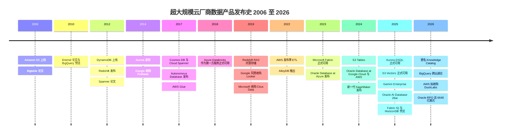
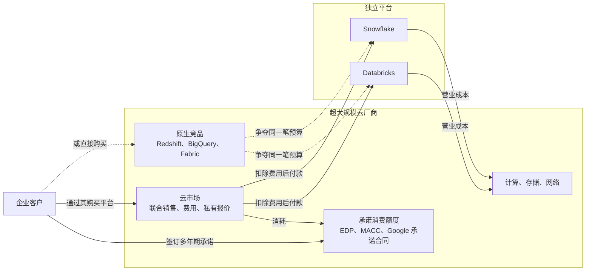

# 28. 超大规模云厂商的数据平台：AWS、Google、Microsoft 与 Oracle
> **状态：** 上市公司（四大集团）：AWS（Amazon，NASDAQ: AMZN）· Google Cloud（Alphabet，NASDAQ: GOOGL）· Microsoft（NASDAQ: MSFT）· Oracle（NYSE: ORCL）· **总部：** Seattle；Mountain View；Redmond；Austin [VERIFY: Oracle 总部迁往 Nashville 的进展] · **成立：** Amazon 1994 年（AWS 2006 年）；Google 1998 年；Microsoft 1975 年；Oracle 1977 年 · **最新市值：** ~$2.6T / ~$3.44T / ~$3.88T / ~$382B（stockanalysis.com，2026-10-23 至 2026-10-30）· **最后核实：** 2026-11-01

## 要点速览（TL;DR）

- **超大规模云厂商（hyperscaler）就是最大的数据库厂商。** 在 Gartner 的数据库市场份额排名中，AWS、Microsoft、Oracle 和 Google 位居前列；Gartner 估算该市场 **2024 年规模为 $119.7B，同比增长 13.4%**（分析师估算）。[^gartner-dbms] 四家公司都不单独披露数据库或分析业务收入。它们的数据产品归属于各自的云业务分部，而这些分部如今的增长主要由 AI 基础设施驱动。
- **最新一个季度增长明显提速，但主要来自 AI 算力而非数据产品。** Google Cloud 在 Q3 2026 增长 **103%，达到 $30.7B**（GAAP 分部收入，含 TPU 系统销售）。[^goog-q3] Azure 在 Microsoft 的 Q1 FY2027（2026 年 7–9 月）增长 **48%**（媒体报道的公司公告摘要，约 $33.2B）。[^msft-q1] Oracle 的云基础设施（OCI）在其 Q1 FY2027（2026 年 6–8 月）增长 **121%**，剩余履约义务（RPO）达到 **$664B**。[^orcl-q1] **AWS** 分部销售额在 Q3 2026 增长 **39%，达到 $46.0B**（GAAP 分部收入；约五年来最快增速，高于 Q2 2026 的 37%），Amazon 称该业务的**年化运行率为 $184B**（公司披露）。按收入计，AWS 仍是四家中规模最大、增速最慢的。[^amzn-q3]
- **每家云厂商都提供完整的数据栈，并把制造锁定效应的环节免费送出。** 对象存储、开放表格式（Iceberg 或 Delta）、目录、数据仓库、操作型数据库、向量/RAG 层和 BI 都有原生产品。目录和[零 ETL（zero-ETL）](../glossary.md#zero-etl)复制之所以便宜甚至免费，是因为它们能把数据和工作负载拉到云厂商的计费表上。
- **它们与 Databricks 和 Snowflake 竞争，同时又从后者身上赚钱。** 两家公司都把租用超大规模云基础设施的支出计入营业成本，都通过云市场销售，让客户消耗承诺消费额度合同。Azure Databricks 是 Microsoft 的第一方服务。与此同时，Redshift、BigQuery、Fabric 和 Oracle 的 Autonomous AI Lakehouse 都在争夺同一笔预算。
- **Everpure 视角。** 超大规模云厂商在默认对象存储层与 Everpure 竞争（S3 事实上是[湖仓一体（lakehouse）](../glossary.md#lakehouse)的底座）。它们同时也是渠道：Everpure Cloud 原生运行在 Azure 上。对 Everpure 有利的逆向趋势是主权和本地部署需求，就连超大规模云厂商自己也在用区域内和本地部署版本来满足这类需求。[^ep-acc26]

## 概览表

| 项目 | AWS（Amazon） | Google Cloud（Alphabet） | Microsoft（Azure、Fabric） | Oracle（OCI、Database） |
|---|---|---|---|---|
| 母公司市值 | ~$2.6T（2026-10-30） | ~$3.44T（2026-10-30） | ~$3.88T（2026-10-30） | ~$382B；EV ~$515B（2026-10-23） |
| 财年 | 自然年 | 自然年 | 截至 6 月 30 日（Q1 FY2027 = 2026 年 7–9 月） | 截至 5 月 31 日（Q1 FY2027 = 2026 年 6–8 月） |
| 最新云收入 | $46.0B，+39%（Q3 2026，GAAP 分部）；$184B 年化运行率（公司披露） | $30.7B，+103%（Q3 2026，GAAP 分部） | Azure ~$33.2B，+48%（Q1 FY2027，媒体报道）；Microsoft Cloud $63.9B，+30% | OCI ~$7.4B，+121%；总收入 ~$19.35B（Q1 FY2027，媒体报道） |
| 积压订单信号 | 本章不涉及 | 本章不涉及 | 商业 RPO $677B，+73%（媒体报道） | RPO $664B，同比 +$209B |
| 现金流信号 | 不适用 | Q3 2026 资本开支 $51.4B | Q1 FY2027 资本开支 $39.4B（媒体报道） | TTM 自由现金流（FCF）**–$28.7B**（经营现金流 $46.9B 减资本开支 $75.7B；非 GAAP） |
| 旗舰数据产品 | S3、S3 Tables、Redshift、Aurora、DynamoDB、SageMaker | BigQuery、Spanner、AlloyDB、Looker | Fabric/OneLake、Power BI、Azure SQL、Cosmos DB | Oracle AI Database 26ai、Exadata、Autonomous DB |
| 对 Databricks/Snowflake 的立场 | 托管方、云市场、竞争者；正在收购 DuckLabs | 托管方、云市场、竞争者 | 第一方 Azure Databricks；Fabric 与之竞争 | 在三大云上都是 Database@ 合作伙伴 |

*图 28.1 — 概览。资料来源：`data/public_comps.csv` 与 `data/company_financials.csv`（stockanalysis.com 快照）、Amazon 与 Alphabet 的 8-K、媒体对 Microsoft 和 Oracle 公告的报道。[^comps][^amzn-q3][^goog-q3][^msft-q1][^orcl-q1][^orcl-fcf] 各家分部口径不同，因此收入一行不可直接比较。*

## 起源与战略演进

### AWS：先做存储，其他一切建在其上

Amazon 于 2006 年 3 月推出 S3，早于 EC2。[^history] 二十年后，这一先后顺序仍能解释 AWS 的数据战略。S3 成为企业存放文件的默认之地，此后的每一款分析产品都被设计为从 S3 读取数据。DynamoDB（2012 年）源自 Amazon 2007 年关于其购物车存储系统的 Dynamo 论文。[^dynamo][^history] Redshift（2012 年 11 月发布）以价格优势冲击本地部署数据仓库，AWS 称按预留定价每 TB 每年不到 $1,000。[^redshift-2012] Aurora（2014 年）把数据库引擎与一个共享的、日志结构化的存储服务分离开来。[^aurora] Glue 和 Athena（2016–17 年）让 S3 无需加载到别处即可查询。[^glue-ga]

2019 年推出的 RA3 节点在基于 S3 的托管存储之上，为 Redshift 实现了[存算分离（separation of storage and compute）](../glossary.md#separation-of-storage-and-compute)。这是对 Snowflake 的直接回应。[^ra3-launch] 自 2022 年以来，主线变成了消除数据管道、把表直接放进存储*内部*。零 ETL 集成把 Aurora 和 DynamoDB 复制到 Redshift。[^zetl-2022][^zetl-ga] S3 Tables（2024 年 12 月）让托管 Apache Iceberg 成为 S3 的一种原生存储桶类型。[^s3tables] S3 Vectors 在 re:Invent 2025 上正式发布（GA）。[^reinvent25] 2026 年 8 月，AWS 同意以未披露金额收购 DuckDB 背后的公司 **DuckLabs**。DuckDB 仍在独立的 DuckDB Foundation 下保持 MIT 许可，AWS 将其定位于智能体（agent）和 S3 上的就地分析。[^ducklabs]

### Google：把论文产品化的研究实验室

Google 的数据产品是其内部系统的商业版本，这些系统最早都在研究论文中描述过：Bigtable（2006 年）、Dremel（2010 年）和 Spanner（2012 年）。[^bigtable][^dremel][^spanner] BigQuery 是 Dremel 对外的产品形态，2010 年发布预览，约在 2011–2012 年正式可用。[^dremel20] 它从第一天起就是无服务器的，客户从不需要规划集群规模。它的短板在市场进入（GTM），而不在技术。因此 Google 收购了 Looker（$2.6B，2020 年 2 月完成）以获得语义层（semantic layer），又收购了 Dataform（2020 年）以获得 SQL 数据转换能力。[^looker-acq][^dataform] 随后 BigLake 和 BigQuery Omni 把 BigQuery 扩展到开放格式和其他云。2025–26 年的阶段主题是智能体：Agentspace 于 2025 年 10 月更名为 **Gemini Enterprise**，Dataplex Universal Catalog 于 2026 年更名为 **Knowledge Catalog**，Vertex AI 于 2026 年 4 月更名为 **Gemini Enterprise Agent Platform**。[^gemini-ent][^gcp-kc][^vertex-rename]

### Microsoft：从 SQL Server 到 SaaS 数据湖

Microsoft 的数据业务建立在 SQL Server 和 Excel 之上，后来又加上 Power BI。Azure SQL Database 和 Cosmos DB（2017 年）把这一业务搬上了云。[^history] 决定性的合作发生在 2017–18 年：Microsoft 没有自建 Spark 平台，而是把 **Azure Databricks** 做成第一方服务，由 Microsoft 负责销售、计费和支持。[^adb-ga] Azure Synapse（2019 年）是 Microsoft 自研统一分析平台的一次较弱尝试。**Microsoft Fabric** 于 2023 年 5 月发布、2023 年 11 月正式可用，取代 Synapse 成为战略押注。它是一个 SaaS 分析套件，建立在单一的租户级数据湖 **OneLake** 之上，沿用与 Power BI Premium 相同的容量计费模式。[^fabric-launch] 在 Ignite 2025 上，Microsoft 宣布 Fabric 的操作型数据库正式可用，预览了 **Fabric IQ** 语义层，并预览了可横向扩展的 PostgreSQL 服务 **Azure HorizonDB**。[^ignite25]

### Oracle：从守成者变身 AI 房东

Oracle 在 1979 年推出了最早的商用 SQL 数据库之一，[^history] 至今仍拥有最深厚的关键任务 OLTP 装机基础。其硬件战略（Exadata，2008 年）和 **Autonomous Database**（2017 年发布）都旨在把这一基础留在 Oracle 自研的基础设施上。[^history] OCI 的“Gen 2”云起步较晚。随后 Oracle 完成了两次转向。第一，它不再坚持让客户迁往 OCI，而是把 Oracle Database 硬件放进竞争对手的云*内部*：**Oracle Database@Azure**（2023 年发布）、**@Google Cloud** 和 **@AWS**（2024 年）。[^history][^oracle-dbazure] 第二，它成为 AI 实验室的算力房东。这让 OCI 成为本章中增长最快的云业务线，并填满了它的积压订单。2025 年 10 月更名为 **Oracle AI Database 26ai**，把向量、智能体和湖仓访问能力放进了核心数据库。[^oracle-aiworld]

*图 28.2 — 二十年的产品发布。每家云厂商都从存储和单一数据库（2006–2014 年）走向托管数据仓库（2012–2019 年），再走向存储内部的开放表、零 ETL 和智能体（2022–2026 年）。*

## 产品与技术

### 四套技术栈并排对比

四家云厂商如今都提供了[第 1 章](../01-data-systems-foundations/ch01-data-stack-map.md)所述数据栈的每一层。差别在于*各家把哪一层当作锚点*。AWS 以存储为锚：S3 是记录系统，其他一切都从它读取。Google 以查询引擎为锚，因为客户冲着 BigQuery 而来。Microsoft 以 SaaS 工作空间以及 Office/Power BI 用户为锚。Oracle 以数据库本身为锚，并把它带到客户偏好的任何一朵云上。

```mermaid
flowchart LR
    subgraph AWS["AWS：以存储为锚"]
        direction TB
        A1["S3 加 S3 Tables<br/>托管 Iceberg"] --> A2["Glue Data Catalog<br/>SageMaker Catalog"]
        A2 --> A3["Redshift、Athena、EMR"]
        A3 --> A4["Aurora、DSQL、DynamoDB"]
        A4 --> A5["Bedrock 知识库、S3 Vectors"]
        A5 --> A6["QuickSight"]
    end
    subgraph GCP["Google Cloud：以引擎为锚"]
        direction TB
        G1["Cloud Storage 加 BigLake<br/>Iceberg"] --> G2["Knowledge Catalog<br/>原 Dataplex"]
        G2 --> G3["BigQuery<br/>源自 Dremel"]
        G3 --> G4["Spanner、AlloyDB、Bigtable"]
        G4 --> G5["Gemini Enterprise<br/>Agent Platform"]
        G5 --> G6["Looker"]
    end
    subgraph MS["Microsoft：以工作空间为锚"]
        direction TB
        M1["ADLS 加 OneLake<br/>Delta 与 Parquet"] --> M2["OneLake 目录<br/>Purview"]
        M2 --> M3["Fabric Warehouse<br/>Azure Databricks"]
        M3 --> M4["Azure SQL、Cosmos DB<br/>Postgres、HorizonDB"]
        M4 --> M5["Microsoft Foundry<br/>Fabric IQ"]
        M5 --> M6["Power BI"]
    end
    subgraph ORA["Oracle：以数据库为锚"]
        direction TB
        O1["OCI Object Storage<br/>Exadata 存储"] --> O2["Data Catalog<br/>Iceberg 访问"]
        O2 --> O3["Autonomous AI Lakehouse"]
        O3 --> O4["AI Database 26ai<br/>Exadata、Database at 各云"]
        O4 --> O5["AI Vector Search<br/>库内智能体"]
        O5 --> O6["Analytics Cloud"]
    end
```

*图 28.3 — 四套技术栈，自上（存储）而下（BI）。各层可以一一对应，但重心不同：AWS 是 S3，Google 是 BigQuery，Microsoft 是 Fabric 工作空间，Oracle 是数据库引擎。*

| 能力 | AWS | Google Cloud | Microsoft | Oracle |
|---|---|---|---|---|
| 对象存储 | S3（自 re:Invent 2025 起单对象最大 50 TB） | Cloud Storage | Azure Blob / ADLS Gen2；OneLake 作为逻辑层 | OCI Object Storage |
| 托管开放表 | S3 Tables（Iceberg；支持 v3） | BigLake Iceberg 表 | OneLake Delta（通过表 API 和元数据虚拟化支持 Iceberg） | Autonomous AI Lakehouse（Iceberg 读/写）[VERIFY: 写入支持] |
| 目录 / 数据治理 | Glue Data Catalog、Lake Formation、SageMaker Catalog | Knowledge Catalog（原 Dataplex Universal Catalog）；BigLake metastore（Iceberg REST） | OneLake 目录、Microsoft Purview | OCI Data Catalog；Data Safe |
| 数据仓库 / SQL 分析 | Redshift（RA3、Serverless）、Athena | BigQuery | Fabric Data Warehouse；Synapse（遗留） | Autonomous Data Warehouse |
| Spark / 数据湖处理 | EMR、Glue | Dataproc、BigQuery Spark | Fabric Spark；Azure Databricks（第一方） | OCI Data Flow |
| 关系型 OLTP | Aurora（Postgres/MySQL）、RDS | AlloyDB、Cloud SQL | Azure SQL、SQL Server 2025、Azure Database for PostgreSQL | Oracle AI Database 26ai、Exadata、MySQL HeatWave |
| 分布式 SQL | Aurora DSQL（2025 年 5 月正式可用） | Spanner | HorizonDB（预览）、Cosmos DB for PostgreSQL | Globally Distributed Database |
| NoSQL / 键值 | DynamoDB | Bigtable、Firestore | Cosmos DB | Oracle NoSQL；核心数据库内的 JSON |
| 零 ETL / 镜像 | Aurora、RDS、DynamoDB 到 Redshift；应用到 S3 Tables | Spanner、AlloyDB、Cloud SQL 到 BigQuery（正式可用，Next '26） | Fabric 镜像（Azure SQL、Cosmos DB、Snowflake 等） | GoldenGate；库内湖仓 |
| 向量 / RAG | S3 Vectors；Bedrock Knowledge Bases；OpenSearch | BigQuery 向量检索；AlloyDB ScaNN | Azure AI Search；SQL Server 2025 与 Cosmos DB 中的向量 | 核心数据库内的 AI Vector Search |
| AI / 智能体平台 | Bedrock、SageMaker Unified Studio | Gemini Enterprise Agent Platform（原 Vertex AI）；Gemini Enterprise | Microsoft Foundry；Copilot；Fabric IQ（预览） | OCI Generative AI；库内智能体 |
| BI | QuickSight | Looker、Looker Studio | Power BI | Oracle Analytics Cloud |
| 跨云覆盖 | Database Savings Plans；有限 | 针对 AWS/Azure 数据的 BigQuery 跨云湖仓 | 指向 S3、GCS 等的 OneLake 快捷方式 | Database@AWS、@Azure、@Google Cloud |
| 第三方湖仓 | 通过 Marketplace 提供 Databricks 和 Snowflake | 通过 Marketplace 提供 Databricks 和 Snowflake | Azure Databricks 为第一方；Snowflake 通过 Marketplace | 多云数据库合作伙伴，而非湖仓托管方 |

*图 28.4 — 产品映射：14 项能力 × 四家云厂商。资料来源：re:Invent 2025、Next '26、Ignite 2025 和 Oracle AI World 的汇总；产品文档。[^reinvent25][^aws-analytics25][^next26][^ignite25][^oracle-aiworld][^onelake-irc][^biglake-irc] 产品名称变化频繁；在会议中使用前请核对当前名称。*

### AWS

**S3 作为底座。** 几乎所有湖仓引擎，包括 Databricks、Snowflake 外部表、Trino、DuckDB 和 ClickHouse，都把 S3 API 当作存储接口。AWS 的战略是把过去属于引擎的功能*下沉到 S3*。**S3 Tables** 把 Iceberg 表存放在“表存储桶（table bucket）”中，并以托管服务的形式执行压缩合并和快照清理。这把[小文件问题（small-files problem）](../glossary.md#small-files-problem)从客户的待办清单中移除，并让表而非对象成为计费单位。[^s3tables] 在 re:Invent 2025 上，AWS 为 S3 Tables 增加了 Intelligent-Tiering 存储类别和复制功能，在 EMR、Glue 和 S3 Tables 中支持 Iceberg v3，并宣布 **S3 Vectors** 正式可用。S3 Vectors 每个索引最多支持 2B 个向量，查询延迟约 100 ms，AWS 称成本比替代方案最多低 90%（公司说法）。[^reinvent25][^aws-analytics25]

**引擎与统一层。** Redshift 是数据仓库（RA3 托管存储；Serverless 按 RPU 小时计费）。Athena 和 EMR 分别是无服务器 SQL 和 Spark 选项。2024–25 年的“新一代 SageMaker”把 SageMaker 从机器学习工具变成了伞形产品。**SageMaker Unified Studio** 是覆盖 Redshift、Athena、EMR、Glue 和 Bedrock 的统一工作空间。**SageMaker Lakehouse** 通过一个兼容 Iceberg 的目录对外暴露 S3 和 Redshift 数据。[^sm-lakehouse][^aws-analytics25] Glue Data Catalog 和 Lake Formation 仍是底层的权限与元数据引擎。该目录支持 [Iceberg REST 目录（Iceberg REST catalog）](../glossary.md#iceberg-rest-catalog)协议，因此第三方引擎也能使用它。[^glue-irc]

**操作型数据库。** Aurora 是 AWS 最大的关系型数据库业务（兼容 Postgres 和 MySQL，采用日志结构化共享存储）。**Aurora DSQL** 于 2025 年 5 月 27 日正式可用，是一款具备多区域强一致性的无服务器分布式 SQL 数据库。AWS 的可用性设计目标为单区域 99.99%、多区域 99.999%（公司披露）。[^dsql-ga] DynamoDB 是键值存储的主力。**Bedrock Knowledge Bases** 把检索增强生成（RAG）打包成产品：它对文档进行切块、嵌入并存入向量存储，再为 Bedrock 模型检索。[^bedrock-kb] DuckLabs 整合完成后，AWS 将获得一个可以嵌入其他服务运行的进程内引擎。据 The Register 报道，Aurora PostgreSQL 中已经上线了由 DuckDB 驱动的分析功能。[^ducklabs]

### Google Cloud

**BigQuery 就是产品本身。** BigQuery 把存储（Colossus 文件系统，采用专有列式格式）、计算（Dremel “slot”）和分布式内存 shuffle 层拆分开，并通过 Google 的数据中心网络连接起来。客户可以按扫描的 TB 数付费（按需），也可以购买预留的 slot 容量。[^dremel20] 由于它在“无服务器”一词流行之前就已是无服务器形态，客户无需规划集群规模，也不会忘记关闭闲置的仓库，这仍是它相对预置型竞品的主要优势。**BigLake** 把 BigQuery 的治理能力扩展到 Cloud Storage 中的 Iceberg 表。其元数据存储暴露 Iceberg REST 端点，使 Spark 和其他引擎可以共享同一批表。[^biglake-irc] BigQuery ML 和 Gemini in BigQuery 让分析师在数据仓库内训练模型并生成 SQL 或 Python。

**Next '26 的变化。** 从 Spanner、AlloyDB 和 Cloud SQL 到 BigQuery 的实时复制现已正式可用，复制到 Iceberg 表的功能处于预览阶段。**跨云湖仓**让 BigQuery 无需搬迁即可查询存放在 AWS 或 Azure 中的数据。BigQuery 的远程 [MCP](../glossary.md#model-context-protocol) 服务器已正式可用。[^next26] **Knowledge Catalog**（原 Dataplex Universal Catalog；API 名称不变）是数据治理与语义元数据层。Google 把它定位为智能体的上下文，而不仅仅是数据清单。[^gcp-kc]

**操作型数据库。** Spanner 是基于 [TrueTime](../glossary.md#truetime) 的全球分布式 SQL 数据库（见[第 4 章](../01-data-systems-foundations/ch04-distributed-databases.md)）。**AlloyDB** 是 Google 兼容 PostgreSQL 的服务，具备解耦的存储层、用于分析查询的内存**列式引擎**，以及基于 **ScaNN**（Google 自研的近似最近邻（ANN）库）的向量索引。[^alloydb] Bigtable（宽列）和 Firestore（文档型，来自对 Firebase 的收购）覆盖 NoSQL 一端。在最上层，**Gemini Enterprise**（原 Agentspace）是面向员工的智能体产品，可跨企业数据源检索，并连接 BigQuery 和 Looker 的语义。[^gemini-ent]

### Microsoft

**Fabric 与 OneLake。** Fabric 是一个 SaaS 套件，涵盖数据工程（Spark）、Data Factory 数据管道、数据仓库、实时智能、数据科学和 Power BI。所有这些都建立在 **OneLake** 之上，每个租户一个逻辑数据湖。OneLake 以 Delta Lake 格式（Parquet 加事务日志）存储表，并可向 Iceberg 读取方暴露这些表。[^onelake-irc] 有两种机制让它做到“一份副本”。**快捷方式（Shortcuts）**是指针，可把 ADLS、S3、Google Cloud Storage 等存储中的数据挂载到 OneLake 而无需复制。**镜像（Mirroring）**把 Azure SQL、Cosmos DB 和 Snowflake 等操作型数据库持续复制为 OneLake 中的 Delta 表。镜像计算免费，每购买一个容量单位还附带免费的镜像存储。[^fabric-mirror] Ignite 2025 宣布 **Fabric 数据库**（Fabric 内的 SQL 数据库和 Cosmos DB）正式可用，并将面向智能体的语义“本体”层 **Fabric IQ** 与 Work IQ、Foundry IQ 一同推出预览。[^ignite25]

**数据库与 AI。** Azure SQL 和 **SQL Server 2025** 承载关系型业务。SQL Server 2025 增加了原生向量类型和向量检索 [VERIFY: SQL Server 2025 正式可用日期和功能清单]。Cosmos DB 是多模型 NoSQL 服务。在 Azure Database for PostgreSQL 之外，新增了 **Azure HorizonDB**（预览），这是一款可横向扩展、兼容 Postgres 的服务，Microsoft 称其吞吐量最高可达开源 Postgres 的 3 倍（公司说法）。[^ignite25] **Microsoft Purview** 负责在 Microsoft 365 和 Azure 之间进行数据分类、数据血缘和数据防泄漏（见[第 15 章](../02-pipelines-and-governance/ch15-governance-security-privacy.md)）。[^purview] **Microsoft Foundry**（原 Azure AI Foundry）是模型与智能体平台。**Power BI** 是分发引擎，把 Fabric 推到数以百万计的现有用户面前。

### Oracle

**数据库即平台。** **Oracle AI Database 26ai**（2025 年 10 月）把向量检索、JSON/关系二元性、图和智能体功能内置于核心引擎。其主张是让 AI 走向数据，而不是把数据复制到 AI 服务中。[^oracle-aiworld] **Exadata** 是 Oracle 的工程化系统：数据库服务器加存储服务器，在靠近数据的位置执行 SQL 过滤（“smart scan”），并通过 RDMA 互连。运行在 **Exascale** 上的 Exadata Database Service（一种多租户池化版本），以及可查询对象存储中 Iceberg 数据的 **Autonomous AI Lakehouse**，均在 Oracle AI World 上宣布正式可用。[^oracle-aiworld] **MySQL HeatWave** 为 MySQL 增加了内存分析引擎。

**Database@ 各大云。** Oracle 把 Exadata 硬件安装在 Microsoft、Google 和 AWS 的数据中心里，并在那里以服务形式运行 Oracle Database。客户通过宿主云的云市场购买，并消耗其在该云上的承诺额度。截至 2025 年 10 月，Database@Azure 已在 28 个区域运行，Database@Google Cloud 在 8 个区域运行、另有 9 个在规划中。Oracle Database@AWS 正在扩张，但我们未找到官方区域数量。[^oracle-dbazure][^oracle-aiworld] 这是本章中竞合关系最清晰的案例：三家竞争对手托管 Oracle 的硬件，因为它们客户最重要的数据库就运行在这些硬件上。

> **深入（L3）。** BigQuery 的速度来自三个解耦的层级，而不是某个巧妙的索引。存储位于 Colossus 上，采用列式格式，其编码和统计信息让引擎得以跳过数据。计算是按查询阶段分配的 Dremel 工作节点池（“slot”）。中间结果通过一个独立的远程内存 **shuffle** 服务传递，因此各阶段可以独立扩展，某个工作节点失败也不会丢失 shuffle 数据。Melnik 等人 2020 年发表于 VLDB 的回顾论文详细介绍了无服务器调度、解耦 shuffle 和列式存储如何从 2010 年的设计演进而来。[^dremel20] AWS Redshift RA3 和 Snowflake 则通过在对象存储前用本地 SSD 缓存热数据，实现了类似的分离。

## 盈利模式

### 计价单位与利润所在

超大规模云厂商以类似基础设施的单位为数据产品定价：每 GB 每月的存储、请求次数、扫描的 TB 数（Athena、BigQuery 按需）、slot 小时或 RPU 小时（BigQuery 版本、Redshift Serverless）、DynamoDB 读/写单位，以及**容量单位**（Fabric 和 Power BI Premium，一个由所有 Fabric 工作负载共享的预留资源池；见[基于容量的定价（capacity-based pricing）](../glossary.md#capacity-based-pricing)）。数据产品很少需要单独自负盈亏，它的回报来自它所带动的计算、存储和网络消费。BigQuery 客户还会购买 Cloud Storage、Dataflow、Vertex/Gemini token 和出口流量。Fabric 客户通常早已为 Microsoft 365 和 Power BI 席位付过费。

这就是制造黏性的环节之所以便宜或免费的原因：

- **目录。** Glue Data Catalog 在免费额度之上按对象数和请求数收取少量费用，Microsoft 则把 OneLake 目录并入 Fabric 容量。[^glue-pricing] Google 的 Knowledge Catalog 元数据随 BigQuery 使用量适度计费 [VERIFY: Knowledge Catalog 当前定价]。免费的目录，本质上是为“决定哪个引擎能读取数据”的那一层支付的获客成本（见[第 8 章](../01-data-systems-foundations/ch08-catalogs-and-metastores.md)）。
- **[零 ETL](../glossary.md#zero-etl)与镜像。** AWS 曾表示 Aurora 到 Redshift 的零 ETL 不单独收取复制费用，客户只为源端和目标端资源付费 [VERIFY: 当前零 ETL 定价页面]；Fabric 镜像计算也是免费的。[^zetl-ga][^fabric-mirror] 消除数据管道，就消除了使用 Fivetran、Informatica 或 Databricks Lakeflow 的一个理由，也消除了把分析副本放在同一朵云之外的一个理由。零 ETL 就像一家免费帮你拆箱的搬家公司，但只会把东西搬进它自己的房子。见[第 9 章](../02-pipelines-and-governance/ch09-pipeline-patterns.md)。
- **免费迁移与抵扣额度。** 数据库迁移工具和迁移资助额度的逻辑相同：云厂商一次性承担转换成本，然后连续多年赚取运行率收入。

### 承诺消费额度：超大规模云厂商的“照付不议”

大客户会签订多年期**承诺消费协议**。AWS 的协议历来称为 Enterprise Discount Program（EDP；如今一般称为私有定价协议），Microsoft 的是 **Microsoft Azure Consumption Commitment（MACC）**，Google 也有同类的承诺合同。客户承诺在三年内消费比如 $100M，以换取折扣，任何差额仍需付费。通过云厂商**云市场**购买的合格第三方软件也计入承诺额度。Microsoft 在文档中写明，合格的 Azure Marketplace 购买计入 MACC。[^macc] AWS 和 Google 也有类似的云市场消耗规则，并有合同层面的具体限制 [VERIFY: AWS 和 Google 关于云市场支出中多大比例计入承诺额度的现行规则]。

> **类比：照付不议（take-or-pay）供货协议。** MACC 或 EDP 相当于云领域的**照付不议晶圆或存储器供货协议**。买方承诺采购量并为差额付费，供应商则获得建设产能（这里是数据中心）所需的可见度。云市场消耗是其中的巧妙之处：这就好比 TSMC 允许客户把承诺的晶圆量花在*第三方*的芯片上，只要订单经过 TSMC 的账簿。客户花的是已承诺的预算，因此 Databricks 和 Snowflake 卖得更多。超大规模云厂商保住了承诺额度、赚取云市场费用，同时还托管这些工作负载。Oracle 的 $664B RPO 则是供应商一侧的镜像：由 AI 实验室*与*房东签订的照付不议算力合同。[^orcl-q1]

### 集团层面的经济性

数据产品所在分部的经济性差异很大。Google Cloud 的营业利润在 Q3 2026 升至 **$11.1B，上年同期为 $3.6B**，对应收入 $30.7B（GAAP）。[^goog-q3] Oracle 则处于相反的阶段。其过去十二个月资本开支 **$75.7B** 超过了 **$46.9B** 的经营现金流，自由现金流为 **–$28.7B**（非 GAAP，经营现金流减资本开支，截至 2026-10-20）。Oracle 还出售了 **$20B 普通股**来为建设融资。[^orcl-fcf][^comps] 数据库许可证和支持服务（Oracle 传统的高毛利业务）实际上正在为一场 AI 基础设施建设提供资金，而这场建设的回报取决于少数几个大租户。

## 财务数据

四家公司都没有单列“数据平台”收入。最好的公开替代指标是图 28.5 中的云分部数据，其中混合了数据产品、通用计算，以及越来越多的 AI 加速器。

*图 28.5 — 2025 至 2026 年间，在 AI 算力推动下，Google、Microsoft 和 Oracle 的云业务增速大致翻了一倍到两倍；AWS 在最大的基数上把增速从 20% 提高到 39%，大约翻了一倍。Q4 2025 至 Q2 2026 之间的多数季度未汇编，因此以虚线连接空缺。资料来源：`data/ch28_cloud_segments.csv`。[^segments][^amzn-q3]*

| 厂商 | 最新期间 | 云收入 | 同比增速 | 口径 | 驱动因素 |
|---|---|---|---|---|---|
| AWS | Q3 2026（2026 年 7–9 月） | $46.0B | +39% | GAAP 分部（Amazon 8-K） | 约五年来最快增速，高于 Q2 2026 的 37%；$184B 年化运行率（公司披露）[^amzn-q3] |
| Google Cloud | Q3 2026 | $30.7B | +103% | GAAP 分部 | TPU 系统销售和 AI 基础设施；营业利润 $11.1B[^goog-q3] |
| Microsoft Azure | Q1 FY2027（2026 年 7–9 月） | ~$33.2B | +48% | 媒体报道（首次披露 Azure 金额） | AI 算力；超出 44–45% 的固定汇率指引[^msft-q1] |
| Oracle OCI | Q1 FY2027（2026 年 6–8 月） | ~$7.4B | +121% | 媒体报道 | CPU/GPU 基础设施约 $6.5B，+151%；Q2 云业务指引 +65–71%[^orcl-q1] |

*图 28.6 — 最新云分部数据。各分部口径不同：Google Cloud 包含 Workspace；Microsoft 报告的是“Azure 及其他云服务”；OCI 仅为 Oracle 的基础设施业务线。*

**AWS。** AWS 分部销售额在 Q3 2026 为 **$46.0B，增长 39%**（GAAP 分部收入，2026-10-29 公布），为约五年来最快增速，高于 Q2 2026 的 37%。Amazon 称该业务的**年化运行率为 $184B**（公司披露；即单季度 × 4）。Amazon 合并净销售额为 $201.9B（+12%），因此 AWS 占收入不到四分之一，却是主要增长引擎。[^amzn-q3] 一年前 AWS 增长 20% 至 $33.0B（Q3 2025），这本身已是从 2025 年上半年 17–17.5% 的再加速。[^segments] 按收入计，它仍是最大的云厂商；按百分比计，它仍是四家中增速最慢的。按绝对金额计，AWS 同比增加约 $13.0B，而 Google Cloud 约为 $15.5B（作者根据分部数据计算），因此本季度 Google 新增收入多于 AWS。截至 2026-10-30，Amazon 市值约为 $2.6T。[^comps] 本章资料来源中没有 AWS 本季度的分部营业利润 [VERIFY: 从 Amazon 8-K 中获取 AWS Q3 2026 分部营业利润]。

**Google Cloud。** 103% 的增长是真实的，但需要仔细解读。对 8-K 的报道指出，TPU 系统销售有所贡献，这意味着 Google 如今在销售 AI 加速器系统，而不仅仅是出租。[^goog-q3][^comps] Alphabet Q3 2026 资本开支为 **$51.4B**。财报发布后股价下跌超过 8%（媒体报道），表明投资者在增长与资本开支之间进行了权衡。[^comps] 就数据平台分析而言，BigQuery 在这部分收入中的占比并未披露。

**Microsoft。** Q1 FY2027 总收入为 $92.3B（媒体报道），Microsoft Cloud 达到 $63.9B，增长 30%。[^msft-q1] Microsoft 在该季度首次披露 Azure 的收入金额，约为 $33.2B（媒体报道）。这意味着 Azure 每季度比 AWS 的 $46.0B 少约 $13B，不过两者口径不同（“Azure 及其他云服务”对比 AWS 分部）[VERIFY: Azure 金额需与 Microsoft 投资者关系资料核对]。媒体摘要还报道了 **$677B（+73%）** 的商业 RPO 和 **$39.4B** 的季度资本开支。[^msft-q1] Fabric 收入未单独披露。

**Oracle。** Q1 FY2027 总收入约为 $19.35B（GAAP，媒体报道），其中 OCI 约 $7.4B，RPO 达到 **$664B，同比增加 $209B**。[^orcl-q1] 增加 $209B 意味着一年前约为 $455B，与 Oracle 在 2025 年 9 月报告的跃升相符。媒体报道把那次跃升的大部分归因于与 **OpenAI** 签订的多年期算力合同，据《华尔街日报》报道，该合同从 2027 年起约**五年、总额约 $300B**（媒体报道；Oracle 在其公告中未点名交易对手）。[^openai-oracle] Oracle 给出的 FY2027 收入指引至少为 $90B，截至 2026-10-23，EV/未来 12 个月收入约为 5.7x；由于存在净负债，EV 远高于市值。[^comps] 看多者把积压订单视为 AI 时代的收入可见度；看空者则指出，这些订单高度集中、后置，并且在自由现金流为负的情况下依靠债务和股权融资。

## 客户与市场进入

### 与 Databricks 和 Snowflake 的竞合

超大规模云厂商与独立数据平台之间的关系，是这个市场中最重要的商业动态。每一美元 Databricks 或 Snowflake 收入，都会以*三种*方式为超大规模云厂商带来收入：平台作为营业成本购买的基础设施、云市场费用，以及客户承诺额度的消耗。同时，它也*替代*了客户本可能花在 Redshift、BigQuery 或 Fabric 上的一美元。

*图 28.7 — 竞合（coopetition）。实线箭头表示资金流向；虚线箭头表示竞争。无论客户选择哪个平台，超大规模云厂商都能在基础设施和承诺额度上获益，这正是它会与竞争对手联合销售的原因。*

**Microsoft 的版本最为深入。** 自 2018 年 3 月正式可用以来，Azure Databricks 一直是 Azure 的第一方服务。Microsoft 负责销售、计费并提供一线支持，其消费与任何 Azure 服务一样计入 MACC。[^adb-ga] Microsoft 至少从 2019 年 E 轮起就是 Databricks 的投资者。[^funding] 然而 Fabric 是 Microsoft 面向同一批买家的自有产品，而且 Fabric 镜像可以把 Snowflake 和 Azure Databricks 的数据复制到 OneLake。[^fabric-mirror] 无论哪种情况 Microsoft 都会赢，但走向哪一边取决于其一线销售的激励机制。这使得与 Microsoft 的关系成为 Databricks 最大的单一渠道风险（见[第 25 章](ch25-databricks.md)）。

**AWS 和 Google 采用云市场模式。** Databricks 和 Snowflake 都通过 AWS Marketplace 和 Google Cloud Marketplace 销售，在 AWS 上按交易量计它们位列最重要的卖家之列。我们无法确认两家公司当前披露的云市场销售数据 [VERIFY: Snowflake 和 Databricks 公司披露的 AWS Marketplace 销售额]。在供给侧，Snowflake 的文件中描述了对其云服务商（主要是 AWS）的大额多年期容量承诺 [VERIFY: Snowflake 最新 10-K 中 AWS 采购承诺的当前金额和期限]。Databricks 的无服务器产品同样把云成本转入自身的营业成本（见[第 25 章](ch25-databricks.md)和[第 26 章](ch26-snowflake.md)）。

> **类比：IDM 与无晶圆厂（fabless）芯片公司。** 超大规模云厂商是**整合元件制造商（IDM）**：它们拥有晶圆厂（数据中心），自研芯片（Graviton、TPU、Maia），并销售成品（Redshift、BigQuery、Fabric）。Databricks 和 Snowflake 是**无晶圆厂公司**：它们设计产品，向 IDM 租用晶圆厂产能，因此基础设施计入营业成本。Snowflake 约 75% 的非 GAAP 产品毛利率（Q2 FY2027）就是向代工厂付费后的无晶圆厂毛利率。[^sf-q2] 与半导体行业一样，无晶圆厂公司的执行力往往胜过 IDM 的内部设计团队。IDM 乐于向它们出售产能，但在合同续约时掌控着定价、路线图节奏和客户关系。IDM 最好的武器不是更好的芯片，而是捆绑销售，Intel 当年的平台折扣就是例证。在这里，与 Power BI 捆绑的 Fabric、与 Aurora 捆绑的零 ETL 扮演的正是这一角色。

### Fabric 的采用与市场份额

Microsoft 在 FabCon 2025 上表示，Fabric 已有超过 **19,000 家付费客户**（公司披露，经二手回顾报道）。[^fabric-cust] 后来的财报电话会引用了更高的数字，但我们未能为本章核实 [VERIFY: 公司最新披露的 Fabric 付费客户数和收入增速]。一家付费客户可能只是一笔小额容量采购，因此这个数字更能说明覆盖广度而非深度。Fabric 真正的优势在于分发：每个 Power BI Premium 租户都已拥有可以运行 Fabric 工作负载的容量。

在市场份额方面，Gartner 的 DBMS 研究估算 **2024 年**市场总规模为 **$119.7B**（分析师估算，+13.4%），并且多年来一直把 Microsoft、AWS、Oracle 和 Google 列为按收入计最大的四家 DBMS 厂商，排在 Databricks 和 Snowflake 之前。[^gartner-dbms] 最新一版中的厂商排名和份额位于 Gartner 付费墙之后 [VERIFY: 从公开的 Gartner 摘要中获取 2024 或 2025 年厂商排名和份额]。到 2024 年，云 DBMS 已占市场的大部分（根据 Gartner 摘要估算；见 `data/market_sizes.csv`）。[^gartner-dbms]

## 并购与投资

超大规模云厂商大多自建数据产品而非收购。即便收购，它们买的也是缺失的一层能力或一个开发者社区，而不是收入。

| 日期 | 收购方 | 标的 | 金额 | 交易逻辑 | 结果 |
|---|---|---|---|---|---|
| 2014 年 10 月 | Google | Firebase | 未披露 | 移动后端即服务 | 成为 Firestore 和 Google 的应用平台[^ma] |
| 2019 年 1 月 | Microsoft | Citus Data | 未披露 | 分布式 Postgres | Azure Cosmos DB for PostgreSQL；支撑 HorizonDB 背后的 Postgres 战略[^ma] |
| 2019 年 2 月 | Google | Alooma | 未披露 | 通往 BigQuery 的数据管道 | 并入迁移工具[^ma] |
| 2019 年 6 月（2020 年 2 月完成） | Google | Looker | $2.6B（已披露） | 语义层与 BI | Google Cloud 的 BI 与语义层[^looker-acq] |
| 2020 年 12 月 | Google | Dataform | 未披露 | SQL 数据转换 | 在 BigQuery 内免费提供[^dataform] |
| 2026 年 8 月 | AWS | DuckLabs（DuckDB） | 未披露 | 面向智能体和 S3 的进程内分析 | 已宣布；DuckDB 在 DuckDB Foundation 下保持 MIT 许可；尚未确认完成交割 [VERIFY][^ducklabs] |
| 2009 年 | Oracle | GoldenGate | 未披露 | 基于日志的复制 | 至今仍是 Oracle 的复制与 CDC 产品[^goldengate] |

*图 28.8 — 部分数据层交易。超大规模云厂商的数据类并购大多是补强型收购，战略性资金则投向资本开支和少数股权。*

规模更大的“投资”是对独立厂商的入股。Microsoft、AWS 以及 Google 旗下的 CapitalG 都出现在 Databricks 的融资历史中。[^funding] 入股一家同时与你竞争的公司是一种对冲：它让合作伙伴保持利益一致，而且如果对方胜出，你也能获益。

## 竞争地位

| 维度 | AWS | Google Cloud | Microsoft | Oracle | Databricks | Snowflake |
|---|---|---|---|---|---|---|
| 锚定资产 | S3 | BigQuery | Fabric 工作空间与 Power BI 存量用户 | Oracle Database 与 Exadata | Unity Catalog 与湖仓 | 托管数据仓库与 Horizon |
| 开放格式立场 | S3 Tables 中的 Iceberg | 通过 BigLake 支持 Iceberg | 原生 Delta，可读 Iceberg | 通过 Autonomous AI Lakehouse 支持 Iceberg | Delta 加 UniForm（Iceberg） | Iceberg 表正式可用；Polaris |
| 多云覆盖 | 弱 | 中（跨云湖仓） | 中（快捷方式） | 强（三大云上的 Database@） | 强（三大云） | 强（三大云） |
| 操作型数据库深度 | 很高 | 高 | 高 | 很高（关键任务） | 新兴（Lakebase） | 新兴（Snowflake Postgres） |
| BI 分发能力 | 弱（QuickSight） | 中（Looker） | 很高（Power BI） | 低 | 中（AI/BI） | 低 |
| 智能体叙事 | Bedrock、SageMaker | Gemini Enterprise 与 Agent Platform | Foundry、Copilot、Fabric IQ | 库内智能体 | Agent Bricks、Genie One | CoWork、Cortex |
| 规模指标 | 每季度 $46.0B，+39%（Q3 2026，GAAP 分部） | 每季度 $30.7B，+103% | Azure 每季度约 $33.2B，+48% | OCI 约 $7.4B，+121%；RPO $664B | 年化运行率 >$7B（公司披露） | 每季度 $1.55B，+35%（GAAP） |

*图 28.9 — 竞争矩阵（定性各行为作者判断）。资料来源：图 28.4–28.6；Databricks 和 Snowflake 公告。[^db-7b][^sf-q2] 各规模指标不可直接比较。*

这个矩阵说明了为什么没有一家云厂商能取代独立厂商。每家超大规模云厂商在自己的云*内部*最强，但大型企业同时运行两到三朵云，需要一个横跨各云的统一治理和分析层。Databricks 和 Snowflake 是中立选项。Oracle 通过把 Exadata 带进每一朵云，在数据库层让自己成为中立方。Google 的跨云湖仓和 Microsoft 的 OneLake 快捷方式，都是在不要求客户迁移数据的前提下伸手触及竞争对手存储的尝试。

## 制胜原因 / 看多逻辑

1. **分发和捆绑胜过功能。** Fabric 触达每一个 Power BI 租户，零 ETL 触达每一个 Aurora 客户，BigQuery 触达每一个 Google Workspace 和 Google Ads 分析团队。即便是“够用”的产品，只要预装好并能消耗现有承诺额度，也能胜出。
2. **存储引力。** 大多数企业的湖仓数据早已存放在 S3、ADLS 或 Cloud Storage 中。S3 Tables 和 S3 Vectors 把表和向量管理移入存储服务，于是超大规模云厂商掌握了独立引擎所依赖的那一层。[^s3tables][^reinvent25]
3. **它们从竞争对手身上赚钱。** 基础设施、云市场费用和承诺额度消耗意味着，Databricks 或 Snowflake 赢单，超大规模云厂商同样赢。这是任何独立厂商都不具备的对冲。
4. **操作型数据库是护城河。** Aurora、DynamoDB、Spanner、Azure SQL、Cosmos DB 和 Oracle Database 承载着记录系统。从这些系统到云厂商自家数据仓库的零 ETL，是通往分析的最短路径。
5. **AI 需求正在填满产能。** Google Cloud 和 OCI 的三位数增长、Azure 的 48% 以及 AWS 的 39%（约五年来最快）表明，AI 工作负载正在落到超大规模云基础设施上，数据产品也随之受益。[^amzn-q3][^goog-q3][^msft-q1][^orcl-q1]

## 风险 / 看空逻辑与待解问题

1. **在 AI 资本开支的故事里，数据产品只是零头。** 增长如今由 GPU 和 TPU 产能驱动。如果 AI 需求放缓，资本开支（Alphabet 单季度 $51.4B、Microsoft 单季度 $39.4B（后者为媒体报道）；Oracle TTM $75.7B）将变成折旧负担，而数据产品无法填补这一缺口。[^comps][^orcl-fcf]
2. **Oracle 的集中度与融资风险。** $664B 的积压订单之下，是为负的自由现金流、沉重的净负债和一次 $20B 的股票发行。据报道，其中大部分与单一交易对手挂钩，而该交易对手自身的融资依赖资本市场。[^orcl-q1][^openai-oracle]
3. **开放格式削弱锁定效应。** 存放在客户自有存储上、由开放目录治理的 Iceberg 和 Delta，让任何引擎都能竞标任何工作负载。超大规模云厂商帮助推动了这些格式的标准化，也因此降低了客户离开它们自家数据仓库的成本。
4. **产品蔓延与频繁更名。** Agentspace 变成 Gemini Enterprise，Dataplex 变成 Knowledge Catalog，Vertex AI 变成 Agent Platform，Azure AI Foundry 变成 Microsoft Foundry。持续更名反映出战略摇摆，也让买家困惑。独立厂商的单一平台叙事更容易销售。
5. **监管与主权。** 欧盟《数据法案》（EU Data Act）的转换规则和主权云要求，提高了超大规模云厂商捆绑策略的成本，并有利于境内或本地部署方案。
6. **待解问题。** 云收入中数据与分析占多大比例？Databricks 和 Snowflake 的消费中有多少经由云市场流转？Fabric 的客户增长能否转化为数据仓库支出中的大份额？AWS 会如何处置 DuckDB？

## 与 Everpure 的相关性

**竞争。** 超大规模云厂商的对象存储是湖仓和 AI 数据的默认归宿，而 AWS 正在把表（S3 Tables）和向量（S3 Vectors）内置进存储服务。[^s3tables][^reinvent25] 这抬高了任何本地对象存储平台的门槛：它需要具备感知 Iceberg 的管理能力和面向向量的数据管道，而不仅仅是兼容 S3 API。

**合作。** Everpure Cloud 支持 Azure 原生虚拟机（在 Accelerate 2026 上宣布正式可用）。Everpure 的 Data Intelligence 连接器覆盖对象存储、Databricks、Snowflake、SQL Server 和 Oracle。[^ep-acc26][^ep-di] Everpure 还是 Databricks Storage Ecosystem 的首发合作伙伴，因此运行在超大规模云上的 Databricks 工作空间可以通过 OpenSharing 治理和查询存放在 Everpure 存储上的表。[^storage-eco][^everpure-os]

**逆向趋势。** 数据主权（data sovereignty）和 AI 数据引力正把部分数据推回客户可控的基础设施。超大规模云厂商自己也通过 Oracle Database@ 部署、主权云区域和本地部署版本（Azure Local、Google Distributed Cloud、Oracle Cloud@Customer）承认了这一点 [VERIFY: AWS European Sovereign Cloud 的当前状态]。[^oracle-dbazure]

> **存储桥接。** 对超大规模云厂商而言，存储是一种近乎亏本引流的底座，其真正价值在于吸引来的计算。S3 Tables 和 S3 Vectors 把表维护和向量检索推入这一底座。本地对象存储平台的竞争点在于数据必须存放在哪里以及它暴露的元数据，而不在于原始吞吐量。关于 S3 语义和对象存储性能，请参阅配套的 *Everpure Tech Atlas*。

**基于公开信息，战略团队可能评估的选项：**

| 选项 | 含义 | 为何可能重要 | 注意事项 |
|---|---|---|---|
| 可消耗 MACC/EDP 的云市场上架 | 通过 Azure 和 AWS 云市场销售 Everpure Cloud 和 Evergreen 订阅 | 客户可以把已承诺的云预算花在 Everpure 上；获得联合销售渠道 | 云市场费用；货架由超大规模云厂商掌控 |
| 感知 Iceberg 的本地对象存储层 | 在 FlashBlade 上提供类似 S3 Tables 的托管 Iceberg 维护 | 为主权湖仓匹配超大规模云厂商的功能组合 | 需要目录互操作性（Polaris、Unity、Glue REST） |
| 主权 AI 数据定位 | 瞄准无法将 AI 数据放在公有云存储上的受监管客户 | 与 Data Stream 和 Data Intelligence 相契合 | 超大规模云厂商的主权区域正在缩小差距 |
| 以 Data Intelligence 作为跨云分类器 | 对 S3、ADLS、OneLake 和本地存储中的数据进行分类 | 任何单一云厂商都不提供的中立层 | Purview 和 Knowledge Catalog 是捆绑提供的，近乎免费 |

*图 28.10 — 选项（仅基于公开信息）。*

关于数据引力和出口流量费的经济性，见[第 24 章](../03-ai-data-stack/ch24-data-meets-compute-and-storage.md)；关于云市场联合销售机制，见[第 40 章](../05-business-and-economics/ch40-gtm-partnerships.md)。

## 对话手册

**向超大规模云厂商产品负责人或合作伙伴经理提出的三个问题**

1. “你们的数据与分析消费中，有多大比例来自云市场上的第三方平台、多大比例来自原生服务？一线销售在两者上分别如何计酬？” *好的回答*会承认两者都计入销售配额和承诺额度，并说明原生产品在哪些方面享有额外激励。
2. “哪些云市场购买计入客户的承诺额度，按什么比例计入？” *好的回答*会说出资格规则和任何上限，并把私有报价与按目录价购买区分开来。
3. “目录（Glue、Knowledge Catalog、OneLake 目录）是用来治理其他引擎读取的数据，还是只服务你们自己的引擎？” *好的回答*会说出 Iceberg REST 端点、凭证下发机制以及支持哪些外部引擎。

**向工程师或合作伙伴架构师提出的三个问题**

1. “当 S3 Tables 或 BigLake 的 Iceberg 表由你们的引擎写入时，Databricks 或 Snowflake 也能安全地写入吗？” *好的回答：*具体说明由目录协调的提交，以及哪些引擎已获认证可以写入，而不仅仅是读取。
2. “零 ETL 或镜像如何处理模式变更和删除？端到端延迟是多少？” *好的回答：*清楚描述 CDC 路径及其限制，以及源端模式变更时会发生什么。
3. “使用 Database@Azure 或 @AWS 时，Exadata 硬件放在哪里、由谁运维、与宿主云之间的网络如何连接？” *好的回答：*硬件由 Oracle 运维、位于宿主云的数据中心内，通过低延迟私有互连连接，并通过宿主云计费。

**好的回答听起来是什么样的。** 它们会把*存储*、*目录*和*引擎*分开，并指出哪一层制造锁定效应。它们使用厂商自己的计量单位（slot、RPU、容量单位），并承认云市场联合销售意味着无论客户选择哪款产品，超大规模云厂商往往都是赢家。

**不要这样说**

- “Google Cloud 103% 的增长说明 BigQuery 正在击败 Snowflake。” *增长主要来自 AI 基础设施，包括 TPU 系统销售；BigQuery 收入并未披露。*
- “Oracle 有 $664B 的收入即将到来。” *RPO 是已签约的积压订单，高度后置、集中，并取决于交易对手的支付能力。*
- “Azure Databricks 是 Microsoft 的产品。” *它是 Databricks 的平台，由 Microsoft 作为第一方服务销售和计费；Microsoft 自己的产品是 Fabric。*
- “Fabric 以专有格式存储数据。” *OneLake 存储的是 Delta/Parquet，并暴露兼容 Iceberg 的元数据。*
- “超大规模云厂商想干掉 Databricks 和 Snowflake。” *它们通过基础设施、云市场费用和承诺额度消耗从两家身上赚钱。*
- 把“Dataplex”或“Agentspace”当作现行名称。*它们现在分别叫 Knowledge Catalog 和 Gemini Enterprise。*

## 关键术语

- [超大规模云厂商（Hyperscaler）](../glossary.md#hyperscaler) — 以全球数据中心规模运营的云服务商（AWS、Microsoft Azure、Google Cloud；通常也包括 Oracle OCI）。
- [承诺消费额度（Committed spend）](../glossary.md#committed-spend) — 承诺在某朵云上消费最低金额以换取折扣的多年期合同。
- [MACC](../glossary.md#macc) — Microsoft Azure Consumption Commitment，Microsoft 的承诺消费合同。
- [EDP](../glossary.md#edp) — AWS Enterprise Discount Program，AWS 历史上的承诺消费合同。
- [云市场（Cloud marketplace）](../glossary.md#cloud-marketplace) — 超大规模云厂商的线上商店，第三方软件可在其中购买并计入云账单。
- [云市场消耗（Marketplace drawdown）](../glossary.md#marketplace-drawdown) — 把云市场购买计入客户的云承诺额度。
- [第一方服务（First-party service）](../glossary.md#first-party-service) — 由云厂商自己销售、计费和支持的合作伙伴产品，例如 Azure Databricks。
- [竞合（Coopetition）](../glossary.md#coopetition) — 与同一家公司同时竞争与合作。
- [S3 Tables](../glossary.md#s3-tables) — AWS 存放在 S3 表存储桶中的托管 Apache Iceberg 表。
- [S3 Vectors](../glossary.md#s3-vectors) — AWS 内置于 S3 的向量存储与查询能力。
- [OneLake](../glossary.md#onelake) — Microsoft Fabric 的单一租户级逻辑数据湖。
- [OneLake 快捷方式（OneLake shortcut）](../glossary.md#onelake-shortcut) — 无需复制即可把外部数据挂载到 OneLake 的指针。
- [Microsoft Fabric](../glossary.md#microsoft-fabric) — Microsoft 基于 OneLake 和 Power BI 容量构建的 SaaS 分析套件。
- [BigQuery](../glossary.md#bigquery) — Google 源自 Dremel 的无服务器数据仓库。
- [Slot](../glossary.md#slot) — BigQuery 的查询计算容量单位。
- [Knowledge Catalog](../glossary.md#knowledge-catalog) — Google Cloud 的数据治理与元数据目录，原名 Dataplex Universal Catalog。
- [Exadata](../glossary.md#exadata) — Oracle 的工程化数据库硬件，把 SQL 过滤下推到存储服务器。
- [超大规模云上的数据库（Database at hyperscaler）](../glossary.md#database-at-hyperscaler) — Oracle 在 Azure、Google Cloud 和 AWS 数据中心内运行基于 Exadata 的 Oracle Database 的模式。
- [剩余履约义务（Remaining performance obligations）](../glossary.md#remaining-performance-obligations) — 已签约但尚未确认的收入（积压订单）。
- [照付不议（Take-or-pay）](../glossary.md#take-or-pay) — 无论是否实际使用，买方都需为承诺量付费的合同。
- [零 ETL（Zero-ETL）](../glossary.md#zero-etl) — 托管复制服务，无需客户自建数据管道即可让操作型数据在分析中可查询。
- [数据镜像（Data mirroring）](../glossary.md#data-mirroring) — 把源数据库持续复制到另一平台的存储中。
- [Iceberg REST 目录（Iceberg REST catalog）](../glossary.md#iceberg-rest-catalog) — 引擎读取和提交 Iceberg 表所用的开放 HTTP 协议。
- [基于容量的定价（Capacity-based pricing）](../glossary.md#capacity-based-pricing) — 为预留的计算资源池付费，而非按查询付费。
- [存算分离（Separation of storage and compute）](../glossary.md#separation-of-storage-and-compute) — 存储与查询计算独立扩展。
- [湖仓一体（Lakehouse）](../glossary.md#lakehouse) — 在对象存储中的开放文件之上实现数据仓库级的管理与性能。
- [数据主权（Data sovereignty）](../glossary.md#data-sovereignty) — 要求数据受特定司法辖区的法律与控制约束。
- [整合元件制造商（Integrated device manufacturer）](../glossary.md#integrated-device-manufacturer) — 既设计又制造芯片的芯片公司；本章用作超大规模云厂商的类比。
- [无晶圆厂（Fabless）](../glossary.md#fabless) — 只设计芯片、租用制造产能的芯片公司；本章用作 Databricks/Snowflake 的类比。

## 资料来源

[^gartner-dbms]: Gartner, "Market Share: Database Management Systems, Worldwide"（摘要），https://www.gartner.com/en/documents/6494271 与 https://www.gartner.com/en/documents/5441963，2025 年发布；The Register, "Gartner DBMS chart," https://www.theregister.com/2026/04/21/gartner_bamboozling_dbms_chart_shows/，2026-04-21 发布；经由 AI Data Atlas `data/market_sizes.csv`（2024 = $119.7B，+13.4%）；2026-11-01 检索。分析师估算；厂商排名未重新核实 [VERIFY]。
[^goog-q3]: Alphabet Inc., Form 8-K Exhibit 99.1, "Alphabet Announces Third Quarter 2026 Results," https://www.sec.gov/Archives/edgar/data/0001652044/000165204426000080/googexhibit991q32026.htm，2026-10-28 发布；经由 `data/public_comps.csv`；2026-11-01 检索。GAAP。
[^msft-q1]: Runtime Wire, "Microsoft revenue hits $92.3 billion as Azure growth accelerates to 48%," https://runtimewire.com/article/microsoft-revenue-hits-92-3-billion-as-azure-growth-accelerates-to-48，2026-10 发布；24/7 Wall St. 对同一公告的报道；经由 `data/public_comps.csv` 与 `meta/verified-facts.md` 第 3 项（收入 $92.3B +19%，Azure +48%，Microsoft Cloud $63.9B +30%，商业 RPO $677B +73%，资本开支 $39.4B）；2026-11-01 检索。对公司 2026-10-28/29 公告的媒体报道摘要；FY2027 Q1 = 2026 年 7–9 月（Microsoft 财年截至 6 月 30 日）。Azure 金额（~$33.2B）仅见于二手报道 [VERIFY: 需与 Microsoft 投资者关系资料核对]。
[^amzn-q3]: Amazon.com, Inc., Form 8-K Exhibit 99.1, Q3 2026 results（截至 2026-09-30 的季度），https://www.sec.gov/Archives/edgar/data/0001018724/000101872426000038/amzn-20260930xex991.htm，2026-10-29 发布；经由 `meta/verified-facts.md` 第 2 项；2026-11-01 检索。AWS 分部净销售额 $46.0B（+39%；Q2 2026 为 +37%），GAAP；$184B 年化运行率为公司披露；Amazon 合并净销售额 $201.9B（+12%）。
[^orcl-q1]: StorageNewsletter, "Oracle fiscal 1Q27 financial results," https://storagenewsletter.com/2026/09/23/oracle-fiscal-1q27-financial-results，2026-09-23 发布；经由 `data/public_comps.csv`；2026-11-01 检索。对 Oracle 公告的媒体报道摘要；FY2027 Q1 = 2026 年 6–8 月。
[^orcl-fcf]: AI Data Atlas `data/company_financials.csv`，Oracle TTM 经营现金流 $46,940M，资本开支 –$75,660M，FCF –$28,720M（stockanalysis.com，https://stockanalysis.com/stocks/orcl/statistics/），截至 2026-10-20；2026-11-01 检索。输入项为 GAAP；FCF 为非 GAAP。
[^comps]: AI Data Atlas `data/public_comps.csv`，Amazon、Alphabet、Microsoft 和 Oracle 各行（stockanalysis.com 市值与统计页面，https://stockanalysis.com/stocks/amzn/market-cap/ 等），截至 2026-10-23 至 2026-10-30；2026-11-01 检索。
[^segments]: AI Data Atlas `data/ch28_cloud_segments.csv`（Amazon、Alphabet、Microsoft 和 Oracle 季度公告；2024–2025 年各行由起草者根据公司公告汇编，本次会话未重新抓取 [VERIFY]）；2026-11-01 检索。
[^history]: 起草者汇编的公司公告，本次会话未重新抓取 [VERIFY: URL]：AWS, "Announcing Amazon S3," https://aws.amazon.com/about-aws/whats-new/2006/03/13/announcing-amazon-s3---simple-storage-service/，2006-03-14；W. Vogels, "Amazon DynamoDB," https://www.allthingsdistributed.com/2012/01/amazon-dynamodb.html，2012-01-18；Microsoft Azure 博客（Cosmos DB，Build 2017），2017-05；Oracle（Exadata，2008；Autonomous Database，OpenWorld 2017；Database@Google Cloud，2024-06；Database@AWS，2024-09）；2026-11-01 检索。
[^dynamo]: G. DeCandia et al., "Dynamo: Amazon's Highly Available Key-value Store," SOSP 2007, https://www.allthingsdistributed.com/files/amazon-dynamo-sosp2007.pdf，2007-10 发布；2026-11-01 检索。
[^redshift-2012]: Computerworld, "Amazon introduces data warehouse service," https://www.computerworld.com/article/1401411/amazon-introduces-data-warehouse-service.html，2012-11-28 发布；2026-11-01 检索。AWS 的定价说法。
[^aurora]: A. Verbitski et al., "Amazon Aurora: Design Considerations for High Throughput Cloud-Native Relational Databases," SIGMOD 2017, https://pdos.csail.mit.edu/6.824/papers/aurora.pdf，2017-05 发布；W. Vogels, "Amazon Aurora ascendant," https://www.allthingsdistributed.com/2019/03/amazon-aurora-design-cloud-native-relational-database.html，2019-03 发布；2026-11-01 检索。
[^glue-ga]: AWS What's New, "Amazon Athena now integrates with AWS Glue," https://aws.amazon.com/about-aws/whats-new/2017/08/amazon-athena-now-integrates-with-aws-glue，2017-08-14 发布；2026-11-01 检索。
[^ra3-launch]: AWS What's New, "Amazon Redshift introduces RA3 nodes with managed storage enabling independent compute and storage scaling," https://aws.amazon.com/about-aws/whats-new/2019/12/amazon-redshift-announces-ra3-nodes-managed-storage/，2019-12 发布；2026-11-01 检索。
[^zetl-2022]: Amazon, "AWS Announces Two New Capabilities to Move Toward a Zero-ETL Future on AWS," https://press.aboutamazon.com/2022/11/aws-announces-two-new-capabilities-to-move-toward-a-zero-etl-future-on-aws，2022-11-29 发布；2026-11-01 检索。
[^zetl-ga]: AWS What's New, "AWS announces general availability of Amazon Aurora MySQL zero-ETL integration with Amazon Redshift," https://aws.amazon.com/about-aws/whats-new/2023/11/aws-general-availability-amazon-aurora-mysql-zero-etl-integration-redshift/，2023-11-07 发布；2026-11-01 检索。
[^s3tables]: AWS News Blog, "New Amazon S3 Tables: Storage optimized for analytics workloads," https://aws.amazon.com/blogs/aws/new-amazon-s3-tables-storage-optimized-for-analytics-workloads/，2024-12-03 发布；2026-11-01 检索。性能数据为厂商说法。
[^reinvent25]: AWS News Blog, "Top announcements of AWS re:Invent 2025," https://aws.amazon.com/blogs/aws/top-announcements-of-aws-reinvent-2025，2025-12 发布；Blocks & Files, "AWS piles on S3 upgrades from vector search to 50 TB objects," https://www.blocksandfiles.com/ai-ml/2025/12/03/aws-piles-on-s3-upgrades-from-vector-search-to-50-tb-objects/1704690，2025-12-03 发布；2026-11-01 检索。
[^aws-analytics25]: AWS Big Data Blog, "AWS analytics at re:Invent 2025: unifying data, AI and governance at scale," https://aws.amazon.com/blogs/big-data/aws-analytics-at-reinvent-2025-unifying-data-ai-and-governance-at-scale，2025-12 发布；2026-11-01 检索。
[^sm-lakehouse]: AWS News Blog, "Amazon S3 Tables integration with Amazon SageMaker Lakehouse is now generally available," https://aws.amazon.com/blogs/aws/amazon-s3-tables-integration-with-amazon-sagemaker-lakehouse-is-now-generally-available，2025-03-13 发布；2026-11-01 检索。
[^glue-pricing]: AWS, "AWS Glue pricing"（Data Catalog 存储与请求费用、免费额度），https://aws.amazon.com/glue/pricing/，持续更新文档；2026-11-01 检索。
[^glue-irc]: AWS Storage Blog, "Access data in Amazon S3 Tables using PyIceberg through the AWS Glue Iceberg REST endpoint," https://aws.amazon.com/blogs/storage/access-data-in-amazon-s3-tables-using-pyiceberg-through-the-aws-glue-iceberg-rest-endpoint/，无日期；2026-11-01 检索。
[^dsql-ga]: AWS What's New, "Amazon Aurora DSQL is now generally available," https://aws.amazon.com/about-aws/whats-new/2025/05/amazon-aurora-dsql-generally-available，2025-05-27 发布；Business Wire, https://www.businesswire.com/news/home/20250527678337/en，2025-05-27；2026-11-01 检索。公司披露的设计目标。
[^bedrock-kb]: AWS, "Retrieve data and generate AI responses with Amazon Bedrock Knowledge Bases," Amazon Bedrock User Guide, https://docs.aws.amazon.com/bedrock/latest/userguide/knowledge-base.html，持续更新文档；2026-11-01 检索 [VERIFY: 页面未重新抓取；产品名称以 2026 年为准]。
[^ducklabs]: Amazon, "AWS to acquire DuckLabs," https://www.aboutamazon.com/news/company-news/aws-ducklabs，约 2026-08-25/26 发布；The Register, "AWS buys DuckLabs, the people behind the popular in-process OLAP database," https://www.theregister.com/databases/2026/08/26/aws-buys-ducklabs-the-people-behind-the-popular-in-process-olap-database/5292590，2026-08-26 发布；经由 `data/ma_deals.csv` 与整合者备注；2026-11-01 检索。交易条款未披露。
[^bigtable]: F. Chang et al., "Bigtable: A Distributed Storage System for Structured Data," OSDI 2006, https://research.google/pubs/bigtable-a-distributed-storage-system-for-structured-data/，2006-11 发布；2026-11-01 检索。
[^dremel]: S. Melnik et al., "Dremel: Interactive Analysis of Web-Scale Datasets," PVLDB 3(1), https://research.google/pubs/pub36632/，2010 年发布；2026-11-01 检索。
[^dremel20]: S. Melnik et al., "Dremel: A Decade of Interactive SQL Analysis at Web Scale," PVLDB 13(12), https://www.vldb.org/pvldb/vol13/p3461-melnik.pdf，2020 年发布；2026-11-01 检索。
[^spanner]: J. C. Corbett et al., "Spanner: Google's Globally-Distributed Database," OSDI 2012, https://www.usenix.org/conference/osdi12/technical-sessions/presentation/corbett，2012-10 发布；2026-11-01 检索。
[^looker-acq]: Alphabet Investor Relations, "Google to Acquire Looker," https://abc.xyz/investor/news/news-details/2019/Google-to-Acquire-Looker-06-06-2019/default.aspx，2019-06-06 发布；TechCrunch, "Google closes $2.6B Looker acquisition," https://techcrunch.com/2020/02/13/google-closes-2-6b-looker-acquisition/，2020-02-13 发布；2026-11-01 检索。
[^dataform]: Google Cloud blog, "Welcoming Dataform to BigQuery," https://cloud.google.com/blog/products/data-analytics/welcoming-dataform-to-bigquery，2020-12-08 发布；2026-11-01 检索。
[^gemini-ent]: Atlan, "Gemini Enterprise (Formerly Agentspace)," https://atlan.com/know/ai-agent/ai-agent-applications/google-agentspace/，2026 年发布；2026-11-01 检索。二手来源；更名日期为 2025-10-09。
[^gcp-kc]: Google Cloud documentation, "Knowledge Catalog (formerly Dataplex) overview," https://docs.cloud.google.com/dataplex/docs/overview，2026-11-01 访问；Atlan, "Google Knowledge Catalog," https://atlan.com/know/ai-agent/gcp/google-knowledge-catalog/，2026 年发布；2026-11-01 检索。
[^vertex-rename]: HPCwire，关于 Google Cloud Next '26 将 Vertex AI 更名为 Gemini Enterprise Agent Platform 的报道，2026-04-23 发布（经由整合者备注；URL 未记录 [VERIFY: URL]）；2026-11-01 检索。
[^next26]: G-gen, "Next '26: What's new in BigQuery," https://blog.g-gen.co.jp/entry/next-26-whats-new-in-bigquery，2026-04 发布；2026-11-01 检索。二手来源（Google Cloud 合作伙伴）。
[^biglake-irc]: Google Cloud blog, "BigLake metastore now supports Iceberg REST Catalog," https://cloud.google.com/blog/products/data-analytics/biglake-metastore-now-supports-iceberg-rest-catalog/，2025-11-19 发布；2026-11-01 检索。
[^alloydb]: Google Cloud documentation, "AlloyDB for PostgreSQL overview"（列式引擎；ScaNN 向量索引），https://cloud.google.com/alloydb/docs/overview，持续更新文档；2026-11-01 检索 [VERIFY: 本次会话未重新抓取该页面]。
[^adb-ga]: Microsoft Azure blog, "Azure Databricks, industry-leading analytics platform powered by Apache Spark, now generally available," https://azure.microsoft.com/en-us/blog/azure-databricks-industry-leading-analytics-platform-powered-by-apache-spark/，2018-03-22 发布；2026-11-01 检索 [VERIFY: URL 未重新抓取]。
[^fabric-launch]: Microsoft Azure blog, "Introducing Microsoft Fabric: Data analytics for the era of AI," https://azure.microsoft.com/en-us/blog/introducing-microsoft-fabric-data-analytics-for-the-era-of-ai/，2023-05-23 发布；于 Ignite 宣布正式可用，2023-11-15；2026-11-01 检索 [VERIFY: URL 未重新抓取]。
[^ignite25]: Microsoft Azure blog, "Azure at Microsoft Ignite 2025: all the intelligent cloud news explained," https://azure.microsoft.com/en-us/blog/azure-at-microsoft-ignite-2025-all-the-intelligent-cloud-news-explained/，2025-11 发布；Redmond Magazine, https://redmondmag.com/articles/2025/11/18/big-data-platform-changes-emerge-at-ignite-as-microsoft-broadens-its-azure-focus.aspx，2025-11-18 发布；2026-11-01 检索。
[^onelake-irc]: Microsoft Learn, "OneLake table APIs for Iceberg," https://learn.microsoft.com/en-us/fabric/onelake/table-apis/onelake-iceberg-table-apis，无日期；2026-11-01 检索。
[^fabric-mirror]: Microsoft Learn, "Open mirroring in Microsoft Fabric" 与 "Cost of mirroring," https://learn.microsoft.com/en-ie/fabric/database/mirrored-database/open-mirroring，持续更新文档；2026-11-01 检索。
[^purview]: Microsoft Learn, "Data lineage in classic Data Catalog"（Microsoft Purview），https://learn.microsoft.com/en-us/purview/concept-data-lineage，2026-11-01 访问；2026-11-01 检索。
[^fabric-cust]: Theobald Software, "SAP Meets Microsoft Fabric: Key Takeaways from FabCon 2025," https://theobald-software.com/en/blog/fabcon-2025，2025-04 发布；2026-11-01 检索。公司披露数据，经二手回顾转述。
[^oracle-aiworld]: Oracle, "Oracle Database@Google Cloud adds new Oracle AI Database services…," https://www.oracle.com/news/announcement/ai-world-oracle-database-at-google-cloud-adds-new-oracle-ai-database-services-2025-10-14/，2025-10-14 发布；2026-11-01 检索。
[^oracle-dbazure]: Oracle, "Oracle Database@Azure powers cloud migrations for organizations across the world," https://www.oracle.com/news/announcement/ai-world-oracle-database-at-azure-powers-cloud-migrations-for-organizations-across-the-world-2025-10-14/，2025-10-14 发布；2026-11-01 检索。
[^openai-oracle]: The Wall Street Journal, "OpenAI, Oracle Sign $300 Billion Computing Deal, Among Biggest in History," 2025-09-10 发布（付费墙；本次会话未重新抓取 URL [VERIFY: URL 与条款]）；2026-11-01 检索。媒体报道。
[^macc]: Microsoft Learn, "Azure consumption commitment benefit"（Microsoft commercial marketplace），https://learn.microsoft.com/en-us/marketplace/azure-consumption-commitment-benefit，持续更新文档；2026-11-01 检索 [VERIFY: 本次会话未重新抓取该页面]。
[^funding]: AI Data Atlas `data/private_funding.csv`，Databricks 各行（2019-02-05 的 E 轮列有 Microsoft；2021-02-01 的 G 轮列有 AWS 和 CapitalG [VERIFY: 参与方名单]），截至 2026-11-01。
[^sf-q2]: Snowflake via Business Wire, "Snowflake Reports Financial Results for the Second Quarter of Fiscal 2027," https://secure.businesswire.com/news/home/20260902386235/en/Snowflake-Reports-Financial-Results-for-the-Second-Quarter-of-Fiscal-2027，2026-09-02 发布；2026-11-01 检索。GAAP 收入；非 GAAP 产品毛利率；FY2027 = 2026 年 2 月至 2027 年 1 月。
[^db-7b]: Databricks, "Databricks Grows >80% YoY, Surpasses $7B Revenue Run-Rate…," https://www.databricks.com/company/newsroom/press-releases/databricks-grows-80-yoy-surpasses-7b-revenue-run-rate-scales，2026-08-13 发布；2026-11-01 检索。公司披露的年化运行率，未经审计。
[^ma]: AI Data Atlas `data/ma_deals.csv` 中 Google–Firebase（Bloomberg，2014-10-21）、Microsoft–Citus Data（Microsoft 博客，2019-01-24）和 Google–Alooma（TechCrunch，2019-02-19）各行，截至 2026-11-01。
[^goldengate]: Visual Studio Magazine, "Oracle Acquires GoldenGate Software," https://visualstudiomagazine.com/Articles/2009/07/23/Oracle-Acquires-GoldenGate-Software.aspx，2009-07-23 发布；2026-11-01 检索。
[^ep-acc26]: TechTarget, "7 highlights from Pure Accelerate 2026," https://www.techtarget.com/it-infrastructure/opinion/7-highlights-from-Pure-Accelerate-2026，2026-06 发布；2026-11-01 检索。
[^ep-di]: Techzine, "Stop vectorizing garbage: inside Everpure's smart AI data pipeline," https://www.techzine.eu/blogs/infrastructure/144105/stop-vectorizing-garbage-inside-everpures-smart-ai-data-pipeline/，2026-06 发布；2026-11-01 检索。连接器清单以报道为准；属于集成，而非已宣布的合作伙伴关系。
[^storage-eco]: Databricks blog, "Announcing the Databricks Storage Ecosystem: Governing the Enterprise Data Estate Wherever It Lives," https://www.databricks.com/blog/announcing-databricks-storage-ecosystem-governing-enterprise-data-estate-wherever-it-lives，2026-06-10 发布；2026-11-01 检索。
[^everpure-os]: Everpure blog, "Everpure OpenSharing Connector," https://blog.everpuredata.com/products/everpure-opensharing-connector/，2026-06 发布；2026-11-01 检索。厂商说法；自 2026-06-09 起私有预览。
