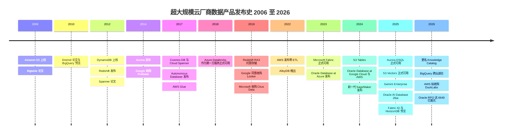

# 28. 超大规模云厂商的数据平台：AWS、Google、Microsoft 与 Oracle
> **状态：** 上市公司（四大集团）：AWS（Amazon，NASDAQ: AMZN）· Google Cloud（Alphabet，NASDAQ: GOOGL）· Microsoft（NASDAQ: MSFT）· Oracle（NYSE: ORCL）· **总部：** Seattle；Mountain View；Redmond；Austin [VERIFY: Oracle 总部迁往 Nashville 的进展] · **成立：** Amazon 1994 年（AWS 2006 年）；Google 1998 年；Microsoft 1975 年；Oracle 1977 年 · **最新市值：** ~$2.6T / ~$3.44T / ~$3.88T / ~$382B（stockanalysis.com，2026-10-23 至 2026-10-30）· **最后核实：** 2026-11-01

## 要点速览（TL;DR）

- **超大规模云厂商（hyperscaler）就是最大的数据库厂商。** 在 Gartner 的数据库市场份额排名中，AWS、Microsoft、Oracle 和 Google 位居前列；Gartner 估算该市场 **2024 年规模为 $119.7B，同比增长 13.4%**（分析师估算）。[^gartner-dbms] 四家公司都不单独披露数据库或分析业务收入。它们的数据产品归属于各自的云业务分部，而这些分部如今的增长主要由 AI 基础设施驱动。
- **最新一个季度增长明显提速，但主要来自 AI 算力而非数据产品。** Google Cloud 在 Q3 2026 增长 **103%，达到 $30.7B**（GAAP 分部收入，含 TPU 系统销售）。[^goog-q3] Azure 在 Microsoft 的 Q1 FY2027（2026 年 7–9 月）增长 **48%**（媒体报道的公司公告摘要，约 $33.2B）。[^msft-q1] Oracle 的云基础设施（OCI）在其 Q1 FY2027（2026 年 6–8 月）增长 **121%**，剩余履约义务（RPO）达到 **$664B**。[^orcl-q1] **AWS** 分部销售额在 Q3 2026 增长 **39%，达到 $46.0B**（GAAP 分部收入；约五年来最快增速，高于 Q2 2026 的 37%），Amazon 称该业务的**年化运行率为 $184B**（公司披露）。按收入计，AWS 仍是四家中规模最大、增速最慢的。[^amzn-q3]
- **每家云厂商都提供完整的数据栈，并把制造锁定效应的环节免费送出。** 对象存储、开放表格式（Iceberg 或 Delta）、目录、数据仓库、操作型数据库、向量/RAG 层和 BI 都有原生产品。目录和[零 ETL（zero-ETL）](../glossary.md#zero-etl)复制之所以便宜甚至免费，是因为它们能把数据和工作负载拉到云厂商的计费表上。
- **它们与 Databricks 和 Snowflake 竞争，同时又从后者身上赚钱。** 两家公司都把租用超大规模云基础设施的支出计入营业成本，都通过云市场销售，让客户消耗承诺消费额度合同。Azure Databricks 是 Microsoft 的第一方服务。与此同时，Redshift、BigQuery、Fabric 和 Oracle 的 Autonomous AI Lakehouse 都在争夺同一笔预算。
- **Everpure 视角。** 超大规模云厂商在默认对象存储层与 Everpure 竞争（S3 事实上是[湖仓一体（lakehouse）](../glossary.md#lakehouse)的底座）。它们同时也是渠道：Everpure Cloud 原生运行在 Azure 上。对 Everpure 有利的逆向趋势是主权和本地部署需求，就连超大规模云厂商自己也在用区域内和本地部署版本来满足这类需求。[^ep-acc26]

## 概览表

| 项目 | AWS（Amazon） | Google Cloud（Alphabet） | Microsoft（Azure、Fabric） | Oracle（OCI、Database） |
|---|---|---|---|---|
| 母公司市值 | ~$2.6T（2026-10-30） | ~$3.44T（2026-10-30） | ~$3.88T（2026-10-30） | ~$382B；EV ~$515B（2026-10-23） |
| 财年 | 自然年 | 自然年 | 截至 6 月 30 日（Q1 FY2027 = 2026 年 7–9 月） | 截至 5 月 31 日（Q1 FY2027 = 2026 年 6–8 月） |
| 最新云收入 | $46.0B，+39%（Q3 2026，GAAP 分部）；$184B 年化运行率（公司披露） | $30.7B，+103%（Q3 2026，GAAP 分部） | Azure ~$33.2B，+48%（Q1 FY2027，媒体报道）；Microsoft Cloud $63.9B，+30% | OCI ~$7.4B，+121%；总收入 ~$19.35B（Q1 FY2027，媒体报道） |
| 积压订单信号 | 本章不涉及 | 本章不涉及 | 商业 RPO $677B，+73%（媒体报道） | RPO $664B，同比 +$209B |
| 现金流信号 | 不适用 | Q3 2026 资本开支 $51.4B | Q1 FY2027 资本开支 $39.4B（媒体报道） | TTM 自由现金流（FCF）**–$28.7B**（经营现金流 $46.9B 减资本开支 $75.7B；非 GAAP） |
| 旗舰数据产品 | S3、S3 Tables、Redshift、Aurora、DynamoDB、SageMaker | BigQuery、Spanner、AlloyDB、Looker | Fabric/OneLake、Power BI、Azure SQL、Cosmos DB | Oracle AI Database 26ai、Exadata、Autonomous DB |
| 对 Databricks/Snowflake 的立场 | 托管方、云市场、竞争者；正在收购 DuckLabs | 托管方、云市场、竞争者 | 第一方 Azure Databricks；Fabric 与之竞争 | 在三大云上都是 Database@ 合作伙伴 |

*图 28.1 — 概览。资料来源：`data/public_comps.csv` 与 `data/company_financials.csv`（stockanalysis.com 快照）、Amazon 与 Alphabet 的 8-K、媒体对 Microsoft 和 Oracle 公告的报道。[^comps][^amzn-q3][^goog-q3][^msft-q1][^orcl-q1][^orcl-fcf] 各家分部口径不同，因此收入一行不可直接比较。*

## 起源与战略演进

### AWS：先做存储，其他一切建在其上

Amazon 于 2006 年 3 月推出 S3，早于 EC2。[^history] 二十年后，这一先后顺序仍能解释 AWS 的数据战略。S3 成为企业存放文件的默认之地，此后的每一款分析产品都被设计为从 S3 读取数据。DynamoDB（2012 年）源自 Amazon 2007 年关于其购物车存储系统的 Dynamo 论文。[^dynamo][^history] Redshift（2012 年 11 月发布）以价格优势冲击本地部署数据仓库，AWS 称按预留定价每 TB 每年不到 $1,000。[^redshift-2012] Aurora（2014 年）把数据库引擎与一个共享的、日志结构化的存储服务分离开来。[^aurora] Glue 和 Athena（2016–17 年）让 S3 无需加载到别处即可查询。[^glue-ga]

2019 年推出的 RA3 节点在基于 S3 的托管存储之上，为 Redshift 实现了[存算分离（separation of storage and compute）](../glossary.md#separation-of-storage-and-compute)。这是对 Snowflake 的直接回应。[^ra3-launch] 自 2022 年以来，主线变成了消除数据管道、把表直接放进存储*内部*。零 ETL 集成把 Aurora 和 DynamoDB 复制到 Redshift。[^zetl-2022][^zetl-ga] S3 Tables（2024 年 12 月）让托管 Apache Iceberg 成为 S3 的一种原生存储桶类型。[^s3tables] S3 Vectors 在 re:Invent 2025 上正式发布（GA）。[^reinvent25] 2026 年 8 月，AWS 同意以未披露金额收购 DuckDB 背后的公司 **DuckLabs**。DuckDB 仍在独立的 DuckDB Foundation 下保持 MIT 许可，AWS 将其定位于智能体（agent）和 S3 上的就地分析。[^ducklabs]

### Google：把论文产品化的研究实验室

Google 的数据产品是其内部系统的商业版本，这些系统最早都在研究论文中描述过：Bigtable（2006 年）、Dremel（2010 年）和 Spanner（2012 年）。[^bigtable][^dremel][^spanner] BigQuery 是 Dremel 对外的产品形态，2010 年发布预览，约在 2011–2012 年正式可用。[^dremel20] 它从第一天起就是无服务器的，客户从不需要规划集群规模。它的短板在市场进入（GTM），而不在技术。因此 Google 收购了 Looker（$2.6B，2020 年 2 月完成）以获得语义层（semantic layer），又收购了 Dataform（2020 年）以获得 SQL 数据转换能力。[^looker-acq][^dataform] 随后 BigLake 和 BigQuery Omni 把 BigQuery 扩展到开放格式和其他云。2025–26 年的阶段主题是智能体：Agentspace 于 2025 年 10 月更名为 **Gemini Enterprise**，Dataplex Universal Catalog 于 2026 年更名为 **Knowledge Catalog**，Vertex AI 于 2026 年 4 月更名为 **Gemini Enterprise Agent Platform**。[^gemini-ent][^gcp-kc][^vertex-rename]

### Microsoft：从 SQL Server 到 SaaS 数据湖

Microsoft 的数据业务建立在 SQL Server 和 Excel 之上，后来又加上 Power BI。Azure SQL Database 和 Cosmos DB（2017 年）把这一业务搬上了云。[^history] 决定性的合作发生在 2017–18 年：Microsoft 没有自建 Spark 平台，而是把 **Azure Databricks** 做成第一方服务，由 Microsoft 负责销售、计费和支持。[^adb-ga] Azure Synapse（2019 年）是 Microsoft 自研统一分析平台的一次较弱尝试。**Microsoft Fabric** 于 2023 年 5 月发布、2023 年 11 月正式可用，取代 Synapse 成为战略押注。它是一个 SaaS 分析套件，建立在单一的租户级数据湖 **OneLake** 之上，沿用与 Power BI Premium 相同的容量计费模式。[^fabric-launch] 在 Ignite 2025 上，Microsoft 宣布 Fabric 的操作型数据库正式可用，预览了 **Fabric IQ** 语义层，并预览了可横向扩展的 PostgreSQL 服务 **Azure HorizonDB**。[^ignite25]

### Oracle：从守成者变身 AI 房东

Oracle 在 1979 年推出了最早的商用 SQL 数据库之一，[^history] 至今仍拥有最深厚的关键任务 OLTP 装机基础。其硬件战略（Exadata，2008 年）和 **Autonomous Database**（2017 年发布）都旨在把这一基础留在 Oracle 自研的基础设施上。[^history] OCI 的“Gen 2”云起步较晚。随后 Oracle 完成了两次转向。第一，它不再坚持让客户迁往 OCI，而是把 Oracle Database 硬件放进竞争对手的云*内部*：**Oracle Database@Azure**（2023 年发布）、**@Google Cloud** 和 **@AWS**（2024 年）。[^history][^oracle-dbazure] 第二，它成为 AI 实验室的算力房东。这让 OCI 成为本章中增长最快的云业务线，并填满了它的积压订单。2025 年 10 月更名为 **Oracle AI Database 26ai**，把向量、智能体和湖仓访问能力放进了核心数据库。[^oracle-aiworld]

*图 28.2 — 二十年的产品发布。每家云厂商都从存储和单一数据库（2006–2014 年）走向托管数据仓库（2012–2019 年），再走向存储内部的开放表、零 ETL 和智能体（2022–2026 年）。*

## 产品与技术

### 四套技术栈并排对比

四家云厂商如今都提供了[第 1 章](../01-data-systems-foundations/ch01-data-stack-map.md)所述数据栈的每一层。差别在于*各家把哪一层当作锚点*。AWS 以存储为锚：S3 是记录系统，其他一切都从它读取。Google 以查询引擎为锚，因为客户冲着 BigQuery 而来。Microsoft 以 SaaS 工作空间以及 Office/Power BI 用户为锚。Oracle 以数据库本身为锚，并把它带到客户偏好的任何一朵云上。

```mermaid
flowchart LR
    subgraph AWS["AWS：以存储为锚"]
        direction TB
        A1["S3 加 S3 Tables<br/>托管 Iceberg"] --> A2["Glue Data Catalog<br/>SageMaker Catalog"]
        A2 --> A3["Redshift、Athena、EMR"]
        A3 --> A4["Aurora、DSQL、DynamoDB"]
        A4 --> A5["Bedrock 知识库、S3 Vectors"]
        A5 --> A6["QuickSight"]
    end
    subgraph GCP["Google Cloud：以引擎为锚"]
        direction TB
        G1["Cloud Storage 加 BigLake<br/>Iceberg"] --> G2["Knowledge Catalog<br/>原 Dataplex"]
        G2 --> G3["BigQuery<br/>源自 Dremel"]
        G3 --> G4["Spanner、AlloyDB、Bigtable"]
        G4 --> G5["Gemini Enterprise<br/>Agent Platform"]
        G5 --> G6["Looker"]
    end
    subgraph MS["Microsoft：以工作空间为锚"]
        direction TB
        M1["ADLS 加 OneLake<br/>Delta 与 Parquet"] --> M2["OneLake 目录<br/>Purview"]
        M2 --> M3["Fabric Warehouse<br/>Azure Databricks"]
        M3 --> M4["Azure SQL、Cosmos DB<br/>Postgres、HorizonDB"]
        M4 --> M5["Microsoft Foundry<br/>Fabric IQ"]
        M5 --> M6["Power BI"]
    end
    subgraph ORA["Oracle：以数据库为锚"]
        direction TB
        O1["OCI Object Storage<br/>Exadata 存储"] --> O2["Data Catalog<br/>Iceberg 访问"]
        O2 --> O3["Autonomous AI Lakehouse"]
        O3 --> O4["AI Database 26ai<br/>Exadata、Database at 各云"]
        O4 --> O5["AI Vector Search<br/>库内智能体"]
        O5 --> O6["Analytics Cloud"]
    end
```

*图 28.3 — 四套技术栈，自上（存储）而下（BI）。各层可以一一对应，但重心不同：AWS 是 S3，Google 是 BigQuery，Microsoft 是 Fabric 工作空间，Oracle 是数据库引擎。*

| 能力 | AWS | Google Cloud | Microsoft | Oracle |
|---|---|---|---|---|
| 对象存储 | S3（自 re:Invent 2025 起单对象最大 50 TB） | Cloud Storage | Azure Blob / ADLS Gen2；OneLake 作为逻辑层 | OCI Object Storage |
| 托管开放表 | S3 Tables（Iceberg；支持 v3） | BigLake Iceberg 表 | OneLake Delta（通过表 API 和元数据虚拟化支持 Iceberg） | Autonomous AI Lakehouse（Iceberg 读/写）[VERIFY: 写入支持] |
| 目录 / 数据治理 | Glue Data Catalog、Lake Formation、SageMaker Catalog | Knowledge Catalog（原 Dataplex Universal Catalog）；BigLake metastore（Iceberg REST） | OneLake 目录、Microsoft Purview | OCI Data Catalog；Data Safe |
| 数据仓库 / SQL 分析 | Redshift（RA3、Serverless）、Athena | BigQuery | Fabric Data Warehouse；Synapse（遗留） | Autonomous Data Warehouse |
| Spark / 数据湖处理 | EMR、Glue | Dataproc、BigQuery Spark | Fabric Spark；Azure Databricks（第一方） | OCI Data Flow |
| 关系型 OLTP | Aurora（Postgres/MySQL）、RDS | AlloyDB、Cloud SQL | Azure SQL、SQL Server 2025、Azure Database for PostgreSQL | Oracle AI Database 26ai、Exadata、MySQL HeatWave |
| 分布式 SQL | Aurora DSQL（2025 年 5 月正式可用） | Spanner | HorizonDB（预览）、Cosmos DB for PostgreSQL | Globally Distributed Database |
| NoSQL / 键值 | DynamoDB | Bigtable、Firestore | Cosmos DB | Oracle NoSQL；核心数据库内的 JSON |
| 零 ETL / 镜像 | Aurora、RDS、DynamoDB 到 Redshift；应用到 S3 Tables | Spanner、AlloyDB、Cloud SQL 到 BigQuery（正式可用，Next '26） | Fabric 镜像（Azure SQL、Cosmos DB、Snowflake 等） | GoldenGate；库内湖仓 |
| 向量 / RAG | S3 Vectors；Bedrock Knowledge Bases；OpenSearch | BigQuery 向量检索；AlloyDB ScaNN | Azure AI Search；SQL Server 2025 与 Cosmos DB 中的向量 | 核心数据库内的 AI Vector Search |
| AI / 智能体平台 | Bedrock、SageMaker Unified Studio | Gemini Enterprise Agent Platform（原 Vertex AI）；Gemini Enterprise | Microsoft Foundry；Copilot；Fabric IQ（预览） | OCI Generative AI；库内智能体 |
| BI | QuickSight | Looker、Looker Studio | Power BI | Oracle Analytics Cloud |
| 跨云覆盖 | Database Savings Plans；有限 | 针对 AWS/Azure 数据的 BigQuery 跨云湖仓 | 指向 S3、GCS 等的 OneLake 快捷方式 | Database@AWS、@Azure、@Google Cloud |
| 第三方湖仓 | 通过 Marketplace 提供 Databricks 和 Snowflake | 通过 Marketplace 提供 Databricks 和 Snowflake | Azure Databricks 为第一方；Snowflake 通过 Marketplace | 多云数据库合作伙伴，而非湖仓托管方 |

*图 28.4 — 产品映射：14 项能力 × 四家云厂商。资料来源：re:Invent 2025、Next '26、Ignite 2025 和 Oracle AI World 的汇总；产品文档。[^reinvent25][^aws-analytics25][^next26][^ignite25][^oracle-aiworld][^onelake-irc][^biglake-irc] 产品名称变化频繁；在会议中使用前请核对当前名称。*

### AWS

**S3 作为底座。** 几乎所有湖仓引擎，包括 Databricks、Snowflake 外部表、Trino、DuckDB 和 ClickHouse，都把 S3 API 当作存储接口。AWS 的战略是把过去属于引擎的功能*下沉到 S3*。**S3 Tables** 把 Iceberg 表存放在“表存储桶（table bucket）”中，并以托管服务的形式执行压缩合并和快照清理。这把[小文件问题（small-files problem）](../glossary.md#small-files-problem)从客户的待办清单中移除，并让表而非对象成为计费单位。[^s3tables] 在 re:Invent 2025 上，AWS 为 S3 Tables 增加了 Intelligent-Tiering 存储类别和复制功能，在 EMR、Glue 和 S3 Tables 中支持 Iceberg v3，并宣布 **S3 Vectors** 正式可用。S3 Vectors 每个索引最多支持 2B 个向量，查询延迟约 100 ms，AWS 称成本比替代方案最多低 90%（公司说法）。[^reinvent25][^aws-analytics25]

**引擎与统一层。** Redshift 是数据仓库（RA3 托管存储；Serverless 按 RPU 小时计费）。Athena 和 EMR 分别是无服务器 SQL 和 Spark 选项。2024–25 年的“新一代 SageMaker”把 SageMaker 从机器学习工具变成了伞形产品。**SageMaker Unified Studio** 是覆盖 Redshift、Athena、EMR、Glue 和 Bedrock 的统一工作空间。**SageMaker Lakehouse** 通过一个兼容 Iceberg 的目录对外暴露 S3 和 Redshift 数据。[^sm-lakehouse][^aws-analytics25] Glue Data Catalog 和 Lake Formation 仍是底层的权限与元数据引擎。该目录支持 [Iceberg REST 目录（Iceberg REST catalog）](../glossary.md#iceberg-rest-catalog)协议，因此第三方引擎也能使用它。[^glue-irc]

**操作型数据库。** Aurora 是 AWS 最大的关系型数据库业务（兼容 Postgres 和 MySQL，采用日志结构化共享存储）。**Aurora DSQL** 于 2025 年 5 月 27 日正式可用，是一款具备多区域强一致性的无服务器分布式 SQL 数据库。AWS 的可用性设计目标为单区域 99.99%、多区域 99.999%（公司披露）。[^dsql-ga] DynamoDB 是键值存储的主力。**Bedrock Knowledge Bases** 把检索增强生成（RAG）打包成产品：它对文档进行切块、嵌入并存入向量存储，再为 Bedrock 模型检索。[^bedrock-kb] DuckLabs 整合完成后，AWS 将获得一个可以嵌入其他服务运行的进程内引擎。据 The Register 报道，Aurora PostgreSQL 中已经上线了由 DuckDB 驱动的分析功能。[^ducklabs]

### Google Cloud

**BigQuery 就是产品本身。** BigQuery 把存储（Colossus 文件系统，采用专有列式格式）、计算（Dremel “slot”）和分布式内存 shuffle 层拆分开，并通过 Google 的数据中心网络连接起来。客户可以按扫描的 TB 数付费（按需），也可以购买预留的 slot 容量。[^dremel20] 由于它在“无服务器”一词流行之前就已是无服务器形态，客户无需规划集群规模，也不会忘记关闭闲置的仓库，这仍是它相对预置型竞品的主要优势。**BigLake** 把 BigQuery 的治理能力扩展到 Cloud Storage 中的 Iceberg 表。其元数据存储暴露 Iceberg REST 端点，使 Spark 和其他引擎可以共享同一批表。[^biglake-irc] BigQuery ML 和 Gemini in BigQuery 让分析师在数据仓库内训练模型并生成 SQL 或 Python。

**Next '26 的变化。** 从 Spanner、AlloyDB 和 Cloud SQL 到 BigQuery 的实时复制现已正式可用，复制到 Iceberg 表的功能处于预览阶段。**跨云湖仓**让 BigQuery 无需搬迁即可查询存放在 AWS 或 Azure 中的数据。BigQuery 的远程 [MCP](../glossary.md#model-context-protocol) 服务器已正式可用。[^next26] **Knowledge Catalog**（原 Dataplex Universal Catalog；API 名称不变）是数据治理与语义元数据层。Google 把它定位为智能体的上下文，而不仅仅是数据清单。[^gcp-kc]

**操作型数据库。** Spanner 是基于 [TrueTime](../glossary.md#truetime) 的全球分布式 SQL 数据库（见[第 4 章](../01-data-systems-foundations/ch04-distributed-databases.md)）。**AlloyDB** 是 Google 兼容 PostgreSQL 的服务，具备解耦的存储层、用于分析查询的内存**列式引擎**，以及基于 **ScaNN**（Google 自研的近似最近邻（ANN）库）的向量索引。[^alloydb] Bigtable（宽列）和 Firestore（文档型，来自对 Firebase 的收购）覆盖 NoSQL 一端。在最上层，**Gemini Enterprise**（原 Agentspace）是面向员工的智能体产品，可跨企业数据源检索，并连接 BigQuery 和 Looker 的语义。[^gemini-ent]

### Microsoft

**Fabric 与 OneLake。** Fabric 是一个 SaaS 套件，涵盖数据工程（Spark）、Data Factory 数据管道、数据仓库、实时智能、数据科学和 Power BI。所有这些都建立在 **OneLake** 之上，每个租户一个逻辑数据湖。OneLake 以 Delta Lake 格式（Parquet 加事务日志）存储表，并可向 Iceberg 读取方暴露这些表。[^onelake-irc] 有两种机制让它做到“一份副本”。**快捷方式（Shortcuts）**是指针，可把 ADLS、S3、Google Cloud Storage 等存储中的数据挂载到 OneLake 而无需复制。**镜像（Mirroring）**把 Azure SQL、Cosmos DB 和 Snowflake 等操作型数据库持续复制为 OneLake 中的 Delta 表。镜像计算免费，每购买一个容量单位还附带免费的镜像存储。[^fabric-mirror] Ignite 2025 宣布 **Fabric 数据库**（Fabric 内的 SQL 数据库和 Cosmos DB）正式可用，并将面向智能体的语义“本体”层 **Fabric IQ** 与 Work IQ、Foundry IQ 一同推出预览。[^ignite25]

**数据库与 AI。** Azure SQL 和 **SQL Server 2025** 承载关系型业务。SQL Server 2025 增加了原生向量类型和向量检索 [VERIFY: SQL Server 2025 正式可用日期和功能清单]。Cosmos DB 是多模型 NoSQL 服务。在 Azure Database for PostgreSQL 之外，新增了 **Azure HorizonDB**（预览），这是一款可横向扩展、兼容 Postgres 的服务，Microsoft 称其吞吐量最高可达开源 Postgres 的 3 倍（公司说法）。[^ignite25] **Microsoft Purview** 负责在 Microsoft 365 和 Azure 之间进行数据分类、数据血缘和数据防泄漏（见[第 15 章](../02-pipelines-and-governance/ch15-governance-security-privacy.md)）。[^purview] **Microsoft Foundry**（原 Azure AI Foundry）是模型与智能体平台。**Power BI** 是分发引擎，把 Fabric 推到数以百万计的现有用户面前。

### Oracle

**数据库即平台。** **Oracle AI Database 26ai**（2025 年 10 月）把向量检索、JSON/关系二元性、图和智能体功能内置于核心引擎。其主张是让 AI 走向数据，而不是把数据复制到 AI 服务中。[^oracle-aiworld] **Exadata** 是 Oracle 的工程化系统：数据库服务器加存储服务器，在靠近数据的位置执行 SQL 过滤（“smart scan”），并通过 RDMA 互连。运行在 **Exascale** 上的 Exadata Database Service（一种多租户池化版本），以及可查询对象存储中 Iceberg 数据的 **Autonomous AI Lakehouse**，均在 Oracle AI World 上宣布正式可用。[^oracle-aiworld] **MySQL HeatWave** 为 MySQL 增加了内存分析引擎。

**Database@ 各大云。** Oracle 把 Exadata 硬件安装在 Microsoft、Google 和 AWS 的数据中心里，并在那里以服务形式运行 Oracle Database。客户通过宿主云的云市场购买，并消耗其在该云上的承诺额度。截至 2025 年 10 月，Database@Azure 已在 28 个区域运行，Database@Google Cloud 在 8 个区域运行、另有 9 个在规划中。Oracle Database@AWS 正在扩张，但我们未找到官方区域数量。[^oracle-dbazure][^oracle-aiworld] 这是本章中竞合关系最清晰的案例：三家竞争对手托管 Oracle 的硬件，因为它们客户最重要的数据库就运行在这些硬件上。

> **深入（L3）。** BigQuery 的速度来自三个解耦的层级，而不是某个巧妙的索引。存储位于 Colossus 上，采用列式格式，其编码和统计信息让引擎得以跳过数据。计算是按查询阶段分配的 Dremel 工作节点池（“slot”）。中间结果通过一个独立的远程内存 **shuffle** 服务传递，因此各阶段可以独立扩展，某个工作节点失败也不会丢失 shuffle 数据。Melnik 等人 2020 年发表于 VLDB 的回顾论文详细介绍了无服务器调度、解耦 shuffle 和列式存储如何从 2010 年的设计演进而来。[^dremel20] AWS Redshift RA3 和 Snowflake 则通过在对象存储前用本地 SSD 缓存热数据，实现了类似的分离。
