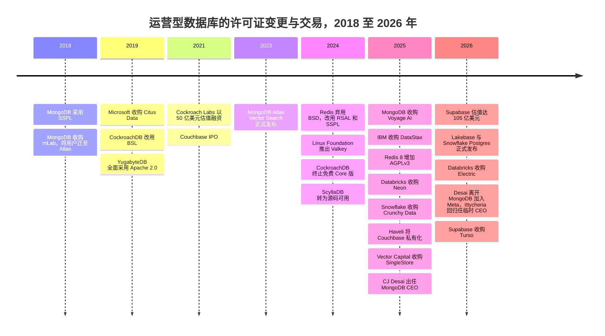
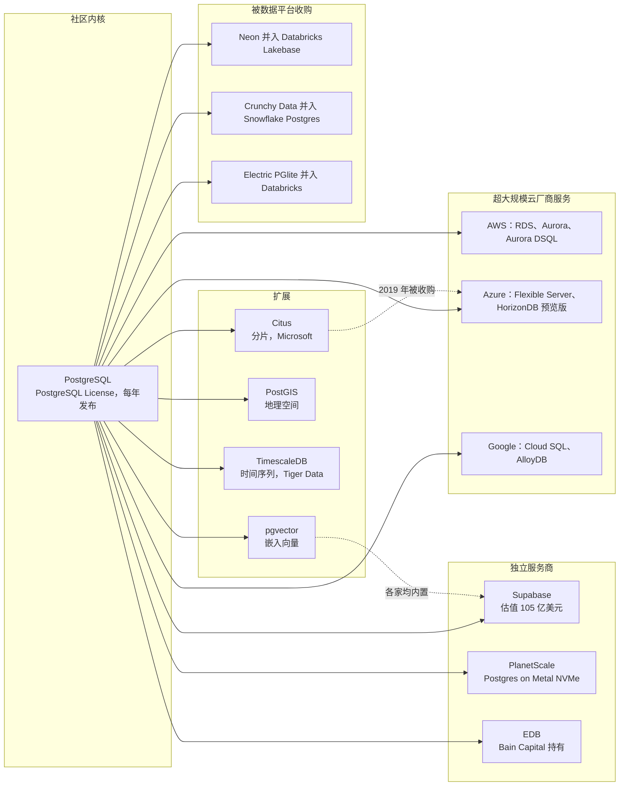
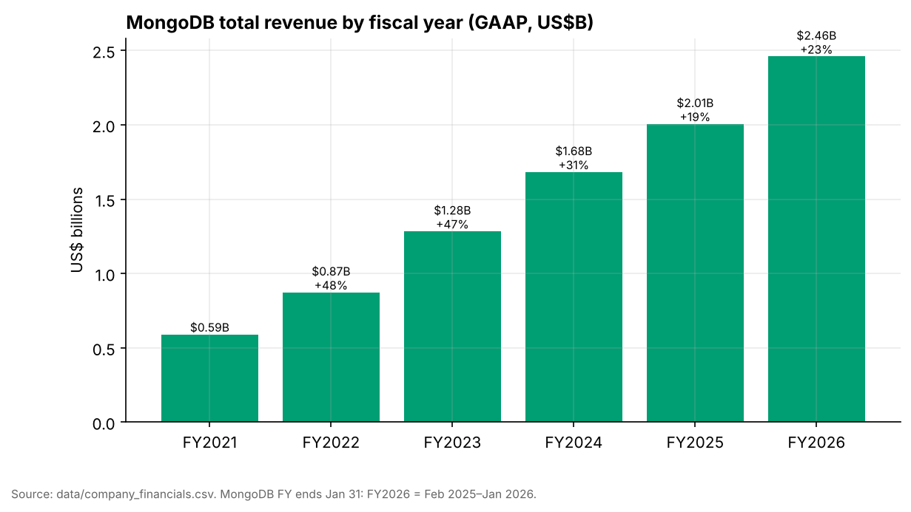
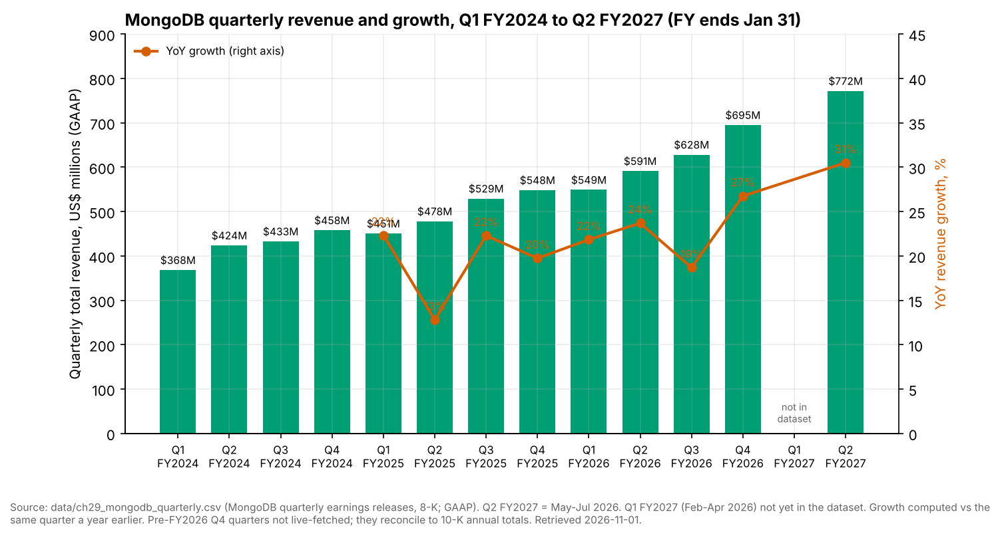
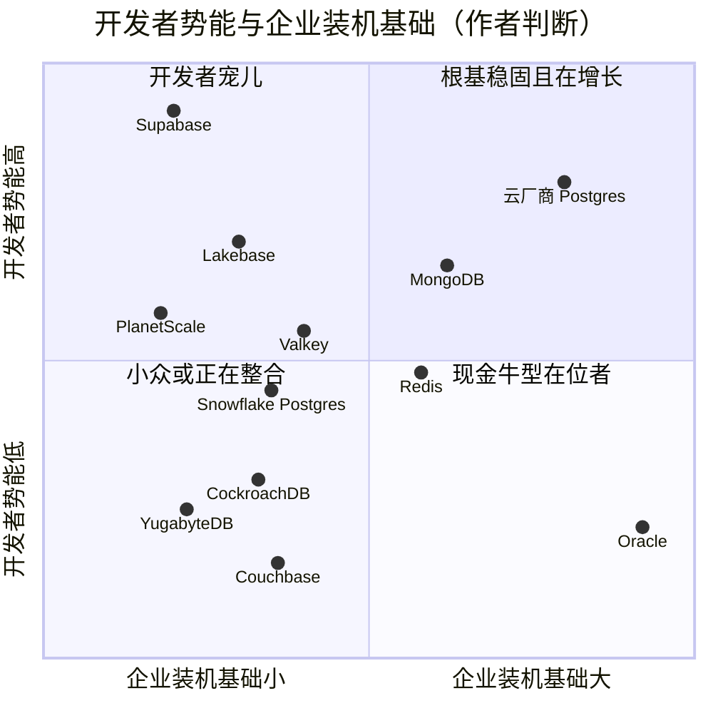

# 29. 运营型数据库厂商
> **状态：** 上市与非上市公司并存 · **总部：** 各不相同（Oracle：Austin, TX；MongoDB：New York, NY；多数挑战者：San Francisco Bay Area）· **成立：** 1977 年（Oracle）至 2021 年（Neon）· **最新估值/市值：** Oracle 市值 $382.45B（2026-10-23）；MongoDB 市值 $29.5B，EV $27.14B，EV/未来 12 个月收入 9.0x（2026-10-20）；Supabase 投后估值 $10.5B（媒体报道，2026 年 6 月）· **最后核实：** 2026-11-01

## 要点速览（TL;DR）

- **市场。** 运营型数据库（[OLTP](../glossary.md#oltp)）记录着企业的日常业务：订单、支付、账户、会话。它们属于数据库管理系统（DBMS）市场，Gartner 估算该市场 **2024 年规模为 $119.7B，同比增长 13.4%**（分析师估算）。超大规模云厂商和 Oracle 拿走了其中大部分收入，而 PostgreSQL 已成为新应用的默认引擎。[^gartner][^so25]
- **两家在位者，一个标准。** Oracle 的数据库收入主要来自对一个已有数十年历史的装机基础收取的支持服务费，其表现如同年金。MongoDB 是该品类中唯一一家已形成规模、独立上市的纯业务公司。其 **Q2 FY2027（2026 年 5–7 月）收入为 $771.8M，同比增长 30%（GAAP）**，较一年前（Q2 FY2026）约 24% 的增速以及 Q3 FY2026 19% 的低点重新加速。公司目前也处于两任正式 CEO 之间的空档：自 2025 年 11 月起担任 CEO 的 CJ Desai 于 2026 年 9 月离职加入 Meta，前任 CEO Dev Ittycheria 回归担任临时 CEO。其他所有厂商要么跑在 Postgres 之上，要么与之竞争。[^mdb-q2][^mdb-qtr]
- **Postgres 圈地运动。** 2025–26 年，分析型平台通过收购进入 OLTP 领域。Databricks 收购了 Neon（约 $1B，媒体报道）并将其改造为 Lakebase。Snowflake 收购了 Crunchy Data（其 10-Q 披露的收购对价为 $164.5M，而媒体报道约为 $250M），并推出了 Snowflake Postgres。Supabase 凭借开发者以及 AI 编程智能体（agent）创建数据库的热潮，估值达到 **$10.5B**（媒体报道，2026 年 6 月）。[^neon-deal][^crunchy][^supabase-f]
- **许可证是定价杠杆，而不是道德问题。** MongoDB（2018 年）、Cockroach Labs（2019 年、2024 年）、Redis（2024 年）和 ScyllaDB（2024 年）都收紧了许可证，以阻止云厂商转售其成果。在 AWS 和 Google 支持 **Valkey** 分叉之后，Redis 于 2025 年通过增加 AGPLv3 部分回调了方向。那些没有自有云却存活下来的独立厂商大多已被出售：DataStax 卖给 IBM，Couchbase 卖给 Haveli，SingleStore 卖给 Vector Capital。[^redis][^valkey][^datastax][^couchbase][^singlestore]
- **Everpure 视角。** 运营型数据库是 FlashArray 上典型的块存储工作负载。向云托管和无服务器 Postgres 的迁移，以及将存储重构为基于对象存储（object storage）的日志服务（Aurora、Neon/Lakebase），改变了持久性所在的位置。这既给本地块存储需求带来风险，也围绕 Kubernetes 数据服务（Portworx）、快速数据库克隆和以对象存储为后端的数据库存储创造了机会。[^neon-arch]

## 概览表

| 公司 | 所有权 / 状态 | CEO（据查） | 规模指标 | 口径 / 日期 | 估值 / 市值 |
|---|---|---|---|---|---|
| Oracle | 上市（NYSE: ORCL）；财年截至 5 月 31 日 | 联席 CEO Clay Magouyrk 与 Mike Sicilia [VERIFY] | Q1 FY2027（2026 年 6–8 月）收入约 $19.35B；OCI +121%；RPO $664B | GAAP；经 StorageNewsletter 媒体报道[^comps-orcl] | 市值 $382.45B，EV $514.52B，EV/未来 12 个月收入 5.7x（2026-10-23）[^comps-orcl] |
| MongoDB | 上市（Nasdaq: MDB）；财年截至 1 月 31 日 | Dev Ittycheria，**临时**总裁兼 CEO（自 2026 年 9 月起；此前自 2025-11-10 起任 CEO 的 CJ Desai 离职加入 Meta）；正在物色正式 CEO[^mdb-ceo] | Q2 FY2027 收入 $771.8M，+30%；FY2027 指引 $2.99–3.03B | GAAP；公司指引[^mdb-q2] | 市值 $29.5B，EV $27.14B，EV/未来 12 个月收入 9.0x（2026-10-20）[^comps-mdb] |
| Supabase | 非上市，风险投资支持 | Paul Copplestone（联合创始人） | 未披露收入 | n/d | 投后估值 $10.5B（2026 年 6 月）；2026 年 10 月追加 $150M，据报道估值 $10.65B（单一来源）[^supabase-f][^supabase-turso] |
| Neon → Databricks Lakebase | 被 Databricks 收购（2025 年 5 月宣布） | n/a（已并入 Databricks） | Lakebase 年化运行率 >$100M（2026 年 7 月） | 公司披露的年化运行率[^db-7b] | 交易约 $1B（媒体报道）[^neon-deal] |
| Crunchy Data → Snowflake Postgres | 被 Snowflake 收购（2025 年 6 月） | n/a（已并入 Snowflake） | Snowflake Postgres 正式发布（GA，2026 年 6 月） | 公司披露[^sf-pg] | 收购对价 $164.5M（10-Q）；媒体报道约 $250M（WSJ）[^crunchy] |
| Redis Inc. | 非上市，风险投资支持 | Rowan Trollope [VERIFY] | 未披露收入 | n/d | >$2B（G 轮，2021 年 4 月；媒体报道）[VERIFY][^redis-g] |
| Couchbase | 非上市（Haveli 私有化于 2025 年 9 月完成） | n/d | 最后一个公开财年收入约 $200M [VERIFY] | GAAP，退市前 | 按每股 $24.50 计股权价值约 $1.5B[^couchbase] |
| Cockroach Labs | 非上市，风险投资支持 | Spencer Kimball（联合创始人） | 未披露收入 | n/d | $5B（F 轮，2021 年 12 月；媒体报道）[^crdb-f] |
| SingleStore | 非上市（Vector Capital 控股收购，2025 年 9 月） | n/d | 未披露收入 | n/d | 股权价值约 $500M（Bloomberg 援引知情人士，非公司披露）[^singlestore] |
| DataStax | 被 IBM 收购（2025 年 5 月完成） | n/a | n/d | n/d | 交易金额未披露[^datastax] |

*图 29.1 — 概览。只有 Oracle 和 MongoDB 公布经审计的数据。此处所有非上市公司估值要么是 2021 年的定价，要么是媒体报道数字或交易价格，因此应视为参考指标，而非公允价值。*

## 起源与战略演进

### 四层市场结构

剥去品牌名称后，运营型数据库市场的形态其实很简单。

**第 1 层：商业关系型在位者。** Oracle Database、Microsoft SQL Server 和 IBM Db2 仍在运行全球大部分记录系统（systems of record）：ERP、核心银行、计费、电信。它们的收入主要来自多年前售出许可证的维护与支持费用，以及迁移到各厂商自有云的路径。DB-Engines 的流行度排名统计的是网络提及、招聘和搜索热度而非收入，它仍将 Oracle、MySQL（同样归 Oracle 所有）和 SQL Server 列为前三，PostgreSQL 第四，MongoDB 第五（2026 年 7 月，二手报道）。[^dbe-jul]

**第 2 层：超大规模云厂商的托管数据库。** Amazon RDS 和 Aurora、Azure SQL 和 Azure Database for PostgreSQL、Google Cloud SQL、AlloyDB 和 Spanner，以及 DynamoDB 和 Cosmos DB。它们如今是新增 OLTP 容量的最大渠道。Gartner 的公开摘要显示云 DBMS 约占市场的五分之三，但这一份额是推算出来的参考数字。[^gartner-cloud] [第 28 章](ch28-hyperscaler-data-platforms.md)深入介绍了超大规模云厂商。

**第 3 层：独立厂商。** MongoDB 是已形成规模的幸存者。围绕它的是一圈风险投资支持的专业厂商：分布式 SQL（Cockroach Labs、Yugabyte、PingCAP）、内存与键值（Redis、Aerospike）、宽列（ScyllaDB、DataStax），以及多模型或混合事务分析处理（HTAP）引擎（Couchbase、SingleStore）。它们大多按 2021 年的估值融资，此后要么被出售、要么被私有化，要么再没有新的定价轮次。

**第 4 层：Postgres 生态。** PostgreSQL 本身是一个采用宽松许可证、不受任何公司控制的社区项目。商业价值来自围绕它的包装：托管服务（managed service）（Supabase、Neon、Crunchy、PlanetScale、EDB，以及每一家超大规模云厂商）和扩展（pgvector、PostGIS、TimescaleDB、Citus）。开发者调查显示了这一结果。在 Stack Overflow 的调查中，PostgreSQL 的使用率从 2024 年占受访者的 48.7% 上升到 2025 年媒体报道的 55.6%，为所有数据库中最高。2026 年上半年，PostgreSQL 在 DB-Engines 上的得分增幅也居所有系统之首。[^so24][^so25][^dbe-h1]

### 战略演进，2018–2026

2018 年以来的演进分为三个阶段。**第一，开源厂商试图通过更改许可证来抵御云厂商。** Amazon、Microsoft 和 Google 一直在销售 MongoDB、Redis 和 Elasticsearch 的托管版本，却不向这些项目的主导公司付费。**第二，超大规模云厂商以分叉和自研引擎回应**：DocumentDB，以及后来的 Valkey。**第三，从 2025 年起，AI 改变了买方。** 编程智能体和"氛围编程"（vibe-coding）工具开始成千上万地创建数据库。分析型平台随即认定，谁拥有运营型数据库，谁就拥有新应用，于是收购 Postgres 公司以获得一个。

*图 29.2 — 许可证变更集中在 2018–2019 年和 2024 年；收购集中在 2025–2026 年。第一波浪潮旨在抵御云转售商；第二波旨在掌控 AI 构建的应用所起步的数据库。*[^mdb-sspl][^crdb-license][^yb-license][^redis-2024][^valkey][^scylla][^redis][^neon-deal][^crunchy][^couchbase][^singlestore][^electric][^supabase-turso]

> **类比：重新授权相当于修改版税表。** 从 Apache 或 BSD 切换到 SSPL、BSL 或 RSAL，在经济上类似于知识产权（IP）授权方针对某一类被许可方重写版税表。自行部署的终端用户仍然一分不付。而规模化变现该 IP 的那一类，即以服务形式提供该数据库的云厂商，如今被要求要么付费，要么开源其整个服务栈，而没有任何超大规模云厂商会这样做。与半导体 IP 一样，授权方的议价能力取决于转换成本。当被许可方有能力资助一个兼容的替代品（Redis 的 Valkey、MongoDB API 的 DocumentDB）时，修改版税表的结果不是提高版税，而是把最大的被许可方推出生态。

## 产品与技术

### Oracle：融合型在位者

Oracle Database 是关系型引擎的标杆：行存储、通过 undo 段实现的 [MVCC](../glossary.md#mvcc)、用于共享磁盘横向扩展的 Real Application Clusters，以及将 SQL 过滤下推到存储服务器的 Exadata 一体化工程系统。Oracle 的产品战略是**融合**。一个引擎同时处理关系、JSON、图、空间和向量数据，客户因此永远不需要第二个数据库。在 2025 年 10 月的 Oracle AI World 上，旗舰产品更名为 **Oracle AI Database 26ai**（23ai 的继任者），在引擎内部集成了向量检索（vector search）和 AI 功能。[^orcl-aiworld] 另一项战略举措是**多云**。Oracle 如今在其他云厂商的数据中心内运行 Exadata 硬件，形式包括 Oracle Database@Azure（28 个区域）、Database@Google Cloud（8 个区域，另有 9 个在规划中）和 Database@AWS。[^orcl-aiworld][^orcl-azure] 这种设计让数据库留在 Oracle 自己的基础设施和许可证之上，同时允许应用迁往其他云。这也解释了为何 Oracle 的云业务数据如今包含了过去属于本地支持服务的数据库收入。[第 28 章](ch28-hyperscaler-data-platforms.md)介绍了 OCI 及其 AI 基础设施建设。

### MongoDB：把文档模型做成一门生意

MongoDB 存储的是[文档](../glossary.md#document-database)：自包含的类 JSON 记录（磁盘上为 BSON），其结构与应用代码中的对象一致。一张客户订单连同其明细行和收货地址就是一个文档，一次操作即可读写，无需关联（join）。模式存在于应用之中，开发者因此无需执行迁移就能发布。代价出现在多对多关系占主导的场景。自 4.0 版（2018 年）起，MongoDB 支持多文档 ACID 事务（transaction），消除了企业架构师的主要顾虑。[^mdb-10k] 横向扩展通过基于分片键的分片（sharding）实现，高可用则依靠副本集。

该产品有三种销售方式：

- **Atlas**，运行在 AWS、Azure 和 Google Cloud 上的托管云服务。它于 2016 年推出，占 **FY2026（2025 年 2 月–2026 年 1 月）收入的 73%**，高于 FY2025 的 70%（公司披露）。[^mdb-ars]
- **Enterprise Advanced（EA）**，一种自管理订阅（subscription），包含管理工具、安全功能和支持服务，供那些将数据保留在本地或自有云账户中的银行和政府使用。
- **Community Edition**，基于 [SSPL](../glossary.md#sspl) 免费提供，是销售漏斗的顶端。

AI 层分三步构建。**Atlas Vector Search** 于 2023 年 12 月正式发布（GA）。它将嵌入（向量）（embedding）与运营文档存放在一起，并用近似最近邻（ANN）索引进行检索。[^mdb-vs] 收购 **Voyage AI**（$220M，2025 年 2 月）带来了嵌入与重排序（reranking）模型，使 MongoDB 不仅能存储向量，还能生成向量。这让它对检索质量有了一定话语权，而不仅限于存储。[^voyage] 2026 年 6 月，向量检索和全文检索在免费的自管理 Community Edition 中正式发布，把 AI 检索能力下沉到漏斗中那些从不接触 Atlas 的开发者。[^mdb-vs]

### Postgres 生态：一个带扩展总线的标准

PostgreSQL 的商业优势源于架构。其**扩展**机制允许第三方在不分叉内核的前提下添加数据类型、索引方法、函数乃至存储行为。这就是为什么一个引擎如今能覆盖 JSON 文档（JSONB，自 2014 年起）、向量（pgvector）、地理空间（PostGIS）、时间序列（TimescaleDB）和分片（Citus）。[^pg-jsonb][^pgvector] PostgreSQL 18（2025 年 9 月）新增了异步 I/O 子系统，表明内核仍在按年度发布周期独立改进。[^pg18]

*图 29.3 — Postgres 生态：一个社区内核，一个添加 AI 及其他数据类型的扩展层，以及三个层级的托管服务。2025–26 年的收购把最具创新性的独立服务商层级并入了 Databricks 和 Snowflake。*[^citus][^horizondb][^dsql-ga][^planetscale][^neon-deal][^crunchy][^electric]

> **类比：扩展如同芯粒（chiplet）生态。** Postgres 扩展的运作方式类似于围绕 UCIe 等标准裸片间接口构建的芯粒。核心引擎是基础裸片（base die）。扩展 API（钩子、自定义类型、索引访问方法、表访问方法）是接口规范。第三方构建专用"芯粒"，例如向量索引或地理空间类型，无需对内核重新流片就能装入任何合规封装。与 UCIe 一样，标准接口把价值转移给负责组装封装的一方（托管服务）以及构建最受欢迎芯粒的一方（pgvector、Citus）。它也让基础裸片商品化：没有人能为 PostgreSQL 本身收取溢价。

**各家托管服务设计的差异在于存储放在哪里。** 经典的托管 Postgres（RDS、Cloud SQL、Supabase、Crunchy）在虚拟机上运行原生引擎，并使用网络块存储。**Aurora**（2017 年）和 **Neon**（2021 年）则对引擎进行了解耦。计算层只把[预写日志（WAL）](../glossary.md#write-ahead-log)发送到存储服务，由存储服务重建数据页；在 Neon 的方案中，数据页还会分层下沉到对象存储。[^neon-arch] 这种设计使[数据库分支](../glossary.md#database-branching)（在某个日志位置创建的写时复制克隆）和[缩容至零](../glossary.md#scale-to-zero)成为可能。当软件智能体创建成千上万个短生命周期数据库时，这两项能力都至关重要。**PlanetScale** 走了相反的路线。其"Metal"产品在本地挂载的 NVMe 而非网络块存储上运行 Postgres 和 MySQL，并依靠复制（replication）获得持久性，以牺牲弹性换取延迟。[^planetscale] PlanetScale 的 MySQL 业务建立在 **Vitess** 之上，这是在 YouTube 构建、并于 2019 年从 CNCF 毕业的分片层。[^vitess]

### 专业厂商

- **Redis** 是一个内存数据结构服务器，用作缓存、会话存储、限流器和消息代理。Redis 8（2025 年 5 月）把原先的模块（JSON、搜索、时间序列、概率数据结构）并入内核，并新增了向量集合，因此如今也在语义缓存和[智能体记忆](../glossary.md#agent-memory)领域展开竞争。[^redis]
- **Valkey** 是 Linux Foundation 基于 Redis 7.2.4 的分叉，于 2024 年 3 月推出，获得 AWS、Google Cloud、Oracle 等公司的支持。AWS 和 Google 如今提供基于 Valkey 的托管缓存服务。[^valkey]
- **CockroachDB、YugabyteDB 和 TiDB** 是基于 Raft 共识（consensus）的分布式 SQL（[NewSQL](../glossary.md#newsql)）引擎。CockroachDB 和 YugabyteDB 兼容 Postgres 线协议，TiDB 兼容 MySQL 线协议。[第 4 章](../01-data-systems-foundations/ch04-distributed-databases.md)解释了其中的机制。
- **Couchbase** 是一个采用内存优先架构的 JSON 文档数据库，具备类 SQL 查询语言（SQL++）和移动端同步。**SingleStore** 是一个 [HTAP](../glossary.md#htap) 引擎，结合了内存行存储与磁盘列存储。**ScyllaDB** 是用 C++ 重写的 Apache Cassandra。**DataStax** 以 Astra DB 的形式将 Cassandra 商业化，并拥有智能体构建工具 Langflow。**Aerospike** 是针对闪存优化的键值与文档存储，用于广告技术、反欺诈和电信领域。

## 盈利模式

该品类依靠四种收入模式运转，每一种对应不同的利润率和不同的 AI 敞口。

| 模式 | 计价单位 | 收入确认 | 毛利率驱动因素 | 示例 |
|---|---|---|---|---|
| 永久许可证 + 年度支持 | 按处理器核心（含核心系数）或指定用户计；支持费按许可证价格的一定百分比计 | 许可证一次性确认；支持费按期确认 | 支持业务接近 100%；无基础设施成本 | Oracle、SQL Server、Db2 |
| 期限订阅（自管理） | 按服务器或核心计的年度或多年订阅 | 根据 ASC 606，许可证部分一次性确认，支持部分按期确认，因此收入波动较大 | 高；无基础设施成本 | MongoDB Enterprise Advanced、Couchbase、EDB、Redis Enterprise 软件 |
| 按用量计费的云服务 | 实例小时、存储、I/O、数据传输；承诺消费并逐步抵扣的合同 | 按消耗确认 | 云基础设施计入 COGS；利润率取决于利用率 | MongoDB Atlas、Supabase、Neon/Lakebase、Redis Cloud、CockroachDB Cloud |
| 超大规模云厂商捆绑服务 | 实例小时或无服务器请求单元 | 按消耗确认 | 由云厂商获取，而非引擎作者 | RDS、Aurora、AlloyDB、ElastiCache for Valkey |

*图 29.4 — 商业模式。独立厂商的长期问题在于最后一行。当云厂商捆绑一个兼容引擎时，数据库的作者拿不到任何利润。*

### Oracle：支持服务年金

Oracle 的数据库经济模型建立在支持服务之上。客户购买永久许可证（通常按处理器核心计价），之后每年支付支持费，历史上约为**净许可证费用的 22%**，并随通胀条款上调。[^orcl-sig] 支持服务的续约率非常高，因为迁移核心银行或 ERP 数据库是一个历时多年、风险很高的项目。Oracle 不单独披露数据库收入。其"云服务与许可证支持"科目混合了数据库和应用支持以及云业务，在 **FY2025 的 $57.4B 总收入中约占 $44.0B**（财年截至 2025 年 5 月 31 日；GAAP）[VERIFY]。[^orcl-fy25]

> **类比：半导体 IP 维护费。** Oracle 的支持收入流与半导体 IP 组合的维护费和版税尾部表现相似。一旦某个设计基于特定 CPU 核或接口 IP 完成流片，只要芯片还在出货，客户就会持续付费，因为改用不同 IP 重新流片既昂贵又有风险。估值逻辑也相同：将其定价为一个递减年金，具有高续约率（低流失）、温和的价格上调条款，以及一个取决于装机基础向外迁移速度的终值。Database@Azure、Google 和 AWS 是 Oracle 在应用层迁往其他云时维持这笔年金的方式。

### MongoDB：按用量计费加上波动的期限许可证

**Atlas** 按集群规格（实例大小、内存、存储）、I/O 和数据传输计费，按小时计量。大客户签订年度承诺并逐步抵扣。收入跟随用量变化，因此某季度的 Atlas 增长反映的是现有应用的负载强度以及新上线应用的数量，而非签了多少合同。**Enterprise Advanced** 是期限许可证。根据 ASC 606，多年期交易中的许可证部分在期限开始时确认，因此一笔大额 EA 续约就可能让某季度收入大幅波动。这就是为什么大额 EA 交易集中的 Q4 会出现 Atlas 占比（Q4 FY2026 为 72%，公司在业绩电话会上披露）低于全年（73%）的情况。[^mdb-call][^mdb-ars]

Atlas 的毛利率（gross margin）低于 EA，因为 MongoDB 需要为底层机器向 AWS、Azure 和 Google 付费。这与[第 25 章](ch25-databricks.md)描述的 Databricks 无服务器业务中"从版税转向代工"的变化相同。Q2 FY2027 的综合结果为 **74% 的 GAAP 毛利率和 76% 的非 GAAP 毛利率**。[^mdb-q2]

### Postgres 服务商：谁在赚钱

由于引擎是免费的，Postgres 厂商赚的是运维、开发者体验和周边能力的钱。Supabase 将 Postgres 与身份认证、文件存储、实时订阅和边缘函数打包，按项目加用量收费。Neon（现为 Lakebase）按计算小时和存储收费，而缩容至零意味着闲置数据库几乎不产生费用。正是这一点让智能体成千上万地创建数据库变得足够便宜。EDB 向正在离开 Oracle 的企业销售企业级 Postgres 订阅和 Oracle 兼容工具。从 Postgres 中赚钱最多的是超大规模云厂商，它们通过 RDS、Aurora、Azure 和 Cloud SQL 的实例小时获利，却并不拥有该项目。

## 财务数据

### Oracle（仅作背景）

Oracle 的合并数据如今由 AI 基础设施驱动，而非数据库。Q1 FY2027（2026 年 6–8 月）总收入约为 $19.35B（GAAP），OCI 收入增长 121%，剩余履约义务（RPO）达到 $664B。Oracle 给出的 FY2027 收入指引为至少 $90B。由于资本开支超过经营现金流，过去 12 个月的自由现金流（FCF）约为 −$28.7B。[^comps-orcl] 按 5.7x 的 EV/未来 12 个月收入（截至 2026-10-23，未来 12 个月收入取指引下限）计算，市场估值的是一项底层带有数据库年金、高杠杆的 AI 算力建设，而不是一家数据库公司。[^comps-orcl]

### MongoDB

*图 29.5 — MongoDB 年度收入（GAAP）。FY2021 至 FY2026 收入大约翻了两番，但增速从约 48% 放缓至约 19%（FY2025），随后在 FY2026（2025 年 2 月–2026 年 1 月）重新加速至约 23%。资料来源：`data/company_financials.csv`。*

*图 29.6 — 季度视角。增速在 Q2 FY2025 触及 13% 的低点、Q3 FY2026 为 19%，随后重新加速至 27% 和约 30%。Q1 FY2027 尚未纳入数据集。资料来源：`data/ch29_mongodb_quarterly.csv`；Q4 FY2026 之前的季度未经实时核实，但与 10-K 年度合计数一致。*[^mdb-qtr]

| 指标 | 数值 | 期间 | 口径 | 来源 |
|---|---|---|---|---|
| 总收入 | $771.8M，同比 +30% | Q2 FY2027（2026 年 5–7 月） | GAAP | [^mdb-q2] |
| 订阅 / 服务收入 | $747.1M / $24.6M | Q2 FY2027 | GAAP | [^mdb-q2] |
| Atlas 收入增速 | 同比 +29% | Q2 FY2027 | 公司披露 | [^mdb-q2] |
| Atlas 收入占比 | Q2 FY2027 约 73%（约 $565.9M，第三方拆分）；FY2026 为 73%；FY2025 为 70% | 如所述 | 公司披露（Q2 金额拆分来自第三方） | [^mdb-ars][^mdb-q2] |
| Enterprise Advanced 及其他 | 同比 +36% | Q2 FY2027 | 公司披露 | [^mdb-q2] |
| 毛利率 | GAAP 74% / 非 GAAP 76% | Q2 FY2027 | GAAP / 非 GAAP | [^mdb-q2] |
| 营业利润率 | 24%（一年前为 15%） | Q2 FY2027 | 非 GAAP | [^mdb-q2] |
| 净利润 | $40.9M | Q2 FY2027 | GAAP | [^mdb-q2] |
| 客户数 | 总计 >65,200（FY2026 年末）；据新闻稿的搜索摘要，Q2 FY2027 Atlas 客户 >69,300 [VERIFY: Atlas 客户数与总客户数的区别] | 如所述 | 公司披露的 KPI | [^mdb-q4][^mdb-q2] |
| FY2027 收入指引 | $2.99–3.03B（中值 $3.01B），Atlas 增速约 27%；Q3 FY2027 指引 $756–761M | FY2027（2026 年 2 月–2027 年 1 月） | 公司指引 | [^mdb-q2] |
| EV / 未来 12 个月收入 | 9.0x（EV $27.14B ÷ 指引中值 $3.01B） | 2026-10-20 | 市场数据；未来 12 个月收入为替代值 | [^comps-mdb] |

*图 29.7 — MongoDB 关键数字。Q2 FY2027 的 Atlas 占比、营业利润率、净利润和 EA 增速依据整合者对新闻稿的实时核查（`meta/verified-facts.md` 第 7 项）。注意 Q3 指引（$756–761M）低于 Q2 的 $771.8M：Q2 包含了波动较大的一次性确认的 Enterprise Advanced 许可证收入（EA +36%），因此环比下降是收入确认效应，未必意味着需求放缓。*

**增速为何重新加速。** 三股力量共同作用，按重要性大致排序如下：

1. **Atlas 用量恢复。** 在 FY2024–25，客户优化云支出、新工作负载爬坡缓慢，Atlas 增速逐步滑落至 20% 区间中段 [VERIFY: FY2025–FY2026 各季度 Atlas 增速]。到 Q2 FY2027，Atlas 在大得多的基数上增长 29%，管理层给出的全年指引约为 27%。[^mdb-q2] 按 Atlas 约占四分之三的收入结构计算，仅 Atlas 就贡献了约 21 个百分点的总增速（0.73 × 29%，本书计算）。
2. **Enterprise Advanced 不再拖累。** FY2025 面临前一年一次性确认的异常大额多年期 EA 交易带来的高基数，管理层曾将此列为不利因素 [VERIFY: FY2025 多年期许可证不利因素的规模]。这在图 29.6 中 Q2 FY2025 13% 的增速上清晰可见。高基数消化后，业务中非 Atlas 的那四分之一不再拉低增速，Q4 FY2026（+27%）显示 EA 重新作出贡献。
3. **AI 时代的新工作负载。** MongoDB 认为，AI 应用需要灵活的模式以及紧邻运营数据的向量检索，而 Voyage 的模型能提升检索质量。[^voyage][^mdb-vs] 更干净的证据是 Atlas 的加速。公司未披露任何 AI 专项收入数字，因此应将增长归因于 AI 视为管理层叙事加相关性。

**管理层。** 自 2014 年起担任 CEO 的 Dev Ittycheria 将职位交给了 **Chirantan "CJ" Desai**，后者此前任 Cloudflare 产品与工程总裁。MongoDB 于 2025-11-03 宣布此次变更，2025-11-10 生效。Desai 的任期很短：**2026 年 9 月，他卸任并加入 Meta**，董事会在物色正式继任者期间**任命 Ittycheria 为临时总裁兼 CEO**。[^mdb-ceo] 重新加速始于第一次交接前后的几个季度，因此主要建立在 Ittycheria 任内推行的市场进入（GTM）调整之上，而他如今又重新掌舵。对分析师而言，问题在于执行风险和继任者搜寻的时长，而非战略转向：临时 CEO 正是当前 Atlas 优先模式的缔造者。不过，CEO 在任十个月便离职，仍是值得追问的公司治理黄灯信号。

**估值。** 按 9.0x 的 EV/未来 12 个月收入（2026-10-20；未来 12 个月收入以 FY2027 指引中值替代）计算，MongoDB 的估值约为 Snowflake 16.9x（2026-10-30，采用相同的指引替代法）的一半，尽管两者增速相近，均约 30%。毛利率解释不了这一差距：MongoDB 76% 的非 GAAP 毛利率与 Snowflake 约 75% 的非 GAAP 产品毛利率相当。折价反映的是另外几点。市场怀疑在经历数年百分之十几到二十出头的增长之后，约 30% 的增速能否持续（FY2027 指引中值意味着全年增速约 22%）；市场在为 2026 年 9 月 CEO 离职后的管理层不确定性定价；并且市场认为运营型数据库比分析型平台更容易受到免费的、由超大规模云厂商运营的 Postgres 冲击。非 GAAP 数字所剔除的股权激励费用（SBC）对两家公司都构成压力。[^comps-mdb][^comps-sf]

### 非上市的 Postgres 与 NoSQL 公司

本章中没有任何非上市厂商公布经审计的收入。估值定价反而说明了问题。Supabase 的估值从 $2B（2025 年 4 月）升至 $5B（2025 年 10 月），再升至 $10.5B（2026 年 6 月），投资者明确表示买的是"智能体式基础设施"。[^supabase-e][^supabase-f] Cockroach Labs 的 $5B 估值来自 2021 年 12 月，此后未发现新的定价轮次。[^crdb-f] Couchbase、SingleStore 和 DataStax 通过私募股权或战略买家退出，按多数说法，成交价格低于其 2021 年的峰值 [VERIFY: DataStax 与 SingleStore 2021–22 年的估值]。

## 客户与市场进入

**Oracle** 通过企业许可协议和审计自上而下地向 CIO 销售。许可证合规审查是一个众所周知的杠杆，用于把审计风险敞口转化为云承诺。其客户是全球 2000 强企业的记录系统，在这些场景中，数据库是需要压缩的成本，而不是用来构建的平台。

**MongoDB** 采用双速模式。自助式开发者漏斗（Community Edition、Atlas 免费层、高校项目）为企业现场销售团队输送线索，后者销售 Atlas 承诺合同和 EA。截至 FY2026 年末，MongoDB 拥有超过 65,200 名客户。[^mdb-q4] 超大规模云厂商的云市场（marketplace）也是合作伙伴：Atlas 通过 AWS、Azure 和 Google 的云市场销售，客户因此可以用它来抵扣云承诺消费额度（committed spend）。

**Postgres 挑战者**由开发者主导，并越来越多地由智能体主导。Supabase 是 Lovable 和 Bolt 等 AI 应用构建工具的默认后端（公司及媒体表述 [VERIFY]）。Neon 在被 Databricks 收购时表示，其平台上创建的数据库中超过 80% 是由 AI 智能体自动配置的（公司披露，媒体报道）。[^neon-deal] 这一个统计数字就解释了 2025–26 年的大部分交易。如果由智能体创建数据库，那么智能体默认选用的平台无需一通销售电话就能拿下新工作负载。

## 并购与投资

| 日期 | 收购方 | 标的 | 金额 | 交易逻辑 | 结果 |
|---|---|---|---|---|---|
| 2018 年 10 月 | MongoDB | mLab | $68M（已披露） | 收购最大的第三方 MongoDB 托管商 | 用户迁至 Atlas；mLab 停运[^mlab] |
| 2019 年 1 月 | Microsoft | Citus Data | 未披露 | 为 Azure 提供分布式 Postgres | 成为 Azure Cosmos DB for PostgreSQL；扩展保持开源[^citus] |
| 2025 年 2 月 | MongoDB | Voyage AI | $220M（已披露；现金加股票） | 嵌入与重排序模型 | 整合进 Atlas Vector Search[^voyage] |
| 2025 年 2–5 月 | IBM | DataStax | 未披露 | 为 watsonx 引入 Astra DB 向量/NoSQL 和 Langflow | 2025-05-28 完成[^datastax] |
| 2025 年 5 月 | Databricks | Neon | 约 $1B（媒体报道） | 面向智能体的无服务器 Postgres | Lakebase；至 2026 年 7 月年化运行率 >$100M[^neon-deal][^db-7b] |
| 2025 年 6 月 | Snowflake | Crunchy Data | $164.5M（10-Q；媒体报道约 $250M） | 企业级 Postgres | Snowflake Postgres 于 2026 年 6 月正式发布；镜像至 Snowflake[^crunchy][^sf-pg] |
| 2025 年 6–9 月 | Haveli Investments | Couchbase | 约 $1.5B（每股 $24.50 现金） | 私募股权对一家增长较慢的 NoSQL 厂商进行私有化 | 2025-09-24 完成；退市[^couchbase] |
| 2025 年 9 月 | Vector Capital | SingleStore | 股权价值约 $500M（Bloomberg 援引知情人士） | 控股收购 | 交割未获确认 [VERIFY][^singlestore] |
| 2025 年 10 月 | Databricks | Mooncake Labs | 未披露 | Postgres 到列式存储的镜像 | 并入 Lakebase[^mooncake] |
| 2026 年 8 月 | Databricks | Electric（PGlite） | 未披露 | 面向智能体沙箱的嵌入式/本地 Postgres | 已宣布；交割未见报道[^electric] |
| 2026 年 10 月 | Supabase | Turso | 未披露 | 基于 SQLite 的智能体数据库 | 与 $150M 融资一同宣布[^supabase-turso] |

*图 29.8 — 交易。有两个模式尤为突出。分析型平台在收购 Postgres（Neon、Crunchy、Mooncake、Electric），而私募股权或战略买家在吸收那些缺乏自有云的 NoSQL 厂商（Couchbase、SingleStore、DataStax）。资料来源：`data/ma_deals.csv`、`data/private_funding.csv`。*

**迄今为止的整合结果。** Neon 是最明确的成功案例。Lakebase 在交易宣布约 14 个月后突破了公司披露的 $100M 年化运行率。[^db-7b] Crunchy 的价格是解读媒体报道的一课：10-Q 显示现金对价为 $164.5M，而宣布时的报道约为 $250M。[^crunchy] MongoDB"收购托管商"的模式（mLab，2018 年）在业内被反复复制，而 Voyage 是一种更新的"收购模型"变体。IBM 收购 DataStax 是押注 Langflow 和向量检索能把 watsonx 带入 AI 应用构建。其成效尚未在 IBM 的披露中体现。

## 竞争地位

### 厂商矩阵

| 厂商 | 数据模型 | 许可证 | 部署方式 | 所有者 / 状态 | 最新估值 / 市值（日期） | 收入 / 增速（已标注） | AI 功能 |
|---|---|---|---|---|---|---|---|
| Oracle Database | 融合型关系（JSON、图、向量） | 专有 | 本地、Exadata、OCI、Database@Azure/Google/AWS | 上市（ORCL） | 市值 $382.45B（2026-10-23） | Q1 FY2027 总收入约 $19.35B，OCI +121%（GAAP，Oracle 整体） | AI Database 26ai：库内向量与智能体 |
| MongoDB | 文档 | SSPL（Community）；商业许可（EA、Atlas） | Atlas 运行于 3 家云；自管理 | 上市（MDB） | 市值 $29.5B（2026-10-20） | Q2 FY2027 $771.8M，+30%（GAAP） | Atlas Vector Search；Voyage 嵌入；Community 版向量检索 |
| PostgreSQL（社区） | 关系 + 扩展 | PostgreSQL License（宽松） | 任意环境 | 社区项目 | n/a | n/a | pgvector |
| Supabase | Postgres 后端平台 | Apache 2.0 / MIT 组件 | 云；自部署 | 非上市 | 投后估值 $10.5B（2026 年 6 月） | n/d | AI 应用构建工具的默认后端；Turso（已宣布） |
| Neon / Lakebase | 无服务器 Postgres | Apache 2.0（Neon） | Databricks 云 | Databricks | 交易约 $1B（2025 年 5 月） | Lakebase 年化运行率 >$100M（公司披露，2026 年 7 月） | 智能体创建的数据库；分支 |
| Crunchy / Snowflake Postgres | Postgres | Postgres License | Snowflake 云 | Snowflake | 交易 $164.5M（2025 年 6 月） | n/d | 镜像至 Snowflake AI 技术栈 |
| PlanetScale | MySQL（Vitess）与 Postgres | Vitess 为 Apache 2.0；服务为专有 | 云；Metal NVMe | 非上市 | 最近披露轮次为 C 轮，2021 年 [VERIFY] | n/d | n/d |
| EDB | 企业级 Postgres | Postgres License + 专有工具 | 本地、云 | Bain Capital [VERIFY] | n/d | n/d | EDB Postgres AI [VERIFY] |
| Redis | 内存键值、向量 | RSALv2 / SSPLv1 / AGPLv3（Redis 8） | Redis Cloud；软件 | 非上市 | >$2B（2021 年 4 月，媒体报道）[VERIFY] | n/d | 向量集合；语义缓存；智能体记忆 |
| Valkey | 内存键值 | BSD-3 | AWS、Google、自部署 | Linux Foundation | n/a | n/a | 向量检索开发中 [VERIFY] |
| Couchbase | 文档，内存优先 | BSL（服务器）[VERIFY] | Capella 云；自管理；移动端 | Haveli（非上市） | 私有化约 $1.5B（2025 年 9 月） | 退市后 n/d | Capella AI 服务 [VERIFY] |
| CockroachDB | 分布式 SQL（Postgres 线协议） | 专有企业许可证（收入低于 $10M 者免费） | 自托管；Cockroach Cloud | 非上市 | $5B（2021 年 12 月） | n/d | 向量索引 [VERIFY] |
| YugabyteDB | 分布式 SQL（兼容 Postgres） | Apache 2.0 | 自托管；托管服务 | 非上市 | $1.3B（2021 年 10 月）[VERIFY] | n/d | 兼容 pgvector [VERIFY] |
| TiDB（PingCAP） | 分布式 SQL（兼容 MySQL），HTAP | Apache 2.0 | 自托管；TiDB Cloud | 非上市 | n/d | n/d | TiDB Cloud 中的向量检索 [VERIFY] |
| SingleStore | HTAP（行 + 列） | 专有 | 云；自管理 | Vector Capital（非上市） | 股权价值约 $500M（2025 年 9 月，Bloomberg） | n/d | 向量函数 |
| ScyllaDB | 宽列（兼容 Cassandra） | 自 2024 年 12 月起源码可用 | 云；自管理 | 非上市 | n/d | n/d | 向量检索 [VERIFY] |
| DataStax | 宽列（Cassandra）、向量 | Apache 2.0（Cassandra）；服务为专有 | Astra DB 云 | IBM | 未披露（2025 年 5 月） | n/d | Astra 向量；Langflow |
| Aerospike | 键值 / 文档，闪存优化 | 专有企业版；社区版 | 自管理；云 | 非上市 | E 轮 $109M（2024 年 4 月）[VERIFY] | n/d | 向量检索 [VERIFY] |

*图 29.9 — 厂商矩阵（18 家厂商 × 7 个维度）。"n/d" = 未披露。只有两家上市公司有收入数据。AI 功能大多是向量检索，这使其成为入场门槛而非差异化因素。资料来源：`data/public_comps.csv`、`data/private_funding.csv`、`data/ma_deals.csv` 以及本章脚注。*

### 定位

*图 29.10 — 定位（作者判断，非测量数据）。势能已转向托管 Postgres。MongoDB 是唯一一家兼具庞大企业基础与开发者吸引力的独立厂商。Oracle 所在象限利润丰厚，但相对地位正在缩小。*

**MongoDB 对阵超大规模云厂商的 Postgres。** 这是决定性的竞争。每家主要云厂商如今都提供带 JSONB 和 pgvector 的 Postgres，"文档加向量"已不再是 MongoDB 独有。MongoDB 的防御在于开发者体验、横跨三家云和本地环境的单一 API，以及来自 Voyage 的检索质量。其风险敞口在于那些决定"一个 Postgres 包打天下"的架构师。

**Oracle 对阵所有人。** Oracle 很少会迅速丢掉现有的记录系统，但也很少赢得新应用。它的应对是在应用正在迁往的云中销售数据库容量，并捆绑 AI，让"数据留在原地"本身成为 AI 叙事。

**数据平台对阵独立厂商。** Lakebase 和 Snowflake Postgres 并不打算在开发者体验上击败 Supabase。它们要做的是通过[数据镜像](../glossary.md#data-mirroring)，让运营数据无需单独的数据管道（pipeline）就能落入湖仓一体（lakehouse）或数据仓库（data warehouse）。这对[第 30 章](ch30-data-movement-streaming-companies.md)中的变更数据捕获（CDC）厂商构成的威胁，不亚于对数据库厂商的威胁。

## 制胜原因 / 看多逻辑

1. **MongoDB 在 $3B 规模上重新加速。** 增速从 19%（Q3 FY2026）升至约 30%（Q2 FY2027），Atlas 增长 29%，全年指引上调至 $2.99–3.03B。[^mdb-q2][^mdb-qtr] 在这种体量下重新加速的基础设施软件公司寥寥无几。按 9.0x 的未来 12 个月收入倍数，看多者认为市场尚未对增长的持久性定价。
2. **AI 让数据库数量成倍增加。** 智能体和 AI 应用构建工具以编程方式创建数据库。Neon 超过 80% 由智能体创建的统计数字，以及 Supabase 在 14 个月内估值增长 5 倍，就是证据。[^neon-deal][^supabase-f] 应用越多，运营型数据库就越多，而运营数据正是 AI 智能体所需的新鲜上下文。
3. **Oracle 的年金极其持久。** 关键任务数据库的支持服务在经济衰退中照样续约，而多云模式让 Oracle 即便在客户迁往 Azure 或 AWS 时也能保住这笔收入。[^orcl-aiworld]
4. **向量检索把 AI 拉进了运营层。** 将嵌入与交易记录存放在一起，省去了同步到独立向量数据库（vector database）的数据管道。这有利于掌握数据的在位者（Oracle、MongoDB、Postgres 服务商），而不利于独立的向量数据库（见[第 32 章](ch32-ai-native-data-companies.md)）。

## 风险 / 看空逻辑与待解问题

1. **Postgres 让引擎商品化。** 当引擎免费且每家云都在运行它时，利润流向平台（AWS、Databricks、Snowflake），而不是引擎专业厂商。MongoDB 相对 Snowflake 的折价部分反映了这一点。[^comps-mdb]
2. **独立厂商的退出记录不佳。** DataStax、Couchbase 和 SingleStore 都卖给了战略或私募股权买家。Cockroach Labs 自 2021 年以来没有定价轮次。收紧许可证并没有造就第二个 MongoDB。[^datastax][^couchbase][^singlestore][^crdb-f]
3. **重新授权会招来分叉。** Redis 在 2024 年的切换催生了 Valkey，而 AWS 和 Google 如今都在销售 Valkey；Redis 在 14 个月内就增加了 AGPLv3。[^valkey][^redis] 任何收紧条款的厂商都必须预设最大的云厂商会资助一个分叉。
4. **智能体创建的数据库可能价值不高。** 成千上万个采用缩容至零计价的一次性数据库，每个带来的收入可能微乎其微。智能体带来的数量能否转化为持久的付费工作负载尚未得到证明。Lakebase 的 $100M 年化运行率是最好的公开数据点。[^db-7b]
5. **Oracle 的资产负债表如今承载着 AI 建设。** EV 约 $515B，而市值约 $382B，且过去 12 个月 FCF 为负，数据库年金正在为一场 AI 算力豪赌提供资金，同时也暴露于其风险之中。[^comps-orcl]
6. **待解问题。** MongoDB 的 Atlas 增长中有多大比例来自 AI 工作负载？Supabase 会在 IPO 之前披露收入吗？Snowflake Postgres 能否在与 Lakebase 的竞争中获得牵引力？在 Desai 于 2026 年 9 月离职后，谁将成为 MongoDB 的正式 CEO？继任者搜寻会改变优先事项或延误决策吗？

## 与 Everpure 的相关性

> **存储桥接。** OLTP 数据库是典型的块存储工作负载：小块随机 I/O、对延迟敏感的提交（每次提交都要等待预写日志刷盘），以及用于备份和测试/开发的快照（snapshot）与克隆。这正是 FlashArray 的核心业务。Aurora 和 Neon 等解耦式设计把持久性、复制和数据页物化移入数据库厂商自己的日志与页面服务中，后端通常是对象存储。PlanetScale Metal 等本地 NVMe 设计则完全绕开了共享存储。块存储协议和快照机制参见配套的 *Everpure Tech Atlas*。

**变化在哪里。** 有三项转变会随时间推移缩小经典的"数据库跑在 SAN 阵列上"的规模。第一，新应用默认使用云托管 Postgres，由超大规模云厂商提供存储。第二，Oracle 的多云模式把自带存储服务器的 Exadata 放进 Azure、Google 和 AWS，因此即便是离开客户数据中心的 Oracle 工作负载，也不会落在客户自有的阵列上。[^orcl-azure] 第三，无服务器 Postgres 把数据库存储变成了 WAL 服务加对象存储。[^neon-arch] 反向的力量在于，企业数据中心里 Oracle、SQL Server 和自管理 Postgres 的装机基础极其庞大且迁移缓慢，而受监管行业会把记录系统保留在本地。

**基于公开信息，战略团队可能评估的选项：**

| 选项 | 含义 | 为何可能重要 | 注意事项 |
|---|---|---|---|
| 让 FlashArray 克隆成为"数据库分支"的本地方案 | 将面向 Oracle、SQL Server 和 Postgres 的即时、节省空间的数据库克隆，打包为开发者和智能体可自助使用的功能 | 分支是 Neon/Lakebase 的主打功能；阵列快照已在存储层实现了这一点 | 需要具备数据库感知能力、可供智能体调用的工具和 API，而不仅仅是阵列快照 |
| 用 Portworx 支持 Kubernetes 上的 Postgres | 将 Portworx（2020 年收购，约 $370M）定位为自管理 Postgres operator 和 Data Services 的数据层 | 许多企业在 Kubernetes 上运行 Postgres 以避免被超大规模云厂商锁定[^portworx] | 对大多数团队而言，超大规模云厂商的托管 Postgres 更简单 |
| 在 FlashBlade 上支持以对象存储为后端的数据库存储 | 在 FlashBlade 的 S3 接口上验证 Neon 式（开源）页面服务器和湖仓镜像目标 | 如果无服务器 Postgres 走向混合部署或主权部署，就需要高速的本地对象存储 | 目前没有公开的本地 Lakebase 计划；属于推测 |
| 与独立数据库厂商开展本地合作 | 与 EDB、MongoDB EA、Couchbase 或 Redis Enterprise 软件联合制定参考架构 | 这些厂商的自管理客户恰恰就是本地部署的买家 | 每家厂商的增长都以云为先 |
| 将 Data Intelligence 扩展到运营型数据库 | 在数据库资产上使用基于 1touch 的数据发现与数据分类，包括 Oracle 和 SQL Server 连接器 | Everpure 的 Data Intelligence 已列出 SQL Server 和 Oracle 连接器[^everpure-di] | 数据库厂商和目录产品（Unity Catalog、Horizon）也在添加各自的分类功能 |

*图 29.11 — 选项（仅基于公开信息）。竞争风险是渐进的：每一个诞生于云托管 Postgres 的新应用，都是一个永远不会落到本地阵列上的应用。*

数据引力（data gravity）参见[第 24 章](../03-ai-data-stack/ch24-data-meets-compute-and-storage.md)，存储厂商向技术栈上层移动参见[第 45 章](../06-history-and-future/ch45-storage-moving-up-the-stack.md)。

## 对话手册

**向厂商产品经理或高管提出的三个问题**

1. （MongoDB）"Atlas 的重新加速中，有多少来自新工作负载、多少来自现有工作负载的用量增长？你们如何在遥测数据中识别 AI 工作负载？" *好的回答*会区分新工作负载与现有工作负载的增长，给出"AI 工作负载"的定义（例如向量索引的使用情况），并承认归因只是近似。
2. （Postgres 平台）"你们平台上创建的数据库中，由智能体创建的占多少？有多少能存活 30 天？每个存活数据库的收入是多少？" *好的回答*会给出队列存活率和转化率，而不只是创建数量。
3. （Oracle）"在 Database@Azure 交易中，许可证、支持和基础设施收入在 Oracle 与 Microsoft 之间如何划分？BYOL 支持是否继续？" *好的回答*会解释自带许可证与含许可证两种模式的区别，以及哪一方确认哪部分收入。

**向工程师或合作伙伴架构师提出的三个问题**

1. "你们的 Postgres 服务中，持久性放在哪里：网络块存储、带复制的本地 NVMe，还是基于对象存储的 WAL 服务？p99 提交延迟是多少？" *好的回答：*具体的架构和实测数字，以及故障模式下的表现。
2. "你们如何为测试分支一个 5 TB 的生产数据库？需要多长时间？" *好的回答：*在某个日志位置进行写时复制或使用存储快照，耗时以秒计，并对敏感数据脱敏（masking）有清晰的方案。
3. "你们支持哪些向量索引类型（HNSW、IVF、DiskANN）？向量查询是否遵循与其他数据相同的事务和访问控制？" *好的回答：*列出具体索引类型，坦诚说明召回率与延迟的权衡，并确认具备事务一致性。

**好的回答听起来是什么样。** 它们区分引擎与服务，把按用量收入与期限许可证收入分开，标注年化运行率与 GAAP 的区别，并把向量检索视为入场门槛而非护城河。

**不要这样说**

- "MongoDB 不支持事务。" *自 4.0 版（2018 年）起就已支持多文档 ACID 事务。*
- "Redis 现在是闭源的。" *Redis 8 在 RSALv2 和 SSPLv1 之外增加了经 OSI 批准的 AGPLv3 许可证；Valkey 仍采用 BSD。*
- "Postgres 归 [某厂商] 所有。" *没有任何公司拥有 PostgreSQL；厂商拥有的是服务、扩展和分叉。*
- "Oracle 是一家传统数据库公司。" *其估值如今由 OCI 和 AI 基础设施驱动（RPO $664B）；数据库是底层的年金。*
- "CJ Desai 是 MongoDB 的 CEO。" *Desai 已于 2026 年 9 月离职加入 Meta；在物色正式继任者期间，Dev Ittycheria 担任临时总裁兼 CEO。*
- "Snowflake 花了 $250M 收购 Crunchy。" *那是媒体报道；10-Q 显示现金对价为 $164.5M。*
- "Supabase 的收入是 $X。" *Supabase 不披露收入；公开的只有估值。*

## 关键术语

- [OLTP](../glossary.md#oltp) — 联机事务处理：大量小型、快速且正确的读写操作。
- [文档数据库（Document database）](../glossary.md#document-database) — 存储自包含的类 JSON 记录，例如 MongoDB。
- [键值存储（Key-value store）](../glossary.md#key-value-store) — 按键检索不透明的值，例如 Redis 或 Valkey。
- [Valkey](../glossary.md#valkey) — Linux Foundation 以 BSD 许可证发布的 Redis 7.2.4 分叉（2024 年）。
- [NewSQL](../glossary.md#newsql) — 在横向扩展下提供 ACID 事务的分布式 SQL 数据库。
- [HTAP](../glossary.md#htap) — 在新鲜数据上同时服务事务型和分析型工作负载的单一系统。
- [MVCC](../glossary.md#mvcc) — 保留多个行版本，使读写互不阻塞。
- [预写日志（Write-ahead log）](../glossary.md#write-ahead-log) — 事务提交前写入的持久化变更日志。
- [数据镜像（Data mirroring）](../glossary.md#data-mirroring) — 由厂商管理、将运营型数据库持续复制到分析平台的机制。
- [SSPL](../glossary.md#sspl) — MongoDB 的 Server Side Public License，要求以服务形式提供该软件的提供商开源其整个服务栈。
- [AGPL](../glossary.md#agpl) — GNU Affero General Public License，一种经 OSI 批准的 copyleft 许可证，将源码共享义务延伸到网络使用。
- [Business Source License](../glossary.md#business-source-license) — 一种源码可用许可证，在一段时间内限制生产使用，之后转为开源。
- [源码可用许可证（Source-available license）](../glossary.md#source-available-license) — 公开源代码但限制使用（通常禁止提供竞争性托管服务）的许可证。
- [Postgres 扩展（Postgres extension）](../glossary.md#postgres-extension) — 无需分叉即可为 PostgreSQL 添加类型、索引或函数的附加模块。
- [pgvector](../glossary.md#pgvector) — 用于存储和检索嵌入向量的开源 Postgres 扩展。
- [数据库分支（Database branching）](../glossary.md#database-branching) — 在数据库历史中的某个时间点即时创建写时复制克隆。
- [缩容至零（Scale to zero）](../glossary.md#scale-to-zero) — 在数据库闲置时关闭其计算资源，使其几乎不产生费用。
- [期限许可证（Term license）](../glossary.md#term-license) — 有时间期限的软件许可证，根据 ASC 606，其许可证部分一次性确认收入。
- [智能体记忆（Agent memory）](../glossary.md#agent-memory) — AI 智能体跨会话存储和检索的持久状态。
- [支持服务年金（Support annuity）](../glossary.md#support-annuity) — 基于永久许可证装机基础的经常性维护收入。
- [嵌入（Embedding）](../glossary.md#embedding) — 表示语义的数值向量，使相似的条目彼此靠近。

## 资料来源

[^gartner]: AI Data Atlas 数据集 `data/market_sizes.csv`，DBMS 2024 行（$119.7B，+13.4%），来源为 Gartner 市场份额摘要，https://www.gartner.com/en/documents/6494271，发布 2025-05；检索 2026-11-01。分析师估算；完整报告需付费。
[^gartner-cloud]: AI Data Atlas 数据集 `data/market_sizes.csv`，云 DBMS 2024 行（推算：61% 云份额 × $119.7B），Gartner 摘要 https://www.gartner.com/en/documents/5441963，发布 2025；检索 2026-11-01。仅为推算的参考值 [VERIFY]。
[^so24]: Stack Overflow，"2024 Developer Survey — Technology: Databases"，https://survey.stackoverflow.co/2024/technology#1-databases，发布 2024-07；数字（全体受访者 48.7%）据 DevClass 报道，https://www.devclass.com/development/2024/08/02/little-sign-of-migration-from-c-or-c-to-rust-in-latest-dev-survey-but-postgresql-is-winning-against-mysql/1622783，发布 2024-08-02；检索 2026-11-01。
[^so25]: Stack Overflow，"2025 Developer Survey — Technology: Databases"，https://survey.stackoverflow.co/2025/technology#1-databases，发布 2025-07；55.6%（全体受访者）据 Vonng 报道，https://blog.vonng.com/en/pg/so2025-pg/，发布 2025；媒体报道 [VERIFY: 与调查页面核对]；检索 2026-11-01。
[^dbe-h1]: Redgate，"DB-Engines: PostgreSQL leads H1 2026 database growth as data platforms gain momentum"，https://www.red-gate.com/our-company/newsroom/press-releases/db-engines-postgresql-leads-h1-2026-database-growth-as-data-platforms-gain-momentum/，发布 2026-06；检索 2026-11-01。
[^dbe-jul]: HelloGitHub，DB-Engines 2026 年 7 月排名报道，https://hellogithub.com/report/db-engines，发布 2026-07；系对 https://db-engines.com/en/ranking 的二手报道 [VERIFY: 当前排名位置]；检索 2026-11-01。
[^mdb-q2]: MongoDB, Inc.，"MongoDB, Inc. Announces Second Quarter Fiscal 2027 Financial Results"，https://investors.mongodb.com/news-releases/news-release-details/mongodb-inc-announces-second-quarter-fiscal-2027-financial，发布 2026-09-01；检索 2026-11-01（数值依据 `data/company_financials.csv` 和 `meta/verified-facts.md` 第 7 项：Atlas +29%，约占收入 73%，EA/其他 +36%，GAAP 净利润 $40.9M，非 GAAP 营业利润率 24%（上年同期 15%），Q3 指引 $756–761M；Atlas 客户数仅来自搜索摘要 [VERIFY]）。FY2027 = 2026 年 2 月–2027 年 1 月。
[^mdb-q4]: MongoDB, Inc.，Form 8-K Exhibit 99.1，Q4 及 FY2026 业绩，https://www.sec.gov/Archives/edgar/data/1441816/000162828026013199/mdb-13126xex991xrelease.htm，发布 2026-03-02；检索 2026-11-01。GAAP；客户数为公司披露。
[^mdb-ars]: MongoDB, Inc.，Annual Report to Shareholders FY2026，SEC EDGAR，https://www.sec.gov/Archives/edgar/data/0001441816/000162828026036431/ars.htm，发布 2026 [VERIFY: 日期]；检索 2026-11-01。Atlas 收入占比 73%（FY2026）和 70%（FY2025），公司披露。
[^mdb-call]: The Motley Fool，"MongoDB (MDB) Q4 2026 Earnings Call Transcript"，https://www.fool.com/earnings/call-transcripts/2026/03/02/mongodb-mdb-q4-2026-earnings-call-transcript/，发布 2026-03-02；检索 2026-11-01。Atlas 占 Q4 收入 72%，公司披露。
[^mdb-qtr]: AI Data Atlas 数据集 `data/ch29_mongodb_quarterly.csv`（MongoDB 季度业绩新闻稿，以 8-K 附件形式提交，SEC EDGAR，https://www.sec.gov/cgi-bin/browse-edgar?action=getcompany&CIK=0001441816&type=8-K），as_of 2026-11-01。GAAP。Q4 FY2026 之前的季度本次未实时抓取；它们与 `data/company_financials.csv` 中的 10-K 年度合计数一致 [VERIFY: 逐季核对]。
[^mdb-10k]: MongoDB, Inc.，Form 10-K 年度报告（业务描述：Atlas、Enterprise Advanced、Community；历史沿革，包括 2016 年推出 Atlas 以及 4.0 版的多文档事务），SEC EDGAR，https://www.sec.gov/cgi-bin/browse-edgar?action=getcompany&CIK=0001441816&type=10-K；检索 2026-11-01（标准引用，未实时抓取）。
[^mdb-ceo]: MongoDB, Inc.，"MongoDB Announces Leadership Transition"，https://www.mongodb.com/press/mongodb-announces-leadership-transition（另见 https://investors.mongodb.com），发布 2025-11-03（Desai 获任总裁兼 CEO，2025-11-10 生效）；StorageNewsletter，"MongoDB Announces CEO Transition"，发布 2026-09（Desai 离职加入 Meta；Ittycheria 获任临时总裁兼 CEO；正式继任者搜寻进行中）；二者均依据 `meta/verified-facts.md` 第 9 项（整合者于 2026-11-01 实时核实）；检索 2026-11-01。公司披露。
[^mdb-vs]: Constellation Research，"MongoDB Atlas Vector Search, Atlas Search Nodes generally available"，https://www.constellationr.com/insights/news/mongodb-atlas-vector-search-atlas-search-nodes-generally-available，发布 2023-12-04；MongoDB，"Now GA: MongoDB Search and Vector Search for Community Edition"，https://www.mongodb.com/products/updates/now-ga-mongodb-search-and-vector-search-for-community-edition/，发布 2026-06-30；检索 2026-11-01。
[^mdb-sspl]: MongoDB，"Server Side Public License FAQ"，https://www.mongodb.com/legal/licensing/server-side-public-license/faq，发布 2018-10（SSPL 于 2018-10-16 宣布）；检索 2026-11-01（标准引用，未实时抓取）。
[^voyage]: Seeking Alpha，"MongoDB acquires Voyage AI for $220M to boost AI search"，https://seekingalpha.com/news/4412466-mongodb-acquires-voyage-ai-for-220m-to-boost-ai-search，发布 2025-02-24；检索 2026-11-01（与 `data/ma_deals.csv` 一致）。
[^mlab]: VentureBeat，"MongoDB to acquire cloud database provider mLab for $68 million"，https://venturebeat.com/ai/mongodb-to-acquire-cloud-database-provider-mlab-for-68-million，发布 2018-10-09；检索 2026-11-01。
[^comps-mdb]: AI Data Atlas 数据集 `data/public_comps.csv`，MongoDB 行（市值 $29.5B，EV $27.14B，未来 12 个月收入 $3.01B 取自 FY2027 指引中值，9.0x），stockanalysis.com 2026-10-20 收盘数据及 MongoDB Q2 FY2027 新闻稿；检索 2026-11-01。
[^comps-sf]: AI Data Atlas 数据集 `data/public_comps.csv`，Snowflake 行（EV $106.31B，未来 12 个月收入 $6.30B，16.9x），截至 2026-10-30；Snowflake Q2 FY2027 新闻稿，经 Business Wire，https://secure.businesswire.com/news/home/20260902386235/en/Snowflake-Reports-Financial-Results-for-the-Second-Quarter-of-Fiscal-2027，发布 2026-09-02；检索 2026-11-01。
[^comps-orcl]: AI Data Atlas 数据集 `data/public_comps.csv`，Oracle 行（市值 $382.45B，EV $514.52B，基于"至少 $90B"的 FY2027 指引计算的 EV/未来 12 个月收入 5.7x；Q1 FY2027 收入约 $19.35B，OCI +121%，RPO $664B；过去 12 个月 FCF −$28.72B），stockanalysis.com 2026-10-23 及 StorageNewsletter，"Oracle fiscal 1Q27 financial results"，https://storagenewsletter.com/2026/09/23/oracle-fiscal-1q27-financial-results，发布 2026-09-23；检索 2026-11-01。Oracle 财年截至 5 月 31 日。
[^orcl-fy25]: Oracle Corporation，2025 财年第四季度及全年业绩新闻稿，Oracle Investor Relations，https://investor.oracle.com/，发布 2025-06（FY2025 = 2024 年 6 月–2025 年 5 月）；检索 2026-11-01。数字凭记忆引自新闻稿，未实时抓取 [VERIFY: 云服务与许可证支持 $44.0B 及总收入 $57.4B]。
[^orcl-sig]: Oracle，"Software Investment Guide" 与 "Technical Support Policies"，https://www.oracle.com/support/policies.html，n.d.；检索 2026-11-01。约 22% 的年度支持费率是广泛记载的行业惯例，并非取自实时抓取的 Oracle 页面 [VERIFY]。
[^orcl-aiworld]: Oracle，"Oracle Database@Google Cloud adds new Oracle AI Database services"，https://www.oracle.com/news/announcement/ai-world-oracle-database-at-google-cloud-adds-new-oracle-ai-database-services-2025-10-14/，发布 2025-10-14；检索 2026-11-01（经 `meta/research-briefing.md`）。
[^orcl-azure]: Oracle，"Oracle Database@Azure powers cloud migrations for organizations across the world"，https://www.oracle.com/news/announcement/ai-world-oracle-database-at-azure-powers-cloud-migrations-for-organizations-across-the-world-2025-10-14/，发布 2025-10-14；检索 2026-11-01。
[^neon-deal]: TechRepublic，"Databricks to Acquire Neon in $1 Billion Deal"，https://www.techrepublic.com/article/news-databricks-neon-acquisition/，发布 2025-05-15；检索 2026-11-01。约 $1B 为媒体报道。">80% 的数据库由 AI 智能体创建"这一数字是 Neon 在宣布交易时公司披露的遥测数据 [VERIFY: Databricks 新闻稿中的确切措辞]。
[^neon-arch]: Neon，"Neon architecture"（文档），https://neon.tech/docs/introduction/architecture-overview，n.d.；Neon 博客，"Get page at LSN"，https://neon.com/blog/get-page-at-lsn，n.d.；检索 2026-11-01。
[^db-7b]: Databricks，"Databricks Grows >80% YoY, Surpasses $7B Revenue Run-Rate, Scales Lakebase, Genie and Unity AI Gateway"，https://www.databricks.com/company/newsroom/press-releases/databricks-grows-80-yoy-surpasses-7b-revenue-run-rate-scales，发布 2026-08-13；检索 2026-11-01。公司披露的年化运行率，未经审计。
[^crunchy]: Snowflake Inc.，截至 2025-10-31 季度的 Form 10-Q（Crunchy Data 对价 $164.5M），https://www.sec.gov/Archives/edgar/data/1640147/000164014725000211/snow-20251031.htm，发布 2025-12；TechCrunch，"Snowflake to acquire database startup Crunchy Data"，https://www.techcrunch.com/2025/06/02/snowflake-to-acquire-database-startup-crunchy-data/，发布 2025-06-02；检索 2026-11-01。
[^sf-pg]: Flexera，"Snowflake Summit 2026 recap"，https://www.flexera.com/blog/perspectives/snowflake-summit-2026/，发布 2026-06；Snowflake 工程博客，"How we pushed CDC into Postgres, and turned replication into clockwork"，https://www.snowflake.com/en/blog/engineering/postgres-to-snowflake-replication-mirroring/，发布 2026-10-20；检索 2026-11-01。
[^electric]: InfoWorld，"Databricks acquires Electric to bring local Postgres databases to agentic apps"，https://www.infoworld.com/article/4209184/databricks-acquires-electric-to-bring-local-postgres-databases-to-agentic-apps.html，发布 2026-08-11；检索 2026-11-01。
[^mooncake]: Databricks，"Mooncake Labs joins Databricks to accelerate vision for Lakebase"，https://www.databricks.com/blog/mooncake-labs-joins-databricks-accelerate-vision-lakebase，发布 2025-10；检索 2026-11-01。
[^supabase-e]: TechCrunch，"Supabase nabs $5B valuation four months after hitting $2B"，https://techcrunch.com/2025/10/03/supabase-nabs-5b-valuation-four-months-after-hitting-2b/，发布 2025-10-03；检索 2026-11-01。媒体报道。
[^supabase-f]: Orrick，"Supabase Raises $500 Million at $10.5 Billion Valuation to Accelerate Lead in Agentic Infrastructure"，https://www.orrick.com/en/News/2026/06/Supabase-Raises-500-Million-at-10-5-Billion-Valuation-to-Accelerate-Lead-in-Agentic-Infrastructure，发布 2026-06；检索 2026-11-01。媒体报道（律所公告）。
[^supabase-turso]: SiliconANGLE，"Database startup Supabase raises $150M, acquires Turso"，https://siliconangle.com/2026/10/02/database-startup-supabase-raises-150m-acquires-turso/，发布 2026-10-02；NBR，"Supabase raises another US$150m"，https://www.nbr.co.nz/tech/supabase-raises-another-us150m/，发布 2026-10-03（估值 $10.65B，单一来源 [VERIFY]）；检索 2026-11-01。
[^planetscale]: PlanetScale，"PlanetScale for Postgres is now GA"，https://planetscale.com/blog/planetscale-for-postgres-is-generally-available，发布 2025；InfoQ，"PlanetScale Metal Postgres"，https://infoq.com/news/2025/10/planetscale-metal-postgres，发布 2025-10；检索 2026-11-01。
[^vitess]: Cloud Native Computing Foundation，"CNCF announces Vitess graduation"，https://www.cncf.io/announcements/2019/11/05/cloud-native-computing-foundation-announces-vitess-graduation/，发布 2019-11-05；检索 2026-11-01。
[^citus]: Microsoft，"Microsoft acquires Citus Data, re-affirming its commitment to open source and accelerating Azure PostgreSQL performance and scale"，https://blogs.microsoft.com/blog/2019/01/24/microsoft-acquires-citus-data-re-affirming-its-commitment-to-open-source-and-accelerating-azure-postgresql-performance-and-scale/，发布 2019-01-24；检索 2026-11-01。
[^horizondb]: Microsoft Azure 博客，"Azure at Microsoft Ignite 2025: all the intelligent cloud news explained"，https://azure.microsoft.com/en-us/blog/azure-at-microsoft-ignite-2025-all-the-intelligent-cloud-news-explained/，发布 2025-11；检索 2026-11-01（Azure HorizonDB 预览版）。
[^dsql-ga]: AWS，"Amazon Aurora DSQL is now generally available"，https://aws.amazon.com/about-aws/whats-new/2025/05/amazon-aurora-dsql-generally-available，发布 2025-05-27；检索 2026-11-01。
[^pg-jsonb]: PostgreSQL Global Development Group，"PostgreSQL 9.4 release notes"，https://www.postgresql.org/docs/release/9.4.0/，发布 2014-12-18；检索 2026-11-01（标准引用）。
[^pgvector]: PostgreSQL Global Development Group，"pgvector 0.8.0 Released!"，https://www.postgresql.org/about/news/pgvector-080-released-2952/，发布 2024-11；检索 2026-11-01。
[^pg18]: PostgreSQL Global Development Group，"PostgreSQL 18 Released!"，https://www.postgresql.org/about/news/postgresql-18-released-3142/，发布 2025-09-25；检索 2026-11-01。
[^redis]: Phoronix，"Redis 8.0 Released: Now Tri-Licensed With AGPLv3"，https://www.phoronix.com/news/Redis-8.0-Goes-AGPLv3，发布 2025-05-01；SD Times，"Open source wins again! Redis adds GNU AGPL license to its offering"，https://sdtimes.com/os/open-source-wins-again-redis-adds-gnu-agpl-license-to-its-offering/，发布 2025-05；检索 2026-11-01。
[^redis-2024]: Redis，"Redis Adopts Dual Source-Available Licensing"，https://redis.io/blog/redis-adopts-dual-source-available-licensing/，发布 2024-03-20；检索 2026-11-01（标准引用，未实时抓取）。
[^redis-g]: Redis（时称 Redis Labs）G 轮，$110M，估值 >$2B，2021 年 4 月，媒体报道。凭训练知识回忆（2025 年年中以前）；本次未检索到 URL [VERIFY: 原始新闻稿及领投方]；检索 2026-11-01。
[^valkey]: Linux Foundation，"Linux Foundation Launches Open Source Valkey Community"，https://www.linuxfoundation.org/press/linux-foundation-launches-open-source-valkey-community，发布 2024-03-28；检索 2026-11-01（标准引用，未实时抓取；支持方名单依据该公告）。
[^scylla]: ScyllaDB，"Why We're Moving to a Source Available License"，https://www.scylladb.com/2024/12/18/why-were-moving-to-a-source-available-license/，发布 2024-12-18；检索 2026-11-01（标准引用，未实时抓取 [VERIFY]）。
[^crdb-license]: Cockroach Labs，"Enterprise license update"，https://cockroachlabs.com/enterprise-license-update，发布 2024-08-15；SiliconANGLE，https://siliconangle.com/2024/08/15/cockroach-labs-changes-self-hosting-license-single-enterprise-model/，发布 2024-08-15；检索 2026-11-01。
[^crdb-f]: CNBC，"Software start-up Cockroach Labs doubles valuation in latest funding"，https://www.cnbc.com/2021/12/16/software-start-up-cockroach-labs-doubles-valuation-in-latest-funding.html，发布 2021-12-16；检索 2026-11-01（与 `data/private_funding.csv` 一致）。
[^yb-license]: Yugabyte，"Why We Changed YugabyteDB Licensing to 100% Open Source"，https://www.yugabyte.com/blog/why-we-changed-yugabyte-db-licensing-to-100-open-source/，发布 2019-07；检索 2026-11-01。
[^couchbase]: Couchbase，"Haveli Investments Completes Acquisition of Couchbase"，https://www.couchbase.com/press-releases/haveli-investments-completes-acquisition-of-couchbase/，发布 2025-09-24；检索 2026-11-01。每股 $24.50 现金；股权价值约 $1.5B（已披露）。宣布日期（2025-06-20）依据 `data/ma_deals.csv` [VERIFY]。
[^datastax]: DBTA，"IBM Officially Closes Acquisition of DataStax"，https://www.dbta.com/Editorial/News-Flashes/IBM-Officially-Closes-Acquisition-of-DataStax-169711.aspx，发布 2025-05/06；检索 2026-11-01。2025-02-25 宣布，2025-05-28 完成；金额未披露。
[^singlestore]: Bloomberg，"Google and Dell-backed SingleStore nears sale to Vector Capital"，https://www.bloomberg.com/news/articles/2025-09-10/google-and-dell-backed-singlestore-nears-sale-to-vector-capital，发布 2025-09-10；检索 2026-11-01。股权价值约 $500M，据知情人士（媒体报道，非公司披露）；交割情况 [VERIFY]。
[^portworx]: AI Data Atlas 数据集 `data/ma_deals.csv`，Pure Storage（现 Everpure）–Portworx 行（2020-09-16，约 $370M，公司公告；训练知识，未重新核实 [VERIFY]）；检索 2026-11-01。
[^everpure-di]: Techzine，"Stop vectorizing garbage: inside Everpure's smart AI data pipeline"，https://www.techzine.eu/blogs/infrastructure/144105/stop-vectorizing-garbage-inside-everpures-smart-ai-data-pipeline/，发布 2026-06；Computer Weekly，"Everpure aims to bridge AI data gap with Universal Data Intelligence"，https://www.computerweekly.com/news/366644438/Everpure-aims-to-bridge-AI-data-gap-with-Universal-Data-Intelligence，发布 2026-06；检索 2026-11-01。
