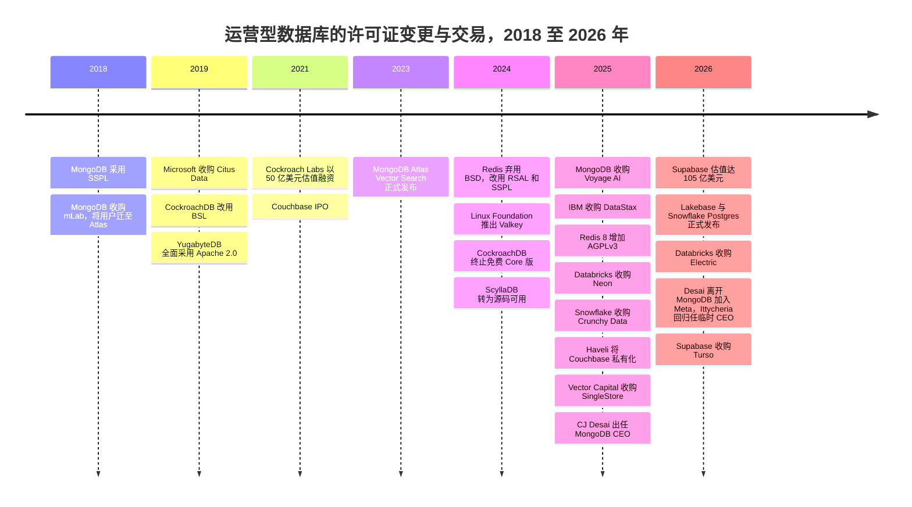
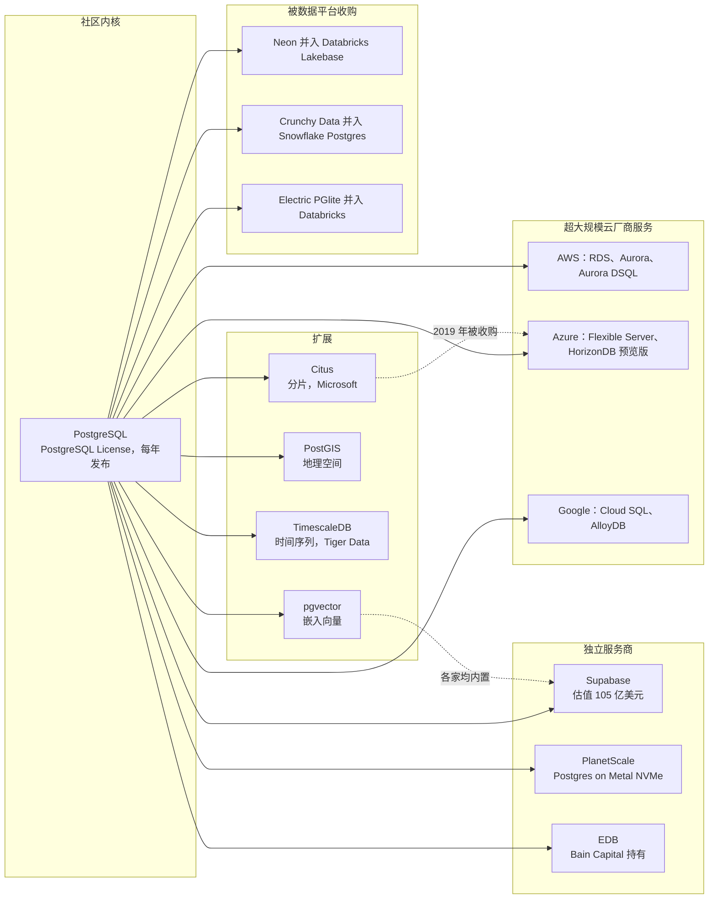

# 29. 运营型数据库厂商
> **状态：** 上市与非上市公司并存 · **总部：** 各不相同（Oracle：Austin, TX；MongoDB：New York, NY；多数挑战者：San Francisco Bay Area）· **成立：** 1977 年（Oracle）至 2021 年（Neon）· **最新估值/市值：** Oracle 市值 $382.45B（2026-10-23）；MongoDB 市值 $29.5B，EV $27.14B，EV/未来 12 个月收入 9.0x（2026-10-20）；Supabase 投后估值 $10.5B（媒体报道，2026 年 6 月）· **最后核实：** 2026-11-01

## 要点速览（TL;DR）

- **市场。** 运营型数据库（[OLTP](../glossary.md#oltp)）记录着企业的日常业务：订单、支付、账户、会话。它们属于数据库管理系统（DBMS）市场，Gartner 估算该市场 **2024 年规模为 $119.7B，同比增长 13.4%**（分析师估算）。超大规模云厂商和 Oracle 拿走了其中大部分收入，而 PostgreSQL 已成为新应用的默认引擎。[^gartner][^so25]
- **两家在位者，一个标准。** Oracle 的数据库收入主要来自对一个已有数十年历史的装机基础收取的支持服务费，其表现如同年金。MongoDB 是该品类中唯一一家已形成规模、独立上市的纯业务公司。其 **Q2 FY2027（2026 年 5–7 月）收入为 $771.8M，同比增长 30%（GAAP）**，较一年前（Q2 FY2026）约 24% 的增速以及 Q3 FY2026 19% 的低点重新加速。公司目前也处于两任正式 CEO 之间的空档：自 2025 年 11 月起担任 CEO 的 CJ Desai 于 2026 年 9 月离职加入 Meta，前任 CEO Dev Ittycheria 回归担任临时 CEO。其他所有厂商要么跑在 Postgres 之上，要么与之竞争。[^mdb-q2][^mdb-qtr]
- **Postgres 圈地运动。** 2025–26 年，分析型平台通过收购进入 OLTP 领域。Databricks 收购了 Neon（约 $1B，媒体报道）并将其改造为 Lakebase。Snowflake 收购了 Crunchy Data（其 10-Q 披露的收购对价为 $164.5M，而媒体报道约为 $250M），并推出了 Snowflake Postgres。Supabase 凭借开发者以及 AI 编程智能体（agent）创建数据库的热潮，估值达到 **$10.5B**（媒体报道，2026 年 6 月）。[^neon-deal][^crunchy][^supabase-f]
- **许可证是定价杠杆，而不是道德问题。** MongoDB（2018 年）、Cockroach Labs（2019 年、2024 年）、Redis（2024 年）和 ScyllaDB（2024 年）都收紧了许可证，以阻止云厂商转售其成果。在 AWS 和 Google 支持 **Valkey** 分叉之后，Redis 于 2025 年通过增加 AGPLv3 部分回调了方向。那些没有自有云却存活下来的独立厂商大多已被出售：DataStax 卖给 IBM，Couchbase 卖给 Haveli，SingleStore 卖给 Vector Capital。[^redis][^valkey][^datastax][^couchbase][^singlestore]
- **Everpure 视角。** 运营型数据库是 FlashArray 上典型的块存储工作负载。向云托管和无服务器 Postgres 的迁移，以及将存储重构为基于对象存储（object storage）的日志服务（Aurora、Neon/Lakebase），改变了持久性所在的位置。这既给本地块存储需求带来风险，也围绕 Kubernetes 数据服务（Portworx）、快速数据库克隆和以对象存储为后端的数据库存储创造了机会。[^neon-arch]

## 概览表

| 公司 | 所有权 / 状态 | CEO（据查） | 规模指标 | 口径 / 日期 | 估值 / 市值 |
|---|---|---|---|---|---|
| Oracle | 上市（NYSE: ORCL）；财年截至 5 月 31 日 | 联席 CEO Clay Magouyrk 与 Mike Sicilia [VERIFY] | Q1 FY2027（2026 年 6–8 月）收入约 $19.35B；OCI +121%；RPO $664B | GAAP；经 StorageNewsletter 媒体报道[^comps-orcl] | 市值 $382.45B，EV $514.52B，EV/未来 12 个月收入 5.7x（2026-10-23）[^comps-orcl] |
| MongoDB | 上市（Nasdaq: MDB）；财年截至 1 月 31 日 | Dev Ittycheria，**临时**总裁兼 CEO（自 2026 年 9 月起；此前自 2025-11-10 起任 CEO 的 CJ Desai 离职加入 Meta）；正在物色正式 CEO[^mdb-ceo] | Q2 FY2027 收入 $771.8M，+30%；FY2027 指引 $2.99–3.03B | GAAP；公司指引[^mdb-q2] | 市值 $29.5B，EV $27.14B，EV/未来 12 个月收入 9.0x（2026-10-20）[^comps-mdb] |
| Supabase | 非上市，风险投资支持 | Paul Copplestone（联合创始人） | 未披露收入 | n/d | 投后估值 $10.5B（2026 年 6 月）；2026 年 10 月追加 $150M，据报道估值 $10.65B（单一来源）[^supabase-f][^supabase-turso] |
| Neon → Databricks Lakebase | 被 Databricks 收购（2025 年 5 月宣布） | n/a（已并入 Databricks） | Lakebase 年化运行率 >$100M（2026 年 7 月） | 公司披露的年化运行率[^db-7b] | 交易约 $1B（媒体报道）[^neon-deal] |
| Crunchy Data → Snowflake Postgres | 被 Snowflake 收购（2025 年 6 月） | n/a（已并入 Snowflake） | Snowflake Postgres 正式发布（GA，2026 年 6 月） | 公司披露[^sf-pg] | 收购对价 $164.5M（10-Q）；媒体报道约 $250M（WSJ）[^crunchy] |
| Redis Inc. | 非上市，风险投资支持 | Rowan Trollope [VERIFY] | 未披露收入 | n/d | >$2B（G 轮，2021 年 4 月；媒体报道）[VERIFY][^redis-g] |
| Couchbase | 非上市（Haveli 私有化于 2025 年 9 月完成） | n/d | 最后一个公开财年收入约 $200M [VERIFY] | GAAP，退市前 | 按每股 $24.50 计股权价值约 $1.5B[^couchbase] |
| Cockroach Labs | 非上市，风险投资支持 | Spencer Kimball（联合创始人） | 未披露收入 | n/d | $5B（F 轮，2021 年 12 月；媒体报道）[^crdb-f] |
| SingleStore | 非上市（Vector Capital 控股收购，2025 年 9 月） | n/d | 未披露收入 | n/d | 股权价值约 $500M（Bloomberg 援引知情人士，非公司披露）[^singlestore] |
| DataStax | 被 IBM 收购（2025 年 5 月完成） | n/a | n/d | n/d | 交易金额未披露[^datastax] |

*图 29.1 — 概览。只有 Oracle 和 MongoDB 公布经审计的数据。此处所有非上市公司估值要么是 2021 年的定价，要么是媒体报道数字或交易价格，因此应视为参考指标，而非公允价值。*

## 起源与战略演进

### 四层市场结构

剥去品牌名称后，运营型数据库市场的形态其实很简单。

**第 1 层：商业关系型在位者。** Oracle Database、Microsoft SQL Server 和 IBM Db2 仍在运行全球大部分记录系统（systems of record）：ERP、核心银行、计费、电信。它们的收入主要来自多年前售出许可证的维护与支持费用，以及迁移到各厂商自有云的路径。DB-Engines 的流行度排名统计的是网络提及、招聘和搜索热度而非收入，它仍将 Oracle、MySQL（同样归 Oracle 所有）和 SQL Server 列为前三，PostgreSQL 第四，MongoDB 第五（2026 年 7 月，二手报道）。[^dbe-jul]

**第 2 层：超大规模云厂商的托管数据库。** Amazon RDS 和 Aurora、Azure SQL 和 Azure Database for PostgreSQL、Google Cloud SQL、AlloyDB 和 Spanner，以及 DynamoDB 和 Cosmos DB。它们如今是新增 OLTP 容量的最大渠道。Gartner 的公开摘要显示云 DBMS 约占市场的五分之三，但这一份额是推算出来的参考数字。[^gartner-cloud] [第 28 章](ch28-hyperscaler-data-platforms.md)深入介绍了超大规模云厂商。

**第 3 层：独立厂商。** MongoDB 是已形成规模的幸存者。围绕它的是一圈风险投资支持的专业厂商：分布式 SQL（Cockroach Labs、Yugabyte、PingCAP）、内存与键值（Redis、Aerospike）、宽列（ScyllaDB、DataStax），以及多模型或混合事务分析处理（HTAP）引擎（Couchbase、SingleStore）。它们大多按 2021 年的估值融资，此后要么被出售、要么被私有化，要么再没有新的定价轮次。

**第 4 层：Postgres 生态。** PostgreSQL 本身是一个采用宽松许可证、不受任何公司控制的社区项目。商业价值来自围绕它的包装：托管服务（managed service）（Supabase、Neon、Crunchy、PlanetScale、EDB，以及每一家超大规模云厂商）和扩展（pgvector、PostGIS、TimescaleDB、Citus）。开发者调查显示了这一结果。在 Stack Overflow 的调查中，PostgreSQL 的使用率从 2024 年占受访者的 48.7% 上升到 2025 年媒体报道的 55.6%，为所有数据库中最高。2026 年上半年，PostgreSQL 在 DB-Engines 上的得分增幅也居所有系统之首。[^so24][^so25][^dbe-h1]

### 战略演进，2018–2026

2018 年以来的演进分为三个阶段。**第一，开源厂商试图通过更改许可证来抵御云厂商。** Amazon、Microsoft 和 Google 一直在销售 MongoDB、Redis 和 Elasticsearch 的托管版本，却不向这些项目的主导公司付费。**第二，超大规模云厂商以分叉和自研引擎回应**：DocumentDB，以及后来的 Valkey。**第三，从 2025 年起，AI 改变了买方。** 编程智能体和"氛围编程"（vibe-coding）工具开始成千上万地创建数据库。分析型平台随即认定，谁拥有运营型数据库，谁就拥有新应用，于是收购 Postgres 公司以获得一个。

*图 29.2 — 许可证变更集中在 2018–2019 年和 2024 年；收购集中在 2025–2026 年。第一波浪潮旨在抵御云转售商；第二波旨在掌控 AI 构建的应用所起步的数据库。*[^mdb-sspl][^crdb-license][^yb-license][^redis-2024][^valkey][^scylla][^redis][^neon-deal][^crunchy][^couchbase][^singlestore][^electric][^supabase-turso]

> **类比：重新授权相当于修改版税表。** 从 Apache 或 BSD 切换到 SSPL、BSL 或 RSAL，在经济上类似于知识产权（IP）授权方针对某一类被许可方重写版税表。自行部署的终端用户仍然一分不付。而规模化变现该 IP 的那一类，即以服务形式提供该数据库的云厂商，如今被要求要么付费，要么开源其整个服务栈，而没有任何超大规模云厂商会这样做。与半导体 IP 一样，授权方的议价能力取决于转换成本。当被许可方有能力资助一个兼容的替代品（Redis 的 Valkey、MongoDB API 的 DocumentDB）时，修改版税表的结果不是提高版税，而是把最大的被许可方推出生态。

## 产品与技术

### Oracle：融合型在位者

Oracle Database 是关系型引擎的标杆：行存储、通过 undo 段实现的 [MVCC](../glossary.md#mvcc)、用于共享磁盘横向扩展的 Real Application Clusters，以及将 SQL 过滤下推到存储服务器的 Exadata 一体化工程系统。Oracle 的产品战略是**融合**。一个引擎同时处理关系、JSON、图、空间和向量数据，客户因此永远不需要第二个数据库。在 2025 年 10 月的 Oracle AI World 上，旗舰产品更名为 **Oracle AI Database 26ai**（23ai 的继任者），在引擎内部集成了向量检索（vector search）和 AI 功能。[^orcl-aiworld] 另一项战略举措是**多云**。Oracle 如今在其他云厂商的数据中心内运行 Exadata 硬件，形式包括 Oracle Database@Azure（28 个区域）、Database@Google Cloud（8 个区域，另有 9 个在规划中）和 Database@AWS。[^orcl-aiworld][^orcl-azure] 这种设计让数据库留在 Oracle 自己的基础设施和许可证之上，同时允许应用迁往其他云。这也解释了为何 Oracle 的云业务数据如今包含了过去属于本地支持服务的数据库收入。[第 28 章](ch28-hyperscaler-data-platforms.md)介绍了 OCI 及其 AI 基础设施建设。

### MongoDB：把文档模型做成一门生意

MongoDB 存储的是[文档](../glossary.md#document-database)：自包含的类 JSON 记录（磁盘上为 BSON），其结构与应用代码中的对象一致。一张客户订单连同其明细行和收货地址就是一个文档，一次操作即可读写，无需关联（join）。模式存在于应用之中，开发者因此无需执行迁移就能发布。代价出现在多对多关系占主导的场景。自 4.0 版（2018 年）起，MongoDB 支持多文档 ACID 事务（transaction），消除了企业架构师的主要顾虑。[^mdb-10k] 横向扩展通过基于分片键的分片（sharding）实现，高可用则依靠副本集。

该产品有三种销售方式：

- **Atlas**，运行在 AWS、Azure 和 Google Cloud 上的托管云服务。它于 2016 年推出，占 **FY2026（2025 年 2 月–2026 年 1 月）收入的 73%**，高于 FY2025 的 70%（公司披露）。[^mdb-ars]
- **Enterprise Advanced（EA）**，一种自管理订阅（subscription），包含管理工具、安全功能和支持服务，供那些将数据保留在本地或自有云账户中的银行和政府使用。
- **Community Edition**，基于 [SSPL](../glossary.md#sspl) 免费提供，是销售漏斗的顶端。

AI 层分三步构建。**Atlas Vector Search** 于 2023 年 12 月正式发布（GA）。它将嵌入（向量）（embedding）与运营文档存放在一起，并用近似最近邻（ANN）索引进行检索。[^mdb-vs] 收购 **Voyage AI**（$220M，2025 年 2 月）带来了嵌入与重排序（reranking）模型，使 MongoDB 不仅能存储向量，还能生成向量。这让它对检索质量有了一定话语权，而不仅限于存储。[^voyage] 2026 年 6 月，向量检索和全文检索在免费的自管理 Community Edition 中正式发布，把 AI 检索能力下沉到漏斗中那些从不接触 Atlas 的开发者。[^mdb-vs]

### Postgres 生态：一个带扩展总线的标准

PostgreSQL 的商业优势源于架构。其**扩展**机制允许第三方在不分叉内核的前提下添加数据类型、索引方法、函数乃至存储行为。这就是为什么一个引擎如今能覆盖 JSON 文档（JSONB，自 2014 年起）、向量（pgvector）、地理空间（PostGIS）、时间序列（TimescaleDB）和分片（Citus）。[^pg-jsonb][^pgvector] PostgreSQL 18（2025 年 9 月）新增了异步 I/O 子系统，表明内核仍在按年度发布周期独立改进。[^pg18]

*图 29.3 — Postgres 生态：一个社区内核，一个添加 AI 及其他数据类型的扩展层，以及三个层级的托管服务。2025–26 年的收购把最具创新性的独立服务商层级并入了 Databricks 和 Snowflake。*[^citus][^horizondb][^dsql-ga][^planetscale][^neon-deal][^crunchy][^electric]

> **类比：扩展如同芯粒（chiplet）生态。** Postgres 扩展的运作方式类似于围绕 UCIe 等标准裸片间接口构建的芯粒。核心引擎是基础裸片（base die）。扩展 API（钩子、自定义类型、索引访问方法、表访问方法）是接口规范。第三方构建专用"芯粒"，例如向量索引或地理空间类型，无需对内核重新流片就能装入任何合规封装。与 UCIe 一样，标准接口把价值转移给负责组装封装的一方（托管服务）以及构建最受欢迎芯粒的一方（pgvector、Citus）。它也让基础裸片商品化：没有人能为 PostgreSQL 本身收取溢价。

**各家托管服务设计的差异在于存储放在哪里。** 经典的托管 Postgres（RDS、Cloud SQL、Supabase、Crunchy）在虚拟机上运行原生引擎，并使用网络块存储。**Aurora**（2017 年）和 **Neon**（2021 年）则对引擎进行了解耦。计算层只把[预写日志（WAL）](../glossary.md#write-ahead-log)发送到存储服务，由存储服务重建数据页；在 Neon 的方案中，数据页还会分层下沉到对象存储。[^neon-arch] 这种设计使[数据库分支](../glossary.md#database-branching)（在某个日志位置创建的写时复制克隆）和[缩容至零](../glossary.md#scale-to-zero)成为可能。当软件智能体创建成千上万个短生命周期数据库时，这两项能力都至关重要。**PlanetScale** 走了相反的路线。其"Metal"产品在本地挂载的 NVMe 而非网络块存储上运行 Postgres 和 MySQL，并依靠复制（replication）获得持久性，以牺牲弹性换取延迟。[^planetscale] PlanetScale 的 MySQL 业务建立在 **Vitess** 之上，这是在 YouTube 构建、并于 2019 年从 CNCF 毕业的分片层。[^vitess]

### 专业厂商

- **Redis** 是一个内存数据结构服务器，用作缓存、会话存储、限流器和消息代理。Redis 8（2025 年 5 月）把原先的模块（JSON、搜索、时间序列、概率数据结构）并入内核，并新增了向量集合，因此如今也在语义缓存和[智能体记忆](../glossary.md#agent-memory)领域展开竞争。[^redis]
- **Valkey** 是 Linux Foundation 基于 Redis 7.2.4 的分叉，于 2024 年 3 月推出，获得 AWS、Google Cloud、Oracle 等公司的支持。AWS 和 Google 如今提供基于 Valkey 的托管缓存服务。[^valkey]
- **CockroachDB、YugabyteDB 和 TiDB** 是基于 Raft 共识（consensus）的分布式 SQL（[NewSQL](../glossary.md#newsql)）引擎。CockroachDB 和 YugabyteDB 兼容 Postgres 线协议，TiDB 兼容 MySQL 线协议。[第 4 章](../01-data-systems-foundations/ch04-distributed-databases.md)解释了其中的机制。
- **Couchbase** 是一个采用内存优先架构的 JSON 文档数据库，具备类 SQL 查询语言（SQL++）和移动端同步。**SingleStore** 是一个 [HTAP](../glossary.md#htap) 引擎，结合了内存行存储与磁盘列存储。**ScyllaDB** 是用 C++ 重写的 Apache Cassandra。**DataStax** 以 Astra DB 的形式将 Cassandra 商业化，并拥有智能体构建工具 Langflow。**Aerospike** 是针对闪存优化的键值与文档存储，用于广告技术、反欺诈和电信领域。

## 盈利模式

该品类依靠四种收入模式运转，每一种对应不同的利润率和不同的 AI 敞口。

| 模式 | 计价单位 | 收入确认 | 毛利率驱动因素 | 示例 |
|---|---|---|---|---|
| 永久许可证 + 年度支持 | 按处理器核心（含核心系数）或指定用户计；支持费按许可证价格的一定百分比计 | 许可证一次性确认；支持费按期确认 | 支持业务接近 100%；无基础设施成本 | Oracle、SQL Server、Db2 |
| 期限订阅（自管理） | 按服务器或核心计的年度或多年订阅 | 根据 ASC 606，许可证部分一次性确认，支持部分按期确认，因此收入波动较大 | 高；无基础设施成本 | MongoDB Enterprise Advanced、Couchbase、EDB、Redis Enterprise 软件 |
| 按用量计费的云服务 | 实例小时、存储、I/O、数据传输；承诺消费并逐步抵扣的合同 | 按消耗确认 | 云基础设施计入 COGS；利润率取决于利用率 | MongoDB Atlas、Supabase、Neon/Lakebase、Redis Cloud、CockroachDB Cloud |
| 超大规模云厂商捆绑服务 | 实例小时或无服务器请求单元 | 按消耗确认 | 由云厂商获取，而非引擎作者 | RDS、Aurora、AlloyDB、ElastiCache for Valkey |

*图 29.4 — 商业模式。独立厂商的长期问题在于最后一行。当云厂商捆绑一个兼容引擎时，数据库的作者拿不到任何利润。*

### Oracle：支持服务年金

Oracle 的数据库经济模型建立在支持服务之上。客户购买永久许可证（通常按处理器核心计价），之后每年支付支持费，历史上约为**净许可证费用的 22%**，并随通胀条款上调。[^orcl-sig] 支持服务的续约率非常高，因为迁移核心银行或 ERP 数据库是一个历时多年、风险很高的项目。Oracle 不单独披露数据库收入。其"云服务与许可证支持"科目混合了数据库和应用支持以及云业务，在 **FY2025 的 $57.4B 总收入中约占 $44.0B**（财年截至 2025 年 5 月 31 日；GAAP）[VERIFY]。[^orcl-fy25]

> **类比：半导体 IP 维护费。** Oracle 的支持收入流与半导体 IP 组合的维护费和版税尾部表现相似。一旦某个设计基于特定 CPU 核或接口 IP 完成流片，只要芯片还在出货，客户就会持续付费，因为改用不同 IP 重新流片既昂贵又有风险。估值逻辑也相同：将其定价为一个递减年金，具有高续约率（低流失）、温和的价格上调条款，以及一个取决于装机基础向外迁移速度的终值。Database@Azure、Google 和 AWS 是 Oracle 在应用层迁往其他云时维持这笔年金的方式。

### MongoDB：按用量计费加上波动的期限许可证

**Atlas** 按集群规格（实例大小、内存、存储）、I/O 和数据传输计费，按小时计量。大客户签订年度承诺并逐步抵扣。收入跟随用量变化，因此某季度的 Atlas 增长反映的是现有应用的负载强度以及新上线应用的数量，而非签了多少合同。**Enterprise Advanced** 是期限许可证。根据 ASC 606，多年期交易中的许可证部分在期限开始时确认，因此一笔大额 EA 续约就可能让某季度收入大幅波动。这就是为什么大额 EA 交易集中的 Q4 会出现 Atlas 占比（Q4 FY2026 为 72%，公司在业绩电话会上披露）低于全年（73%）的情况。[^mdb-call][^mdb-ars]

Atlas 的毛利率（gross margin）低于 EA，因为 MongoDB 需要为底层机器向 AWS、Azure 和 Google 付费。这与[第 25 章](ch25-databricks.md)描述的 Databricks 无服务器业务中"从版税转向代工"的变化相同。Q2 FY2027 的综合结果为 **74% 的 GAAP 毛利率和 76% 的非 GAAP 毛利率**。[^mdb-q2]

### Postgres 服务商：谁在赚钱

由于引擎是免费的，Postgres 厂商赚的是运维、开发者体验和周边能力的钱。Supabase 将 Postgres 与身份认证、文件存储、实时订阅和边缘函数打包，按项目加用量收费。Neon（现为 Lakebase）按计算小时和存储收费，而缩容至零意味着闲置数据库几乎不产生费用。正是这一点让智能体成千上万地创建数据库变得足够便宜。EDB 向正在离开 Oracle 的企业销售企业级 Postgres 订阅和 Oracle 兼容工具。从 Postgres 中赚钱最多的是超大规模云厂商，它们通过 RDS、Aurora、Azure 和 Cloud SQL 的实例小时获利，却并不拥有该项目。

