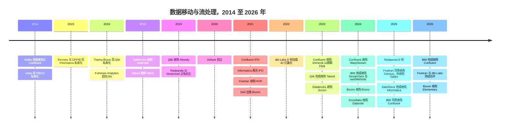
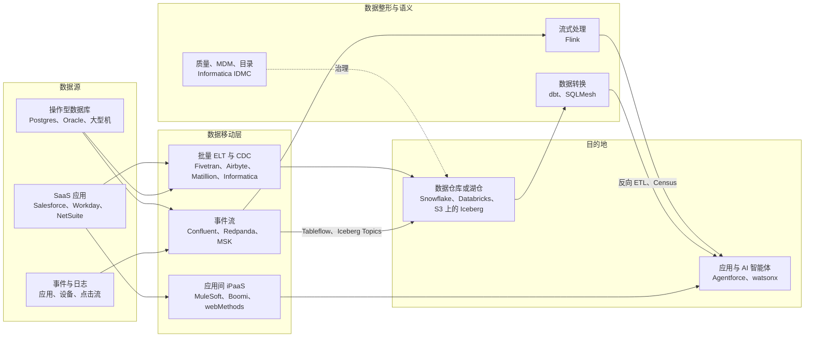

# 30. 数据移动与流处理公司
> **状态：** 混合：已被收购 / 私营 · **总部：** 多地（美国、英国） · **成立：** 1993–2020 年 · **最新估值/市值：** IBM–Confluent 约 $11B EV（公告交易价值，2026-03-17 完成）；Salesforce–Informatica 约 $8B 股权价值（2025-11-18 完成）；Fivetran + dbt Labs 未定价（全股票合并，2026-06-01 完成） · **最后核实：** 2026-11-01

## 要点速览（TL;DR）

- **这一层在 18 个月内被"卖光"。** 2025 年 5 月至 2026 年 6 月间，三家最知名的独立数据移动企业或易主、或合并。Salesforce 收购 Informatica（约 $8B 股权价值），IBM 收购 Confluent（约 $11B 企业价值），Fivetran 则以全股票交易与 dbt Labs 合并。留下来的独立厂商（Airbyte、Redpanda、Matillion、Estuary）规模要小得多。[^infa-close][^ibm-close][^ft-dbt-close]
- **Confluent 是基准先例。** IBM 支付的价格约为 Confluent FY2025 GAAP 收入 $1,166.7M 的 **9.4x**，该收入增长 21%。其中 Confluent Cloud 贡献 $624M（+27%），占比 53%。非 GAAP 营业利润率仅 7.4%，GAAP 营业亏损为 $380.1M。增速已从 FY2021 的 64% 放缓。应将这一价格理解为对一家增长正在褪色的品类龙头给出的、经增长调整后的合理倍数，而非稀缺性溢价。[^comps-cflt][^cflt-fin]
- **买家要的是 AI 智能体（agent）的上下文，而不是"管道"。** Salesforce 需要在 Data 360（2025 年 10 月由 Data Cloud 更名而来）和 Agentforce 之下有一层经过治理、完成匹配的主数据。IBM 需要在 watsonx 之下、与 Red Hat 和 HashiCorp 并列的一层实时事件层。Fivetran + dbt Labs 则希望成为位于客户与 Snowflake、Databricks 及超大规模云厂商之间、从数据摄取（ingestion）到语义的中立层。
- **为什么整合冲击了这一层。** 平台如今捆绑了"够用"的连接器。按连接计量和无盘（diskless）Kafka 设计给定价带来压力。智能体需要集成化、经过治理的上下文。买家厌倦了把十种工具拼接在一起。而 2021 年那一批私募估值也需要退出。
- **Everpure 视角（仅基于公开信息）。** 流数据的保留正迁移到对象存储（object storage）上，而数据移动决定了湖仓一体（lakehouse）表最终落在哪里。这两个趋势都让兼容 S3 的本地存储有可能成为落地区。可行的选项包括：与无盘 Kafka 引擎做认证、与可自托管的摄取工具一起做落地区设计，以及关注 IBM——它既是潜在合作伙伴，也是存储领域的对手。

## 概览表

| 公司 | 成立 / 总部 | 负责人（最新公开信息） | 所有者 / 状态（2026-11-01） | 规模指标（已标注） | 最近价格（口径、日期） |
|---|---|---|---|---|---|
| Confluent | 2014 / Mountain View, CA | Jay Kreps（联合创始人，交割时任 CEO） | 自 2026-03-17 起为 IBM 子公司 | FY2025 收入 $1,166.7M，+21%（GAAP）；客户 >6,500 家（公司披露） | 约 $11B EV，每股现金 $31（公告交易价值，2025-12-08）[^ibm-close][^comps-cflt] |
| Informatica | 1993 / Redwood City, CA | Amit Walia（交割时任 CEO）[VERIFY: 交割后的职务] | 自 2025-11-18 起为 Salesforce 子公司 | FY2024 收入约 $1.6B（GAAP）[VERIFY] | 约 $8B 股权价值，每股现金 $25（2025-05-27）[^infa-close][^infa-fin] |
| Fivetran + dbt Labs | 2012（Fivetran，Oakland）与 2016（dbt Labs，Philadelphia） | George Fraser（CEO）、Tristan Handy（总裁） | 私营；合并于 2026-06-01 完成 | 合并 ARR "接近 $600M"（公司披露） | 未定价（全股票）。最近融资轮 $5.6B（Fivetran，2021）与 $4.2B（dbt Labs，2022），公司披露[^ft-dbt-close][^funding] |
| Airbyte | 2020 / San Francisco | Michel Tricot（联合创始人，CEO） | 私营 | 700+ 个连接器（公司披露）；收入未披露 | 投后估值 $1.5B，$150M B 轮（公司披露，2021-12-17）[^ab-seriesb] |
| Redpanda | 2019 / San Francisco | Alex Gallego（创始人，CEO） | 私营 | 收入未披露 | 投后估值 $1B，GV 领投的 $100M D 轮（公司披露，2025-04）[^rp-fund] |
| Matillion | 2011 / Manchester, UK 与 Denver | Matthew Scullion（创始人，CEO）[VERIFY] | 私营 | 收入未披露 | $1.5B，General Atlantic 领投的 $150M E 轮（融资轮为公司披露；估值为媒体报道，2021-09）[^matillion-e] |
| Estuary | 本轮核查未核实 | 本轮核查未核实 | 私营 | 已连接 200+ 个系统（公司披露） | $17M A 轮，M13 领投（公司披露，2025-10-21；SiliconANGLE 报道为 $14M）[VERIFY][^estuary] |

*图 30.1 — 概览。在三家收入或 ARR 达到约 $1B 及以上的公司中，两家如今隶属于更大的集团，第三家则是靠合并才达到这一规模。剩下的独立厂商属于风投体量，且它们最近一次定价融资大多在 2021 年。*

## 起源与战略演进

本章贯穿着两条谱系。**ETL 谱系**（Informatica，其后是 Talend、Matillion、Fivetran、Airbyte）起家于把数据从应用程序批量搬运到数据仓库。相关机制见[第 10 章](../02-pipelines-and-governance/ch10-ingestion-and-integration.md)。**日志谱系**（Kafka、Confluent、Redpanda）起家于在系统之间持续传送事件，其机制见[第 11 章](../02-pipelines-and-governance/ch11-streaming-and-event-platforms.md)。两者在 2025–26 年走到了同一个终点：被收购、被合并，或承受着捆绑相同功能的平台带来的压力。

*图 30.2 — 整合时间线。私募股权买下了第一代公司（2014–2016），2021 年的 IPO 窗口给了 Confluent 和 Informatica 公开市场的"货币"，而战略买家在五年内把两者都收入囊中。资料来源：`data/ma_deals.csv`、`data/private_funding.csv` 及下方脚注。*

### Confluent

Jay Kreps、Neha Narkhede 和 Jun Rao 在 LinkedIn 打造了 Kafka，随后离职于 2014 年创立 Confluent。[^cflt-10k] 其计划是典型的开放核心（open core）模式。Apache Kafka 在 Apache 许可证下保持免费，Confluent 则销售带有连接器、模式注册表（schema registry）、安全与支持服务的企业发行版（Confluent Platform）。随后又推出了托管服务（managed service）Confluent Cloud。公司于 2021 年 6 月在 Nasdaq 上市，正值疫情后软件市场的顶点。[^cflt-ipo]

IPO 之后的战略演进有三步。**第一，把收入结构转向云。** 按我们的推算，Confluent Cloud 在 FY2024 已超过收入的一半，FY2025 达到 53%。[^cflt-fin] **第二，补上处理能力。** 公司于 2023 年 1 月以 $54.9M 现金收购了由 Apache Flink 提交者组成的团队 Immerok，Flink 由此成为公司的流处理引擎。[^ma-csv] **第三，回应成本攻势。** WarpStream 在 2023 年证明，一款直接写入 S3 的 Kafka 兼容引擎能在跨可用区网络费用上压低经典 Kafka 的成本。Confluent 于 2024 年 9 月以 $135.1M 的初步对价将其收购，推出了自家直写对象存储的 Freight 集群，并发布了把主题（topic）写为 Iceberg 表的 Tableflow（2025 年 3 月 GA）。[^ma-csv][^tableflow][^freight] 每一步的技术细节都在[第 11 章](../02-pipelines-and-governance/ch11-streaming-and-event-platforms.md)中讲解。商业上的要点在于：每一步都拓宽了产品线并降低了成本底线，但没有一步让增速重回 30% 以上。

### Informatica

Gaurav Dhillon 和 Diaz Nesamoney 于 1993 年创立 Informatica。它成为企业 ETL 服务器的默认之选（PowerCenter），并于 1999 年上市。[^infa-hist] 到 2015 年，增长陷入停滞，维权投资者介入，Permira 与加拿大养老金计划投资委员会（CPPIB）以 $5.3B 将其私有化（take-private）。[^infa-pe] 私募股权的计划是把公司重建为订阅和云业务。这次重建的成果就是智能数据管理云（Intelligent Data Management Cloud，IDMC）。IDMC 是一个按用量计费的统一平台，涵盖集成、数据质量、主数据管理（MDM）、目录和数据治理，以预付、共享池化的 Informatica 处理单元（IPU）形式销售。[^infa-ipu] Informatica 于 2021 年 10 月重返公开市场。[^infa-fin] 其云业务增长迅速，但底层的维护收入基础在迁移或萎缩，因此总体增速一直停留在个位数。它的估值倍数始终未能恢复到云软件的水平。

据报道，Salesforce 曾在 2024 年 4 月与 Informatica 洽谈收购，但谈判破裂（媒体报道）。[^infa-2024] 十三个月后，Salesforce 同意以每股 $25 现金、约 $8B 股权价值收购，交易于 2025 年 11 月 18 日完成。[^infa-close]

### Fivetran 与 dbt Labs

George Fraser 和 Taylor Brown 于 2012 年创立 Fivetran，并将其打造为领先的托管 ELT 服务，按[月活跃行数](../glossary.md#monthly-active-rows)（monthly active rows，MAR）计费。[^ft-300m] 2021 年 9 月，公司以 $5.6B 估值融资 $565M，并以 $700M 收购了企业级[变更数据捕获（CDC）](../glossary.md#change-data-capture)厂商 HVR。[^hvr][^funding] 公司于 2024 年 9 月突破 $300M ARR（公司披露）。[^ft-300m]

dbt 于 2016 年诞生于 Tristan Handy 的咨询公司 Fishtown Analytics。它让 SQL 数据转换（transformation）代码可以版本控制、可以测试，并创造了"分析工程师"（analytics engineer）这一职位（见[第 12 章](../02-pipelines-and-governance/ch12-transformation-and-orchestration.md)）。公司于 2021 年更名为 dbt Labs，并于 2022 年 2 月以 $4.2B 估值完成 $222M D 轮融资。[^funding] 它通过 dbt Cloud——一个托管的开发环境、调度器和语义层（semantic layer）——实现变现，而 dbt Core 保持开源。2025 年 2 月，公司突破 $100M ARR，dbt Cloud 客户超过 5,000 家（公司披露）。[^dbt-100m]

随后 Fivetran 通过收购拼出了一个完整的技术栈。它同意收购用于反向 ETL（reverse ETL）的 **Census**（2025 年 5 月宣布；交割未单独确认），收购了拥有 SQLMesh——dbt 最有分量的挑战者——的 **Tobiko Data**（2025 年 9 月），随后又与 **dbt Labs** 达成全股票合并（2025 年 10 月 13 日宣布，2026 年 6 月 1 日完成）。2026 年 5 月，它还接手了 Great Expectations 开源项目的管理。[^census][^tobiko][^ft-dbt-close][^ma-csv] Fraser 任 CEO，Handy 任总裁。

### Airbyte 与 Redpanda

**Airbyte** 由 Michel Tricot 和 John Lafleur 于 2020 年创立，是 Fivetran 的开源对手。它可免费自托管，拥有由社区构建的长尾连接器，并提供付费云服务。它于 2021 年 12 月——现代数据栈周期的顶峰——以 $1.5B 估值完成 $150M B 轮融资。[^ab-seriesb] **Redpanda** 由 Alex Gallego 于 2019 年创立（最初名为 Vectorized）。它用 C++ 以每核一线程（thread-per-core）的设计重写了 Kafka broker，不依赖 JVM 或 ZooKeeper，保持与 Kafka API 的兼容，主打性能、简洁以及自带云（bring-your-own-cloud）部署模式。它于 2025 年 4 月以 $1B 估值融资 $100M，由 GV 领投。[^rp-fund]

## 产品与技术

本节把产品映射到商业定位上。相关机制（日志、分区、MAR 计量、CDC）在第 [10](../02-pipelines-and-governance/ch10-ingestion-and-integration.md) 章和第 [11](../02-pipelines-and-governance/ch11-streaming-and-event-platforms.md) 章中讲解。

*图 30.3 — 数据移动层及其邻居。本章中的每个买家都买下了一个方框以及它旁边的部分箭头：IBM 买下了流处理方框外加处理能力，Salesforce 买下了数据治理外加集成，Fivetran 买下了摄取、转换外加反向 ETL。*

### Confluent

Confluent 的产品组合分四层。(1) **Kafka 本身**，形式为 Confluent Platform（自管理，定期许可）或 Confluent Cloud（托管，运行在其 Kora 引擎上）。(2) **Freight 集群与 WarpStream**，面向对延迟不敏感、数据量大的对象存储层级。WarpStream 采用自带云模式，数据平面位于客户自己的账户中。(3) 用于流处理的 **Flink**，外加 2025 年末推出、为 AI 智能体供数的"Streaming Agents"与"Real-Time Context Engine"功能。[^confluent-intel] (4) **Tableflow** 与连接器，把主题落地为 Iceberg 或 Delta 表。产品组合宽广是看多的理由。看空的理由在于第 2 层和第 4 层会蚕食第 1 层的收入：更便宜的层级和表的交接都会降低客户每 GB 的支出。

### Redpanda

Redpanda 是一个支持 Kafka 协议的单一二进制程序。它主打更低的尾延迟，以及在同等吞吐下更少的机器数量（厂商声称）。从商业角度看，更重要的产品决策是 **BYOC**。Redpanda 运行控制平面，而数据平面和数据都留在客户的云账户中，这有助于通过安全审查，也让客户可以消耗云承诺消费额度（committed spend）。Iceberg Topics（2025 年 4 月 GA）和对象存储层级"Cloud Topics"对应了 Confluent 的 Tableflow 和 Freight。[^rp-iceberg][^rp-streamfest] Redpanda 于 2024 年 5 月收购了 Benthos（条款未披露），以补充一个连接器和流处理框架（Redpanda Connect）。[^rp-benthos]

### Fivetran + dbt Labs

合并后的产品覆盖四个环节：连接器，包括基于 HVR 的数据库 CDC 以及用于自定义数据源的 Connector SDK；通过 dbt（Core、Fusion 引擎和 dbt platform，即原 dbt Cloud）和 SQLMesh 实现的数据转换；语义层（MetricFlow，2025 年 10 月开源）；以及通过 Census 反向 ETL 实现的数据激活。[^ft-sdk][^metricflow][^census] 其卖点是**中立性**：一条从数据源到指标定义、经过治理的数据管道（pipeline），在 Snowflake、Databricks、BigQuery 和 Fabric 上同样适用。这恰恰是这些平台无法可信地提供给彼此客户的东西。

### Informatica

IDMC 是这里覆盖面最广的套件。它涵盖集成（批量、CDC、API 与应用集成）、数据质量、MDM、数据目录（data catalog）和数据治理（governance），全部置于 CLAIRE AI 层之下。MDM 是战略上的"明珠"。把"Acme Corp"、"ACME Corporation"和"Acme Inc."匹配成一条黄金客户记录，是一项艰难且粘性很强的工作，摄取工具不做这件事。Salesforce 正需要这种能力，为 Agentforce 提供单一、可信的客户视图。

### Airbyte、Matillion 与 iPaaS 厂商（简述）

- **Airbyte** 销售三样东西：Elastic License（ELv2）下的开源软件、按积分或容量（"Data Workers"）计价的云服务，以及自管理的企业许可。它的 AI 战略分两半。一半是更便宜的连接器：通过 AI 辅助的 Connector Builder 根据 API 文档起草连接器（2024 年）。另一半是把连接器定位为智能体的数据访问通道，借助 PyAirbyte 和面向智能体的工具 [VERIFY: 当前智能体产品名称]。[^ab-ai][^ab-license][^ab-pricing]
- **Matillion** 提供可视化 ELT，把计算下推到 Snowflake、Databricks 和 Redshift 中执行，按积分计价。它已加入用于构建数据管道的"Maia"AI 智能体 [VERIFY: 发布日期]。[^matillion]
- **Qlik Talend** 是 Thoma Bravo 旗下整合 Qlik、Attunity（CDC 复制）以及 Talend 与 Stitch 的并购组合体，在企业级 CDC 方面实力强劲。[^qlik-talend]
- **Boomi** 是一家 iPaaS 厂商，Dell 于 2021 年以约 $4B（公告交易价值）将其出售给 Francisco Partners 和 TPG。它通过 Rivery（约 $100M，媒体报道，2024 年 12 月）补充了 ELT 和 CDC，又通过 Elementary（2026 年 10 月）补充了可观测性。[^boomi-dell][^rivery][^elementary]
- **MuleSoft** 是 Salesforce 以 API 为主导的应用集成业务，于 2018 年以 $6.5B 收购，如今与 Informatica 同处 Salesforce 旗下。[^mulesoft]

## 盈利模式

| 厂商 | 主要计价单位 | 收入确认特征 | 利润率驱动因素 |
|---|---|---|---|
| Confluent Cloud | 按用量：集群容量单位（eCKU）、按 GB 计的网络、存储、Flink 计算单位 [VERIFY: 当前单位名称] | 按消耗确认；随客户优化而波动 | 云基础设施计入营业成本（COGS）；跨可用区网络费用 |
| Confluent Platform | 订阅，按节点或核心计 [VERIFY] | 依 ASC 606 许可部分在前期确认，因此收入呈块状 | 高（软件许可） |
| Redpanda | BYOC、专属和无服务器云层级；自管理的企业许可 | 按用量或订阅 | BYOC 使基础设施不计入 Redpanda 的 COGS |
| Fivetran | 按连接计 MAR，自 2026 年 1 月起对小型连接收取 $5 基础费 | 在年度承诺额度内按用量计 | 长尾连接支付最高的每行费率 |
| dbt platform | 开发者席位加上按构建模型计量的用量 [VERIFY: 2026 年定价] | 订阅叠加用量 | 软件级利润率；数据仓库算力由客户支付 |
| Informatica IDMC | 预付、共享池化的 IPU | 订阅承诺额度按消耗扣减 | PowerCenter 存量客户的迁移决定增速 |
| Airbyte | 积分（Standard）或容量（Pro、Enterprise Flex）；开源免费 | 按用量或容量 | 社区维护了大部分长尾 |

*图 30.4 — 计价单位。每家厂商计量的东西都不同：行数、容量单位、IPU、席位。这使账单难以比较，也给了采购部门整合供应商的理由。资料来源：第 10 章定价表及厂商定价页面。[^ft-pricing][^ft-2026][^infa-ipu][^ab-pricing]*

**向按用量计费的转变拖累了 Confluent 的报告增速。** 当客户从 Confluent Platform 迁移到 Confluent Cloud 时，收入确认的形态会改变。三年期定期许可会在前期确认一大块许可收入。云端按用量计费则随客户使用逐月确认收入。在若干年里，即便客户终身价值上升，迁移也会压低报告增速。按用量计费还会把客户的成本优化周期直接传导到收入上。2023 年的云"优化"浪潮，以及后来客户把对延迟不敏感的工作负载迁往更便宜的层级，都是以这种方式冲击了 Confluent。

**Fivetran 的计费表向长尾"征税"。** [第 10 章](../02-pipelines-and-governance/ch10-ingestion-and-integration.md)详细推演了 MAR 定价。其商业含义是：Fivetran 利润率最高的行数据来自小型 SaaS 连接，而这正是平台捆绑连接器和 AI 生成连接器所攻击的长尾。按连接分层（2025 年 3 月）和基础费（2026 年 1 月）恰恰抬高了这些连接的实际价格。[^ft-2025][^ft-2026] 这在当下有助于收入，却也给了竞争对手攻击的论据。

> **类比：半导体（IP 核）。** 连接器目录就像一个 **IP 核**库。每个 IP 核（USB PHY、DDR 控制器、Salesforce 连接器）都不起眼，每当标准或 API 变化时都必须重新验证，而且放在一个经过验证的组合里比单独存在更有价值。EDA 厂商花了二十年收购 IP 核和单点工具公司，直到客户购买的是一整套经过验证的流程而不是零件。Fivetran–dbt 合并和 Boomi 的补强收购遵循同样的逻辑。捆绑包之所以能获得溢价，是因为它承担了重新验证的负担，而一家只有一个更好 IP 核的初创公司很难被"设计导入"。

## 财务数据

### Confluent（GAAP，财年 = 自然年）

*图 30.5 — Confluent 的收入在六年内增长约 7.8x，但 FY2021 之后增速逐年下降。云业务在 FY2024 超过收入的一半（我们的数字，由 FY2025 增速推算）。FY2024（$963.6M）和 FY2025（$1,166.7M）已与 FY2025 10-K 及业绩公告核对确认；FY2019–FY2023 的总额凭记忆取自历年申报文件，已标记待复核。资料来源：`data/ch30_confluent_financials.csv`。[^cflt-fin]*

收入从 $149.8M（FY2019）增至 $1,166.7M（FY2025）。增速在 FY2021 达到 64% 的峰值，随后依次放缓至 51%、33%、24% 和 21%。[^cflt-fin] FY2025 收入分为订阅 $1,119.7M 和服务 $47.0M；仅 Q4 就达 $314.8M（+21%），其中云业务 $169M（+23%），可见云业务的增速本身在出售前也在放缓。[^cflt-10k] Confluent Cloud 全年增长 27%，快于总收入，因此其余部分（主要是自管理的 Platform，加上服务）按我们的算法增长约 15%：($1,166.7M − $624M) ÷ ($963.6M − $491M) ≈ 15%（估算；FY2024 云业务基数为推算值）。公司在整个上市期间都报告 GAAP 营业亏损（FY2025：−$380.1M），主要由股权激励费用（SBC）驱动。按非 GAAP 口径，它只是略有盈利：营业利润率 FY2024 为 2.9%，FY2025 为 7.4%。[^cflt-10k] 因此买家支付的是增长和战略契合度，而不是当前盈利。

### 交易倍数

| 交易（宣布时间） | 价格 | 收入基数 | 倍数 | 标注 |
|---|---|---|---|---|
| IBM–Confluent（2025-12） | 约 $11.0B EV（IBM 入账收购价 $11.6B） | FY2025 收入 $1,166.7M（GAAP），+21% | **约 9.4x** EV/过去 12 个月收入（按入账价格约 9.9x） | 根据披露数据估算[^comps-cflt][^ibm-10q] |
| Salesforce–Informatica（2025-05） | 约 $8B 股权价值 | FY2024 收入约 $1.6B（GAAP）[VERIFY] | **约 5x** 股权价值/过去 12 个月收入；计入净债务后 EV/收入更高 [VERIFY] | 估算[^infa-close][^infa-fin] |
| Permira/CPPIB–Informatica（2015-04） | $5.3B | FY2014 收入约 $1.05B（GAAP） | **约 5x** | 估算[^infa-pe][^infa-hist] |
| Salesforce–MuleSoft（2018-03） | $6.5B | FY2017 收入约 $297M（GAAP） | **约 22x** | 估算[^mulesoft] |
| IBM–HashiCorp（2024-04；背景参考） | 约 $6.4B | FY2024（截至 2024 年 1 月）收入约 $583M（GAAP） | **约 11x** | 估算[^hashicorp] |
| Fivetran–HVR（2021-09） | $700M | 未披露 | 不适用 | 已披露价格[^hvr] |
| Confluent–WarpStream（2024-09） | 初步对价 $135.1M（另有最多 $76.2M 的暂扣款） | 未披露 | 不适用 | GAAP 披露（10-Q）[^ma-csv] |
| IBM–StreamSets 与 webMethods（2023-12） | €2.13B（约 $2.3B） | 未披露 | 不适用 | 已披露价格[^ibm-ss] |
| Boomi–Rivery（2024-12） | 约 $100M | 未披露 | 不适用 | 媒体报道[^rivery] |
| Fivetran–dbt Labs（2025-10） | 全股票，无价格 | 合并 ARR 约 $600M（公司披露） | 不适用 | 公司披露[^ft-dbt-close] |

*图 30.6 — 交易倍数。成长型资产（2018 年的 MuleSoft、Confluent）获得约 9–22x 收入倍数。成熟套件（Informatica）两次都以约 5x 成交，前后相隔十年。*
