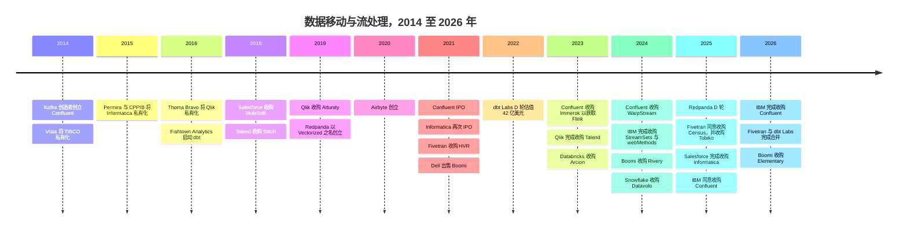
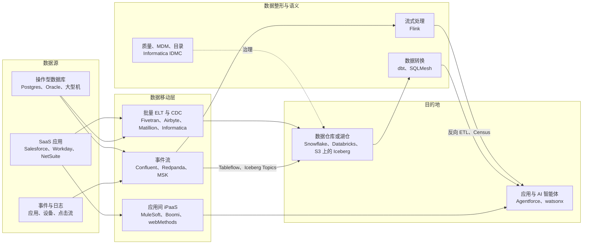
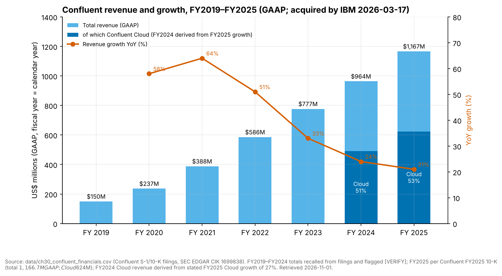
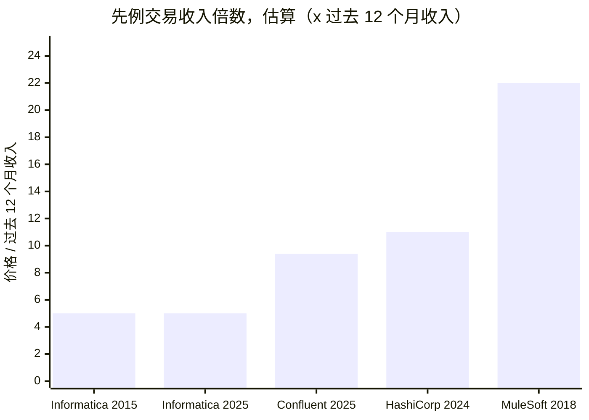
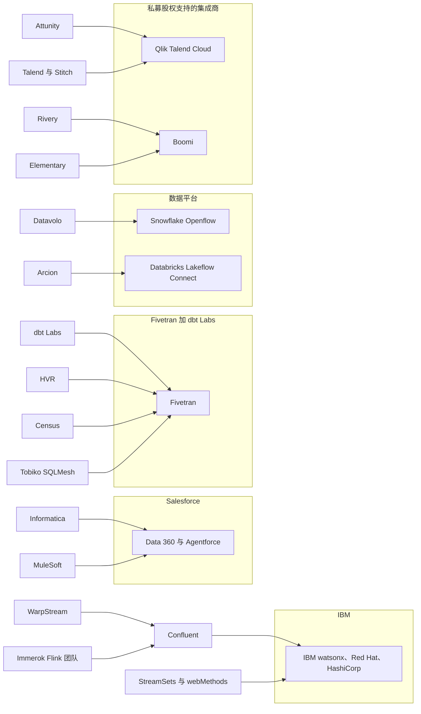

# 30. 数据移动与流处理公司
> **状态：** 混合：已被收购 / 私营 · **总部：** 多地（美国、英国） · **成立：** 1993–2020 年 · **最新估值/市值：** IBM–Confluent 约 $11B EV（公告交易价值，2026-03-17 完成）；Salesforce–Informatica 约 $8B 股权价值（2025-11-18 完成）；Fivetran + dbt Labs 未定价（全股票合并，2026-06-01 完成） · **最后核实：** 2026-11-01

## 要点速览（TL;DR）

- **这一层在 18 个月内被"卖光"。** 2025 年 5 月至 2026 年 6 月间，三家最知名的独立数据移动企业或易主、或合并。Salesforce 收购 Informatica（约 $8B 股权价值），IBM 收购 Confluent（约 $11B 企业价值），Fivetran 则以全股票交易与 dbt Labs 合并。留下来的独立厂商（Airbyte、Redpanda、Matillion、Estuary）规模要小得多。[^infa-close][^ibm-close][^ft-dbt-close]
- **Confluent 是基准先例。** IBM 支付的价格约为 Confluent FY2025 GAAP 收入 $1,166.7M 的 **9.4x**，该收入增长 21%。其中 Confluent Cloud 贡献 $624M（+27%），占比 53%。非 GAAP 营业利润率仅 7.4%，GAAP 营业亏损为 $380.1M。增速已从 FY2021 的 64% 放缓。应将这一价格理解为对一家增长正在褪色的品类龙头给出的、经增长调整后的合理倍数，而非稀缺性溢价。[^comps-cflt][^cflt-fin]
- **买家要的是 AI 智能体（agent）的上下文，而不是"管道"。** Salesforce 需要在 Data 360（2025 年 10 月由 Data Cloud 更名而来）和 Agentforce 之下有一层经过治理、完成匹配的主数据。IBM 需要在 watsonx 之下、与 Red Hat 和 HashiCorp 并列的一层实时事件层。Fivetran + dbt Labs 则希望成为位于客户与 Snowflake、Databricks 及超大规模云厂商之间、从数据摄取（ingestion）到语义的中立层。
- **为什么整合冲击了这一层。** 平台如今捆绑了"够用"的连接器。按连接计量和无盘（diskless）Kafka 设计给定价带来压力。智能体需要集成化、经过治理的上下文。买家厌倦了把十种工具拼接在一起。而 2021 年那一批私募估值也需要退出。
- **Everpure 视角（仅基于公开信息）。** 流数据的保留正迁移到对象存储（object storage）上，而数据移动决定了湖仓一体（lakehouse）表最终落在哪里。这两个趋势都让兼容 S3 的本地存储有可能成为落地区。可行的选项包括：与无盘 Kafka 引擎做认证、与可自托管的摄取工具一起做落地区设计，以及关注 IBM——它既是潜在合作伙伴，也是存储领域的对手。

## 概览表

| 公司 | 成立 / 总部 | 负责人（最新公开信息） | 所有者 / 状态（2026-11-01） | 规模指标（已标注） | 最近价格（口径、日期） |
|---|---|---|---|---|---|
| Confluent | 2014 / Mountain View, CA | Jay Kreps（联合创始人，交割时任 CEO） | 自 2026-03-17 起为 IBM 子公司 | FY2025 收入 $1,166.7M，+21%（GAAP）；客户 >6,500 家（公司披露） | 约 $11B EV，每股现金 $31（公告交易价值，2025-12-08）[^ibm-close][^comps-cflt] |
| Informatica | 1993 / Redwood City, CA | Amit Walia（交割时任 CEO）[VERIFY: 交割后的职务] | 自 2025-11-18 起为 Salesforce 子公司 | FY2024 收入约 $1.6B（GAAP）[VERIFY] | 约 $8B 股权价值，每股现金 $25（2025-05-27）[^infa-close][^infa-fin] |
| Fivetran + dbt Labs | 2012（Fivetran，Oakland）与 2016（dbt Labs，Philadelphia） | George Fraser（CEO）、Tristan Handy（总裁） | 私营；合并于 2026-06-01 完成 | 合并 ARR "接近 $600M"（公司披露） | 未定价（全股票）。最近融资轮 $5.6B（Fivetran，2021）与 $4.2B（dbt Labs，2022），公司披露[^ft-dbt-close][^funding] |
| Airbyte | 2020 / San Francisco | Michel Tricot（联合创始人，CEO） | 私营 | 700+ 个连接器（公司披露）；收入未披露 | 投后估值 $1.5B，$150M B 轮（公司披露，2021-12-17）[^ab-seriesb] |
| Redpanda | 2019 / San Francisco | Alex Gallego（创始人，CEO） | 私营 | 收入未披露 | 投后估值 $1B，GV 领投的 $100M D 轮（公司披露，2025-04）[^rp-fund] |
| Matillion | 2011 / Manchester, UK 与 Denver | Matthew Scullion（创始人，CEO）[VERIFY] | 私营 | 收入未披露 | $1.5B，General Atlantic 领投的 $150M E 轮（融资轮为公司披露；估值为媒体报道，2021-09）[^matillion-e] |
| Estuary | 本轮核查未核实 | 本轮核查未核实 | 私营 | 已连接 200+ 个系统（公司披露） | $17M A 轮，M13 领投（公司披露，2025-10-21；SiliconANGLE 报道为 $14M）[VERIFY][^estuary] |

*图 30.1 — 概览。在三家收入或 ARR 达到约 $1B 及以上的公司中，两家如今隶属于更大的集团，第三家则是靠合并才达到这一规模。剩下的独立厂商属于风投体量，且它们最近一次定价融资大多在 2021 年。*

## 起源与战略演进

本章贯穿着两条谱系。**ETL 谱系**（Informatica，其后是 Talend、Matillion、Fivetran、Airbyte）起家于把数据从应用程序批量搬运到数据仓库。相关机制见[第 10 章](../02-pipelines-and-governance/ch10-ingestion-and-integration.md)。**日志谱系**（Kafka、Confluent、Redpanda）起家于在系统之间持续传送事件，其机制见[第 11 章](../02-pipelines-and-governance/ch11-streaming-and-event-platforms.md)。两者在 2025–26 年走到了同一个终点：被收购、被合并，或承受着捆绑相同功能的平台带来的压力。

*图 30.2 — 整合时间线。私募股权买下了第一代公司（2014–2016），2021 年的 IPO 窗口给了 Confluent 和 Informatica 公开市场的"货币"，而战略买家在五年内把两者都收入囊中。资料来源：`data/ma_deals.csv`、`data/private_funding.csv` 及下方脚注。*

### Confluent

Jay Kreps、Neha Narkhede 和 Jun Rao 在 LinkedIn 打造了 Kafka，随后离职于 2014 年创立 Confluent。[^cflt-10k] 其计划是典型的开放核心（open core）模式。Apache Kafka 在 Apache 许可证下保持免费，Confluent 则销售带有连接器、模式注册表（schema registry）、安全与支持服务的企业发行版（Confluent Platform）。随后又推出了托管服务（managed service）Confluent Cloud。公司于 2021 年 6 月在 Nasdaq 上市，正值疫情后软件市场的顶点。[^cflt-ipo]

IPO 之后的战略演进有三步。**第一，把收入结构转向云。** 按我们的推算，Confluent Cloud 在 FY2024 已超过收入的一半，FY2025 达到 53%。[^cflt-fin] **第二，补上处理能力。** 公司于 2023 年 1 月以 $54.9M 现金收购了由 Apache Flink 提交者组成的团队 Immerok，Flink 由此成为公司的流处理引擎。[^ma-csv] **第三，回应成本攻势。** WarpStream 在 2023 年证明，一款直接写入 S3 的 Kafka 兼容引擎能在跨可用区网络费用上压低经典 Kafka 的成本。Confluent 于 2024 年 9 月以 $135.1M 的初步对价将其收购，推出了自家直写对象存储的 Freight 集群，并发布了把主题（topic）写为 Iceberg 表的 Tableflow（2025 年 3 月 GA）。[^ma-csv][^tableflow][^freight] 每一步的技术细节都在[第 11 章](../02-pipelines-and-governance/ch11-streaming-and-event-platforms.md)中讲解。商业上的要点在于：每一步都拓宽了产品线并降低了成本底线，但没有一步让增速重回 30% 以上。

### Informatica

Gaurav Dhillon 和 Diaz Nesamoney 于 1993 年创立 Informatica。它成为企业 ETL 服务器的默认之选（PowerCenter），并于 1999 年上市。[^infa-hist] 到 2015 年，增长陷入停滞，维权投资者介入，Permira 与加拿大养老金计划投资委员会（CPPIB）以 $5.3B 将其私有化（take-private）。[^infa-pe] 私募股权的计划是把公司重建为订阅和云业务。这次重建的成果就是智能数据管理云（Intelligent Data Management Cloud，IDMC）。IDMC 是一个按用量计费的统一平台，涵盖集成、数据质量、主数据管理（MDM）、目录和数据治理，以预付、共享池化的 Informatica 处理单元（IPU）形式销售。[^infa-ipu] Informatica 于 2021 年 10 月重返公开市场。[^infa-fin] 其云业务增长迅速，但底层的维护收入基础在迁移或萎缩，因此总体增速一直停留在个位数。它的估值倍数始终未能恢复到云软件的水平。

据报道，Salesforce 曾在 2024 年 4 月与 Informatica 洽谈收购，但谈判破裂（媒体报道）。[^infa-2024] 十三个月后，Salesforce 同意以每股 $25 现金、约 $8B 股权价值收购，交易于 2025 年 11 月 18 日完成。[^infa-close]

### Fivetran 与 dbt Labs

George Fraser 和 Taylor Brown 于 2012 年创立 Fivetran，并将其打造为领先的托管 ELT 服务，按[月活跃行数](../glossary.md#monthly-active-rows)（monthly active rows，MAR）计费。[^ft-300m] 2021 年 9 月，公司以 $5.6B 估值融资 $565M，并以 $700M 收购了企业级[变更数据捕获（CDC）](../glossary.md#change-data-capture)厂商 HVR。[^hvr][^funding] 公司于 2024 年 9 月突破 $300M ARR（公司披露）。[^ft-300m]

dbt 于 2016 年诞生于 Tristan Handy 的咨询公司 Fishtown Analytics。它让 SQL 数据转换（transformation）代码可以版本控制、可以测试，并创造了"分析工程师"（analytics engineer）这一职位（见[第 12 章](../02-pipelines-and-governance/ch12-transformation-and-orchestration.md)）。公司于 2021 年更名为 dbt Labs，并于 2022 年 2 月以 $4.2B 估值完成 $222M D 轮融资。[^funding] 它通过 dbt Cloud——一个托管的开发环境、调度器和语义层（semantic layer）——实现变现，而 dbt Core 保持开源。2025 年 2 月，公司突破 $100M ARR，dbt Cloud 客户超过 5,000 家（公司披露）。[^dbt-100m]

随后 Fivetran 通过收购拼出了一个完整的技术栈。它同意收购用于反向 ETL（reverse ETL）的 **Census**（2025 年 5 月宣布；交割未单独确认），收购了拥有 SQLMesh——dbt 最有分量的挑战者——的 **Tobiko Data**（2025 年 9 月），随后又与 **dbt Labs** 达成全股票合并（2025 年 10 月 13 日宣布，2026 年 6 月 1 日完成）。2026 年 5 月，它还接手了 Great Expectations 开源项目的管理。[^census][^tobiko][^ft-dbt-close][^ma-csv] Fraser 任 CEO，Handy 任总裁。

### Airbyte 与 Redpanda

**Airbyte** 由 Michel Tricot 和 John Lafleur 于 2020 年创立，是 Fivetran 的开源对手。它可免费自托管，拥有由社区构建的长尾连接器，并提供付费云服务。它于 2021 年 12 月——现代数据栈周期的顶峰——以 $1.5B 估值完成 $150M B 轮融资。[^ab-seriesb] **Redpanda** 由 Alex Gallego 于 2019 年创立（最初名为 Vectorized）。它用 C++ 以每核一线程（thread-per-core）的设计重写了 Kafka broker，不依赖 JVM 或 ZooKeeper，保持与 Kafka API 的兼容，主打性能、简洁以及自带云（bring-your-own-cloud）部署模式。它于 2025 年 4 月以 $1B 估值融资 $100M，由 GV 领投。[^rp-fund]

## 产品与技术

本节把产品映射到商业定位上。相关机制（日志、分区、MAR 计量、CDC）在第 [10](../02-pipelines-and-governance/ch10-ingestion-and-integration.md) 章和第 [11](../02-pipelines-and-governance/ch11-streaming-and-event-platforms.md) 章中讲解。

*图 30.3 — 数据移动层及其邻居。本章中的每个买家都买下了一个方框以及它旁边的部分箭头：IBM 买下了流处理方框外加处理能力，Salesforce 买下了数据治理外加集成，Fivetran 买下了摄取、转换外加反向 ETL。*

### Confluent

Confluent 的产品组合分四层。(1) **Kafka 本身**，形式为 Confluent Platform（自管理，定期许可）或 Confluent Cloud（托管，运行在其 Kora 引擎上）。(2) **Freight 集群与 WarpStream**，面向对延迟不敏感、数据量大的对象存储层级。WarpStream 采用自带云模式，数据平面位于客户自己的账户中。(3) 用于流处理的 **Flink**，外加 2025 年末推出、为 AI 智能体供数的"Streaming Agents"与"Real-Time Context Engine"功能。[^confluent-intel] (4) **Tableflow** 与连接器，把主题落地为 Iceberg 或 Delta 表。产品组合宽广是看多的理由。看空的理由在于第 2 层和第 4 层会蚕食第 1 层的收入：更便宜的层级和表的交接都会降低客户每 GB 的支出。

### Redpanda

Redpanda 是一个支持 Kafka 协议的单一二进制程序。它主打更低的尾延迟，以及在同等吞吐下更少的机器数量（厂商声称）。从商业角度看，更重要的产品决策是 **BYOC**。Redpanda 运行控制平面，而数据平面和数据都留在客户的云账户中，这有助于通过安全审查，也让客户可以消耗云承诺消费额度（committed spend）。Iceberg Topics（2025 年 4 月 GA）和对象存储层级"Cloud Topics"对应了 Confluent 的 Tableflow 和 Freight。[^rp-iceberg][^rp-streamfest] Redpanda 于 2024 年 5 月收购了 Benthos（条款未披露），以补充一个连接器和流处理框架（Redpanda Connect）。[^rp-benthos]

### Fivetran + dbt Labs

合并后的产品覆盖四个环节：连接器，包括基于 HVR 的数据库 CDC 以及用于自定义数据源的 Connector SDK；通过 dbt（Core、Fusion 引擎和 dbt platform，即原 dbt Cloud）和 SQLMesh 实现的数据转换；语义层（MetricFlow，2025 年 10 月开源）；以及通过 Census 反向 ETL 实现的数据激活。[^ft-sdk][^metricflow][^census] 其卖点是**中立性**：一条从数据源到指标定义、经过治理的数据管道（pipeline），在 Snowflake、Databricks、BigQuery 和 Fabric 上同样适用。这恰恰是这些平台无法可信地提供给彼此客户的东西。

### Informatica

IDMC 是这里覆盖面最广的套件。它涵盖集成（批量、CDC、API 与应用集成）、数据质量、MDM、数据目录（data catalog）和数据治理（governance），全部置于 CLAIRE AI 层之下。MDM 是战略上的"明珠"。把"Acme Corp"、"ACME Corporation"和"Acme Inc."匹配成一条黄金客户记录，是一项艰难且粘性很强的工作，摄取工具不做这件事。Salesforce 正需要这种能力，为 Agentforce 提供单一、可信的客户视图。

### Airbyte、Matillion 与 iPaaS 厂商（简述）

- **Airbyte** 销售三样东西：Elastic License（ELv2）下的开源软件、按积分或容量（"Data Workers"）计价的云服务，以及自管理的企业许可。它的 AI 战略分两半。一半是更便宜的连接器：通过 AI 辅助的 Connector Builder 根据 API 文档起草连接器（2024 年）。另一半是把连接器定位为智能体的数据访问通道，借助 PyAirbyte 和面向智能体的工具 [VERIFY: 当前智能体产品名称]。[^ab-ai][^ab-license][^ab-pricing]
- **Matillion** 提供可视化 ELT，把计算下推到 Snowflake、Databricks 和 Redshift 中执行，按积分计价。它已加入用于构建数据管道的"Maia"AI 智能体 [VERIFY: 发布日期]。[^matillion]
- **Qlik Talend** 是 Thoma Bravo 旗下整合 Qlik、Attunity（CDC 复制）以及 Talend 与 Stitch 的并购组合体，在企业级 CDC 方面实力强劲。[^qlik-talend]
- **Boomi** 是一家 iPaaS 厂商，Dell 于 2021 年以约 $4B（公告交易价值）将其出售给 Francisco Partners 和 TPG。它通过 Rivery（约 $100M，媒体报道，2024 年 12 月）补充了 ELT 和 CDC，又通过 Elementary（2026 年 10 月）补充了可观测性。[^boomi-dell][^rivery][^elementary]
- **MuleSoft** 是 Salesforce 以 API 为主导的应用集成业务，于 2018 年以 $6.5B 收购，如今与 Informatica 同处 Salesforce 旗下。[^mulesoft]

## 盈利模式

| 厂商 | 主要计价单位 | 收入确认特征 | 利润率驱动因素 |
|---|---|---|---|
| Confluent Cloud | 按用量：集群容量单位（eCKU）、按 GB 计的网络、存储、Flink 计算单位 [VERIFY: 当前单位名称] | 按消耗确认；随客户优化而波动 | 云基础设施计入营业成本（COGS）；跨可用区网络费用 |
| Confluent Platform | 订阅，按节点或核心计 [VERIFY] | 依 ASC 606 许可部分在前期确认，因此收入呈块状 | 高（软件许可） |
| Redpanda | BYOC、专属和无服务器云层级；自管理的企业许可 | 按用量或订阅 | BYOC 使基础设施不计入 Redpanda 的 COGS |
| Fivetran | 按连接计 MAR，自 2026 年 1 月起对小型连接收取 $5 基础费 | 在年度承诺额度内按用量计 | 长尾连接支付最高的每行费率 |
| dbt platform | 开发者席位加上按构建模型计量的用量 [VERIFY: 2026 年定价] | 订阅叠加用量 | 软件级利润率；数据仓库算力由客户支付 |
| Informatica IDMC | 预付、共享池化的 IPU | 订阅承诺额度按消耗扣减 | PowerCenter 存量客户的迁移决定增速 |
| Airbyte | 积分（Standard）或容量（Pro、Enterprise Flex）；开源免费 | 按用量或容量 | 社区维护了大部分长尾 |

*图 30.4 — 计价单位。每家厂商计量的东西都不同：行数、容量单位、IPU、席位。这使账单难以比较，也给了采购部门整合供应商的理由。资料来源：第 10 章定价表及厂商定价页面。[^ft-pricing][^ft-2026][^infa-ipu][^ab-pricing]*

**向按用量计费的转变拖累了 Confluent 的报告增速。** 当客户从 Confluent Platform 迁移到 Confluent Cloud 时，收入确认的形态会改变。三年期定期许可会在前期确认一大块许可收入。云端按用量计费则随客户使用逐月确认收入。在若干年里，即便客户终身价值上升，迁移也会压低报告增速。按用量计费还会把客户的成本优化周期直接传导到收入上。2023 年的云"优化"浪潮，以及后来客户把对延迟不敏感的工作负载迁往更便宜的层级，都是以这种方式冲击了 Confluent。

**Fivetran 的计费表向长尾"征税"。** [第 10 章](../02-pipelines-and-governance/ch10-ingestion-and-integration.md)详细推演了 MAR 定价。其商业含义是：Fivetran 利润率最高的行数据来自小型 SaaS 连接，而这正是平台捆绑连接器和 AI 生成连接器所攻击的长尾。按连接分层（2025 年 3 月）和基础费（2026 年 1 月）恰恰抬高了这些连接的实际价格。[^ft-2025][^ft-2026] 这在当下有助于收入，却也给了竞争对手攻击的论据。

> **类比：半导体（IP 核）。** 连接器目录就像一个 **IP 核**库。每个 IP 核（USB PHY、DDR 控制器、Salesforce 连接器）都不起眼，每当标准或 API 变化时都必须重新验证，而且放在一个经过验证的组合里比单独存在更有价值。EDA 厂商花了二十年收购 IP 核和单点工具公司，直到客户购买的是一整套经过验证的流程而不是零件。Fivetran–dbt 合并和 Boomi 的补强收购遵循同样的逻辑。捆绑包之所以能获得溢价，是因为它承担了重新验证的负担，而一家只有一个更好 IP 核的初创公司很难被"设计导入"。

## 财务数据

### Confluent（GAAP，财年 = 自然年）

*图 30.5 — Confluent 的收入在六年内增长约 7.8x，但 FY2021 之后增速逐年下降。云业务在 FY2024 超过收入的一半（我们的数字，由 FY2025 增速推算）。FY2024（$963.6M）和 FY2025（$1,166.7M）已与 FY2025 10-K 及业绩公告核对确认；FY2019–FY2023 的总额凭记忆取自历年申报文件，已标记待复核。资料来源：`data/ch30_confluent_financials.csv`。[^cflt-fin]*

收入从 $149.8M（FY2019）增至 $1,166.7M（FY2025）。增速在 FY2021 达到 64% 的峰值，随后依次放缓至 51%、33%、24% 和 21%。[^cflt-fin] FY2025 收入分为订阅 $1,119.7M 和服务 $47.0M；仅 Q4 就达 $314.8M（+21%），其中云业务 $169M（+23%），可见云业务的增速本身在出售前也在放缓。[^cflt-10k] Confluent Cloud 全年增长 27%，快于总收入，因此其余部分（主要是自管理的 Platform，加上服务）按我们的算法增长约 15%：($1,166.7M − $624M) ÷ ($963.6M − $491M) ≈ 15%（估算；FY2024 云业务基数为推算值）。公司在整个上市期间都报告 GAAP 营业亏损（FY2025：−$380.1M），主要由股权激励费用（SBC）驱动。按非 GAAP 口径，它只是略有盈利：营业利润率 FY2024 为 2.9%，FY2025 为 7.4%。[^cflt-10k] 因此买家支付的是增长和战略契合度，而不是当前盈利。

### 交易倍数

| 交易（宣布时间） | 价格 | 收入基数 | 倍数 | 标注 |
|---|---|---|---|---|
| IBM–Confluent（2025-12） | 约 $11.0B EV（IBM 入账收购价 $11.6B） | FY2025 收入 $1,166.7M（GAAP），+21% | **约 9.4x** EV/过去 12 个月收入（按入账价格约 9.9x） | 根据披露数据估算[^comps-cflt][^ibm-10q] |
| Salesforce–Informatica（2025-05） | 约 $8B 股权价值 | FY2024 收入约 $1.6B（GAAP）[VERIFY] | **约 5x** 股权价值/过去 12 个月收入；计入净债务后 EV/收入更高 [VERIFY] | 估算[^infa-close][^infa-fin] |
| Permira/CPPIB–Informatica（2015-04） | $5.3B | FY2014 收入约 $1.05B（GAAP） | **约 5x** | 估算[^infa-pe][^infa-hist] |
| Salesforce–MuleSoft（2018-03） | $6.5B | FY2017 收入约 $297M（GAAP） | **约 22x** | 估算[^mulesoft] |
| IBM–HashiCorp（2024-04；背景参考） | 约 $6.4B | FY2024（截至 2024 年 1 月）收入约 $583M（GAAP） | **约 11x** | 估算[^hashicorp] |
| Fivetran–HVR（2021-09） | $700M | 未披露 | 不适用 | 已披露价格[^hvr] |
| Confluent–WarpStream（2024-09） | 初步对价 $135.1M（另有最多 $76.2M 的暂扣款） | 未披露 | 不适用 | GAAP 披露（10-Q）[^ma-csv] |
| IBM–StreamSets 与 webMethods（2023-12） | €2.13B（约 $2.3B） | 未披露 | 不适用 | 已披露价格[^ibm-ss] |
| Boomi–Rivery（2024-12） | 约 $100M | 未披露 | 不适用 | 媒体报道[^rivery] |
| Fivetran–dbt Labs（2025-10） | 全股票，无价格 | 合并 ARR 约 $600M（公司披露） | 不适用 | 公司披露[^ft-dbt-close] |

*图 30.6 — 交易倍数。成长型资产（2018 年的 MuleSoft、Confluent）获得约 9–22x 收入倍数。成熟套件（Informatica）两次都以约 5x 成交，前后相隔十年。*

*图 30.7 — 尽管完成了云化重建，Informatica 的倍数十年未变。Confluent 的倍数介于成熟套件与高增长集成先例之间。所有柱值均为根据上表得出的估算；Informatica 2025 年的收入基数仍标记为 [VERIFY]。*

> **类比：估值。** 用倍数除以增速。Confluent 以约 9.4x 成交，对应 21% 的增长，约合**每个增长百分点 0.45x**。2026-10-30，Snowflake 的 EV/未来 12 个月收入为 16.9x，对应 35% 的增长，约合每个百分点 0.48x。[^comps-sf] 两者口径并不一致：Confluent 的倍数是 2025 年 12 月交易日的 EV/*过去 12 个月*收入，Snowflake 的则是十个月后的 EV/*未来 12 个月*收入。若按未来 12 个月口径，Confluent 的倍数还会更低（若增速维持在 18–20% 左右，约为 8x；我们的估算），这反而强化而非削弱了上述论点。按这一粗略口径，IBM 支付的是市场价格，而不是相对于基本面的收购溢价。溢价是相对于 Confluent 宣布前低迷的股价而言的。剔除云业务占比和利润率的差异后，结论依然成立：在 2025–26 年，买家为增长和利润率买单，而不是为品类领导地位买单。

### Fivetran + dbt Labs、Airbyte 与 Redpanda（私营）

合并后的公司只披露 ARR "接近 $600M"（公司披露，2026 年 6 月），宣布时客户超过 10,000 家。[^ft-dbt-close][^merger-ann] 减去 dbt Labs 最近一次公布的数字（>$100M ARR，2025 年 2 月），意味着 Fivetran 加上 Census 和 Tobiko 贡献了约 $450–500M。这是我们的估算，并假设 dbt 在此期间增长了 20–40%。Airbyte 和 Redpanda 不披露收入。

## 客户与市场进入

- **Confluent** 通过直销团队向平台工程团队销售，配合云市场联合销售（co-sell）以及拥有 120 多个预置连接器的合作伙伴生态 [VERIFY: 连接器数量]。在 IBM 交割时，公司称拥有 6,500 多家客户，约占《财富》500 强的 40%（公司披露、媒体报道）。[^ibm-close] 在 IBM 旗下，市场进入（GTM）方式发生变化：IBM Consulting、IBM Z 大型机客户群（大量交易数据的源头）以及 Red Hat OpenShift 成为新的渠道。
- **Informatica** 通过企业协议和系统集成商向全球 2000 强企业的首席数据官销售。在 Salesforce 旗下，悬而未决的问题是中立性。Informatica 的客户同时也在集成 SAP、Oracle、Workday 和 Snowflake，其中一部分人会担心路线图的优先级。
- **Fivetran + dbt Labs** 以产品主导的获客方式（Fivetran 的免费层和 dbt Core 的开源社区）导入企业销售，并大量通过 Snowflake 和 Databricks 云市场进行联合销售。
- **Airbyte** 依赖开源漏斗。**Redpanda** 通过云市场向对延迟敏感和受监管的买家销售 BYOC。

## 并购与投资

*图 30.8 — 各项被收购资产的去向。流处理归入一家基础设施综合集团，数据治理和 MDM 归入一家应用厂商，CDC 工具归入数据平台，而现代数据栈工具则彼此合并。资料来源：`data/ma_deals.csv`。*

### IBM–Confluent：IBM 为何收购

自 2019 年以来，IBM 的软件战略读起来就像一摞收购清单。**Red Hat**（$34B，2019 年）提供混合云运行时（RHEL、OpenShift）。**HashiCorp**（约 $6.4B，2025 年 2 月完成）提供基础设施自动化（Terraform、Vault）。**StreamSets 与 webMethods**（€2.13B，2024 年 7 月完成）提供数据摄取和应用集成。**DataStax**（2025 年 5 月完成）提供向量和 NoSQL 数据。**watsonx** 作为 AI 与数据平台位于顶层。[^ma-csv][^hashicorp][^ibm-ss] 缺失的是这些产品都会触及的实时事件层。Confluent 填补了这一空白，同时带来了对事件传输事实标准协议的商业主导权。

整合逻辑随之而来。OpenShift 自然成为 Confluent Platform 在混合环境中的部署目标。Terraform 本就可以配置 Confluent Cloud 资源。来自 IBM Z 的大型机 CDC 可以写入 Kafka 主题。watsonx 智能体则可以订阅业务事件流，而不再依赖每晚的批处理。IBM 还获得了一项它此前缺乏规模的按用量计费云业务。早期证据：IBM 报告其 **Data** 软件业务线在 Q3 2026 增长 **19%**，该数字包含 Confluent（非内生增长）。[^comps-ibm]

> **类比：基础设施（协议的旗手）。** IBM 收购 Confluent，类似于一家基础设施综合集团收购某项**协议的商业旗手**，就像 Broadcom 收购光纤通道交换领域的领导者 Brocade。协议（Kafka、光纤通道）是开放的或标准化的，没有人能完全拥有它。能买下的是那家编写了大部分代码、运营一致性生态、支持最大存量装机基础的公司。买家得到的是客户掌控力和路线图影响力，而不是排他性。对手（Redpanda、MSK、AutoMQ）仍然使用同一协议，正如其他交换机厂商也使用光纤通道一样。

### Salesforce–Informatica：Salesforce 为何收购

Salesforce 的智能体战略需要干净、统一、经过治理的数据。Agentforce 的回答好坏，完全取决于其下的客户记录。Data Cloud（2025 年 10 月在 Dreamforce 上更名为 Data 360）已经提供对 Snowflake 和 Databricks 的零拷贝（zero-copy）访问，MuleSoft 也已经提供 API。Salesforce 缺的是**工业级的数据管理工具箱**：用于实体解析的 MDM、用于修复记录的数据质量、显示数据来源的目录和数据血缘（lineage），以及来自非 Salesforce 系统的批量集成。[^infa-close] Informatica 正是向全球 2000 强提供这套工具箱最完整的供应商。

> **类比：半导体（供应安全）。** Salesforce 收购 Informatica，类似于一家**系统厂商收购关键元器件供应商**以确保供应，就像 NVIDIA 收购 Mellanox。NVIDIA 的 GPU 是产品，但数据中心规模下的性能取决于一种它并不掌控的互连技术。Agentforce 是产品，但智能体的质量取决于 Informatica 向 Salesforce 客户及其对手供应的数据管理"互连"。拥有它就能保障这一投入，并让 Salesforce 将两者协同设计。与 Mellanox 一样，风险在于对手（SAP、Oracle、ServiceNow）的客户开始转向其他供应来源。

**交割后发生了什么。** Salesforce 不单独报告 Informatica 的收入，但会在一项 ARR 指标中披露 Informatica。在 Q2 FY2027（2026 年 5–7 月），它报告 Data 360 ARR 为 $2.4B（同比 +>200%），**其中包含 $1.1B 的 Informatica Cloud ARR**，合并后的 Agentforce + Data 360 ARR 约为 $3.9B（均为公司披露）。[^crm-q2fy27] 剔除 Informatica，内生的 Data 360 ARR 约为 $1.3B（我们的计算），因此标题中的三位数增长大部分来自这笔收购。Salesforce 还在 Q2 扩大了 Agentforce ARR 的定义，纳入 Slackbot 和"Headless 360"，使跨期比较更加困难。本轮核查未发现 IDMC 定价或第三方连接器支持有已确认的变化 [VERIFY: 领导层变动与整合里程碑]。市场方面，截至 2026-10-30，Salesforce 的企业价值高于其市值，反映了这笔现金交易后的净债务，其市值同比下跌约 21%（stockanalysis，2026-10-30）。[^comps-crm] 这一下跌既反映了这笔交易，也同样反映了市场对 AI 冲击应用软件席位的更广泛担忧。

### Fivetran：合并逻辑与 IPO 问题

Fivetran 的逻辑是以扩大范围代替降价。单纯的摄取正被平台捆绑掉。摄取加转换加语义加激活，则构成一个平台之间无法中立捆绑的"数据控制平面"。全股票结构避免了重新估值——当时两家公司 2021–22 年的估值（$5.6B 和 $4.2B）很可能高于一轮定价融资所能给出的水平。[^funding] 合并宣布后出现了 IPO 猜测，但截至 2026-11-01 尚无任何申报或时间表的报道 [VERIFY: 是否有秘密提交 S-1 的报道]。[^merger-ann] 尚存的风险包括 dbt 社区对许可证的焦虑（Fusion 引擎是专有的；dbt Core v2 采用 Apache 2.0）以及并购组合的整合负担（见[第 12 章](../02-pipelines-and-governance/ch12-transformation-and-orchestration.md)）。[^core-v2]

## 为什么整合冲击了这一层

五股力量同时到来，其中任何一股单独出现都足以给一家独立的数据移动厂商带来压力。

1. **平台捆绑了分布的头部。** Databricks 把 Arcion 变成了 Lakeflow Connect，Snowflake 把 Datavolo 变成了 Openflow，超大规模云厂商则推出了零 ETL（zero-ETL）集成和托管 Kafka。[^lakeflow][^openflow] 数据量最大的数据源（Salesforce、Postgres、SQL Server）如今在客户本已付费的计费表上"免费"提供。独立厂商只剩下长尾和多平台买家，这是一个更小、更慢的市场。
2. **定价压力来自两端。** 在批量摄取方面，按连接的 MAR 分层抬高了实际价格，促使客户流向捆绑或开源方案。[^ft-2025] 在流处理方面，对象存储设计把对延迟不敏感的工作负载的网络费用降低了几个数量级（见[第 11 章](../02-pipelines-and-governance/ch11-streaming-and-event-platforms.md)的算例）。这给每 GB 收入设了上限。
3. **AI 智能体需要集成化的上下文，而不是分散的工具。** 一个回答客户问题的智能体，需要同时获得新鲜的事件、解析后的实体和一致的指标定义。手握需要供数的智能体平台的买家（Salesforce、IBM）决定自己掌握这些输入。Fivetran + dbt Labs 则通过合并，把它们作为一个中立的整体提供。
4. **买家厌倦了拼接工具。** 2020–21 年的"现代数据栈"要求客户从不同厂商处组装摄取、转换、编排（orchestration）、质量、目录和反向 ETL。采购和平台团队如今在整合供应商，这奖励套件而惩罚单点工具。
5. **2021 年那一批需要退出。** Confluent 和 Informatica 于 2021 年上市，Fivetran、dbt Labs、Airbyte 和 Matillion 都在 2021–22 年完成了定价融资。随着增长放缓，公开市场倍数被压缩，私募估值变得过时。战略出售（Confluent、Informatica）或换股合并（Fivetran–dbt Labs）在避免降价融资的情况下解决了这一问题。十年前，私募股权为 TIBCO、Informatica 和 Qlik 做的也是同样的事。[^infa-pe][^ma-csv]

## 竞争地位

| 维度 | Confluent（IBM） | Redpanda | Fivetran + dbt Labs | Informatica（Salesforce） | Airbyte | Matillion | Qlik Talend | Boomi | MuleSoft |
|---|---|---|---|---|---|---|---|---|---|
| 所有者 / 状态 | IBM（2026-03-17 完成） | 私营，风投支持 | 私营，风投支持（2026-06-01 合并） | Salesforce（2025-11-18 完成） | 私营，风投支持 | 私营，风投支持 | Thoma Bravo | Francisco Partners、TPG | Salesforce（2018） |
| 核心功能 | 事件流加 Flink | Kafka API 流处理 | ELT、转换、反向 ETL | 数据管理套件、MDM | 开源 ELT | 可视化 ELT | CDC 加 ETL | iPaaS 加 ELT | API 集成 |
| 最近估值或交易价值（口径、日期） | 约 $11B EV（公告值，2025-12） | 投后 $1B（公司披露，2025-04） | 合并前估值 $5.6B 与 $4.2B（2021、2022） | 约 $8B 股权（2025-05） | 投后 $1.5B（2021-12） | $1.5B（媒体报道，2021） | Talend 价格未披露（2023） | 约 $4B（公告值，2021） | $6.5B（2018） |
| 收入 / ARR（已标注） | FY2025 $1,166.7M（GAAP） | 未披露 | 约 $600M ARR（公司披露） | FY2024 约 $1.6B（GAAP）[VERIFY] | 未披露 | 未披露 | 未披露 | 未披露 | 未单独列示 |
| 计价单位 | eCKU 按用量；Platform 订阅 | BYOC、云层级、许可 | 按连接计 MAR；席位加用量 | IPU | 积分或容量；开源免费 | 积分 | 订阅或容量 | 订阅分级 | 订阅或容量 |
| 部署方式 | 云、自管理、BYOC（WarpStream） | BYOC、云、自管理 | SaaS、混合代理 | SaaS、混合 | 云、自管理、开源 | SaaS、混合代理 | SaaS、本地 | SaaS、运行时代理 | SaaS、本地 |
| Iceberg / 湖仓路径 | Tableflow | Iceberg Topics | 数据湖目的地，注册到 Unity 和 Polaris | IDMC 到湖仓 | Iceberg 与 S3 目的地 | 下推到平台 | Qlik Open Lakehouse [VERIFY] | Rivery ELT | 间接 |
| 中立性风险 | IBM 的优先事项 | 低 | 低（核心卖点） | Salesforce 的优先事项 | 低 | 低 | 低 | 低 | Salesforce 的优先事项 |

*图 30.9 — 厂商矩阵（九家公司 × 八个维度）。两项最大的资产如今都承载着所有者的议程，而这正是独立厂商最好的销售论据。资料来源：概览表脚注、`data/ma_deals.csv`、`data/private_funding.csv`。[^ma-csv][^funding]*

**平台才是真正的竞争者。** Databricks Lakeflow Connect（基于 Arcion）和 Snowflake Openflow（基于 Datavolo/NiFi）把摄取放到了平台自己的计费表上，而 AWS、Google 和 Microsoft 则捆绑了零 ETL、Datastream 和 Fabric 复制作业。[^lakeflow][^openflow] 在流处理领域，Amazon MSK、Google 的托管 Kafka 和 Azure Event Hubs 在各自云内默认胜出。AutoMQ、Bufstream 和 StreamNative Ursa 等无盘设计以价格竞争，而 Apache Kafka 自身已获接受的 KIP-1150 将把对象存储主题带到免费的 Kafka 中。[^kip1150] Redpanda 的独特优势是延迟加 BYOC，Airbyte 的独特优势则是开源加长尾。

## 制胜原因 / 看多逻辑

1. **智能体提升了新鲜、经过治理的上下文的价值。** 事件流（Confluent）、匹配后的主数据（Informatica）和语义定义（dbt）恰恰是智能体所需要的输入，这也是战略买家愿意支付战略价格的原因。
2. **分销渠道改变了被收购资产。** IBM Consulting、IBM Z 客户群和 Salesforce 客户群，都是 Confluent 或 Informatica 无法独自建立的渠道。
3. **整合之后，中立性变得更稀缺。** 随着 Informatica 并入 Salesforce、Confluent 并入 IBM，Fivetran + dbt Labs、Redpanda 和 Airbyte 可以向多平台企业兜售"没有平台议程"。
4. **协议护城河依然稳固。** Kafka 的 API 是行业通用接口，而 Confluent 仍雇用着大部分核心贡献者，从而保有对路线图的影响力。

## 风险 / 看空逻辑与待解问题

1. **捆绑压缩了独立业务。** 每一个平台连接器或零 ETL 集成都会从独立厂商的计费表上拿走一个高流量数据源，只留下长尾，而 AI 生成的连接器接下来就会攻击长尾。
2. **更便宜的架构压缩了每 GB 收入。** Freight、WarpStream、Tableflow 和 KIP-1150 正把流处理推向对象存储的经济模型。这对客户有利，但对每一家流处理厂商——包括 IBM 旗下的 Confluent——的每 GB 收入都不利。
3. **综合集团的"引力"。** IBM 和 Salesforce 的历史上都有被收购产品在整合后放缓的先例。工程师在留任激励到期后离开、客户担忧中立性，是常见的失败模式 [VERIFY: 交割后人员流失的报道]。
4. **Fivetran + dbt Labs 的并购整合执行。** 公司必须融合两种文化、两套定价模式以及一个对更改许可证心存戒备的开源社区，同时还要成长到配得上 2021 年那一批的估值。
5. **过时的私募估值。** Airbyte（$1.5B）和 Matillion（$1.5B）最近一次定价都在 2021 年。平价甚至折价退出是真实存在的可能，这使私募股权和平台仍是可能的买家。
6. **待解问题。** 到 FY2026 年末，IBM 会披露多少 Confluent 收入？Salesforce 是否会让 Informatica 的连接器和定价对 SAP 和 Snowflake 保持中立？Fivetran + dbt Labs 是否会申请 IPO，又会以约 $600M ARR 的多少倍定价？

## 与 Everpure 的相关性

> **存储桥接。** 无盘 Kafka 和"由主题生成 Iceberg"把流数据保留变成了一种对象存储工作负载：大块顺序 PUT、回放突发以及数周的历史数据。能把开放格式写入任意兼容 S3 端点的摄取工具，可以把湖仓表落在本地。对象存储性能细节见姊妹篇 *Everpure Tech Atlas*，成本算例见[第 11 章](../02-pipelines-and-governance/ch11-streaming-and-event-platforms.md)。

**竞争还是合作？** 这些公司都不销售存储，因此关系大多是"合作或忽略"。例外是 IBM：它拥有 Confluent，同时也销售存储（IBM Storage Scale 和 FlashSystem），因此既是渠道对象，也是竞争对手。Everpure 自身的举措（1touch，现为 Data Intelligence；FlashBlade 上的 Data Stream）位于这一层旁边而非其中。Data Intelligence 对数据进行原地分类（data classification），Data Stream 则为 AI 数据管道准备数据。[^everpure-ds][^1touch]

**基于公开信息，战略团队可能评估的选项：**

| 选项 | 含义 | 为何可能重要 | 注意事项 |
|---|---|---|---|
| 将 FlashBlade 认证为对象原生流处理的后端 | 在兼容 S3 的本地存储上，与 WarpStream BYOC、Redpanda 分层存储与 Cloud Topics、AutoMQ 或 Bufstream 形成经过验证的设计 [VERIFY: 各厂商对兼容 S3 存储的支持] | 流数据保留正把字节从 broker 磁盘迁到对象存储，而本地受监管的流处理需要一个归宿 | 必须测试延迟特性、请求速率和元数据服务行为；IBM 可能会引导 Confluent 使用自家存储 |
| 数据移动的落地区参考设计 | Fivetran 的混合部署选项 [VERIFY: 对兼容 S3 目的地的支持]、Airbyte 自管理版、dlt 或 Openflow BYOC 将 Iceberg 写入 FlashBlade | 数据移动工具决定表落在哪里；可自托管的工具让这一决定保持开放 | 托管 SaaS 工具默认使用云端目的地；需求可能较为小众 |
| 让 Data Stream 成为流数据消费者 | 从 Kafka 或 CDC 主题为 Data Stream 的向量化供数，使 AI 索引保持新鲜 | 让 Everpure 与这里每个买家都讲述的"为智能体提供实时上下文"的故事保持一致 | 需要连接器开发工作；与 Confluent 自身的智能体功能有重叠 |
| 关注合作伙伴中立性的变化 | 跟踪 Informatica（Salesforce）和 Confluent（IBM）是否保持存储中立 | 认证计划的变化可能打开或关上大门 | 仅限公开信息；尚无信号 |

*图 30.10 — 选项矩阵（仅基于公开信息）。杠杆最大的抓手是流处理向对象存储的转移，因为它改变了字节在物理上存放的位置。*

## 对话手册

**向这些公司的产品负责人或高管提出的三个问题**

1. *问 Confluent/IBM：*"新增的 Confluent 工作负载中有多大比例落在 Freight 或 WarpStream 上而不是标准集群上，每 GB 收入会怎样变化？" **好的回答：**给出结构变化趋势，并说明数据量增长如何跑赢每 GB 价格的下降，同时诚实给出蚕食效应的数字。
2. *问 Fivetran + dbt Labs：*"约 $600M ARR 中有多大比例来自同时购买摄取和 dbt 的客户？合并以来净留存率如何变化？" **好的回答：**给出交叉销售的附加率和分批次（cohort）视图，而不只是客户数量。
3. *问 Informatica/Salesforce：*"到 2027 年，IDMC 中哪些非 Salesforce 的目的地和数据源会获得一等的路线图优先级？" **好的回答：**给出具名承诺（SAP、Snowflake、Databricks）和合同层面的中立性，而不是"我们保持开放"。

**向合作伙伴架构师或工程师提出的三个问题**

1. "哪些兼容 S3 的本地存储已获得 WarpStream、Tableflow 或 Redpanda Cloud Topics 的认证？你们是在怎样的请求速率和延迟下测试的？"
2. "当 Fivetran 或 Airbyte 把 Iceberg 写入客户的存储桶时，它可以注册到哪些目录？是否支持非 AWS 的端点？"
3. "Confluent 的 Real-Time Context Engine 或 Streaming Agents 如何把主题暴露给智能体：MCP、REST 还是 Flink SQL？"

**好的回答听起来是什么样的。** 它们会区分标价与实际价格、协议与产品。它们会给出针对具体配置的延迟和成本数字。它们也会承认平台如今在哪些地方胜出。

**不要这样说**

- "IBM 收购 Confluent 出价过高。"按粗略的增长调整口径（每个增长百分点约 0.45x，过去 12 个月口径），这个价格与公开可比公司一致。
- "Fivetran 收购了 dbt Labs。"这是一次由双方联合领导的全股票合并。
- "Informatica 是老旧的本地部署 ETL。"在出售之前，大部分新业务已经转向 IDMC 云端按用量计费。
- "Kafka 现在属于 IBM 了。"Apache Kafka 是 Apache 软件基金会的项目；IBM 拥有的是 Confluent。
- "Airbyte 的连接器是免费的，所以不花钱。"软件是免费的，运维却不是（[第 10 章](../02-pipelines-and-governance/ch10-ingestion-and-integration.md)）。

## 关键术语

- [月活跃行数（Monthly active rows）](../glossary.md#monthly-active-rows) — Fivetran 的计费单位：每个连接每月发生变化的不同行数。
- [变更数据捕获（Change data capture）](../glossary.md#change-data-capture) — 读取数据库日志，以流式传送插入、更新和删除操作。
- [反向 ETL（Reverse ETL）](../glossary.md#reverse-etl) — 把建模后的数据仓库数据同步回业务应用。
- [iPaaS](../glossary.md#ipaas) — 集成平台即服务，用于应用与应用之间的集成。
- [Informatica 处理单元（Informatica Processing Unit）](../glossary.md#informatica-processing-unit) — Informatica 用于 IDMC 服务的预付、共享池化消费单位。
- [自带云（Bring your own cloud）](../glossary.md#bring-your-own-cloud) — 厂商的数据平面运行在客户的云账户中。
- [无盘 Kafka（Diskless Kafka）](../glossary.md#diskless-kafka) — 以对象存储为主存储的 Kafka 兼容设计。
- [主数据管理（Master data management）](../glossary.md#master-data-management) — 把重复记录解析为每个实体一条可信的"黄金记录"。
- [Tableflow](../glossary.md#tableflow) — Confluent 的一项功能，把 Kafka 主题物化为 Iceberg 或 Delta 表。
- [私有化（Take-private）](../glossary.md#take-private) — 使上市公司退市的收购，通常由私募股权发起。
- [全股票合并（All-stock merger）](../glossary.md#all-stock-merger) — 以股份支付、不设定现金价格的合并。
- [先例交易（Precedent transaction）](../glossary.md#precedent-transaction) — 以其倍数作为估值基准的过往交易。
- [开放核心（Open core）](../glossary.md#open-core) — 免费提供开源核心、销售专有功能或托管服务的模式。

## 资料来源

[^ibm-close]: IBM, "IBM Completes Acquisition of Confluent," via Stock Titan, https://www.stocktitan.net/news/IBM/ibm-completes-acquisition-of-confluent-making-real-time-data-the-lbuwdbharsqe.html，发布 2026-03-17；ChannelWeb UK, "IBM completes $11bn Confluent acquisition," https://www.channelweb.co.uk/news-network/2026/ibm-completes-11bn-confluent-acquisition，发布 2026-03；检索 2026-11-01。客户数量为公司披露、媒体报道。
[^ibm-10q]: IBM, Form 10-Q for the quarter ended 2026-03-31（Confluent 收购价 $11,602M），SEC EDGAR, https://www.sec.gov/Archives/edgar/data/0000051143/000005114326000038/ibm-20260331.htm，发布 2026-04；检索 2026-11-01。
[^comps-cflt]: AI Data Atlas 数据集 `data/public_comps.csv`，Confluent 行（EV 约 $11.0B；FY2025 收入 $1,167M，+21%；Confluent Cloud $624M，+27%；9.4x EV/过去 12 个月收入），截至 2026-03-17；来源：IBM 10-Q（见上）及 Confluent Form 10-K FY2025, https://www.sec.gov/Archives/edgar/data/1699838/000169983826000006/cflt-20251231.htm，发布 2026；检索 2026-11-01。FY2025 数据已与 10-K 及 Business Wire Q4/FY2025 公告核对确认（meta/verified-facts.md #1）。
[^cflt-fin]: AI Data Atlas 数据集 `data/ch30_confluent_financials.csv`（Confluent FY2019–FY2025 GAAP 收入及 FY2024–FY2025 Confluent Cloud 收入），整理自 Confluent S-1 与 Form 10-K 申报文件，SEC EDGAR, https://www.sec.gov/cgi-bin/browse-edgar?action=getcompany&CIK=0001699838&type=10-K；检索 2026-11-01。FY2024（$963.6M）与 FY2025（$1,166.7M；Cloud $624M）已与 FY2025 10-K 及公告核对确认；FY2019–FY2023 数值凭记忆取自申报文件，本次未重新打开 [VERIFY]；FY2024 Cloud 收入为推算值（估算）。
[^cflt-10k]: Confluent, Inc., Form 10-K for fiscal year ended 2025-12-31（公司历史、创始人、GAAP 经营业绩：收入 $1,166.7M，订阅 $1,119.7M，服务 $47.0M，GAAP 营业亏损 $380.1M），SEC EDGAR, https://www.sec.gov/Archives/edgar/data/1699838/000169983826000006/cflt-20251231.htm，发布 2026-02；Confluent via Business Wire, "Confluent Announces Fourth Quarter and Fiscal Year 2025 Financial Results"（Q4 $314.8M；Cloud 全年 $624M、Q4 $169M；非 GAAP 营业利润率 7.4%，上年为 2.9%），https://www.businesswire.com/news/home/20260210008002/en/Confluent-Announces-Fourth-Quarter-and-Fiscal-Year-2025-Financial-Results，发布 2026-02-10/11；检索 2026-11-01。除标注为非 GAAP 者外均为 GAAP。
[^cflt-ipo]: Confluent, Inc., Form S-1 and Rule 424(b) prospectus (Nasdaq: CFLT, June 2021), SEC EDGAR, https://www.sec.gov/cgi-bin/browse-edgar?action=getcompany&CIK=0001699838&type=424B4，发布 2021-06；检索 2026-11-01。IPO 定价细节本次未重新打开 [VERIFY]。
[^comps-sf]: AI Data Atlas 数据集 `data/public_comps.csv`，Snowflake 行（16.9x EV/未来 12 个月收入，截至 2026-10-30）；增速取自 Snowflake Q2 FY2027 公告（GAAP 收入 +35%），https://secure.businesswire.com/news/home/20260902386235/en/Snowflake-Reports-Financial-Results-for-the-Second-Quarter-of-Fiscal-2027，发布 2026-09-02；检索 2026-11-01。
[^comps-ibm]: AI Data Atlas 数据集 `data/public_comps.csv`，IBM 行（Q3 2026，2026 年 7–9 月：Data +19%，含 Confluent，非内生），来源 IBM Q3 2026 earnings exhibit, https://www.sec.gov/Archives/edgar/data/0000051143/000005114326000093/ibm-20261021xex991.htm，发布 2026-10-21；检索 2026-11-01。GAAP 分部增速。
[^crm-q2fy27]: Salesforce, Q2 FY2027 results release and investor deck（截至 2026-07-31 的季度；Agentforce + Data 360 ARR 约 $3.9B；Data 360 ARR $2.4B，含 $1.1B Informatica Cloud ARR；Agentforce ARR 定义扩大），investor.salesforce.com 及 https://s205.q4cdn.com/626266368/files/doc_financials/2027/q2/，发布 2026-08-26；经 meta/verified-facts.md #19 检索 2026-11-01。公司披露的 ARR，非 GAAP 收入。
[^comps-crm]: AI Data Atlas 数据集 `data/public_comps.csv`，Salesforce 行（市值 $188.61B，EV $219.58B；市值同比下跌约 21%），stockanalysis.com, https://stockanalysis.com/stocks/crm/market-cap/，截至 2026-10-30；检索 2026-11-01。
[^infa-close]: Salesforce via Business Wire (FinancialContent), "Salesforce Completes Acquisition of Informatica," https://markets.financialcontent.com/clarkebroadcasting.mymotherlode/article/bizwire-2025-11-18-salesforce-completes-acquisition-of-informatica，发布 2025-11-18；Bloomberg Law, "Salesforce Agrees to Buy Informatica in Deal Worth $8 Billion," https://news.bloomberglaw.com/tech-and-telecom-law/salesforce-agrees-to-buy-informatica-in-deal-worth-8-billion，发布 2025-05-27；检索 2026-11-01。
[^infa-fin]: Informatica Inc., Form 10-K for fiscal year ended 2024-12-31 and IPO prospectus (NYSE: INFA, October 2021), SEC EDGAR full-text search, https://www.sec.gov/edgar/search/#/q=%22Informatica%20Inc.%22，发布 2025-02 及 2021-10；检索 2026-11-01。FY2024 收入（约 $1.6B，GAAP）、IPO 日期与 CEO 本次未重新打开 [VERIFY]。
[^infa-hist]: Informatica Corporation, historical Form 10-K filings（1993 年创立；1999 年 IPO；FY2014 收入约 $1.05B，GAAP），SEC EDGAR full-text search, https://www.sec.gov/edgar/search/#/q=%22Informatica%20Corporation%22，日期不详；检索 2026-11-01。凭记忆；经审阅者确认为 2025 年前的既定事实；申报文件未重新打开。
[^infa-pe]: Permira, "Informatica announces agreement to be acquired by the Permira funds and Canada Pension Plan Investment Board," https://www.permira.com/news-and-insights/news/informatica-announces-agreement-to-be-acquired-by-the-permira-funds-and-canada-pension-plan-investment-board/，发布 2015-04-07；检索 2026-11-01。
[^infa-2024]: 媒体报道（Wall Street Journal、Reuters）Salesforce–Informatica 洽谈及其破裂，2024 年 4 月；本次未重新检索 [VERIFY: 原始文章 URL 与日期]。媒体报道。
[^infa-ipu]: Informatica blog, "Announcing Consumption Pricing for Informatica Intelligent Data Management Cloud," https://www.informatica.com/blogs/announcing-consumption-pricing-for-informatica-intelligent-data-management-cloud.html，日期不详；检索 2026-11-01。
[^ft-dbt-close]: Fivetran, "Fivetran & dbt Labs Complete Merger to Create the Data Infrastructure for Trusted AI Agents," https://www.fivetran.com/press/fivetran-dbt-labs-complete-merger-to-create-the-data-infrastructure-for-trusted-ai-agents，发布 2026-06-01；合并公告：Business Wire, https://www.businesswire.com/news/home/20251013172495/en，发布 2025-10-13；检索 2026-11-01。合并 ARR 为公司披露。
[^merger-ann]: dbt Labs blog, "dbt Labs and Fivetran merge announcement," https://www.getdbt.com/blog/dbt-labs-and-fivetran-merge-announcement，发布 2025-10-13；Reuters via TradingView, "a16z-backed data firms Fivetran, dbt Labs to merge in all-stock deal," https://de.tradingview.com/news/reuters.com%2C2025%3Anewsml_L6N3VU00K%3A0-a16z-backed-data-firms-fivetran-dbt-labs-to-merge-in-all-stock-deal，发布 2025-10-13；检索 2026-11-01。>10,000 家客户为公司披露。
[^ft-300m]: Fivetran, "Fivetran Surpasses $300M ARR, Driven by Growing AI and Data Movement Demand," https://www.fivetran.com/press/fivetran-surpasses-300m-arr-driven-by-growing-ai-and-data-movement-demand，发布 2024-09-27；检索 2026-11-01。公司披露。
[^hvr]: Fivetran, "Fivetran to Acquire HVR; Announces $565 Million in Series D Funding," https://www.fivetran.com/press/fivetran-to-acquire-hvr-announces-565-million-in-series-d-funding，发布 2021-09-20；检索 2026-11-01。
[^dbt-100m]: dbt Labs blog, "dbt Labs surpasses $100M ARR," https://getdbt.com/blog/dbt-labs-100m-arr-milestone，发布 2025-02-05；检索 2026-11-01。公司披露。
[^census]: Business Wire, "Fivetran Signs Agreement to Acquire Census," https://www.businesswire.com/news/home/20250501266140/en，发布 2025-05-01；检索 2026-11-01。交割未单独确认。
[^tobiko]: Fivetran, "Fivetran Acquires Tobiko Data…," https://www.fivetran.com/press/fivetran-acquires-tobiko-data-to-power-the-next-generation-of-advanced-ai-ready-data-transformation，发布 2025-09-03；检索 2026-11-01。
[^ft-sdk]: Fivetran blog, "Fivetran Connector SDK: Unlocking every data source," https://www.fivetran.com/blog/fivetran-connector-sdk-unlocking-every-data-source，发布 2025-06-02；检索 2026-11-01。
[^metricflow]: dbt Labs, "dbt Labs Affirms Commitment to Open Semantic Interchange by Open Sourcing MetricFlow," https://www.getdbt.com/blog/dbt-labs-affirms-commitment-to-open-semantic-interchange-by-open-sourcing-metricflow，发布 2025-10-14；检索 2026-11-01。
[^core-v2]: dbt Labs developer blog, "dbt Core v2 is here," https://docs.getdbt.com/blog/dbt-core-v2-is-here，2026（确切日期未核实）；检索 2026-11-01。
[^ft-pricing]: Fivetran, "Pricing," https://www.fivetran.com/pricing，持续更新的文档；检索 2026-11-01。标价。
[^ft-2025]: Fivetran Docs, "Usage-Based Pricing Updates 2025," https://fivetran.com/docs/usage-based-pricing/2025-pricing-faq，发布 2025；检索 2026-11-01。
[^ft-2026]: Fivetran Docs, "Usage-Based Pricing Updates 2026," https://fivetran.com/docs/core-concepts/usage-based-pricing/pricing-updates/2026-pricing-updates，发布 2025-12/2026；检索 2026-11-01。
[^funding]: AI Data Atlas 数据集 `data/private_funding.csv`（Fivetran D 轮 2021-09-20，$565M，估值 $5.6B；dbt Labs D 轮 2022-02-24，$222M，估值 $4.2B；均为公司披露，经由 Sacra https://sacra.com/c/fivetran/ 与 https://sacra.com/c/dbt/），截至 2026-11-01；检索 2026-11-01。
[^ab-seriesb]: Airbyte via Business Wire, "Airbyte Closes $150 Million Series B Funding Round Led by Altimeter Capital and Coatue Management," https://www.businesswire.com/news/home/20211217005648/en/，发布 2021-12-17；检索 2026-11-01。估值为公司披露。
[^ab-ai]: Airbyte via Business Wire，Airbyte 1.0 发布及 Connector Builder 的 AI Assistant, https://www.businesswire.com/news/home/20240924140740/en，发布 2024-09-24；检索 2026-11-01。
[^ab-license]: Airbyte Docs, "Licenses," https://docs.airbyte.com/community/licenses/，持续更新的文档；检索 2026-11-01。
[^ab-pricing]: Airbyte, "Pricing," https://www.airbyte.com/pricing，持续更新的文档；检索 2026-11-01。
[^rp-fund]: Redpanda, "Redpanda Raises $100M Series D," https://www.redpanda.com/press/redpanda-raises-100m-launches-enterprise-agentic-ai-platform，发布 2025-04；Bloomberg Law, "GV, Lightspeed Funding Lifts Redpanda to Unicorn Valuation," https://news.bloomberglaw.com/ip-law/gv-lightspeed-funding-deal-lifts-redpanda-to-unicorn-valuation，发布 2025-04；检索 2026-11-01。
[^rp-iceberg]: Redpanda, "Redpanda 25.1: Iceberg Topics now generally available," https://redpanda.com/blog/redpanda-25-1-iceberg-topics-ga，发布 2025-04-07；检索 2026-11-01。
[^rp-streamfest]: Redpanda, "Streamfest day 2: Smarter streaming in the cloud and the future of Kafka," https://www.redpanda.com/blog/redpanda-streamfest-2025-day-2，发布 2025；检索 2026-11-01。
[^rp-benthos]: Redpanda 收购 Benthos（以 Redpanda Connect 名义推出），2024 年 5 月宣布，条款未披露；经审阅者确认为 2025 年前的既定事实；本次未检索原始公告 URL。
[^matillion-e]: Matillion E 轮公告（General Atlantic 领投 $150M，2021 年 9 月；估值约 $1.5B，媒体报道）；经审阅者确认为 2025 年前的既定事实；本次未检索原始 URL。
[^matillion]: Matillion, "Pricing," https://matillion.com/pricing，持续更新的文档；检索 2026-11-01。Maia 发布日期未确认 [VERIFY]。
[^estuary]: Estuary Series A release via Venture Capital Access Online, https://www.vcaonline.com/news/2025102107/estuary-raises-17m-series-a-to-power-ai-for-enterprises-with-right-time-data-movement/，发布 2025-10-21；SiliconANGLE, https://siliconangle.com/2025/10/21/estuary-raises-14m-try-solve-one-hardest-problems-data-movement/，发布 2025-10-21；检索 2026-11-01。
[^qlik-talend]: Qlik, "Qlik Acquires Talend," https://www.qlik.com/us/news/company/press-room/press-releases/qlik-acquires-talend，发布 2023-05-16；检索 2026-11-01。条款未披露。
[^boomi-dell]: Dell Technologies 将 Boomi 出售给 Francisco Partners 和 TPG（2021-05 宣布，公告价值 $4B；2021-10 完成）；经审阅者确认为 2025 年前的既定事实；本次未检索 Dell 新闻稿 URL。
[^rivery]: Boomi via Business Wire, "Boomi Boosts Data Management Capabilities with Acquisition of Modern Data Integration Provider Rivery," https://www.businesswire.com/news/home/20241212909154/en，发布 2024-12-12；Calcalist（约 $100M，媒体报道），https://www.calcalistech.com/ctechnews/article/h1eodtavjl，2024-12；检索 2026-11-01。
[^elementary]: iTWire/Business Wire, "Boomi acquires Elementary Data…," https://itwire.com/it-industry-news/deals/boomi-acquires-elementary-data-to-bring-trusted-governed-data-to-the-ai-era，发布 2026-10-19；检索 2026-11-01。
[^mulesoft]: Salesforce, "Salesforce Signs Definitive Agreement to Acquire MuleSoft," https://investor.salesforce.com/news/news-details/2018/Salesforce-Signs-Definitive-Agreement-to-Acquire-MuleSoft/default.aspx，发布 2018-03-20；检索 2026-11-01。MuleSoft FY2017 收入（约 $297M，GAAP）凭记忆取自其 10-K；经审阅者确认为 2025 年前的既定事实；申报文件未重新打开。
[^hashicorp]: IBM–HashiCorp 收购（2024-04 宣布，约 $6.4B；2025-02 完成）及 HashiCorp FY2024 收入（约 $583M，GAAP，财年截至 2024-01-31），SEC EDGAR full-text search, https://www.sec.gov/edgar/search/#/q=%22HashiCorp%22，日期不详；检索 2026-11-01。凭记忆；经审阅者确认为 2025 年前的既定事实；申报文件未重新打开。
[^ibm-ss]: IBM Newsroom, "IBM Completes Acquisition of StreamSets and webMethods," https://newsroom.ibm.com/2024-07-01-IBM-Completes-Acquisition-of-StreamSets-and-webMethods,-Bolstering-its-Automation,-Data-and-AI-Portfolios，发布 2024-07-01；检索 2026-11-01。
[^ma-csv]: AI Data Atlas 数据集 `data/ma_deals.csv`（行：IBM–Red Hat；Confluent–Immerok，据 10-Q 现金 $54.9M；Confluent–WarpStream，据 Q3 2024 10-Q 为 $135.1M https://www.sec.gov/Archives/edgar/data/1699838/000095017024119042/cflt-20240930.htm；IBM–DataStax，2025-05-28 完成；Fivetran–GX Core 项目管理权，2026-05-13），截至 2026-11-01；检索 2026-11-01。
[^tableflow]: Confluent, "Confluent Announces the General Availability of Tableflow," Business Wire, https://www.businesswire.com/news/home/20250318342911/en/confluent-announces-the-general-availability-of-tableflow，发布 2025-03-18；检索 2026-11-01。
[^freight]: Confluent, "Freight Clusters Are Generally Available," https://www.confluent.io/blog/freight-clusters-are-generally-available/，发布 2025；检索 2026-11-01。公司声称。
[^confluent-intel]: Confluent, "Introducing Real-Time Context Engine," https://www.confluent.io/blog/introducing-real-time-context-engine-ai/，发布 2025-10；检索 2026-11-01。
[^kip1150]: Aiven, "KIP-1150 accepted and the road ahead," https://aiven.io/blog/kip-1150-accepted-and-the-road-ahead，发布 2026-03-12；检索 2026-11-01。
[^lakeflow]: Databricks Docs, "Managed connectors in Lakeflow Connect," https://docs.databricks.com/aws/en/ingestion/lakeflow-connect/，持续更新的文档；检索 2026-11-01。
[^openflow]: Snowflake, "Snowflake Agrees to Acquire Open Data Integration Platform, Datavolo," https://www.snowflake.com/news/snowflake-agrees-to-acquire-open-data-integration-platform-datavolo/，发布 2024-11-20；检索 2026-11-01。
[^everpure-ds]: Everpure, "Everpure Announces Data Stream," https://www.everpuredata.com/company/newsroom/press-releases/everpure-announces-data-stream.html，发布 2026-06-17；检索 2026-11-01。
[^1touch]: Computer Weekly, "Everpure aims to bridge AI data gap with Universal Data Intelligence," https://www.computerweekly.com/news/366644438/Everpure-aims-to-bridge-AI-data-gap-with-Universal-Data-Intelligence，发布 2026-06；检索 2026-11-01。
