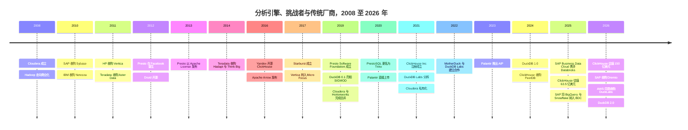
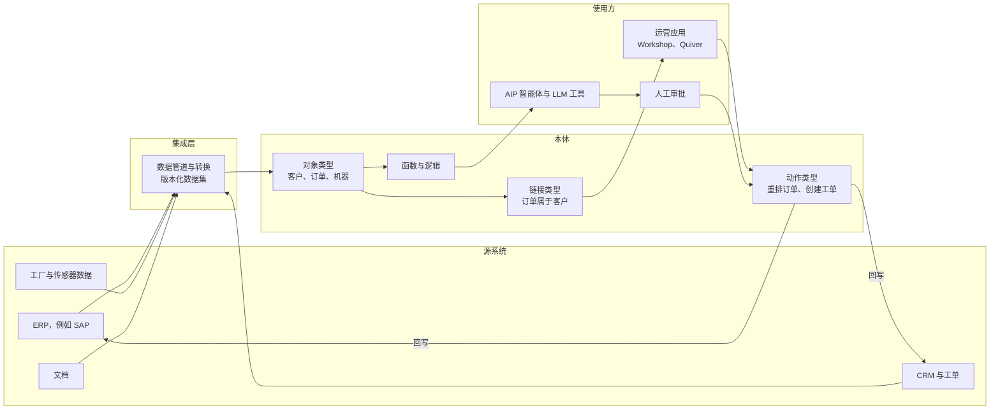
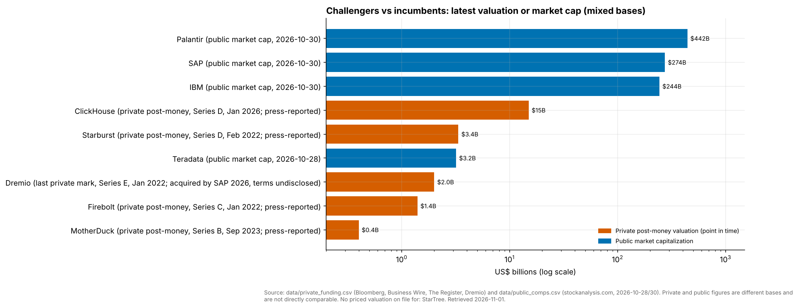
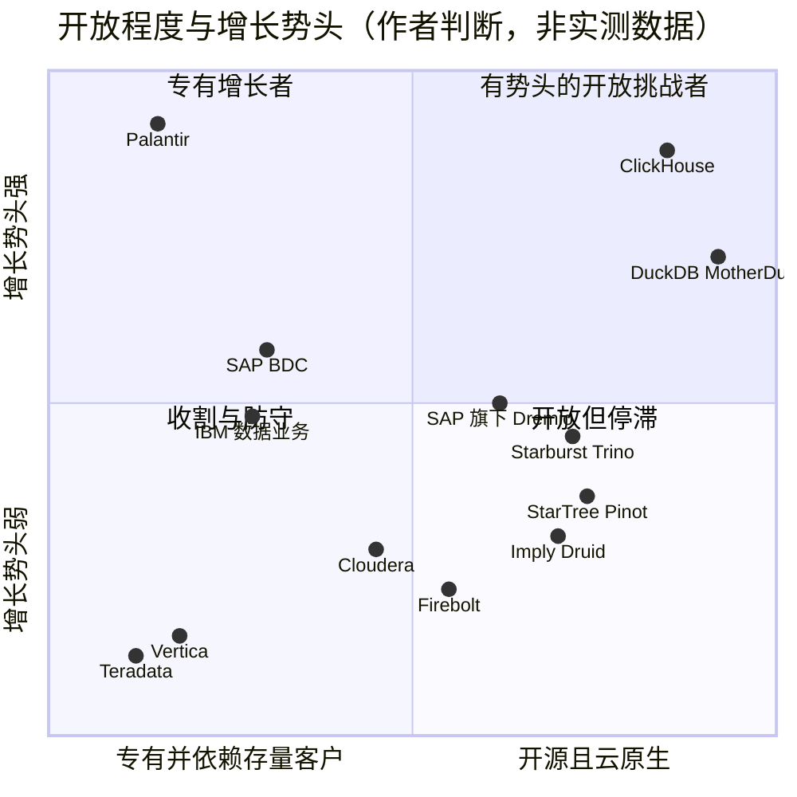

# 31. 分析引擎挑战者与传统平台
> **状态：** 上市与非上市公司混合 · **总部：** 各不相同（见概览表）· **成立：** 各不相同（见概览表）· **最新估值/市值：** ClickHouse 投后估值 $15B（媒体报道，2026 年 1 月）；Palantir 市值 $442B、Teradata 市值 $3.2B（2026-10-30 / 2026-10-28）· **最后核实：** 2026-11-01

## 要点速览（TL;DR）

- **两个阵营，一场战争。** 开源挑战者（ClickHouse、DuckDB 与 MotherDuck、Trino 与 Starburst、Dremio、Firebolt，以及 Druid 和 Pinot 的商业厂商）凭借性价比攻击特定工作负载。传统厂商（Teradata、Cloudera、SAP、IBM、OpenText 旗下的 Vertica）则依靠长期合同守住庞大的存量客户群。两个阵营都受到 Databricks、Snowflake 和超大规模云厂商的挤压（[第 25 章](ch25-databricks.md)、[第 26 章](ch26-snowflake.md)、[第 28 章](ch28-hyperscaler-data-platforms.md)）。
- **ClickHouse 是突围而出的挑战者。** 它在 2026 年 1 月以 **$15B** 估值融资 $400M（媒体报道），是 2025 年 5 月估值的 2.4 倍；公司称在 2026 年 5 月已突破 **$250M 年度经常性收入（ARR），客户超过 4,000 家**（公司披露）。可观测性和 AI 智能体遥测是其增长引擎。[^ch-seriesd][^ch-arr]
- **独立厂商正在被吸收。** SAP 同意收购 **Dremio**（2026 年 5 月 4 日宣布；约 2026 年 7 月完成；条款未披露）。AWS 同意收购 DuckDB 背后的公司 **DuckLabs**（2026 年 8 月 26 日宣布），而 DuckDB 本身仍在 DuckDB Foundation 名下保持 MIT 许可。[^sap-dremio][^aws-duck] Starburst 如今是最大的独立 Trino 厂商，其最近一轮有定价的融资还停留在 2022 年。
- **传统厂商便宜自有其原因。** Teradata 的估值约为 **1.7 倍 EV/过去 12 个月收入**，收入持平；而 **Palantir** 的估值约为 **70 倍 EV/过去 12 个月收入**，过去 12 个月增长约 79%；若按 `data/public_comps.csv` 中的 FY2026 指引口径，约为 53 倍 EV/未来 12 个月收入（stockanalysis，2026-10-28/30）。Palantir Foundry 的[本体（ontology）](../glossary.md#ontology)实质上是一个带有操作型回写能力的语义层，被当作 AI 操作系统卖给高管。[^comps-tdc][^comps-pltr]
- **Everpure 视角。** 本地部署的湖仓一体（lakehouse）引擎（Starburst、Dremio、Cloudera、自管 ClickHouse）是本地 S3 对象存储天然的软件合作伙伴。Everpure 已公开发布与 Dremio 和 Starburst 合作的 FlashBlade 参考方案。Dremio 并入 SAP，改变了这项合作中坐在谈判桌对面的人。[^dremio-pure][^starburst-ep]

## 概览表

| 公司 | 状态 / 所有者 | 总部 / 成立 | 负责人（公开记录） | 规模指标 | 最新估值或市值 | 主要投资方 / 所有者 |
|---|---|---|---|---|---|---|
| ClickHouse | 非上市 | 从 Yandex 分拆；2021 年 9 月注册成立[^ch-inc] | Aaron Katz（CEO）† | ARR >$250M，客户 >4,000 家（2026 年 5 月，公司披露）[^ch-arr] | 投后估值 $15B（2026 年 1 月，媒体报道）[^ch-seriesd] | Dragoneer（D 轮）、Khosla（C 轮）、Index、Benchmark[^ch-seriesc][^ch-inc] |
| DuckDB / DuckLabs | MIT 项目；DuckLabs 同意并入 AWS（2026 年 8 月） | Amsterdam；2018 年起源于 CWI 研究，Labs 于 2021 年分拆[^duck-history] | Hannes Mühleisen、Mark Raasveldt（创始人） | 员工 >30 人（2026 年）；duckdb.org 月独立访客 >8M（公司披露）[^duck-history][^duck-40k] | 条款未披露[^aws-duck] | AWS（收购方）；知识产权由 DuckDB Foundation 持有 |
| MotherDuck | 非上市 | Seattle；2022 年† | Jordan Tigani（CEO）† | 未披露 | 投后估值约 $400M（2023 年 9 月，媒体报道）[^motherduck] | Felicis、a16z |
| Starburst | 非上市 | Boston；2017 年† | Justin Borgman（CEO）† | 未披露 | D 轮 $250M，估值约 $3.35B（2022 年 2 月，媒体报道）[^starburst-d] | Alkeon（D 轮领投） |
| Dremio | 已被 SAP 收购（2026 年） | Santa Clara；2015 年† | 已整合进 SAP Business Data Cloud | 未披露 | E 轮估值 $2B（2022 年 1 月，公司披露）；交易条款未披露[^dremio-e][^sap-dremio] | SAP（所有者） |
| Firebolt | 非上市 | Tel Aviv / 美国；2019 年† | Eldad Farkash（CEO）† | 未披露 | C 轮 $100M，估值约 $1.4B（2022 年 1 月，媒体报道）[^firebolt] | 不适用 |
| Teradata（TDC） | 上市，NYSE | San Diego；1979 年† | Steve McMillan（CEO）† | 过去 12 个月收入约 $1.69B（GAAP）[^fin-tdc] | 市值 $3.19B，EV $2.88B（2026-10-28）[^comps-tdc] | 公众流通股 |
| Cloudera | 非上市（自 2021 年起由 KKR、CD&R 持有） | Santa Clara；2008 年† | Charles Sansbury（CEO）† | 私有化后无经审计数据 | 私有化股权价值 $5.3B（2021 年）[^ma-cloudera] | KKR、Clayton Dubilier & Rice |
| Palantir（PLTR） | 上市，Nasdaq | Denver；2003 年† | Alex Karp（CEO）† | 截至 Q2 2026 过去 12 个月收入 $6.16B，同比约 +79%（GAAP）[^fin-pltr] | 市值 $442B，EV $433B（2026-10-30）[^comps-pltr] | 公众流通股 |
| SAP（SAP） | 上市，NYSE / Xetra | Walldorf；1972 年† | Christian Klein（CEO）† | Q3 2026 收入 €10.27B，云业务 +26%（IFRS）[^comps-sap] | 市值 $274B（2026-10-30）[^comps-sap] | 公众流通股 |
| IBM（IBM） | 上市，NYSE | Armonk；1911 年† | Arvind Krishna（CEO）† | Q3 2026 收入 $17.1B；Data 业务 +19%，含 Confluent（GAAP）[^comps-ibm] | 市值 $244B（2026-10-30）[^comps-ibm] | 公众流通股 |

*图 31.1 — 概览。标有 † 的单元格（总部、成立年份、CEO）属于经审阅者核对的公认背景知识；总部和成立年份较为稳定，但 CEO 信息仅确认至 2025 年中 [VERIFY: 2025 年中以后是否有管理层变动]；其余内容均有脚注。挑战者几乎不披露任何经审计数据，只有 ClickHouse 公布了近期的 ARR 下限。上市传统厂商的价值跨越两个数量级，这更多反映的是增长预期，而非存量客户规模。*

## 起源与战略演进

本章涉及的公司来自三波浪潮。每一波都始于某家大型互联网公司或研究实验室为自身需求打造的引擎，又都以传统厂商收购幸存者告终。

**第一波：MPP 一体机（1980 年代–2011 年）。** Teradata 以软硬件一体机的形式，向银行、零售商和电信运营商销售无共享（shared-nothing）的[大规模并行处理（massively parallel processing）](../glossary.md#massively-parallel-processing)数据仓库。2000 年代的列式存储和一体机初创公司大多在大约一年之内相继出售：SAP 收购 Sybase（$5.8B，2010 年），IBM 收购 Netezza（$1.7B，2010 年），HP 收购 Vertica（2011 年），Teradata 收购 Aster Data 的剩余股权（$263M，2011 年）。[^ma-sybase][^ma-netezza][^ma-vertica][^ma-aster] [第 5 章](../01-data-systems-foundations/ch05-analytical-engines.md)解释了这些引擎所开创的列式存储与向量化执行，本章不再赘述。

**第二波：Hadoop 与 SQL-on-Hadoop（2008–2021 年）。** Cloudera（2008 年成立）和 Hortonworks 将 Apache Hadoop 商业化。Facebook 工程师在 2012 年创建了 **Presto**，用于在公司的 Hadoop 数据仓库上运行交互式 SQL，并于 2013 年以 Apache License 发布。[^trino-rename][^presto-psf] Teradata 的应对是收购 SQL-on-Hadoop 团队（Hadapt，2014 年）和一家 Hadoop 咨询公司（Think Big，2014 年）。[^ma-hadapt][^ma-thinkbig] Hadoop 发行商始终没能及时建成云服务。Cloudera 与 Hortonworks 以全股票方式合并，合并估值 $5.2B（2019 年 1 月完成）；MapR 的资产在 2019 年归入 HPE；2021 年，KKR 和 CD&R 以约 $5.3B 将 Cloudera 私有化。[^ma-hortonworks][^ma-mapr][^ma-cloudera]

**第三波：面向云和笔记本电脑的开放引擎（2016–2026 年）。** 2016 年 6 月，Yandex 开源了 ClickHouse——其网站分析产品 Metrica 背后的引擎。[^ch-history] Presto 的创建者离开 Facebook，于 2019 年 1 月成立 Presto Software Foundation；在 Facebook 将 Presto 名称置于 Linux Foundation 之下注册商标后，他们于 2020 年 12 月将自己的分支更名为 **Trino**。[^trino-rename] DuckDB 于 2018 年在 CWI Amsterdam 起步，并在 SIGMOD 2019 上亮相。[^duck-history] ClickHouse, Inc. 于 2021 年 9 月注册成立并完成 $50M A 轮融资，DuckDB Labs 则于 2021 年 7 月从 CWI 分拆。[^ch-inc][^duck-history] 随后，2026 年的整合潮开启：SAP–Dremio 与 AWS–DuckLabs。[^sap-dremio][^aws-duck]

Palantir 不属于这三波浪潮。它于 2003 年为情报分析而创立，为商业客户打造了 Foundry，2020 年 9 月在 NYSE 直接上市（2024 年 11 月将上市地转至 Nasdaq），并于 2023 年推出人工智能平台（AIP）。这些日期属于公认背景知识。它的"数据平台"是一个应用层构造——本体——而不是查询引擎。

*图 31.2 — 三波浪潮：一体机被系统厂商收购（2010–11 年），Hadoop 发行版整合并被私有化（2019–21 年），开放引擎先融风险资本、再被吸收（2026 年）。日期来自所引资料；Druid 2012 年、Starburst 2017 年和 Palantir AIP 2023 年依据公认背景知识，SAP Business Data Cloud（2025 年 2 月）由 SAP 后来的合作伙伴公告确认。[^sap-snow]*

## 产品与技术

### ClickHouse

ClickHouse 是一个向量化列式存储，其核心表引擎 [MergeTree](../glossary.md#mergetree) 将每次插入写成一个已排序、不可变的"数据片段（part）"，并在后台合并这些片段。稀疏主键索引指向每 8,192 行组成的数据块，因此针对某个时间范围的查询只读取所需的数据块。这一设计源自 Yandex Metrica：该产品需要在原始事件上实现亚秒级的自定义报表，而不是依赖预聚合的多维数据集。Yandex 披露该产品的集群有 374 台服务器，存储超过 20 万亿行数据。[^ch-history][^ch-paper] 核心团队发表于 VLDB 2024 的论文是对它最好的单篇描述。[^ch-paper]

ClickHouse Cloud 运行一个名为 SharedMergeTree 的变体，它把全部表数据放在共享对象存储中，使计算副本无状态。[^ch-smt] 自管的 ClickHouse 在本地 NVMe 上依然运行良好，这也是它出现在本地可观测性技术栈中的原因。自 2024 年以来，其产品战略是补齐引擎周边的组件：Postgres 变更数据捕获（CDC）（PeerDB）、可观测性界面（HyperDX，现为 ClickStack）和 LLM 追踪（Langfuse）。[^ch-peerdb][^ch-hyperdx][^ch-langfuse] 其逻辑很简单：日志、追踪和智能体遥测都是宽表、以追加写入为主的事件表，而 ClickHouse 正是处理这类事件表最便宜的快速引擎。

### DuckDB 与 MotherDuck

DuckDB 是一个[进程内数据库（in-process database）](../glossary.md#in-process-database)：一个运行在 Python 笔记本、应用程序或浏览器内部的库，不需要服务器。它把向量化引擎带到分析师本来就在工作的地方。它可以直接读取 Parquet、CSV、Iceberg 和 Delta 文件，包括 S3 上的文件。[^duck-history] 其商业论点是：大多数分析查询规模都很小。MotherDuck 对 Amazon 公开的 Redshift 集群数据集进行分析后发现，只有约 0.03% 的查询扫描量超过 10 TB（厂商分析）。[^md-redshift][^redset] DuckDB 2.0（2026 年 10 月 21 日）新增了名为 Quack 的客户端-服务器协议、异步 I/O 和 VARIANT 类型。[^duck-200] 这让 DuckDB 首次走出"单进程"的框框。

其组织架构颇为特别。**DuckDB Foundation** 拥有知识产权，并使其保持 MIT 许可。**DuckLabs**（2026 年由 DuckDB Labs 更名）雇用核心工程师。**MotherDuck** 运营托管云服务，并根据 2022 年 11 月宣布的合作关系向 DuckLabs 采购工程服务。[^duck-history] DuckLake 是该团队推出的表格式，把湖的元数据保存在 SQL 数据库中，已于 2026 年 4 月发布 1.0 版（[第 7 章](../01-data-systems-foundations/ch07-open-table-formats.md)）。[^duck-history]

2026 年 8 月 26 日，AWS 签署了收购 DuckLabs 的最终协议，条款未披露。团队留在 Amsterdam，DuckDB、DuckLake 和 Quack 在 Foundation 名下保持 MIT 许可，Foundation 还将设立技术咨询委员会。[^aws-duck][^duck-aws-blog] AWS 将 DuckDB 定位为对智能体友好、擅长在 S3 上原地分析数据的引擎。到 2026 年 9–10 月，它已在 Aurora PostgreSQL 中推出由 DuckDB 驱动的分析功能（据 `data/ma_deals.csv`）。[^aws-duck][^aurora-duck] [第 23 章](../03-ai-data-stack/ch23-real-time-analytics-htap.md)介绍了技术层面的内容。

**这对 MotherDuck 意味着什么。** 看多的解读是：MotherDuck 所依赖的引擎如今由云计算领域财力最雄厚的公司出资支持，而且许可证无法被收回。看空的解读是：MotherDuck 的工程合作伙伴现在为最有可能在 S3 上推出竞争性无服务器 DuckDB 服务的超大规模云厂商工作。自 2023 年 B 轮（投后估值约 $400M，媒体报道）以来，MotherDuck 没有公开披露过有定价的融资。[^motherduck] 值得追问的是：DuckLabs 的工程合同能否在交易后延续？在失去对核心团队的优先接触后，MotherDuck 的差异化（本地加云的混合执行、共享、托管目录）是否足够？

### Trino 与 Starburst

Trino 是一个**本身不带存储**的分布式 SQL 引擎。协调节点负责规划查询，工作节点通过连接器拉取数据：对象存储上的 Hive 和 Iceberg 表，以及关系型数据库、Kafka 等众多数据源。这使它成为[查询联邦（query federation）](../glossary.md#query-federation)的标准引擎——即用一条 SQL 语句跨系统关联数据，而无需先把数据复制进数据仓库。Starburst 由曾在 Teradata 维护 Presto 的前 Teradata 工程师创立，销售 Starburst Enterprise（自管）和 Starburst Galaxy（SaaS）。它推广"Icehouse"模式（这是它对"Trino 加对象存储上的 Iceberg"的叫法），并推出 Warp Speed，在工作节点 SSD 上缓存和索引列数据（加速效果为厂商宣称）。[^warp] Dell 的 Data Lakehouse 一体机（2024 年推出）以 OEM 方式基于 Starburst 引擎构建 [VERIFY: Dell–Starburst OEM 产品的当前状态]。Everpure 发布了基于 FlashBlade、Iceberg 和 Starburst 的"Scalable Lakehouse Analytics"参考架构。[^starburst-ep]

### Dremio

Dremio 基于 [Apache Arrow](../glossary.md#apache-arrow)（它在 2016 年参与共同创建的内存列式标准）构建了一个 Iceberg 原生的湖仓引擎。[^arrow-tlp] 它增加了类 Git 的目录（Project Nessie，以 Arctic 名义销售），后来又支持 **Apache Polaris**——一个 Iceberg REST 目录，已于 2026 年毕业成为 Apache 顶级项目。[^polaris] 它的卖点是在数据湖上提供自助式 SQL，用 reflections（物化加速结构）替代数据副本，且可部署在任何云或本地环境。正是这种本地部署能力，促使 Everpure 为混合 Iceberg 湖仓打造了 FlashBlade–Dremio 联合解决方案。[^dremio-pure] SAP 收购 Dremio，是为了在其 Business Data Cloud 内把非 SAP 数据与 SAP 数据一并查询，所宣称的目标是智能体式 AI。[^sap-dremio]

### 实时及其他挑战者（简述）

- **Firebolt** 于 2020 年推出，是一款基于稀疏索引、面向低延迟和高并发分析的云数据仓库。我们能确认的最近一轮有定价融资是 2022 年 1 月的 $100M C 轮，报道估值约 $1.4B [VERIFY: 之后是否有新一轮融资、产品或所有权变化]。[^firebolt]
- **Imply**（Apache Druid）和 **StarTree**（Apache Pinot）销售基于数据段（segment）的引擎，用于面向用户的亚秒级仪表盘。Imply 于 2025 年 9 月围绕"可观测性数据仓库"Lumi 重新定位。StarTree 最近一次披露的融资是 2022 年的 $47M B 轮。[^imply-lumi][^startree][^druid-paper]

### 传统平台

- **Teradata Vantage** 是无共享 MPP 数据仓库，目前以本地部署、超大规模云上的 VantageCloud Enterprise 以及基于对象存储的 VantageCloud Lake 等形式销售 [VERIFY: 当前产品命名]。ClearScape Analytics 提供库内分析和机器学习。其强项是在大型银行和电信企业中为数千个并发查询提供混合工作负载管理。
- **Cloudera** 销售混合数据平台：将 Hadoop 时代的老技术栈（Spark、Hive、Impala、NiFi、Kafka）重新以 Iceberg 表为中心组织，同一套软件既可本地部署也可运行在公有云上，再加上在受监管数据旁运行模型的"私有 AI"卖点。私有化以来，它收购了 Verta（模型管理，2024 年）、Octopai（数据血缘，2024 年）和 Taikun（Kubernetes 管理，2025 年）[VERIFY: 三笔交易的日期与条款]。
- **SAP** 在 S/4HANA 之下运行其内存列式存储 **HANA**。Datasphere 是其数据仓库服务；**Business Data Cloud**（BDC）于 2025 年 2 月推出，并与 Databricks 合作（"SAP Databricks"），是将 SAP 应用数据作为受治理数据产品对外开放的总体框架 [VERIFY: Databricks 合作的商业条款]。[^sap-bdc] 随后 SAP 加入了 Google BigQuery（2025 年 10 月），并在 2025 年 11 月 4 日加入 Snowflake：**SAP Snowflake**（BDC 内由 SAP 托管的 Snowflake，计划于 Q1 2026 正式可用）和 **SAP BDC Connect for Snowflake**（零拷贝共享，计划于 H1 2026 推出）[VERIFY: 两者在 2026 年的交付状态]。[^sap-snow] 如今，Dremio 成为 SAP 在这一框架内处理非 SAP 数据的自有引擎，与三家合作伙伴平台并列。
- **IBM** 销售 Db2、Netezza Performance Server（复活的一体机）和 **watsonx.data**——一个于 2023 年推出、基于 Iceberg 之上的 Presto 和 Spark 的湖仓 [VERIFY: 当前引擎组合]。IBM 在 2025–26 年对 DataStax 和 Confluent 的收购表明，它是在为 watsonx 买入数据层，而不是自建。[^ibm-datastax][^ibm-confluent]
- **Vertica** 是源自 C-Store 研究脉络的列式存储，先后从 HP 转到 HPE、Micro Focus（2017 年），并随 OpenText 收购 Micro Focus（2023 年 1 月完成）归入 OpenText [VERIFY: 2025–26 年是否有剥离]。[^ma-vertica]

### Palantir 的本体

Palantir 不是分析引擎，但它争夺的是同一笔高管预算："让我们的数据能为 AI 所用。"Foundry 通过数据管道（pipeline）整合来自源系统的数据，再将其映射为一个**本体**。本体包含带属性的**对象类型**（Customer、Aircraft、Purchase Order）、对象之间的**链接类型**，以及**动作类型**——即可以修改数据并回写至源系统的受治理操作。[^palantir-ontology] 应用程序、分析师以及自 2023 年起的 AIP 智能体，面对的是对象和动作，而不是表和 SQL。

*图 31.4 — Palantir 的本体模型（重新绘制的概念图，并非 Palantir 原图）。数据经由数据管道流入，成为带类型的对象和链接，再以受治理动作的形式流出并回写至源系统。正是这个回写闭环，使它区别于只读的语义层。*

> **类比：数字孪生。** 本体是企业的数字孪生（digital twin），而不是喷气发动机的数字孪生。在晶圆厂里，孪生体映射每一台设备、每一个批次和每一套工艺配方，制造执行系统可以把配方变更推送回设备。Palantir 对订单、货运和机器做的是同样的事：对象映射现实中的实体，链接映射它们之间的关系，动作则是流回 ERP 的受控"配方变更"。普通的[语义层（semantic layer）](../glossary.md#semantic-layer)（[第 14 章](../02-pipelines-and-governance/ch14-semantic-layers-and-bi.md)）是一个只读的孪生体：它定义"收入"的含义，却无法修改一笔订单。

### 厂商对比

| 厂商 | 引擎类型 | 存储模型 | 部署方式 | 许可 / 开放程度 | 最佳工作负载 | 表格式 | 所有权趋势 |
|---|---|---|---|---|---|---|---|
| ClickHouse | 向量化列式，MergeTree | 本地 NVMe 或对象存储（SharedMergeTree） | 自管、ClickHouse Cloud | 核心为 Apache 2.0 | 实时分析、可观测性、AI 遥测 | 原生；可读取 Iceberg 和 Delta | 独立，$15B |
| DuckDB / MotherDuck | 进程内向量化 | 文件；DuckLake；MotherDuck 服务 | 库、浏览器、托管云 | MIT（Foundation） | 单节点分析、嵌入式、智能体 | Parquet、Iceberg、Delta、DuckLake | DuckLabs 并入 AWS |
| Trino / Starburst | 分布式 SQL，无自有存储 | 任意数据湖或联邦数据源 | 自管、Galaxy SaaS、OEM | Trino 为 Apache 2.0；专有附加组件 | 联邦查询、Iceberg 湖仓 | Iceberg、Delta、Hudi、Hive | 独立 |
| Dremio | 基于 Arrow 的湖仓引擎 | 对象存储上的 Iceberg | 云、本地部署 | 开放核心 | 自助式湖仓 SQL | 以 Iceberg 为先 | 归 SAP 所有 |
| Firebolt | 带稀疏索引的云数据仓库 | 托管存储 | SaaS | 专有 [VERIFY] | 高并发仪表盘 | 托管 | 独立 |
| Druid / Imply、Pinot / StarTree | 基于数据段并带索引 | 本地数据段加深层存储 | 自管、SaaS | 核心为 Apache 2.0 | 面向用户的亚秒级分析 | 原生数据段 | 独立 |
| Teradata Vantage | 无共享 MPP | 本地或对象存储（Lake） | 本地部署、超大规模云 | 专有 | 高并发下的混合工作负载 | 原生；支持 Iceberg [VERIFY] | 上市，低估值倍数 |
| Cloudera | Spark、Impala、Hive、NiFi | HDFS 或对象存储 | 本地部署、公有云、混合 | 开源组件，订阅制 | 混合湖仓、受监管数据 | Iceberg | 私募股权持有 |
| SAP HANA / BDC | 内存列式存储加数据湖 | 内存；BDC 中为对象存储 | SAP 云、本地 HANA | 专有 | SAP 应用分析 | 经 Databricks 支持 Delta；经 Dremio 和 Snowflake 支持 Iceberg；BigQuery 连接器 | 外购与合作 |
| IBM Db2 / Netezza / watsonx.data | 行式与 MPP；Presto 和 Spark | 本地；对象存储上的 Iceberg | 本地部署、IBM Cloud、混合 | 专有加开放引擎 | 大型机周边及受监管场景 | Iceberg | 外购 |
| Vertica（OpenText） | 列式 MPP | 本地或对象存储（Eon 模式） | 本地部署、云 | 专有 | 电信、广告技术分析 | 原生；Parquet 外部表 | 组合中的资产 |
| Palantir Foundry | 基于集成数据的本体 | Foundry 数据集加已连接数据源 | 云、本地部署、涉密环境 | 专有 | 运营决策、AI 智能体 | 兼容 Iceberg 的数据集 [VERIFY] | 上市，约 70 倍 EV/过去 12 个月收入（约 53 倍 EV/未来 12 个月收入，FY2026 指引） |

*图 31.3 — 厂商对比表（12 家厂商 × 8 个维度）。开放引擎的差别主要在于所处的位置（笔记本电脑、集群、联邦层）；传统厂商的差别主要在于它们变现的是谁的存量客户。*

## 盈利模式

**开放核心加云服务。** ClickHouse、Starburst 和 Dremio 采用[开放核心（open core）](../glossary.md#open-core)打法：引擎免费，公司对托管服务（计算与存储按用量计费）或带安全、治理和支持的企业版收费。ClickHouse Cloud 对计算和存储按用量分别计费。Starburst 同时销售 Galaxy 用量和 Enterprise 订阅。这种经济模式取决于能否把庞大开源用户群中的一小部分转化为付费客户。只有当大规模、高质量地运行引擎本身很难时，这一模式才行得通——分布式的 ClickHouse 和 Trino 确实如此，单节点的 DuckDB 则远非如此。

**DuckDB 的例外。** DuckDB 很容易运行，因此在运维上几乎没有可变现的空间。DuckLabs 的收入来自支持和工程合同，MotherDuck 销售协作与混合执行能力，而 AWS 可以通过 S3 和 Aurora 的用量间接变现 DuckDB。[^duck-history][^aurora-duck] 这就是为什么超大规模云厂商是天然的买家。

**传统厂商的维护年金。** Teradata、Cloudera、IBM 和 Vertica 从长期部署的客户那里获得经常性的订阅和维护收入。这类收入像一只缓慢摊还的债券：毛利率高、增长低，续约风险集中在几百个大客户身上。Teradata 的战略指标是云 ARR 的增速能否足以抵消本地部署业务的流失。

**Palantir 的大合同模式。** Palantir 销售企业和政府合同，通常先通过短期付费"训练营（bootcamp）"在几天内做出一个可用的用例 [VERIFY: 训练营项目细节]。其过去 12 个月的 GAAP 毛利率约为 85%。[^comps-pltr] 收入随构建在本体之上的用例数量增长，这使净扩张成为关键驱动因素。

> **类比：授权费与存量客户。** 开源引擎就像开放指令集：采用免费，所以传播很广，但所有者只能靠在其之上增加的东西赚钱。Teradata 则相反，更接近一座运行成熟制程节点的老旧晶圆厂。它的客户黏性强，因为重新认证工艺成本高昂；产量缓慢萎缩，剩余晶圆的利润率不错；战略问题在于是再投资还是收割。

## 财务数据

只有上市公司公布经审计的数据。以下非上市公司数据均为公司披露或媒体报道。

- **ClickHouse。** 截至 2026 年 5 月 27 日，ARR 超过 $250M，客户超过 4,000 家，ARR 同比增长超过两倍（公司披露）。[^ch-arr] 按 2026 年 1 月 $15B 的估值计算，相当于约 **60 倍**的过往 ARR，尚未计入 5 月以来的任何增长（我们的计算，估算）。[^ch-seriesd]
- **Teradata**（财年 = 日历年）。过去 12 个月收入约 **$1.69B**（GAAP），增长约 1%（stockanalysis 过去 12 个月数据，2026-10-23/28）。市值 $3.19B，企业价值 $2.88B（净现金），因此约为 **1.7 倍 EV/过去 12 个月收入**。[^fin-tdc][^comps-tdc] Q3 2026 的总 ARR 和公有云 ARR 本次未能核实 [VERIFY: Q3 2026 总 ARR、云 ARR 及 FY2026 指引]。
- **Palantir**（财年 = 日历年）。FY2025 收入 **$4.48B**（GAAP）。截至 Q2 2026 过去 12 个月收入 **$6.16B**，同比增长约 79%（GAAP）。截至 2026-10-30，市值 $442.4B，EV $433.2B，约为 **70 倍 EV/过去 12 个月收入**。截至数据日期，Q3 2026 业绩尚未发布。[^fin-pltr][^comps-pltr] 投资者最关注的美国商业业务增速不在我们的数据文件中 [VERIFY: Q2 2026 美国商业收入增速]。
- **SAP**（财年 = 日历年）。Q3 2026 总收入 **€10.27B**（IFRS），云收入 +26%，当期云业务积压订单 €24.14B（+28%）。市值约 $274B（2026-10-30）。[^comps-sap]
- **IBM**（财年 = 日历年）。Q3 2026 收入 **$17.1B**（GAAP，按固定汇率计 +6%），其中 Data 业务线增长 19%，受 Confluent 收购（2026 年 3 月 17 日完成）推高。[^comps-ibm][^ibm-confluent]

*图 31.5 — 最新估值或市值，口径不一。非上市挑战者 ClickHouse 的估值约为 Teradata 市值的 5 倍，而收入约只有后者的七分之一（ClickHouse 为公司披露的 ARR，Teradata 为 GAAP 过去 12 个月收入，口径不同）。Starburst（约 $3.35B）和 Firebolt（约 $1.4B）只有媒体报道的 2022 年估值，尚未纳入图表数据文件；StarTree 没有披露估值。来源：`scripts/charts/ch31_valuations.py`，数据取自 `data/private_funding.csv` 和 `data/public_comps.csv`。*

**为什么 Palantir 是异类：一个算例。** 在 70 倍 EV/过去 12 个月收入的水平上，假设 Palantir 的 EV 维持在 $433B，而市场最终给出仍然慷慨的 15 倍收入倍数，那么收入需要达到约 $28.9B，即过去 12 个月 $6.16B 基数的 4.7 倍。按 50% 的年增速需要约 3.8 年，按 30% 则需要约 5.9 年（我们的计算；仅作说明，并非预测）。相比之下，Snowflake 的估值约为 16.9 倍 EV/未来 12 个月收入（2026-10-30；见[第 26 章](ch26-snowflake.md)）。市场是在为 Palantir 多年保持高增长以及经营杠杆买单，而不是在为一个数据库买单。注意，`data/public_comps.csv` 中的 70 倍是 EV/过去 12 个月收入的代理指标，而非 EV/未来 12 个月收入；按远期收入计算，倍数会更低。

## 客户与市场进入

**自下而上与自上而下。** 开放引擎先赢得开发者。ClickHouse 由构建可观测性或面向客户分析的平台工程师选用。DuckDB 通过笔记本里的一条 `pip install` 进入企业，其网站在 2026 年年中的月独立访客超过 800 万（公司披露）。[^duck-40k] Trino 则通过需要同时查询多个系统的数据平台团队进入。商业化动作紧随采用之后，这使获客成本保持在低位，但转化率不确定。

**传统厂商向 CIO 销售。** Teradata、IBM、SAP 和 Cloudera 向受监管行业的中央 IT 部门销售多年期合同。它们的客户更看重工作负载管理、安全认证和支持服务，而不是单次查询的标价。SAP 的市场进入（GTM）优势独一无二：它拥有人人都想要其数据的那套应用，因此 Business Data Cloud 和 Dremio 可以作为"用 AI 使用 SAP 数据的原生方式"来销售。[^sap-dremio]

**Palantir 向业务运营者销售。** Palantir 的销售对象是 COO、工厂经理或国防项目办公室，通常带着一个具体用例和截止日期。它的合作伙伴生态如今包括了它曾经绕开的那些数据平台。它既是数据仓库数据的使用者，也是竞争者。

**OEM 与嵌入。** Starburst 与 Dell 的合作、Aurora 中的 DuckDB 以及 Postgres 中的 pg_duckdb 表明，开放引擎正通过其他厂商的产品扩散。[^aurora-duck] 对存储厂商而言，OEM 是重要的路径：嵌入一体机或存储平台中的引擎，无需单独的销售周期即可触达客户。

## 并购与投资

| 日期 | 收购方 | 标的 | 金额 | 买到了什么 | 结果 |
|---|---|---|---|---|---|
| 2010-05 | SAP | Sybase | $5.8B（已披露） | ASE 和 IQ 数据库 | IQ 与 HANA 并存延续[^ma-sybase] |
| 2010-09 | IBM | Netezza | $1.7B（已披露） | 数据仓库一体机 | 更名，后以 Netezza Performance Server 复活[^ma-netezza] |
| 2011-02 | HP | Vertica | 未披露 | 列式存储 | 转入 Micro Focus（2017 年），后归 OpenText（2023 年）[^ma-vertica] |
| 2011-03 | Teradata | Aster Data（剩余 89%） | $263M（已披露） | MapReduce 式分析 | 并入 Vantage[^ma-aster] |
| 2014 | Teradata | Hadapt 资产；Think Big | 未披露 | SQL-on-Hadoop 团队；Hadoop 服务 | Hadoop 转型未能成功[^ma-hadapt][^ma-thinkbig] |
| 2018-10 | Cloudera | Hortonworks | 合并股权价值 $5.2B（全股票） | 结束 Hadoop 价格战 | 增长停滞；被私有化[^ma-hortonworks] |
| 2021-06 | KKR 与 CD&R | Cloudera | 约 $5.3B（每股 $16） | 私有化（take-private） | 自 2021 年 10 月起非上市[^ma-cloudera] |
| 2024-07 | ClickHouse | PeerDB | 未披露 | Postgres CDC | 已在 ClickPipes 中上线[^ch-peerdb] |
| 2025-03 | ClickHouse | HyperDX | 未披露 | 可观测性界面 | 成为 ClickStack 的界面[^ch-hyperdx] |
| 2026-01 | ClickHouse | Langfuse | 未披露 | LLM 可观测性 | 与 $400M 融资同时宣布[^ch-langfuse] |
| 2026-05 | SAP | Dremio | 未披露 | Iceberg 湖仓引擎 | 约 2026 年 7 月完成；并入 Business Data Cloud[^sap-dremio] |
| 2026-08 | AWS | DuckLabs | 未披露 | DuckDB 核心团队 | 项目在 Foundation 名下保持 MIT 许可；完成情况 [VERIFY][^aws-duck] |

*图 31.6 — 交易表。买家类型反复出现：应用和系统厂商收购引擎（2010–11 年，以及 2026 年再次出现），私募股权收购增长放缓的平台，而唯一资金充裕的挑战者（ClickHouse）收购相邻工具以成为平台。一些聚合网站还列出了 ClickHouse 对 LibreChat（2025 年）和 RunReveal（2026 年）的收购 [VERIFY]。*

**SAP 为什么收购 Dremio。** SAP 的客户希望为 AI 智能体把 SAP 数据与其他所有数据结合起来。与 Databricks、BigQuery 和 Snowflake 的合作为 SAP 带来了湖仓覆盖面，但也让强大的合作伙伴横亘在 SAP 与客户的非 SAP 数据之间。[^sap-snow] 拥有一个 Iceberg 引擎和一个与 Polaris 对齐的目录，让 SAP 对这些"其他所有数据"有了自己的控制点（control point）。Forrester 将此举描述为 SAP 瞄准 AI 数据控制平面。[^sap-dremio] 整合风险在于文化。Dremio 的价值来自中立、可部署于任何地方，而 SAP 旗下的 Dremio 将以其能否保持这一点来接受评判。

**AWS 为什么收购 DuckLabs。** DuckDB 已经成为数据科学家默认的本地引擎，也越来越多地成为需要快速分析文件的 AI 智能体的默认引擎。AWS 获得了核心团队、一种把快速分析能力植入每一项触及 S3 的服务的方式，以及对蚕食 Redshift 和 EMR 的"小数据"论点的回应。它付出的代价是一项治理承诺：代码在独立的 Foundation 名下保持 MIT 许可。[^duck-aws-blog]

## 竞争地位

*图 31.7 — 定位（作者判断）。开放本身并不会带来增长势头：ClickHouse 和 DuckDB 有势头，Druid 和 Pinot 的厂商则大多没有。Palantir 是专有阵营中的例外。非上市公司的势头根据披露的 ARR、融资和交易活动推断；上市公司则依据报告的增长。*

**ClickHouse 对比 Databricks 和 Snowflake。** ClickHouse 凭借成本优势赢得对延迟敏感、高并发的事件分析。Databricks 正在构建实时引擎并收购安全分析公司，Snowflake 则收购了 Observe，二者都瞄准 ClickHouse 在可观测性领域的滩头阵地（[第 25 章](ch25-databricks.md)、[第 26 章](ch26-snowflake.md)）。ClickHouse 的防线是性价比，以及平台厂商无法复制的开源用户基础。

**Starburst 对比 Dremio 对比平台厂商。** 二者都主打"在数据所在之处查询数据湖，包括本地部署"。Dremio 卖给 SAP 后，Starburst 成为面向混合环境的主要独立联邦查询和 Iceberg 引擎厂商。交易宣布后不久，Starburst 就发表了相关评论。[^starburst-dremio] 二者面临的结构性威胁是：Databricks、Snowflake 和各大云厂商如今都能读取 Iceberg，而目录联邦（[第 8 章](../01-data-systems-foundations/ch08-catalogs-and-metastores.md)）正在侵蚀联邦查询这一细分市场。

**Teradata 和 Cloudera 对比迁移工具。** Teradata 的主要竞争对手是迁移项目。Databricks 在 2025 年收购了 BladeBridge，并将其代码转换工具免费用于迁移，明确包括从 Teradata 迁移。[^bladebridge] 迁移成本每降低一分，Teradata 的流失风险就上升一分。

**Palantir 对比所有人，又不与任何人竞争。** Palantir 与 Databricks 和 Snowflake 的智能体产品争夺"企业数据上的 AI"这一叙事，但它往往又运行在它们的数据之上。它的护城河是本体加上前置部署工程（forward-deployed engineering），而不是存储或计算。

## 制胜原因 / 看多逻辑

1. **ClickHouse 拥有一个被平台厂商低估的增长引擎。** 可观测性数据的增长快于业务数据，AI 智能体又带来了追踪和评估数据。ARR 增长两倍多、超过 $250M（公司披露），说明需求拉动是真实的。[^ch-arr]
2. **开放引擎正在成为基础设施。** AWS 中的 DuckDB、Dell 一体机和 IBM watsonx.data 中的 Trino，以及无处不在的 Arrow，意味着无论最终哪些公司攫取利润，这些引擎都将存续数十年。[^aurora-duck]
3. **本地部署和主权需求有利于混合部署厂商。** 一项由 Cloudera 委托的调查显示，66% 的受访者在过去 12 个月内把 AI 工作负载从公有云迁回；AWS 自己也在 2026 年 1 月推出了欧洲主权云。[^cloudera-survey][^aws-esc] Cloudera、Teradata、Starburst 和 SAP-Dremio 销售的软件都能在数据必须留驻的地方运行。
4. **传统厂商的现金流很便宜。** Teradata 以约 1.7 倍 EV/过去 12 个月收入的估值且持有净现金，其定价已反映衰退预期。只要总 ARR 企稳，它就是典型的价值股或私有化候选标的。我们没有发现已确认的私有化进程 [VERIFY]。[^comps-tdc]
5. **Palantir 证明语义层可以比引擎更值钱。** 本体通过回写把数据转化为决策，而这正是智能体创造价值的地方。在 $6B 基数上接近 79% 的收入增速支持这一论点。[^fin-pltr]

## 风险 / 看空逻辑与待解问题

1. **挑战者估值跑在收入前面。** ClickHouse 约 60 倍过往 ARR 的估值需要多年极高的增长来支撑。数个 2021–22 年的估值（Starburst、Firebolt、StarTree）尚未重新定价，很可能高于这些公司如今能卖出的价格。[^ch-seriesd]
2. **平台厂商吞并细分市场。** 每一项重要的引擎功能（Iceberg 读取、向量化执行、联邦查询、实时摄取）如今都在 Databricks 和 Snowflake 的路线图上。挑战者需要找到一个自己便宜数倍、而不仅仅是更快的工作负载。
3. **超大规模云厂商的引力。** AWS 拥有 DuckDB 的核心团队，可能挤压 MotherDuck 和其他基于 DuckDB 的初创公司，正如 AWS 服务过去挤压过其他开源厂商那样。
4. **传统厂商的衰退是结构性的。** Teradata 的收入多年来大致持平甚至下滑，免费的迁移工具又加速了客户流失。[^bladebridge] Cloudera 的非上市状态掩盖了其发展轨迹，而私募股权持有意味着几年内会出售或重新上市。
5. **Palantir 的估值倍数没有安全边际。** 在约 70 倍 EV/过去 12 个月收入的水平上，增长一旦放缓，倍数就会急剧压缩。上面的算例显示了仍需实现多少收入。
6. **待解问题。** AWS–DuckLabs 交易能否顺利完成？MotherDuck 的工程合同能否延续？SAP 会让 Dremio 继续可部署于非 SAP 的本地环境吗？Teradata 的 Q3 2026 云 ARR 和总 ARR 是多少？Starburst 下一步是融资、出售还是合作？

## 与 Everpure 的相关性

> **存储桥接。** 除 Palantir 外，本章的每个引擎都能从兼容 S3 的对象存储中读取 Iceberg 或 Parquet。Trino、Dremio 和 Cloudera 把对象存储作为记录系统，并依赖 SSD 缓存。ClickHouse 将本地 NVMe 用于热数据片段，将对象存储用于大部分数据。这些引擎对本地存储的要求是：范围 GET 的高聚合吞吐量、快速的元数据操作和强一致性。FlashBlade 的对象存储性能请参阅姊妹篇 *Everpure Tech Atlas*。

公开记录显示，Everpure（前身为 Pure Storage；NYSE: P）拥有一份面向混合 Iceberg 湖仓的 FlashBlade–Dremio 联合解决方案简介（2024 年），其合作伙伴页面上还有一份 Starburst 参考架构。[^dremio-pure][^starburst-ep] 记录还显示，Everpure 正通过收购 1touch 向技术栈上层移动，1touch 的数据发现与数据分类技术已成为 Everpure Data Intelligence。[^everpure-1touch] 本地湖仓引擎是让本地 S3 存储在分析和 AI 中发挥作用的软件。在实践中，它们是企业为分析而采购大型对象存储的主要原因。

**基于公开信息，战略团队可能评估的选项：**

| 选项 | 含义 | 为何可能重要 | 注意事项 |
|---|---|---|---|
| 与 SAP 重新签订 Dremio 合作 | 把 SAP Business Data Cloud 作为合作伙伴，将 FlashBlade 定位为 SAP 与非 SAP Iceberg 数据的本地落地区 | SAP 的存量客户规模庞大且受监管；本地 SAP 环境需要数据湖 | SAP 可能偏向超大规模云存储；Dremio 的本地部署在 SAP 内部的优先级未知 |
| 深化与 Starburst 的关系 | 推出联合的 FlashBlade 上 Icehouse 方案，可能像 Dell 那样采用 OEM 形式 | Starburst 如今是主要的独立混合引擎；相对 Databricks 和 Snowflake 保持中立 | Starburst 的资金状况不透明；Dell 是直接的存储竞争对手，且已在嵌入 Starburst |
| 在 Everpure 上认证自管 ClickHouse | 经验证的方案，将 ClickHouse 冷数据片段分层至本地 S3，面向可观测性和 AI 遥测 | ClickHouse 是增长最快的挑战者；遥测数据量大且对主权敏感 | ClickHouse 的增长主要来自其自有云服务 |
| 与 Cloudera 和 Teradata 合作推进混合 AI | 为 Cloudera 的 Iceberg 湖仓和基于对象存储的 Teradata 提供参考设计 | 二者都向希望数据留在本地的受监管行业销售；一项厂商调查报告了回迁趋势[^cloudera-survey] | 二者的增长或在萎缩、或不透明；合作价值取决于它们的销售管道 |
| 将 Data Intelligence 与引擎目录打通 | 把源自 1touch 的分类标签推送到 Polaris、Iceberg REST 目录或 Trino 策略中 | 把存储侧元数据转化为查询引擎中的强制执行 | 目录厂商正在构建自己的分类功能（[第 8 章](../01-data-systems-foundations/ch08-catalogs-and-metastores.md)） |

*图 31.8 — 合作选项（仅基于公开信息）。SAP 拥有 Dremio 是最大的变化：一个中立的引擎合作伙伴，已经成为一家拥有自有云和超大规模云联盟的应用厂商的一部分。*

关于存储厂商向技术栈上层移动的更广泛规律，请参阅[第 45 章](../06-history-and-future/ch45-storage-moving-up-the-stack.md)。关于本地湖仓的经济性，请参阅[第 24 章](../03-ai-data-stack/ch24-data-meets-compute-and-storage.md)。

## 对话手册

**向产品经理、高管或合作伙伴提出的三个问题**

1. *问 SAP 或 Dremio：*"Dremio 是否会继续作为面向非 SAP 数据的独立本地 Iceberg 引擎进行销售和支持？采用哪些存储认证？" *好的回答*会给出具体的产品线、支持承诺和合作伙伴计划，而不是"一切都并入 Business Data Cloud"。
2. *问 Starburst：*"你们的收入中自管或混合部署与 Galaxy 各占多少？Dell 这样的 OEM 合作伙伴与存储合作伙伴如何并存？" *好的回答*会给出方向，并坦诚说明渠道冲突规则。
3. *问 ClickHouse：*"你们超过 $250M 的 ARR 中，可观测性和 AI 遥测占多少？有多少以自管方式运行并采用对象存储分层？" *好的回答*会把 Cloud 与自管区分开来，并说明分层架构。

**向工程师或合作伙伴架构师提出的三个问题**

1. "在本地 S3 上运行 Trino 或 Dremio，规模化时的瓶颈是什么：GET 吞吐量、LIST 与元数据调用，还是缓存未命中？" *好的回答：*给出请求速率和缓存命中率的具体数字，而不是"视情况而定"。
2. "在 ClickHouse 中，冷数据片段如何迁移到对象存储？查询触及这些片段时 p99 延迟会怎样？" *好的回答：*清楚描述存储策略、缓存机制和预期延迟。
3. "Palantir 的动作如何回写到 SAP？失败和权限如何处理？" *好的回答：*描述事务边界和审计轨迹，而不是做一场演示。

**好的回答听起来是什么样的。** 它们会把开源项目与公司区分开，给出收入口径标签（ARR、年化运行率、GAAP），并承认平台厂商在哪些方面已追平挑战者。它们把目录和部署位置视为战略杠杆，而不是引擎基准测试。

**不要这样说**

- "DuckDB 被 AWS 收购了。" *AWS 同意收购的是 DuckLabs 这家公司；DuckDB 在独立的 DuckDB Foundation 名下保持 MIT 许可。*
- "ClickHouse 赚了 $15B。" *$15B 是媒体报道的投后估值；ARR 超过 $250M（公司披露）。*
- "Trino 和 Presto 是同一个项目。" *二者同源，但 Trino 是创建者的分支，于 2020 年 12 月更名；Presto 则在 Linux Foundation 下继续发展。*
- "Palantir 的估值是 70 倍远期收入。" *我们可比公司文件中的 70 倍是 EV 除以过去 12 个月收入。*
- "Teradata 现在是一家云公司了。" *云 ARR 在增长，但大部分收入仍来自本地部署和混合部署的存量客户。*
- "Dremio 是一个中立的合作伙伴。" *自 2026 年年中起，它已是 SAP 的一部分。*

## 关键术语

- [本体（Ontology）](../glossary.md#ontology) — 由业务对象、链接和动作组成的受治理模型；Palantir 的核心抽象。
- [回写（Write-back）](../glossary.md#write-back) — 分析或 AI 应用修改源系统中的数据，而不仅仅是读取。
- [数字孪生（Digital twin）](../glossary.md#digital-twin) — 映射物理或业务实体并能对其采取行动的实时软件模型。
- [语义层（Semantic layer）](../glossary.md#semantic-layer) — 对业务指标和实体的共享、受治理的定义。
- [MergeTree](../glossary.md#mergetree) — ClickHouse 的核心表引擎，由在后台合并的已排序、不可变数据片段组成。
- [进程内数据库（In-process database）](../glossary.md#in-process-database) — 作为库在应用程序内部运行的数据库，例如 DuckDB。
- [查询联邦（Query federation）](../glossary.md#query-federation) — 在多个系统中原地查询数据，无需先复制。
- [Icehouse](../glossary.md#icehouse) — Starburst 对基于 Trino 和 Iceberg 构建的湖仓的称呼。
- [开放核心（Open core）](../glossary.md#open-core) — 一种商业模式：开源核心免费，专有功能或服务收费。
- [私有化（Take-private）](../glossary.md#take-private) — 通常由私募股权收购一家上市公司，随后使其退市。
- [OEM](../glossary.md#oem) — 一家厂商将另一家厂商的产品嵌入自身产品中的安排。
- [混合数据平台（Hybrid data platform）](../glossary.md#hybrid-data-platform) — 一套既能在本地运行、也能在公有云中运行的数据软件栈。
- [大规模并行处理（Massively parallel processing）](../glossary.md#massively-parallel-processing) — 把查询分散到多个节点上执行，每个节点各自拥有一部分数据。
- [Apache Arrow](../glossary.md#apache-arrow) — 标准的内存列式格式，由 Dremio 参与共同创建。
- [湖仓一体（Lakehouse）](../glossary.md#lakehouse) — 在对象存储中的开放文件上实现数据仓库级的管理与性能。
- [数据主权（Data sovereignty）](../glossary.md#data-sovereignty) — 要求数据在某一司法辖区内留存和处理的规则。

## 资料来源

[^ch-seriesd]: Bloomberg, "ClickHouse Lands $15 Billion Valuation in AI Database Race," https://bloomberg.com/news/articles/2026-01-16/clickhouse-lands-15-billion-valuation-in-ai-database-race，发布 2026-01-16；Business Wire 新闻稿（经 Standard-Journal 转载），https://www.standard-journal.com/ap/business/article_fc7656bf-059e-533c-9dae-7646b95fb9eb.html，2026-01-16；检索 2026-11-01（经由 `data/private_funding.csv`）。估值为媒体报道；$400M D 轮由 Dragoneer 领投。
[^ch-seriesc]: Bloomberg, "Khosla-Led Deal Values Data Startup ClickHouse at $6.35 Billion," https://bloomberg.com/news/articles/2025-05-29/khosla-led-deal-values-data-startup-clickhouse-at-6-35-billion，发布 2025-05-29；检索 2026-11-01（经由 `data/private_funding.csv`）。媒体报道。
[^ch-arr]: ClickHouse via Business Wire, "ClickHouse Tops $250M ARR and 4,000 Customers…," https://www.businesswire.com/news/home/20260527813115/en/，发布 2026-05-27；检索 2026-11-01（经由 `data/staging/merged/ch23-company_financials.csv` 及第 23 章）。公司披露的 ARR，为下限值。
[^ch-inc]: ClickHouse via Business Wire, "ClickHouse, Inc. Announces Incorporation, Along With $50M In Series A Funding," https://businesswire.com/news/home/20210920005219/en/，发布 2021-09-20；检索 2026-11-01（经由第 23 章）。
[^ch-history]: ClickHouse documentation, "ClickHouse history," https://clickhouse.com/docs/about-us/history（来源：github.com/ClickHouse/clickhouse-docs, docs/about-us/history.md），持续更新的文档；检索 2026-11-01。Yandex Metrica 的起源及集群数据为公司披露；该页面未注明开源月份。
[^ch-paper]: R. Schulze, T. Schreiber, I. Yatsishin, R. Dahimene, A. Milovidov, "ClickHouse — Lightning Fast Analytics for Everyone," PVLDB 17(12): 3731–3744, https://www.vldb.org/pvldb/vol17/p3731-schulze.pdf，发布 2024；检索 2026-11-01。
[^ch-smt]: ClickHouse documentation, "SharedMergeTree," https://clickhouse.com/docs/cloud/reference/shared-merge-tree，无日期；检索 2026-11-01（经由第 23 章）。
[^ch-peerdb]: TechCrunch, "Real-time database startup ClickHouse acquires PeerDB to expand its Postgres support," https://techcrunch.com/2024/07/30/real-time-database-startup-clickhouse-acquires-peerdb-to-expand-its-postgres-support，发布 2024-07-30；检索 2026-11-01（经由 `data/ma_deals.csv`）。
[^ch-hyperdx]: ClickHouse blog, "ClickHouse acquires HyperDX: the future of open-source observability," https://clickhouse.com/blog/clickhouse-acquires-hyperdx-the-future-of-open-source-observability，发布 2025-03-13；检索 2026-11-01（经由 `data/ma_deals.csv`）。
[^ch-langfuse]: ClickHouse blog, "ClickHouse acquires Langfuse," https://clickhouse.com/blog/clickhouse-acquires-langfuse-open-source-llm-observability，发布 2026-01-16；检索 2026-11-01（经由 `data/ma_deals.csv`）。
[^duck-history]: DuckDB, "DuckDB and Its Ecosystem"（历史页面），https://duckdb.org/history/（来源：github.com/duckdb/duckdb-web, history.md），持续更新的文档；检索 2026-11-01。涵盖：2018 年在 CWI 起步、DuckDB 0.1 亮相 SIGMOD 2019、DuckDB Labs 于 2021-07-14 分拆、DuckDB Foundation 2021 年成立、MotherDuck 合作 2022-11、DuckDB 1.0 于 2024-06-03 发布、DuckLake 1.0 于 2026-04-13 发布、更名为 DuckLabs 及员工 >30 人（2026 年）、AWS 公告 2026-08-26，以及 DuckDB 2.0 于 2026-10-21 发布。公司披露。
[^duck-aws-blog]: M. Raasveldt, H. Mühleisen, "DuckLabs to Join AWS, Projects to Remain Open Source," DuckDB blog, https://duckdb.org/2026/08/26/ducklabs-to-join-aws.html（来源：github.com/duckdb/duckdb-web, _posts/2026-08-26-ducklabs-to-join-aws.md），发布 2026-08-26；检索 2026-11-01。文中称预计于 2026 年 9 月初生效。
[^aws-duck]: Amazon, "AWS to acquire DuckLabs, the Amsterdam-based company behind DuckDB," https://www.aboutamazon.com/news/company-news/aws-ducklabs，发布 2026-08-26；The Register, "AWS buys DuckLabs, the people behind the popular in-process OLAP database," https://www.theregister.com/databases/2026/08/26/aws-buys-ducklabs-the-people-behind-the-popular-in-process-olap-database/5292590，2026-08-26；检索 2026-11-01（经由第 23 章及整合者备注）。条款未披露；交易完成尚未得到一手资料确认。
[^duck-40k]: DuckDB blog, "Thank You for 40 000 Stars on GitHub," https://duckdb.org/2026/08/05/github-40k-stars.html（来源：github.com/duckdb/duckdb-web），发布 2026-08-05；检索 2026-11-01。访客数据为公司披露。
[^duck-200]: DuckDB blog, "Announcing DuckDB 2.0.0 LTS," https://duckdb.org/2026/10/21/announcing-duckdb-200.html（来源：github.com/duckdb/duckdb-web），发布 2026-10-21；检索 2026-11-01。
[^motherduck]: The Register, "MotherDuck funding," https://theregister.com/2023/09/21/motherduck_funding/，发布 2023-09-21；检索 2026-11-01（经由 `data/private_funding.csv`）。$52.5M B 轮；约 $400M 投后估值为媒体报道。
[^md-redshift]: MotherDuck blog, "Redshift Files: The Hunt for Big Data," https://motherduck.com/blog/redshift-files-hunt-for-big-data/，发布 2024 [VERIFY: 确切日期]；检索 2026-11-01（经由第 23 章）。厂商分析。
[^redset]: A. van Renen et al., "Why TPC Is Not Enough: An Analysis of the Amazon Redshift Fleet," PVLDB 17(11), https://vldb.org/pvldb/vol17/p3694-saxena.pdf，发布 2024；检索 2026-11-01（经由第 23 章）。
[^aurora-duck]: AWS documentation, "How Aurora PostgreSQL analytics works," https://docs.aws.amazon.com/AmazonRDS/latest/AuroraUserGuide/aurora-analytics-how-it-works.html，无日期；检索 2026-11-01（经由第 23 章）。
[^trino-rename]: M. Traverso, D. Sundstrom, D. Phillips, "We're rebranding PrestoSQL as Trino," Trino blog, https://trino.io/blog/2020/12/27/announcing-trino.html（来源：github.com/trinodb/trino.io, _posts/2020-12-27-announcing-trino.md），发布 2020-12-27；检索 2026-11-01。Presto 于 2012 年在 Facebook 创建；Presto Software Foundation 成立于 2019 年 1 月；Linux Foundation 旗下的 Presto Foundation 成立于 2019 年 9 月。
[^presto-psf]: Trino (Presto Software Foundation), "Presto Software Foundation launch," https://trino.io/blog/2019/01/31/presto-software-foundation-launch.html（来源：github.com/trinodb/trino.io），发布 2019-01-31；检索 2026-11-01。文中称 Presto 于 2013 年以 Apache License 发布。
[^starburst-d]: StartupIntros, "Starburst Series D," https://startupintros.com/news/2022-02-01-starburst-series-d，2022-02；检索 2026-11-01（经由 `data/private_funding.csv`；聚合网站来源）。约 $3.35B 估值为媒体报道，经审阅者确认为 2025 年前的公认事实；更正已暂存于 `data/staging/review-part-4b-private_funding.csv`。
[^warp]: Starburst, "Announcing the public preview of Warp Speed in Starburst Galaxy," https://www.starburst.io/blog/announcing-warp-speed-starburst-galaxy/，2023；检索 2026-11-01（经由第 24 章）。加速效果为厂商宣称。
[^starburst-ep]: Everpure, "Technology Alliance Partners: Starburst," https://www.everpuredata.com/la/partners/technology-alliance-partners/starburst.html，无日期；检索 2026-11-01（经由 `meta/research-briefing.md`）。
[^starburst-dremio]: Starburst blog, "Dremio acquired by SAP," https://starburst.io/blog/dremio-acquired-by-sap/，2026；检索 2026-11-01（列于 `meta/sources.md`；本次未重新阅读该页面）。
[^dremio-e]: Dremio, "Dremio raises $160M in Series E, doubles valuation to $2 billion," https://www.dremio.com/newsroom/dremio-raises-160m-in-series-e-doubles-valuation-to-2-billion，发布 2022-01-25；检索 2026-11-01（经由 `data/private_funding.csv`）。公司披露。
[^sap-dremio]: Dremio newsroom, "SAP to Acquire Dremio to Unify SAP and Non-SAP Data to Power Agentic AI," https://www.dremio.com/newsroom/sap-to-acquire-dremio-to-unify-sap-and-non-sap-data-to-power-agentic-ai/，发布 2026-05-04；CIO.com, https://www.cio.com/article/4166881/sap-to-acquire-data-lakehouse-vendor-dremio.html，2026-05；Forrester, "SAP is targeting the AI data control plane," https://www.forrester.com/blogs/sap-is-targeting-the-ai-data-control-plane/，2026-05；检索 2026-11-01（经由 `meta/research-briefing.md` 和 `meta/sources.md`）。据研究简报，约于 2026 年 7 月完成 [VERIFY: 确切完成日期]。
[^dremio-pure]: Dremio 合作伙伴页面，https://www.dremio.com/partners/pure-storage/，无日期；Pure Storage/Dremio solution brief, https://dremio.com/wp-content/uploads/2024/10/Dremio-Pure-Storage-Solutions-Brief-1.pdf，2024-10；检索 2026-11-01（经由 `meta/research-briefing.md`）。
[^arrow-tlp]: Dremio, "The Origin and History of Apache Arrow," https://www.dremio.com/blog/origin-and-history-of-apache-arrow，无日期（文中称顶级项目公告日期为 2016-02-17）；检索 2026-11-01（经由第 6 章）。
[^polaris]: Apache Software Foundation, "The Apache Software Foundation graduates two open source projects from incubator," https://news.apache.org/foundation/entry/the-apache-software-foundation-graduates-two-open-source-projects-from-incubator，发布 2026-03-05；检索 2026-11-01（经由 `meta/sources.md`）。
[^firebolt]: `data/private_funding.csv`，Firebolt 行（C 轮，2022 年 1 月；约 $100M，估值约 $1.4B，媒体报道），截至 2026-11-01。经审阅者确认为 2025 年前的公认事实；未检索到一手资料 URL；更正已暂存于 `data/staging/review-part-4b-private_funding.csv`。
[^imply-lumi]: Imply via Business Wire, "Imply Launches Imply Lumi: The Industry's First Observability Warehouse," https://www.businesswire.com/news/home/20250908960771/en，发布 2025-09-08；检索 2026-11-01（经由第 23 章）。"首个"为公司说法。
[^startree]: BigDATAwire, "StarTree uncorks $47 million for Pinot," https://www.hpcwire.com/bigdatawire/2022/08/29/startree-uncorks-47-million-for-pinot/，发布 2022-08-29；检索 2026-11-01（经由 `data/private_funding.csv`）。
[^druid-paper]: F. Yang et al., "Druid: A Real-time Analytical Data Store," SIGMOD 2014, http://static.druid.io/docs/druid.pdf，发布 2014-06；检索 2026-11-01（经由第 23 章）。
[^palantir-ontology]: Palantir, "Ontology overview," Foundry documentation, https://www.palantir.com/docs/foundry/ontology/overview/，持续更新的文档；检索 2026-11-01（经由第 19 章）。
[^comps-pltr]: stockanalysis.com, "Palantir market cap," https://stockanalysis.com/stocks/pltr/market-cap/，数据截至 2026-10-30；检索 2026-11-01（经由 `data/public_comps.csv`）。市值 $442.43B，EV $433.23B，EV/过去 12 个月收入 70.3 倍，过去 12 个月 GAAP 收入增长 79%，过去 12 个月 GAAP 毛利率 84.8%。
[^fin-pltr]: stockanalysis.com, Palantir revenue and statistics, https://stockanalysis.com/stocks/pltr/revenue/ 和 https://stockanalysis.com/stocks/pltr/statistics/，数据截至 2026-10-30；检索 2026-11-01（经由 `data/company_financials.csv`）。FY2025 收入 $4.48B，截至 Q2 2026 过去 12 个月收入 $6.16B，GAAP。
[^comps-tdc]: stockanalysis.com, "Teradata statistics," https://stockanalysis.com/stocks/tdc/statistics/，数据截至 2026-10-28；检索 2026-11-01（经由 `data/public_comps.csv`）。市值 $3.19B，EV $2.88B，过去 12 个月收入 $1.69B。
[^fin-tdc]: stockanalysis.com, "Teradata revenue," https://stockanalysis.com/stocks/tdc/revenue/，数据截至 2026-10-23；检索 2026-11-01（经由 `data/company_financials.csv`）。过去 12 个月 GAAP 收入。
[^comps-sap]: stockanalysis.com, "SAP market cap," https://stockanalysis.com/stocks/sap/market-cap/，数据截至 2026-10-30；SAP SE Form 6-K, Q3 2026 quarterly statement, https://www.sec.gov/Archives/edgar/data/0001000184/000110465926118617/tm2628113d1_ex99-1.htm，发布 2026-10-21；检索 2026-11-01（经由 `data/public_comps.csv`）。IFRS 数据。
[^comps-ibm]: stockanalysis.com, IBM ratios, https://stockanalysis.com/stocks/ibm/financials/ratios/，数据截至 2026-10-30；IBM Form 8-K Ex. 99.1 (Q3 2026), https://www.sec.gov/Archives/edgar/data/0000051143/000005114326000093/ibm-20261021xex991.htm，发布 2026-10-21；检索 2026-11-01（经由 `data/public_comps.csv`）。GAAP。
[^ibm-confluent]: StockTitan (IBM press release), "IBM completes acquisition of Confluent," https://www.stocktitan.net/news/IBM/ibm-completes-acquisition-of-confluent-making-real-time-data-the-lbuwdbharsqe.html，发布 2026-03-17；检索 2026-11-01（经由 `data/ma_deals.csv`）。
[^ibm-datastax]: DBTA, "IBM Officially Closes Acquisition of DataStax," https://www.dbta.com/Editorial/News-Flashes/IBM-Officially-Closes-Acquisition-of-DataStax-169711.aspx，发布 2025-05；检索 2026-11-01（经由 `data/ma_deals.csv`）。
[^ma-sybase]: SAP investor release, "SAP to acquire Sybase," https://www.sap.com/investors/en/financial-news/ad-hoc-news/2010/05/934992.html，发布 2010-05-12；检索 2026-11-01（经由 `data/ma_deals.csv`）。
[^ma-netezza]: WilmerHale, "Netezza to be acquired for $1.7 billion in cash," https://www.wilmerhale.com/en/insights/news/netezza-to-be-acquired-for-1-7-billion-in-cash-september-22-2010，发布 2010-09-22；检索 2026-11-01（经由 `data/ma_deals.csv`）。
[^ma-vertica]: TechCrunch, "HP acquires data management and real-time analytics company Vertica," https://techcrunch.com/2011/02/14/hp-acquires-data-management-and-real-time-analytics-company-vertica/，发布 2011-02-14；检索 2026-11-01（经由 `data/ma_deals.csv`；后续所有权依据 CSV 备注；OpenText 通过收购 Micro Focus（2023 年 1 月完成）取得所有权，属于 2025 年前的公认事实）。
[^ma-aster]: Teradata Form 8-K (Aster Data merger agreement), https://www.sec.gov/Archives/edgar/data/0000816761/000119312511054332/d8k.htm，发布 2011-03-03；检索 2026-11-01（经由 `data/ma_deals.csv`）。
[^ma-hadapt]: BigDATAwire, "Teradata acquires Revelytix, Hadapt," https://bigdatawire.com/2014/07/22/teradata-acquires-revelytix-hadapt，发布 2014-07-22；检索 2026-11-01（经由 `data/ma_deals.csv`）。
[^ma-thinkbig]: SiliconANGLE, "Teradata buys out the hottest Hadoop consultancy in Silicon Valley," https://siliconangle.com/2014/09/04/teradata-buys-out-the-hottest-hadoop-consultancy-in-silicon-valley/，发布 2014-09-04；检索 2026-11-01（经由 `data/ma_deals.csv`）。
[^ma-hortonworks]: TechCrunch, "Cloudera and Hortonworks announce $5.2 billion merger," https://techcrunch.com/2018/10/03/cloudera-and-hortonworks-announce-5-2-billion-merger，发布 2018-10-03；检索 2026-11-01（经由 `data/ma_deals.csv`）。为合并后股权价值，而非支付价格。
[^ma-mapr]: HPE press release, "HPE advances its intelligent data platform with acquisition of MapR business assets," https://hpe.com/us/en/newsroom/press-release/2019/08/hpe-advances-its-intelligent-data-platform-with-acquisition-of-mapr-business-assets.html，发布 2019-08-05；检索 2026-11-01（经由 `data/ma_deals.csv`）。
[^ma-cloudera]: `data/ma_deals.csv`，KKR 与 CD&R 对 Cloudera 的私有化（$5.3B，每股 $16，2021-06-01 宣布，2021-10-08 完成）；2025 年中以前的背景知识，经审阅者确认为公认事实。
[^bladebridge]: Databricks press release, "Databricks acquires BladeBridge technology and talent," https://www.databricks.com/company/newsroom/press-releases/databricks-acquires-bladebridge-technology-and-talent，发布 2025-02-05；检索 2026-11-01（经由 `data/ma_deals.csv`）。
[^cloudera-survey]: Virtualization Review, "Cloudera survey: 66 percent repatriated AI workloads from public cloud," https://virtualizationreview.com/articles/2026/08/12/cloudera-survey-66-percent-repatriated-ai-workloads-from-public-cloud.aspx，发布 2026-08-12；检索 2026-11-01（经由第 24 章）。厂商委托的调查。
[^aws-esc]: Amazon press release, "AWS Launches AWS European Sovereign Cloud and Announces Expansion Across Europe," https://press.aboutamazon.com/2026/1/aws-launches-aws-european-sovereign-cloud-and-announces-expansion-across-europe，发布 2026-01-14；检索 2026-11-01（经由第 24 章）。
[^sap-bdc]: SAP SE 关于 SAP Business Data Cloud 及 SAP Databricks 合作的公告，2025 年 2 月（日期由 SAP 2025 年 11 月的 Snowflake 新闻稿确认，该新闻稿称 Snowflake 是继 SAP Databricks 和 Google BigQuery 之后的第三项此类合作）；未重新检索 2025 年 2 月的一手资料 URL [VERIFY: 合作条款]；检索 2026-11-01。
[^sap-snow]: SAP News, "SAP and Snowflake…" (SAP Snowflake; SAP BDC Connect for Snowflake), https://news.sap.com/2025/11/sap-snowflake-data-enterprise-ai-business-data-fabric/，发布 2025-11-04；Business Wire，2025-11-04；检索 2026-11-01，经由 `meta/verified-facts.md` #12。计划上市日期为公司披露。
[^everpure-1touch]: World Wide Technology（转载 Pure Storage 新闻稿），"Pure Storage rebrands to Everpure and announces intent to acquire 1touch," https://www.wwt.com/news/pure-storage-rebrands-to-everpure-and-announces-intent-to-acquire-1touch，发布 2026-02-23；检索 2026-11-01（经由 `meta/research-briefing.md`）。
