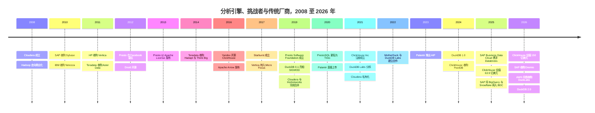

# 31. 分析引擎挑战者与传统平台
> **状态：** 上市与非上市公司混合 · **总部：** 各不相同（见概览表）· **成立：** 各不相同（见概览表）· **最新估值/市值：** ClickHouse 投后估值 $15B（媒体报道，2026 年 1 月）；Palantir 市值 $442B、Teradata 市值 $3.2B（2026-10-30 / 2026-10-28）· **最后核实：** 2026-11-01

## 要点速览（TL;DR）

- **两个阵营，一场战争。** 开源挑战者（ClickHouse、DuckDB 与 MotherDuck、Trino 与 Starburst、Dremio、Firebolt，以及 Druid 和 Pinot 的商业厂商）凭借性价比攻击特定工作负载。传统厂商（Teradata、Cloudera、SAP、IBM、OpenText 旗下的 Vertica）则依靠长期合同守住庞大的存量客户群。两个阵营都受到 Databricks、Snowflake 和超大规模云厂商的挤压（[第 25 章](ch25-databricks.md)、[第 26 章](ch26-snowflake.md)、[第 28 章](ch28-hyperscaler-data-platforms.md)）。
- **ClickHouse 是突围而出的挑战者。** 它在 2026 年 1 月以 **$15B** 估值融资 $400M（媒体报道），是 2025 年 5 月估值的 2.4 倍；公司称在 2026 年 5 月已突破 **$250M 年度经常性收入（ARR），客户超过 4,000 家**（公司披露）。可观测性和 AI 智能体遥测是其增长引擎。[^ch-seriesd][^ch-arr]
- **独立厂商正在被吸收。** SAP 同意收购 **Dremio**（2026 年 5 月 4 日宣布；约 2026 年 7 月完成；条款未披露）。AWS 同意收购 DuckDB 背后的公司 **DuckLabs**（2026 年 8 月 26 日宣布），而 DuckDB 本身仍在 DuckDB Foundation 名下保持 MIT 许可。[^sap-dremio][^aws-duck] Starburst 如今是最大的独立 Trino 厂商，其最近一轮有定价的融资还停留在 2022 年。
- **传统厂商便宜自有其原因。** Teradata 的估值约为 **1.7 倍 EV/过去 12 个月收入**，收入持平；而 **Palantir** 的估值约为 **70 倍 EV/过去 12 个月收入**，过去 12 个月增长约 79%；若按 `data/public_comps.csv` 中的 FY2026 指引口径，约为 53 倍 EV/未来 12 个月收入（stockanalysis，2026-10-28/30）。Palantir Foundry 的[本体（ontology）](../glossary.md#ontology)实质上是一个带有操作型回写能力的语义层，被当作 AI 操作系统卖给高管。[^comps-tdc][^comps-pltr]
- **Everpure 视角。** 本地部署的湖仓一体（lakehouse）引擎（Starburst、Dremio、Cloudera、自管 ClickHouse）是本地 S3 对象存储天然的软件合作伙伴。Everpure 已公开发布与 Dremio 和 Starburst 合作的 FlashBlade 参考方案。Dremio 并入 SAP，改变了这项合作中坐在谈判桌对面的人。[^dremio-pure][^starburst-ep]

## 概览表

| 公司 | 状态 / 所有者 | 总部 / 成立 | 负责人（公开记录） | 规模指标 | 最新估值或市值 | 主要投资方 / 所有者 |
|---|---|---|---|---|---|---|
| ClickHouse | 非上市 | 从 Yandex 分拆；2021 年 9 月注册成立[^ch-inc] | Aaron Katz（CEO）† | ARR >$250M，客户 >4,000 家（2026 年 5 月，公司披露）[^ch-arr] | 投后估值 $15B（2026 年 1 月，媒体报道）[^ch-seriesd] | Dragoneer（D 轮）、Khosla（C 轮）、Index、Benchmark[^ch-seriesc][^ch-inc] |
| DuckDB / DuckLabs | MIT 项目；DuckLabs 同意并入 AWS（2026 年 8 月） | Amsterdam；2018 年起源于 CWI 研究，Labs 于 2021 年分拆[^duck-history] | Hannes Mühleisen、Mark Raasveldt（创始人） | 员工 >30 人（2026 年）；duckdb.org 月独立访客 >8M（公司披露）[^duck-history][^duck-40k] | 条款未披露[^aws-duck] | AWS（收购方）；知识产权由 DuckDB Foundation 持有 |
| MotherDuck | 非上市 | Seattle；2022 年† | Jordan Tigani（CEO）† | 未披露 | 投后估值约 $400M（2023 年 9 月，媒体报道）[^motherduck] | Felicis、a16z |
| Starburst | 非上市 | Boston；2017 年† | Justin Borgman（CEO）† | 未披露 | D 轮 $250M，估值约 $3.35B（2022 年 2 月，媒体报道）[^starburst-d] | Alkeon（D 轮领投） |
| Dremio | 已被 SAP 收购（2026 年） | Santa Clara；2015 年† | 已整合进 SAP Business Data Cloud | 未披露 | E 轮估值 $2B（2022 年 1 月，公司披露）；交易条款未披露[^dremio-e][^sap-dremio] | SAP（所有者） |
| Firebolt | 非上市 | Tel Aviv / 美国；2019 年† | Eldad Farkash（CEO）† | 未披露 | C 轮 $100M，估值约 $1.4B（2022 年 1 月，媒体报道）[^firebolt] | 不适用 |
| Teradata（TDC） | 上市，NYSE | San Diego；1979 年† | Steve McMillan（CEO）† | 过去 12 个月收入约 $1.69B（GAAP）[^fin-tdc] | 市值 $3.19B，EV $2.88B（2026-10-28）[^comps-tdc] | 公众流通股 |
| Cloudera | 非上市（自 2021 年起由 KKR、CD&R 持有） | Santa Clara；2008 年† | Charles Sansbury（CEO）† | 私有化后无经审计数据 | 私有化股权价值 $5.3B（2021 年）[^ma-cloudera] | KKR、Clayton Dubilier & Rice |
| Palantir（PLTR） | 上市，Nasdaq | Denver；2003 年† | Alex Karp（CEO）† | 截至 Q2 2026 过去 12 个月收入 $6.16B，同比约 +79%（GAAP）[^fin-pltr] | 市值 $442B，EV $433B（2026-10-30）[^comps-pltr] | 公众流通股 |
| SAP（SAP） | 上市，NYSE / Xetra | Walldorf；1972 年† | Christian Klein（CEO）† | Q3 2026 收入 €10.27B，云业务 +26%（IFRS）[^comps-sap] | 市值 $274B（2026-10-30）[^comps-sap] | 公众流通股 |
| IBM（IBM） | 上市，NYSE | Armonk；1911 年† | Arvind Krishna（CEO）† | Q3 2026 收入 $17.1B；Data 业务 +19%，含 Confluent（GAAP）[^comps-ibm] | 市值 $244B（2026-10-30）[^comps-ibm] | 公众流通股 |

*图 31.1 — 概览。标有 † 的单元格（总部、成立年份、CEO）属于经审阅者核对的公认背景知识；总部和成立年份较为稳定，但 CEO 信息仅确认至 2025 年中 [VERIFY: 2025 年中以后是否有管理层变动]；其余内容均有脚注。挑战者几乎不披露任何经审计数据，只有 ClickHouse 公布了近期的 ARR 下限。上市传统厂商的价值跨越两个数量级，这更多反映的是增长预期，而非存量客户规模。*

## 起源与战略演进

本章涉及的公司来自三波浪潮。每一波都始于某家大型互联网公司或研究实验室为自身需求打造的引擎，又都以传统厂商收购幸存者告终。

**第一波：MPP 一体机（1980 年代–2011 年）。** Teradata 以软硬件一体机的形式，向银行、零售商和电信运营商销售无共享（shared-nothing）的[大规模并行处理（massively parallel processing）](../glossary.md#massively-parallel-processing)数据仓库。2000 年代的列式存储和一体机初创公司大多在大约一年之内相继出售：SAP 收购 Sybase（$5.8B，2010 年），IBM 收购 Netezza（$1.7B，2010 年），HP 收购 Vertica（2011 年），Teradata 收购 Aster Data 的剩余股权（$263M，2011 年）。[^ma-sybase][^ma-netezza][^ma-vertica][^ma-aster] [第 5 章](../01-data-systems-foundations/ch05-analytical-engines.md)解释了这些引擎所开创的列式存储与向量化执行，本章不再赘述。

**第二波：Hadoop 与 SQL-on-Hadoop（2008–2021 年）。** Cloudera（2008 年成立）和 Hortonworks 将 Apache Hadoop 商业化。Facebook 工程师在 2012 年创建了 **Presto**，用于在公司的 Hadoop 数据仓库上运行交互式 SQL，并于 2013 年以 Apache License 发布。[^trino-rename][^presto-psf] Teradata 的应对是收购 SQL-on-Hadoop 团队（Hadapt，2014 年）和一家 Hadoop 咨询公司（Think Big，2014 年）。[^ma-hadapt][^ma-thinkbig] Hadoop 发行商始终没能及时建成云服务。Cloudera 与 Hortonworks 以全股票方式合并，合并估值 $5.2B（2019 年 1 月完成）；MapR 的资产在 2019 年归入 HPE；2021 年，KKR 和 CD&R 以约 $5.3B 将 Cloudera 私有化。[^ma-hortonworks][^ma-mapr][^ma-cloudera]

**第三波：面向云和笔记本电脑的开放引擎（2016–2026 年）。** 2016 年 6 月，Yandex 开源了 ClickHouse——其网站分析产品 Metrica 背后的引擎。[^ch-history] Presto 的创建者离开 Facebook，于 2019 年 1 月成立 Presto Software Foundation；在 Facebook 将 Presto 名称置于 Linux Foundation 之下注册商标后，他们于 2020 年 12 月将自己的分支更名为 **Trino**。[^trino-rename] DuckDB 于 2018 年在 CWI Amsterdam 起步，并在 SIGMOD 2019 上亮相。[^duck-history] ClickHouse, Inc. 于 2021 年 9 月注册成立并完成 $50M A 轮融资，DuckDB Labs 则于 2021 年 7 月从 CWI 分拆。[^ch-inc][^duck-history] 随后，2026 年的整合潮开启：SAP–Dremio 与 AWS–DuckLabs。[^sap-dremio][^aws-duck]

Palantir 不属于这三波浪潮。它于 2003 年为情报分析而创立，为商业客户打造了 Foundry，2020 年 9 月在 NYSE 直接上市（2024 年 11 月将上市地转至 Nasdaq），并于 2023 年推出人工智能平台（AIP）。这些日期属于公认背景知识。它的"数据平台"是一个应用层构造——本体——而不是查询引擎。

*图 31.2 — 三波浪潮：一体机被系统厂商收购（2010–11 年），Hadoop 发行版整合并被私有化（2019–21 年），开放引擎先融风险资本、再被吸收（2026 年）。日期来自所引资料；Druid 2012 年、Starburst 2017 年和 Palantir AIP 2023 年依据公认背景知识，SAP Business Data Cloud（2025 年 2 月）由 SAP 后来的合作伙伴公告确认。[^sap-snow]*

## 产品与技术

### ClickHouse

ClickHouse 是一个向量化列式存储，其核心表引擎 [MergeTree](../glossary.md#mergetree) 将每次插入写成一个已排序、不可变的"数据片段（part）"，并在后台合并这些片段。稀疏主键索引指向每 8,192 行组成的数据块，因此针对某个时间范围的查询只读取所需的数据块。这一设计源自 Yandex Metrica：该产品需要在原始事件上实现亚秒级的自定义报表，而不是依赖预聚合的多维数据集。Yandex 披露该产品的集群有 374 台服务器，存储超过 20 万亿行数据。[^ch-history][^ch-paper] 核心团队发表于 VLDB 2024 的论文是对它最好的单篇描述。[^ch-paper]

ClickHouse Cloud 运行一个名为 SharedMergeTree 的变体，它把全部表数据放在共享对象存储中，使计算副本无状态。[^ch-smt] 自管的 ClickHouse 在本地 NVMe 上依然运行良好，这也是它出现在本地可观测性技术栈中的原因。自 2024 年以来，其产品战略是补齐引擎周边的组件：Postgres 变更数据捕获（CDC）（PeerDB）、可观测性界面（HyperDX，现为 ClickStack）和 LLM 追踪（Langfuse）。[^ch-peerdb][^ch-hyperdx][^ch-langfuse] 其逻辑很简单：日志、追踪和智能体遥测都是宽表、以追加写入为主的事件表，而 ClickHouse 正是处理这类事件表最便宜的快速引擎。

### DuckDB 与 MotherDuck

DuckDB 是一个[进程内数据库（in-process database）](../glossary.md#in-process-database)：一个运行在 Python 笔记本、应用程序或浏览器内部的库，不需要服务器。它把向量化引擎带到分析师本来就在工作的地方。它可以直接读取 Parquet、CSV、Iceberg 和 Delta 文件，包括 S3 上的文件。[^duck-history] 其商业论点是：大多数分析查询规模都很小。MotherDuck 对 Amazon 公开的 Redshift 集群数据集进行分析后发现，只有约 0.03% 的查询扫描量超过 10 TB（厂商分析）。[^md-redshift][^redset] DuckDB 2.0（2026 年 10 月 21 日）新增了名为 Quack 的客户端-服务器协议、异步 I/O 和 VARIANT 类型。[^duck-200] 这让 DuckDB 首次走出"单进程"的框框。

其组织架构颇为特别。**DuckDB Foundation** 拥有知识产权，并使其保持 MIT 许可。**DuckLabs**（2026 年由 DuckDB Labs 更名）雇用核心工程师。**MotherDuck** 运营托管云服务，并根据 2022 年 11 月宣布的合作关系向 DuckLabs 采购工程服务。[^duck-history] DuckLake 是该团队推出的表格式，把湖的元数据保存在 SQL 数据库中，已于 2026 年 4 月发布 1.0 版（[第 7 章](../01-data-systems-foundations/ch07-open-table-formats.md)）。[^duck-history]

2026 年 8 月 26 日，AWS 签署了收购 DuckLabs 的最终协议，条款未披露。团队留在 Amsterdam，DuckDB、DuckLake 和 Quack 在 Foundation 名下保持 MIT 许可，Foundation 还将设立技术咨询委员会。[^aws-duck][^duck-aws-blog] AWS 将 DuckDB 定位为对智能体友好、擅长在 S3 上原地分析数据的引擎。到 2026 年 9–10 月，它已在 Aurora PostgreSQL 中推出由 DuckDB 驱动的分析功能（据 `data/ma_deals.csv`）。[^aws-duck][^aurora-duck] [第 23 章](../03-ai-data-stack/ch23-real-time-analytics-htap.md)介绍了技术层面的内容。

**这对 MotherDuck 意味着什么。** 看多的解读是：MotherDuck 所依赖的引擎如今由云计算领域财力最雄厚的公司出资支持，而且许可证无法被收回。看空的解读是：MotherDuck 的工程合作伙伴现在为最有可能在 S3 上推出竞争性无服务器 DuckDB 服务的超大规模云厂商工作。自 2023 年 B 轮（投后估值约 $400M，媒体报道）以来，MotherDuck 没有公开披露过有定价的融资。[^motherduck] 值得追问的是：DuckLabs 的工程合同能否在交易后延续？在失去对核心团队的优先接触后，MotherDuck 的差异化（本地加云的混合执行、共享、托管目录）是否足够？

### Trino 与 Starburst

Trino 是一个**本身不带存储**的分布式 SQL 引擎。协调节点负责规划查询，工作节点通过连接器拉取数据：对象存储上的 Hive 和 Iceberg 表，以及关系型数据库、Kafka 等众多数据源。这使它成为[查询联邦（query federation）](../glossary.md#query-federation)的标准引擎——即用一条 SQL 语句跨系统关联数据，而无需先把数据复制进数据仓库。Starburst 由曾在 Teradata 维护 Presto 的前 Teradata 工程师创立，销售 Starburst Enterprise（自管）和 Starburst Galaxy（SaaS）。它推广"Icehouse"模式（这是它对"Trino 加对象存储上的 Iceberg"的叫法），并推出 Warp Speed，在工作节点 SSD 上缓存和索引列数据（加速效果为厂商宣称）。[^warp] Dell 的 Data Lakehouse 一体机（2024 年推出）以 OEM 方式基于 Starburst 引擎构建 [VERIFY: Dell–Starburst OEM 产品的当前状态]。Everpure 发布了基于 FlashBlade、Iceberg 和 Starburst 的"Scalable Lakehouse Analytics"参考架构。[^starburst-ep]

### Dremio

Dremio 基于 [Apache Arrow](../glossary.md#apache-arrow)（它在 2016 年参与共同创建的内存列式标准）构建了一个 Iceberg 原生的湖仓引擎。[^arrow-tlp] 它增加了类 Git 的目录（Project Nessie，以 Arctic 名义销售），后来又支持 **Apache Polaris**——一个 Iceberg REST 目录，已于 2026 年毕业成为 Apache 顶级项目。[^polaris] 它的卖点是在数据湖上提供自助式 SQL，用 reflections（物化加速结构）替代数据副本，且可部署在任何云或本地环境。正是这种本地部署能力，促使 Everpure 为混合 Iceberg 湖仓打造了 FlashBlade–Dremio 联合解决方案。[^dremio-pure] SAP 收购 Dremio，是为了在其 Business Data Cloud 内把非 SAP 数据与 SAP 数据一并查询，所宣称的目标是智能体式 AI。[^sap-dremio]

### 实时及其他挑战者（简述）

- **Firebolt** 于 2020 年推出，是一款基于稀疏索引、面向低延迟和高并发分析的云数据仓库。我们能确认的最近一轮有定价融资是 2022 年 1 月的 $100M C 轮，报道估值约 $1.4B [VERIFY: 之后是否有新一轮融资、产品或所有权变化]。[^firebolt]
- **Imply**（Apache Druid）和 **StarTree**（Apache Pinot）销售基于数据段（segment）的引擎，用于面向用户的亚秒级仪表盘。Imply 于 2025 年 9 月围绕"可观测性数据仓库"Lumi 重新定位。StarTree 最近一次披露的融资是 2022 年的 $47M B 轮。[^imply-lumi][^startree][^druid-paper]

### 传统平台

- **Teradata Vantage** 是无共享 MPP 数据仓库，目前以本地部署、超大规模云上的 VantageCloud Enterprise 以及基于对象存储的 VantageCloud Lake 等形式销售 [VERIFY: 当前产品命名]。ClearScape Analytics 提供库内分析和机器学习。其强项是在大型银行和电信企业中为数千个并发查询提供混合工作负载管理。
- **Cloudera** 销售混合数据平台：将 Hadoop 时代的老技术栈（Spark、Hive、Impala、NiFi、Kafka）重新以 Iceberg 表为中心组织，同一套软件既可本地部署也可运行在公有云上，再加上在受监管数据旁运行模型的"私有 AI"卖点。私有化以来，它收购了 Verta（模型管理，2024 年）、Octopai（数据血缘，2024 年）和 Taikun（Kubernetes 管理，2025 年）[VERIFY: 三笔交易的日期与条款]。
- **SAP** 在 S/4HANA 之下运行其内存列式存储 **HANA**。Datasphere 是其数据仓库服务；**Business Data Cloud**（BDC）于 2025 年 2 月推出，并与 Databricks 合作（"SAP Databricks"），是将 SAP 应用数据作为受治理数据产品对外开放的总体框架 [VERIFY: Databricks 合作的商业条款]。[^sap-bdc] 随后 SAP 加入了 Google BigQuery（2025 年 10 月），并在 2025 年 11 月 4 日加入 Snowflake：**SAP Snowflake**（BDC 内由 SAP 托管的 Snowflake，计划于 Q1 2026 正式可用）和 **SAP BDC Connect for Snowflake**（零拷贝共享，计划于 H1 2026 推出）[VERIFY: 两者在 2026 年的交付状态]。[^sap-snow] 如今，Dremio 成为 SAP 在这一框架内处理非 SAP 数据的自有引擎，与三家合作伙伴平台并列。
- **IBM** 销售 Db2、Netezza Performance Server（复活的一体机）和 **watsonx.data**——一个于 2023 年推出、基于 Iceberg 之上的 Presto 和 Spark 的湖仓 [VERIFY: 当前引擎组合]。IBM 在 2025–26 年对 DataStax 和 Confluent 的收购表明，它是在为 watsonx 买入数据层，而不是自建。[^ibm-datastax][^ibm-confluent]
- **Vertica** 是源自 C-Store 研究脉络的列式存储，先后从 HP 转到 HPE、Micro Focus（2017 年），并随 OpenText 收购 Micro Focus（2023 年 1 月完成）归入 OpenText [VERIFY: 2025–26 年是否有剥离]。[^ma-vertica]
