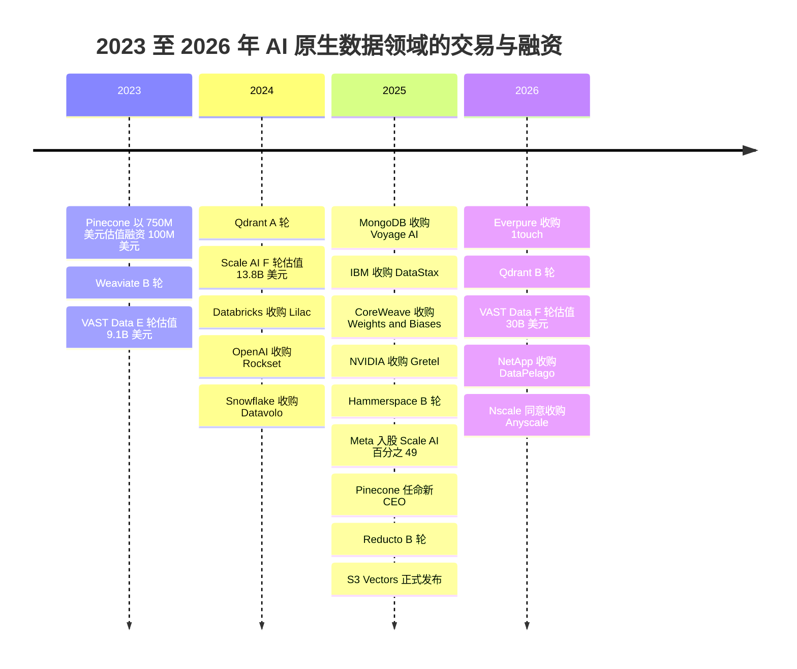
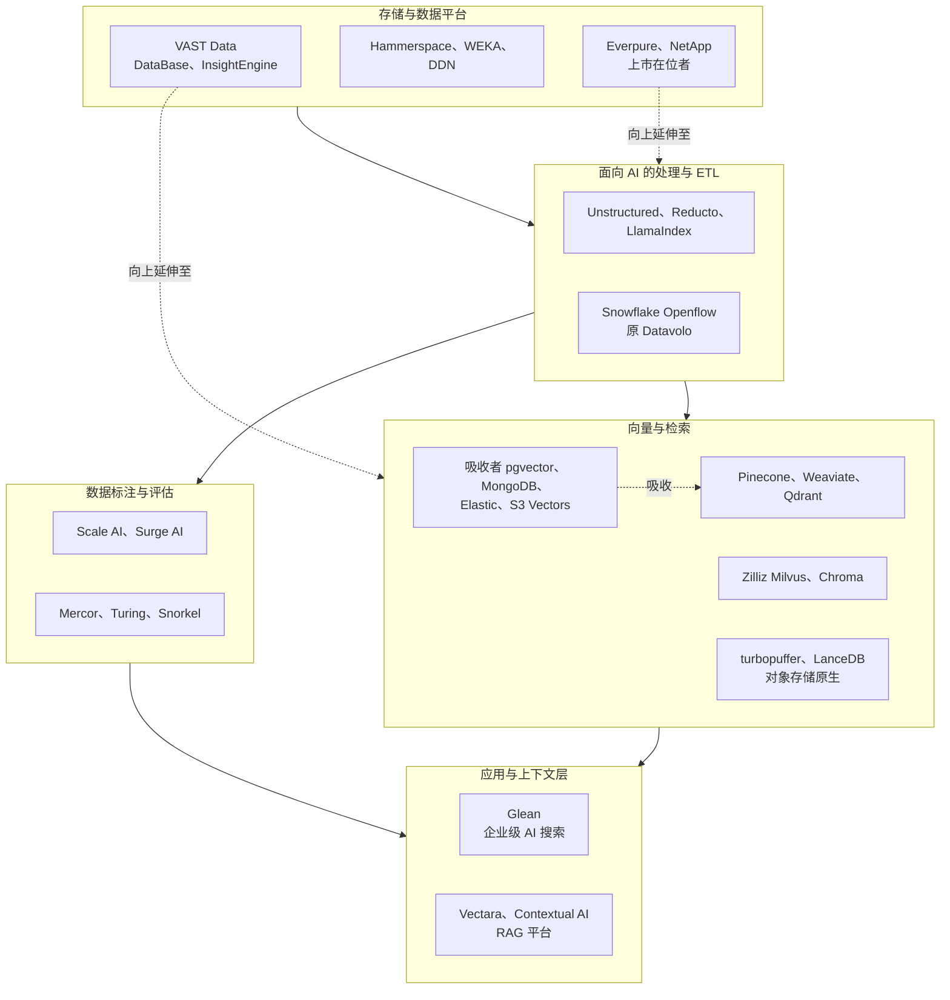

# 32. AI 原生数据公司
> **状态：** 以非上市公司为主 · **总部：** 各不相同（美国、欧洲、以色列）· **成立：** 本章所介绍的公司大多成立于 2016–2023 年 · **最新估值/市值：** 从约 $0.5B（Hammerspace，2025 年 4 月）到 $30B（VAST Data，2026 年 4 月）不等，均为公司披露或媒体报道的投后估值 · **最后核实：** 2026-11-01

## 要点速览（TL;DR）

- **五个类别，五种截然不同的生意。** "AI 原生数据公司"涵盖：(A) [向量数据库（vector database）](../glossary.md#vector-database)厂商；(B) 文档解析与面向 AI 的 ETL 工具；(C) 训练数据与数据标注供应商；(D) 由存储起家的 AI 数据基础设施平台；(E) 企业级 AI 搜索。它们面对同一类买家——AI 团队——但毛利率、护城河和退出路径大相径庭。本章逐一剖析各类别；底层技术见[第 17 章](../03-ai-data-stack/ch17-unstructured-data-processing.md)、[第 18 章](../03-ai-data-stack/ch18-embeddings-and-vector-search.md)和[第 20 章](../03-ai-data-stack/ch20-training-data-supply-chain.md)。
- **资金流向了技术栈的底层和顶层，而非中间层。** VAST Data 以 **$30B** 估值完成融资（2026 年 4 月，公司披露，约一半为老股转让），Meta 则以 **$14.3B 收购 Scale AI 49% 股权**（2025 年 6 月，媒体报道，隐含估值约 $29B）。纯向量数据库公司的融资轮次在 $28M–$100M 之间，而 Pinecone 最近一次定价融资（2023 年，投后估值 $750M）距今已超过三年。[^vast-f][^meta-scale][^pinecone-b]
- **[功能吸收（feature absorption）](../glossary.md#feature-absorption)是决定性风险。** 向量检索已成为 Postgres、MongoDB、Elastic、Databricks、Snowflake 的一项功能，自 2025 年 12 月起更成为 Amazon S3 本身的功能（S3 Vectors 正式发布）。文档解析正被数据平台（Snowflake 收购了 Datavolo）以及能直接读取 PDF 的前沿模型所吸收。[^s3-vectors][^datavolo]
- **中立性是一种只能卖一次的资产。** Meta 交易之后，Scale AI 的 CEO 转投 Meta，据报道多家主要 AI 实验室客户随之缩减合作。Surge AI、Mercor 等竞争对手的份额和估值随之上升。这一教训适用于任何在集中市场中接受单一客户入股的供应商。[^meta-scale][^tk-scale-after]
- **Everpure 视角。** VAST Data 是"存储公司向技术栈上层延伸"最接近的可比对象：它如今在自家存储之上销售数据库、事件/函数引擎和检索引擎。Everpure 走的是一条平行但不同的路径（Enterprise Data Cloud、收购 1touch、基于 NVIDIA AI Data Platform 的 Data Stream）。对战略团队而言，待解的问题是：独自向上延伸到哪一层，以及在哪些环节寻求合作。[^everpure-ds][^1touch]

## 概览表

| 类别 | 代表公司 | 最新估值（口径，日期） | 规模指标（已标注口径） | 商业模式 | 类别现状 |
|---|---|---|---|---|---|
| (A) 向量数据库 | Pinecone、Weaviate、Qdrant、Zilliz/Milvus、Chroma、LanceDB、turbopuffer | Pinecone $750M（媒体报道，2023 年 4 月）；Qdrant $50M B 轮（2026 年 3 月，估值未披露）；LanceDB $30M A 轮（2025 年 6 月） | 无经审计收入；公开披露 ARR 的极少 | 按用量计费的无服务器模式；开放核心加托管云 | 正在整合；价格持续压缩 |
| (B) 非结构化数据 / 面向 AI 的 ETL | Unstructured、LlamaIndex、Reducto、Datavolo（现属 Snowflake）、Vectara、Contextual AI | Reducto $75M B 轮（2025 年 10 月）；Unstructured $40M B 轮（2024 年 3 月）；Datavolo 被收购（2024 年 11 月，金额未披露） | 无经审计收入 | 按页或按文档计费的 API；企业平台许可 | 早期阶段；平台吸收正在进行 |
| (C) 训练数据 / 数据标注 | Scale AI、Surge AI、Mercor、Snorkel、Turing | Scale 隐含估值约 $29B（Meta，2025 年 6 月，媒体报道）；Surge 洽谈估值最高 $25B（2025 年 7 月，媒体报道，未确认完成）；Snorkel $3.5B（2026 年 9 月，公司披露） | 收入集中于少数几家前沿实验室；Snorkel 年化运行率约 $375M（公司披露，2026 年 9 月） | 服务模式：外包人员成本转嫁加利润；平台型市场抽取佣金 | 增长快、波动大、客户集中 |
| (D) AI 数据基础设施 | VAST Data、Hammerspace、WEKA、DDN、NetApp、Everpure | VAST $30B（公司披露，2026 年 4 月）；Hammerspace >$0.5B（公司披露，2025 年 4 月） | VAST 的年化运行率说法未经重新核实；NetApp 与 Everpure 为上市公司 | 运行于通用或自有硬件之上的软件许可；订阅 | 资金充裕；竞相向上层延伸 |
| (E) 企业级 AI 搜索 / 上下文 | Glean | $7.2B（媒体报道，2025 年 6 月） | ARR 约 $300M（公司披露，2026 年 5 月） | 按席位计费的 SaaS | 增长中；受办公套件挤压 |

*图 32.1 — 类别概览。估值均为私募估值，往往已过时，且由优先股定价；这些公司均未公布经审计的财务报表。资料来源：`data/private_funding.csv` 及正文脚注。[^pf]*

## 起源与战略演进

AI 原生数据这一类别分三波形成，每一波都由模型对数据需求的变化所触发。

**第一波：服务于搜索与推荐的检索（2017–2022 年）。** 在 ChatGPT 出现之前，向量检索只是大型消费互联网公司内部使用的小众技术。Zilliz 打造的 Milvus 于 2019 年开源，后来转入 LF AI & Data Foundation。[^zilliz-b] Pinecone 由前 Amazon 研究总监 Edo Liberty 于 2019 年创立，向工程团队销售托管向量索引。Weaviate（阿姆斯特丹）和 Qdrant（柏林，以 Rust 编写）随后推出了开源引擎。成立于 2016 年的 VAST Data 当时还是一家纯闪存存储公司。同样成立于 2016 年的 Scale AI 则为自动驾驶项目标注图像。[^tk-origins]

**第二波：RAG 热潮（2022 年末–2024 年）。** [检索增强生成（retrieval-augmented generation，RAG）](../glossary.md#retrieval-augmented-generation)让每家企业都想要一个向量索引。Pinecone 于 2023 年 4 月以 $750M 估值融资 $100M，Weaviate 同月完成 $50M B 轮融资。[^pinecone-b][^weaviate-b] Chroma 作为 LangChain 时代原型项目默认的本地存储完成了种子轮融资。[^tk-chroma] 上游又出现了另一层：将杂乱的 PDF、幻灯片和扫描件转换为干净文本块的公司（Unstructured、LlamaIndex 的 LlamaParse、Reducto）。Scale AI 从图像标注转向为聊天模型提供[人类反馈强化学习（RLHF）](../glossary.md#reinforcement-learning-from-human-feedback)数据，并于 2024 年 5 月以 $13.8B 估值融资 $1B。[^scale-f]

**第三波：吸收与整合（2024–2026 年）。** 在位者开始收购或模仿。OpenAI 收购了 Rockset（2024 年）。Snowflake 收购了 Datavolo（2024 年）。MongoDB 以 $220M 收购 Voyage AI（2025 年）。IBM 收购了 DataStax（2025 年）。CoreWeave 以约 $1.7B 收购 Weights & Biases（媒体报道，2025 年）。[^rockset][^datavolo][^voyage][^datastax][^cw-wb] AWS 推出了 S3 Vectors。[^s3-vectors] Meta 对 Scale AI 的交易（2025 年 6 月）是单笔规模最大的交易。基础设施层的情况则恰恰相反：VAST Data 的估值增长三倍以上，达到 $30B；存储领域的在位者（Everpure、NetApp）则收购软件，向数据准备领域延伸。[^vast-f][^1touch][^datapelago]

*图 32.2 — 资金从独立的检索产品（2023 年）转向平台发起的收购（2024–2025 年），再转向基础设施级别的大额融资（2026 年）。资料来源：`data/private_funding.csv`、`data/ma_deals.csv`。[^pf][^ma]*

## 产品与技术

下图按层级排列各家公司，应自下而上阅读：数据落在存储与数据平台上，经过解析和切块，再被嵌入并建立索引以供检索；另一路则被加工成带标注的训练集和评估集。企业搜索等应用位于最上层。虚线箭头表示谁正在吸收谁。

*图 32.3 — AI 数据基础设施全景（作者绘制）。纯业务公司位于中间层；其下方和上方的平台正在向中间层扩张。*
