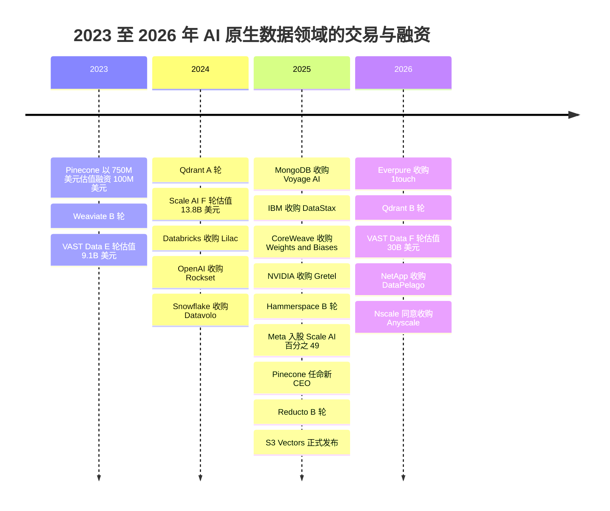
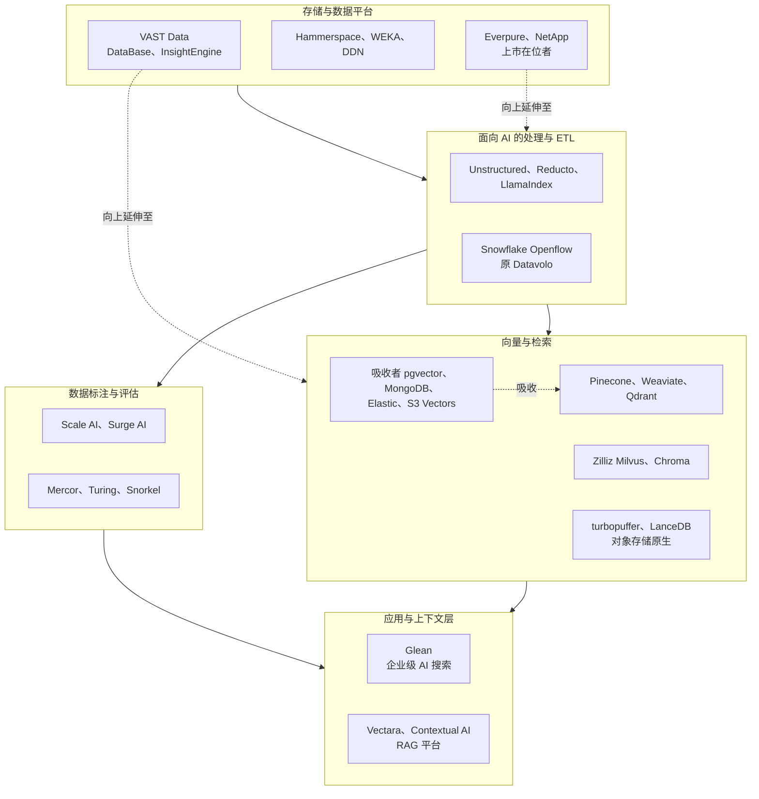
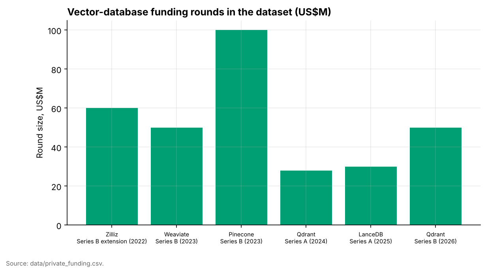
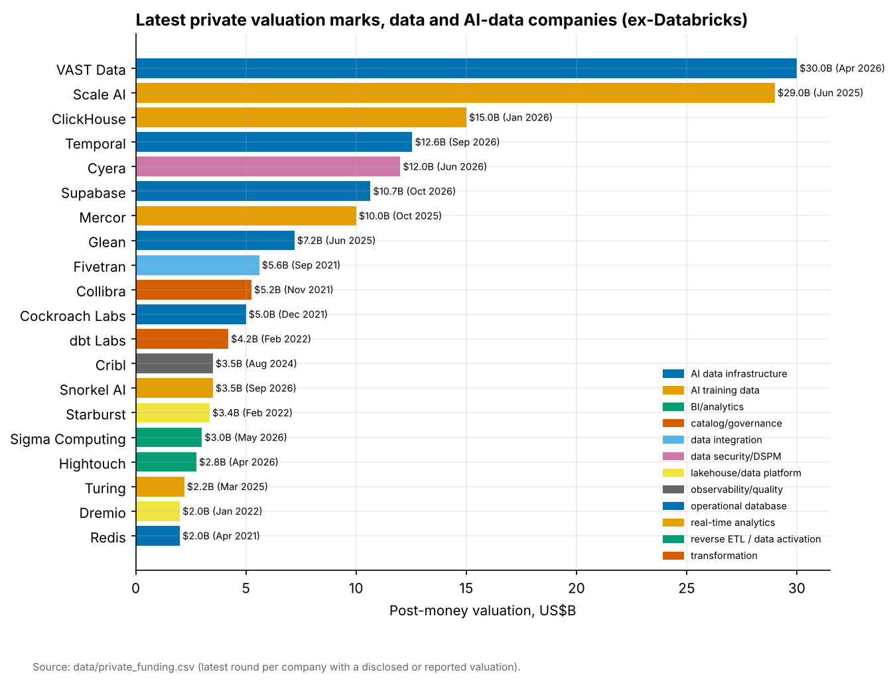
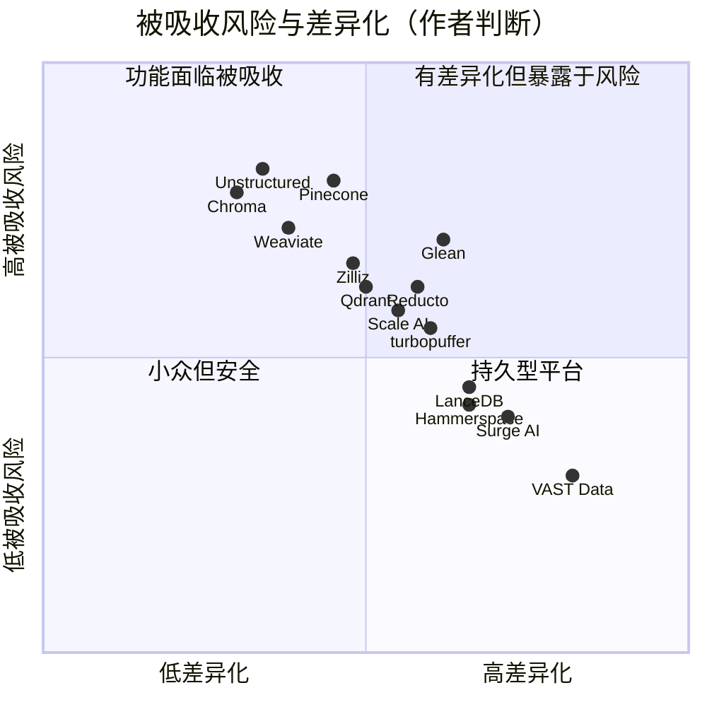

# 32. AI 原生数据公司
> **状态：** 以非上市公司为主 · **总部：** 各不相同（美国、欧洲、以色列）· **成立：** 本章所介绍的公司大多成立于 2016–2023 年 · **最新估值/市值：** 从约 $0.5B（Hammerspace，2025 年 4 月）到 $30B（VAST Data，2026 年 4 月）不等，均为公司披露或媒体报道的投后估值 · **最后核实：** 2026-11-01

## 要点速览（TL;DR）

- **五个类别，五种截然不同的生意。** "AI 原生数据公司"涵盖：(A) [向量数据库（vector database）](../glossary.md#vector-database)厂商；(B) 文档解析与面向 AI 的 ETL 工具；(C) 训练数据与数据标注供应商；(D) 由存储起家的 AI 数据基础设施平台；(E) 企业级 AI 搜索。它们面对同一类买家——AI 团队——但毛利率、护城河和退出路径大相径庭。本章逐一剖析各类别；底层技术见[第 17 章](../03-ai-data-stack/ch17-unstructured-data-processing.md)、[第 18 章](../03-ai-data-stack/ch18-embeddings-and-vector-search.md)和[第 20 章](../03-ai-data-stack/ch20-training-data-supply-chain.md)。
- **资金流向了技术栈的底层和顶层，而非中间层。** VAST Data 以 **$30B** 估值完成融资（2026 年 4 月，公司披露，约一半为老股转让），Meta 则以 **$14.3B 收购 Scale AI 49% 股权**（2025 年 6 月，媒体报道，隐含估值约 $29B）。纯向量数据库公司的融资轮次在 $28M–$100M 之间，而 Pinecone 最近一次定价融资（2023 年，投后估值 $750M）距今已超过三年。[^vast-f][^meta-scale][^pinecone-b]
- **[功能吸收（feature absorption）](../glossary.md#feature-absorption)是决定性风险。** 向量检索已成为 Postgres、MongoDB、Elastic、Databricks、Snowflake 的一项功能，自 2025 年 12 月起更成为 Amazon S3 本身的功能（S3 Vectors 正式发布）。文档解析正被数据平台（Snowflake 收购了 Datavolo）以及能直接读取 PDF 的前沿模型所吸收。[^s3-vectors][^datavolo]
- **中立性是一种只能卖一次的资产。** Meta 交易之后，Scale AI 的 CEO 转投 Meta，据报道多家主要 AI 实验室客户随之缩减合作。Surge AI、Mercor 等竞争对手的份额和估值随之上升。这一教训适用于任何在集中市场中接受单一客户入股的供应商。[^meta-scale][^tk-scale-after]
- **Everpure 视角。** VAST Data 是"存储公司向技术栈上层延伸"最接近的可比对象：它如今在自家存储之上销售数据库、事件/函数引擎和检索引擎。Everpure 走的是一条平行但不同的路径（Enterprise Data Cloud、收购 1touch、基于 NVIDIA AI Data Platform 的 Data Stream）。对战略团队而言，待解的问题是：独自向上延伸到哪一层，以及在哪些环节寻求合作。[^everpure-ds][^1touch]

## 概览表

| 类别 | 代表公司 | 最新估值（口径，日期） | 规模指标（已标注口径） | 商业模式 | 类别现状 |
|---|---|---|---|---|---|
| (A) 向量数据库 | Pinecone、Weaviate、Qdrant、Zilliz/Milvus、Chroma、LanceDB、turbopuffer | Pinecone $750M（媒体报道，2023 年 4 月）；Qdrant $50M B 轮（2026 年 3 月，估值未披露）；LanceDB $30M A 轮（2025 年 6 月） | 无经审计收入；公开披露 ARR 的极少 | 按用量计费的无服务器模式；开放核心加托管云 | 正在整合；价格持续压缩 |
| (B) 非结构化数据 / 面向 AI 的 ETL | Unstructured、LlamaIndex、Reducto、Datavolo（现属 Snowflake）、Vectara、Contextual AI | Reducto $75M B 轮（2025 年 10 月）；Unstructured $40M B 轮（2024 年 3 月）；Datavolo 被收购（2024 年 11 月，金额未披露） | 无经审计收入 | 按页或按文档计费的 API；企业平台许可 | 早期阶段；平台吸收正在进行 |
| (C) 训练数据 / 数据标注 | Scale AI、Surge AI、Mercor、Snorkel、Turing | Scale 隐含估值约 $29B（Meta，2025 年 6 月，媒体报道）；Surge 洽谈估值最高 $25B（2025 年 7 月，媒体报道，未确认完成）；Snorkel $3.5B（2026 年 9 月，公司披露） | 收入集中于少数几家前沿实验室；Snorkel 年化运行率约 $375M（公司披露，2026 年 9 月） | 服务模式：外包人员成本转嫁加利润；平台型市场抽取佣金 | 增长快、波动大、客户集中 |
| (D) AI 数据基础设施 | VAST Data、Hammerspace、WEKA、DDN、NetApp、Everpure | VAST $30B（公司披露，2026 年 4 月）；Hammerspace >$0.5B（公司披露，2025 年 4 月） | VAST 的年化运行率说法未经重新核实；NetApp 与 Everpure 为上市公司 | 运行于通用或自有硬件之上的软件许可；订阅 | 资金充裕；竞相向上层延伸 |
| (E) 企业级 AI 搜索 / 上下文 | Glean | $7.2B（媒体报道，2025 年 6 月） | ARR 约 $300M（公司披露，2026 年 5 月） | 按席位计费的 SaaS | 增长中；受办公套件挤压 |

*图 32.1 — 类别概览。估值均为私募估值，往往已过时，且由优先股定价；这些公司均未公布经审计的财务报表。资料来源：`data/private_funding.csv` 及正文脚注。[^pf]*

## 起源与战略演进

AI 原生数据这一类别分三波形成，每一波都由模型对数据需求的变化所触发。

**第一波：服务于搜索与推荐的检索（2017–2022 年）。** 在 ChatGPT 出现之前，向量检索只是大型消费互联网公司内部使用的小众技术。Zilliz 打造的 Milvus 于 2019 年开源，后来转入 LF AI & Data Foundation。[^zilliz-b] Pinecone 由前 Amazon 研究总监 Edo Liberty 于 2019 年创立，向工程团队销售托管向量索引。Weaviate（阿姆斯特丹）和 Qdrant（柏林，以 Rust 编写）随后推出了开源引擎。成立于 2016 年的 VAST Data 当时还是一家纯闪存存储公司。同样成立于 2016 年的 Scale AI 则为自动驾驶项目标注图像。[^tk-origins]

**第二波：RAG 热潮（2022 年末–2024 年）。** [检索增强生成（retrieval-augmented generation，RAG）](../glossary.md#retrieval-augmented-generation)让每家企业都想要一个向量索引。Pinecone 于 2023 年 4 月以 $750M 估值融资 $100M，Weaviate 同月完成 $50M B 轮融资。[^pinecone-b][^weaviate-b] Chroma 作为 LangChain 时代原型项目默认的本地存储完成了种子轮融资。[^tk-chroma] 上游又出现了另一层：将杂乱的 PDF、幻灯片和扫描件转换为干净文本块的公司（Unstructured、LlamaIndex 的 LlamaParse、Reducto）。Scale AI 从图像标注转向为聊天模型提供[人类反馈强化学习（RLHF）](../glossary.md#reinforcement-learning-from-human-feedback)数据，并于 2024 年 5 月以 $13.8B 估值融资 $1B。[^scale-f]

**第三波：吸收与整合（2024–2026 年）。** 在位者开始收购或模仿。OpenAI 收购了 Rockset（2024 年）。Snowflake 收购了 Datavolo（2024 年）。MongoDB 以 $220M 收购 Voyage AI（2025 年）。IBM 收购了 DataStax（2025 年）。CoreWeave 以约 $1.7B 收购 Weights & Biases（媒体报道，2025 年）。[^rockset][^datavolo][^voyage][^datastax][^cw-wb] AWS 推出了 S3 Vectors。[^s3-vectors] Meta 对 Scale AI 的交易（2025 年 6 月）是单笔规模最大的交易。基础设施层的情况则恰恰相反：VAST Data 的估值增长三倍以上，达到 $30B；存储领域的在位者（Everpure、NetApp）则收购软件，向数据准备领域延伸。[^vast-f][^1touch][^datapelago]

*图 32.2 — 资金从独立的检索产品（2023 年）转向平台发起的收购（2024–2025 年），再转向基础设施级别的大额融资（2026 年）。资料来源：`data/private_funding.csv`、`data/ma_deals.csv`。[^pf][^ma]*

## 产品与技术

下图按层级排列各家公司，应自下而上阅读：数据落在存储与数据平台上，经过解析和切块，再被嵌入并建立索引以供检索；另一路则被加工成带标注的训练集和评估集。企业搜索等应用位于最上层。虚线箭头表示谁正在吸收谁。

*图 32.3 — AI 数据基础设施全景（作者绘制）。纯业务公司位于中间层；其下方和上方的平台正在向中间层扩张。*

### (A) 向量数据库

向量数据库存储[嵌入（向量）（embedding）](../glossary.md#embedding)，并借助[近似最近邻（approximate nearest neighbor，ANN）](../glossary.md#approximate-nearest-neighbor)索引（HNSW 图、IVF 分区、DiskANN 式闪存图；见[第 18 章](../03-ai-data-stack/ch18-embeddings-and-vector-search.md)）回答"找出最相似的 k 个条目"这类查询。工程上的竞争集中在三点：每个存储向量的内存成本、带过滤条件的检索质量（相似度加元数据谓词），以及持续写入下的数据新鲜度。

- **Pinecone** 闭源且完全托管。其无服务器架构于 2024 年初推出，将存储（存放在云对象存储上的索引文件）与计算分离，并按读取单元、写入单元和存储 GB 数计费。[^tk-pinecone-serverless] 2025 年 9 月，曾创立 Actifio 并在 Google 担任高管的 Ash Ashutosh 出任 CEO；创始人 Edo Liberty 改任首席科学家。[^pinecone-ceo] 据媒体报道，公司在 2025 年曾探索出售；我们未发现任何已宣布的交易。[^tk-pinecone-sale]
- **Weaviate、Qdrant 和 Zilliz** 采用开放核心（open core）模式：开发者可免费运行的 Apache 许可引擎，加上托管云、混合式"自带云"（[bring your own cloud，BYOC](../glossary.md#bring-your-own-cloud)）部署和企业级功能。Qdrant 于 2026 年 3 月完成由 AVP 领投的 $50M B 轮融资，累计融资额约 $88M。[^qdrant-b] Zilliz 将 Milvus 商业化，后者是在大规模场景中部署最广的开源引擎；其最近一次经确认的融资是 2022 年 $60M 的 B 轮扩展融资。[^zilliz-b]
- **Chroma** 起初是一款嵌入式、以开发者为先的存储，后来增加了托管服务。[^tk-chroma]
- **LanceDB 和 turbopuffer** 代表新一代设计。二者都将对象存储视为索引的主要存放地，并把热数据缓存在本地 NVMe 上。LanceDB 构建于开放的 [Lance](../glossary.md#lance) 列式格式之上，该格式面向多模态训练与检索数据的快速随机访问。[^lance-paper] 它于 2025 年 6 月完成 $30M A 轮融资。[^lancedb-a] 成立于 2023 年的 turbopuffer 销售一款以对象存储为先的搜索引擎，并称其用户中包括多家 AI 原生软件公司（公司披露）。[^tk-turbopuffer]

> **类比：独立 DRAM 厂商与集成内存控制器。** 2000 年代初，内存控制器位于独立的北桥芯片上，芯片组厂商以此为生。AMD（2003 年）和随后的 Intel（2008 年）将控制器移入 CPU 裸片，大多数独立芯片组业务随之消失。DRAM 厂商之所以存活，是因为它们拥有 CPU 厂商无法集成的东西：存储器本身的制程技术和晶圆厂规模。向量检索就是 RAG 技术栈中的内存控制器。这项功能正被集成进每一个数据库，乃至 S3。独立厂商只有像 DRAM 厂商那样，掌握集成者无法复制的规模或成本优势，才能生存。对向量数据库而言，这意味着以最低成本存储和服务数十亿个向量，而不是更好的 API。

### (B) 非结构化数据与面向 AI 的 ETL

企业的大部分知识存在于 PDF、幻灯片、扫描表单和电子邮件中。任何内容在被嵌入之前，都必须先经过解析（文本、表格、版式、图像）、清洗，并切分为带元数据的文本块（[第 17 章](../03-ai-data-stack/ch17-unstructured-data-processing.md)）。难点在于表格和多栏版式——一旦阅读顺序出错，检索结果就会在无声无息中被污染。

- **Unstructured** 提供开源的文档切分库，以及付费的无服务器数据管道，并附带连接各类数据源和向量存储的连接器。它于 2024 年 3 月完成 $40M B 轮融资；Contrary Research 的一项估算（并非报道数字）认为其估值接近 $230M。[^unstructured-b]
- **Reducto** 结合视觉-语言模型与版式模型解析复杂文档，并向企业和 AI 应用开发者按页出售 API 访问。它完成了 $24.5M A 轮融资（2025 年），并于 2025 年 10 月完成由 Andreessen Horowitz 领投的 $75M B 轮融资，累计约 $108M。[^reducto-b]
- **LlamaIndex** 从一个开源 RAG 框架发展为 LlamaCloud 和 LlamaParse——一项托管的解析与索引服务。[^tk-llamaindex]
- **Datavolo** 由 Apache NiFi 的创建者创立，构建多模态数据摄取管道。Snowflake 于 2024 年 11 月将其收购，并以 **Openflow** 之名重新推出。[^datavolo]
- **Vectara** 和 **Contextual AI** 销售端到端 RAG 平台（解析、索引、检索，以及带事实依据校验的生成）。Contextual AI 的 CEO Douwe Kiela 是 2020 年最初那篇 RAG 论文的合著者。[^tk-rag-platforms]

### (C) 训练数据与数据标注

前沿实验室采购三类数据服务：用于 RLHF 的偏好判断，专家撰写的示范与推理轨迹（编程、数学、法律、医学），以及评估集。行业已从低成本的众包标注转向 **[专家数据（expert data）](../glossary.md#expert-data)**，其投入是按小时计酬的博士或资深工程师。第 20 章介绍供应链；本节聚焦于这些企业本身。

- **Scale AI** 将庞大的外包人员队伍（Remotasks/Outlier）与工具链和政府业务结合在一起。Meta 于 2025 年 6 月投资约 $14.3B，获得 49% 的无投票权股份，并将创始人兼 CEO Alexandr Wang 招入 Meta 的超级智能项目；Jason Droege 出任临时 CEO。[^meta-scale] 媒体报道称，Google、OpenAI 等随后削减或终止了与 Scale 的合作；2025 年 7 月，Scale 裁员约 14%。[^tk-scale-after]
- **Surge AI** 由 Edwin Chen 以自有资金创办，据媒体报道其 2024 年收入已超过 $1B，并于 2025 年 7 月洽谈以最高 $25B 的估值融资。[^surge-bbg][^tk-surge-rev]
- **Mercor** 运营一个为实验室招募领域专家并支付报酬的平台型市场；它于 2025 年 2 月以 $2B 估值融资，据媒体报道 2025 年 10 月估值达 $10B。[^tk-mercor]
- **Snorkel AI** 从程序化标注软件转向专家数据服务。它于 2025 年 5 月以 $1.3B 估值融资 $100M，随后于 2026 年 9 月以 $3.5B 估值融资 $350M（Insight Partners 和 S32），并称收入年化运行率约 $375M（均为公司披露；Reuters 报道为 >$350M）。[^snorkel] 按约 9 倍年化运行率计，其定价远低于上文那些软件式估值，更接近服务型业务组合所能支撑的水平。**Turing** 则从开发者人力派遣转向为实验室提供编程与推理数据。[^tk-snorkel-turing]

### (D) AI 数据基础设施

这一类别起步于存储，如今将自己定位为 AI 工厂的数据层。存储机制见配套的 *Everpure Tech Atlas*；这里的战略问题是：每家公司要向技术栈上层延伸多远。

- **VAST Data** 的存储基于**[分解式全共享（disaggregated shared-everything）](../glossary.md#disaggregated-shared-everything)**（DASE）架构：无状态服务器（"CNode"）通过 NVMe 网络访问全部 NVMe 闪存机柜，使容量与性能可独立扩展。在此基础上，VAST 增加了 **VAST DataBase**（同一系统内的表格存储）、用于事件触发器和函数的 **DataEngine**，以及与 NVIDIA 合作打造、在数据落地时即进行嵌入和建索引的 **InsightEngine**。2025 年，它开始将整个技术栈称为"AI 操作系统"。[^tk-vast-products] 它于 2023 年 12 月以 $9.1B 估值融资 $118M，又于 2026 年 4 月以 $30B 估值融资约 $1B（其中约一半为老股转让），NVIDIA 参与其中。[^vast-e][^vast-f] GPU 云是其标志性客户；据报道，2025 年末它与 CoreWeave 签订了一项大型多年期协议。[^tk-vast-cw]
- **Hammerspace** 卖的是软件，而不是硬件盒子。其全球数据平台在现有存储孤岛和云之上呈现统一的[全局命名空间（global namespace）](../glossary.md#global-namespace)，并通过标准 Linux [并行 NFS（parallel NFS）](../glossary.md#parallel-nfs)客户端为 GPU 服务器提供数据，因此无需专有客户端。它于 2025 年 4 月完成由 Altimeter 领投的 $100M B 轮融资，公司称估值"超过 $500M"。[^hammerspace-b][^tk-hammerspace-tech]
- **WEKA**（并行文件系统，2025 年围绕"NeuralMesh"重塑品牌）和 **DDN**（面向 HPC 的 EXAScaler、面向 AI 的 Infinia 对象存储）是另外两家非上市专业厂商。DDN 于 2025 年初获得 Blackstone 投资。[^tk-weka-ddn]
- **NetApp** 于 2025 年发布了分解式全闪存系统（AFX）和"AI Data Engine"，并于 2026 年 7 月收购了 GPU 加速数据处理初创公司 DataPelago。[^tk-netapp-afx][^datapelago]
- **Everpure** 推出了 Enterprise Data Cloud（2025 年 6 月），完成了 $125M 的 1touch 收购（2026 年 5 月）并将其更名为 Data Intelligence 重新推出，还发布了 **Data Stream**——该产品采用 NVIDIA AI Data Platform 参考设计，在 FlashBlade 和 NVIDIA GPU 上为 AI 数据管道将数据向量化（2026 年 6 月）。[^edc][^1touch][^everpure-ds]

> **类比：内存厂商进军存内计算。** Samsung 的 HBM-PIM 和 SK hynix 的 AiM 将简单的运算单元放在 DRAM 存储体旁边，因为把数据搬运到处理器所耗费的能量，比运算本身还多。这项技术可行，但普及缓慢：主机厂商（CPU 或 GPU）掌控编程模型，软件必须重写才能利用它。VAST 的 DataEngine 和 InsightEngine，以及 Everpure 的 Data Stream，是[存内计算（compute-in-memory）](../glossary.md#compute-in-memory)的存储版本：在数据所在之处运行嵌入、过滤和触发器。同样的约束依然适用。NVIDIA、Databricks 和 Snowflake 掌控着 AI 编程模型，因此存储侧计算要想成功，必须接入它们的框架（NVIDIA AI Data Platform、OpenSharing、Iceberg），而不是要求开发者采用一套新框架。

### (E) 企业级 AI 搜索与上下文

**Glean** 由 Arvind Jain（Rubrik 联合创始人）于 2019 年创立，通过具备权限感知能力的连接器为企业的 SaaS 应用、文档和聊天内容建立索引，并在其上叠加助手和智能体。它是面向知识工作者的领先独立"上下文层"。它于 2025 年 6 月以 $7.2B 估值融资 $150M（媒体报道），并于 2026 年 5 月称 ARR 约 $300M（公司披露）。[^glean]

## 盈利模式

| 类别 | 计价单位 | 毛利率的驱动因素 | 毛利率走向 | 主要价格压力 |
|---|---|---|---|---|
| (A) 向量数据库 | 读/写单元与存储 GB 数（无服务器）；pod 或节点；企业 BYOC 许可 | 索引存放位置（RAM、NVMe 还是对象存储）；多租户装箱效率 | 对象存储原生设计在改善 | pgvector（免费）、S3 Vectors、各数据库内置的向量检索 |
| (B) 面向 AI 的 ETL | 按页或按文档；平台订阅 | 每页的模型推理成本（视觉-语言模型很贵） | 在模型成本下降前承压 | 超大规模云厂商的文档 AI 服务；可原生读取文件的前沿模型 |
| (C) 数据标注 | 按任务或按小时计费，在外包人员报酬之上加价 | 外包人员成本转嫁；专家资源池的利用率 | 偏低，类似服务业 | 实验室自建团队；平台型市场推高专家报酬 |
| (D) AI 数据基础设施 | 按 TB 或按节点的软件许可；订阅；部分一体机收入 | 软件在账单中的占比与硬件转嫁 | 纯软件（Hammerspace）或以许可为主（VAST）时较高 | NVIDIA 参考设计使底层商品化 |
| (E) 企业搜索 | 按席位按月计费 | 索引计算及每次查询的 LLM 推理 | 受推理成本挤压 | Microsoft Copilot、Google Gemini Enterprise 以及捆绑在现有套件中的数据平台智能体 |

*图 32.4 — 各类别的单位经济模型（作者根据公开定价页面和公司文件归纳）。只有基础设施类别在规模化后拥有软件式毛利率；数据标注是一门享受软件估值倍数的服务生意。*

**向量数据库：价格压缩的算例。** 假设有 1 亿份文档，切块后以 1,024 维、32 位浮点数进行嵌入。在计入索引开销之前，原始向量即为 100M × 1,024 × 4 字节 ≈ 410 GB（我们的计算）。若以 HNSW 索引的形式放在云实例的 RAM 中，这一规模需要数台大型内存优化服务器全月运行。若以文件形式存放在对象存储上，按 S3 Standard 约 $0.023 每 GB-月的标价计算，同样 410 GB 每月存储费用约 $9，而计算只在查询到来时才付费。[^tk-s3-price] 对象存储原生设计（Pinecone 无服务器、turbopuffer、LanceDB、S3 Vectors）接受更高的尾部延迟——通常为数十毫秒至约 100 毫秒，而非个位数毫秒——以换取低一到两个数量级的存储成本（估算）。[^s3-vectors] 一旦 AWS 把这种权衡作为 S3 的原生功能出售，独立厂商在"便宜、大容量、够用"的检索场景中的价格上限，就会跌到大致与 S3 收费相当的水平。剩下可收费的是：低延迟服务、带过滤条件的检索与[混合检索（hybrid search）](../glossary.md#hybrid-search)质量、大规模多租户能力，以及运维。

**开放核心与闭源无服务器。** 开放核心厂商（Weaviate、Qdrant、Zilliz、Chroma、LanceDB）以低成本赢得采用——开发者直接下载引擎即可——但只有一小部分用户会转化为付费云服务或企业版用户，而且超大规模云厂商也可以托管同一引擎（见[第 38 章](../05-business-and-economics/ch38-open-source-strategy.md)）。闭源无服务器厂商（Pinecone、turbopuffer）可以从每一次查询中获取收入，但在每个新项目上都必须击败一个免费的默认选项（pgvector）。

**数据标注：服务型收入，软件式估值。** 数据标注公司的收入主要是其支付给专家的报酬再加上一部分利润。因此其毛利率看起来像人力派遣公司，而非软件公司 [VERIFY: Scale、Surge 或 Mercor 均未披露经审计的毛利率]。收入还高度集中：少数几家前沿实验室贡献了大部分支出，因此失去一家实验室就可能在一个季度内抹去很大一部分收入。其估值逻辑建立在增长之上，以及这样一种主张：数据、工具和评估方面的专业积累会不断复利，形成护城河。

**基础设施：运行在他人硬件上、以许可为主导的软件。** VAST 和 Hammerspace 销售运行在合作伙伴所造服务器上的软件，这使硬件转嫁收入不计入（或很少计入）其收入项，从而支撑软件式毛利率。在位者（Everpure、NetApp）销售带订阅的集成系统；Everpure 在 Q2 FY2027（截至 2026-08-02 的季度）的 GAAP 毛利率为 68.4%。[^everpure-comps]

## 财务数据

本章所涉及的非上市公司均未公布经审计的财务报表。现有的只是一系列私募估值和公司披露的年化运行率，通常在融资时一并披露。下面两张图展示了数据集中的内容。

*图 32.5 — 向量数据库的融资规模一直不大，介于 $28M 与 $100M 之间；在数据集中，没有任何一家纯业务公司以高于 Pinecone 2023 年 $750M 的估值完成上调估值的定价融资。资料来源：`data/private_funding.csv`。*

*图 32.6 — 在剔除 Databricks 后的数据领域中，两个最高的私募估值都属于 AI 原生数据公司，且分处技术栈两端：VAST Data（基础设施）和 Scale AI（训练数据）。部分 2021–2022 年的估值（Fivetran、Collibra、Dremio）已经过时。资料来源：`data/private_funding.csv`。*

**解读这些估值。**

- **VAST Data，$30B（2026 年 4 月，公司披露）。** 在这轮 $1B 的融资中，约一半是现有股东的老股转让，因此真正进入公司的新资金约为 $500M。[^vast-f] 与完全由新股构成的融资相比，以标题价格进行的[老股转让（secondary sale）](../glossary.md#secondary-sale)对一级市场需求的说明力更弱。我们未能实时重新核实 VAST 最新的收入或年化运行率说法 [VERIFY: VAST 在 F 轮时公司披露的 ARR 或订单额]。作为敏感性分析，该估值相当于假设 $1B 年化运行率的 30 倍、假设 $2B 年化运行率的 15 倍（仅为示意，并非报道数字）。作为参照，2026-10-01 时 Everpure 的市值约为 $43.8B，FY2027 收入指引为 $5.03–5.07B，EV/未来 12 个月收入约 8.5 倍。[^everpure-comps] 按标题数字计算，私募市场给 VAST 的估值约为 Everpure 公开市值的三分之二。但两者口径不同：VAST 的数字是部分由老股转让决定的优先股投后估值，Everpure 的则是交易中的普通股价值，且只有 Everpure 的收入经过审计。
- **Scale AI，隐含估值约 $29B（2025 年 6 月，媒体报道）。** Meta 的价格针对的是一笔无投票权的少数股权投资，同时还"买下"了一位 CEO。对于此后流失客户的剩余业务而言，这并不是一个干净的公平交易估值。[^meta-scale][^tk-scale-after]
- **Glean，$7.2B（2025 年 6 月，媒体报道）。** 以 2026 年 5 月公司披露的约 $300M ARR 计算，2025 年 6 月的估值约为当前 ARR 的 24 倍（我们的计算，估算），若增长得以保持，这很可能低于 2026 年新一轮融资的定价。[^glean]
- **Pinecone，$750M（2023 年 4 月，媒体报道）。** 此后三年多没有任何定价融资，而这段时间该类别的价格持续压缩。若以低于最近一轮优先股价格出售，[清算优先权（liquidation preference）](../glossary.md#liquidation-preference)的层级将排在普通股股东和员工之前。[^pinecone-b]
- **Hammerspace，">$500M"（2025 年 4 月，公司披露）。** 这是一个下限，而非精确的投后估值。[^hammerspace-b]

## 客户与市场进入

**向量数据库**采用自下而上的销售方式。开发者从免费层或开源版本起步，项目进入生产，之后由平台团队谈判企业合同或 BYOC 部署。云市场很重要，因为客户可以借此消耗承诺的云消费额度。这种模式的弱点在于：同一位开发者也可以直接使用技术栈中已有的 pgvector 或 MongoDB Atlas Vector Search 起步，而且很多人确实如此；MongoDB 收购 Voyage AI，正是为了让其内置选项变得"够用"。[^voyage]

**面向 AI 的 ETL 厂商**面对两类买家：调用解析 API 的 AI 应用初创公司（量大、对价格敏感），以及需要受治理数据管道的企业数据团队（量小、价格较高）。第二类买家越来越多地在 Snowflake（Openflow、Document AI）或 Databricks 内部获得这一能力，因此独立厂商只有在难处理文档上的准确率明显更好时才能胜出。[^datavolo]

**数据标注公司**的严肃买家或许只有十家左右：前沿实验室、超大规模云厂商，以及少数大型企业和政府。合同金额大、以项目为基础，且可以迅速取消。信任就是产品：实验室会把尚未发布的模型输出和评估计划交给这些供应商，因此一旦出现被感知到的利益冲突（例如竞争对手持股 49%），这就是一个商业事件，而不仅仅是公司治理问题。[^tk-scale-after]

**AI 数据基础设施**采用自上而下的方式，销往 AI 工厂、GPU 云、国家实验室和大型企业，通常与 NVIDIA 的参考设计一同出现。获得 NVIDIA 计划的认证、进入 GPU 云的建设方案，是主要渠道。VAST 也通过服务器 OEM 合作伙伴销售 [VERIFY: VAST 当前的 OEM 合作伙伴名单]。Databricks 在首发合作伙伴 Everpure、MinIO 和 Qumulo 之后，将 VAST Data 列为即将加入其 Storage Ecosystem 的存储厂商之一。[^storage-eco]

**Glean** 自上而下地向 CIO 按席位销售，与 Microsoft Copilot 和 Google 的企业智能体争夺同一预算科目。[^glean]

## 并购与投资

| 日期 | 收购方 / 投资方 | 标的 | 金额（口径） | 交易逻辑 | 结果 |
|---|---|---|---|---|---|
| 2024-03 | Databricks | Lilac | 未披露 | 为生成式 AI 整理非结构化文本 | 团队并入 Mosaic AI[^lilac] |
| 2024-06 | OpenAI | Rockset | 未披露 | 面向检索的实时索引 | 对外服务关停（客户于 2024 年末前迁出）[^rockset] |
| 2024-11 | Snowflake | Datavolo | 未披露 | 多模态数据摄取（NiFi） | 成为 Snowflake Openflow[^datavolo] |
| 2025-02 | MongoDB | Voyage AI | $220M（已披露） | 在 Atlas 内提供嵌入与重排序模型 | 集成进 Atlas Vector Search[^voyage] |
| 2025-02 | IBM | DataStax | 未披露 | 为 watsonx 引入 Astra DB 向量/NoSQL 能力及 Langflow | 2025-05-28 完成交割[^datastax] |
| 2025-03 | CoreWeave | Weights & Biases | 约 $1.7B（媒体报道） | GPU 云增加机器学习开发者层 | 2025-05-05 完成交割[^cw-wb] |
| 2025-03 | NVIDIA | Gretel | 未披露（九位数，媒体报道） | 合成训练数据 | 约 80 名员工加入 NVIDIA[^gretel] |
| 2025-06 | Meta | Scale AI（49%，无投票权） | 约 $14.3B（媒体报道） | 为 Meta 超级智能实验室获取人才与数据产能 | CEO 转投 Meta；客户缩减合作[^meta-scale] |
| 2025-08 | Databricks | Tecton（资产） | 未披露 | 面向智能体的实时特征服务 | 资产收购[^tecton] |
| 2026-02 | Everpure | 1touch | $125M（已披露现金对价） | 数据发现、数据分类与语义上下文 | 2026-05-07 完成交割；现为 Data Intelligence[^1touch] |
| 2026-07 | NetApp | DataPelago | 未披露 | 在存储层进行 GPU 加速的数据处理 | 以子公司形式运营[^datapelago] |
| 2026-07 | Nscale | Anyscale | 约 $1.65B（媒体报道，已宣布） | GPU 云增加 Ray 计算层 | 2026-07-30 宣布 [VERIFY: 是否完成交割][^anyscale] |

*图 32.7 — 2024–2026 年 AI 数据领域交易。买方是数据平台、数据库厂商、GPU 云和存储厂商；尚无任何纯向量数据库公司被超大规模云厂商收购。资料来源：`data/ma_deals.csv`。*

有三个规律值得注意。第一，**GPU 云正在收购其上方的软件层**（CoreWeave–W&B、Nscale–Anyscale），其逻辑与晶圆代工厂增加设计服务相同。第二，**数据库与数据平台厂商收购的是检索和数据摄取环节**，而非独立的向量数据库：对它们而言，嵌入模型（Voyage）和数据管道（Datavolo）比再多一个索引更有价值。第三，**存储厂商收购的是元数据与数据处理软件**，价格在数亿美元的低端区间（1touch 为 $125M，DataPelago 未披露），而非 $1B 以上的平台。[^1touch][^datapelago] 作为参照，1touch 的 $125M 约为 2026-10-01 时 Everpure 约 $43.8B 市值的 0.3%（我们的计算）：这是一笔能力补强型的小规模收购，而非押上公司命运的举动；公开记录中也没有任何信息能比这更多地说明 Everpure 的意图。[^everpure-comps]

> **类比：晶圆代工客户入股关键供应商。** 2012 年，Intel、TSMC 和 Samsung 购入 ASML 的少数股权，为 EUV 研发提供资金。ASML 保持了中立，价值也随之提升，原因有二：这些持股有上限且是被动的，而且没有任何客户能替代 ASML 的设备。[^tk-asml] Meta–Scale 交易在这两项检验上都不合格。持股比例达 49%，创始人转投投资方，而且数据标注是可替代的：Surge、Mercor 和实验室内部团队都能承接这些工作。在集中市场中，供应商只有在自身不可替代、且投资方明显保持被动时，才能安全地接受战略股权投资。

## 竞争地位

| 公司 | 类别 | 成立 | 最近一轮融资 / 估值（日期，口径） | 模式 | 是否开源？ | 差异化 | 被吸收风险 |
|---|---|---|---|---|---|---|---|
| Pinecone | A | 2019 | $100M B 轮，估值 $750M（2023 年 4 月，媒体报道） | 闭源无服务器 SaaS | 否 | 先发者；规模化的托管无服务器服务 | 高 |
| Weaviate | A | 2019 | $50M B 轮（2023 年 4 月，估值未披露） | 开放核心 + 云 | 是（BSD-3） | 混合检索、模块化、BYOC | 高 |
| Qdrant | A | 2021 | $50M B 轮（2026 年 3 月，未披露） | 开放核心 + 云 | 是（Apache 2.0） | Rust 引擎；过滤与量化；边缘部署 | 中–高 |
| Zilliz / Milvus | A | 2017 | $60M B 轮扩展融资（2022 年，未披露） | 开放核心 + 云 | 是（Apache 2.0，LF AI & Data） | 十亿级分布式引擎；GPU 索引 | 中–高 |
| Chroma | A | 2022 | 约 $18M 种子轮（2023 年 4 月，媒体报道） | 开源 + 云 | 是（Apache 2.0） | 原型开发的开发者默认选择 | 高 |
| LanceDB | A | 2022 | $30M A 轮（2025 年 6 月，未披露） | 开源 + 云 | 是（Apache 2.0） | 面向对象存储上多模态数据的 Lance 格式 | 中 |
| turbopuffer | A | 2023 | [VERIFY: 融资情况] | 闭源无服务器 | 否 | 以对象存储为先的成本结构 | 中 |
| Unstructured | B | 2022 | $40M B 轮（2024 年 3 月，估算约 $230M） | 开放核心 + 无服务器 API | 是（库） | 连接器与文档切分的覆盖广度 | 高 |
| Reducto | B | 2023 | $75M B 轮（2025 年 10 月，未披露） | 按页计费 API | 否 | 复杂版式上的准确率 | 中–高 |
| LlamaIndex | B | 2022 | $19M A 轮（2025 年 3 月，Norwest 领投，估值未披露） | 开源框架 + LlamaCloud | 是（框架） | 在 RAG/智能体领域的开发者心智份额 | 高 |
| Scale AI | C | 2016 | 隐含估值约 $29B（2025 年 6 月，媒体报道） | 数据服务 + 政府业务 | 否 | 规模、工具链、国防业务 | 中（实验室自建） |
| Surge AI | C | 2020 | 洽谈估值最高 $25B（2025 年 7 月，媒体报道） | 专家数据服务 | 否 | 在实验室中的质量口碑 | 中 |
| Mercor | C | 2023 | 约 $10B（2025 年 10 月，媒体报道）[VERIFY] | 专家平台型市场 | 否 | 专家招募引擎 | 中 |
| VAST Data | D | 2016 | 约 $1B F 轮，估值 $30B（2026 年 4 月，公司披露） | 软件许可 + 订阅 | 否 | DASE 加数据库与 AI 引擎 | 低–中 |
| Hammerspace | D | 2018 | $100M B 轮，>$500M（2025 年 4 月，公司披露） | 软件许可 | 使用标准 Linux NFS 客户端 | 覆盖现有存储的全局命名空间 | 中 |
| Glean | E | 2019 | $150M F 轮，估值 $7.2B（2025 年 6 月，媒体报道） | 按席位计费 SaaS | 否 | 覆盖各类 SaaS 的权限感知连接器 | 中–高 |

*图 32.8 — 16 家 AI 原生数据公司的分组比较。成立年份和许可证信息来自公司资料以及 2025 年以前已成定论的背景知识（经审校核对，未实时重新检索）；被吸收风险为作者判断。融资数据：`data/private_funding.csv`。[^pf][^tk-origins]*

*图 32.9 — 定位图（作者判断，并非实测数据）。大多数中间层纯业务公司落在"功能面临被吸收"象限；只有拥有深厚工程积累的基础设施公司，以及具备质量品牌的专家数据供应商，才偏向"持久型"一侧。*

**各类别中谁在胜出。**

- **(A) 向量数据库：** 胜出的是这项*能力*，输掉的是这个*类别*。可能的幸存者包括：具备结构性成本优势的引擎（turbopuffer、LanceDB 等对象存储原生设计）、十亿级规模下的开源标准（Milvus），以及最终被纳入更大平台的某个托管服务。可能的收购方：数据库厂商（MongoDB 收购 Voyage AI、IBM 收购 DataStax，均已在这一领域出手）、数据平台、可观测性与搜索厂商，以及寻求"闪存上的向量"故事的存储厂商。
- **(B) 面向 AI 的 ETL：** 准确率领先者（Reducto）当下正在赢得企业订单。长期风险在于解析变成模型自带的能力。可能的收购方：Snowflake 和 Databricks（二者都在收购数据摄取能力）、Fivetran–dbt、超大规模云厂商，以及增加"AI 就绪数据"管道的存储厂商。
- **(C) 数据标注：** 质量和中立性正在胜出。Surge 和 Mercor 从 Scale 丧失中立性中获益。实验室整体收购标注公司的可能性不大，因为那会重现 Scale 的利益冲突；少数股权投资和人才收购（acquihire）的可能性更大。
- **(D) AI 数据基础设施：** VAST 正在赢得 GPU 云细分市场和估值竞赛。其规模使 IPO 比出售更可能成为退出路径。Hammerspace 和 WEKA 是存储 OEM 或服务器厂商可能的收购标的。
- **(E) Glean：** 在独立厂商中胜出，但大型套件厂商（Microsoft、Google、Salesforce、ServiceNow）和数据平台（Snowflake CoWork、Databricks Genie One）都在向同一位 CIO 推销"企业上下文"的故事。合乎逻辑的收购方是应用套件厂商；目前尚无相关报道。

## 制胜原因 / 看多逻辑

1. **稀缺的投入品变成了数据，而非模型。** 随着模型质量趋同，优势转向专有数据及其准备和检索。这里的每个类别都在出售其中的一部分，而企业的 AI 预算仍在增长。
2. **基础设施规模是真实的。** VAST 在约 28 个月内（2023 年 12 月至 2026 年 4 月）从 $9.1B 跃升至 $30B，且有 NVIDIA 参与，表明 GPU 买家愿意为能让加速器保持忙碌的数据平台买单。[^vast-e][^vast-f] 存储起家的平台拥有数据字节本身，这是上层最难复制的东西。
3. **专家数据是一个增长中而非萎缩中的市场。** 推理模型和智能体需要无法靠抓取获得的专家示范与评估。对 Surge 和 Mercor 的竞价，以及 Meta 为 Scale 支付的价格，都意味着实验室将其视为多年期支出。[^surge-bbg][^meta-scale]
4. **对象存储原生的检索可以在成本上胜出。** 如果向量检索变成一个存储成本问题，那么构建在对象存储上的设计就能以更低价格击败基于 RAM 的在位者，并可在任何提供 S3 API 的地方运行，包括本地闪存。
5. **收购方活跃且资金充裕。** 自 2024 年以来，数据库厂商、数据平台、GPU 云和存储厂商都曾为 AI 数据能力付费，这为退出价值提供了支撑，即便对那些无法独立生存的公司也是如此。

## 风险 / 看空逻辑与待解问题

1. **被吸收。** 向量检索已进入 S3、Postgres、MongoDB 和每一个数据平台；解析已进入 Snowflake、Databricks 和各超大规模云厂商；企业搜索已进入 Microsoft 365 和 Google Workspace。独立厂商每年都必须在成本或质量上明显更胜一筹。[^s3-vectors][^voyage][^datavolo]
2. **过时的优先股估值。** Pinecone（$750M，2023 年）、Weaviate 和 Zilliz 已多年未完成上调估值的定价融资。若以低于最近一轮优先股价格退出，留给普通股股东的所剩无几。[^pinecone-b]
3. **数据标注领域的客户集中度与中立性。** 少数几家实验室购买了大部分专家数据，而且实验室可以自建团队。Scale 的经历表明，一笔股权交易就可能在一夜之间改变市场份额。[^tk-scale-after]
4. **NVIDIA 作为标准制定者。** NVIDIA AI Data Platform 参考设计给了每家存储厂商同一份蓝图。这有助于采用，却削弱了差异化；而 NVIDIA 自身的投资（VAST）和收购（Gretel、Run:ai）表明，它可以挑选赢家。[^vast-f][^gretel][^nvidia-aidp]
5. **年化运行率不透明。** 现有的少量收入数字，都是在融资前后公司披露或媒体报道的年化运行率。
6. **待解问题。** Pinecone 会出售吗？卖给谁？VAST 会申请 IPO 吗？其毛利率在审计之下会是什么样子？Scale 能否在新领导层带领下企稳？前沿模型会否在两年内让文档解析沦为商品？[VERIFY: Pinecone 2025–2026 年的战略状态；Scale AI 正式 CEO]

## 与 Everpure 的相关性

> **存储桥接。** VAST、Hammerspace、WEKA、DDN、NetApp 和 Everpure 服务的是同一批 AI 工厂。它们在存储架构上的差异（DASE、并行 NFS、并行文件系统、统一文件与对象存储）见配套的 *Everpure Tech Atlas*。本章仅将其视为向数据层延伸的起点。

**基于公开信息对可比公司进行中立比较。**

| 维度 | VAST Data | Hammerspace | NetApp | Everpure |
|---|---|---|---|---|
| 起点 | 软件定义的全闪存（DASE） | 在他人存储之上进行数据编排 | 统一存储（ONTAP） | 闪存阵列与订阅（Evergreen） |
| 向上延伸的举措 | DataBase、DataEngine、InsightEngine、"AI 操作系统" | 全局命名空间、面向 GPU 的数据放置 | AFX、AI Data Engine；收购 DataPelago | Enterprise Data Cloud；1touch → Data Intelligence；Data Stream |
| 自建还是收购 | 以自建为主 | 自建 | 自建加收购（2026 年） | 自建加收购（2026 年） |
| 能否跨第三方存储工作？ | 主要限于自有平台 | 能，这是设计初衷 | 主要限于自有平台 | Data Intelligence：能，包括第三方存储 |
| 与 NVIDIA 的协同 | 投资方兼合作伙伴 | 合作伙伴 | AI Data Platform 合作伙伴 | Data Stream 基于 NVIDIA AI Data Platform |
| 数据平台合作伙伴 | 被列为即将加入 Databricks Storage Ecosystem | — | 被列为即将加入 Databricks Storage Ecosystem | Databricks Storage Ecosystem 首发合作伙伴 |

*图 32.10 — 存储起家、向技术栈上层延伸的公司（仅基于公开信息）。资料来源：本章脚注。[^tk-vast-products][^tk-hammerspace-tech][^tk-netapp-afx][^datapelago][^everpure-ds][^1touch][^storage-eco]*

战略上的差别在于范围。VAST 试图*成为* AI 数据平台本身，拥有自己的数据库和函数引擎，这使它与 Databricks 和 Snowflake 形成部分竞争。Everpure 迄今的公开举措着眼于*理解和准备*数据（数据发现、数据分类、向量化），同时与数据平台（Databricks Storage Ecosystem）和 NVIDIA 合作。在一个方面，Hammerspace 与 Everpure 的 Data Intelligence 最为接近：二者都主张在客户已有的存储之上创造价值。[^everpure-ds][^storage-eco]

**基于公开信息，战略团队可能评估的选项：**

| 选项 | 含义 | 为何可能重要 | 注意事项 |
|---|---|---|---|
| 闪存上的向量合作 | 在 FlashBlade 对象存储上认证对象存储原生引擎（LanceDB、turbopuffer 式设计、运行在 S3 上的 Milvus） | 检索成本正在变成存储成本问题；本地部署和主权 RAG 需要一个高速的 S3 目标 | 合作伙伴可能更偏好超大规模云厂商的 S3；需管理与 Data Stream 的重叠 |
| 在解析或检索领域进行补强收购 | 收购一支文档解析或向量引擎团队，以加强 Data Stream | 小规模交易（1touch 量级）符合既有模式；这些能力与 Data Intelligence 相邻 | 被吸收风险高；买下的是平台免费赠送的功能 |
| 保持中立数据层定位 | 深化与 Databricks、Snowflake 和 NVIDIA 的集成，而不是自建数据库 | 避免 VAST 与数据平台之间的渠道冲突 | 将技术栈上层的价值获取让给合作伙伴 |
| 上下文层连接器 | 将 Data Intelligence 元数据开放给企业搜索和智能体平台（Glean 类、MCP） | 数据分类与权限正是上下文层所需要的 | 平台可能自建数据发现能力 |
| 跟踪非上市可比公司 | 跟踪 VAST、Hammerspace 和 WEKA 的估值及任何 IPO 申报文件 | VAST 的 S-1 将首次提供"从存储到 AI 平台"模式的经审计视角 | 估值为私募估值，部分来自老股转让，且为公司披露 |

*图 32.11 — 选项框架（仅基于公开信息；并非对 Everpure 计划的陈述）。*

数据引力见[第 24 章](../03-ai-data-stack/ch24-data-meets-compute-and-storage.md)，更广泛的"存储向技术栈上层延伸"模式见[第 45 章](../06-history-and-future/ch45-storage-moving-up-the-stack.md)。

## 对话手册

**向这些公司的高管或产品经理提出的三个问题**

1. *问向量数据库厂商：* "在客户技术栈中已有 pgvector 或 S3 Vectors 的情况下，你们能赢下多大比例的新工作负载？依据的是什么标准？" *好的回答*会指出一个可衡量的优势（在给定延迟下每百万向量的成本、带过滤条件的召回率数据、租户数量），并坦承在哪些场景下内置选项已经够用。
2. *问数据标注厂商：* "前三大客户贡献了多大比例的收入？面对彼此竞争的各家实验室，你们如何证明自己的中立性？" *好的回答*会给出集中度区间，并说明数据隔离控制措施和股权结构，而不只是一句"我们是独立的"。
3. *问 VAST、Hammerspace 或其他存储同行：* "你们的哪些数据服务运行在 NVIDIA 参考设计之内，哪些要求开发者采用你们自己的 API？" *好的回答*会区分标准接口（S3、NFS、Iceberg、NIM）与专有接口，并说明哪些客户在生产环境中使用后者。

**向工程师或合作伙伴提出的三个问题**

1. "索引存放在哪里：RAM、本地 NVMe 还是对象存储？在 10 亿向量规模、带元数据过滤条件时，p99 延迟是多少？" *好的回答：* 明确的分层方案，以及附带测试条件的真实数据。
2. "你们如何解析一份带嵌套表格的扫描版多栏 PDF？又如何衡量解析准确率？" *好的回答：* 一个有名称的基准测试或内部评估集，以及失败案例。
3. "如果客户的文档存放在本地对象存储上，你们的管道能否就地读取？权限又如何一路传递到检索环节？" *好的回答：* 兼容 S3 的访问路径加上权限传递，而不是"先复制到我们的云上"。

**好的回答听起来是什么样的。** 它们会量化每个存储向量或每页的成本，区分标价与实际成交价，并坦率说明哪些功能平台如今已免费提供。在数据标注领域，它们谈的是专家质量和客户集中度，而不是人员规模。

**不要这样说**

- "向量数据库是一个庞大的独立市场。" *这项能力无处不在；独立厂商的融资规模很小，并且面临 S3 Vectors 和 pgvector 的竞争。*
- "Meta 收购了 Scale AI。" *Meta 买的是 49% 的无投票权股份；Scale 仍是一家独立公司。*
- "VAST 是一家估值 $30B 的存储公司。" *VAST 将自己定位为 AI 数据平台，而且这轮 $30B 估值融资中约一半是老股转让。*
- "Glean 目前的估值是 $7.2B。" *那是 2025 年 6 月的估值；此后 ARR 已有增长（公司披露）。*
- "RAG 意味着你需要一个向量数据库。" *许多 RAG 系统使用现有数据库或搜索引擎中的混合检索。*
- "Everpure 与 VAST 采取同样的战略竞争。" *两者的公开举措不同：Everpure 侧重数据智能以及与数据平台合作；VAST 则在构建自己的数据库和引擎层。*

## 关键术语

- [向量数据库（Vector database）](../glossary.md#vector-database) — 专为存储嵌入并大规模响应相似度查询而构建的数据库。
- [近似最近邻（Approximate nearest neighbor）](../glossary.md#approximate-nearest-neighbor) — 以少量召回率换取大幅速度提升的相似度检索。
- [嵌入（Embedding）](../glossary.md#embedding) — 由模型生成、表示语义的数值向量。
- [向量索引（Vector index）](../glossary.md#vector-index) — 让相似度检索变快的数据结构（HNSW、IVF、DiskANN）。
- [混合检索（Hybrid search）](../glossary.md#hybrid-search) — 在同一个排序结果中结合关键词匹配与向量相似度。
- [检索增强生成（Retrieval-augmented generation）](../glossary.md#retrieval-augmented-generation) — 在查询时获取相关内容并将其加入模型提示词。
- [功能吸收（Feature absorption）](../glossary.md#feature-absorption) — 独立产品的核心功能变成更大平台的捆绑功能。
- [开放核心（Open core）](../glossary.md#open-core) — 免费的开源引擎，加上付费的云服务或企业级功能。
- [自带云（Bring your own cloud）](../glossary.md#bring-your-own-cloud) — 部署在客户自有云账户内、由厂商托管的服务。
- [Lance](../glossary.md#lance) — LanceDB 面向多模态和向量 AI 数据的开放列式格式。
- [文档解析（Document parsing）](../glossary.md#document-parsing) — 将 PDF、幻灯片和扫描件转换为结构化的文本、表格和版式。
- [人类反馈强化学习（Reinforcement learning from human feedback）](../glossary.md#reinforcement-learning-from-human-feedback) — 依据人类偏好判断训练模型。
- [专家数据（Expert data）](../glossary.md#expert-data) — 由领域专家撰写或评判的训练与评估数据。
- [分解式全共享（Disaggregated shared-everything）](../glossary.md#disaggregated-shared-everything) — VAST 的架构，无状态服务器通过网络共享全部闪存。
- [全局命名空间（Global namespace）](../glossary.md#global-namespace) — 跨越多个存储系统和地点的单一文件系统视图。
- [并行 NFS（Parallel NFS）](../glossary.md#parallel-nfs) — 一种 NFS 扩展，允许客户端并行地从多台服务器读取数据。
- [存内计算（Compute-in-memory）](../glossary.md#compute-in-memory) — 将处理能力放在存储器旁边，以避免数据搬运。
- [企业级 AI 搜索（Enterprise AI search）](../glossary.md#enterprise-ai-search) — 针对企业自有应用和文档、具备权限感知能力的搜索与助手。
- [老股转让（Secondary sale）](../glossary.md#secondary-sale) — 现有股东将股份出售给新投资者；公司本身不获得新资金。
- [清算优先权（Liquidation preference）](../glossary.md#liquidation-preference) — 在公司被出售时，优先股股东先于普通股股东获得偿付的权利。
- [人才收购（Acquihire）](../glossary.md#acquihire) — 以招揽标的公司团队为主要目的的交易。

## 资料来源

方法说明：本章起草期间无法使用实时网络搜索（会话搜索额度已用尽）。数据来自本 atlas 的数据集和 Phase 0 研究笔记，这些笔记引用了下列原始 URL。来自起草者背景知识（2025 年年中以前）且无法重新核对的条目标注为"training knowledge"（训练知识），并以 [VERIFY] 标记。

[^pf]: AI Data Atlas 数据集 `data/private_funding.csv`（Pinecone、Weaviate、Qdrant、Zilliz、Chroma、LanceDB、Unstructured、Reducto、Scale AI、Hammerspace、VAST Data、Glean、Anyscale 各行），as_of 2026-11-01；各行来源列于 CSV 中；检索 2026-11-01。
[^ma]: AI Data Atlas 数据集 `data/ma_deals.csv`，as_of 2026-11-01；各行来源列于 CSV 中；检索 2026-11-01。
[^pinecone-b]: Crunchbase News, "Pinecone raises $100M Series B"（向量数据库融资），https://news.crunchbase.com/ai-robotics/startup-venture-funding-database-pinecone，发布 2023-04-27；检索 2026-11-01。估值为媒体报道。
[^pinecone-ceo]: Pinecone blog, "Moving Pinecone forward with Ash Ashutosh as CEO," https://pinecone.io/blog/growing-ai-ambitions，发布 2025-09-08；VentureBeat, https://venturebeat.com/data-management/pinecone-founder-edo-liberty-steps-aside-as-ceo-and-appoints-googler-ash，发布 2025-09；检索 2026-11-01。
[^tk-pinecone-sale]: 媒体报道（2025 年）称 Pinecone 曾探索出售，见 `data/private_funding.csv` 和 `meta/research-notes-funding.md` 中的记录；原文章未重新打开；检索 2026-11-01。媒体报道 [VERIFY: 发布方、日期、状态]。
[^tk-pinecone-serverless]: Pinecone 无服务器架构发布（2024 年 1 月）及按用量计费（读取单元、写入单元、存储）；训练知识（2025 年年中以前），经审校确认为已成定论；当前价目表未重新核对。
[^weaviate-b]: Clay（聚合网站），"Weaviate funding," https://www.clay.com/dossier/weaviate-funding，无日期；检索 2026-11-01。低优先级来源；据数据集为 Index Ventures 领投 [VERIFY: 具体日期]。
[^qdrant-b]: TechTarget, "Qdrant raises $50M in funding to fuel vector database growth," https://techtarget.com/searchdatamanagement/news/366640132/Qdrant-raises-50M-in-funding-to-fuel-vector-database-growth，发布 2026-03；检索 2026-11-01。此前的 A 轮：Maginative, https://www.maginative.com/article/qdrant-secures-28m-for-open-source-vector-database-tech/，2024-01。
[^zilliz-b]: Zilliz news, "Vector database company Zilliz Series B extension," https://zilliz.com/news/vector-database-company-zilliz-series-b-extension，发布 2022-08；检索 2026-11-01。Milvus 开源历史（2019 年）及从 LF AI & Data 毕业（2021 年 6 月）来自 2025 年以前已成定论的知识，经审校确认。
[^tk-chroma]: Chroma 种子轮（约 $18M，2023 年 4 月，Quiet Capital 领投，媒体报道）；训练知识（2025 年年中以前），经审校确认为已成定论；Chroma Cloud 发布日期未重新核实 [VERIFY: Chroma Cloud 正式发布日期]。
[^lancedb-a]: PitchBook profile, LanceDB, https://pitchbook.com/profiles/company/493221-61，无日期；检索 2026-11-01。领投方未确认。
[^lance-paper]: W. Pace et al. (LanceDB), "Lance: Efficient Random Access in Columnar Storage through Adaptive Structural Encodings," arXiv:2504.15247, https://arxiv.org/abs/2504.15247v1，发布 2025-04-21；检索 2026-11-01。
[^tk-turbopuffer]: turbopuffer 公司资料（2023 年由 Simon Eskildsen 创立；以对象存储为先的架构；客户标识）；训练知识（2025 年年中以前），2026-11-01 未重新核实 [VERIFY: 融资情况与客户名单]。
[^tk-origins]: 成立年份与创始人（Pinecone 2019 年，创始人 Edo Liberty 曾任职 AWS 研究部门；Weaviate 2019 年；Qdrant 2021 年；Zilliz 2017 年；Chroma 2022 年；LanceDB 2022 年；turbopuffer 2023 年；Unstructured 2022 年；LlamaIndex 2022 年；Reducto 2023 年；VAST Data 2016 年；Scale AI 2016 年；Surge AI 2020 年；Mercor 2023 年；Hammerspace 2018 年；Glean 2019 年，创始人 Arvind Jain，Rubrik 联合创始人）及开源许可证（Weaviate BSD-3；Qdrant、Milvus、Chroma、Lance 均为 Apache 2.0）；训练知识（2025 年年中以前），经审校核对为已成定论的事实；2026-11-01 未重新检索。
[^unstructured-b]: Contrary Research, Unstructured profile, https://research.contrary.com/，2025–2026；检索 2026-11-01。约 $230M 的估值为 Contrary 的估算，并非报道数字。
[^reducto-b]: PR Newswire, "Reducto Raises $75M Series B to Define the Future of AI Document Intelligence," https://www.prnewswire.com/news-releases/reducto-raises-75m-series-b-to-define-the-future-of-ai-document-intelligence-302581462.html，发布 2025-10-14；检索 2026-11-01。公司披露。
[^tk-llamaindex]: LlamaIndex blog, "Announcing our Series A and LlamaCloud general availability," https://www.llamaindex.ai/blog/announcing-our-series-a-and-llamacloud-general-availability，发布 2025-03-04（据 `data/private_funding.csv`：$19M，Norwest 领投，Greylock 参投；公司披露）；检索 2026-11-01。
[^datavolo]: Snowflake press release, "Snowflake Agrees to Acquire Open Data Integration Platform Datavolo," https://www.snowflake.com/news/snowflake-agrees-to-acquire-open-data-integration-platform-datavolo/，发布 2024-11-20；TechCrunch，2024-11-20；检索 2026-11-01。
[^tk-rag-platforms]: Vectara 与 Contextual AI 的产品定位及融资（Vectara A 轮 2024 年；Contextual AI A 轮 2024 年）；Lewis et al., "Retrieval-Augmented Generation for Knowledge-Intensive NLP Tasks," NeurIPS 2020（Kiela 为合著者）；训练知识（2025 年年中以前），2026-11-01 未重新核实 [VERIFY: 融资轮规模]。
[^scale-f]: Silicon UK（经由数据集），https://www.silicon.co.uk/cloud/ai/surge-ai-funding-620404，无日期；`data/private_funding.csv` 中 Scale AI F 轮一行（$1B，估值 $13.8B，Accel 领投，公司披露；2024-05-21 宣布，经审校确认为 2025 年以前已成定论的事实），检索 2026-11-01。
[^meta-scale]: TechCrunch, "Scale AI confirms 'significant' investment from Meta, says CEO Alexandr Wang is leaving," https://techcrunch.com/2025/06/13/scale-ai-confirms-significant-investment-from-meta-says-ceo-alexandr-wang-is-leaving/，发布 2025-06-13；CNBC via NBC Chicago, https://www.nbcchicago.com/news/business/money-report/scale-ais-alexandr-wang-confirms-departure-for-meta-as-part-of-14-3-billion-deal/3767336/，发布 2025-06；DeepLearning.AI The Batch, https://www.deeplearning.ai/the-batch/meta-invests-14-3-billion-in-scale-ai-hires-ceo-alexandr-wang，2025-06；检索 2026-11-01。媒体报道。
[^tk-scale-after]: 媒体报道（Reuters、Bloomberg、TechCrunch，2025 年 6–7 月）称，Meta 交易后 Google、OpenAI 等削减了与 Scale AI 的合作，且 Scale 于 2025 年 7 月裁员约 14%；客户流失亦记录于 `data/private_funding.csv`；裁员数字来自训练知识，2026-11-01 未重新核实 [VERIFY]。
[^surge-bbg]: Bloomberg, "Scale rival Surge AI in talks for funding at $25 billion value," https://www.bloomberg.com/news/articles/2025-07-30/scale-rival-surge-ai-in-talks-for-funding-at-25-billion-value，发布 2025-07-30；检索 2026-11-01。媒体报道；未确认完成。
[^tk-surge-rev]: 媒体报道（2025 年）称 Surge AI 在未接受外部融资的情况下 2024 年收入超过 $1B；训练知识，2026-11-01 未重新核实 [VERIFY]。
[^tk-mercor]: Mercor B 轮（2025 年 2 月，估值 $2B，媒体报道）及报道中约 $10B 的估值（2025 年 10 月）；训练知识，2026-11-01 未重新核实 [VERIFY]。
[^tk-snorkel-turing]: Turing E 轮（约 $111M，估值约 $2.2B，2025 年 3 月），媒体报道；训练知识，2026-11-01 未重新核实 [VERIFY]。Turing 的数字有意未写入正文。Snorkel 的数据现单独注明来源（见下一条注释）。
[^snorkel]: Snorkel AI press releases, "Snorkel AI raises $100 million to build better evaluators for AI models," https://snorkel.ai/press/snorkel-ai-raises-100-million-to-build-better-evaluators-for-ai-models/，2025-05-29，以及 "Snorkel AI raises $350M to scale the data factory for frontier AI," https://snorkel.ai/press/snorkel-ai-raises-350m-to-scale-the-data-factory-for-frontier-ai/，发布 2026-09-22（TechCrunch 2026-09-22 予以佐证）；经由 `data/private_funding.csv`；检索 2026-11-01。估值与年化运行率均为公司披露。
[^tk-vast-products]: VAST Data 产品发布：VAST DataBase（2023 年）、DataEngine、与 NVIDIA 合作的 InsightEngine（2024 年 10 月）以及"AI Operating System"定位（2025 年）；DASE 架构白皮书；训练知识（2025 年年中以前），2026-11-01 未重新核实 [VERIFY]。
[^vast-e]: HPCwire（VAST E 轮），https://www.hpcwire.com/?p=189419，发布 2023-12；检索 2026-11-01。$9.1B 为公司披露 [VERIFY: 领投方]。
[^vast-f]: Quartz, "Nvidia-backed VAST Data Series F at $30B," https://qz.com/nvidia-vast-data-series-f-billion-valuation-042226，发布 2026-04-22；检索 2026-11-01。公司披露；约一半为老股转让。
[^tk-vast-cw]: 媒体报道（2025 年末）称 VAST Data 与 CoreWeave 签订多年期商业协议（报道金额约 $1.17B）；训练知识，2026-11-01 未重新核实 [VERIFY]。金额有意未写入正文。
[^hammerspace-b]: NAND Research, "Research note: Hammerspace $100M Series B to accelerate AI infrastructure growth," https://nand-research.com/research-note-hammerspace-100m-series-b-to-accelerate-ai-infrastructure-growth/，发布 2025-04；检索 2026-11-01。估值"over $500M"（超过 $500M），公司披露。
[^tk-hammerspace-tech]: Hammerspace 技术资料（全球数据平台、使用标准 Linux pNFS v4.2 客户端的 Hyperscale NAS，2024 年）；训练知识（2025 年年中以前），经审校确认为已成定论；2026-11-01 未重新检索。
[^tk-weka-ddn]: WEKA E 轮（2024 年 5 月）及 NeuralMesh 品牌重塑（2025 年）；DDN Infinia 及 Blackstone 投资（2025 年 1 月，约 $300M，估值约 $5B，媒体报道）；训练知识，2026-11-01 未重新核实 [VERIFY]。金额有意未写入正文。
[^tk-netapp-afx]: NetApp AFX 与 AI Data Engine 发布（NetApp INSIGHT，2025 年 10 月）；训练知识，2026-11-01 未重新核实 [VERIFY]。
[^datapelago]: NetApp press release, "NetApp Acquires DataPelago," https://www.netapp.com/en/newsroom/press-releases/news-rel-20260716-210092/，发布 2026-07-16；检索 2026-11-01。
[^edc]: Blocks & Files, "Pure Storage Enterprise Data Cloud," https://blocksandfiles.com/2025/06/18/pure-storage-enterprise-data-cloud/，发布 2025-06-18；检索 2026-11-01。
[^1touch]: Everpure, Inc., Form 10-Q（截至 2026-05-03 的季度），https://www.sec.gov/Archives/edgar/data/0001474432/000147443226000061/pstg-20260503.htm，发布 2026-06；Cleary Gottlieb, "Everpure Completes Acquisition of 1touch," https://www.clearygottlieb.com/news-and-insights/news-listing/everpure-completes-acquisition-of-1touch，发布 2026-05-11；Computer Weekly, https://www.computerweekly.com/news/366644438/Everpure-aims-to-bridge-AI-data-gap-with-Universal-Data-Intelligence，2026-06；检索 2026-11-01。据 10-Q，现金对价为 $125.0M。
[^everpure-ds]: Everpure via PR Newswire, "Everpure Unveils Data-Primacy Architecture for the AI Era," https://www.prnewswire.com/news-releases/everpure-unveils-data-primacy-architecture-for-the-ai-era-302803097.html，发布 2026-06-17；SiliconANGLE, https://siliconangle.com/2026/06/17/everpure-accelerates-ai-workloads-data-stream-unveils-data-primacy-architectural-vision/，2026-06-17；检索 2026-11-01。
[^everpure-comps]: AI Data Atlas 数据集 `data/public_comps.csv`（Everpure 一行，as_of 2026-10-01），引用 stockanalysis.com 以及 Everpure, "Everpure Announces Second Quarter Fiscal 2027 Financial Results," https://investor.everpuredata.com/news-and-events/press-releases/press-release-details/2026/Everpure-Announces-Second-Quarter-Fiscal-2027-Financial-Results/default.aspx，发布 2026-08；检索 2026-11-01。GAAP 毛利率；收入指引为公司披露；FY2027 ≈ 2026 年 2 月–2027 年 1 月。
[^nvidia-aidp]: Pure Storage via Seeking Alpha PR, "Pure Storage Integrates NVIDIA AI Data Platform into FlashBlade," https://seekingalpha.com/pr/20038454-pure-storage-integrates-nvidia-ai-data-platform-into-flashblade-to-fuel-enterprise-ai，发布 2025-03；检索 2026-11-01。
[^storage-eco]: Databricks blog, "Announcing the Databricks Storage Ecosystem: Governing the Enterprise Data Estate Wherever It Lives," https://www.databricks.com/blog/announcing-databricks-storage-ecosystem-governing-enterprise-data-estate-wherever-it-lives，发布 2026-06-10；检索 2026-11-01。
[^s3-vectors]: Amazon Web Services, "Top announcements of AWS re:Invent 2025," https://aws.amazon.com/blogs/aws/top-announcements-of-aws-reinvent-2025，发布 2025-12；Blocks & Files, "AWS piles on S3 upgrades from vector search to 50 TB objects," https://www.blocksandfiles.com/ai-ml/2025/12/03/aws-piles-on-s3-upgrades-from-vector-search-to-50-tb-objects/1704690，发布 2025-12-03；检索 2026-11-01。公司披露（每个索引最多 2B 个向量，查询约 100 毫秒）。
[^tk-s3-price]: AWS, Amazon S3 pricing page（S3 Standard，首 50 TB，us-east-1，约 $0.023 每 GB-月），https://aws.amazon.com/s3/pricing/；长期沿用的标价，来自 2025 年以前已成定论的知识（经审校确认）；未针对 2026 年的变化进行实时核对。
[^voyage]: Seeking Alpha, "MongoDB acquires Voyage AI for $220M to boost AI search," https://seekingalpha.com/news/4412466-mongodb-acquires-voyage-ai-for-220m-to-boost-ai-search，发布 2025-02-24；检索 2026-11-01。
[^datastax]: DBTA, "IBM Officially Closes Acquisition of DataStax," https://www.dbta.com/Editorial/News-Flashes/IBM-Officially-Closes-Acquisition-of-DataStax-169711.aspx，发布 2025-05；检索 2026-11-01。
[^cw-wb]: CoreWeave IR, "CoreWeave Completes Acquisition of Weights & Biases," https://investors.coreweave.com/news/news-details/2025/CoreWeave-Completes-Acquisition-of-Weights--Biases/default.aspx，发布 2025-05-05；Maginative, https://www.maginative.com/article/coreweave-acquires-weights-biases-in-a-1-7-billion-ai-cloud-play/，2025-03；检索 2026-11-01。约 $1.7B 为媒体报道。
[^gretel]: TechCrunch, "Nvidia reportedly acquires synthetic data startup Gretel," https://techcrunch.com/2025/03/19/nvidia-reportedly-acquires-synthetic-data-startup-gretel，发布 2025-03-19；检索 2026-11-01。
[^lilac]: InfoWorld, "Databricks acquires Lilac AI," https://www.infoworld.com/article/3714681/databricks-acquires-lilac-ai-to-boost-data-quality-for-llm-training.html，发布 2024-03；检索 2026-11-01。
[^rockset]: OpenAI–Rockset 收购（2024-06-21 宣布，条款未披露；Rockset 的托管服务于 2024 年晚些时候对外部客户关停），据 `data/ma_deals.csv`；2025 年以前已成定论的知识，经审校确认；原始 URL 未重新检索。
[^tecton]: Fenwick, "Fenwick Represents Databricks in Acquisition of the Assets of Tecton," https://www.fenwick.com/insights/experience/fenwick-represents-databricks-in-acquisition-of-the-assets-of-tecton，发布 2025-08；检索 2026-11-01。
[^anyscale]: Multiples.vc（聚合网站），Anyscale profile, https://multiples.vc/private-comps/anyscale，无日期；据 `data/private_funding.csv` 备注（Nscale 协议约 $1.65B，2026-07-30 宣布）；检索 2026-11-01。媒体报道，低优先级来源 [VERIFY]。
[^glean]: Wikipedia, "Glean Technologies," https://en.wikipedia.org/wiki/Glean_Technologies，无日期；据 `data/private_funding.csv`（F 轮 $150M，估值 $7.2B，Wellington 领投，2025 年 6 月；2026 年 5 月 ARR 约 $300M，公司披露）；检索 2026-11-01。二手来源 [VERIFY: ARR 的原始新闻稿]。
[^tk-asml]: ASML Customer Co-Investment Program（2012 年），Intel（15%）、TSMC（5%）和 Samsung（3%）据此入股少数股权并共同资助 EUV 研发；已成定论的历史事实（经审校确认），ASML 原始新闻稿未重新检索。
