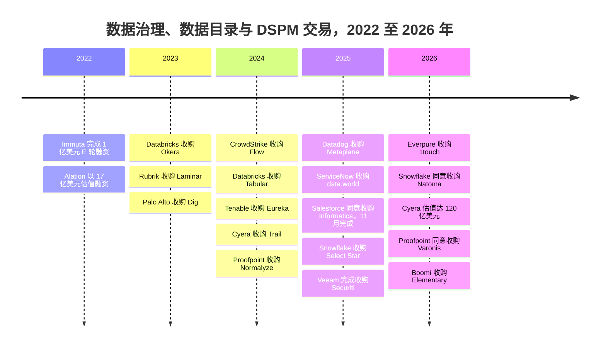

# 33. 数据治理、数据目录与数据安全公司
> **状态：** 上市与非上市公司混合 · **总部：** 各不相同（美国、比利时、以色列）· **成立：** 2005–2021 年 · **最新估值/市值：** Cyera 投后估值 $12B（媒体报道，2026 年 6 月）；Varonis 同意以约 $6.3B 交易价值 / 约 $5.71B 股权价值出售给 Proofpoint（已披露，尚待完成，2026 年 10 月）· **最后核实：** 2026-11-01

## 要点速览（TL;DR）

- **两类业务，同一个问题。** *业务数据目录*厂商（Collibra、Alation、Atlan、data.world、Informatica 的目录产品）帮助人们找到并信任数据。*数据安全*厂商，即由 Cyera、BigID、Varonis、Securiti、Sentra 等组成的[数据安全态势管理（DSPM）](../glossary.md#data-security-posture-management)阵营，负责找出敏感数据以及谁能接触到它们。两者的起点都是数据发现与数据分类。[第 8 章](../01-data-systems-foundations/ch08-catalogs-and-metastores.md)和[第 15 章](../02-pipelines-and-governance/ch15-governance-security-privacy.md)讲解了其机制；本章讨论的是这些公司、它们的价格以及买家是谁。
- **数据目录正遭受挤压。** Databricks Unity Catalog、Snowflake Horizon、Microsoft Purview 和 Google 的 Knowledge Catalog（原 Dataplex）把"够用"的数据治理（governance）捆绑进平台账单。独立厂商的估值标记已经过时：Collibra $5.25B（2021 年）、Alation $1.7B（2022 年）、Atlan $750M（2024 年）。两家独立厂商归入了应用软件厂商：ServiceNow 同意收购 data.world（2025 年 5 月，条款未披露；未找到完成日期），Salesforce 收购了 Informatica（约 $8B，2025 年 11 月完成）。[^collibra][^alation][^atlan][^dataworld][^infa-close]
- **安全领域正在整合，而且价格更高。** Proofpoint 同意以约 **$6.3B** 交易价值（约 **$5.71B** 股权价值）收购 Varonis，按标题金额计算约为 2026 日历年收入指引的 **8.5 倍**，按股权价值计算约为 7.7 倍（估算）。Veeam 以 **$1.725B** 收购 Securiti。Palo Alto 收购了 Dig（约 $400M，媒体报道），Proofpoint 收购了 Normalyze。仅存的主要独立厂商 Cyera 在 19 个月内投后估值从 $3B 升至 **$12B**（媒体报道）。[^varonis-8k][^securiti][^dig][^normalyze][^cyera-g]
- **四类买家，四种不同动机。** 安全平台希望为其威胁与身份产品获得数据上下文。备份厂商希望销售"了解你的副本里有什么"。应用软件厂商希望为自己的智能体获得受治理的数据。存储厂商作为最新入场的买家，希望在承载每一个字节的那一层完成分类。
- **Everpure 的动作规模小、时机早。** 以 **$125.0M** 现金收购 1touch（2026-02-23 宣布，2026-05-07 完成，GAAP，依据 10-Q），约占 Everpure **$43.79B** 市值（2026-10-01）的 **0.3%**。这只是 Veeam 和 Proofpoint 所付价格的一小部分，买到的是数据发现与分类的核心能力，而不附带安全销售团队。[^ep-10q][^ep-comps]

## 概览表

| 公司 | 类别 | 成立 / 总部 | CEO（公开记录） | 状态，2026 年 11 月 | 最新估值标记（口径，日期） | 已披露的业务进展（标签） |
|---|---|---|---|---|---|---|
| Collibra | 业务数据目录与数据治理 | 2008 年 / Brussels 与 New York | Felix Van de Maele | 非上市 | 投后估值 $5.25B，G 轮（媒体报道，2021 年 11 月）[^collibra] | 2021 年以来未找到 |
| Alation | 业务数据目录 | 2012 年 / Redwood City, CA | Satyen Sangani | 非上市 | $1.7B，E 轮（媒体报道，2022 年 11 月）[^alation] | 累计融资 $340M（媒体报道） |
| Atlan | 主动元数据目录 | 2019 年 / New York 与 Singapore | Prukalpa Sankar | 非上市 | $750M，C 轮（公司披露，2024 年 5 月）[^atlan] | 未披露 ARR |
| data.world | 知识图谱（knowledge graph）目录 | 2016 年 / Austin, TX | 不适用 | ServiceNow（2025 年 5 月宣布协议；未找到完成日期）[^dataworld] | 未披露 | 不适用 |
| Cyera | DSPM 加 DLP | 2021 年 / New York 与 Tel Aviv | Yotam Segev | 非上市 | 投后估值 $12B，G 轮（媒体报道，2026 年 6 月）[^cyera-g] | 隐含约 80 倍 ARR（媒体报道，公司予以否认） |
| BigID | 数据发现、隐私、DSPM | 2016 年 / New York | Dimitri Sirota | 非上市 | "超过 $1B"，E 轮（公司披露，2024 年 3 月）[^bigid] | 未披露 |
| Varonis（VRNS） | 数据安全、访问治理 | 2005 年 / New York 地区；2014 年 IPO | Yaki Faitelson | 上市；出售给 Proofpoint 尚待完成 | 约 $6.3B 交易价值、约 $5.71B 股权价值，每股 $49.75 现金（已披露，2026 年 10 月）[^varonis-8k] | Q2 2026 收入 $180.0M，+18%（GAAP）；SaaS ARR $726.0M（公司披露）[^varonis-q2] |
| Securiti | 隐私运营、DSPM、AI 治理 | 2018–19 年 / San Jose, CA | Rehan Jalil（现任 Veeam 安全与 AI 总裁） | Veeam（2025 年 12 月完成） | $1.725B（已披露）[^securiti] | 约 600 名员工加入 Veeam（公司披露） |
| Sentra | 云 DSPM | 2021 年 / Tel Aviv 与 New York | 不适用 | 非上市 | B 轮 $50M（估值未披露，2025 年 4 月）[^sentra] | 累计融资 >$100M（公司披露） |
| Immuta | 策略执行（ABAC） | 2015 年 / Boston | 不适用 | 非上市 | E 轮 $100M（估值未披露，2022 年 6 月）[^immuta] | 未披露 |
| 1touch | 数据发现、分类、语义上下文 | 不适用 [VERIFY: 成立年份与总部] | 不适用 | Everpure（2026 年 5 月完成） | $125.0M 现金（GAAP，10-Q）[^ep-10q] | 未披露 |

*图 33.1 — 概览。独立数据目录厂商的估值标记已有三到五年历史，而安全厂商的估值标记来自 2025–26 年。这一落差用一张表概括了本章的核心论点。成立、总部和 CEO 单元格来自公开的公司简介和 2025 年以前已确定的知识（经审阅者核对），本次会话未重新抓取。[^bg] [VERIFY: 2025 年中以来的 CEO 变动]*

## 起源与战略演进

**第一波：合规软件（2005–2018 年）。** Varonis 于 2005 年起步，分析谁能打开 Windows 共享上的哪些文件，这正是非结构化数据中的访问问题。Collibra 于 2008 年从 Brussels 一所大学的研究团队分拆而来，为面临金融危机后监管的银行管理业务术语表和数据管理职责（data stewardship）。Alation（2012 年）把数据目录做成一个搜索引擎，从查询日志中学习人们实际使用的是哪些表。随后，自 2018 年 5 月起施行的 GDPR 催生了一个大规模查找个人数据的市场。BigID（2016 年）和 Securiti（2018–19 年）正是为此而生：处理数据主体请求、同意管理和数据删除。[^bg]

**第二波：云端蔓延与 2021 年的估值标记（2019–2022 年）。** 云迁移把数据副本散布到成千上万个存储桶和账户中，风险资本把数据治理当作核心基础设施来定价。Collibra 在 2021 年 11 月以 $5.25B 完成 G 轮，估值在大约一年内翻倍；Alation 于 2022 年以 $1.7B 估值融资。[^collibra][^alation] Cyera（2021 年）和 Sentra 基于不同的前提创立：它们不要求数据管理员去记录数据，而是在不安装代理的情况下直接扫描云存储，并对暴露风险排序。这就是 DSPM 模式。

**第三波：捆绑与整合（2023–2026 年）。** 三件事同时发生。平台把数据治理内建其中：Unity Catalog 和 Horizon 成为执行权限的地方，因此数据目录问题转移到了它们身上（[第 8 章](../01-data-systems-foundations/ch08-catalogs-and-metastores.md)）。安全平台把 DSPM 初创公司当作功能收购。生成式 AI 则把数据分类变成部署智能体（agent）和检索索引的前提条件，从而抬高了规模化安全厂商的成交价格。

*图 33.2 — 交易时间线。2023–24 年的小型 DSPM 补强收购之后，是 2025–26 年的大型平台交易。资料来源：`data/ma_deals.csv` 与 `data/private_funding.csv`。[^okera][^dspm-tuckins][^dig][^tabular][^cyera-trail][^normalyze][^metaplane][^dataworld][^infa-close][^select-star][^securiti][^ep-10q][^natoma][^cyera-g][^varonis-8k][^boomi]*
