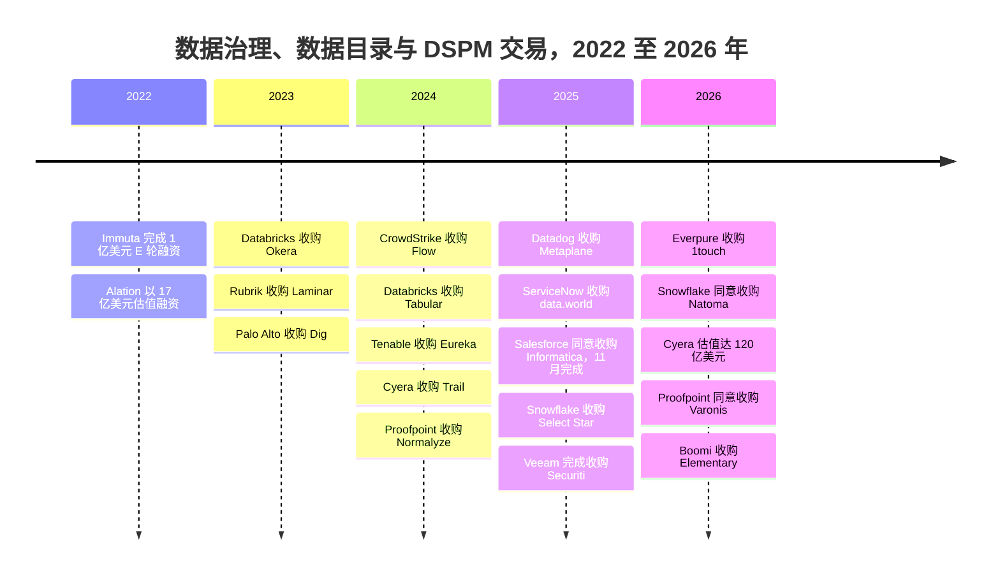
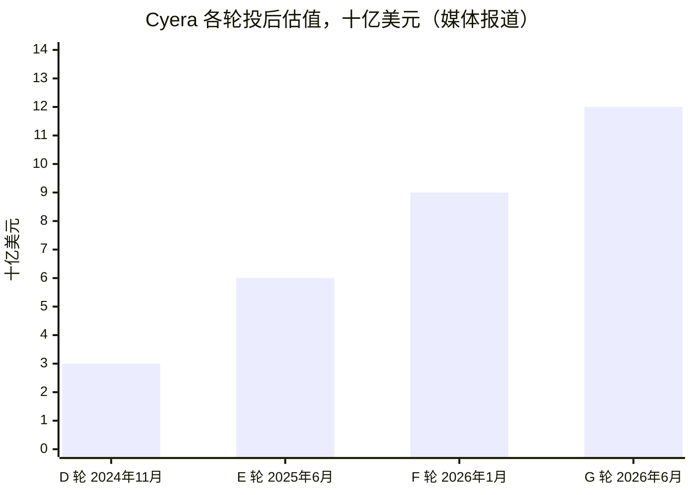
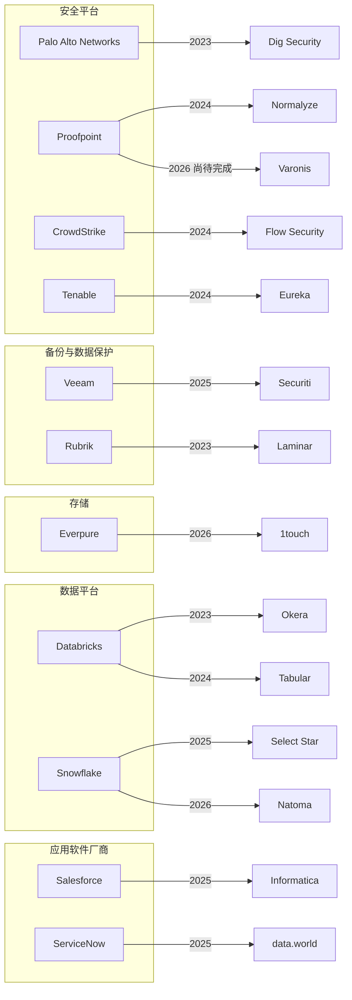
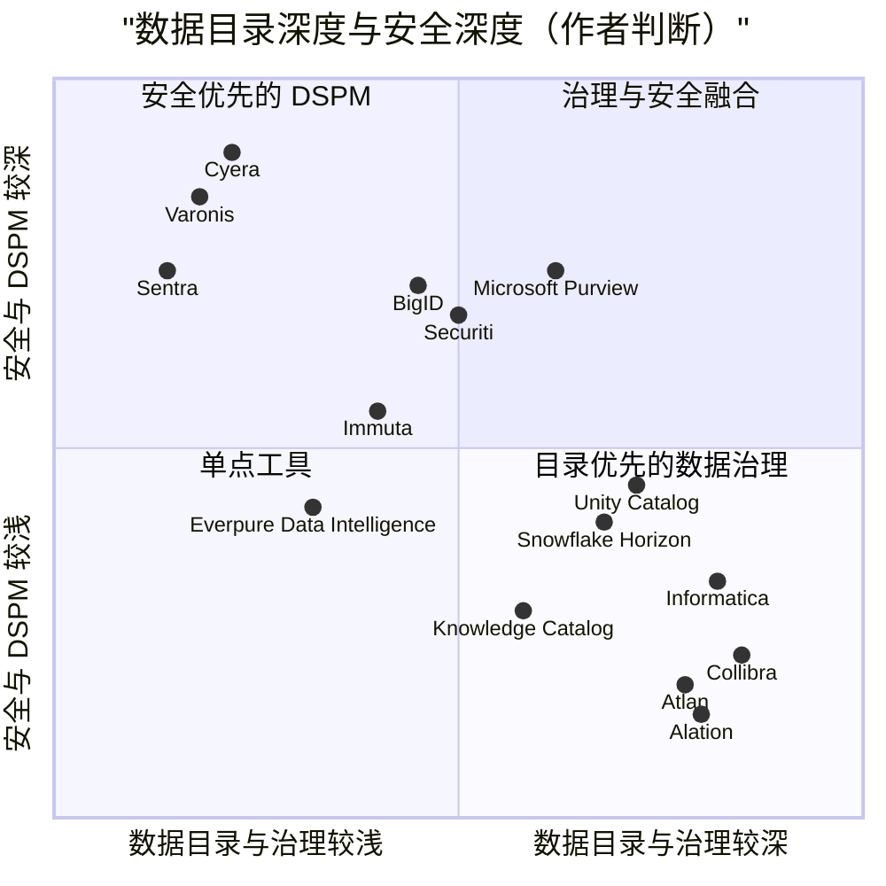

# 33. 数据治理、数据目录与数据安全公司
> **状态：** 上市与非上市公司混合 · **总部：** 各不相同（美国、比利时、以色列）· **成立：** 2005–2021 年 · **最新估值/市值：** Cyera 投后估值 $12B（媒体报道，2026 年 6 月）；Varonis 同意以约 $6.3B 交易价值 / 约 $5.71B 股权价值出售给 Proofpoint（已披露，尚待完成，2026 年 10 月）· **最后核实：** 2026-11-01

## 要点速览（TL;DR）

- **两类业务，同一个问题。** *业务数据目录*厂商（Collibra、Alation、Atlan、data.world、Informatica 的目录产品）帮助人们找到并信任数据。*数据安全*厂商，即由 Cyera、BigID、Varonis、Securiti、Sentra 等组成的[数据安全态势管理（DSPM）](../glossary.md#data-security-posture-management)阵营，负责找出敏感数据以及谁能接触到它们。两者的起点都是数据发现与数据分类。[第 8 章](../01-data-systems-foundations/ch08-catalogs-and-metastores.md)和[第 15 章](../02-pipelines-and-governance/ch15-governance-security-privacy.md)讲解了其机制；本章讨论的是这些公司、它们的价格以及买家是谁。
- **数据目录正遭受挤压。** Databricks Unity Catalog、Snowflake Horizon、Microsoft Purview 和 Google 的 Knowledge Catalog（原 Dataplex）把"够用"的数据治理（governance）捆绑进平台账单。独立厂商的估值标记已经过时：Collibra $5.25B（2021 年）、Alation $1.7B（2022 年）、Atlan $750M（2024 年）。两家独立厂商归入了应用软件厂商：ServiceNow 同意收购 data.world（2025 年 5 月，条款未披露；未找到完成日期），Salesforce 收购了 Informatica（约 $8B，2025 年 11 月完成）。[^collibra][^alation][^atlan][^dataworld][^infa-close]
- **安全领域正在整合，而且价格更高。** Proofpoint 同意以约 **$6.3B** 交易价值（约 **$5.71B** 股权价值）收购 Varonis，按标题金额计算约为 2026 日历年收入指引的 **8.5 倍**，按股权价值计算约为 7.7 倍（估算）。Veeam 以 **$1.725B** 收购 Securiti。Palo Alto 收购了 Dig（约 $400M，媒体报道），Proofpoint 收购了 Normalyze。仅存的主要独立厂商 Cyera 在 19 个月内投后估值从 $3B 升至 **$12B**（媒体报道）。[^varonis-8k][^securiti][^dig][^normalyze][^cyera-g]
- **四类买家，四种不同动机。** 安全平台希望为其威胁与身份产品获得数据上下文。备份厂商希望销售"了解你的副本里有什么"。应用软件厂商希望为自己的智能体获得受治理的数据。存储厂商作为最新入场的买家，希望在承载每一个字节的那一层完成分类。
- **Everpure 的动作规模小、时机早。** 以 **$125.0M** 现金收购 1touch（2026-02-23 宣布，2026-05-07 完成，GAAP，依据 10-Q），约占 Everpure **$43.79B** 市值（2026-10-01）的 **0.3%**。这只是 Veeam 和 Proofpoint 所付价格的一小部分，买到的是数据发现与分类的核心能力，而不附带安全销售团队。[^ep-10q][^ep-comps]

## 概览表

| 公司 | 类别 | 成立 / 总部 | CEO（公开记录） | 状态，2026 年 11 月 | 最新估值标记（口径，日期） | 已披露的业务进展（标签） |
|---|---|---|---|---|---|---|
| Collibra | 业务数据目录与数据治理 | 2008 年 / Brussels 与 New York | Felix Van de Maele | 非上市 | 投后估值 $5.25B，G 轮（媒体报道，2021 年 11 月）[^collibra] | 2021 年以来未找到 |
| Alation | 业务数据目录 | 2012 年 / Redwood City, CA | Satyen Sangani | 非上市 | $1.7B，E 轮（媒体报道，2022 年 11 月）[^alation] | 累计融资 $340M（媒体报道） |
| Atlan | 主动元数据目录 | 2019 年 / New York 与 Singapore | Prukalpa Sankar | 非上市 | $750M，C 轮（公司披露，2024 年 5 月）[^atlan] | 未披露 ARR |
| data.world | 知识图谱（knowledge graph）目录 | 2016 年 / Austin, TX | 不适用 | ServiceNow（2025 年 5 月宣布协议；未找到完成日期）[^dataworld] | 未披露 | 不适用 |
| Cyera | DSPM 加 DLP | 2021 年 / New York 与 Tel Aviv | Yotam Segev | 非上市 | 投后估值 $12B，G 轮（媒体报道，2026 年 6 月）[^cyera-g] | 隐含约 80 倍 ARR（媒体报道，公司予以否认） |
| BigID | 数据发现、隐私、DSPM | 2016 年 / New York | Dimitri Sirota | 非上市 | "超过 $1B"，E 轮（公司披露，2024 年 3 月）[^bigid] | 未披露 |
| Varonis（VRNS） | 数据安全、访问治理 | 2005 年 / New York 地区；2014 年 IPO | Yaki Faitelson | 上市；出售给 Proofpoint 尚待完成 | 约 $6.3B 交易价值、约 $5.71B 股权价值，每股 $49.75 现金（已披露，2026 年 10 月）[^varonis-8k] | Q2 2026 收入 $180.0M，+18%（GAAP）；SaaS ARR $726.0M（公司披露）[^varonis-q2] |
| Securiti | 隐私运营、DSPM、AI 治理 | 2018–19 年 / San Jose, CA | Rehan Jalil（现任 Veeam 安全与 AI 总裁） | Veeam（2025 年 12 月完成） | $1.725B（已披露）[^securiti] | 约 600 名员工加入 Veeam（公司披露） |
| Sentra | 云 DSPM | 2021 年 / Tel Aviv 与 New York | 不适用 | 非上市 | B 轮 $50M（估值未披露，2025 年 4 月）[^sentra] | 累计融资 >$100M（公司披露） |
| Immuta | 策略执行（ABAC） | 2015 年 / Boston | 不适用 | 非上市 | E 轮 $100M（估值未披露，2022 年 6 月）[^immuta] | 未披露 |
| 1touch | 数据发现、分类、语义上下文 | 不适用 [VERIFY: 成立年份与总部] | 不适用 | Everpure（2026 年 5 月完成） | $125.0M 现金（GAAP，10-Q）[^ep-10q] | 未披露 |

*图 33.1 — 概览。独立数据目录厂商的估值标记已有三到五年历史，而安全厂商的估值标记来自 2025–26 年。这一落差用一张表概括了本章的核心论点。成立、总部和 CEO 单元格来自公开的公司简介和 2025 年以前已确定的知识（经审阅者核对），本次会话未重新抓取。[^bg] [VERIFY: 2025 年中以来的 CEO 变动]*

## 起源与战略演进

**第一波：合规软件（2005–2018 年）。** Varonis 于 2005 年起步，分析谁能打开 Windows 共享上的哪些文件，这正是非结构化数据中的访问问题。Collibra 于 2008 年从 Brussels 一所大学的研究团队分拆而来，为面临金融危机后监管的银行管理业务术语表和数据管理职责（data stewardship）。Alation（2012 年）把数据目录做成一个搜索引擎，从查询日志中学习人们实际使用的是哪些表。随后，自 2018 年 5 月起施行的 GDPR 催生了一个大规模查找个人数据的市场。BigID（2016 年）和 Securiti（2018–19 年）正是为此而生：处理数据主体请求、同意管理和数据删除。[^bg]

**第二波：云端蔓延与 2021 年的估值标记（2019–2022 年）。** 云迁移把数据副本散布到成千上万个存储桶和账户中，风险资本把数据治理当作核心基础设施来定价。Collibra 在 2021 年 11 月以 $5.25B 完成 G 轮，估值在大约一年内翻倍；Alation 于 2022 年以 $1.7B 估值融资。[^collibra][^alation] Cyera（2021 年）和 Sentra 基于不同的前提创立：它们不要求数据管理员去记录数据，而是在不安装代理的情况下直接扫描云存储，并对暴露风险排序。这就是 DSPM 模式。

**第三波：捆绑与整合（2023–2026 年）。** 三件事同时发生。平台把数据治理内建其中：Unity Catalog 和 Horizon 成为执行权限的地方，因此数据目录问题转移到了它们身上（[第 8 章](../01-data-systems-foundations/ch08-catalogs-and-metastores.md)）。安全平台把 DSPM 初创公司当作功能收购。生成式 AI 则把数据分类变成部署智能体（agent）和检索索引的前提条件，从而抬高了规模化安全厂商的成交价格。

*图 33.2 — 交易时间线。2023–24 年的小型 DSPM 补强收购之后，是 2025–26 年的大型平台交易。资料来源：`data/ma_deals.csv` 与 `data/private_funding.csv`。[^okera][^dspm-tuckins][^dig][^tabular][^cyera-trail][^normalyze][^metaplane][^dataworld][^infa-close][^select-star][^securiti][^ep-10q][^natoma][^cyera-g][^varonis-8k][^boomi]*

## 产品与技术

相关机制（分类管道、ABAC、凭证分发、数据血缘）已在[第 15 章](../02-pipelines-and-governance/ch15-governance-security-privacy.md)和[第 8 章](../01-data-systems-foundations/ch08-catalogs-and-metastores.md)中介绍。对买家而言，有三个产品事实比算法更重要。

**扫描器在哪里运行。** 业务数据目录主要读取*元数据*：模式、查询日志、BI 血缘和 dbt 模型，很少打开数据本身。DSPM 工具则会打开数据，至少是抽样读取，因为它们必须证明某一列或某个文件确实含有银行卡号。这让 DSPM 的运行更重、更贵，对安全买家也更有价值。这也是存储厂商的扫描器值得关注的原因：它可以在字节所在之处读取内容，而不产生出口流量费（egress fees）。

**结构化与非结构化。** 数据目录起源于表。Varonis 起源于文件共享，而云 DSPM 厂商两者都覆盖。AI 正在把价值推向非结构化数据，因为检索索引是由 PDF、幻灯片和电子邮件构建的，而不是由数据仓库表构建的。

**回写。** 标签只有在执行策略的地方才有价值。因此独立工具比拼的是能否把分类结果推送到 Unity Catalog、Horizon、Purview 或身份系统中。无法回写的工具只能沦为一份报告。

| 厂商 | 类别 | 所有者 / 状态 | 最新估值或交易（口径，日期） | 商业模式 | 结构化 / 非结构化 | 部署方式 | AI 定位 |
|---|---|---|---|---|---|---|---|
| Collibra | 业务数据目录、数据治理 | 独立 | $5.25B（媒体报道，2021 年）[^collibra] | 企业订阅 | 以结构化为主 | SaaS | AI 用例与模型的治理 |
| Alation | 业务数据目录 | 独立 | $1.7B（媒体报道，2022 年）[^alation] | 企业订阅 | 以结构化为主 | SaaS，部分自管 | 数据目录作为智能体上下文；Numbers Station 交易 [VERIFY][^bg] |
| Atlan | 主动元数据目录 | 独立 | $750M（公司披露，2024 年）[^atlan] | 平台订阅 | 以结构化为主 | SaaS | 面向智能体的元数据"上下文层" |
| data.world | 知识图谱目录 | ServiceNow（已达成协议；未找到完成日期） | 未披露（2025-05 宣布）[^dataworld] | 正被并入 Workflow Data Fabric | 结构化 | SaaS | 为 LLM 答案提供语义锚定（[第 14 章](../02-pipelines-and-governance/ch14-semantic-layers-and-bi.md)） |
| Informatica CDGC | 数据管理套件中的目录 | Salesforce | 约 $8B 股权价值（已披露，2025-11-18 完成）[^infa-close] | 池化消费单位（IPU）[^infa-ipu] | 结构化 | SaaS、混合 | 为 Data 360（原 Data Cloud）和 Agentforce 供数；计入 Data 360 ARR[^crm-q2fy27] |
| Microsoft Purview | 数据目录加数据安全 | Microsoft | 捆绑 | 按用户（M365）加按用量 | 两者；在 M365 中最深 | 云 | 面向 AI 的 DSPM、Copilot 监督[^purview-dspm] |
| Google Knowledge Catalog | 平台目录 | Google | 捆绑 | 按用量计费 | 以结构化为主 | 云 | 为 Gemini 智能体提供上下文[^gcp-kc] |
| Unity Catalog | 平台目录 | Databricks | 捆绑在 DBU 中 | 平台消费 | 两者（表、卷、模型） | 云 | 面向智能体流量的 Unity AI Gateway[^uc-2026] |
| Snowflake Horizon | 平台目录 | Snowflake | 捆绑在 credits 中 | 平台消费 | 以结构化为主 | 云 | Select Star 与 Natoma 交易[^select-star][^natoma] |
| Cyera | DSPM 加 DLP | 独立 | $12B（媒体报道，2026-06）[^cyera-g] | 订阅 | 两者 | SaaS，无代理 | 面向 AI 数据流的 DLP（Trail）[^cyera-trail] |
| BigID | 数据发现、隐私、DSPM | 独立 | "超过 $1B"（公司披露，2024 年）[^bigid] | 订阅 | 两者 | SaaS 或自托管 | AI 数据治理 |
| Varonis | 数据安全、访问治理 | Proofpoint（尚待完成） | 约 $6.3B 交易价值；约 $5.71B 股权价值（已披露，2026-10）[^varonis-8k] | SaaS 订阅 | 以非结构化为主，正在扩展 | SaaS（由本地部署转换而来） | Copilot 与 AI 智能体访问风险 |
| Securiti | 隐私运营、DSPM | Veeam | $1.725B（已披露，2025-12）[^securiti] | 订阅，现为交叉销售 | 两者 | 混合 | 基于备份数据的 AI 数据治理 |
| Sentra | 云 DSPM | 独立 | 未披露（B 轮 $50M，2025 年）[^sentra] | 订阅 | 两者 | 云 | AI 数据暴露监控 |
| Normalyze | 云 DSPM | Proofpoint | 未披露（2024 年）[^normalyze] | 并入套件 | 两者 | 云 | Proofpoint 数据安全的一部分 |
| Dig Security | 云 DSPM、DDR | Palo Alto Networks | 约 $400M（媒体报道，2023 年）[^dig] | 并入 Prisma Cloud | 两者 | 云 | Prisma Cloud 与 Cortex 的一部分 |
| 1touch | 数据发现、分类、上下文 | Everpure | $125.0M 现金（GAAP，2026 年）[^ep-10q] | 现为 Everpure Data Intelligence | 两者 | 混合，含第三方存储 | MCP 接口（2026 年 10 月）[^ep-oct] |
| Immuta | 策略执行 | 独立 | 未披露（E 轮 $100M，2022 年）[^immuta] | 订阅 | 结构化 | 叠加于平台之上的 SaaS | 智能体数据供给 |
| Privacera | 策略执行（Ranger 一脉） | 独立 | 未披露（B 轮 $50M，2021 年）[^privacera] | 订阅 | 结构化 | SaaS 或自托管 | AI 访问治理 |

*图 33.3 — 厂商矩阵。独立厂商能存活下来的地方，要么横跨多个平台，要么掌握平台看不到的内容，例如非结构化数据、SaaS 和本地部署数据。"AI 定位"一栏由作者用自己的话概括各厂商的公开宣传，并非经过测试的能力。*

## 盈利模式

**数据目录是按席位和范围收费的软件。** 独立数据目录厂商销售年度订阅。价格随使用产品的人数以及所连接的系统或资产数量上升。当数据目录是数据管理员整天工作的"目的地产品"时，这一模式行之有效。但当平台自带的目录已经免费展示血缘和权限时，它就会被削弱，因为买家的问题变成了"在 Unity Catalog 之上我还能得到什么？"诚实的答案是跨平台范围：在 Snowflake、Databricks、SAP、Salesforce 和各类 BI 工具之间共用一套术语表和一张血缘图。这能卖给最大型的企业，却难以打入只运行一个平台的中型客户。

**DSPM 按数据量和风险销售。** DSPM 厂商按其扫描的数据资产定价，无论是数据存储、云账户还是数据量。经济买家是 CISO，其预算比首席数据官更大，也更不具可自由裁量性。扩张跟随数据增长和新云的加入，这解释了更高的估值倍数。成本端是扫描算力。Amazon Macie 每检查 1 GB 收费 $1.00 的目录价意味着完整扫描 1 PB 约需 $1M，这还未计入抽样和分层。[^macie] 独立厂商通过抽样和增量扫描来降低这一成本，这些方法决定了毛利率（gross margin）。

**平台间接地将数据治理变现。** Unity Catalog 和 Horizon 之所以"免费"，是因为其成本通过计算（DBU 和 credits）回收。Snowflake 的文档写明，计划对 Iceberg REST 目录调用按每百万次 0.5 credits 收费。[^horizon-irc] Microsoft 主要通过 Microsoft 365 按用户许可来销售 Purview 的数据安全功能，这是任何独立厂商都最难与之比价的捆绑。

| 模式 | 定价单位（典型） | 买家 | 扩张驱动 | 毛利与风险动态 | 依据 |
|---|---|---|---|---|---|
| 独立业务数据目录（Collibra、Alation、Atlan） | 按版本的年度订阅，随用户数和所连接的数据源或资产扩展 | CDO、数据治理办公室 | 更多业务域、用户和数据源 | 软件毛利高；当平台目录"够用"时存在流失风险 | 未公开；作者概括 |
| 套件消费（Informatica IDMC/CDGC） | 跨服务预付的池化 IPU[^infa-ipu] | CIO、数据平台团队 | 在集成、质量、目录上的用量 | 池化便于交叉销售；经济下行时用量可能下降 | 公司博客 |
| 平台原生目录（Unity、Horizon） | 捆绑；通过 DBU 或 credits 回收；部分 API 计量[^horizon-irc] | 平台所有者 | 平台消费 | 对客户的边际价格为零：这正是对独立厂商的挤压 | 厂商文档 |
| 超大规模云厂商治理（Purview、Knowledge Catalog、Macie） | 按用户的 M365 许可；按用量的扫描；Macie 每检查 1 GB 收费 $1.00[^macie][^gsdp] | CISO 与 CIO，通常在企业协议框架内 | 席位和扫描数据量 | 捆绑进企业协议 | 列明之处为目录价 |
| 独立 DSPM（Cyera、BigID、Sentra） | 年度订阅，随数据存储、账户或数据量扩展 | CISO | 数据增长、新云、DLP 附加模块 | 扫描算力是主要的销货成本（COGS）杠杆 | 未公开；作者概括 |
| 数据安全 SaaS（Varonis） | SaaS 订阅；历史上按用户 | CISO | 从本地部署转换、新模块 | 转型期间毛利率下滑（Q2 2026 非 GAAP 77.7%，对比 80.6%）[^varonis-q2] | 公司申报文件 |
| 捆绑于备份或存储（Veeam–Securiti、Rubrik、Everpure） | 基于受保护或存储数据的附加 SKU | 基础设施与安全团队 | 存量客户群的附加销售 | 向现有客户交叉销售；获客成本（CAC）低 | 未公开；作者概括 |

*图 33.4 — 商业模式。定价单位决定了由谁签署采购订单：数据目录卖给数据办公室，DSPM 卖给 CISO，捆绑产品则通过现有合同销售。标注"作者概括"的行反映的是常见的公开描述，而非已公布的价目表。[VERIFY: Collibra、Alation、Atlan、Cyera、BigID 的定价单位]*

## 财务数据

这一群体中只有一家公司仍以独立上市公司身份报告业绩，而它即将被私有化。

### Varonis：先 SaaS 转型，再被出售

大约自 2023 年起，Varonis 一直在把客户从自托管软件的永久许可和定期许可转换为 SaaS。这种转换掩盖了增长：当客户迁移时，原先在定期许可下一次性确认的收入变成了按期确认的 SaaS 收入。2026 年第二季度（2026 年 4–6 月；Varonis 按日历年报告），总收入为 **$180.0M**，较 $152.2M 增长 18%（GAAP）。SaaS 收入为 **$171.7M**，约占总收入的 95%。SaaS ARR 为 **$726.0M**，增长 52%，但剔除转换因素后仅增长约 25%（公司披露）。非 GAAP 毛利率从一年前的 80.6% 降至 **77.7%**，原因是托管成本转移到了 Varonis 自己的账上。[^varonis-q2]

由 Thoma Bravo 持有的 Proofpoint 于 2026-10-15 同意以**每股 $49.75 现金**收购 Varonis。这相当于约 **$6.3B** 的交易价值（标题金额）和约 **$5.71B** 的股权价值，预计于 2027 年上半年完成。[^varonis-8k] 按每股 $49.75 计算，$5.71B 大致对应 1.15 亿股，因此约 $0.6B 的差额很可能反映的是可转换票据和其他稀释性证券，而不是从股权价值到企业价值的调整（我们的推断）。以 Varonis 2026 日历年收入指引中值（$735–739M）计算，标题价格约为收入的 **8.5 倍**、SaaS ARR 的约 **8.7 倍**；按股权价值计算分别约为 **7.7 倍**和 **7.9 倍**（均为估算）。要得到干净的 EV/收入倍数，需要看 8-K 中对可转债和净现金的处理。[VERIFY: $6.3B 交易价值与 $5.71B 股权价值之间的调节]

### Cyera：稀缺性定价

Cyera 在 19 个月内完成的四轮定价融资，描绘出本图谱中最陡峭的估值曲线之一。

*图 33.5 — Cyera 的估值在 19 个月内翻了两番，各轮融资额分别为 $300M、$540M、$400M 和 $600M。所有数值均为媒体报道，E 轮的领投方尚未确认。资料来源：`data/private_funding.csv`。[^cyera-d][^cyera-e][^cyera-f][^cyera-g]*

媒体报道称 G 轮估值约为 80 倍 ARR，而 Cyera 的发言人对这一数字提出异议。[^cyera-g] 二手资料给出的 ARR 数字相互矛盾，因此我们不列出任何数字。按我们对 CSV 各行的加总，Cyera 已累计融资超过 $2.3B，超过 Securiti 的全部出售价格。其中一部分资金用于收购，例如 Trail Security（$162M，现金加股票）。[^cyera-trail]

### 先例交易倍数

| 交易或估值标记 | 日期 | 价值 | 倍数 | 倍数口径 | 标签 |
|---|---|---|---|---|---|
| Proofpoint–Varonis | 2026-10-15（尚待完成） | 约 $6.3B 交易价值；约 $5.71B 股权价值[^varonis-8k] | 约 8.5 倍 CY2026 收入指引（按股权价值约 7.7 倍）；约 8.7 倍 SaaS ARR | $6.3B（或 $5.71B）÷ $737M 中值；÷ $726.0M SaaS ARR | 估算（我们的计算） |
| Varonis 宣布后的交易价格 | 2026-11-01 | EV 约 $5.26B[^comps] | 7.1 倍 EV/未来 12 个月收入 | 未来 12 个月代理值 = 全年指引中值 | 估算；按交易价差交易 |
| Cyera G 轮 | 2026-06 | 投后估值 $12B[^cyera-g] | 约 80 倍 ARR | 媒体报道；公司提出异议 | 媒体报道 |
| Salesforce–Informatica | 2025-11-18（已完成） | 约 $8B 股权[^infa-close] | 约 4.9 倍 CY2024 收入 | $8B ÷ 约 $1.64B CY2024 收入 [VERIFY: Informatica FY2024 GAAP 收入] | 估算 |
| Veeam–Securiti | 2025-12-11（已完成） | $1.725B[^securiti] | 无法计算 | 未披露 Securiti 收入 | 仅有披露价值 |
| Palo Alto–Chronosphere（相邻领域：可观测性） | 2025-11-19 | $3.35B[^chronosphere] | 约 21 倍 ARR | 媒体报道（Calcalist） | 媒体报道 |
| Databricks–Tabular（目录控制权） | 2024-06 | 约 $2B[^tabular] | 每名员工约 $50M（约 40 名员工） | 价格 ÷ 员工数；无收入 | 媒体报道；估算 |
| Palo Alto–Dig | 2023-10 | 约 $400M[^dig] | 无法计算 | 尚未形成收入规模的初创公司 | 媒体报道 |
| Everpure–1touch | 2026-05-07（已完成） | $125.0M 现金[^ep-10q] | 约占收购方市值的 0.3% | $125.0M ÷ $43.79B（2026-10-01） | 估算（我们的计算） |
| Tenable–Eureka | 2024-06 | $29.2M 现金[^dspm-tuckins] | 无法计算 | 补强收购 | GAAP（10-Q） |
| 作为参照的上市可比公司 | 2026-10 | Rubrik 16.0 倍、Everpure 8.5 倍、Commvault 5.3 倍 EV/未来 12 个月收入[^comps] | — | 未来 12 个月代理值依据 `data/public_comps.csv` | 估算 |

*图 33.6 — 先例交易倍数。规模化、增长较慢的资产以 5–9 倍收入成交（Informatica、Varonis），而稀缺的高增长 DSPM 则按期权价值定价（Cyera）。大多数补强收购不披露收入，因此其"倍数"实际上是为团队和技术支付的价格。*

> **类比：金融。** 把 Varonis 和 Cyera 看作同一条曲线的两端。Varonis 约 8.5 倍的价格来自一位现金流型买家（Thoma Bravo 旗下平台），它为一个已完成转换、公司披露 SaaS 续约率超过 90% 的 SaaS 客户群付费。[^varonis-q2] Cyera 据报道约 80 倍的价格，则是成长型股权投资对最后一家大型独立厂商的定价，更接近于一份看涨期权，押注它会成为每个安全平台最终都需要的资产。战略买家应以 Varonis 而非 Cyera 作为校准基准。

## 客户与市场进入

两半业务卖给不同的人。**数据目录卖给首席数据官**和数据治理办公室，通常是受监管的企业：银行、保险公司、制药企业。交易周期长，涉及围绕业务术语表的研讨会，并依赖系统集成商。推销话术已从"找到你的数据"转向"让你的数据可以被 AI 智能体使用"，因为数据目录中的描述、认证和血缘，正是智能体避免自信地给出错误答案所需要的（[第 22 章](../03-ai-data-stack/ch22-agents-and-data.md)）。

**DSPM 卖给 CISO。** 这是一项安全采购，常由一次云审计、一则新闻中的数据泄露事件或董事会关于 Copilot 的提问触发。Microsoft Copilot 的推广是 2024–26 年的一个强力触发点。在启用一个能读取每个 SharePoint 站点的助手之前，安全团队希望知道哪些站点存有薪酬或健康数据，以及谁能打开它们。Varonis 和 Purview 都倚重这一用例。[^purview-dspm]

**渠道决定结果。** 独立厂商越来越多地通过云市场（marketplace）并与平台合作伙伴一起销售：数据目录定位为"Unity 和 Horizon 之上的那一层"，DSPM 定位为"横跨 AWS、Azure、Google 和 SaaS 的那一层"。被收购的厂商一夜之间获得母公司的渠道。Securiti 如今通过 Veeam 的存量客户群销售，Dig 和 Normalyze 则分别通过 Palo Alto 和 Proofpoint 的渠道销售。这种交叉销售是收购方最常提到的协同效应。

## 并购与投资

### 谁在买什么，以及为什么

*图 33.7 — 整合版图。安全买家收购 DSPM，备份与存储买家收购数据发现与分类能力，平台收购目录与策略技术，应用软件厂商则收购整家数据目录公司。日期为宣布年份；Proofpoint–Varonis 尚待完成。*

**安全平台（Palo Alto、Proofpoint、CrowdStrike、Tenable、Zscaler）。** 这些买家想要风险的*数据*维度。当系统知道某个用户能够接触到比如数万份患者档案时，一次防火墙告警或一名被钓鱼的用户就显得更加重要。它们的交易大多是小型补强收购（Dig、Flow、Eureka、Normalyze），直到 Proofpoint–Varonis 出现，这是一笔规模化押注，赌的是以人为中心的安全（电子邮件、内部人员风险）与数据访问治理应当合二为一。[^normalyze][^varonis-8k][^dspm-tuckins] Zscaler 把数据保护内建于其零信任云，但我们在数据集中未发现类似的 DSPM 收购。[VERIFY: Zscaler 的 DSPM 收购]

**备份与数据保护（Veeam、Rubrik、Cohesity、Commvault）。** 备份系统本就持有一切数据的副本，并且已建立索引、带有版本。对这些副本进行分类，可以让厂商在不触碰生产系统的情况下销售"了解你的备份里有什么"、更精准的勒索软件分诊以及面向 AI 的数据整理。Veeam 以 $1.725B 收购 Securiti 是此类押注中规模最大的，Rubrik–Laminar（2023 年）则是第一笔。[^securiti][^dspm-tuckins] Cohesity 把资金花在了 Veritas 的数据保护业务上，这是一笔规模型交易而非功能型交易。[^cohesity] 公开报道也把 Commvault 与 2025 年的一笔数据安全补强收购联系在一起。[VERIFY: Commvault 收购 Satori Cyber 及其日期]

**存储（Everpure）。** 这是把备份的逻辑提前一层，应用到主数据上。详见下文。

**数据平台（Databricks、Snowflake）。** 平台收购技术以深化自己的目录：Okera 用于策略，Tabular 用于格式控制权，Select Star 用于数据发现与血缘，Natoma 用于智能体和 MCP 治理。它们不会大规模收购独立数据目录厂商，因为它们的战略就是让这一层免费。[^okera][^tabular][^select-star][^natoma]

**应用软件厂商（Salesforce、ServiceNow）。** 这些买家希望受治理的企业数据为*它们自己的*智能体供数，从而在上下文上不必依赖 Snowflake 或 Databricks。Salesforce 买下了整个 Informatica 套件，包括其目录（CDGC）、集成和主数据管理。ServiceNow 为获得 data.world 的知识图谱目录而同意收购它（2025 年 5 月，条款未披露），此时距其同意收购 Moveworks 仅两个月；我们未找到明确的完成公告，但后来的行业报道将其视为已完成的收购。[^infa-close][^dataworld] data.world 接入 **Workflow Data Fabric**，后者由 ServiceNow 于 2024 年 10 月推出，运行在其自有的高性能数据库 **RaptorDB Pro** 之上（这是独立于 data.world 的另一项资产）；2025 年 5 月又推出了拥有 100 多家数据合作伙伴的"Workflow Data Network"。[^now-wdf] 可观测性交易就在隔壁：Datadog–Metaplane 和 Boomi–Elementary 表明，数据质量工具正以同样方式被吸收（[第 13 章](../02-pipelines-and-governance/ch13-data-quality-observability-lineage.md)）。[^metaplane][^boomi]

> **类比：半导体。** DSPM 之于数据，就像在线检测与量测之于晶圆厂。两者都不制造产品，但都能在缺陷演变成良率损失（或数据泄露）之前告诉你缺陷在哪里。设备厂商把检测功能并入自己的平台，因为量测放在工艺设备旁边比作为独立机台更有价值。安全平台收购 DSPM 也是同样的道理：当平台还能执行修复时，检测的价值更高。

> **类比：测试与分析。** 备份厂商收购 DSPM，就像测试设备厂商增加良率分析功能。测试机本就能看到每一颗裸片，因此基于测试数据做分析是自然而然、高毛利的附加业务。备份系统本就能看到每个文件的每一份副本，因此基于备份数据做分类也是同类附加业务：获客成本低、拥有现成的存量客户群，并为一项旧资产（副本）带来一个新买家（安全团队）。

### 迄今为止的整合结果

Dig 成为 Prisma Cloud DSPM 的一部分。Okera 团队被并入 Unity Catalog 的数据治理团队。Metaplane 成为 Datadog 的数据可观测性产品。Securiti 的创始人出任 Veeam 安全与 AI 总裁，这表明它是一条产品线而非一项功能。1touch 在交割后六周内以 Everpure Data Intelligence 的名义重新发布。[^dig][^okera][^metaplane][^securiti][^ep-cw] 这一群体中尚无任何交易公开减值。整合风险反而体现为交易后独立产品路线图的放缓，而这一点从外部很难看清。

## 竞争地位

*图 33.8 — 按数据目录深度和安全深度划分的定位（作者判断，非实测数据）。Microsoft Purview 是唯一一个可信地在规模上位于右上象限的厂商。这正是两半业务共同面临的竞争难题：数据目录必须补上安全，DSPM 厂商必须补上治理，而 Microsoft 把两者捆绑在一起。*

**数据目录对平台。** Unity Catalog 和 Horizon 已经掌握了独立数据目录要去爬取的权限、血缘和使用数据。两者在 2025–26 年都增加了数据发现功能：Snowflake 通过 Select Star，Databricks 通过 Domains 和指标视图（metric views）。[^select-star][^uc-2026] 独立厂商以覆盖广度来实现差异化。一个客户可能同时运行 Snowflake 和 Databricks，外加 SAP、Salesforce 和 Power BI，而只有中立的数据目录才能横跨所有这些系统。Atlan 一直是独立厂商中的增长亮点，主打"主动元数据（active metadata）"，即能触发动作（告警、策略变更、智能体上下文）而非只是躺在门户里的元数据。它在 2024 年以 $750M 完成的 C 轮，恰逢 Collibra 2021 年的估值标记日渐过时。[^atlan] 我们未找到 Collibra 自 2021 年以来的任何定价融资，也无法核实有关独立数据目录厂商裁员的媒体报道。[VERIFY: Collibra 与 Alation 在 2023–2026 年的裁员情况]

**DSPM 对安全平台。** Cyera 与 Palo Alto、CrowdStrike、Proofpoint 和 Microsoft 捆绑的产品竞争。它的防线是深度和速度：广泛覆盖云、SaaS 和本地部署，并通过 Trail 提供 DLP。BigID 在隐私工作流的广度和自托管部署上竞争，这对受监管的买家很重要。Varonis 的优势一直在于本地部署和 Microsoft 365 中的非结构化文件权限，这是最难清理的数据。

**超大规模云厂商。** Microsoft 是本章所有公司最危险的竞争对手。它拥有身份系统（Entra）、内容（Microsoft 365）、AI 助手（Copilot）和 Purview，因此能在一份许可内完成分类、执行和审计。Google 的 Knowledge Catalog 和 AWS 的 Macie 与 Glue 范围更窄，且绑定在各自的云上。[^gcp-kc][^macie]

## 制胜原因 / 看多逻辑

1. **AI 让数据分类成了一道关卡，而不再是一件杂务。** 每一次检索索引和智能体的上线都会引出同一个问题：这些数据是什么，谁有权看到？如今董事会也在问这个问题，于是预算从"有朝一日做数据治理"转向了"在 Copilot 上线之前完成"。
2. **价格证明了战略价值。** 四类买家在 24 个月内争夺资产，而 Varonis 约 8.5 倍的倍数（标题金额口径；按股权价值约 7.7 倍）来自一位由财务投资者持有的买家，而非一位处于炒作周期中的战略买家。
3. **非结构化数据是尚未开发的前沿。** 平台目录对表的治理做得很好，对文档则做得很差。能够对文件、电子邮件和 SaaS 内容进行分类的厂商，覆盖的正是 AI 消耗最多的数据。
4. **中立性确有真实需求。** 多平台企业不希望自己的数据治理被数据仓库厂商掌控，这为至少一到两家独立数据目录厂商留下了空间。

## 风险 / 看空逻辑与待解问题

1. **捆绑。** Unity Catalog、Horizon 和 Purview 以零边际价格到来。独立数据目录市场可能萎缩到只剩最大型的、受监管的多平台企业。
2. **估值包袱。** 2021–22 年的数据目录估值标记（$5.25B、$1.7B）很可能高于今天的出清价格，折价融资（down round）或结构化退出都有可能发生。Cyera 的 $12B 估值已经计入了近乎完美的执行。
3. **是功能，而不是公司。** 大多数 DSPM 交易都是价格未披露的补强收购，这表明买家把 DSPM 视为一项功能。Varonis 是例外，因为它是一家拥有已转换 SaaS 客户群的规模化企业。
4. **扫描成本与准确性。** 在 PB 级规模上做内容扫描代价高昂，而误报会侵蚀信任。激进抽样的厂商会漏掉东西，不抽样的厂商则成本过高。
5. **待解问题。** ServiceNow 会把 data.world 保留为独立的数据目录吗？Salesforce 会让 Informatica 的目录对 Snowflake 和 Databricks 保持中立吗？Cyera 会 IPO，还是出售给某个安全平台？

## 与 Everpure 的相关性

**Everpure 公开说了什么。** 2026-02-23，也就是更名当天，Pure Storage 宣布有意收购 1touch。它把 1touch 描述为能够发现、分类数据并为数据添加语义上下文的数据智能软件，并将目标定位为帮助客户从控制数据走向理解数据，使数据变得"AI-ready"（为 AI 做好准备）。[^ep-wwt] 该交易于 2026-05-07 以 $125.0M 现金完成（GAAP，依据 10-Q）。[^ep-10q] 在 2026 年 6 月的 Accelerate 大会上，这项技术以 **Data Intelligence** 的名义重新发布。行业报道称，它能在不复制数据的情况下，发现并分类分布在 Everpure 阵列、第三方存储、公有云和 SaaS 中的结构化与非结构化数据。[^ep-cw] 2026 年 10 月的更新增加了仅基于元数据的 File Edition 和一个 MCP 接口。[^ep-oct]

**衡量这笔押注的规模。** $125.0M 约占 Everpure $43.79B 市值（2026-10-01）的 0.3%，约占其 FY2026 自由现金流（FCF）$616M 的 20%（非 GAAP；FY2026 ≈ 2025 年 2 月至 2026 年 1 月）。[^ep-comps][^ep-q4] 它约为 Veeam 收购 Securiti 价格的十四分之一，约为 Proofpoint 收购 Varonis 价格的 2%。Everpure 买下的是数据发现与分类的核心能力及其连接器，而不是一支安全销售团队或一套隐私运营套件。

| 交易对手 | 当前关系（公开信息） | 战略团队可能评估的选项 |
|---|---|---|
| Cyera、BigID、Sentra | 在数据发现与分类上存在重叠 | 合作：把存储侧的标签输入它们的态势引擎；避免由 CISO 主导的正面竞争 |
| Varonis（Proofpoint） | 在非结构化文件数据上存在重叠 | 关注 Proofpoint 的整合进展；Varonis 的本地文件基因与 Everpure 的存量客户群最为接近 |
| Veeam–Securiti、Rubrik、Commvault、Cohesity | 在 Everpure 阵列上是备份合作伙伴，在数据智能上是竞争对手 | 共存：主数据分类对备份副本分类；约定以谁的标签为准 |
| Unity Catalog、Horizon、Purview、Knowledge Catalog | 策略执行点；Databricks Storage Ecosystem 合作关系（[第 25 章](ch25-databricks.md)） | 集成：把 Data Intelligence 标签发布到执行策略的地方 |
| Collibra、Alation、Atlan | 位于存储之上的业务上下文层 | 集成：提供元数据爬虫无法产生的内容级分类 |

*图 33.9 — Everpure Data Intelligence 的竞争与合作版图。这些仅是基于公开信息的选项，并非对 Everpure 计划的陈述。*

> **类比：EDA。** 业务数据目录之于数据资产，就像设计数据管理工具之于芯片团队：它们追踪哪个模块的哪个版本进入了哪次流片、谁负责它以及它依赖什么。这些工具之所以在 EDA 套件内部变得有价值，是因为它们紧挨着设计流程。存储驻留式分类下的是同样的赌注：上下文放在字节旁边，比放在一个独立门户里更有价值。

> **存储桥接。** 主存储阵列能看到任何数据目录都未登记的影子副本（快照、克隆、临时卷）。这是在存储层进行分类的结构性论据。其约束在于对生产系统的扫描负载，以及如何把标签写出到外部数据目录。快照与元数据机制请参见姊妹篇 *Everpure Tech Atlas*。

## 对话手册

**向数据治理或 DSPM 厂商高管或合作伙伴提出的三个问题**

1. "新增 ARR 中有多大比例来自已经在运行 Unity Catalog、Horizon 或 Purview 的客户？他们在此之上从你们这里买了什么？" *好的回答*会点出具体能力，例如跨平台血缘或非结构化数据覆盖，并给出赢单率或附加销售的趋势，而不是一句"我们是互补的"。
2. "每分类 1 TB 数据的扫描成本是多少？抽样如何改变了毛利率？" *好的回答*会区分首次扫描与增量扫描，并坦承准确性上的权衡。
3. "哪类买家接触过你们或你们的同行：安全平台、备份厂商、存储厂商还是应用软件厂商？各自看重的是什么？" *好的回答*会区分渠道协同与技术价值。

**向工程师或合作伙伴架构师提出的三个问题**

1. "你们的分类结果如何回写到执行点：Unity Catalog 标签、Snowflake 标签、Purview 标签？" *好的回答：*具名的 API、同步延迟和冲突规则。
2. "对于非结构化数据，你们是原地读取内容还是复制出去？一次全量扫描会给主存储阵列带来多大负载？" *好的回答：*具体的吞吐上限和限流控制。
3. "在结构化和非结构化存储之间，你们如何把检测结果关联到具体个人，以处理 DSAR（数据主体请求）和数据删除？" *好的回答：*实体解析方法和实测精度。

**好的回答听起来是什么样的。** 它们会讲明买家（CDO 还是 CISO）、定价单位以及标签在哪里被执行。它们会承认平台目录对单一平台企业来说"够用"，并把厂商的价值定位在覆盖广度或内容深度上。

**不要这样说**

- "Collibra 值 $5B。" *那是 2021 年的私募估值标记；此后未发现任何定价融资。*
- "Cyera 的交易价格是 80 倍 ARR。" *约 80 倍这一数字是媒体报道的，且遭到公司否认；而且 Cyera 是非上市公司，并不存在交易价格。*
- "Proofpoint 为 Varonis 支付 $5.7B。" *约 $6.3B 是交易价值（标题金额），约 $5.71B 是股权价值；要说清你指的是哪个口径。*
- "Everpure 收购了一家 DSPM 公司来和 Cyera 竞争。" *公开表述把 1touch 定位为面向 AI-ready 数据的数据发现、分类和语义上下文，而不是一款安全产品。*
- "Unity Catalog 让业务数据目录过时了。" *它挤压了业务数据目录；多平台企业仍会购买中立的数据目录。*

## 关键术语

- [业务数据目录（Business catalog）](../glossary.md#business-catalog) — 一个可搜索的数据资产清单，附带业务定义、所有者和认证信息。
- [数据目录（Data catalog）](../glossary.md#data-catalog) — 横跨整个技术栈、登记数据资产、所有者、血缘和访问策略的注册表。
- [技术目录（Technical catalog）](../glossary.md#technical-catalog) — 位于查询热路径上的元数据存储，保存表元数据并执行访问控制。
- [主动元数据（Active metadata）](../glossary.md#active-metadata) — 能够触发动作（告警、策略变更、智能体上下文）而不只是被展示的元数据。
- [数据安全态势管理（Data security posture management）](../glossary.md#data-security-posture-management) — 持续发现敏感数据、谁能接触它以及它在哪里暴露。
- [数据分类（Data classification）](../glossary.md#data-classification) — 按内容和敏感度为数据打标签，以便策略据此执行。
- [数据访问治理（Data access governance）](../glossary.md#data-access-governance) — 分析并合理调整谁能访问哪些数据，尤其是文件共享和 SaaS 中的数据。
- [数据防泄漏（Data loss prevention）](../glossary.md#data-loss-prevention) — 检测并阻止敏感数据离开批准边界的控制措施。
- [数据检测与响应（Data detection and response）](../glossary.md#data-detection-and-response) — 对敏感数据的异常访问进行实时告警。
- [基于属性的访问控制（Attribute-based access control）](../glossary.md#attribute-based-access-control) — 依据数据上的标签和用户属性来评估的策略。
- [无代理扫描（Agentless scanning）](../glossary.md#agentless-scanning) — 通过云服务商 API 和快照扫描云端数据，无需在主机上安装软件。
- [影子数据（Shadow data）](../glossary.md#shadow-data) — 存在于受治理、已登记系统之外的数据副本。
- [模型上下文协议（Model Context Protocol）](../glossary.md#model-context-protocol) — 一种将 AI 智能体连接到工具和数据源的开放协议。
- [先例交易（Precedent transaction）](../glossary.md#precedent-transaction) — 以其隐含倍数作为估值基准的过往收购交易。
- [私有化（Take-private）](../glossary.md#take-private) — 对上市公司的收购，买方通常有私募股权背景，收购后公司退市。
- [Unity Catalog](../glossary.md#unity-catalog) — Databricks 面向数据与 AI 资产的治理目录。

## 资料来源

[^collibra]: CNBC, "Collibra doubles valuation as investors chase next cloud winner," https://www.cnbc.com/2021/11/09/collibra-doubles-valuation-as-investors-chase-next-cloud-winner.html，发布 2021-11-09；检索 2026-11-01（依据 `data/private_funding.csv`；G 轮 $250M，投后估值 $5.25B，媒体报道）。未发现此后的定价融资（`meta/research-notes-funding.md`）。
[^alation]: Blocks & Files, "Alation E round," https://blocksandfiles.com/2022/11/03/alation-e-round/，发布 2022-11-03；检索 2026-11-01（E 轮 $123M，估值 $1.7B，累计融资 $340M，媒体报道）。
[^atlan]: Datanami, "Atlan plants itself in the middle of the data governance map with $105M round," https://www.datanami.com/2024/05/09/atlan-plants-itself-in-the-middle-of-the-data-governance-map-with-105m-round，发布 2024-05-09；检索 2026-11-01（C 轮 $105M，估值 $750M，GIC 与 Meritech；未确认 2025–26 年有新一轮融资）。
[^dataworld]: TechCrunch, "ServiceNow acquires data.world two months after acquiring Moveworks," https://techcrunch.com/2025/05/07/servicenow-acquires-data-world-two-months-after-acquiring-moveworks，发布 2025-05-07；检索 2026-11-01。条款未披露；未找到明确的完成日期（Computer Weekly 后来称之为"recent acquisition"），依据 `meta/verified-facts.md` #18。
[^now-wdf]: ServiceNow 投资者关系发布的有关 Workflow Data Fabric（2024-10-23 推出）和 RaptorDB Pro 的新闻稿，以及 Knowledge 2025 发布内容（Workflow Data Network、data.world 协议），ServiceNow IR PDF 位于 s205.q4cdn.com/537566246/；Constellation Research, constellationr.com；检索 2026-11-01，经由 `meta/verified-facts.md` #18。公司披露。
[^crm-q2fy27]: Salesforce, Q2 FY2027 业绩与投资者演示材料（截至 2026-07-31 的季度）：Data 360 ARR $2.4B，其中包括 $1.1B Informatica Cloud ARR，公司披露，https://s205.q4cdn.com/626266368/files/doc_financials/2027/q2/，发布 2026-08-26；检索 2026-11-01，经由 `meta/verified-facts.md` #19。
[^infa-close]: Salesforce via Business Wire (FinancialContent), "Salesforce Completes Acquisition of Informatica," https://markets.financialcontent.com/clarkebroadcasting.mymotherlode/article/bizwire-2025-11-18-salesforce-completes-acquisition-of-informatica，发布 2025-11-18；Bloomberg Law, "Salesforce Reaches an $8 Billion Deal to Buy Informatica," https://news.bloomberglaw.com/tech-and-telecom-law/salesforce-agrees-to-buy-informatica-in-deal-worth-8-billion，发布 2025-05-27；检索 2026-11-01。Informatica CY2024 收入（约 $1.64B，用于约 4.9 倍的估算）来自 2025 年以前的知识，未重新核实 [VERIFY]。
[^infa-ipu]: Informatica blogs, "Announcing Consumption Pricing for Informatica Intelligent Data Management Cloud," https://www.informatica.com/blogs/announcing-consumption-pricing-for-informatica-intelligent-data-management-cloud.html，未记录发布日期；检索 2026-11-01。
[^varonis-8k]: Varonis Systems, Inc., Form 8-K Exhibit 99.1（与 Proofpoint 的合并协议），SEC EDGAR, https://www.sec.gov/Archives/edgar/data/0001361113/000121390026109901/ea030861001ex99-1.htm，发布 2026-10-15；SiliconANGLE, "Proofpoint agrees to buy data security company Varonis for $6.3B in cash," https://siliconangle.com/2026/10/15/proofpoint-agrees-to-buy-data-security-company-varonis-for-6-3b-in-cash/，发布 2026-10-15；检索 2026-11-01。每股 $49.75 现金；约 $6.3B 为交易价值（标题金额），约 $5.71B 为股权价值（8-K；`meta/verified-facts.md` #14）；预计 2027 年上半年完成。倍数为我们依据 `data/public_comps.csv` 做出的估算。
[^varonis-q2]: Varonis Systems, "Varonis Announces Second Quarter 2026 Financial Results," https://s203.q4cdn.com/582009126/files/doc_news/Varonis-Announces-Second-Quarter-2026-Financial-Results-2026.pdf，发布 2026-07-28；检索 2026-11-01。收入为 GAAP；SaaS ARR 与续约率为公司披露；毛利率为非 GAAP（依据 `data/public_comps.csv`）。
[^comps]: 图谱数据集 `data/public_comps.csv`（Varonis、Rubrik、Commvault、Everpure 行），引用日期为 2026-10-01 至 2026-11-01 的 stockanalysis.com 页面，例如 https://stockanalysis.com/stocks/vrns/ 和 https://stockanalysis.com/stocks/rbrk/market-cap/；检索 2026-11-01。未来 12 个月收入为指引或过去 12 个月代理值（估算）。
[^securiti]: Veeam via Business Wire, "Veeam Completes Acquisition of Securiti AI to Create the Industry's First Trusted Data Platform for Accelerating Safe AI at Scale," https://www.businesswire.com/news/home/20251211040418/en/Veeam-Completes-Acquisition-of-Securiti-AI-to-Create-the-Industrys-First-Trusted-Data-Platform-for-Accelerating-Safe-AI-at-Scale，发布 2025-12-11；检索 2026-11-01。$1.725B 为已披露数字；约 600 名员工及 Rehan Jalil 的职务为公司披露；宣布日期（2025 年 10 月）[VERIFY]。
[^dig]: Palo Alto Networks, "A Decade of Strategic Acquisitions" (Cyberpedia), https://www.paloaltonetworks.com/cyberpedia/palo-alto-networks-strategic-acquisitions，无日期；检索 2026-11-01。约 $400M 最初为媒体报道；宣布的具体日期 [VERIFY]。
[^normalyze]: Proofpoint, "Proofpoint Signs Definitive Agreement to Acquire Normalyze," https://www.proofpoint.com/us/newsroom/press-releases/proofpoint-signs-definitive-agreement-acquire-normalyze，发布 2024-10-29；检索 2026-11-01。条款未披露。
[^cyera-d]: SecurityWeek, 被引用为 D 轮数据行依据的 Cyera 融资报道（$300M，估值 $3B，2024 年 11 月，媒体报道），https://www.securityweek.com/cyera-raises-400-million-at-9-billion-valuation/amp/，发布 2026-01；检索 2026-11-01（依据 `data/private_funding.csv`；具体日期与领投方 [VERIFY]）。
[^cyera-e]: DefiLlama pre-IPO tracker, "Cyera," https://defillama.com/pre-ipo/cyera，无日期；检索 2026-11-01（$540M，估值 $6B，2025 年 6 月，媒体报道；二手来源较弱；领投方 [VERIFY]）。
[^cyera-f]: StorageNewsletter, "Cyera raised $400 million at $9 billion valuation," https://www.storagenewsletter.com/2026/01/06/cyera-raised-400-million-at-9-billion-valuation/，发布 2026-01-06；检索 2026-11-01（Blackstone 领投；累计融资 >$1.7B，媒体报道）。
[^cyera-g]: SecurityWeek, "Cyera raises $600 million at $12 billion valuation," https://www.securityweek.com/cyera-raises-600-million-at-12-billion-valuation/amp/，发布 2026-06；检索 2026-11-01。依据 `data/private_funding.csv`，由 Evolution Equity Partners 领投；约 80 倍 ARR 的倍数为媒体报道，且遭 Cyera 发言人否认。
[^cyera-trail]: Cyera, "Cyera acquires Trail Security for $162M, redefining AI-powered data security with comprehensive data loss prevention," https://www.cyera.com/press-releases/cyera-acquires-trail-security-for-162m-redefining-ai-powered-data-security-with-comprehensive-data-loss-prevention，发布 2024-10-17；检索 2026-11-01。
[^bigid]: Foley & Lardner, "Foley represents Riverwood Capital as lead investor in Series E round for BigID," https://www.foley.com/news/2024/03/foley-represents-riverwood-capital-as-lead-investor-in-series-e-round-for-bigid/，发布 2024-03；检索 2026-11-01。$60M；估值"超过 $1B"（公司披露）。
[^sentra]: Sentra via Business Wire, B 轮融资公告, https://www.businesswire.com/news/home/20250422569273/en，发布 2025-04-22；检索 2026-11-01（$50M，由 Key1 Capital 领投；累计融资 >$100M，公司披露）。
[^immuta]: Immuta via Business Wire, "Immuta Raises $100 Million in Series E Funding," https://www.businesswire.com/news/home/20220608005624/en，发布 2022-06-08；Immuta newsroom, https://www.immuta.com/newsroom/press-releases/；检索 2026-11-01。
[^privacera]: Insight Partners, "Privacera Secures $50 Million Series B…," https://www.insightpartners.com/ideas/privacera-secures-50-million-series-b-advances-cloud-first-data-governance-and-security-across-global-organizations/，发布 2021-03；检索 2026-11-01。
[^dspm-tuckins]: Tenable Holdings, 截至 2024-09-30 季度的 Form 10-Q（Eureka：$29.2M 现金，已扣除所获得的 $0.4M 现金），https://www.sec.gov/Archives/edgar/data/1660280/000166028024000153/tenb-20240930.htm，发布 2024-11；SecurityWeek, "CrowdStrike to acquire Flow Security," https://www.securityweek.com/crowdstrike-to-acquire-flow-security，发布 2024-03；Rubrik–Laminar（2023-08 宣布，条款未披露）依据交易追踪摘要 https://www.privsource.com/acquisitions/deal/3ASll0（来源较弱）；该交易本身是 2025 年以前已确定的事实（经审阅者确认），未重新检索 Rubrik 的一手新闻稿；均检索于 2026-11-01。
[^okera]: Futurum Group, "Databricks Acquires Okera," https://futurumgroup.com/insights/databricks-acquires-okera，发布 2023-05；检索 2026-11-01。
[^tabular]: TechCrunch, "Databricks reportedly paid $2 billion in Tabular acquisition," https://techcrunch.com/2024/08/14/databricks-reportedly-paid-2-billion-in-tabular-acquisition，发布 2024-08-14；Databricks 新闻稿（团队约 40 人），https://www.databricks.com/company/newsroom/press-releases/databricks-agrees-acquire-tabular-company-founded-original-creators，发布 2024-06-04；检索 2026-11-01。
[^select-star]: Snowflake blog, "Snowflake to acquire Select Star," https://www.snowflake.com/en/blog/snowflake-acquire-select-star/，发布 2025-11；检索 2026-11-01。条款未披露。
[^natoma]: Snowflake Inc., 截至 2026-04-30 季度的 Form 10-Q（Natoma Labs，所述对价约 $110M），https://www.sec.gov/Archives/edgar/data/0001640147/000164014726000030/snow-20260430.htm，发布 2026-05/06；检索 2026-11-01（依据 `data/ma_deals.csv`；完成情况未核实）。
[^metaplane]: Datadog, "Datadog Brings Observability to Data Teams by Acquiring Metaplane," https://www.datadoghq.com/about/latest-news/press-releases/datadog-metaplane-acquisition/，发布 2025-04-23；检索 2026-11-01。条款未披露。
[^boomi]: iTWire (Business Wire), "Boomi acquires Elementary Data to bring trusted, governed data to the AI era," https://itwire.com/it-industry-news/deals/boomi-acquires-elementary-data-to-bring-trusted-governed-data-to-the-ai-era，发布 2026-10-19；Calcalist, https://www.calcalistech.com/ctechnews/article/b1zgj8mnzg，2026-10（$40–45M，媒体报道）；检索 2026-11-01。
[^chronosphere]: SecurityWeek, "Palo Alto Networks to acquire observability platform Chronosphere in $3.35 billion deal," https://securityweek.com/palo-alto-networks-to-acquire-observability-platform-chronosphere-in-3-35-billion-deal/，发布 2025-11-19；检索 2026-11-01。约 21 倍 ARR 依据 Calcalist（媒体报道，依据 `data/ma_deals.csv`）。
[^cohesity]: Cohesity, 关于完成与 Veritas 数据保护业务合并的新闻稿, https://www.cohesity.com/press/，发布 2024-12-10；检索 2026-11-01（依据 `data/ma_deals.csv`；合并后公司 >$7B 的估值并非交易价格）。
[^ep-wwt]: World Wide Technology（转载 Pure Storage 新闻稿）, "Pure Storage rebrands to Everpure and announces intent to acquire 1touch," https://www.wwt.com/news/pure-storage-rebrands-to-everpure-and-announces-intent-to-acquire-1touch，发布 2026-02-23；检索 2026-11-01。
[^ep-10q]: Everpure, Inc., 截至 2026-05-03 季度的 Form 10-Q（1touch 于 2026-05-07 完成；所述现金对价 $125.0M，可能根据调整和托管安排变动），SEC EDGAR, https://www.sec.gov/Archives/edgar/data/0001474432/000147443226000061/pstg-20260503.htm，发布 2026-06；Cleary Gottlieb, "Everpure Completes Acquisition of 1touch," https://www.clearygottlieb.com/news-and-insights/news-listing/everpure-completes-acquisition-of-1touch，发布 2026-05-11；检索 2026-11-01。
[^ep-cw]: Computer Weekly, "Everpure aims to bridge AI data gap with Universal Data Intelligence," https://www.computerweekly.com/news/366644438/Everpure-aims-to-bridge-AI-data-gap-with-Universal-Data-Intelligence，发布 2026-06；Everpure via PR Newswire, "Everpure Unveils Data-Primacy Architecture for the AI Era," https://www.prnewswire.com/news-releases/everpure-unveils-data-primacy-architecture-for-the-ai-era-302803097.html，发布 2026-06-17；检索 2026-11-01。
[^ep-oct]: HPCwire/AIwire, "Everpure enhances Data Intelligence to bolster customer AI projects," https://www.hpcwire.com/aiwire/2026/10/07/verpure-enhances-data-intelligence-to-bolster-customer-ai-projects/，发布 2026-10-07；检索 2026-11-01（行业媒体）。
[^ep-comps]: 图谱数据集 `data/public_comps.csv`，Everpure 行：截至 2026-10-01 的市值 $43.79B，来自 https://stockanalysis.com/stocks/p/financials/ratios/；检索 2026-11-01。0.3% = $125.0M ÷ $43.79B（估算）。
[^ep-q4]: Everpure, Q4 FY2026 业绩新闻稿（8-K Ex. 99.1），https://www.sec.gov/Archives/edgar/data/1474432/000147443226000015/pstg-ex991q4fy2026.htm，发布 2026-02-25；检索 2026-11-01。FY2026 自由现金流 $616M（非 GAAP）。
[^purview-dspm]: Microsoft Learn, "Microsoft Purview Data Security Posture Management (DSPM) for AI," https://learn.microsoft.com/en-us/purview/dspm-for-ai，持续更新文档；检索 2026-11-01。
[^gcp-kc]: Google Cloud docs, "Knowledge Catalog (formerly Dataplex) overview," https://docs.cloud.google.com/dataplex/docs/overview，访问于 2026-11-01；检索 2026-11-01。
[^uc-2026]: Databricks blog, "What's new with Unity Catalog at Data + AI Summit 2026," https://www.databricks.com/blog/whats-new-unity-catalog-data-ai-summit-2026，发布 2026-06；检索 2026-11-01。
[^horizon-irc]: Snowflake documentation, "Access Apache Iceberg tables with an external engine through Snowflake Horizon Catalog," https://docs.snowflake.com/en/user-guide/tables-iceberg-access-using-external-query-engine-snowflake-horizon，无日期；检索 2026-11-01（每百万次调用 0.5 credits，计划于 2026 年实施，目录价可能变动）。
[^macie]: AWS, "Amazon Macie pricing," https://aws.amazon.com/macie/pricing/，持续更新文档；检索 2026-11-01。每检查 1 GB $1.00，US East 目录价；每 PB $1M 为我们的算术推算（估算）。
[^gsdp]: Google Cloud, "Sensitive Data Protection pricing," https://cloud.google.com/sensitive-data-protection/pricing，持续更新文档；检索 2026-11-01。
[^bg]: 成立年份、总部和 CEO 来自公开的公司简介和 2025 年以前的背景知识，本次会话未重新抓取（网络检索额度已用尽）；Alation–Numbers Station（2025 年）在 `meta/research-notes-ma-2020s.md` 中被列为尚未研究 [VERIFY]。检索 2026-11-01。
