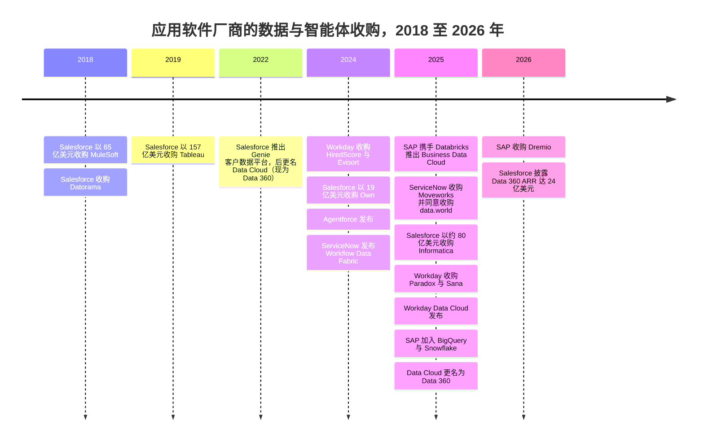
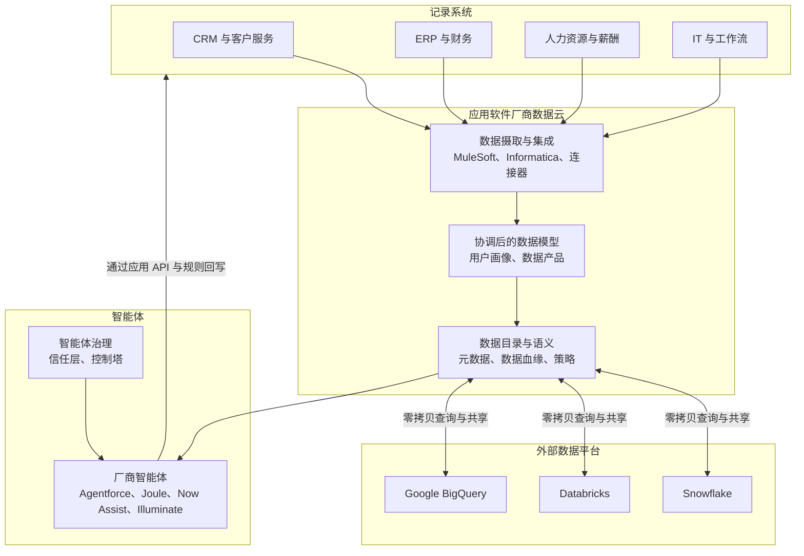
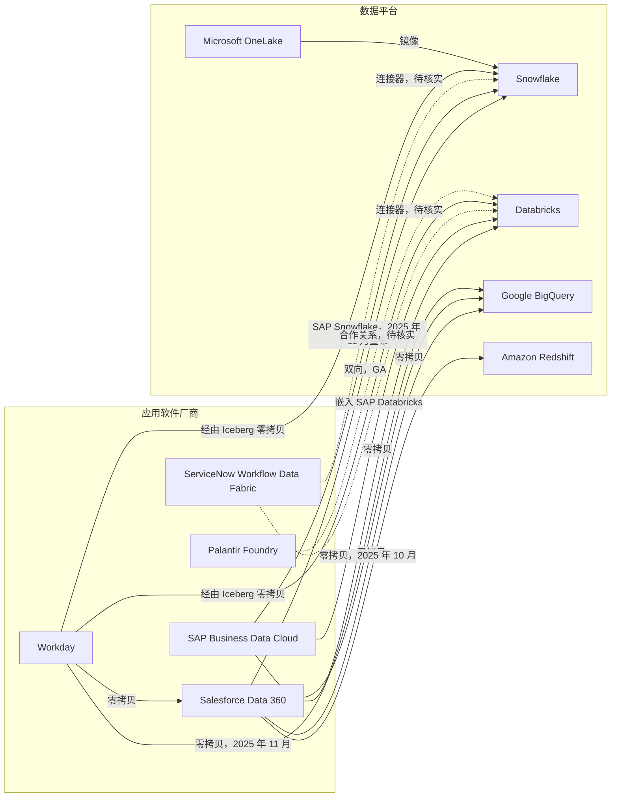
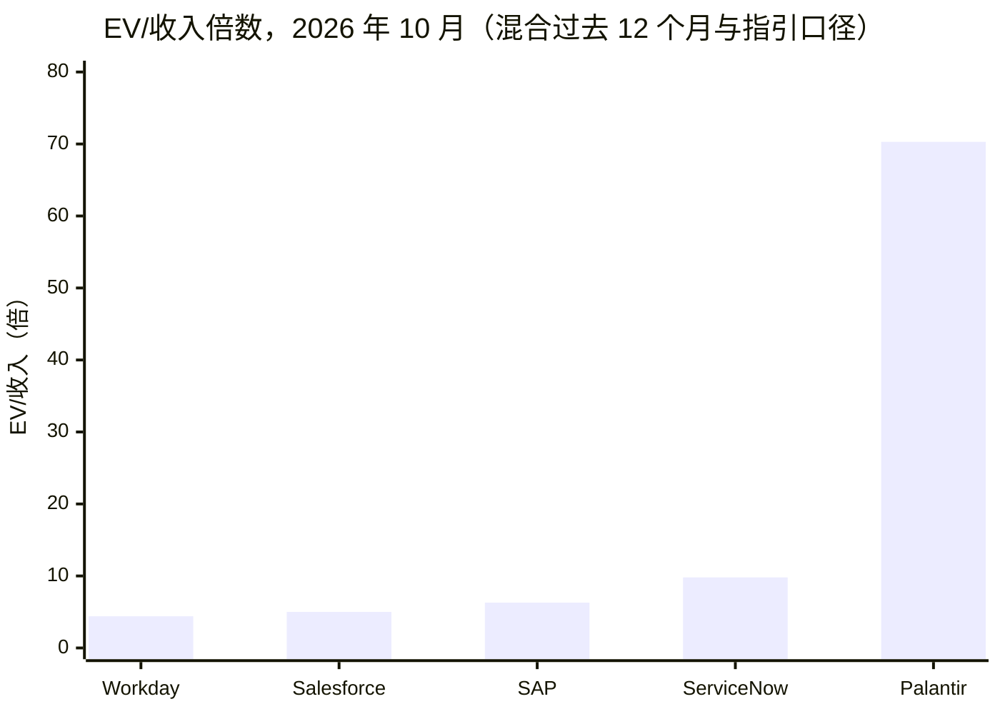
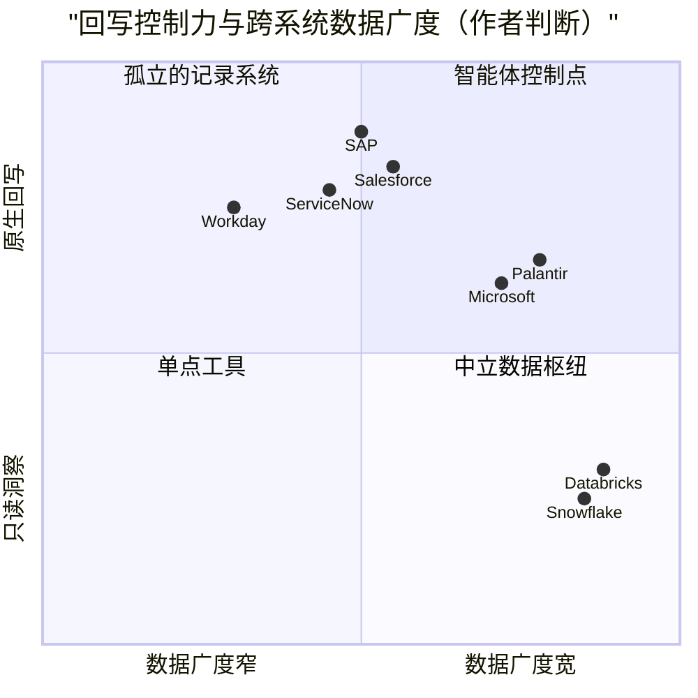

# 34. 应用软件巨头的数据平台
> **状态：** 上市：CRM、NOW、SAP、WDAY、PLTR · **总部：** San Francisco（Salesforce）、Santa Clara（ServiceNow）、Walldorf（SAP）、Pleasanton（Workday）、Denver（Palantir）· **成立：** 1999 年、2004 年、1972 年、2005 年、2003 年 · **最新估值/市值：** 市值分别为 $188.6B / $142.4B / $273.8B / $46.0B / $442.4B（stockanalysis.com，日期为 2026-10-01 至 2026-10-30；见概览表）· **最后核实：** 2026-11-01

> **研究说明。** 本次会话的网络检索额度在实时核实开始之前就已用尽。下文数字来自图谱数据集（`data/*.csv`，2026-10 核实）、`meta/research-briefing.md` 以及整合者经实时核实的登记表（`meta/verified-facts.md`，2026-11-01），独立审阅已将其应用于 Salesforce、SAP、Workday 和 ServiceNow 各节。2025 年中以后、仍无法重新核对的产品事实标注为 `[VERIFY]`。

## 要点速览（TL;DR）

- **核心论点。** 智能体（agent）需要两样仅靠数据仓库无法提供的东西：跨系统的上下文，以及*回写*到记录系统（system of record）的权限。应用软件厂商掌握着写入路径和业务语义（"商机"、"事件单"或"成本中心"究竟意味着什么）。如今每家厂商都在构建一个数据层，好让它自己的智能体，而不是 Databricks 或 Snowflake 的智能体，成为"智能系统（system of intelligence）"。
- **防守。** 如果智能体接手了过去由人完成的工作，按席位定价就会暴露于风险之下。市场已经下调了席位模式的估值：Salesforce 市值同比下跌约 21%，Workday 下跌约 27%，而作为本体（ontology）与智能体厂商的 Palantir，交易价格接近 **70 倍 EV/过去 12 个月收入**（按 `data/public_comps.csv` 中的 FY2026 指引口径约为 53 倍 EV/未来 12 个月收入）。[^comps-crm][^comps-wday][^comps-pltr] 掌握数据层可以让厂商围绕用量和智能体动作重新定价。
- **交易。** Salesforce 以约 $8B 收购 Informatica（2025 年 11 月完成），此前已收购 MuleSoft（$6.5B）、Tableau（$15.7B）和 Own（$1.9B）。ServiceNow 收购了 Moveworks（$2.85B，2025 年 12 月完成），并同意收购 data.world（2025 年 5 月；未找到完成日期）。SAP 收购了 Dremio（2026 年，金额未披露）。[^ma-csv][^dremio][^now-ir]
- **零拷贝是休战，而非合并。** 应用软件厂商与数据平台如今原地向对方开放数据表，而不是导出数据。Salesforce 与 Snowflake、Databricks、BigQuery 和 Redshift 进行双向共享。SAP 把 Databricks 嵌入 Business Data Cloud，并在 2025 年底加入了 BigQuery 和 Snowflake。Workday 推出了 Data Cloud，与 Databricks、Salesforce、Snowflake 和 BigQuery 建立零拷贝连接。各方仍都希望成为智能体运行的地方。[^zcpn][^sf-snow][^sap-snow][^wday-dc]
- **Everpure 视角。** 这些数据云几乎完全运行在超大规模云厂商之上。本地部署的机会较窄但真实存在：SAP 如今拥有 Dremio，而后者本就是 FlashBlade 的合作伙伴；主权部署（SAP、Palantir、Oracle）需要本地基础设施；SaaS 数据的副本仍然需要数据发现和保护。[^briefing-a]

## 概览表

| 公司 | 财年 | 市值 / EV | 所用收入口径 | EV/收入 | 增长（口径） | 数据与智能体产品 |
|---|---|---|---|---|---|---|
| Salesforce（CRM） | 截至 1 月 31 日（FY2027 = 2026 年 2 月至 2027 年 1 月） | $188.6B / $219.6B | 过去 12 个月 $43.94B | 5.0 倍（过去 12 个月） | 过去 12 个月 11.2%（GAAP） | Data 360（原 Data Cloud）、Agentforce、Informatica、MuleSoft、Tableau |
| ServiceNow（NOW） | 日历年 | $142.4B / $144.2B | 过去 12 个月 $14.73B | 9.8 倍（过去 12 个月） | Q2 2026 为 24.0%（GAAP） | Workflow Data Fabric、RaptorDB Pro、data.world（已达成协议）、Moveworks、AI Control Tower |
| SAP（SAP） | 日历年 | $273.8B / $273.9B | 过去 12 个月约 $43.3B（由 €38.19B 换算） | 6.3 倍（过去 12 个月） | Q3 2026 总收入 +13%；云业务 +26%（IFRS） | Business Data Cloud、Datasphere、SAP Databricks、SAP Snowflake、Dremio、Joule |
| Workday（WDAY） | 截至 1 月 31 日（FY2027 = 2026 年 2 月至 2027 年 1 月） | $46.0B / $46.4B | FY2027 指引中值 $10.655B | 4.4 倍（未来 12 个月代理值） | Q2 FY2027 订阅收入 +13.9%（GAAP） | Prism Analytics、Workday Data Cloud、Illuminate 智能体 |
| Palantir（PLTR） | 日历年 | $442.4B / $433.2B | 过去 12 个月 $6.16B | 70.3 倍（过去 12 个月） | 过去 12 个月 79%（GAAP）；毛利率 84.8% | Foundry、Ontology、AIP |

*图 34.1 — 概览。市场数据来自 stockanalysis.com，日期见 `data/public_comps.csv`（CRM、PLTR 为 2026-10-30；SAP 为 2026-10-30；WDAY 为 2026-10-16；NOW 为 2026-10-01）。收入口径不同（过去 12 个月与指引），因此倍数仅供参考。[^comps-crm][^comps-now][^comps-sap][^comps-wday][^comps-pltr]*

## 起源与战略演进

### 应用软件厂商为何想要数据层

二十年来，分工一直很稳定。CRM、IT 服务管理（ITSM）、ERP 和人力资源等应用负责记录交易。数据团队把这些记录复制到数据仓库中进行分析。洞察随后再通过手工或[反向 ETL（reverse ETL）](../glossary.md#reverse-etl)流回业务系统。智能体从四个方面打破了这种安排。

1. **智能体需要跨系统上下文。** 一个处理账单争议的客服智能体需要 CRM 工单、ERP 发票、合同 PDF 和产品使用日志。谁先把这些上下文组装起来，谁就能托管这个智能体。
2. **智能体需要回写。** 光回答问题是不够的。智能体必须发放抵扣额、关闭工单或修改采购订单，而这些写入操作必须遵守应用的业务规则和审批链。只有记录系统才能原生地执行这些规则。数据仓库可以读取订单表的副本，却无法安全地修改一张订单。
3. **语义存在于应用之中。** 在 SAP 中，"物料"、"公司代码"和单据流都有精确的含义，编码在数千张表里。一旦这些记录被拍平放进数据仓库，大部分含义就丢失了。应用软件厂商认为，它们自己的元数据才是智能体最好的[语义层（semantic layer）](../glossary.md#semantic-layer)，这一论点见[第 14 章](../02-pipelines-and-governance/ch14-semantic-layers-and-bi.md)。
4. **席位面临风险。** 如果智能体处理了 40% 的客服工单，客户需要的人工许可就会减少。按席位收费的厂商必须在席位数萎缩之前，转向按智能体动作或按用量单位定价。掌握数据层为它们提供了新的计量单位（处理的数据量、统一的记录数、智能体动作）来取代旧的计量单位。

还有一个防守动机。Databricks 和 Snowflake 都把自己定位为企业的"智能系统"，智能体在那里读取受治理的数据并通过 API 采取行动（[第 25 章](ch25-databricks.md)、[第 26 章](ch26-snowflake.md)）。如果这种模式胜出，CRM 和 ERP 就会沦为薄薄的交易后端，估值如同公用事业。应用软件厂商的回应是自己运行智能体，并把数据平台变成与之共享数据的对等方。

> **类比：芯片领域的垂直整合。** Apple 把 Mac 从 Intel 处理器转向自研的 M 系列芯片，因为底层决定了电池续航、每瓦性能和开发者体验。构建数据云的应用软件厂商下的是同样的赌注：谁控制了智能体之下的那一层，谁就控制了体验和利润。这个类比也带有警示。Apple 仍然从 TSMC 购买晶圆。Salesforce、SAP 和 Workday 仍然从 AWS、Azure 和 Google 租用计算和存储。它们整合的是设计层（语义、元数据、智能体），而不是晶圆厂。

### 演进轨迹，2018–2026 年

这一转变分三波展开。2018 至 2019 年，厂商收购集成与 BI：MuleSoft、Datorama 和 Tableau。2022 至 2025 年，它们在此之上构建数据云：Salesforce 的客户数据平台变成了 Data Cloud（2025 年 10 月更名为 Data 360），ServiceNow 推出 Workflow Data Fabric（2024 年 10 月），SAP 先后推出 Datasphere 和 Business Data Cloud（2025 年 2 月），Workday 推出 Workday Data Cloud（2025 年 9 月）。2025 和 2026 年，它们直接收购数据管理和智能体前端：Informatica、Moveworks、data.world 和 Dremio。

*图 34.2 — 收购顺序沿技术栈向下推进，从 BI 与集成（2018–19 年）到数据目录、主数据和智能体前端（2024–26 年）。数值来自 `data/ma_deals.csv`；2025 年 Workday Data Cloud、SAP 合作伙伴和 Data 360 条目来自 `meta/verified-facts.md`；Paradox 与 Sana 交易在下文中仍标注为 [VERIFY]。[^ma-csv][^wday-dc][^sap-snow]*

## 产品与技术

### 共同架构

本章中的每家厂商都在向同一个四层设计收敛。记录系统保存交易。由厂商运营的数据云保存经过协调的副本或元数据、一个数据目录以及业务语义。零拷贝（zero-copy）连接让外部数据平台读取这些表，也让数据云读取各平台的表，而无需批量导出。智能体位于最上层，通过数据云读取数据，并通过应用自身的 API 和规则回写。

*图 34.3 — 应用软件厂商的数据层。决定性的是最后一个箭头：通过应用的业务逻辑进行回写，是数据平台无法复制的。*

### Salesforce

Salesforce 的数据层起初是一个面向营销的客户数据平台。它在 Dreamforce 2022 上以"Genie"之名重新发布，随后更名为 **Data Cloud**。[^sf-dc-hist] 它把 CRM 对象和外部数据摄取到一个湖仓一体（lakehouse）式的存储中，把身份解析为统一的用户画像，并将其开放给 Agentforce、Tableau 和各个 CRM 应用。在 2025 年 10 月（约 10 月 14 日）的 Dreamforce 上，Salesforce 将其更名为 **Data 360**，归入"Agentforce 360"品牌之下。[^sf-d360]

有两项功能最为重要。第一，**Zero Copy Partner Network**（2024 年 4 月）让 Data 360（当时为 Data Cloud）可以原地查询 Snowflake、Databricks、BigQuery 和 Redshift 的表，并把自己的对象反向开放给它们。[^zcpn] Snowflake 称与 Snowflake 的连接是双向的且已全面可用（GA）。[^sf-snow] 第二，**Informatica**（2025-11-18 完成，约 $8B 股权价值）带来了企业级数据目录、主数据管理（MDM）、数据质量以及跨非 Salesforce 系统的集成能力。[^infa] 加上 MuleSoft，Salesforce 如今拥有三大企业集成业务中的两个（[第 10 章](../02-pipelines-and-governance/ch10-ingestion-and-integration.md)）。2024 年 9 月发布的 **Agentforce** 是智能体层。它基于 Data 360 的上下文进行推理，通过 CRM 流程和 API 采取行动，并配有一个对数据脱敏并记录提示词的"信任层"。[^af-launch]

公司披露的规模指标是 FY2025（2024 年 2 月至 2025 年 1 月）末约 **$900M、增长约 120%** 的 **"Data Cloud and AI" 年度经常性收入（ARR）**。[^sf-q4fy25] 到 **Q2 FY2027**（2026 年 5–7 月；2026-08-26 公布），Salesforce 披露 **Agentforce + Data 360 ARR 约 $3.9B（增长超过 210%）**，其中 Agentforce ARR 超过 $1.5B（增长 >240%），**Data 360 ARR 为 $2.4B（增长 >200%），其中包含 $1.1B 的 Informatica Cloud ARR**。它还披露该季度"Agentic Work Units"达 32 亿个（环比 +97%）。Q2 总收入为 $11.345B（+11%，GAAP），FY2027 收入指引为 $46.10–46.40B。[^crm-q2fy27] 有三点需要注意。所有 ARR 数字均为公司披露，并非 GAAP 收入。剔除 Informatica 后，Data 360 ARR 约为 $1.3B（我们的算术推算），因此三位数增长中有很大一部分来自收购。另外，Q2 中 Agentforce ARR 的定义被扩大，纳入了 Slackbot 和"Headless 360"，因此增长率并非同口径比较。Salesforce 还在 2025 年 9 月与 Snowflake 共同牵头发起了 Open Semantic Interchange（OSI），这表明它宁愿共享语义，也不愿为之争夺。[^osi]

### ServiceNow

ServiceNow 于 2024-10-23 推出 **Workflow Data Fabric**。它运行在 ServiceNow 的高性能数据库 **RaptorDB Pro** 之上（源自 Postgres，ServiceNow 宣传其在自家平台上速度更快），并增加了连接外部平台的零拷贝连接器和一个数据目录。2025 年 5 月（Knowledge 2025 大会），ServiceNow 推出了拥有 100 多家数据合作伙伴的"Workflow Data Network"。[^now-ir][^now-wdf] **data.world** 协议（2025 年 5 月宣布，条款未披露）增加了一个知识图谱（knowledge graph）目录；它是独立于 RaptorDB Pro 的另一项资产。我们未找到明确的完成日期，但后来的行业报道称之为一笔近期完成的收购。[^dataworld][^now-ir] **Moveworks**（$2.85B，在美国司法部提出第二次信息请求后于 2025-12-15 完成）增加了一个企业搜索与智能体入口，供 IT、人力资源和财务等部门的员工使用。[^moveworks] 在 Knowledge 2025 上推出的 **AI Control Tower** 可以在一个控制台中治理 ServiceNow 和第三方智能体 [VERIFY: 产品状态]。[^now-act]

ServiceNow 的切入点是工作流。它的记录是工单、审批和变更请求，也就是智能体采取行动时必须遵循的步骤。Q2 2026 GAAP 收入为 $3.99B，增长 24%，其中部分增长可能来自收购。[^now-fin]

### SAP

SAP 于 2025 年 2 月宣布推出 **Business Data Cloud（BDC）**，合作伙伴为 Databricks。[^sap-bdc] BDC 把 SAP 应用数据打包成精选的"数据产品"，并完整保留 SAP 语义。它整合了 **Datasphere**（SAP 早先的数据仓库服务）和 SAP Analytics Cloud。它还嵌入了 **SAP Databricks**，即由 SAP 销售的 Databricks 环境，两者之间通过 Delta Sharing 实现零拷贝共享。随后，SAP 加入了 Google BigQuery（2025 年 10 月），并于 2025-11-04 在 TechEd 上把 Snowflake 作为 BDC 解决方案扩展加入：**SAP Snowflake**（BDC 内由 SAP 托管的 Snowflake，计划 2026 年第一季度 GA）和 **SAP BDC Connect for Snowflake**（零拷贝共享，计划 2026 年上半年推出）。Snowflake 是继 SAP Databricks 和 BigQuery 之后的第三笔此类合作 [VERIFY: SAP Snowflake 与 BDC Connect 在 2026 年的上线状态]。[^sap-snow] SAP 的助手 **Joule** 如今承载着在 S/4HANA 和 SuccessFactors 内部采取行动的智能体。

**Dremio** 收购（2026-05-04 与 Prior Labs 一同宣布，约 2026 年 7 月完成，条款未披露）增加了一个原生支持 Iceberg 的湖仓引擎和数据目录。SAP 表示它将为智能体式 AI 统一 SAP 与非 SAP 数据。[^dremio] 对 Everpure 而言，这是本章最相关的一笔交易，因为 Dremio 此前已与 FlashBlade 推出了联合的混合湖仓解决方案（[第 7 章](../01-data-systems-foundations/ch07-open-table-formats.md)）。[^briefing-a] SAP 披露 Q3 2026 IFRS 收入为 €10.27B，云收入增长 26%，当前云积压订单为 €24.14B（+28%）。[^sap-q3]

### Workday

Workday 的数据历程始于 **Platfora**（2016 年），后者演变为 **Prism Analytics**，一款把外部数据与人力资源和财务记录融合的工具。[^ma-csv] 2025 年，它围绕智能体重新定位。它宣布推出 **"Agent System of Record"**，用于登记和治理自有及第三方智能体，并同意收购 **Paradox**（对话式招聘）和 **Sana**（AI 搜索与学习，约 $1.1B，媒体报道）[VERIFY: 日期与金额]。[^wday-agents] 此前它已收购 HiredScore（2024 年 2 月）和 Evisort（2024 年 9 月）。在 2025-09-16 的 Workday Rising 大会上，它宣布推出 **Workday Data Cloud**，零拷贝合作伙伴为 Databricks、Salesforce 和 Snowflake；Google BigQuery 于 2025-11-19 加入。Data Connect 通过 Apache Iceberg 进行双向数据共享，Prism Analytics 则接受入站的零拷贝查询。Snowflake 将这种连接描述为指向存放在 Workday Data Cloud 中 Parquet 文件的外部托管 Iceberg 表。[^wday-dc] [VERIFY: 各合作伙伴的 GA 状态] Q2 FY2027（2026 年 5–7 月）GAAP 收入为 $2.649B，订阅收入增长 13.9%。[^wday-q2]

### Palantir

Palantir 是个异类：一家应用与智能体公司，却没有自己的传统记录系统。它的 **Ontology（本体）** 把来自其他系统的数据映射为业务对象（一座"工厂"、一批"货运"、一份"理赔"），附带属性、关系和*动作*，即回写到源系统的受治理函数。**AIP**（Artificial Intelligence Platform，2023 年）让语言模型能够基于这些对象和动作运行。[^pltr-aip] 实际上，Palantir 是在其他厂商的记录之上构建了上文所述的语义层和回写层。这就是为什么市场给予它约 70 倍过去 12 个月收入的估值，而老牌厂商的交易倍数只有 4–10 倍。[^comps-pltr] Palantir 于 2025 年 3 月宣布与 Databricks 合作 [VERIFY: 范围与商业条款]。[第 31 章](ch31-analytical-engine-challengers-legacy.md)对 Ontology 有深入介绍。

### Microsoft Dynamics 与 Oracle Fusion（简述）

**Microsoft** 的路径最简单，因为它同时拥有数据平台。Dataverse 中的 Dynamics 365 和 Power Platform 数据可以链接进 **Fabric** 的 OneLake，而 OneLake 可将 Snowflake、Azure SQL 和 Cosmos DB 镜像为 Delta 表。语义层 Fabric IQ 于 2025 年 11 月进入预览。[^fabric-mirror][^ignite] **Oracle** 提供 Fusion Data Intelligence（基于 Fusion ERP 和 HCM 的预置分析）以及面向 Fusion 应用的 AI Agent Studio [VERIFY: 当前名称]。它还在 Azure、Google Cloud 和 AWS 内提供其 Autonomous AI Lakehouse（2025 年 10 月 GA）和数据库服务。[^oracle-aiw] 两者都能把应用、数据平台和基础设施捆绑在一起，这是任何纯应用软件厂商都做不到的。

| 厂商 | 数据产品 | 数据目录 / 语义 | 零拷贝合作伙伴 | 智能体产品 | 定价模式（智能体） | 主要数据类收购 | 指标（已标注） |
|---|---|---|---|---|---|---|---|
| Salesforce | Data 360（原 Data Cloud） | Informatica 目录与 MDM；Tableau Semantics | Snowflake、Databricks、BigQuery、Redshift | Agentforce | 按对话计费，后改为按动作计费（Flex Credits） | MuleSoft、Tableau、Own、Informatica | Q2 FY2027 Data 360 ARR $2.4B，含 $1.1B Informatica Cloud（公司披露） |
| ServiceNow | Workflow Data Fabric、RaptorDB Pro | data.world 知识图谱（已达成协议）；CMDB | Databricks、Snowflake、BigQuery；拥有 100 多家合作伙伴的 Workflow Data Network [VERIFY: 各合作伙伴的零拷贝状态] | Now Assist 智能体、Moveworks、AI Control Tower | Pro Plus 高级 SKU 加 assist 包 [VERIFY] | Moveworks、data.world | Q2 2026 收入 $3.99B，+24%（GAAP） |
| SAP | Business Data Cloud、Datasphere | SAP 数据产品；Dremio 目录 | Databricks（嵌入）、BigQuery（2025 年 10 月）、Snowflake（2025 年 11 月；上线状态 [VERIFY]） | Joule 智能体 | 容量单位与 AI 单位 [VERIFY] | Sybase（2010 年）、Dremio | Q3 2026 云收入 +26%（IFRS） |
| Workday | Prism Analytics、Workday Data Cloud | Workday 业务对象 | Databricks、Snowflake、Salesforce（2025 年 9 月）；BigQuery（2025 年 11 月） | Illuminate 智能体、Agent System of Record | 订阅加智能体附加模块 [VERIFY] | Platfora、Evisort、Paradox、Sana | Q2 FY2027 订阅收入 +13.9%（GAAP） |
| Palantir | Foundry | Ontology（对象加动作） | Databricks [VERIFY]、Snowflake [VERIFY] | AIP | 大型企业与政府合同 | 无重大收购 | 过去 12 个月收入 $6.16B，+79%（GAAP） |
| Microsoft | Fabric、OneLake、Dataverse | Purview；Fabric IQ（预览） | 将 Snowflake 等镜像进 OneLake | Copilot、Copilot Studio 智能体 | 容量单位加按消息计费的智能体计量 [VERIFY] | Citus Data（数据库，2019 年） | 2025 年 Fabric 付费客户 19,000 多家（公司披露） |
| Oracle | Fusion Data Intelligence、Autonomous AI Lakehouse | Oracle 语义模型 [VERIFY] | Database@Azure、@Google Cloud、@AWS | AI Agent Studio [VERIFY] | 包含在 Fusion 订阅中 [VERIFY] | BlueKai、Datalogix（均已退出） | Q1 FY2027 OCI 收入 +121%（GAAP，媒体报道） |

*图 34.4 — 七家厂商，一种架构。差别在于语义从何而来（自有记录、收购来的数据目录，或架在他人记录之上的本体），以及底层基础设施归谁所有。[^comps-now][^comps-sap][^comps-wday][^comps-pltr][^fabric-cust][^comps-orcl]*

### 零拷贝联盟关系图

在此语境下，"零拷贝"通常意味着**联邦查询加元数据共享**。一个平台获得另一个平台数据表的凭证和模式，并原地读取它们，有时会缓存结果。批量数据留在原处，因此无需每晚导出再做对账。但它并非免费：查询仍然要跨越网络，源平台仍会收取计算费用，延迟也会上升。

*图 34.5 — 谁与谁共享数据。实线已在图谱资料来源中得到确认（SAP–Snowflake 已宣布，但 2026 年上线状态未经确认）；虚线在 2025–26 年的报道中出现过，但未在此重新核实。Databricks 和 Snowflake 位于中心：每家应用软件厂商都与两者相连，而不是选边站。[^zcpn][^sf-snow][^sap-bdc][^sap-snow][^wday-dc][^fabric-mirror]*

> **类比：共享虚拟内存。** 零拷贝共享相当于数据中心版的 CPU 与 GPU 之间的共享虚拟内存（CUDA 统一内存、OpenCL SVM）。两个设备寻址同一个虚拟空间，因此程序传递的是指针，而不必设置一次 DMA 拷贝。IOMMU 按页权限检查每一次访问，在这里扮演这一角色的是数据目录的访问策略。与统一内存一样，拷贝并没有消失，而是变成了隐式的：页面按需迁移，热数据在访问方被缓存。性能取决于访问模式，带宽账单（在这里是云出口流量费（egress fees）和查询计算费）照样会到来。零拷贝消除的是对账问题，而不是物理规律。

## 盈利模式

定价正从**席位**转向**智能体动作**和**数据用量**。每家厂商仍在销售席位，但都在增加新的计量单位。

| 厂商 | 旧单位 | 新单位（列明之处为公司披露） | 备注 |
|---|---|---|---|
| Salesforce | 按版本、按用户、按月 | Agentforce 每次对话 $2（2024 年目录价）；Flex Credits 每次动作 $0.10，以每 100,000 credits $500 的方式出售（2025 年）；Data 360（原 Data Cloud）用于摄取和处理的 credits | 按动作定价把收入与智能体的工作量挂钩，而非与员工人数挂钩[^af-price] |
| ServiceNow | 按处理人员席位、分档 | Pro Plus 和 Enterprise Plus 档位以溢价捆绑 Now Assist；assist 包消费 | 以高级档位追加销售为主，而非纯计量 [VERIFY][^now-proplus] |
| SAP | 指名用户和全用途当量（FUE） | BDC 容量单位；Joule 的 AI 单位 [VERIFY] | RISE with SAP 订阅是主要的云合同 |
| Workday | 按员工、按年（HCM） | AI 与智能体附加模块；据报道有 Flex Credits [VERIFY] | 按员工数定价受智能体的直接冲击小于客服席位 |
| Palantir | 企业与政府合同 | 部分商业交易中按用量计费的 Foundry/AIP 计算 | 没有需要捍卫的席位基础 |

*图 34.6 — 定价单位。厂商正在增加随智能体活动增长的计量单位，以免收入随人员数量减少而萎缩。*

**算例（示意，估算）。** 一个联络中心每年处理 100 万次对话，配备 100 名人工坐席。假设每个席位每用户每月 $150，即每年 $180K。如果 AI 智能体解决了 40% 的对话（400,000 次），平均每次三个动作，按每次动作 $0.10 的 Flex Credit 定价可带来 $120K。按旧的每次对话 $2 的价格则会带来 $800K。与此同时，客户可能削减 30 个席位，节省 $54K。由此得出两点启示。智能体定价可以弥补甚至超过流失的席位收入，但单位工作量的价格下降得很快，同样一次对话在一年之内从 $2 降到约 $0.30。买家会把价格压向底层模型和计算成本。

> **类比：金融。** 席位定价是一种与客户员工人数挂钩的年金。智能体定价则是对交易量收取的通行费。这种转换降低了对裁员的敞口，却增加了波动性，这与让 Snowflake 季度业绩更难预测的按用量收入特征如出一辙（[第 35 章](../05-business-and-economics/ch35-business-models.md)）。

## 财务数据

| 公司 | 收入数字 | 口径 | 增长 | EV/收入（日期） |
|---|---|---|---|---|
| Salesforce | Q2 FY2027（2026 年 5–7 月）$11.345B；过去 12 个月 $43.94B；FY2027 指引 $46.10–46.40B | GAAP；公司指引 | Q2 +11%；过去 12 个月 11.2% | 5.0 倍过去 12 个月（2026-10-30） |
| ServiceNow | Q2 2026（4–6 月）$3.99B；过去 12 个月 $14.73B | GAAP | Q2 24.0% | 9.8 倍过去 12 个月（2026-10-01） |
| SAP | Q3 2026（7–9 月）€10.27B；过去 12 个月 €38.19B | IFRS | 云业务 +26%；总收入约 13% | 6.3 倍过去 12 个月（2026-10-30） |
| Workday | Q2 FY2027（2026 年 5–7 月）$2.649B；FY2027 指引 $10.65–10.66B | GAAP；公司指引 | 订阅收入 +13.9% | 4.4 倍未来 12 个月代理值（2026-10-16） |
| Palantir | FY2025 $4.48B；过去 12 个月 $6.16B | GAAP | 过去 12 个月 79% | 70.3 倍过去 12 个月（2026-10-30） |

*图 34.7 — 财务概览，来自 `data/public_comps.csv` 和 `data/company_financials.csv`。SAP FY2026 指引仅涵盖云与软件业务（按固定汇率计 €36.3–36.8B）。[^comps-crm][^crm-q2fy27][^now-fin][^sap-q3][^wday-q2][^pltr-fin]*

*图 34.8 — 市场给予本体与智能体厂商的倍数，是记录系统厂商的 7–16 倍。资料来源：`data/public_comps.csv`。*

引人注目的是相对规模。四家记录系统厂商的合计市值约为 $651B，对应约 $113B 的收入（混合过去 12 个月与指引口径）。仅 Palantir 一家的价值就达 $442B，对应收入为 $6.16B。[^comps-pltr] 按我们的算术，投资者对 Palantir 的估值约为这四家合计的三分之二，而其收入仅约为它们的 5.5%。看多者将此视为价值正向语义与智能体层转移的证据，并认为老牌厂商构建数据云是理性的回应。看空者则认为这是 Palantir 特有的溢价（79% 的增长、84.8% 的 GAAP 毛利率、政府需求），老牌厂商无法靠品牌重塑来获得。

没有任何厂商按 GAAP 报告数据云收入。Salesforce 的 Data 360 和 Agentforce ARR 数字（Q2 FY2027 分别为 $2.4B 和 >$1.5B）是公司披露的指标，有其自身的、最近被扩大的定义，而且 Data 360 包含 $1.1B 收购而来的 Informatica Cloud ARR。[^crm-q2fy27] ServiceNow 的 Now Assist 年度合同价值（ACV）目标为公司披露 [VERIFY: 最新 Now Assist ACV]。[^sf-q4fy25]

## 客户与市场进入

市场进入（GTM）的优势在于存量客户群。每一个 Salesforce、SAP 和 ServiceNow 客户都已有合同、管理员团队和系统集成商。数据云作为 CRM、ERP 或 ITSM 续约的附加项来销售，通常捆绑 credits。这比销售一个新的数据平台成本更低，而且触达的是业务线买家（客服负责人、CFO、CHRO），而不是首席数据官。

弱点恰好是其镜像。首席数据官花了十年时间整合到 Snowflake 或 Databricks 上，抗拒为每个应用再引入一个数据平台。因此厂商把零拷贝当作一种安抚来销售：保留你的湖仓，让应用的数据云与之联邦。SAP 的做法走得最远，直接在 BDC 内销售 Databricks。Accenture 和 Deloitte 等系统集成商为双方都设有业务团队，这让它们在决定企业的智能体落在何处时成为造王者。

## 并购与投资

| 日期 | 收购方 | 标的 | 价值 | 动机 | 结果 |
|---|---|---|---|---|---|
| 2016-07 | Workday | Platfora | 未披露 | 基于人力资源和财务数据的分析 | 成为 Prism Analytics[^ma-csv] |
| 2018-03 | Salesforce | MuleSoft | $6.5B（已披露） | API 主导的集成 | Integration Cloud；为 Data 360 供数[^ma-csv] |
| 2018-07 | Salesforce | Datorama | 约 $800M（媒体报道） | 营销数据集成 | Marketing Cloud Intelligence[^ma-csv] |
| 2019-06 | Salesforce | Tableau | $15.7B（已披露，全股票） | BI 与分析 | 基于 Data 360 的 Tableau Next[^ma-csv][^tableau-next] |
| 2024-09 | Salesforce | Own Company | $1.9B（已披露，现金） | SaaS 备份、恢复、归档 | Salesforce Backup 产品[^ma-csv] |
| 2025-03 | ServiceNow | Moveworks | $2.85B（已披露） | 智能体与企业搜索入口 | 2025-12-15 完成[^moveworks] |
| 2025-05 | ServiceNow | data.world | 未披露 | 知识图谱目录 | 已达成协议；未找到明确的完成日期[^dataworld] |
| 2025-05 | Salesforce | Informatica | 约 $8B（已披露，每股 $25） | 数据目录、MDM、数据质量、集成 | 2025-11-18 完成[^infa] |
| 2025 | Workday | Paradox；Sana | Sana 约 $1.1B（媒体报道）[VERIFY] | 招聘智能体；AI 搜索与学习 | [VERIFY: 完成情况][^wday-agents] |
| 2026-05 | SAP | Dremio（连同 Prior Labs） | 未披露 | Iceberg 湖仓引擎与数据目录 | 约 2026 年 7 月完成；并入 BDC[^dremio] |

*图 34.9 — 交易表。自 2018 年以来，Salesforce 在数据层资产上花费超过 $32B（我们对已披露价值的加总：MuleSoft、Tableau、Own、Informatica，外加媒体报道的 Datorama）。[^ma-csv]*

规律很清楚。Salesforce 通过收购进入了从集成到 BI 再到数据目录和 MDM 的每一层。其整合记录好坏参半：Tableau 保住了品牌，却失去了市场势头，而 MuleSoft 成为了 Data 360 的连接组织。ServiceNow 收购的是较小的部件，并倚重其单一平台的工程文化。SAP 更偏好合作（Databricks、BigQuery，以及自 2025 年 11 月起的 Snowflake），并为获得一个自己能够掌控的开放引擎而收购了 Dremio。这些厂商的风险投资部门也在对冲：Salesforce Ventures 投资了 Snowflake、Databricks 和 Supabase，ServiceNow 和 Workday 则投资了 Sigma Computing。[^funding]

## 竞争地位

| 维度 | 应用软件巨头（Salesforce、SAP、ServiceNow、Workday） | Databricks / Snowflake | 超大规模云厂商（Microsoft、Google、AWS） | Palantir |
|---|---|---|---|---|
| 掌握写入路径 | 是，原生掌握 | 否；通过 API 和反向 ETL | Microsoft 是（Dynamics）；其他否 | 通过架在他人系统之上的本体动作 |
| 业务语义 | 深厚，但按应用各自孤立 | 通用；语义视图和指标视图 | Fabric IQ、Looker（通用） | 由客户构建的本体 |
| 跨系统广度 | 在自有应用之外较弱；正在通过收购补足（Informatica、Dremio） | 强；中立枢纽 | 在自有云内强 | 强；以集成为主的部署 |
| 数据规模与成本 | 一般；常常向外联邦 | 规模化下性价比最佳 | 掌握基础设施利润 | 中等 |
| 智能体分发 | 嵌入日常工作流 | 开发者与分析师工具 | Office 和 Teams 中的 Copilot | 高管与运营用户 |
| 基础设施 | 超大规模云厂商（SAP、ServiceNow 也自有数据中心） | 超大规模云厂商 | 自有 | 任何云、本地部署、涉密环境 |

*图 34.10 — 竞争矩阵（作者根据公开定位做出的判断）。每个阵营都掌握着其他阵营所缺的一项资产。应用软件巨头掌握写入路径，数据平台掌握规模与中立性，超大规模云厂商掌握基础设施，Palantir 则掌握跨系统的本体。*

*图 34.11 — 定位（作者判断，非实测数据）。应用软件厂商正通过收购广度向右移动；数据平台正通过操作型数据库和智能体 API 向上移动。Palantir 已经接近目标角落。*

## 制胜原因 / 看多逻辑

1. **回写是持久的护城河。** 修改订单或薪酬记录的智能体必须遵守存在于应用中的审批、审计轨迹和监管要求。这些逻辑很难复制到数据仓库里。
2. **分发渠道早已付费。** 嵌入在数百万用户每天打开的界面中的智能体，比一个新平台更快获得采用。
3. **收购填补了空白。** Informatica 为 Salesforce 带来跨系统的 MDM，Dremio 为 SAP 带来开放的 Iceberg 引擎。每一笔都化解了"你只看得到自己的数据"这一异议。
4. **零拷贝削弱了转换的理由。** 客户不必在湖仓与应用的数据云之间二选一，这降低了销售阻力。
5. **定价可以扩张。** 如果智能体计量以更高的总额取代席位，就像算例中那样，那么即使员工人数下降，每位客户带来的收入也会上升。

## 风险 / 看空逻辑与待解问题

1. **中立枢纽可能胜出。** 大多数企业拥有数十个应用。一个需要从所有应用获取数据的智能体，可能会落在中立平台上，而不是某一家应用软件厂商内部。
2. **席位流失可能快于智能体收入增长。** 单价在一年内从每次对话 $2 降到每次动作 $0.10。如果 AI 削减席位的速度快于智能体用量的增长，收入就会萎缩。
3. **大型交易的整合风险，以及经过美化的指标。** Informatica 是 Salesforce 自 Tableau 以来最大的一笔数据类交易。Tableau 交易后的表现以及市值的下跌，削弱了市场的信心。Data 360 标题级的增长（+>200%）主要来自收购：$2.4B 中约 $1.1B 是 Informatica Cloud ARR，而且 Agentforce ARR 在 Q2 FY2027 被重新定义。投资者目前还看不到同口径的数据云内生增长。[^comps-crm][^crm-q2fy27]
4. **按用量模式的利润率。** 运行在超大规模云厂商之上的数据云要把基础设施成本计入销货成本（COGS），这会稀释毛利率，就像无服务器（serverless）业务对 Databricks 的影响一样（[第 25 章](ch25-databricks.md)）。
5. **待解问题。** 当 Informatica 跨过 2025-11-18 完成日的周年（自 Q4 FY2027 起，即 2026 年 11 月至 2027 年 1 月）后，Data 360 ARR 的内生增长是多少？ServiceNow 是否已正式完成对 data.world 的收购？SAP Snowflake 是否如期 GA？SAP 会如何处置 Dremio 的开源引擎及其合作伙伴渠道，包括存储合作伙伴？Workday 的数据共享会保持双向吗？

## 与 Everpure 的相关性

> **存储桥接。** 应用软件厂商的数据云是运行在超大规模云厂商对象存储之上的多租户 SaaS 服务。存储决策归厂商而非客户所有。因此，只有在数据离开 SaaS 边界的地方才会出现存储层面的影响力：对外共享的 Iceberg/Delta 表、备份、主权或本地部署，以及为 AI 管道准备的本地副本。对象存储和数据保护的细节请参见姊妹篇 *Everpure Tech Atlas*。

这个市场的大部分运行在公有云上。Salesforce 运行在 Hyperforce（公有云）上，Workday 运行在超大规模云厂商基础设施上，SAP 的 BDC 也运行在超大规模云厂商之上 [VERIFY: Workday 与 BDC 的基础设施]。例外之处正是 Everpure 这类基础设施可能发挥作用的地方：SAP 的主权云产品（包括德国的 Delos Cloud）、ServiceNow 的自有数据中心和自托管选项、Palantir 的本地部署和涉密部署，以及 Oracle 的 Cloud@Customer 和专属区域 [VERIFY: 2026 年 SAP 主权云的范围]。

**基于公开信息，战略团队可能评估的选项：**

| 选项 | 含义 | 为何可能重要 | 注意事项 |
|---|---|---|---|
| 在 SAP 旗下深化与 Dremio 的关系 | 在 Dremio 并入 BDC 的过程中，保持 FlashBlade 加 Dremio 混合 Iceberg 设计的时效性 | 希望把 SAP 数据产品与本地数据放在一起的 SAP 客户可获得一种受支持的模式[^briefing-a] | SAP 可能把 Dremio 引向云端的 BDC，并收窄第三方渠道 |
| 瞄准主权部署 | 定位为 SAP、Palantir 和 Oracle 主权部署的基础设施 | 主权规则有利于本地的、由客户控制的存储 | 由服务商主导的采购；周期长 |
| 在本地承接对外共享的表 | 成为零拷贝连接所读取的 Iceberg/Delta 表的 S3 兼容存放地 | 与 Databricks OpenSharing 的打法相呼应（Everpure 是首发合作伙伴）[^dbx-storage] | 应用软件厂商目前的零拷贝合作伙伴是云平台，而非存储厂商 |
| 发现并分类源自 SaaS 的副本 | 将 Data Intelligence（1touch）的连接器扩展到 Salesforce、SAP 和 Workday 数据的副本 | 副本随着反向 ETL 和联邦查询而扩散；数据分类是治理缺口[^briefing-a] | Informatica（Salesforce）和 data.world（ServiceNow）如今销售类似的数据目录 |
| SaaS 数据韧性 | 就存放在 SaaS 厂商之外的 SaaS 数据备份开展合作 | Salesforce 收购 Own 显示了 SaaS 数据保护的价值[^ma-csv] | Salesforce 如今在 Salesforce 备份领域直接参与竞争 |

*图 34.12 — 选项（仅基于公开信息）。主要威胁是间接的：如果智能体及其数据都存在于 SaaS 云内部，落在客户自有基础设施上的企业数据就会减少。*

关于存储厂商沿技术栈向上移动，请参见[第 45 章](../06-history-and-future/ch45-storage-moving-up-the-stack.md)；关于智能体为何提升了回写的价值，请参见[第 22 章](../03-ai-data-stack/ch22-agents-and-data.md)。

## 对话手册

**向厂商产品负责人提出的问题**

1. "当 Agentforce 或 Joule 智能体需要存放在 Databricks 中的数据时，它是原地查询、缓存还是复制？这部分计算由谁付费？" *好的回答：*就联邦查询与缓存给出精确的回答，并说明延迟和计费方式。
2. "智能体动作中有多大比例是回写到记录系统，而不是回答问题？" *好的回答：*一个实测的比例，并解释审批和审计如何适用。
3. "客户在续约时如何把席位许可换成智能体用量？" *好的回答：*真实的合同机制（credit 池、转换比率），而不是一句口号。

**向工程师和合作伙伴提出的问题**

1. "零拷贝是通过开放协议（Iceberg REST、Delta Sharing、OpenSharing）还是通过专有连接器开放的？" *好的回答：*协议名称，以及元数据以哪一方为准。
2. "BDC 数据产品物理上存放在哪里？能否驻留在客户管理的对象存储上？" *好的回答：*清楚说明由哪些超大规模云厂商区域托管，以及是否有主权或本地部署选项。
3. "数据目录如何协调应用语义与湖仓自身的语义层？" *好的回答：*具名的机制（OSI、指标视图、本体映射），以及对语义漂移的坦诚看法。

**好的回答听起来是什么样的。** 它们会区分读与写，说出"零拷贝"背后的协议，并正确标注指标（公司披露的 ARR 与 GAAP 收入）。

**不要这样说**

- "零拷贝意味着没有数据移动。" *查询仍会让数据跨越网络移动，缓存中也保存着副本。*
- "Salesforce 的 Data Cloud 收入是 $900M。" *$900M 是 FY2025 的"Data Cloud and AI" ARR。公司最新披露的数字是 Data 360 ARR $2.4B（Q2 FY2027），其中包含 $1.1B 的 Informatica；两者都不是 GAAP 收入。*
- "SAP 选择了 Databricks 而不是 Snowflake。" *SAP 嵌入了 Databricks，并加入了 BigQuery（2025 年 10 月）和 Snowflake（2025 年 11 月）；它与这三家都有合作，并且拥有 Dremio。*
- "Palantir 是一家数据库公司。" *它销售的是架在其他系统数据之上的本体和应用。*
- "应用软件厂商将取代湖仓。" *它们与湖仓联邦；争夺的焦点是智能体在哪里运行。*

## 关键术语

- [记录系统（System of record）](../glossary.md#system-of-record) — 其数据是某项业务事实权威版本的应用。
- [智能系统（System of intelligence）](../glossary.md#system-of-intelligence) — 跨系统整合数据、让分析和智能体能够决策并采取行动的那一层。
- [回写（Write-back）](../glossary.md#write-back) — 智能体或工具在遵守业务规则的前提下修改源应用中的数据。
- [零拷贝数据共享（Zero-copy data sharing）](../glossary.md#zero-copy-data-sharing) — 授予另一平台原地查询数据的权限，而无需批量复制。
- [Data Cloud](../glossary.md#data-cloud) — Salesforce 支撑 Agentforce 的客户数据与湖仓层，于 2025 年 10 月的 Dreamforce 上更名为 Data 360。
- [Agentforce](../glossary.md#agentforce) — Salesforce 的 AI 智能体平台，先按对话计费，后改为按动作计费。
- [Business Data Cloud](../glossary.md#business-data-cloud) — SAP 的数据服务，把应用数据打包为语义化的数据产品，并嵌入 Databricks。
- [Workflow Data Fabric](../glossary.md#workflow-data-fabric) — ServiceNow 的数据层，结合了 RaptorDB、零拷贝连接器和一个数据目录。
- [本体（Ontology）](../glossary.md#ontology) — Palantir 映射到源数据之上的业务对象、关系和动作模型。
- [主数据管理（Master data management）](../glossary.md#master-data-management) — 跨系统为客户、产品等实体维护一条权威记录。
- [语义层（Semantic layer）](../glossary.md#semantic-layer) — 供 BI 工具和智能体使用的、关于指标和实体的共享业务定义。
- [反向 ETL（Reverse ETL）](../glossary.md#reverse-etl) — 把建模后的数据仓库数据同步回操作型应用。
- [Flex Credits](../glossary.md#flex-credits) — Salesforce 用于 Agentforce 动作的消费货币。
- [按席位定价（Seat-based pricing）](../glossary.md#seat-based-pricing) — 按指名用户收费，当智能体取代用户时会让厂商暴露于风险之下。

## 资料来源

[^comps-crm]: AI Data Atlas 数据集 `data/public_comps.csv`，Salesforce 行（市值 $188.61B，EV $219.58B，过去 12 个月收入 $43.94B，5.0 倍，过去 12 个月增长 11.2%；市值同比下降约 21%），来源 https://stockanalysis.com/stocks/crm/market-cap/，截至 2026-10-30；检索 2026-11-01。
[^comps-now]: AI Data Atlas 数据集 `data/public_comps.csv`，ServiceNow 行（市值 $142.4B，EV $144.2B，过去 12 个月收入 $14.73B，9.8 倍），来源 https://stockanalysis.com/stocks/now/financials/ratios/，截至 2026-10-01；检索 2026-11-01。
[^comps-sap]: AI Data Atlas 数据集 `data/public_comps.csv`，SAP 行（市值 $273.8B，EV $273.9B，过去 12 个月约 $43.3B，由 €38.19B 按约 1.134 USD/EUR 换算，6.3 倍），来源 https://stockanalysis.com/stocks/sap/market-cap/，截至 2026-10-30；检索 2026-11-01。
[^comps-wday]: AI Data Atlas 数据集 `data/public_comps.csv`，Workday 行（市值 $45.99B，EV $46.35B，FY2027 指引中值 $10.655B，4.4 倍；市值同比下降约 27%），来源 https://stockanalysis.com/stocks/wday/market-cap/，截至 2026-10-16；检索 2026-11-01。
[^comps-pltr]: AI Data Atlas 数据集 `data/public_comps.csv`，Palantir 行（市值 $442.43B，EV $433.23B，过去 12 个月收入 $6.16B，70.3 倍，过去 12 个月增长 79%，过去 12 个月 GAAP 毛利率 84.8%），来源 https://stockanalysis.com/stocks/pltr/market-cap/，截至 2026-10-30；检索 2026-11-01。
[^comps-orcl]: AI Data Atlas 数据集 `data/public_comps.csv`，Oracle 行（Q1 FY2027 = 2026 年 6–8 月；OCI 收入 +121%），来源 https://stockanalysis.com/stocks/orcl/market-cap/ 和 https://storagenewsletter.com/2026/09/23/oracle-fiscal-1q27-financial-results，截至 2026-10-23；检索 2026-11-01。
[^ma-csv]: AI Data Atlas 数据集 `data/ma_deals.csv`，包括 Workday–Platfora（Workday blog，2016-07-21）、Salesforce–MuleSoft（Salesforce 新闻稿，2018-03-20）、Salesforce–Datorama（Calcalist，2018-07-16）、Salesforce–Tableau（Cooley，2019-06-10）、Salesforce–Own（2024-09-05；训练知识，未重新核实）、ServiceNow–Moveworks、ServiceNow–data.world 和 Salesforce–Informatica 各行；截至 2026-11-01。
[^infa]: Salesforce via Business Wire (FinancialContent), "Salesforce Completes Acquisition of Informatica," https://markets.financialcontent.com/clarkebroadcasting.mymotherlode/article/bizwire-2025-11-18-salesforce-completes-acquisition-of-informatica，发布 2025-11-18；Bloomberg Law, "Salesforce Reaches an $8 Billion Deal to Buy Informatica," https://news.bloomberglaw.com/tech-and-telecom-law/salesforce-agrees-to-buy-informatica-in-deal-worth-8-billion，发布 2025-05；检索 2026-11-01。
[^moveworks]: ServiceNow via Business Wire, "ServiceNow completes acquisition of Moveworks," https://www.businesswire.com/news/home/20251215128980/en/ServiceNow-completes-acquisition-of-Moveworks，发布 2025-12-15；检索 2026-11-01。
[^dataworld]: TechCrunch, "ServiceNow acquires data.world two months after acquiring Moveworks," https://techcrunch.com/2025/05/07/servicenow-acquires-data-world-two-months-after-acquiring-moveworks，发布 2025-05-07；检索 2026-11-01。完成情况未经确认。
[^dremio]: Dremio newsroom, "SAP to Acquire Dremio to Unify SAP and Non-SAP Data to Power Agentic AI," https://www.dremio.com/newsroom/sap-to-acquire-dremio-to-unify-sap-and-non-sap-data-to-power-agentic-ai/，发布 2026-05-04；CIO.com, https://www.cio.com/article/4166881/sap-to-acquire-data-lakehouse-vendor-dremio.html，2026-05；检索 2026-11-01（经由 `meta/research-briefing.md`）。依据该简报，约 2026 年 7 月完成。
[^briefing-a]: AI Data Atlas, `meta/research-briefing.md`，A 节（Everpure Data Intelligence/1touch；FlashBlade–Dremio 联合解决方案，依据 https://www.dremio.com/partners/pure-storage/ 及 2024-10 的解决方案简介），编制于 2026-11-01；检索 2026-11-01。
[^zcpn]: CIO.com, "Salesforce debuts Zero Copy Partner Network to ease data integration," https://www.cio.com/article/2095136/salesforce-debuts-zero-copy-partner-network-to-ease-data-integration.html，发布 2024-04；检索 2026-11-01。发布时的合作伙伴名单（Snowflake、Databricks、BigQuery、Redshift）是 2025 年以前已确定的事实（经审阅者确认）；后续新增合作伙伴未重新核对。
[^sf-snow]: Snowflake blog, "Bidirectional Data Sharing Between Snowflake and Salesforce Data Cloud Is Now Generally Available," https://snowflake.com/blog/bi-directional-data-sharing-snowflake-salesforce-ga，发布 2024 [VERIFY: 具体日期]；检索 2026-11-01。
[^sf-dc-hist]: Salesforce newsroom, Dreamforce 2022 关于 Genie 客户数据平台的发布, https://www.salesforce.com/news/，发布 2022-09 [VERIFY: 具体 URL 与日期]；检索 2026-11-01。训练知识，未重新抓取。
[^af-launch]: Salesforce newsroom, Agentforce 全面可用发布公告, https://www.salesforce.com/news/，发布 2024-09/10 [VERIFY: 具体 URL]；检索 2026-11-01。训练知识，未重新抓取。
[^af-price]: Salesforce newsroom, Agentforce 定价（每次对话 $2，2024 年）和 Flex Credits（每次动作 $0.10；每 100,000 credits $500），https://www.salesforce.com/news/，发布 2024-09 和 2025-05 [VERIFY: 具体 URL 与当前目录价]；检索 2026-11-01。来自训练知识的公司披露目录价。
[^sf-q4fy25]: Salesforce, "Salesforce Announces Fourth Quarter and Fiscal 2025 Results," https://investor.salesforce.com/，发布 2025-02-26 [VERIFY: 具体 URL]；检索 2026-11-01。Data Cloud and AI ARR 约 $900M，同比约 120%，公司披露；FY2025 = 2024 年 2 月至 2025 年 1 月。训练知识，未重新抓取。
[^sf-d360]: Salesforce 产品页面及 Dreamforce 2025 报道（salesforceben.com；Tableau help）中关于 Data Cloud → Data 360 在 Agentforce 360 品牌下更名的内容，约 2025-10-14；检索 2026-11-01，经由 `meta/verified-facts.md` #11 和 `meta/research-briefing.md` 整合者备注。
[^crm-q2fy27]: Salesforce, Q2 FY2027 业绩新闻稿（investor.salesforce.com）及投资者演示材料, https://s205.q4cdn.com/626266368/files/doc_financials/2027/q2/，发布 2026-08-26；检索 2026-11-01，经由 `meta/verified-facts.md` #19。收入为 GAAP；ARR、Agentic Work Units 和指引为公司披露；FY2027 = 2026 年 2 月至 2027 年 1 月。
[^osi]: Snowflake press release, "Snowflake, Salesforce, dbt Labs, and More, Revolutionize Data Readiness for AI with Open Semantic Interchange Initiative," https://snowflake.com/en/news/press-releases/snowflake-salesforce-dbt-labs-and-more-revolutionize-data-readiness-for-ai-with-open-semantic-interchange-initiative，发布 2025-09-23；检索 2026-11-01。
[^tableau-next]: IT Brief UK, "Salesforce launches Tableau Next to automate data analysis," https://itbrief.co.uk/story/salesforce-launches-tableau-next-to-automate-data-analysis，发布 2025-04；检索 2026-11-01。
[^now-wdf]: ServiceNow newsroom, Workflow Data Fabric 与 RaptorDB 发布公告, https://www.servicenow.com/company/media/press-room.html，发布 2024-10-23（日期依据 `meta/verified-facts.md` #18）[VERIFY: 具体 URL 与连接器列表]；检索 2026-11-01。
[^now-ir]: ServiceNow 投资者关系发布的有关 Workflow Data Fabric（2024-10-23）、RaptorDB Pro 和 Knowledge 2025（Workflow Data Network；data.world 协议，条款未披露）的新闻稿，ServiceNow IR PDF 位于 s205.q4cdn.com/537566246/；Constellation Research, constellationr.com；Computer Weekly（"recent acquisition"）；检索 2026-11-01，经由 `meta/verified-facts.md` #18。公司披露。
[^now-act]: ServiceNow newsroom, Knowledge 2025 AI Control Tower 发布公告, https://www.servicenow.com/company/media/press-room.html，发布 2025-05 [VERIFY: 具体 URL]；检索 2026-11-01。训练知识，未重新抓取。
[^now-proplus]: ServiceNow, Pro Plus 和 Enterprise Plus 档位中的 Now Assist 打包方式, https://www.servicenow.com/，发布 2023–2025 [VERIFY: 当前打包方式与定价]；检索 2026-11-01。训练知识。
[^now-fin]: AI Data Atlas 数据集 `data/company_financials.csv`，ServiceNow Q2 2026 各行（总收入 $3.99B，+24.0%，GAAP，经由 stockanalysis），来源 https://stockanalysis.com/stocks/now/revenue/，截至 2026-10-01；检索 2026-11-01。
[^sap-bdc]: SAP News Center, 关于携手 Databricks 推出 SAP Business Data Cloud 的公告, https://news.sap.com/，发布 2025-02-13（2025 年 2 月这一日期已由 SAP 2025-11-04 的 Snowflake 新闻稿佐证）[VERIFY: 具体 URL]；检索 2026-11-01。
[^sap-snow]: SAP News, "SAP and Snowflake…"（SAP Snowflake；SAP BDC Connect for Snowflake；继 SAP Databricks 和 Google BigQuery 之后的第三家合作伙伴），https://news.sap.com/2025/11/sap-snowflake-data-enterprise-ai-business-data-fabric/，发布 2025-11-04；Business Wire，2025-11-04；检索 2026-11-01，经由 `meta/verified-facts.md` #12。计划 GA 日期为公司披露。
[^sap-q3]: SAP SE, Form 6-K Ex. 99.1，Q3 2026 季度报告, https://www.sec.gov/Archives/edgar/data/0001000184/000110465926118617/tm2628113d1_ex99-1.htm，发布 2026-10-21；经由 `data/public_comps.csv`；检索 2026-11-01。IFRS；财年 = 日历年。
[^wday-agents]: Workday newsroom, 关于 Agent System of Record（2025-02）以及同意收购 Paradox（2025-08）和 Sana（2025-09，约 $1.1B，媒体报道）的公告, https://newsroom.workday.com/，发布 2025 [VERIFY: 具体 URL、金额与完成情况]；检索 2026-11-01。训练知识，未重新抓取。
[^wday-dc]: Workday newsroom, "Workday Introduces Workday Data Cloud…," https://newsroom.workday.com/，发布 2025-09-16，以及 BigQuery 加入的公告，Workday newsroom，发布 2025-11-19；Snowflake 关于基于 Workday Data Cloud 的外部托管 Iceberg 表的博客，发布 2025-10-28；检索 2026-11-01，经由 `meta/verified-facts.md` #17。公司披露。
[^wday-q2]: Workday, "Workday Announces Fiscal 2027 Second Quarter Financial Results," https://investor.workday.com/news-and-events/press-releases/news-details/2026/Workday-Announces-Fiscal-2027-Second-Quarter-Financial-Results/default.aspx，发布 2026-08-27；检索 2026-11-01。GAAP；FY2027 = 2026 年 2 月至 2027 年 1 月。
[^pltr-aip]: Palantir, "Artificial Intelligence Platform (AIP)," https://www.palantir.com/platforms/aip/，无日期；检索 2026-11-01 [VERIFY: 页面未重新抓取]。
[^pltr-fin]: AI Data Atlas 数据集 `data/company_financials.csv`，Palantir FY2025 总收入 $4.48B 及过去 12 个月 $6.16B（GAAP，经由 stockanalysis），https://stockanalysis.com/stocks/pltr/revenue/，截至 2026-10-30；检索 2026-11-01。
[^fabric-mirror]: Microsoft Learn, "Mirroring in Microsoft Fabric," https://learn.microsoft.com/en-us/fabric/mirroring/overview，无日期；第 9 章引用；检索 2026-11-01。
[^ignite]: Microsoft Azure blog, "Azure at Microsoft Ignite 2025: all the intelligent cloud news explained," https://azure.microsoft.com/en-us/blog/azure-at-microsoft-ignite-2025-all-the-intelligent-cloud-news-explained/，发布 2025-11；检索 2026-11-01。
[^fabric-cust]: Theobald Software, "SAP Meets Microsoft Fabric: Key Takeaways from FabCon 2025," https://theobald-software.com/en/blog/fabcon-2025，发布 2025-04；检索 2026-11-01。经由二手回顾转述的公司披露数字。
[^oracle-aiw]: Oracle press release, "Oracle Database@Google Cloud adds new Oracle AI Database services…," https://www.oracle.com/news/announcement/ai-world-oracle-database-at-google-cloud-adds-new-oracle-ai-database-services-2025-10-14/，发布 2025-10-14；检索 2026-11-01（经由 `meta/research-briefing.md`）。
[^dbx-storage]: Databricks blog, "Announcing the Databricks Storage Ecosystem: Governing the Enterprise Data Estate Wherever It Lives," https://www.databricks.com/blog/announcing-databricks-storage-ecosystem-governing-enterprise-data-estate-wherever-it-lives，发布 2026-06-10；检索 2026-11-01（第 25 章引用）。
[^funding]: AI Data Atlas 数据集 `data/private_funding.csv`（Snowflake 2020 年 G 轮、Databricks 2021 年 G 轮、Supabase 2026 年 F 轮和 Sigma Computing 2026 年 E 轮各行，列明 Salesforce Ventures、ServiceNow 和 Workday 的风险投资部门），截至 2026-11-01；检索 2026-11-01。
