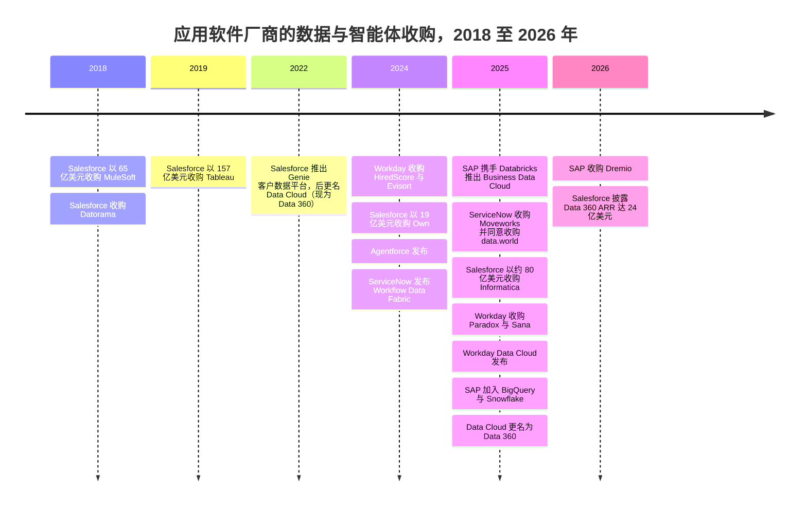
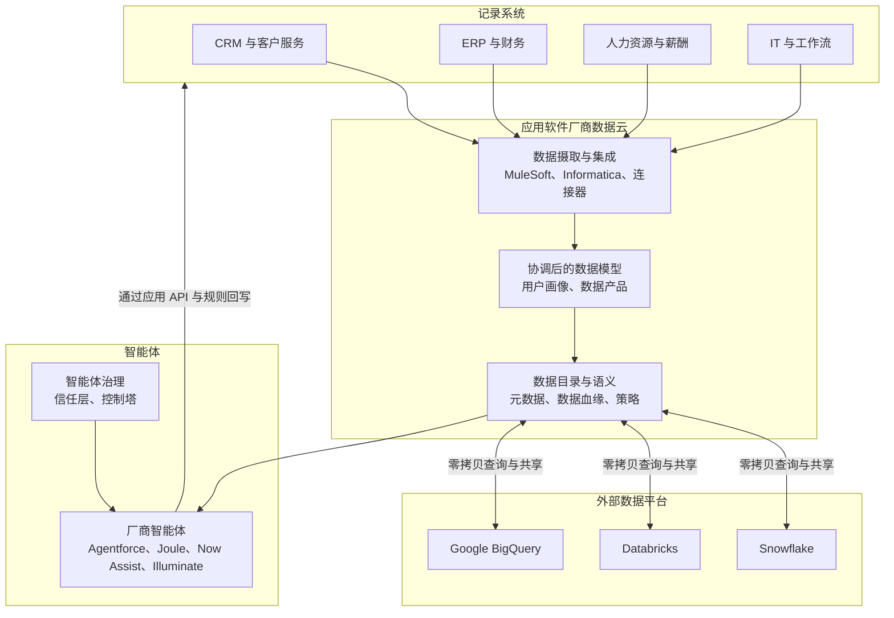
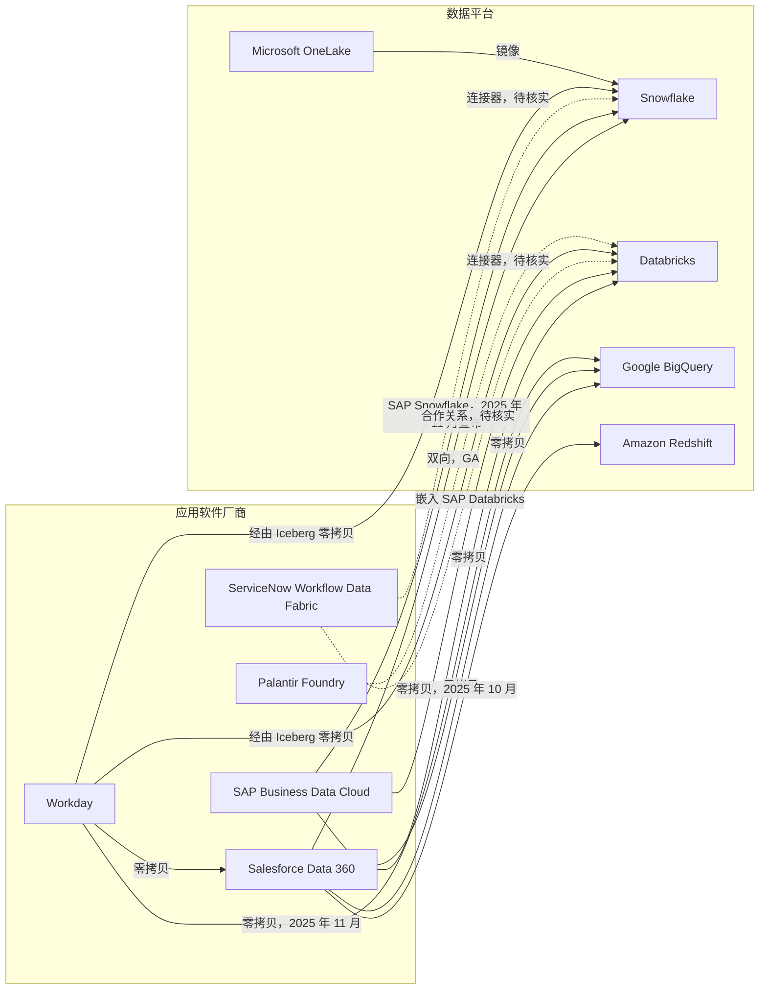

# 34. 应用软件巨头的数据平台
> **状态：** 上市：CRM、NOW、SAP、WDAY、PLTR · **总部：** San Francisco（Salesforce）、Santa Clara（ServiceNow）、Walldorf（SAP）、Pleasanton（Workday）、Denver（Palantir）· **成立：** 1999 年、2004 年、1972 年、2005 年、2003 年 · **最新估值/市值：** 市值分别为 $188.6B / $142.4B / $273.8B / $46.0B / $442.4B（stockanalysis.com，日期为 2026-10-01 至 2026-10-30；见概览表）· **最后核实：** 2026-11-01

> **研究说明。** 本次会话的网络检索额度在实时核实开始之前就已用尽。下文数字来自图谱数据集（`data/*.csv`，2026-10 核实）、`meta/research-briefing.md` 以及整合者经实时核实的登记表（`meta/verified-facts.md`，2026-11-01），独立审阅已将其应用于 Salesforce、SAP、Workday 和 ServiceNow 各节。2025 年中以后、仍无法重新核对的产品事实标注为 `[VERIFY]`。

## 要点速览（TL;DR）

- **核心论点。** 智能体（agent）需要两样仅靠数据仓库无法提供的东西：跨系统的上下文，以及*回写*到记录系统（system of record）的权限。应用软件厂商掌握着写入路径和业务语义（"商机"、"事件单"或"成本中心"究竟意味着什么）。如今每家厂商都在构建一个数据层，好让它自己的智能体，而不是 Databricks 或 Snowflake 的智能体，成为"智能系统（system of intelligence）"。
- **防守。** 如果智能体接手了过去由人完成的工作，按席位定价就会暴露于风险之下。市场已经下调了席位模式的估值：Salesforce 市值同比下跌约 21%，Workday 下跌约 27%，而作为本体（ontology）与智能体厂商的 Palantir，交易价格接近 **70 倍 EV/过去 12 个月收入**（按 `data/public_comps.csv` 中的 FY2026 指引口径约为 53 倍 EV/未来 12 个月收入）。[^comps-crm][^comps-wday][^comps-pltr] 掌握数据层可以让厂商围绕用量和智能体动作重新定价。
- **交易。** Salesforce 以约 $8B 收购 Informatica（2025 年 11 月完成），此前已收购 MuleSoft（$6.5B）、Tableau（$15.7B）和 Own（$1.9B）。ServiceNow 收购了 Moveworks（$2.85B，2025 年 12 月完成），并同意收购 data.world（2025 年 5 月；未找到完成日期）。SAP 收购了 Dremio（2026 年，金额未披露）。[^ma-csv][^dremio][^now-ir]
- **零拷贝是休战，而非合并。** 应用软件厂商与数据平台如今原地向对方开放数据表，而不是导出数据。Salesforce 与 Snowflake、Databricks、BigQuery 和 Redshift 进行双向共享。SAP 把 Databricks 嵌入 Business Data Cloud，并在 2025 年底加入了 BigQuery 和 Snowflake。Workday 推出了 Data Cloud，与 Databricks、Salesforce、Snowflake 和 BigQuery 建立零拷贝连接。各方仍都希望成为智能体运行的地方。[^zcpn][^sf-snow][^sap-snow][^wday-dc]
- **Everpure 视角。** 这些数据云几乎完全运行在超大规模云厂商之上。本地部署的机会较窄但真实存在：SAP 如今拥有 Dremio，而后者本就是 FlashBlade 的合作伙伴；主权部署（SAP、Palantir、Oracle）需要本地基础设施；SaaS 数据的副本仍然需要数据发现和保护。[^briefing-a]

## 概览表

| 公司 | 财年 | 市值 / EV | 所用收入口径 | EV/收入 | 增长（口径） | 数据与智能体产品 |
|---|---|---|---|---|---|---|
| Salesforce（CRM） | 截至 1 月 31 日（FY2027 = 2026 年 2 月至 2027 年 1 月） | $188.6B / $219.6B | 过去 12 个月 $43.94B | 5.0 倍（过去 12 个月） | 过去 12 个月 11.2%（GAAP） | Data 360（原 Data Cloud）、Agentforce、Informatica、MuleSoft、Tableau |
| ServiceNow（NOW） | 日历年 | $142.4B / $144.2B | 过去 12 个月 $14.73B | 9.8 倍（过去 12 个月） | Q2 2026 为 24.0%（GAAP） | Workflow Data Fabric、RaptorDB Pro、data.world（已达成协议）、Moveworks、AI Control Tower |
| SAP（SAP） | 日历年 | $273.8B / $273.9B | 过去 12 个月约 $43.3B（由 €38.19B 换算） | 6.3 倍（过去 12 个月） | Q3 2026 总收入 +13%；云业务 +26%（IFRS） | Business Data Cloud、Datasphere、SAP Databricks、SAP Snowflake、Dremio、Joule |
| Workday（WDAY） | 截至 1 月 31 日（FY2027 = 2026 年 2 月至 2027 年 1 月） | $46.0B / $46.4B | FY2027 指引中值 $10.655B | 4.4 倍（未来 12 个月代理值） | Q2 FY2027 订阅收入 +13.9%（GAAP） | Prism Analytics、Workday Data Cloud、Illuminate 智能体 |
| Palantir（PLTR） | 日历年 | $442.4B / $433.2B | 过去 12 个月 $6.16B | 70.3 倍（过去 12 个月） | 过去 12 个月 79%（GAAP）；毛利率 84.8% | Foundry、Ontology、AIP |

*图 34.1 — 概览。市场数据来自 stockanalysis.com，日期见 `data/public_comps.csv`（CRM、PLTR 为 2026-10-30；SAP 为 2026-10-30；WDAY 为 2026-10-16；NOW 为 2026-10-01）。收入口径不同（过去 12 个月与指引），因此倍数仅供参考。[^comps-crm][^comps-now][^comps-sap][^comps-wday][^comps-pltr]*

## 起源与战略演进

### 应用软件厂商为何想要数据层

二十年来，分工一直很稳定。CRM、IT 服务管理（ITSM）、ERP 和人力资源等应用负责记录交易。数据团队把这些记录复制到数据仓库中进行分析。洞察随后再通过手工或[反向 ETL（reverse ETL）](../glossary.md#reverse-etl)流回业务系统。智能体从四个方面打破了这种安排。

1. **智能体需要跨系统上下文。** 一个处理账单争议的客服智能体需要 CRM 工单、ERP 发票、合同 PDF 和产品使用日志。谁先把这些上下文组装起来，谁就能托管这个智能体。
2. **智能体需要回写。** 光回答问题是不够的。智能体必须发放抵扣额、关闭工单或修改采购订单，而这些写入操作必须遵守应用的业务规则和审批链。只有记录系统才能原生地执行这些规则。数据仓库可以读取订单表的副本，却无法安全地修改一张订单。
3. **语义存在于应用之中。** 在 SAP 中，"物料"、"公司代码"和单据流都有精确的含义，编码在数千张表里。一旦这些记录被拍平放进数据仓库，大部分含义就丢失了。应用软件厂商认为，它们自己的元数据才是智能体最好的[语义层（semantic layer）](../glossary.md#semantic-layer)，这一论点见[第 14 章](../02-pipelines-and-governance/ch14-semantic-layers-and-bi.md)。
4. **席位面临风险。** 如果智能体处理了 40% 的客服工单，客户需要的人工许可就会减少。按席位收费的厂商必须在席位数萎缩之前，转向按智能体动作或按用量单位定价。掌握数据层为它们提供了新的计量单位（处理的数据量、统一的记录数、智能体动作）来取代旧的计量单位。

还有一个防守动机。Databricks 和 Snowflake 都把自己定位为企业的"智能系统"，智能体在那里读取受治理的数据并通过 API 采取行动（[第 25 章](ch25-databricks.md)、[第 26 章](ch26-snowflake.md)）。如果这种模式胜出，CRM 和 ERP 就会沦为薄薄的交易后端，估值如同公用事业。应用软件厂商的回应是自己运行智能体，并把数据平台变成与之共享数据的对等方。

> **类比：芯片领域的垂直整合。** Apple 把 Mac 从 Intel 处理器转向自研的 M 系列芯片，因为底层决定了电池续航、每瓦性能和开发者体验。构建数据云的应用软件厂商下的是同样的赌注：谁控制了智能体之下的那一层，谁就控制了体验和利润。这个类比也带有警示。Apple 仍然从 TSMC 购买晶圆。Salesforce、SAP 和 Workday 仍然从 AWS、Azure 和 Google 租用计算和存储。它们整合的是设计层（语义、元数据、智能体），而不是晶圆厂。

### 演进轨迹，2018–2026 年

这一转变分三波展开。2018 至 2019 年，厂商收购集成与 BI：MuleSoft、Datorama 和 Tableau。2022 至 2025 年，它们在此之上构建数据云：Salesforce 的客户数据平台变成了 Data Cloud（2025 年 10 月更名为 Data 360），ServiceNow 推出 Workflow Data Fabric（2024 年 10 月），SAP 先后推出 Datasphere 和 Business Data Cloud（2025 年 2 月），Workday 推出 Workday Data Cloud（2025 年 9 月）。2025 和 2026 年，它们直接收购数据管理和智能体前端：Informatica、Moveworks、data.world 和 Dremio。

*图 34.2 — 收购顺序沿技术栈向下推进，从 BI 与集成（2018–19 年）到数据目录、主数据和智能体前端（2024–26 年）。数值来自 `data/ma_deals.csv`；2025 年 Workday Data Cloud、SAP 合作伙伴和 Data 360 条目来自 `meta/verified-facts.md`；Paradox 与 Sana 交易在下文中仍标注为 [VERIFY]。[^ma-csv][^wday-dc][^sap-snow]*

## 产品与技术

### 共同架构

本章中的每家厂商都在向同一个四层设计收敛。记录系统保存交易。由厂商运营的数据云保存经过协调的副本或元数据、一个数据目录以及业务语义。零拷贝（zero-copy）连接让外部数据平台读取这些表，也让数据云读取各平台的表，而无需批量导出。智能体位于最上层，通过数据云读取数据，并通过应用自身的 API 和规则回写。

*图 34.3 — 应用软件厂商的数据层。决定性的是最后一个箭头：通过应用的业务逻辑进行回写，是数据平台无法复制的。*

### Salesforce

Salesforce 的数据层起初是一个面向营销的客户数据平台。它在 Dreamforce 2022 上以"Genie"之名重新发布，随后更名为 **Data Cloud**。[^sf-dc-hist] 它把 CRM 对象和外部数据摄取到一个湖仓一体（lakehouse）式的存储中，把身份解析为统一的用户画像，并将其开放给 Agentforce、Tableau 和各个 CRM 应用。在 2025 年 10 月（约 10 月 14 日）的 Dreamforce 上，Salesforce 将其更名为 **Data 360**，归入"Agentforce 360"品牌之下。[^sf-d360]

有两项功能最为重要。第一，**Zero Copy Partner Network**（2024 年 4 月）让 Data 360（当时为 Data Cloud）可以原地查询 Snowflake、Databricks、BigQuery 和 Redshift 的表，并把自己的对象反向开放给它们。[^zcpn] Snowflake 称与 Snowflake 的连接是双向的且已全面可用（GA）。[^sf-snow] 第二，**Informatica**（2025-11-18 完成，约 $8B 股权价值）带来了企业级数据目录、主数据管理（MDM）、数据质量以及跨非 Salesforce 系统的集成能力。[^infa] 加上 MuleSoft，Salesforce 如今拥有三大企业集成业务中的两个（[第 10 章](../02-pipelines-and-governance/ch10-ingestion-and-integration.md)）。2024 年 9 月发布的 **Agentforce** 是智能体层。它基于 Data 360 的上下文进行推理，通过 CRM 流程和 API 采取行动，并配有一个对数据脱敏并记录提示词的"信任层"。[^af-launch]

公司披露的规模指标是 FY2025（2024 年 2 月至 2025 年 1 月）末约 **$900M、增长约 120%** 的 **"Data Cloud and AI" 年度经常性收入（ARR）**。[^sf-q4fy25] 到 **Q2 FY2027**（2026 年 5–7 月；2026-08-26 公布），Salesforce 披露 **Agentforce + Data 360 ARR 约 $3.9B（增长超过 210%）**，其中 Agentforce ARR 超过 $1.5B（增长 >240%），**Data 360 ARR 为 $2.4B（增长 >200%），其中包含 $1.1B 的 Informatica Cloud ARR**。它还披露该季度"Agentic Work Units"达 32 亿个（环比 +97%）。Q2 总收入为 $11.345B（+11%，GAAP），FY2027 收入指引为 $46.10–46.40B。[^crm-q2fy27] 有三点需要注意。所有 ARR 数字均为公司披露，并非 GAAP 收入。剔除 Informatica 后，Data 360 ARR 约为 $1.3B（我们的算术推算），因此三位数增长中有很大一部分来自收购。另外，Q2 中 Agentforce ARR 的定义被扩大，纳入了 Slackbot 和"Headless 360"，因此增长率并非同口径比较。Salesforce 还在 2025 年 9 月与 Snowflake 共同牵头发起了 Open Semantic Interchange（OSI），这表明它宁愿共享语义，也不愿为之争夺。[^osi]

### ServiceNow

ServiceNow 于 2024-10-23 推出 **Workflow Data Fabric**。它运行在 ServiceNow 的高性能数据库 **RaptorDB Pro** 之上（源自 Postgres，ServiceNow 宣传其在自家平台上速度更快），并增加了连接外部平台的零拷贝连接器和一个数据目录。2025 年 5 月（Knowledge 2025 大会），ServiceNow 推出了拥有 100 多家数据合作伙伴的"Workflow Data Network"。[^now-ir][^now-wdf] **data.world** 协议（2025 年 5 月宣布，条款未披露）增加了一个知识图谱（knowledge graph）目录；它是独立于 RaptorDB Pro 的另一项资产。我们未找到明确的完成日期，但后来的行业报道称之为一笔近期完成的收购。[^dataworld][^now-ir] **Moveworks**（$2.85B，在美国司法部提出第二次信息请求后于 2025-12-15 完成）增加了一个企业搜索与智能体入口，供 IT、人力资源和财务等部门的员工使用。[^moveworks] 在 Knowledge 2025 上推出的 **AI Control Tower** 可以在一个控制台中治理 ServiceNow 和第三方智能体 [VERIFY: 产品状态]。[^now-act]

ServiceNow 的切入点是工作流。它的记录是工单、审批和变更请求，也就是智能体采取行动时必须遵循的步骤。Q2 2026 GAAP 收入为 $3.99B，增长 24%，其中部分增长可能来自收购。[^now-fin]

### SAP

SAP 于 2025 年 2 月宣布推出 **Business Data Cloud（BDC）**，合作伙伴为 Databricks。[^sap-bdc] BDC 把 SAP 应用数据打包成精选的"数据产品"，并完整保留 SAP 语义。它整合了 **Datasphere**（SAP 早先的数据仓库服务）和 SAP Analytics Cloud。它还嵌入了 **SAP Databricks**，即由 SAP 销售的 Databricks 环境，两者之间通过 Delta Sharing 实现零拷贝共享。随后，SAP 加入了 Google BigQuery（2025 年 10 月），并于 2025-11-04 在 TechEd 上把 Snowflake 作为 BDC 解决方案扩展加入：**SAP Snowflake**（BDC 内由 SAP 托管的 Snowflake，计划 2026 年第一季度 GA）和 **SAP BDC Connect for Snowflake**（零拷贝共享，计划 2026 年上半年推出）。Snowflake 是继 SAP Databricks 和 BigQuery 之后的第三笔此类合作 [VERIFY: SAP Snowflake 与 BDC Connect 在 2026 年的上线状态]。[^sap-snow] SAP 的助手 **Joule** 如今承载着在 S/4HANA 和 SuccessFactors 内部采取行动的智能体。

**Dremio** 收购（2026-05-04 与 Prior Labs 一同宣布，约 2026 年 7 月完成，条款未披露）增加了一个原生支持 Iceberg 的湖仓引擎和数据目录。SAP 表示它将为智能体式 AI 统一 SAP 与非 SAP 数据。[^dremio] 对 Everpure 而言，这是本章最相关的一笔交易，因为 Dremio 此前已与 FlashBlade 推出了联合的混合湖仓解决方案（[第 7 章](../01-data-systems-foundations/ch07-open-table-formats.md)）。[^briefing-a] SAP 披露 Q3 2026 IFRS 收入为 €10.27B，云收入增长 26%，当前云积压订单为 €24.14B（+28%）。[^sap-q3]

### Workday

Workday 的数据历程始于 **Platfora**（2016 年），后者演变为 **Prism Analytics**，一款把外部数据与人力资源和财务记录融合的工具。[^ma-csv] 2025 年，它围绕智能体重新定位。它宣布推出 **"Agent System of Record"**，用于登记和治理自有及第三方智能体，并同意收购 **Paradox**（对话式招聘）和 **Sana**（AI 搜索与学习，约 $1.1B，媒体报道）[VERIFY: 日期与金额]。[^wday-agents] 此前它已收购 HiredScore（2024 年 2 月）和 Evisort（2024 年 9 月）。在 2025-09-16 的 Workday Rising 大会上，它宣布推出 **Workday Data Cloud**，零拷贝合作伙伴为 Databricks、Salesforce 和 Snowflake；Google BigQuery 于 2025-11-19 加入。Data Connect 通过 Apache Iceberg 进行双向数据共享，Prism Analytics 则接受入站的零拷贝查询。Snowflake 将这种连接描述为指向存放在 Workday Data Cloud 中 Parquet 文件的外部托管 Iceberg 表。[^wday-dc] [VERIFY: 各合作伙伴的 GA 状态] Q2 FY2027（2026 年 5–7 月）GAAP 收入为 $2.649B，订阅收入增长 13.9%。[^wday-q2]

### Palantir

Palantir 是个异类：一家应用与智能体公司，却没有自己的传统记录系统。它的 **Ontology（本体）** 把来自其他系统的数据映射为业务对象（一座"工厂"、一批"货运"、一份"理赔"），附带属性、关系和*动作*，即回写到源系统的受治理函数。**AIP**（Artificial Intelligence Platform，2023 年）让语言模型能够基于这些对象和动作运行。[^pltr-aip] 实际上，Palantir 是在其他厂商的记录之上构建了上文所述的语义层和回写层。这就是为什么市场给予它约 70 倍过去 12 个月收入的估值，而老牌厂商的交易倍数只有 4–10 倍。[^comps-pltr] Palantir 于 2025 年 3 月宣布与 Databricks 合作 [VERIFY: 范围与商业条款]。[第 31 章](ch31-analytical-engine-challengers-legacy.md)对 Ontology 有深入介绍。

### Microsoft Dynamics 与 Oracle Fusion（简述）

**Microsoft** 的路径最简单，因为它同时拥有数据平台。Dataverse 中的 Dynamics 365 和 Power Platform 数据可以链接进 **Fabric** 的 OneLake，而 OneLake 可将 Snowflake、Azure SQL 和 Cosmos DB 镜像为 Delta 表。语义层 Fabric IQ 于 2025 年 11 月进入预览。[^fabric-mirror][^ignite] **Oracle** 提供 Fusion Data Intelligence（基于 Fusion ERP 和 HCM 的预置分析）以及面向 Fusion 应用的 AI Agent Studio [VERIFY: 当前名称]。它还在 Azure、Google Cloud 和 AWS 内提供其 Autonomous AI Lakehouse（2025 年 10 月 GA）和数据库服务。[^oracle-aiw] 两者都能把应用、数据平台和基础设施捆绑在一起，这是任何纯应用软件厂商都做不到的。

| 厂商 | 数据产品 | 数据目录 / 语义 | 零拷贝合作伙伴 | 智能体产品 | 定价模式（智能体） | 主要数据类收购 | 指标（已标注） |
|---|---|---|---|---|---|---|---|
| Salesforce | Data 360（原 Data Cloud） | Informatica 目录与 MDM；Tableau Semantics | Snowflake、Databricks、BigQuery、Redshift | Agentforce | 按对话计费，后改为按动作计费（Flex Credits） | MuleSoft、Tableau、Own、Informatica | Q2 FY2027 Data 360 ARR $2.4B，含 $1.1B Informatica Cloud（公司披露） |
| ServiceNow | Workflow Data Fabric、RaptorDB Pro | data.world 知识图谱（已达成协议）；CMDB | Databricks、Snowflake、BigQuery；拥有 100 多家合作伙伴的 Workflow Data Network [VERIFY: 各合作伙伴的零拷贝状态] | Now Assist 智能体、Moveworks、AI Control Tower | Pro Plus 高级 SKU 加 assist 包 [VERIFY] | Moveworks、data.world | Q2 2026 收入 $3.99B，+24%（GAAP） |
| SAP | Business Data Cloud、Datasphere | SAP 数据产品；Dremio 目录 | Databricks（嵌入）、BigQuery（2025 年 10 月）、Snowflake（2025 年 11 月；上线状态 [VERIFY]） | Joule 智能体 | 容量单位与 AI 单位 [VERIFY] | Sybase（2010 年）、Dremio | Q3 2026 云收入 +26%（IFRS） |
| Workday | Prism Analytics、Workday Data Cloud | Workday 业务对象 | Databricks、Snowflake、Salesforce（2025 年 9 月）；BigQuery（2025 年 11 月） | Illuminate 智能体、Agent System of Record | 订阅加智能体附加模块 [VERIFY] | Platfora、Evisort、Paradox、Sana | Q2 FY2027 订阅收入 +13.9%（GAAP） |
| Palantir | Foundry | Ontology（对象加动作） | Databricks [VERIFY]、Snowflake [VERIFY] | AIP | 大型企业与政府合同 | 无重大收购 | 过去 12 个月收入 $6.16B，+79%（GAAP） |
| Microsoft | Fabric、OneLake、Dataverse | Purview；Fabric IQ（预览） | 将 Snowflake 等镜像进 OneLake | Copilot、Copilot Studio 智能体 | 容量单位加按消息计费的智能体计量 [VERIFY] | Citus Data（数据库，2019 年） | 2025 年 Fabric 付费客户 19,000 多家（公司披露） |
| Oracle | Fusion Data Intelligence、Autonomous AI Lakehouse | Oracle 语义模型 [VERIFY] | Database@Azure、@Google Cloud、@AWS | AI Agent Studio [VERIFY] | 包含在 Fusion 订阅中 [VERIFY] | BlueKai、Datalogix（均已退出） | Q1 FY2027 OCI 收入 +121%（GAAP，媒体报道） |

*图 34.4 — 七家厂商，一种架构。差别在于语义从何而来（自有记录、收购来的数据目录，或架在他人记录之上的本体），以及底层基础设施归谁所有。[^comps-now][^comps-sap][^comps-wday][^comps-pltr][^fabric-cust][^comps-orcl]*

### 零拷贝联盟关系图

在此语境下，"零拷贝"通常意味着**联邦查询加元数据共享**。一个平台获得另一个平台数据表的凭证和模式，并原地读取它们，有时会缓存结果。批量数据留在原处，因此无需每晚导出再做对账。但它并非免费：查询仍然要跨越网络，源平台仍会收取计算费用，延迟也会上升。

*图 34.5 — 谁与谁共享数据。实线已在图谱资料来源中得到确认（SAP–Snowflake 已宣布，但 2026 年上线状态未经确认）；虚线在 2025–26 年的报道中出现过，但未在此重新核实。Databricks 和 Snowflake 位于中心：每家应用软件厂商都与两者相连，而不是选边站。[^zcpn][^sf-snow][^sap-bdc][^sap-snow][^wday-dc][^fabric-mirror]*

> **类比：共享虚拟内存。** 零拷贝共享相当于数据中心版的 CPU 与 GPU 之间的共享虚拟内存（CUDA 统一内存、OpenCL SVM）。两个设备寻址同一个虚拟空间，因此程序传递的是指针，而不必设置一次 DMA 拷贝。IOMMU 按页权限检查每一次访问，在这里扮演这一角色的是数据目录的访问策略。与统一内存一样，拷贝并没有消失，而是变成了隐式的：页面按需迁移，热数据在访问方被缓存。性能取决于访问模式，带宽账单（在这里是云出口流量费（egress fees）和查询计算费）照样会到来。零拷贝消除的是对账问题，而不是物理规律。
