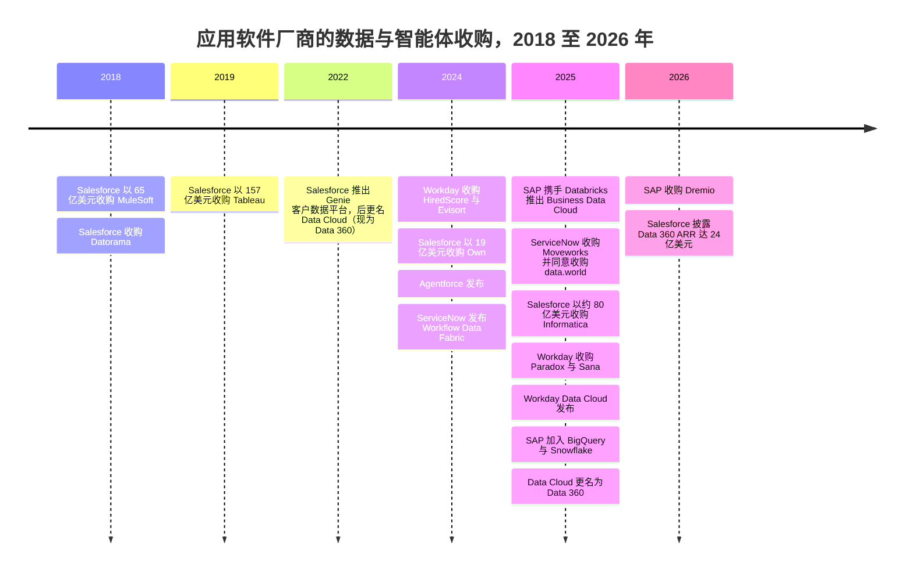

# 34. 应用软件巨头的数据平台
> **状态：** 上市：CRM、NOW、SAP、WDAY、PLTR · **总部：** San Francisco（Salesforce）、Santa Clara（ServiceNow）、Walldorf（SAP）、Pleasanton（Workday）、Denver（Palantir）· **成立：** 1999 年、2004 年、1972 年、2005 年、2003 年 · **最新估值/市值：** 市值分别为 $188.6B / $142.4B / $273.8B / $46.0B / $442.4B（stockanalysis.com，日期为 2026-10-01 至 2026-10-30；见概览表）· **最后核实：** 2026-11-01

> **研究说明。** 本次会话的网络检索额度在实时核实开始之前就已用尽。下文数字来自图谱数据集（`data/*.csv`，2026-10 核实）、`meta/research-briefing.md` 以及整合者经实时核实的登记表（`meta/verified-facts.md`，2026-11-01），独立审阅已将其应用于 Salesforce、SAP、Workday 和 ServiceNow 各节。2025 年中以后、仍无法重新核对的产品事实标注为 `[VERIFY]`。

## 要点速览（TL;DR）

- **核心论点。** 智能体（agent）需要两样仅靠数据仓库无法提供的东西：跨系统的上下文，以及*回写*到记录系统（system of record）的权限。应用软件厂商掌握着写入路径和业务语义（"商机"、"事件单"或"成本中心"究竟意味着什么）。如今每家厂商都在构建一个数据层，好让它自己的智能体，而不是 Databricks 或 Snowflake 的智能体，成为"智能系统（system of intelligence）"。
- **防守。** 如果智能体接手了过去由人完成的工作，按席位定价就会暴露于风险之下。市场已经下调了席位模式的估值：Salesforce 市值同比下跌约 21%，Workday 下跌约 27%，而作为本体（ontology）与智能体厂商的 Palantir，交易价格接近 **70 倍 EV/过去 12 个月收入**（按 `data/public_comps.csv` 中的 FY2026 指引口径约为 53 倍 EV/未来 12 个月收入）。[^comps-crm][^comps-wday][^comps-pltr] 掌握数据层可以让厂商围绕用量和智能体动作重新定价。
- **交易。** Salesforce 以约 $8B 收购 Informatica（2025 年 11 月完成），此前已收购 MuleSoft（$6.5B）、Tableau（$15.7B）和 Own（$1.9B）。ServiceNow 收购了 Moveworks（$2.85B，2025 年 12 月完成），并同意收购 data.world（2025 年 5 月；未找到完成日期）。SAP 收购了 Dremio（2026 年，金额未披露）。[^ma-csv][^dremio][^now-ir]
- **零拷贝是休战，而非合并。** 应用软件厂商与数据平台如今原地向对方开放数据表，而不是导出数据。Salesforce 与 Snowflake、Databricks、BigQuery 和 Redshift 进行双向共享。SAP 把 Databricks 嵌入 Business Data Cloud，并在 2025 年底加入了 BigQuery 和 Snowflake。Workday 推出了 Data Cloud，与 Databricks、Salesforce、Snowflake 和 BigQuery 建立零拷贝连接。各方仍都希望成为智能体运行的地方。[^zcpn][^sf-snow][^sap-snow][^wday-dc]
- **Everpure 视角。** 这些数据云几乎完全运行在超大规模云厂商之上。本地部署的机会较窄但真实存在：SAP 如今拥有 Dremio，而后者本就是 FlashBlade 的合作伙伴；主权部署（SAP、Palantir、Oracle）需要本地基础设施；SaaS 数据的副本仍然需要数据发现和保护。[^briefing-a]

## 概览表

| 公司 | 财年 | 市值 / EV | 所用收入口径 | EV/收入 | 增长（口径） | 数据与智能体产品 |
|---|---|---|---|---|---|---|
| Salesforce（CRM） | 截至 1 月 31 日（FY2027 = 2026 年 2 月至 2027 年 1 月） | $188.6B / $219.6B | 过去 12 个月 $43.94B | 5.0 倍（过去 12 个月） | 过去 12 个月 11.2%（GAAP） | Data 360（原 Data Cloud）、Agentforce、Informatica、MuleSoft、Tableau |
| ServiceNow（NOW） | 日历年 | $142.4B / $144.2B | 过去 12 个月 $14.73B | 9.8 倍（过去 12 个月） | Q2 2026 为 24.0%（GAAP） | Workflow Data Fabric、RaptorDB Pro、data.world（已达成协议）、Moveworks、AI Control Tower |
| SAP（SAP） | 日历年 | $273.8B / $273.9B | 过去 12 个月约 $43.3B（由 €38.19B 换算） | 6.3 倍（过去 12 个月） | Q3 2026 总收入 +13%；云业务 +26%（IFRS） | Business Data Cloud、Datasphere、SAP Databricks、SAP Snowflake、Dremio、Joule |
| Workday（WDAY） | 截至 1 月 31 日（FY2027 = 2026 年 2 月至 2027 年 1 月） | $46.0B / $46.4B | FY2027 指引中值 $10.655B | 4.4 倍（未来 12 个月代理值） | Q2 FY2027 订阅收入 +13.9%（GAAP） | Prism Analytics、Workday Data Cloud、Illuminate 智能体 |
| Palantir（PLTR） | 日历年 | $442.4B / $433.2B | 过去 12 个月 $6.16B | 70.3 倍（过去 12 个月） | 过去 12 个月 79%（GAAP）；毛利率 84.8% | Foundry、Ontology、AIP |

*图 34.1 — 概览。市场数据来自 stockanalysis.com，日期见 `data/public_comps.csv`（CRM、PLTR 为 2026-10-30；SAP 为 2026-10-30；WDAY 为 2026-10-16；NOW 为 2026-10-01）。收入口径不同（过去 12 个月与指引），因此倍数仅供参考。[^comps-crm][^comps-now][^comps-sap][^comps-wday][^comps-pltr]*

## 起源与战略演进

### 应用软件厂商为何想要数据层

二十年来，分工一直很稳定。CRM、IT 服务管理（ITSM）、ERP 和人力资源等应用负责记录交易。数据团队把这些记录复制到数据仓库中进行分析。洞察随后再通过手工或[反向 ETL（reverse ETL）](../glossary.md#reverse-etl)流回业务系统。智能体从四个方面打破了这种安排。

1. **智能体需要跨系统上下文。** 一个处理账单争议的客服智能体需要 CRM 工单、ERP 发票、合同 PDF 和产品使用日志。谁先把这些上下文组装起来，谁就能托管这个智能体。
2. **智能体需要回写。** 光回答问题是不够的。智能体必须发放抵扣额、关闭工单或修改采购订单，而这些写入操作必须遵守应用的业务规则和审批链。只有记录系统才能原生地执行这些规则。数据仓库可以读取订单表的副本，却无法安全地修改一张订单。
3. **语义存在于应用之中。** 在 SAP 中，"物料"、"公司代码"和单据流都有精确的含义，编码在数千张表里。一旦这些记录被拍平放进数据仓库，大部分含义就丢失了。应用软件厂商认为，它们自己的元数据才是智能体最好的[语义层（semantic layer）](../glossary.md#semantic-layer)，这一论点见[第 14 章](../02-pipelines-and-governance/ch14-semantic-layers-and-bi.md)。
4. **席位面临风险。** 如果智能体处理了 40% 的客服工单，客户需要的人工许可就会减少。按席位收费的厂商必须在席位数萎缩之前，转向按智能体动作或按用量单位定价。掌握数据层为它们提供了新的计量单位（处理的数据量、统一的记录数、智能体动作）来取代旧的计量单位。

还有一个防守动机。Databricks 和 Snowflake 都把自己定位为企业的"智能系统"，智能体在那里读取受治理的数据并通过 API 采取行动（[第 25 章](ch25-databricks.md)、[第 26 章](ch26-snowflake.md)）。如果这种模式胜出，CRM 和 ERP 就会沦为薄薄的交易后端，估值如同公用事业。应用软件厂商的回应是自己运行智能体，并把数据平台变成与之共享数据的对等方。

> **类比：芯片领域的垂直整合。** Apple 把 Mac 从 Intel 处理器转向自研的 M 系列芯片，因为底层决定了电池续航、每瓦性能和开发者体验。构建数据云的应用软件厂商下的是同样的赌注：谁控制了智能体之下的那一层，谁就控制了体验和利润。这个类比也带有警示。Apple 仍然从 TSMC 购买晶圆。Salesforce、SAP 和 Workday 仍然从 AWS、Azure 和 Google 租用计算和存储。它们整合的是设计层（语义、元数据、智能体），而不是晶圆厂。

### 演进轨迹，2018–2026 年

这一转变分三波展开。2018 至 2019 年，厂商收购集成与 BI：MuleSoft、Datorama 和 Tableau。2022 至 2025 年，它们在此之上构建数据云：Salesforce 的客户数据平台变成了 Data Cloud（2025 年 10 月更名为 Data 360），ServiceNow 推出 Workflow Data Fabric（2024 年 10 月），SAP 先后推出 Datasphere 和 Business Data Cloud（2025 年 2 月），Workday 推出 Workday Data Cloud（2025 年 9 月）。2025 和 2026 年，它们直接收购数据管理和智能体前端：Informatica、Moveworks、data.world 和 Dremio。

*图 34.2 — 收购顺序沿技术栈向下推进，从 BI 与集成（2018–19 年）到数据目录、主数据和智能体前端（2024–26 年）。数值来自 `data/ma_deals.csv`；2025 年 Workday Data Cloud、SAP 合作伙伴和 Data 360 条目来自 `meta/verified-facts.md`；Paradox 与 Sana 交易在下文中仍标注为 [VERIFY]。[^ma-csv][^wday-dc][^sap-snow]*
