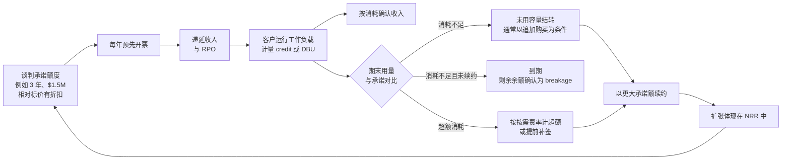
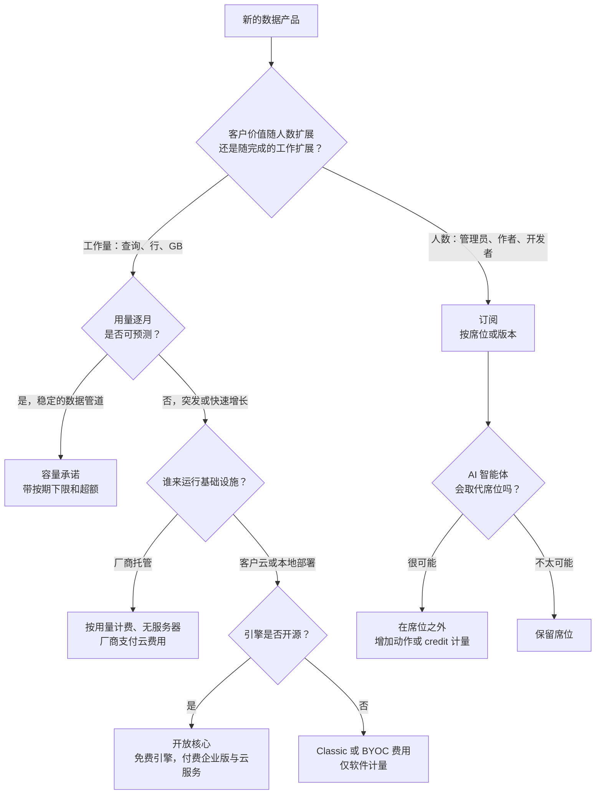
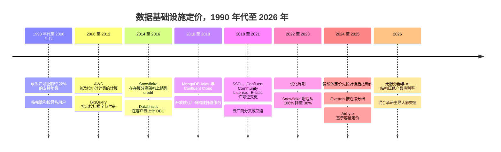

# 35. 商业模式：按用量计费、订阅、开放核心与托管云
> **深度：** L2 · **阅读时间：** 约 17 分钟 · **最后核实：** 2026-11-01 · **前置阅读：** [第 25 章 — Databricks](../04-company-deep-dives/ch25-databricks.md)，[第 26 章 — Snowflake](../04-company-deep-dives/ch26-snowflake.md)

## 要点速览（TL;DR）

- 数据基础设施的销售方式基本有四种。[按用量计费（consumption pricing）](../glossary.md#consumption-pricing)对实际完成的工作计量（credit、DBU、slot、扫描字节数）。[订阅定价（subscription pricing）](../glossary.md#seat-based-pricing)按席位、节点或已连接数据源收费。[开放核心（open core）](../glossary.md#open-core)免费提供引擎，围绕引擎出售功能、支持或托管服务。托管云服务（managed cloud service）替客户运行软件，同时对软件和基础设施收费。如今大多数大额合同都是混合形态：以按用量计量的消耗来扣减一笔[容量承诺（capacity commitment）](../glossary.md#capacity-commitment)。
- 会计处理决定了业务的行为方式。订阅收入按期（ratably）确认，因此收入平滑、可见性高。按用量计费的收入只有在计量表转动时才确认，因此逐周跟踪客户活动。Snowflake 的 FY2026 10-K 显示，按需（on-demand）计费仅占收入约 1%。即便如此，其几乎全部收入都按消耗确认，因为预付容量只有在被使用时才转为收入。[^sf-10k26]
- 按用量计费的收入具有双向弹性。Snowflake 产品收入在 FY2022（2021 年 2 月–2022 年 1 月）增长 106%。到 FY2024，随着客户优化支出、以及厂商自身性能提升降低了账单，增速降至 38%。[^sf-hist] 管理层此前已就自身平台改进给出约 $97M 的 FY2023 收入逆风指引。[^sf-fy22]
- 毛利率取决于谁来支付云账单。当客户直接向 AWS 付费（"classic"或自管部署）时，厂商获得的收入接近于特许权使用费（royalty），毛利率接近软件水平。当厂商付费时（如无服务器或托管服务），单工作负载收入上升，毛利率百分比下降。Snowflake 的非 GAAP 产品毛利率约为 75%。GitLab 这类按席位定价的软件约为 86%。[^sf-q2][^comps]
- 对 Everpure 而言，Evergreen//One 本身已是类按用量计费的模式：以预留承诺（reserve commitment）作为计费下限，超出部分按需计费，两者都计入其 Subscription ARR KPI。[^ep-10k] 向技术栈上层的数据智能延伸，带来一个新问题：按什么单位收费。可选项包括按 TB、按查询或按受治理资产，而每种单位意味着不同的波动性、毛利率和竞争暴露。

## 为何重要（商业 + Everpure 视角）

商业模式是厂商成本结构与客户预算之间的契约。在数据基础设施领域，这一契约决定了投资者关心的三件事：收入波动有多大、毛利率能有多高、销售团队如何行事。两家产品相同、年收入相同的公司，价值可能相差悬殊。一家出售每年续约的 $500K 席位；另一家出售 $500K 的计量表，当客户工程师调优查询时，它可能在一个季度内下降 20%。[第 36 章](ch36-unit-economics-kpis.md)介绍解读这类业务所用的指标。[第 37 章](ch37-public-comps-valuation.md)介绍市场如何为它们定价。

商业模式还决定了竞争格局。按用量计费让厂商无需走采购流程即可小规模切入、逐步扩张。但它也让超大规模云厂商（hyperscaler）可以在同一计量单位上压价。开放核心以低成本建立采用度，却引来云厂商托管免费引擎。正是这种担忧催生了 [第 38 章](ch38-open-source-strategy.md)所述的 2018–2021 年许可证变更潮。席位定价可预测，但收入受限于员工人数，而 AI 智能体正在威胁员工人数。

对 Everpure 而言，这个问题非常现实。其 Evergreen//One 存储即服务已表现为容量承诺与按用量计费的混合体：预留承诺、超出部分按需计费，并附带服务等级保障。[^ep-e1] 10-K 将 Subscription ARR 定义为包含年化的按需计费额，因此该 KPI 已有一部分随用量变动。[^ep-10k] 进入数据管理与数据智能领域（1touch，现为 Everpure Data Intelligence）意味着要为位于存储之上的软件选择定价单位。按 TB 定价与存量客户群一致，但容易导致商品化。按查询定价与价值一致，但会引入 Snowflake 式的波动。按资产或按数据源的数据治理定价与数据目录厂商一致，但面向的是不同的买方。下文"Everpure 视角：在技术栈上层选择计费单位"一节，将这些权衡作为基于公开信息、战略团队可能评估的选项加以阐述。

## 工作原理

### 四种模式，各用一段话说明

**按用量计费。** 厂商定义一个工作单位，按秒或按字节计量。Snowflake [credit](../glossary.md#snowflake-credit) 按规格计量虚拟仓库运行时间。Databricks [DBU](../glossary.md#dbu) 按实例类型和工作负载 SKU 计量处理能力。BigQuery 要么按扫描的 TiB 收费，要么按预留容量的 [slot](../glossary.md#slot)-小时收费。[^bq] MongoDB Atlas 按集群小时、存储和数据传输计费。[^mdb-10k24] Confluent Cloud 按弹性容量单位（[eCKU](../glossary.md#ecku)）加网络与存储计费。[^cflt-pricing] 收入在客户消耗时确认。

**订阅。** 厂商出售在一定期限内使用软件的权利。价格随某个价值代理指标（用户、节点、核数或已连接数据源）缩放，收入按期确认。商业智能（BI）席位、Collibra 和 Alation 等数据目录厂商（按版本、用户和已连接数据源定价；见[第 33 章](../04-company-deep-dives/ch33-governance-catalog-security-companies.md)）以及 dbt 的开发者席位都采用这种方式。[^dbt-pricing] 云时代之前的 Informatica 出售永久许可证外加支持年费，这是一种更早期的变体，见[第 29 章](../04-company-deep-dives/ch29-operational-database-vendors.md)。此后它转向了池化的 [Informatica Processing Unit](../glossary.md#informatica-processing-unit)，这是一种按用量计费的单位。[^infa-ipu]

**开放核心。** 核心引擎免费：MongoDB Community、Elasticsearch、Apache Kafka、dbt Core、Airbyte 的连接器。收入来自引擎周边：可以是带安全与管理功能的企业版（Confluent Platform、MongoDB Enterprise Advanced）、支持服务，或利润最高的托管服务。免费层就是营销预算。它在任何销售人员登门之前，就培养出了熟悉产品的开发者。

**托管云服务。** 厂商在云上运营软件，并对结果收费。这既适用于厂商自有引擎（Atlas、Elastic Cloud、Confluent Cloud），也适用于由超大规模云厂商运营的"开源即服务"（Amazon RDS for PostgreSQL、ElastiCache for Valkey）。开放核心的经济性成败系于托管服务。谁运营服务，谁就拥有客户关系和基础设施利润。当超大规模云厂商来运营时，项目作者可能一无所获。

### 计费单位：每种计量表到底在计什么

| # | 单位 | 厂商 / 产品 | 计量内容 | 代表性标价（美国，截至检索时） | 模式 |
|---|---|---|---|---|---|
| 1 | Credit | Snowflake | 按规格缩放的虚拟仓库小时（XS = 1 credit/小时，每升一档翻倍）；无服务器与 AI 功能折算为 credit | 因版本和区域而异；见[第 26 章](../04-company-deep-dives/ch26-snowflake.md)[^sf-cost] | 按用量计费 |
| 2 | DBU | Databricks | 按实例类型和 SKU 计的每小时处理能力 | 每 DBU 约 $0.15（Jobs，classic）至约 $0.70（Serverless SQL）（第三方汇编）[^dbx-pricing] | 按用量计费 |
| 3 | Slot-小时 | Google BigQuery editions | 预留或自动扩缩的查询算力 | 每 slot-小时 Standard $0.04、Enterprise $0.06、Enterprise Plus $0.10[^bq] | 按用量计费 / 容量 |
| 4 | 每扫描 TiB 美元 | BigQuery 按需 | 每次查询处理的字节数 | 每 TiB $6.25；每月前 1 TiB 免费[^bq] | 按用量计费 |
| 5 | RPU-小时 | Amazon Redshift Serverless | 查询运行期间的 Redshift Processing Unit | 每 RPU-小时 $0.375（US East）；最低 4 RPU[^redshift] | 按用量计费 |
| 6 | eCKU-小时 | Confluent Cloud | 弹性 Kafka 集群容量，另加按 GB 计的网络与存储 | Confluent 计算器：每 eCKU-小时 Standard $0.75、Enterprise $2.25；主定价页隐含的月度下限不同[^cflt-pricing] | 按用量计费 |
| 7 | 实例小时 + GB | MongoDB Atlas | 集群档位（计算、内存）、存储、数据传输 | 按集群规模分档；大客户按年承诺[^mdb-10k24] | 按用量计费 / 托管 |
| 8 | MAR | Fivetran | 每个连接分档计价的变更[月活跃行数（monthly active rows）](../glossary.md#monthly-active-rows) | 首档每百万 MAR $500，超过 10 亿后降至 $1.18[^ft-pricing] | 按用量计费 |
| 9 | IPU | Informatica IDMC | 在集成、数据质量、数据目录之间共用的池化单位 | 费率未公开[^infa-ipu] | 预付按用量计费 |
| 10 | Data Worker | Airbyte（Pro / Enterprise Flex） | 预留的并行同步容量 | 仅限询价；2025 年 2 月推出[^ab-capacity] | [基于容量的定价（capacity-based）](../glossary.md#capacity-based-pricing) |
| 11 | vCPU 或实例小时 | Classic 计算、RDS 式托管开源 | 客户租用的虚拟机 | 客户自己的云账单 | 直通（pass-through） |
| 12 | 存储 每 TB-月美元 | Snowflake、Evergreen//One | 存储或预留的容量 | Evergreen//One 归档层每 GiB-月 $0.018 起（≈ 每 TiB-月 $18），最低 500 TiB，36 个月[^ep-e1] | 按用量计费 / 承诺 |
| 13 | 出口流量 每 GB 美元 | AWS 及同类厂商 | 离开区域或云的数据 | 100 GB 免费后，每月前 10 TB 约 $0.09/GB（US East）[^aws-egress] | 按用量计费 |
| 14 | 席位 | dbt 平台、BI 工具 | 具名开发者或查看者 | dbt Starter 每开发者席位每月 $100，含 15,000 次成功的模型构建[^dbt-pricing] | 订阅 + 用量 |
| 15 | 对话 / 动作 | Salesforce Agentforce | 智能体对话，或通过 [Flex Credits](../glossary.md#flex-credits) 计量的动作 | 每次对话 $2（2024 年标价）；每个动作 $0.10（每 100,000 credit $500）；按用户附加包约 $125/月（第三方汇编）[^af-price] | 按用量计费 / 席位混合 |
| 16 | 数据源或资产 | Collibra、Alation、Atlan | 用户、已连接数据源、受治理资产 | 仅限询价；按版本[^ch33] | 订阅 |

*图 35.1 — 十六种计量表，没有公分母。每家厂商选择的单位，要么映射到自身成本驱动因素（计算时间、字节、容量），要么映射到客户价值的代理指标（席位、资产、对话）。标价是上限，而非大客户实际支付的价格。*

> **类比：按用量计费即使用特许权费。** 按用量计费合同在经济上最接近 **Arm 的按芯片特许权费**。Arm 一次性授权其架构，然后对每颗出货芯片收取特许权费，因此其收入随客户的出货量起落，而不是随新签许可证变动。在 FY2026（截至 2026 年 3 月的财年），Arm 收入增长 23% 至 $4.92B。特许权费收入增长 21%，受益于 Armv9 设计更高的单芯片费率（GAAP）。[^arm-20f] Snowflake 和 Databricks 以同样方式对客户的分析活动收取"特许权费"。分析师的模型也相同：存量客户群 × 使用强度 × 单位费率。单位费率升级（Armv9；无服务器 SKU）是独立于用量的增长杠杆。

### 收入确认：为什么同样的一美元表现不同

根据 ASC 606，订阅属于随时待命履约义务（stand-ready obligation），因此收入在期限内平均摊开。按用量计费合同是逐单位履行的，因此收入跟随用量。Snowflake 的 10-K 描述了两种安排。在**容量（capacity）**合同下，客户按约定价格承诺一定的消耗额度，通常每年预先开票。在**按需（on-demand）**合同下，客户按月事后开票。两种合同的收入都在计算、存储和数据传输被消耗时确认。文件还警示，这使 Snowflake 对收入确认时点的可见性有限。[^sf-10k26] 现金提前到账，但收入没有，因此差额体现在递延收入和[剩余履约义务（remaining performance obligations）](../glossary.md#remaining-performance-obligations)（RPO）中。

拥有自管产品的开放核心厂商还有第三种模式。定期许可证（term licence）中的软件部分在期限开始时**一次性**确认，支持部分按期确认。因此，MongoDB Enterprise Advanced 或 Confluent Platform 的一笔大额多年续约会集中落在一个季度，使报告增速呈现波动。这也是为什么这些公司的投资者把云业务线（Atlas 占 MongoDB FY2026 收入的 73%；Confluent Cloud 占 Confluent FY2025 收入的 53%）视为更干净的增长信号。[^mdb-ars][^cflt-fin]

### 按用量计费合同的生命周期

*图 35.2 — 按用量计费合同就是一个随客户工作而逐步消耗的预付账户。结转（rollover）让厂商把消耗不足的问题转化为更大的续约。超额（overage）和提前续约是净收入留存率所衡量的扩张引擎。*

结转是关键条款。Snowflake 的 10-K 称，在许多合同中，未使用的容量可以结转到后续订单，一般以客户追加购买为条件。[^sf-10k26] 这样，客户的过度承诺——本来会成为续约时缩减的理由——就变成了以更大规模续约的理由。云市场又增加了一层。Snowflake 的云市场条款允许客户将 Snowflake 容量用于部分第三方上架产品。[^sf-mp-terms] AWS、Azure 和 Google 允许客户通过[私有报价（private offers）](../glossary.md#private-offer)购买厂商软件来抵扣其云承诺。AWS 于 2025 年 11 月新增"express"私有报价，以缩短谈判时间。[^aws-mp] 客户喜欢这类云市场交易，因为花的是已承诺给云厂商的预算。厂商则接受云市场手续费，以换取更快的采购流程（见[第 40 章](ch40-gtm-partnerships.md)）。

> **类比：容量承诺即照付不议的晶圆协议。** 多年期容量承诺是晶圆代工**长期协议（LTA）**的软件版本。2021–22 年，芯片设计公司签订带预付款的照付不议（take-or-pay）晶圆合同以锁定产能。Cirrus Logic 的 10-K 描述了与 GlobalFoundries 的一份协议：每季度须购买约定数量的晶圆，预付款面临风险。[^gf-lta] GlobalFoundries 在 2022 年表示，LTA 覆盖约 $27B 的未来收入，由约 $3.6B 的预付款和准入费支撑（公司披露，经电话会纪要的媒体报道）。[^gf-lta] 两者直接对应：预付款体现为 RPO，最低采购量即承诺额，风险在于客户过度采购后续约时会怎样。2023 年需求下滑时，晶圆代工厂重新谈判了合同。软件厂商则用结转条款更温和地做同样的事。

### 波动性：一个算例

同一个客户、同样的工作负载、三种合同。假设一家中型企业，按厂商价格其分析用量第 1 年成本为 $500K，每年增长 30%（约每季度 6.8%）。每年第四季度因假期下降 4%。第 2 年年初，客户的平台团队开展一个优化项目（调整虚拟仓库规格、缩短数据保留期、启用自动挂起），使用量重置下降 20%，此后恢复增长。所有数字均为示意。

- **(a) 每年 $500K 的订阅。** 每季度收入 $125K：假设平价续约，第 1 年 $500K、第 2 年 $500K。厂商既看不到用量增长，也看不到优化影响。
- **(b) 纯按用量计费。** 收入跟随计量表。从第 1 年 Q1 的 $113K 升至第 1 年 Q4 的 $132K，然后在优化生效的第 2 年 Q1 下降 11% 至 $118K。第 1 年合计约 $494K，第 2 年约 $514K。若无优化，第 2 年本应约为 $643K，因此一个项目在当年让厂商损失约 $129K 收入（20%）。
- **(c) 带超额的容量承诺。** 客户第 1 年承诺 $480K，第 2 年以 $500K 续约。承诺额作为下限按期确认（每季度先 $120K、后 $125K），超出下限的用量按超额计费。这是 Evergreen//One 的结构，而不是 Snowflake 的。第 1 年合计约 $502K，第 2 年约 $522K。下限吸收了优化季度的冲击（$125K 而非 $118K），而厂商仍能获取下限之上的增长。

*图 35.3 — 仅为示意（作者模型，data/ch35_illustrative_revenue.csv）。两年内三种合同产生的总额几乎相同（$1.00M、$1.01M、$1.02M）。但季度路径不同：按用量计费让厂商同时承担上行与回撤，而按期确认的下限消除了大部分回撤风险。*

两点启示。第一，Snowflake 式容量合同更接近 (b) 而非 (c)。承诺额决定了现金和 RPO，但收入仍跟随消耗。带按期下限的"承诺 + 超额"合同 (c) 才是真正的混合形态。第二，一个周期内的总额可能相近，而季度增速却大幅波动。一家上市的按用量计费公司汇总了成千上万的客户，这能平滑个体噪声，却无法平滑宏观驱动的优化潮这类相关性事件。

### 2022–23 年优化周期与效率逆风

这一相关性事件在 2022–23 年发生了。随着利率上升，CFO 要求平台团队削减云账单，各团队普遍照做。Snowflake 年度产品收入增速从 106%（FY2022）降至 70%（FY2023）和 38%（FY2024）。净收入留存率从 178% 降至 131%（公司披露）。[^sf-hist] MongoDB 表示，FY2023 的消耗波动大于 FY2024，且 Atlas 用量跟随底层应用的流量。[^mdb-call24] 按席位计费的厂商稍后也感受到同样的压力，但更温和，体现在续约时的席位削减。

厂商自身的工程进步带来了第二种结构性逆风。2022 年 3 月，Snowflake 下调 FY2023 产品收入指引，以计入约 $97M 因自身性能改进而损失的净收入。媒体对电话会的报道称总影响约 $160M，部分被新工作负载抵消。[^sf-fy22] Gen2 虚拟仓库（2025 年，厂商声称核心分析快约 2.1 倍）重复了这一押注。在按用量计费模式下，每一次效率提升都是厂商给自己的一次降价。尽管如此仍坚持这样做的理由在于价格弹性，下文"摩尔定律与杰文斯悖论"类比将讨论这一点。

> **类比：摩尔定律与杰文斯悖论。** 1865 年，W. S. Jevons 指出，更高效的蒸汽机会增加英国的煤炭消耗，因为更便宜的能源开辟了新用途。[^jevons] 数十年来，存储器一直遵循同样的规律：每比特成本下降，而出货总比特数增长更快。一个把每次查询所需 credit 减半的按用量计费厂商，押注的正是杰文斯式结果：客户保留更多历史数据、运行更多查询、让 AI 智能体访问数据。若弹性大于 1，效率提升会在滞后一段时间后提高收入；若小于 1，收入会缩水。Snowflake 在持续发布效率改进的同时，于 Q2 FY2027（2026 年 5–7 月）产品收入增速重新加速至 37%，表明当前弹性大于 1。[^sf-q2]

### 预测与激励

按用量计费的公司对**产品收入**而非总收入给出指引，并依据近期每日消耗趋势而非订单来构建指引。Snowflake 的 FY2027 产品收入指引两度上调，从 $5.66B 升至 $6.07B（公司指引）。[^sf-q2] 这体现了该方法的上行空间；其下行一面则是 2022–23 年的一连串指引下调。该方法使最近几周的用量成为关键数据点，这就是分析师关注假期周、财年末预算冻结以及大客户迁移时间表的原因。

销售薪酬随商业模式而定。在订阅模式下，销售代表按订单（年度合同价值）提成。在按用量计费模式下，按订单提成的销售代表有动机超卖客户用不完的承诺额，从而导致不愉快的续约。因此 Snowflake 和 Databricks 已将配额考核转向**消耗**：销售代表按实际扣减的收入获得报酬。实际上，这让销售代表兼任了半个解决方案架构师，帮助客户落地新工作负载 [VERIFY: Snowflake 与 Databricks 当前的销售薪酬设计；依据为 2025 年之前的公开评论]。代价是每个新客户的收入爬坡更慢，换来的是更少的闲置软件（shelfware）和更好的净留存。

### 毛利率：谁来支付云账单

| 部署方式 | 谁向超大规模云厂商付费 | 厂商单工作负载收入 | 厂商毛利率 | 示例 |
|---|---|---|---|---|
| 自管软件（许可证或订阅） | 客户，直接付费或本地部署 | 最低 | 最高（COGS 中无基础设施成本） | Confluent Platform、MongoDB Enterprise Advanced、Collibra |
| Classic 计算 / [自带云（bring your own cloud）](../glossary.md#bring-your-own-cloud) | 客户，直接付费 | 低（仅软件费） | 高；Databricks 披露非 GAAP 订阅毛利率 >80%（2024）[^db-j] | Databricks classic、WarpStream |
| 厂商托管、无服务器 | 厂商，计入 COGS | 最高（软件 + 基础设施） | 较低；Snowflake 非 GAAP 产品毛利率约 75%[^sf-q2] | Snowflake、Databricks 无服务器、Atlas、Confluent Cloud |
| 超大规模云厂商托管的开源 | 超大规模云厂商即厂商 | 由超大规模云厂商获取 | 超大规模云厂商的基础设施利润 | RDS、ElastiCache、Amazon MSK |

*图 35.4 — 越往表格下方，单工作负载收入越高、毛利率百分比越低。AI 工作负载又在其上叠加了 GPU 和第三方模型成本。Snowflake 正是因此将 FY2027 产品毛利率指引下调至 74%。[^sf-q2]*

[无服务器计算（serverless compute）](../glossary.md#serverless-compute)把更多基础设施成本转移给厂商。毛利额仍可能上升，因为厂商把许多客户装箱（bin-pack）到预热资源池上，并保留其中的价差。[第 25 章](../04-company-deep-dives/ch25-databricks.md)中的 DBU 算例显示，一个夜间作业在 classic 计算上计费约 $9，在无服务器上约 $42。这一差异主要是计价单位的变化。Databricks 的部分收入增长反映的是这种结构转移而非新需求，而 Databricks 并未披露两者的拆分。

## 设计选择与权衡

| 维度 | 按用量计费 | 订阅（席位 / 节点 / 数据源） | 开放核心（自管） | 托管云服务 | 混合：承诺 + 扣减 / 超额 |
|---|---|---|---|---|---|
| 收入确认 | 按消耗确认 | 在期限内按期确认 | 许可证一次性确认，支持按期确认 | 按消耗或按档位按期确认 | 下限按期确认（若为照付不议）或按消耗确认；到期时确认 breakage |
| 收入波动性 | 高；跟随用量和季节性 | 期限内低；风险在续约时 | 呈波动（大额续约） | 中–高 | 低–中 |
| NRR 动态 | 增长期可超过 150%；优化周期中收窄 | 与席位增长和提价挂钩；通常 100–120% | 由节点和核数扩张驱动 | 用量驱动，与按用量计费类似 | 续约时阶梯上升，期间有超额 |
| 毛利率 | 65–80%（基础设施计入 COGS） | 80–90% | 85–90%+ | 60–75% | 取决于托管方式 |
| 销售与营销模式 | 小规模切入，按工作负载扩张；销售代表按消耗提成 | 按订单的企业销售；续约团队 | 开发者采用转化为企业销售 | 自助服务加企业承诺；云市场 | 谈判式承诺、私有报价 |
| 示例 | Snowflake、BigQuery、Fivetran MAR | Collibra、BI 席位、dbt 席位 | Elastic 自管、Confluent Platform、MongoDB EA、Airbyte | Atlas、Elastic Cloud、Confluent Cloud、RDS | Snowflake 容量合同、Databricks 承诺、Evergreen//One |
| 主要风险 | 优化潮；自我造成的效率逆风 | AI 智能体导致的席位压缩；提价疲劳 | 云厂商托管免费引擎；许可证变更引发反弹 | 超大规模云厂商在同一单位上竞争；毛利率稀释 | 过度承诺导致缩量续约 |
| 估值处理 | NRR 高时享受溢价，但因可见性低而打折；投资者关注 RPO 和产品收入指引 | 以 ARR 和 FCF 估值；稳定但增速较低 | 投资者穿透看云业务线；波动性被折价 | 以云业务增长和毛利率路径估值 | 以 RPO、ARR 和按需占比估值 |

*图 35.5 — 从八个维度比较商业模式。区间为典型值，基于本章引用的公司（见"关键数字"），而非规则。这一选择是在可见性与上行空间之间、在毛利率百分比与单客户收入之间进行权衡。*

**订阅的最强版本论证。** 席位易于做预算，收入可见，毛利率在软件业中最高。如果产品价值随使用人数扩展——如数据目录管理员、BI 报表作者或开发者——席位就是合理的代理指标。弱点在于智能体干活无需席位。Agentforce 如今同时提供三种计量表：按对话、按动作和按用户。[^af-price] 这是一家席位厂商在对冲自己的计费单位。

**按用量计费的最强版本论证。** 它消除了小规模起步的采购门槛，使价格与交付的价值对齐，并让最好的客户在无需新合同的情况下以 150%+ 的年度净留存增长收入。弱点即图 35.3 所示：厂商承担了客户的优化风险和自身的效率风险。

**开放核心的最强版本论证。** 免费分发是触达开发者最便宜的方式，社区相当于研发与 QA 的延伸。弱点在于最有价值的变现方式——托管——也最容易被复制。MongoDB 转向 SSPL（2018 年 10 月）、Confluent 推出 Community License（2018 年 12 月）以及 Elastic 变更许可证（2021 年 1 月），都是对云厂商托管免费引擎的回应。[^mdb-sspl][^cflt-ccl][^elastic-agpl] Elastic 在 2024 年 8 月增加了经 OSI 批准的 AGPL 选项，部分回调了方向。[^elastic-agpl] [第 38 章](ch38-open-source-strategy.md)介绍许可证机制。

*图 35.6 — 选择商业模式的决策树。先看价值驱动因素，再看可预测性，最后看部署方式。大多数成熟厂商最终会同时采用两到三个分支：Databricks 同时销售无服务器和 classic，MongoDB 同时销售 Atlas 和 Enterprise Advanced，Salesforce 同时销售席位和 Flex Credits。*

## 主要参与者

| 公司 | 主要模式 | 计费单位 | 混合要素 | 章节 |
|---|---|---|---|---|
| Snowflake | 按用量计费，厂商托管 | Credit；存储 每 TB-月美元；数据传输 | 带结转的容量承诺；云市场扣减 | [第 26 章](../04-company-deep-dives/ch26-snowflake.md) |
| Databricks | 按用量计费 | 按 SKU 计的 DBU | Classic（客户支付云费用）与无服务器；Azure 预购承诺最高优惠 37%[^dbx-azure] | [第 25 章](../04-company-deep-dives/ch25-databricks.md) |
| Google BigQuery | 按用量计费 | 每扫描 TiB 美元或 slot-小时 | Edition 承诺 | [第 28 章](../04-company-deep-dives/ch28-hyperscaler-data-platforms.md) |
| MongoDB | 开放核心 + 托管云 | Atlas 集群小时；EA 定期许可证 | Atlas 年度承诺；自助服务按月事后计费 | [第 29 章](../04-company-deep-dives/ch29-operational-database-vendors.md) |
| Confluent（IBM） | 开放核心 + 托管云 | eCKU、GB；Platform 订阅 | WarpStream BYOC | [第 30 章](../04-company-deep-dives/ch30-data-movement-streaming-companies.md) |
| Elastic | 开放核心 + 托管云 | 基于资源的云计费；自管订阅 | 无服务器项目；AGPL 选项 | [第 38 章](ch38-open-source-strategy.md) |
| Fivetran + dbt Labs | 按用量计费 + 席位 | 每个连接的 MAR；dbt 席位 + 模型构建 | dbt Core 开源 | [第 10 章](../02-pipelines-and-governance/ch10-ingestion-and-integration.md) |
| Airbyte | 开放核心 | Credit 或 Data Worker | ELv2 连接器 | [第 10 章](../02-pipelines-and-governance/ch10-ingestion-and-integration.md) |
| Salesforce（Agentforce、Informatica） | 席位 + 按用量计费 | 席位；对话；Flex Credits；IPU | 三种智能体计量表并行 | [第 34 章](../04-company-deep-dives/ch34-application-giants-data-platforms.md) |
| Everpure | 硬件 + 订阅 + 存储即服务 | Evergreen 订阅；Evergreen//One 预留 + 按需 | Subscription ARR 包含年化按需部分 | [第 45 章](../06-history-and-future/ch45-storage-moving-up-the-stack.md) |

*图 35.7 — 几乎每家规模化厂商都运行不止一种模式。纯粹的类型便于分析，但在实践中很少存在。*

## 历史与发展轨迹

*图 35.8 — 定价从拥有软件，到租用软件，再到计量软件，如今正走向计量智能体动作。每一步都提高了收入弹性、降低了可见性。较早时期的日期为近似值。*

这一模式是风险的迁移。在永久许可证下，客户承担全部利用率风险：闲置软件是客户自己的。订阅将风险一分为二。按用量计费则几乎把风险全部转移给厂商，这就是按用量计费厂商在客户成功和工作负载迁移上大举投入的原因。下一次转变正在智能体定价中发生。Salesforce 从 2024 年每次对话 $2，到 2025 年每个动作 $0.10，再到增加按用户附加包，全部在大约一年内完成。[^af-price] [第 34 章](../04-company-deep-dives/ch34-application-giants-data-platforms.md)推演了其中的算术。随着智能体成为数据平台最重度的使用者，预计数据厂商会跟进，对 token、智能体工具调用或受治理的上下文检索进行计量。

### Everpure 视角：在技术栈上层选择计费单位

Evergreen//One 已包含数据平台合同的主要要素。客户设定一个**预留承诺**（例如，统一块与文件层初始承诺 300 TiB，或归档层 500 TiB）。Everpure 对预留部分开票，并对超出部分的按需用量收费。合同附带 25% 的容量缓冲，以及关于正常运行时间和能耗（每 TiB 瓦数）的 SLA。[^ep-e1] Subscription ARR 统计不可撤销订阅的年化合同价值，加上最近一个季度按需计费额 × 4。FY2026 年末为 $1.924B，增长 16%；Q2 FY2027 约为 $2.1B（公司披露 KPI）。[^ep-10k][^ep-q2] 与数据平台比较时有两个细节值得注意。第一，预留承诺的表现类似图 35.3 中的模式 (c)，即带超额的按期下限，而非 Snowflake 的扣减模式，因此波动性更小。第二，10-K 指出，较长期的 Evergreen 续约拖慢了 FY2026 的 ARR 增长。[^ep-10k] 合同结构不仅影响经济性，也影响 KPI。

对于阵列之上的数据智能软件，基于公开信息，战略团队可能评估三种计费单位：

1. **按管理的 TB。** 这对存储厂商的销售团队及其客户的预算而言很自然，也可预测。但它把收入绑定在一个价格逐年下降的单位上，并招致与商品化容量的比较。
2. **按查询、扫描或向量化的 GB（按用量计费）。** 这使收入与 Data Stream 等 AI 数据管道活动对齐，并能获取杰文斯式的上行空间。但它也引入了上文所述的优化与效率逆风，并使 Everpure 与 Snowflake 和 Databricks 的计量表直接比价。
3. **按受治理资产或数据源（订阅）。** 这与 Collibra 和 Cyera 等数据目录及数据安全厂商的采购方式一致（[第 33 章](../04-company-deep-dives/ch33-governance-catalog-security-companies.md)）。它面向首席数据官或 CISO 而非存储采购方销售，且与数据存放位置无关，契合 Data Intelligence 的跨厂商数据发现能力。

混合方案是可能的结果：以按数据源或按 TB 的平台订阅作为下限，再对 AI 数据管道工作加一个按用量计费的计量表。分析上的要点在于，无论选择哪种单位，它同时决定了毛利结构、销售模式以及投资者将给予的估值倍数。

## 关键数字

| 指标 | 数值 | 口径 | 来源 / 日期 |
|---|---|---|---|
| Snowflake 产品收入占总收入比重，Q2 FY2027（2026 年 5–7 月） | 约 96%（$1.547B 中的 $1.49B） | GAAP；作者计算 | Snowflake，2026-09-02[^sf-q2] |
| Snowflake 按需收入占比，FY2026（2025 年 2 月–2026 年 1 月） | 约 1%（FY2025 为 2%，FY2024 为 3%） | 公司披露，10-K | Snowflake 10-K，2026-03[^sf-10k26] |
| Snowflake 产品收入增速，FY2022 → FY2024 | 106% → 70% → 38% | GAAP；作者依据 10-K 计算 | `data/company_financials.csv`[^sf-hist] |
| Snowflake NRR，FY2022 → Q2 FY2027 | 178% → 131%（FY2024）→ 126% | 公司披露 KPI | `data/company_financials.csv`[^sf-hist][^sf-q2] |
| Snowflake 因自身性能提升造成的 FY2023 收入逆风 | 约 $97M（净额；总额约 $160M，媒体报道） | 公司指引假设 | Snowflake / The Register，2022-03[^sf-fy22] |
| Snowflake 产品毛利率，Q2 FY2027 | 非 GAAP 74.7%；GAAP 70.9%；FY2027 指引 74% | 非 GAAP / GAAP | Snowflake，2026-09-02[^sf-q2] |
| Databricks 订阅毛利率（截至 2024 年 10 月的季度） | >80% | 公司披露，非 GAAP | Databricks，2024-12-17[^db-j] |
| MongoDB 毛利率，Q2 FY2027 | GAAP 74%；非 GAAP 76% | GAAP / 非 GAAP | MongoDB，2026-09-01[^mdb-q2] |
| MongoDB Atlas 收入占比，FY2026 | 73%（FY2024 为 66%） | 公司披露 | MongoDB ARS 与 10-K[^mdb-ars][^mdb-10k24] |
| Confluent Cloud 收入占比，FY2025（自然年） | 53%（$1,167M 中的 $624M） | GAAP | Confluent 10-K FY2025[^cflt-fin] |
| GitLab 毛利率，Q2 FY2027（按席位定价的对照组） | 86.5% | 非 GAAP | `data/public_comps.csv`[^comps] |
| Everpure Subscription ARR，FY2026 年末 / Q2 FY2027 | $1.924B（+16%）/ 约 $2.1B | 公司披露 KPI | Everpure 10-K；Q2 FY2027 新闻稿[^ep-10k][^ep-q2] |
| Everpure RPO，Q2 FY2027 | 约 $4.1B | GAAP | Everpure，2026-08-26[^ep-q2] |
| Everpure 毛利率，Q2 FY2027 | GAAP 68.4%；非 GAAP 69.9% | GAAP / 非 GAAP | Everpure，2026-08-26[^ep-q2] |
| EV/未来 12 个月收入：Snowflake vs MongoDB vs Elastic vs Everpure | 16.9x / 9.0x / 4.6x / 8.5x | EV ÷ 当前财年收入指引（NTM 代理值，估算）；市场数据截至 2026-10-30 / 10-20 / 10-12 / 10-01 | `data/public_comps.csv`[^comps] |
| Arm 特许权费收入增速，FY2026（2025 年 4 月–2026 年 3 月） | +21%；总收入 $4.92B（+23%） | GAAP | Arm 20-F[^arm-20f] |

*图 35.9 — 尽管毛利率更低、可见性更差，按用量计费的领先者仍享有最高的估值倍数，部分原因是 120% 以上的 NRR 具有复利效应。单靠留存率并不能赢得溢价：MongoDB 披露基于 ARR 的扩张率约为 121–122%（与 Snowflake 基于收入的 NRR 不可比），估值为 9.0x。市场为弹性买单，前提是弹性向上。*

## 存储桥接

> **存储桥接。** 存储即服务把按用量计费的经济模式带入了硬件：厂商拥有阵列，保障容量和性能，并按存储单位计费，同时设有承诺下限。与数据平台的区别在于计量对象。存储计量的是存量（预留或使用的 TiB），变动缓慢。计算平台计量的是流量（查询、扫描），一个季度内可波动 20%。按流量定价的数据智能产品将具有 Snowflake 而非 Evergreen//One 的波动特征。Evergreen 架构和容量规划的细节请参见配套的 *Everpure Tech Atlas*。

## 对话手册

**向产品经理（PM）提问**

1. "你们的收入中有多少按消耗确认、多少按期确认？按消耗确认的部分中，又有多少处于带结转条款的承诺合同之下？"
2. "上一次发布重大性能改进时，你们对弹性做了什么假设？之后两个季度的工作负载增长实际表现如何？"
3. "客户经理（AE）是如何拿薪酬的：按订单、按消耗，还是两者兼有？如果某位销售代表的客户过度承诺了，会怎样？"

**向工程师提问**

1. "客户账单中哪部分是你们的软件，哪部分是你们转售的云基础设施？classic 与无服务器之间这一比例如何变化？"
2. "你们用哪些遥测数据来预测消耗？能提前多久看到客户即将开展的优化项目？"
3. "如果我们对这项功能按查询而不是按 TB 定价，需要计量什么？又如何防止客户钻计费单位的空子？"

**好的回答听起来是什么样的。** 能把现金（开票额、RPO）与收入（消耗）区分开，并知道按需收入的占比。能用证据量化弹性（"引擎升级后，每次查询的 credit 下降 15%，两个季度内查询量上升 25%"），而不是空口断言。能说清谁向超大规模云厂商付费，以及无服务器占比如何影响毛利率。能具体描述激励机制：以扣减额作为配额考核，并以承诺额作为门槛条件。

**不要这样说**

- "按用量计费的收入就是经常性收入。"只有用量持续，它才会持续。承诺锁定的是现金，而不是收入确认时点。
- "RPO 就是积压订单，所以是有保障的收入。"在按用量计费合同下，RPO 只有在客户消耗时才会转化，而结转条款还可能延长这一过程。
- "毛利率更低就意味着业务更差。"无服务器在降低毛利率百分比的同时，提高了单客户毛利额。应比较金额与结构。
- "开源就意味着没有收入。"托管服务就是收入。风险在于由谁来运营。
- "效率提升纯属善意。"它们是降价。问题在于弹性能否弥补。
- "Snowflake 的 credit 和 Databricks 的 DBU 是可比的价格。"它们计量的工作量不同。应比较单工作负载成本（[第 27 章](../04-company-deep-dives/ch27-databricks-vs-snowflake.md)）。

## 深入阅读

- Snowflake FY2026 10-K 的附注 2（收入确认）以及关于消耗可见性的风险因素，这是对容量合同最清晰的一手描述。[^sf-10k26]
- ASC 606 对随时待命履约义务与基于用量的收费的处理，以及对未使用预付权利的 breakage 处理。可比较 Snowflake 和 MongoDB 在各自 10-K 收入附注中的描述。
- Everpure 10-K 中 Subscription ARR 的定义及其 Evergreen//One 产品指南，了解"预留 + 按需"合同如何计量。[^ep-10k][^ep-e1]
- Arm 20-F 中关于特许权费的讨论，这是带费率升级的按单位特许权费模式最清晰的公开案例。[^arm-20f]

## 关键术语

- [按用量计费（consumption pricing）](../glossary.md#consumption-pricing) — 按完成的工作单位收费（credit、DBU、扫描字节数），按消耗确认收入。
- [按席位定价（seat-based pricing）](../glossary.md#seat-based-pricing) — 在订阅期内按具名用户或开发者收费。
- [开放核心（open core）](../glossary.md#open-core) — 通过付费功能、支持或托管来变现的免费开源引擎。
- [容量承诺（capacity commitment）](../glossary.md#capacity-commitment) — 购买一定金额用量的多年期承诺，随消耗扣减。
- [基于容量的定价（capacity-based pricing）](../glossary.md#capacity-based-pricing) — 对预留的吞吐量或计算能力收费，而非对处理量收费。
- [结转（rollover）](../glossary.md#rollover) — 将未使用的预付容量结转到后续合同，通常以追加购买为条件。
- [超额（overage）](../glossary.md#overage) — 超出承诺的用量，按按需费率或合同费率计费。
- [Breakage（未使用预付收入）](../glossary.md#breakage) — 预付容量未使用即到期时确认的收入。
- [按期确认（ratable recognition）](../glossary.md#ratable-recognition) — 将订阅收入在合同期内平均分摊。
- [剩余履约义务（remaining performance obligations）](../glossary.md#remaining-performance-obligations) — 已签约但尚未确认的收入。
- [产品收入（product revenue）](../glossary.md#product-revenue) — Snowflake 按消耗确认的收入项，不含专业服务。
- [私有报价（private offer）](../glossary.md#private-offer) — 通过云市场销售的协商价格，通常计入买方的云承诺。
- [优化周期（optimization cycle）](../glossary.md#optimization-cycle) — 客户削减按用量计费账单、压缩按用量计费厂商增速的时期。
- [效率逆风（efficiency headwind）](../glossary.md#efficiency-headwind) — 按用量计费厂商自身性能提升降低客户账单而损失的收入。
- [杰文斯悖论（Jevons paradox）](../glossary.md#jevons-paradox) — 降低单位成本的效率提升可能增加总消耗。
- [Snowflake credit](../glossary.md#snowflake-credit) — Snowflake 的计算消耗单位，按版本定价。
- [DBU](../glossary.md#dbu) — Databricks Unit，按工作负载 SKU 定价。
- [Slot](../glossary.md#slot) — BigQuery 的查询算力容量单位。
- [RPU](../glossary.md#rpu) — Redshift Processing Unit，Redshift Serverless 的计费单位。
- [eCKU](../glossary.md#ecku) — Confluent Cloud 的弹性容量单位。
- [月活跃行数（monthly active rows）](../glossary.md#monthly-active-rows) — Fivetran 对每月变更的不同行数的计量。
- [Informatica Processing Unit](../glossary.md#informatica-processing-unit) — Informatica 的池化预付消耗单位。
- [Flex Credits](../glossary.md#flex-credits) — Salesforce 用于 Agentforce 的按动作计费的消耗货币。
- [无服务器计算（serverless compute）](../glossary.md#serverless-compute) — 由厂商运行、按使用计费的计算，基础设施成本计入厂商 COGS。
- [自带云（bring your own cloud）](../glossary.md#bring-your-own-cloud) — 厂商软件运行在客户的云账户中，由客户支付基础设施费用。
- [照付不议（take-or-pay）](../glossary.md#take-or-pay) — 无论是否使用，都须为最低用量付款的合同。
- [Subscription ARR](../glossary.md#subscription-arr) — Everpure 的 KPI：年化订阅合同价值加年化按需计费额。
- [Evergreen One](../glossary.md#evergreen-one) — Everpure 的存储即服务产品，包含预留承诺和按需计费。

## 资料来源

[^sf-10k26]: Snowflake Inc., Form 10-K for the fiscal year ended January 31, 2026（容量与按需安排；按需收入占 FY2026/FY2025/FY2024 收入约 1%/2%/3%；未用容量结转；按消耗确认收入；对确认时点可见性有限）, https://www.sec.gov/Archives/edgar/data/1640147/000164014726000008/snow-20260131.htm，发布 2026-03；检索 2026-11-01。
[^sf-q2]: Snowflake Inc., "Snowflake Reports Financial Results for the Second Quarter of Fiscal 2027," https://www.nasdaq.com/press-release/snowflake-reports-financial-results-second-quarter-fiscal-2027-2026-09-02（Business Wire 原文：https://secure.businesswire.com/news/home/20260902386235/en/），发布 2026-09-02；检索 2026-11-01。数值依据 `data/company_financials.csv`：产品收入约 $1.49B（+37%），总收入 $1,546.8M，NRR 126%，非 GAAP 产品毛利率 74.7%，GAAP 70.9%，FY2027 产品收入指引 $6.07B（初始 $5.66B），FY2027 非 GAAP 产品毛利率指引 74%。
[^sf-hist]: Snowflake Inc., Forms 10-K FY2022–FY2026 via SEC EDGAR, https://www.sec.gov/cgi-bin/browse-edgar?action=getcompany&CIK=0001640147&type=10-K；数值依据 AI Data Atlas 数据集 `data/company_financials.csv`（产品收入 FY2021 $553.8M、FY2022 $1,140.5M、FY2023 $1,938.8M、FY2024 $2,666.8M；NRR FY2022 178%、FY2023 158%、FY2024 131%），截至 2026-11-01；检索 2026-11-01。增速为作者计算。
[^sf-fy22]: Snowflake Inc., "Snowflake Reports Financial Results for the Fourth Quarter and Full Year of Fiscal 2022," Business Wire, https://www.businesswire.com/news/home/20220302005287/en/，发布 2022-03-02；The Register, "Snowflake Q4 FY22," https://www.theregister.com/2022/03/03/snowflake_q4fy22/，发布 2022-03-03；检索 2026-11-01。约 $97M 的 FY2023 净逆风为公司指引假设；约 $160M 总额 / 约 $60M 抵消的拆分来自 Motley Fool 社区对电话会的摘要（媒体报道，可信度较弱）。
[^sf-cost]: Snowflake documentation, "Understanding compute cost," https://docs.snowflake.com/en/user-guide/cost-understanding-compute，持续更新文档；检索 2026-11-01。按虚拟仓库规格的每小时 credit 阶梯；每 credit 价格因版本和区域而异。
[^sf-summit25]: Constellation Research, "Snowflake Summit 2025: Everything you need to know," https://www.constellationr.com/insights/news/snowflake-summit-2025-everything-you-need-know，发布 2025-06；检索 2026-11-01。Gen2 约 2.1 倍的提速为厂商声称。
[^sf-mp-terms]: Snowflake, "Snowflake Marketplace Capacity Drawdown Terms," https://www.snowflake.com/legal/snowflake-marketplace-capacity-drawdown-terms/，持续更新文档；检索 2026-11-01。
[^dbx-pricing]: CloudForecast, "Databricks Pricing Guide (2026)," https://www.cloudforecast.io/guides/databricks-pricing-costs-guide/，发布 2026；Espresso AI, "Databricks Pricing Explained," https://espresso.ai/guides/databricks-pricing-explained，发布 2026；检索 2026-11-01。为 AWS 美国标价的第三方汇编；权威来源 https://www.databricks.com/product/pricing。
[^dbx-azure]: Microsoft Learn, "Optimize Azure Databricks costs with a prepurchase" and "How Azure Databricks prepurchase discount is applied"（1 年或 3 年期 Databricks Commit Units；资源池在各工作负载间扣减；不可撤销）, https://learn.microsoft.com/azure/cost-management-billing/reservations/prepay-databricks-reserved-capacity，持续更新文档；Microsoft Azure, "Azure Databricks pricing"（相对按需付费最多节省 37%）, https://azure.microsoft.com/en-us/pricing/details/databricks/，持续更新文档；检索 2026-11-01。
[^db-j]: Databricks via Cision/AAP, "Databricks is Raising $10B Series J Investment at $62B Valuation," https://www.aap.com.au/aapreleases/cision20241217ae81438，发布 2024-12-17；检索 2026-11-01。截至 2024-10-31 的季度非 GAAP 订阅毛利率 >80%，公司披露。
[^bq]: Google Cloud, "BigQuery pricing," https://cloud.google.com/bigquery/pricing，持续更新文档；检索 2026-11-01。按需每 TiB $6.25，每月前 1 TiB 免费；editions 按需付费每 slot-小时 $0.04 / $0.06 / $0.10（Standard / Enterprise / Enterprise Plus，美国）。费率经第三方指南佐证（DoiT、Revefi，2026）；各区域费率不同。
[^redshift]: Amazon Web Services, "Amazon Redshift pricing," https://aws.amazon.com/redshift/pricing/，持续更新文档；检索 2026-11-01。US East (N. Virginia) 每 RPU-小时 $0.375，按秒计费；AWS, "Amazon Redshift Serverless now offers 4-RPU Minimum Capacity…," https://aws.amazon.com/about-aws/whats-new/2025/11/amazon-redshift-serverless-4-rpu-minimum-capacity，发布 2025-11；检索 2026-11-01。
[^aws-egress]: Amazon Web Services, "AWS price reduction for data transfers out to the internet"（每月 100 GB 免费）, https://aws.amazon.com/about-aws/whats-new/2021/11/aws-price-reduction-data-transfers-internet，发布 2021-11；CloudZero, "AWS egress costs," https://www.cloudzero.com/blog/aws-egress-costs，发布 2025；检索 2026-11-01。US East 前 10 TB $0.09/GB 的费率来自第三方汇编；官方来源 https://aws.amazon.com/ec2/pricing/on-demand/。
[^cflt-pricing]: Confluent, "Confluent Cloud Pricing," https://www.confluent.io/confluent-cloud/pricing/, and "Confluent Cloud cost-benefit calculator," https://confluent.io/cost-benefit-calculator/，持续更新文档；Confluent documentation, "Billing Dimensions in Confluent Cloud," https://docs.confluent.io/cloud/current/billing/billing-dimensions.html；检索 2026-11-01。计算器给出的每 eCKU-小时费率与主定价页的月度下限相互矛盾；视为指示性标价。
[^cflt-fin]: Confluent, Inc., Form 10-K for fiscal year 2025 (calendar), https://www.sec.gov/Archives/edgar/data/1699838/000169983826000006/cflt-20251231.htm，发布 2026-02；检索 2026-11-01。数值依据 `data/ch30_confluent_financials.csv`（总收入 $1,167M；Confluent Cloud $624M），该文件已标注需重新核实。
[^mdb-10k24]: MongoDB, Inc., Form 10-K for the fiscal year ended January 31, 2024（Atlas 占收入 66%；自助服务 Atlas 按用量按月事后计费）, https://www.sec.gov/Archives/edgar/data/1441816/000144181624000049/mdb-20240131.htm，发布 2024-03；检索 2026-11-01。
[^mdb-call24]: The Motley Fool, "MongoDB (MDB) Q4 2024 Earnings Call Transcript," https://www.fool.com/earnings/call-transcripts/2024/03/07/mongodb-mdb-q4-2024-earnings-call-transcript/，发布 2024-03-07；检索 2026-11-01。管理层关于 FY2024 消耗波动低于 FY2023 的评论。
[^mdb-q2]: MongoDB, Inc., "MongoDB, Inc. Announces Second Quarter Fiscal 2027 Financial Results," https://investors.mongodb.com/news-releases/news-release-details/mongodb-inc-announces-second-quarter-fiscal-2027-financial，发布 2026-09-01；检索 2026-11-01（数值依据 `data/company_financials.csv`）。
[^mdb-ars]: MongoDB, Inc., Annual Report to Shareholders FY2026, https://www.sec.gov/Archives/edgar/data/0001441816/000162828026036431/ars.htm，发布 2026；检索 2026-11-01。Atlas 占 FY2026 收入 73%，公司披露（依据 `data/company_financials.csv`）。
[^mdb-sspl]: MongoDB, Inc., "MongoDB Issues New Server Side Public License for MongoDB Community Server," https://investors.mongodb.com/news-releases/news-release-details/mongodb-issues-new-server-side-public-license-mongodb-community，发布 2018-10-16；检索 2026-11-01。
[^cflt-ccl]: Data Center Knowledge, "Confluent Creates New 'Open Source' License to Stop Cloud Poaching," https://datacenterknowledge.com/cloud/confluent-creates-new-open-source-license-to-stop-cloud-poaching，发布 2018-12；检索 2026-11-01。覆盖 KSQL 及部分组件；Apache Kafka 仍为 Apache 2.0。
[^elastic-agpl]: IT Brief UK, "Elastic adds AGPL option to Elasticsearch, Kibana licences," https://itbrief.co.uk/story/elastic-adds-agpl-option-to-elasticsearch-kibana-licences，发布 2024-08；Simon Willison, "Elasticsearch is open source, again," https://feeds.simonwillison.net/2024/Aug/29/elasticsearch-is-open-source-again/，发布 2024-08-29；检索 2026-11-01。2021 年 1 月转向 SSPL / Elastic License 的信息出自同一报道。
[^ft-pricing]: Fivetran, "Pricing"（Standard 方案分档，每百万 MAR 从 $500 至 $1.18）, https://www.fivetran.com/pricing，持续更新文档；检索 2026-11-01。为标价；按连接分档的算例见第 10 章。
[^ab-capacity]: Airbyte, "Introducing capacity-based pricing," https://airbyte.com/blog/introducing-capacity-based-pricing，发布 2025-02-11；Airbyte, "Pricing," https://www.airbyte.com/pricing，持续更新文档；检索 2026-11-01。
[^infa-ipu]: Informatica, "Announcing Consumption Pricing for Informatica Intelligent Data Management Cloud," https://www.informatica.com/blogs/announcing-consumption-pricing-for-informatica-intelligent-data-management-cloud.html，发布日期未记录；检索 2026-11-01。
[^dbt-pricing]: dbt Labs, "dbt pricing," https://www.getdbt.com/pricing，持续更新文档；检索 2026-11-01。Starter 每用户每月 $100，每月含 15,000 次成功的模型构建。
[^af-price]: Salesforce newsroom, Agentforce pricing announcements, https://www.salesforce.com/news/，2024-09（每次对话 $2）与 2025-05（Flex Credits，每个动作 $0.10，每 100,000 credit $500）；按用户附加包价格（约每用户每月 $125）依据第三方汇编，例如 11x, "Agentforce Pricing: How Much Does Agentforce Really Cost in 2026?," https://www.11x.ai/guides/agentforce-pricing，发布 2026；检索 2026-11-01。为标价；第三方来源关于 2026 年版本重组的说法相互矛盾。
[^aws-mp]: Amazon Web Services, "AWS Marketplace introduces express private offers for fast personalized pricing," https://aws.amazon.com/about-aws/whats-new/2025/11/aws-marketplace-express-private-offers，发布 2025-11；检索 2026-11-01。
[^ch33]: AI Data Atlas，[第 33 章 — 数据治理、数据目录与安全公司](../04-company-deep-dives/ch33-governance-catalog-security-companies.md)，"盈利模式"（数据目录按版本、用户和已连接数据源定价），2026-11-01。
[^ep-10k]: Everpure, Inc.（原 Pure Storage）, Form 10-K for the fiscal year ended February 1, 2026（Subscription ARR 定义含按需计费额 × 4；$1,924.3M vs $1,657.8M，+16%；增速放缓归因于较长期的 Evergreen 续约）, https://www.sec.gov/Archives/edgar/data/1474432/000147443226000027/pstg-20260201.htm，发布 2026-03；检索 2026-11-01。
[^ep-q2]: Everpure, Inc., "Everpure Announces Second Quarter Fiscal 2027 Financial Results," https://investor.everpuredata.com/news-and-events/press-releases/press-release-details/2026/Everpure-Announces-Second-Quarter-Fiscal-2027-Financial-Results/default.aspx，发布 2026-08-26；检索 2026-11-01（数值依据 `data/company_financials.csv`：Subscription ARR 约 $2.1B，RPO 约 $4.1B，GAAP 毛利率 68.4%，非 GAAP 69.9%）。FY2027 ≈ 2026 年 2 月–2027 年 1 月。
[^ep-e1]: Everpure (Pure Storage), "Evergreen//One pricing," https://www.purestorage.com/products/staas/evergreen/pricing.html；"Evergreen//One Product Guide," https://purestorage.com/legal/evergreen-one-product-guide.html；Evergreen//One data sheet, https://purestorage.com/products/staas/pure-as-a-service/data-sheet.html；持续更新文档（产品指南版本日期为 2023–2025）；检索 2026-11-01。预留承诺计费，超出部分按需计费；25% 缓冲；正常运行时间与每 TiB 瓦数 SLA；归档层 MSRP 每 GiB-月 $0.018 起，最低 500 TiB / 36 个月；统一块与文件层初始承诺 300 TiB。
[^arm-20f]: Arm Holdings plc, Form 20-F for the fiscal year ended March 31, 2026, https://www.sec.gov/Archives/edgar/data/0001973239/000197323926000097/arm-20260331.htm，发布 2026-05；检索 2026-11-01。收入 $4,920M（+23%）；特许权费收入 +$445M（+21%），GAAP。
[^gf-lta]: Cirrus Logic, Inc., Form 10-K for fiscal year 2025（GlobalFoundries 产能预留与晶圆供应协议；季度采购义务；预付款风险）, https://www.sec.gov/Archives/edgar/data/772406/000077240625000014/crus-20250329.htm，发布 2025-05；GlobalFoundries Q1 2022 earnings call summary（36 家客户签订 LTA，约 $27B 收入，约 $3.6B 预付款和准入费）, https://allmind.ai/earnings/event/2203020，2022-05（公司发言的二手摘要）；检索 2026-11-01。
[^jevons]: W. S. Jevons, *The Coal Question* (Macmillan, 1865; 2nd ed. 1866), Library of Economics and Liberty, https://www.econlib.org/library/YPDBooks/Jevons/jvnCQ.html；检索 2026-11-01。
[^comps]: AI Data Atlas 数据集 `data/public_comps.csv`（GitLab 非 GAAP 毛利率 86.5%，Q2 FY2027；EV/未来 12 个月收入：Snowflake 16.9x 截至 2026-10-30，MongoDB 9.0x 截至 2026-10-20，Elastic 4.6x 截至 2026-10-12，Everpure 8.5x 截至 2026-10-01；NTM 采用公司指引代理值），来源为 stockanalysis.com 及公司新闻稿；检索 2026-11-01。
