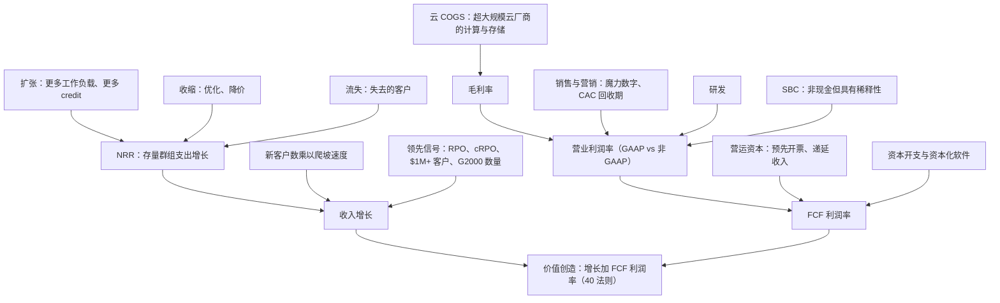

# 36. 单位经济与 KPI
> **深度：** L2 · **阅读时间：** 约 14 分钟 · **最后核实：** 2026-11-01 · **前置阅读：** [第 35 章 商业模式](ch35-business-models.md)

## 要点速览（TL;DR）

- **解读数据平台的损益表大约要看十个 KPI，其中大多数由公司自行定义、未经审计且不可直接比较。** Snowflake 的净收入留存率（NRR）和 MongoDB 的"净 ARR 扩张率（net ARR expansion rate）"回答的都是"去年的客户今年多花了多少？"，但它们使用不同的客户群组、不同的单位和不同的时间窗口。比较两个数字之前，务必先读 10-K 中的定义。
- **在按用量计费（consumption）模式下，NRR 是增长方程中的主导项。** Snowflake 的 NRR 从 178%（FY2022）降至 126%（FY2025），产品收入增速也随之下滑。此后 NRR 稳定在 125–126%，而 Q2 FY2027（2026 年 5–7 月）产品收入增速重新加速至 37%（GAAP）。[^sf-q2][^fin-csv]
- **剩余履约义务（RPO）是已签约的积压订单，而不是收入预测。** 在截至 2026 年 7 月的两个季度里，Snowflake 的 RPO 从 $9.77B *降至*约 $9.0B，而同期收入在加速。客户消耗预付容量的速度快于签订新承诺的速度。[^fin-csv][^sf-10q]
- **对大多数软件公司而言，GAAP 与非 GAAP 之间的差距才是真正的看点。** Q2 FY2027，Snowflake 的 GAAP 营业利润率为 −17.0%，非 GAAP 营业利润率为 +15.3%。这 32 个百分点的差距主要来自约 $424M 的股权激励费用（SBC），约占收入的 27%（媒体报道）。MongoDB 的差距约为 20 个百分点，Everpure 约为 14 个百分点。[^sf-q2][^secapi][^mdb-q2][^ep-q2]
- **40 法则（Rule of 40）是一族公式，而非单一数字。** 对 Snowflake 而言，根据所用的利润率口径和期间，得分从约 18（Q2 FY2027 增速加 GAAP 营业利润率）、约 20（FY2026，扣除 SBC 后的 FCF）、约 41（季度调整后 FCF）到约 58（FY2027 调整后 FCF 指引）不等（作者计算）。经 SBC 调整的版本是 CFA 式的保守解读。按此口径，鲜有高增长数据公司能超过 40。

## 为何重要（商业 + Everpure 视角）

企业发展团队用这些 KPI 为并购标的、合作伙伴和竞争对手定价。每一个 KPI 都是对未来的一个浓缩判断。NRR 表明存量客户将持续增加支出。RPO 表明其中部分支出已有合同约束。毛利率表明每一美元在付完超大规模云厂商的账单后还剩多少。魔力数字（magic number）表明新增收入是以多高的效率"买来"的。误读一个定义，就会给交易定错价。典型的错误是把两年滚动群组口径的 NRR 与基于 ARR 的扩张率相比较，或把 GAAP 与非 GAAP 利润率相比较。

对 Everpure 而言，这一视角有两面。**由外向内：**本书中的每一个数据平台合作伙伴或标的（Snowflake、Databricks、MongoDB 以及[第 32 章](../04-company-deep-dives/ch32-ai-native-data-companies.md)中的 AI 原生厂商）都用这套语言披露业绩。**由内向外：**Everpure 已经披露一组混合 KPI：截至 Q2 FY2027（截至 2026-08-02 的季度），产品收入、订阅服务收入、订阅年度经常性收入（ARR）$2.1B（+20%）以及 RPO $4.1B（+44%）。[^ep-q2] 如果公司进一步进入数据管理和数据服务领域，市场将开始要求下文所述的软件 KPI，并以此评判 Everpure。"工作原理"的最后一节说明了会有哪些变化。

## 工作原理

### KPI 树

本章的每个指标都会影响两个结果之一：收入增长有多快，以及多少收入转化为自由现金流（FCF）。下面的树状图就是地图，本章其余部分从左到右逐一走过。

*图 36.1 — KPI 树。收入增长 = NRR 加新客户贡献。FCF 利润率 = 经营运资本和资本开支调整后的营业利润率。SBC 在 GAAP 下计入营业费用，但在非 GAAP 下被剔除，这就是两种利润率出现背离的原因。*

### 净收入留存率：一个数字浓缩的群组分析

[净收入留存率（net revenue retention）](../glossary.md#net-revenue-retention)（NRR，也称净美元留存率或 NDR）选取一组固定的客户，用他们当前的支出除以一年前的支出。流失的客户按原支出留在分母中，在分子中计为零。新客户不计入。NRR 为 126% 意味着该群组在扣除扩张、收缩和流失之后，*净*多花了 26%。

各家定义的差异至关重要：

- **Snowflake** 使用两年滚动窗口。群组为在第一年*第一个月*内任意时点使用过平台的容量合同客户。NRR 等于该群组第二年的产品收入除以第一年的产品收入。实际上，它比较的是两个连续的 12 个月滚动产品收入窗口。近年的 10-K 说明，该群组包括通过经销商购买的最终客户，历史数据已针对收购和分拆进行调整。[^sf-10k26][^sf-10k21] 由于它是两个 12 个月总和之比，因此平滑且转向缓慢。
- **MongoDB** 披露"净 ARR 扩张率"。它用一年前已是客户的客户当前 ARR，除以一年前*全部*客户（包括已流失客户）的 ARR。截至 2026 年 1 月 31 日约为 121%，高于一年前的约 119%。MongoDB 常在业绩电话会上对其作宽泛描述（例如"高于 120%"）或给出近似值，而不是在固定的季度表格中披露。[^mdb-10k] 它是一个 ARR 时点快照，而非收入流量，Atlas 的消耗需经年化处理才能得出。

**总收入留存率（gross revenue retention，GRR）**剔除了扩张：（上年支出 − 收缩 − 流失）÷ 上年支出，上限为 100%。它衡量的是底线，即在没有任何客户增长时存量客户群的黏性。在本章查阅的新闻稿中，Snowflake 和 MongoDB 都没有披露数值化的总留存率。尽职调查时应主动索要。一个示意性的例子（作者数字，非公司数据）：一个支出 $100M 的群组增长到 $126M，其中扩张增加 $32M、收缩减少 $4M、流失减少 $2M。NRR 为 126%，GRR 为 94%。NRR 相同的两家公司，GRR 可能差异很大；GRR 较低的那家依赖少数大客户足够快地扩张，以弥补漏损。

> **类比：同店销售与群组收益率。** NRR 就是软件公司的同店销售（comps）：它反映一年前已存在门店的增长，忽略新开门店。固定收益分析师会把它看作一个成熟资产池（seasoned pool）。GRR 是存续曲线（1 减去提前还款和违约），扩张则是票息上调。零售商可以靠新店实现强劲的总增长，而同店销售转负；SaaS 公司也可以靠新客户做到这一点，而 NRR 在侵蚀。同店销售告诉你存量业务是否健康。

**为什么在按用量计费模式下 NRR 领先于收入增长。** Snowflake 只在客户消耗 credit 时确认产品收入，因此去年的客户贡献了今年大部分收入。新客户起步小，需要数个季度爬坡。近似地，产品收入增速 ≈（NRR − 1）×（群组贡献的收入占比）+ 群组以外客户的贡献。NRR 为 126% 且群组贡献大部分收入时，仅存量客户就带来约 20–26 个百分点的增长。Q2 FY2027 37% 的产品收入增速中，剩余约 11 个百分点或更多来自新客户的爬坡（作者近似估算；由于 NRR 为 12 个月滚动口径、增速为季度同比口径，两者窗口不同）。[^sf-q2] 由于群组支出具有持续性，稳定或上升的 NRR 为下一年的增长设定了底线。NRR 下降是增长底线正在下移的最早的硬证据。

*图 36.2 — Snowflake NRR（公司披露 KPI）。2022–2024 年 NRR 从 178% 滑落至 131%，同期增速从 106% 降至 38%。NRR 在 125–126% 企稳，恰逢增速稳定在 29% 左右，随后在 Q2 FY2027 重新加速至 37%。来源：`data/company_financials.csv`。*

应将这张图作为一个群组故事来解读。产品收入增速在 FY2022（2021 年 2 月–2022 年 1 月）为 106%，FY2024 为 38%，FY2025 和 FY2026 分别为 30% 和 29%（GAAP；作者依据 CSV 计算）。[^fin-csv] 下行阶段 NRR 与增速同步，因为客户在 2021 年的繁荣后优化了消耗。回升阶段两者的关系变松了：Q1 和 Q2 FY2027 增速分别重新加速至 34% 和 37%，而 NRR 持平于 126%。[^fin-csv] 由于 NRR 是两个窗口的滚动比率，它对季度拐点的反应滞后数个季度。因此，分析师会把 NRR 的环比趋势与 $1M+ 客户数一起作为确认信号。

### RPO 与 cRPO：已签约积压

[剩余履约义务（remaining performance obligations）](../glossary.md#remaining-performance-obligations)（RPO）是已签约但尚未确认的收入金额，按照 ASC 606 在每份 10-Q 的收入附注中披露。当期 RPO（cRPO）是预计在十二个月内确认的部分。截至 2026 年 7 月 31 日，Snowflake 的 RPO 约为 $9.0B，同比 +30%。Snowflake 预计其中约 54%，即约 $4.9B（作者计算），将在未来十二个月内确认。公司提示，确认时点取决于客户消耗，且未使用的容量有时可结转至合同期限之后。[^sf-10q]

RPO 增速可能高于收入，原因很简单：多年期容量交易在签约时就把全部承诺额计入 RPO，而收入只在客户消耗时才到来。一笔三年期、$300M 的承诺在一个季度内为 RPO 增加 $300M，而每年为收入增加的或许只有 $100M。极端案例是 Oracle。凭借 AI 基础设施合同，其 RPO 在 Q1 FY2027（2026 年 6–8 月）达到 $664B，而 FY2027 收入指引至少为 $90B。[^comps] 反向情况也会发生。Snowflake 的 RPO 在 2026 年 1 月 31 日达到 $9.77B 的峰值（包括公司历史上最大的一笔交易），随后两个季度降至 $9.21B 和约 $9.0B，而同期收入在加速。[^fin-csv] 客户消耗预付容量的速度快于补充速度。这对近期收入是利好，对积压覆盖度则是中性偏谨慎。

*图 36.3 — Snowflake RPO（GAAP 披露）。五年间积压增长约七倍，但呈波动性。一笔大额多年期交易对它的影响就可能超过一个季度的收入，因此应看四个季度的趋势，而不是季度环比变化。来源：`data/company_financials.csv`。*

> **类比：半导体积压订单与订单出货比。** RPO 就是芯片厂商的积压订单，只是规则更严格：ASC 606 只计入可执行的合同，而半导体积压订单常包含可取消订单。cRPO ÷ 未来十二个月收入的作用类似订单出货比（book-to-bill）覆盖度。Snowflake 的 cRPO（约 $4.9B）约覆盖 FY2027 产品收入指引（$6.07B）的 80%（作者估算），而对真正的未来十二个月收入覆盖更少，因为截至 2026 年 7 月 31 日，FY2027 已有一半收入确认完毕；其余部分必须来自按需使用和新承诺。RPO 下降而收入上升，相当于出货火爆时订单出货比低于 1。持续一两个季度无妨，若持续下去则是警示信号。

### 开票额，以及按用量计费公司为何淡化它

开票额（billings）等于收入加递延收入的变动，即当期开出的发票金额。对按席位计费的 SaaS 以及销售多年期支持服务的硬件厂商而言，开票额是订单额的合理代理指标。NetApp 仍以此为首要指标：Q1 FY2027（2026 年 5–7 月）开票额为 $2.06B，+36%（由 GAAP 数据推算）。[^ntap] 按用量计费的公司则淡化开票额。Snowflake 对容量合同开票，通常每年预先开票，因此开票额随合同期限和开票时点波动，而收入跟随用量。一位签订更大三年期交易但按年开票的客户，开票额变化不大。一位一次性预付两年的客户则制造了一个尖峰，却丝毫不反映消耗情况。对 Snowflake 而言，RPO 和 NRR 承载了订阅公司中开票额所承载的信息。

### 毛利率与云 COGS

云数据平台的收入成本主要是超大规模云厂商的账单：为运行客户查询而向 AWS、Azure 和 Google Cloud 购买的虚拟机、对象存储和网络出口流量，外加支持人员和资本化软件的摊销。Snowflake 将产品毛利率与总毛利率分开披露。Q2 FY2027，产品毛利率 GAAP 为 70.9%、非 GAAP 为 74.7%（差额为收入成本中的 SBC 和摊销）。由于 AI 工作负载的计算成本更高，全年非 GAAP 指引被下调至 74%。[^sf-q2][^fin-csv] 同一季度，MongoDB 的总毛利率 GAAP 为 74%、非 GAAP 为 76%。该数字混合了承担云 COGS、毛利率较低的 Atlas，与高毛利的自管许可证 Enterprise Advanced 以及服务。[^mdb-q2] 随着 Atlas 增至约占收入的 73%（FY2026），收入结构向低毛利产品倾斜。[^fin-csv]

[第 35 章](ch35-business-models.md)和[第 25 章](../04-company-deep-dives/ch25-databricks.md)所述的无服务器效应也朝同一方向推动。当厂商在自己的云账户中运行计算时，全部虚拟机成本转入其 COGS。单位收入上升，毛利率百分比下降，而毛利额仍可能上升。应以毛利额而非毛利率百分点来评判这一取舍。

> **类比：云 COGS 就是无晶圆厂公司的晶圆成本。** Snowflake 向超大规模云厂商购买算力，就像 NVIDIA 向 TSMC 购买晶圆。毛利率是相对于一项公司无法控制的成本的溢价。有三个杠杆：对投入品的议价能力（多年期承诺消费额度折扣相当于云时代的晶圆产能分配协议）、架构效率（更好的查询引擎如同更高的单片晶圆良率），以及产品结构（AI 推理工作负载类似先进制程、低良率的产品）。一家代工厂同时也是其竞争对手的无晶圆厂公司，存在明显的张力。一个其超大规模云厂商同时销售竞品数据仓库的数据平台，也是如此。

### 销售与营销效率：魔力数字与 CAC 回收期

**[魔力数字（magic number）](../glossary.md#magic-number)** 回答的是每一美元销售与营销（S&M）支出买来了多少新增年化收入。该术语于 2005 年由后来的 Scale Venture Partners 提出，季度公式自 2008 年起流行开来。[^scale] 一个常见版本是（本季度收入 − 上季度收入）× 4 ÷ 上季度 S&M。高于约 1.0 为高效，约 0.7 是通常的"健康"门槛。[^scale] **[CAC 回收期（CAC payback）](../glossary.md#cac-payback)** 将同样的输入换算成月数：12 ÷（魔力数字 × 毛利率）。它回答的是新增收入带来的毛利需要多长时间才能收回获客支出。

要从 10-Q 计算这两个指标，从利润表中取连续两个季度的总收入，从营业费用项中取 S&M（GAAP 口径，因此包含 SBC 和收购无形资产摊销），并从同一报表中取毛利率。下面的算例正是这样做的。主要有两个陷阱。第一，按用量计费的收入对天数敏感：Snowflake 的 Q1（2–4 月）有 89 天，Q2（5–7 月）有 92 天，这会美化环比魔力数字。第二，GAAP S&M 项包含非现金的 SBC，而许多卖方模型使用非 GAAP S&M，因此得出的数字更高。

### SBC 与稀释

[股权激励费用（stock-based compensation）](../glossary.md#stock-based-compensation)是以股票形式支付的员工薪酬。它在 GAAP 下计为费用，但在非 GAAP 营业利润和经营现金流中被加回。Snowflake FY2026 的 SBC 为 $1,599.5M，占收入 34%，低于 FY2025 的 $1,479.3M（41%）（GAAP；百分比为作者计算）。[^sf-10k26][^fin-csv] Q2 FY2027 约为 $424M，占收入 27.4%（媒体报道，引自 10-Q）。[^secapi]

CFA 的观点是：SBC 是真实的费用。用股票而非现金支付工程师，并不会让劳动变成免费的，它只是把成本从利润表转移到了股本数量上。有两项交叉核对能让分析保持诚实。(1) **稀释：**将稀释后股数增长与回购进行比较。Snowflake 在 FY2026 以平均 $177.37 回购约 4.9M 股，约 $874M（作者计算），约为当年 SBC 费用的 55%；在 FY2027 上半年以约 $300M 回购约 1.7M 股。[^sf-10k26][^sf-10q] (2) **现金成本：**抵消稀释的回购就是 SBC 的现金成本。它们体现在筹资现金流中，位于 FCF 线以下，因此"FCF 减回购"或"FCF 减 SBC"是更干净的股东盈余（owner earnings）衡量。

> **类比：SBC 与研发资本化之争。** 半导体分析师争论研发是否应资本化，因为它构建的是多年期资产。SBC 引出了镜像问题：它是一项以股权而非现金支付的经营成本。把 SBC 加回，就像把研发资本化后却从不摊销。投入照样被消耗掉，只是用别人的所有权来支付。

### 40 法则、FCF 利润率与客户数

**[40 法则（Rule of 40）](../glossary.md#rule-of-40)** 认为收入增速加利润率应超过 40%。它由 Brad Feld 于 2015 年 2 月针对规模化 SaaS 公司推广开来。[^feld] 变体比法则本身更重要。增速可以是总收入或产品收入，季度或年度。利润率可以是 FCF、调整后 FCF、非 GAAP 营业利润率、GAAP 营业利润率或 EBITDA。Palantir 每季度公布一个公司自定义的得分：Q2 2026 为 155%，基于 93% 的增速和 63% 的调整后 FCF 利润率。[^pltr] ServiceNow 以固定汇率订阅收入增速和 FCF 利润率披露一个"Rule of"数字。[^now]

**FCF 利润率** =（经营现金流 − 资本开支）÷ 收入。公司随后会对其进行"调整"。Snowflake 的调整后 FCF 加回了与员工股票交易相关的工资税项目的净现金支出。其他公司则加回重组或收购成本。每年预先开票使 FCF 在季度间波动：Snowflake Q2 FY2027 调整后 FCF 利润率为 6.0%，Q4 FY2026 为 61%，FY2026 全年为 25.5%（非 GAAP）。[^fin-csv] 做任何 40 法则分析时，都应使用 12 个月滚动或全年数据。

*图 36.4 — 可比公司的 40 法则（最近一季增速，GAAP；FCF 利润率为非 GAAP，口径以标记形状区分）。按调整后 FCF 口径，大多数数据与基础设施公司现已超过 40。若换用季度 FCF 利润率（Snowflake 降至约 41）或扣除 SBC，排名会改变。来源：`data/ch36_rule_of_40.csv`；Everpure 的 FCF 利润率为依据指引中值的估算。*

**客户数**是最后一个领先指标。Snowflake 披露 12 个月滚动产品收入超过 $1M 的客户数：Q2 FY2027 为 828 家（+27%），而 FY2021 为 77 家。它还披露福布斯全球 2000 强（Forbes Global 2000）客户数：829 家，约占名单的 41%（作者计算）。[^sf-q2][^fin-csv][^pulse] MongoDB 披露总客户数（70,600+）和 ARR 超过 $100K 的客户数（2,999）。[^mdb-q2] 大客户数比总数更重要。在按用量计费模式下，大客户支撑着 NRR，因此 $1M+ 客户新增放缓往往先于 NRR 变化出现。

### 算例：解读 Snowflake 的 Q2 FY2027（2026 年 5–7 月）

FY2027 = 2026 年 2 月–2027 年 1 月。所有金额单位均为百万美元（US$M）。媒体报道的摘要引用了约 $263M 的 GAAP 营业亏损，与公司 −17.0% 的 GAAP 营业利润率完全吻合。

| # | 新闻稿 / 10-Q 中的项目 | 公式 | 数值 | 标签 |
|---|---|---|---|---|
| 1 | 产品收入 | 报告值 | 约 $1,490（同比 +37%） | GAAP |
| 2 | 总收入，Q2 FY2027 | 报告值 | $1,546.8（+35%，对比 $1,145.0） | GAAP |
| 3 | 总收入，Q1 FY2027 | 报告值 | 约 $1,390 | GAAP（取整） |
| 4 | S&M 费用，Q2 FY2027 | 10-Q 利润表 | $611.6（+22%，对比 $502.0） | GAAP |
| 5 | S&M 费用，Q1 FY2027 | 六个月 S&M（约 $1,200）− 第 4 行 | 约 $590 | 估算（推导） [VERIFY] |
| 6 | 魔力数字（环比） | （第 2 行 − 第 3 行）× 4 ÷ 第 5 行 | (156.8 × 4) ÷ 590 ≈ **1.06** | 估算 |
| 7 | 魔力数字，天数调整后 | 将 Q2 收入按 Q1 的 89 天折算：1,546.8 × 89/92 = 1,496.4；(1,496.4 − 1,390) × 4 ÷ 590 | ≈ **0.72** | 估算 |
| 8 | CAC 回收期 | 12 ÷（第 6 行 × GAAP 产品毛利率 70.9%） | ≈ **16 个月**（天数调整后 ≈ 24） | 估算 |
| 9 | S&M 占收入百分比 | 第 4 行 ÷ 第 2 行 | 39.5%（一年前为 43.8%） | GAAP |
| 10 | SBC | 现金流量表 | 约 $424 | GAAP，媒体报道 |
| 11 | SBC 占收入百分比 | 第 10 行 ÷ 第 2 行 | **27.4%** | GAAP，媒体报道 |
| 12 | GAAP 营业利润 | 报告值 | 约 −$263（−17.0%） | GAAP |
| 13 | 其他非 GAAP 加回项 | 第 14 行 − 第 12 行 − 第 10 行 | 约 $76（4.9 个百分点） | 推导；收购无形资产摊销、股权相关工资税及其他 [VERIFY 拆分] |
| 14 | 非 GAAP 营业利润 | 报告值 | 约 $237（15.3%） | 非 GAAP |
| 15 | 调整后 FCF | 报告值 | $92.3（6.0%） | 非 GAAP |
| 16 | 40 法则（季度） | 总收入增速 35 + 调整后 FCF 利润率 6.0 | **41** | 混合：GAAP 增速，非 GAAP FCF |
| 17 | 40 法则（指引） | 35 + FY2027 调整后 FCF 利润率指引 23 | **58** | 依据公司指引推导 |
| 18 | 40 法则（扣除 SBC，FY2026） | FY2026 增速 29.2 +（调整后 FCF $1,192.7 − SBC $1,599.5）÷ $4,683.9 | 29.2 − 8.7 ≈ **20** | 估算 |

*图 36.5 — 10-Q 算例。来源：Snowflake Q2 FY2027 新闻稿及 10-Q；Q1 FY2027 新闻稿；FY2026 10-K；SBC 数据来自 sec-api.io。[^sf-q2][^sf-10q][^sf-q1][^sf-10k26][^secapi] 利润率桥接为 −17.0% + 27.4（SBC）+ 4.9（其他）= 15.3%。仅天数调整一项就抹去了表观 S&M 效率的约三分之一。*

解读结论：Snowflake 获取增长的效率高于一年前。S&M 增长 22%，而收入增长 35%，因此 S&M 占收入比重从 43.8% 降至 39.5%。按日历调整后，约 0.7 的魔力数字属于健康而非惊艳。SBC 占收入比重已从约 41% 降至约 27%，但它仍是 GAAP 亏损与非 GAAP 盈利之间差距的主要来源。按公司定义，合理的 40 法则区间约为 41–58；若将 SBC 视同现金，则约为 20。

### 一张表看 MongoDB，以及与 Everpure 的对比

| Q2 FY2027（2026 年 5–7 月）* | Snowflake | MongoDB | Everpure（原 Pure Storage） |
|---|---|---|---|
| 收入（GAAP） | $1,546.8M，+35% | $771.8M，+30% | 约 $1,186M（产品 $687M + 订阅服务 $499M），+38% |
| 毛利率 | 产品 GAAP 70.9% / 非 GAAP 74.7% | GAAP 74% / 非 GAAP 76%（总计） | GAAP 68.4% / 非 GAAP 69.9%（总计） |
| GAAP 营业利润率 | −17.0%（约 −$263M） | 3.7%（$28.4M） | 5.3%（$63M；作者计算） |
| 非 GAAP 营业利润率 | 15.3% | 24%（$185.9M） | 19.4% |
| GAAP 与非 GAAP 差距 | 约 32 个百分点 | 约 20 个百分点 | 约 14 个百分点 |
| 当季 FCF（非 GAAP） | 调整后 $92.3M（6.0%） | $137.6M（17.8%） | −$238M（FY2027 指引 $600–800M） |
| 留存 / 经常性 KPI | NRR 126% | 净 ARR 扩张率约 121%（2026 年 1 月 31 日，10-K；Q2 FY2027 约 122%，媒体报道） | 订阅 ARR $2.1B，+20% |
| 积压 | RPO 约 $9.0B，+30% | 未作为主要 KPI | RPO $4.1B，+44% |
| 大客户 KPI | 12 个月滚动收入 >$1M 客户 828 家；G2000 客户 829 家 | ARR ≥$100K 客户 2,999 家 | 未作为主要 KPI 披露 |
| 40 法则（作者计算） | 41（季度）/ 58（指引） | 约 48（季度） | 约 52（基于指引的估算） |

*图 36.6 — 三家公司损益表并列。\*Everpure 的季度截至 2026-08-02。Snowflake 和 MongoDB 承担云 COGS，且 SBC 差距较大。Everpure 承担硬件 COGS，SBC 差距较小，营运资本随库存波动。来源：公司新闻稿。[^sf-q2][^mdb-q2][^mdb-10k][^ep-q2]*

MongoDB 的这一季度展示了一个更成熟的按用量计费数据库的样貌。增速略低于 Snowflake，GAAP 与非 GAAP 差距更窄，且公司已实现 GAAP 盈利。自由现金流较一年前的 $69.9M 几乎翻倍。[^mdb-q2] 其留存 KPI 基于 ARR 且披露频率较低，因此无法依据公开数据与 Snowflake 进行同口径 NRR 比较。

**Everpure 视角：存储公司增加软件和数据服务后会有什么变化。** 存储公司的损益表建立在发货时确认的产品收入、随元器件（NAND）成本和产品结构变动的毛利率，以及随库存和递延收入波动的 FCF 之上。订阅业务（Evergreen 与存储即服务）已表现得像软件：经常性、以 ARR 计量，且毛利率高于产品。在过去的季度中，Everpure 的非 GAAP 订阅服务毛利率在 75% 上下，而产品为 68%–69% 左右（媒体报道）。[^ep-seg] 基于公开信息，战略团队可能评估，增加数据管理或数据智能服务将从四个方面改变 KPI 组合。(1) 投资者会要求单独披露软件或数据服务 ARR，以及该业务线的留存率（NRR 和 GRR），仅有 Subscription ARR 是不够的。(2) 若软件为自管部署，毛利率会上升；若以承担云 COGS 的托管服务形式运行，则会下降，这与上文所述的无服务器取舍相同。(3) S&M 效率需要单独衡量，因为向数据团队销售软件与向基础设施采购方销售阵列是不同的销售模式。(4) SBC 占收入的比重很可能上升，因为软件人才市场以股权支付薪酬，这会扩大 GAAP 与非 GAAP 的差距。目前 Everpure 约 14 个百分点的差距，窄于 Snowflake 的约 32 和 MongoDB 的约 20。

> **存储桥接。** 存储厂商的订阅 ARR 与数据平台的 NRR 衡量的是不同的东西：ARR 是某一时点的年化合同价值，NRR 是一个固定群组支出的增长。Everpure 不公布 NRR。与之最接近的类比是订阅 ARR 增速（+20%）和 RPO 增速（+44%）。[^ep-q2] Evergreen 订阅的结构请参见配套的 *Everpure Tech Atlas*。

### KPI 速查卡

| KPI | 定义 | 公式 | 披露位置 | 陷阱 |
|---|---|---|---|---|
| NRR / NDR | 固定上年群组的支出增长 | 群组支出（第 2 年）÷ 群组支出（第 1 年） | 10-K"关键业务指标"、业绩新闻稿 | 各公司群组和窗口不同；滚动比率滞后；未经审计 |
| 净 ARR 扩张率（MongoDB） | 基于 ARR 的 NRR | 一年前客户的当前 ARR ÷ 一年前全部客户的 ARR | 10-K、不定期电话会评论 | 按用量计费的 ARR 是年化值；披露不规律 |
| 总收入留存率 | 不含扩张的 NRR | （上期支出 − 收缩 − 流失）÷ 上期支出 | 很少披露 | 被强劲的 NRR 掩盖；尽职调查时索要 |
| RPO | 已签约、未确认的收入 | 未履行履约义务之和 | 10-Q/10-K 收入附注（ASC 606） | 随大额交易波动；容量交易的确认时点取决于消耗 |
| cRPO | 12 个月内到期的 RPO | RPO × 预计 12 个月内确认的比例 | 10-Q 附注、部分新闻稿 | 基于历史消耗的估算；应与未来 12 个月收入比较，而非与 RPO 比较 |
| 开票额 | 开票金额 | 收入 + 递延收入变动 | 由报表推导；部分新闻稿 | 受开票时点和期限扭曲；对按用量计费模式用处较小 |
| 产品毛利率 | 核心平台的毛利率 | （产品收入 − 产品 COGS）÷ 产品收入 | 利润表、新闻稿 | GAAP vs 非 GAAP（SBC、摊销）；AI 和无服务器结构稀释 |
| 魔力数字 | S&M 效率 | 季度收入变动 × 4 ÷ 上季度 S&M | 由 10-Q 推导 | 天数；GAAP vs 非 GAAP S&M；单季度噪声大 |
| CAC 回收期 | 收回获客成本所需月数 | 12 ÷（魔力数字 × 毛利率） | 推导 | 继承魔力数字的全部噪声；忽略流失 |
| SBC 占收入百分比 | 以股权支付的成本强度 | SBC ÷ 收入 | 现金流量表、新闻稿调节表 | 被排除在非 GAAP 之外；需核查回购和稀释后股数增长 |
| GAAP vs 非 GAAP 营业利润率 | 含与不含 SBC 及其他项目的盈利能力 | 非 GAAP 加回 SBC、摊销及其他 | 新闻稿调节表 | 差距大小才是真正的信号；"其他"项目会逐渐膨胀 |
| FCF 利润率 / 调整后 FCF | 现金创造能力 | （经营现金流 − 资本开支 [− 资本化软件]）÷ 收入 | 新闻稿调节表 | 季度间有季节性；"调整后"定义各异；不含 SBC 成本 |
| 40 法则 | 增长与盈利的平衡 | 增速 % + 利润率 % | 部分公司自行披露 | 混用口径；季度 FCF；忽略 SBC |
| $1M+ 客户 / G2000 | 大客户渗透率 | 超过门槛的客户数（12 个月滚动收入） | 新闻稿、10-K | 门槛不同（$1M 12 个月滚动收入 vs $100K ARR） |

*图 36.7 — KPI 定义。"披露位置"一栏表明哪些数字经过审计（报表项目），哪些是公司自定义指标。SEC 2020 年的指引要求每个此类指标都有清晰的定义和一致的计算方法。[^sec-kpi]*
