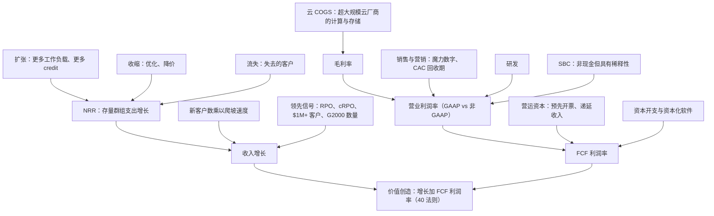

# 36. 单位经济与 KPI
> **深度：** L2 · **阅读时间：** 约 14 分钟 · **最后核实：** 2026-11-01 · **前置阅读：** [第 35 章 商业模式](ch35-business-models.md)

## 要点速览（TL;DR）

- **解读数据平台的损益表大约要看十个 KPI，其中大多数由公司自行定义、未经审计且不可直接比较。** Snowflake 的净收入留存率（NRR）和 MongoDB 的"净 ARR 扩张率（net ARR expansion rate）"回答的都是"去年的客户今年多花了多少？"，但它们使用不同的客户群组、不同的单位和不同的时间窗口。比较两个数字之前，务必先读 10-K 中的定义。
- **在按用量计费（consumption）模式下，NRR 是增长方程中的主导项。** Snowflake 的 NRR 从 178%（FY2022）降至 126%（FY2025），产品收入增速也随之下滑。此后 NRR 稳定在 125–126%，而 Q2 FY2027（2026 年 5–7 月）产品收入增速重新加速至 37%（GAAP）。[^sf-q2][^fin-csv]
- **剩余履约义务（RPO）是已签约的积压订单，而不是收入预测。** 在截至 2026 年 7 月的两个季度里，Snowflake 的 RPO 从 $9.77B *降至*约 $9.0B，而同期收入在加速。客户消耗预付容量的速度快于签订新承诺的速度。[^fin-csv][^sf-10q]
- **对大多数软件公司而言，GAAP 与非 GAAP 之间的差距才是真正的看点。** Q2 FY2027，Snowflake 的 GAAP 营业利润率为 −17.0%，非 GAAP 营业利润率为 +15.3%。这 32 个百分点的差距主要来自约 $424M 的股权激励费用（SBC），约占收入的 27%（媒体报道）。MongoDB 的差距约为 20 个百分点，Everpure 约为 14 个百分点。[^sf-q2][^secapi][^mdb-q2][^ep-q2]
- **40 法则（Rule of 40）是一族公式，而非单一数字。** 对 Snowflake 而言，根据所用的利润率口径和期间，得分从约 18（Q2 FY2027 增速加 GAAP 营业利润率）、约 20（FY2026，扣除 SBC 后的 FCF）、约 41（季度调整后 FCF）到约 58（FY2027 调整后 FCF 指引）不等（作者计算）。经 SBC 调整的版本是 CFA 式的保守解读。按此口径，鲜有高增长数据公司能超过 40。

## 为何重要（商业 + Everpure 视角）

企业发展团队用这些 KPI 为并购标的、合作伙伴和竞争对手定价。每一个 KPI 都是对未来的一个浓缩判断。NRR 表明存量客户将持续增加支出。RPO 表明其中部分支出已有合同约束。毛利率表明每一美元在付完超大规模云厂商的账单后还剩多少。魔力数字（magic number）表明新增收入是以多高的效率"买来"的。误读一个定义，就会给交易定错价。典型的错误是把两年滚动群组口径的 NRR 与基于 ARR 的扩张率相比较，或把 GAAP 与非 GAAP 利润率相比较。

对 Everpure 而言，这一视角有两面。**由外向内：**本书中的每一个数据平台合作伙伴或标的（Snowflake、Databricks、MongoDB 以及[第 32 章](../04-company-deep-dives/ch32-ai-native-data-companies.md)中的 AI 原生厂商）都用这套语言披露业绩。**由内向外：**Everpure 已经披露一组混合 KPI：截至 Q2 FY2027（截至 2026-08-02 的季度），产品收入、订阅服务收入、订阅年度经常性收入（ARR）$2.1B（+20%）以及 RPO $4.1B（+44%）。[^ep-q2] 如果公司进一步进入数据管理和数据服务领域，市场将开始要求下文所述的软件 KPI，并以此评判 Everpure。"工作原理"的最后一节说明了会有哪些变化。

## 工作原理

### KPI 树

本章的每个指标都会影响两个结果之一：收入增长有多快，以及多少收入转化为自由现金流（FCF）。下面的树状图就是地图，本章其余部分从左到右逐一走过。

*图 36.1 — KPI 树。收入增长 = NRR 加新客户贡献。FCF 利润率 = 经营运资本和资本开支调整后的营业利润率。SBC 在 GAAP 下计入营业费用，但在非 GAAP 下被剔除，这就是两种利润率出现背离的原因。*

### 净收入留存率：一个数字浓缩的群组分析

[净收入留存率（net revenue retention）](../glossary.md#net-revenue-retention)（NRR，也称净美元留存率或 NDR）选取一组固定的客户，用他们当前的支出除以一年前的支出。流失的客户按原支出留在分母中，在分子中计为零。新客户不计入。NRR 为 126% 意味着该群组在扣除扩张、收缩和流失之后，*净*多花了 26%。

各家定义的差异至关重要：

- **Snowflake** 使用两年滚动窗口。群组为在第一年*第一个月*内任意时点使用过平台的容量合同客户。NRR 等于该群组第二年的产品收入除以第一年的产品收入。实际上，它比较的是两个连续的 12 个月滚动产品收入窗口。近年的 10-K 说明，该群组包括通过经销商购买的最终客户，历史数据已针对收购和分拆进行调整。[^sf-10k26][^sf-10k21] 由于它是两个 12 个月总和之比，因此平滑且转向缓慢。
- **MongoDB** 披露"净 ARR 扩张率"。它用一年前已是客户的客户当前 ARR，除以一年前*全部*客户（包括已流失客户）的 ARR。截至 2026 年 1 月 31 日约为 121%，高于一年前的约 119%。MongoDB 常在业绩电话会上对其作宽泛描述（例如"高于 120%"）或给出近似值，而不是在固定的季度表格中披露。[^mdb-10k] 它是一个 ARR 时点快照，而非收入流量，Atlas 的消耗需经年化处理才能得出。

**总收入留存率（gross revenue retention，GRR）**剔除了扩张：（上年支出 − 收缩 − 流失）÷ 上年支出，上限为 100%。它衡量的是底线，即在没有任何客户增长时存量客户群的黏性。在本章查阅的新闻稿中，Snowflake 和 MongoDB 都没有披露数值化的总留存率。尽职调查时应主动索要。一个示意性的例子（作者数字，非公司数据）：一个支出 $100M 的群组增长到 $126M，其中扩张增加 $32M、收缩减少 $4M、流失减少 $2M。NRR 为 126%，GRR 为 94%。NRR 相同的两家公司，GRR 可能差异很大；GRR 较低的那家依赖少数大客户足够快地扩张，以弥补漏损。

> **类比：同店销售与群组收益率。** NRR 就是软件公司的同店销售（comps）：它反映一年前已存在门店的增长，忽略新开门店。固定收益分析师会把它看作一个成熟资产池（seasoned pool）。GRR 是存续曲线（1 减去提前还款和违约），扩张则是票息上调。零售商可以靠新店实现强劲的总增长，而同店销售转负；SaaS 公司也可以靠新客户做到这一点，而 NRR 在侵蚀。同店销售告诉你存量业务是否健康。

**为什么在按用量计费模式下 NRR 领先于收入增长。** Snowflake 只在客户消耗 credit 时确认产品收入，因此去年的客户贡献了今年大部分收入。新客户起步小，需要数个季度爬坡。近似地，产品收入增速 ≈（NRR − 1）×（群组贡献的收入占比）+ 群组以外客户的贡献。NRR 为 126% 且群组贡献大部分收入时，仅存量客户就带来约 20–26 个百分点的增长。Q2 FY2027 37% 的产品收入增速中，剩余约 11 个百分点或更多来自新客户的爬坡（作者近似估算；由于 NRR 为 12 个月滚动口径、增速为季度同比口径，两者窗口不同）。[^sf-q2] 由于群组支出具有持续性，稳定或上升的 NRR 为下一年的增长设定了底线。NRR 下降是增长底线正在下移的最早的硬证据。

*图 36.2 — Snowflake NRR（公司披露 KPI）。2022–2024 年 NRR 从 178% 滑落至 131%，同期增速从 106% 降至 38%。NRR 在 125–126% 企稳，恰逢增速稳定在 29% 左右，随后在 Q2 FY2027 重新加速至 37%。来源：`data/company_financials.csv`。*

应将这张图作为一个群组故事来解读。产品收入增速在 FY2022（2021 年 2 月–2022 年 1 月）为 106%，FY2024 为 38%，FY2025 和 FY2026 分别为 30% 和 29%（GAAP；作者依据 CSV 计算）。[^fin-csv] 下行阶段 NRR 与增速同步，因为客户在 2021 年的繁荣后优化了消耗。回升阶段两者的关系变松了：Q1 和 Q2 FY2027 增速分别重新加速至 34% 和 37%，而 NRR 持平于 126%。[^fin-csv] 由于 NRR 是两个窗口的滚动比率，它对季度拐点的反应滞后数个季度。因此，分析师会把 NRR 的环比趋势与 $1M+ 客户数一起作为确认信号。

### RPO 与 cRPO：已签约积压

[剩余履约义务（remaining performance obligations）](../glossary.md#remaining-performance-obligations)（RPO）是已签约但尚未确认的收入金额，按照 ASC 606 在每份 10-Q 的收入附注中披露。当期 RPO（cRPO）是预计在十二个月内确认的部分。截至 2026 年 7 月 31 日，Snowflake 的 RPO 约为 $9.0B，同比 +30%。Snowflake 预计其中约 54%，即约 $4.9B（作者计算），将在未来十二个月内确认。公司提示，确认时点取决于客户消耗，且未使用的容量有时可结转至合同期限之后。[^sf-10q]

RPO 增速可能高于收入，原因很简单：多年期容量交易在签约时就把全部承诺额计入 RPO，而收入只在客户消耗时才到来。一笔三年期、$300M 的承诺在一个季度内为 RPO 增加 $300M，而每年为收入增加的或许只有 $100M。极端案例是 Oracle。凭借 AI 基础设施合同，其 RPO 在 Q1 FY2027（2026 年 6–8 月）达到 $664B，而 FY2027 收入指引至少为 $90B。[^comps] 反向情况也会发生。Snowflake 的 RPO 在 2026 年 1 月 31 日达到 $9.77B 的峰值（包括公司历史上最大的一笔交易），随后两个季度降至 $9.21B 和约 $9.0B，而同期收入在加速。[^fin-csv] 客户消耗预付容量的速度快于补充速度。这对近期收入是利好，对积压覆盖度则是中性偏谨慎。

*图 36.3 — Snowflake RPO（GAAP 披露）。五年间积压增长约七倍，但呈波动性。一笔大额多年期交易对它的影响就可能超过一个季度的收入，因此应看四个季度的趋势，而不是季度环比变化。来源：`data/company_financials.csv`。*

> **类比：半导体积压订单与订单出货比。** RPO 就是芯片厂商的积压订单，只是规则更严格：ASC 606 只计入可执行的合同，而半导体积压订单常包含可取消订单。cRPO ÷ 未来十二个月收入的作用类似订单出货比（book-to-bill）覆盖度。Snowflake 的 cRPO（约 $4.9B）约覆盖 FY2027 产品收入指引（$6.07B）的 80%（作者估算），而对真正的未来十二个月收入覆盖更少，因为截至 2026 年 7 月 31 日，FY2027 已有一半收入确认完毕；其余部分必须来自按需使用和新承诺。RPO 下降而收入上升，相当于出货火爆时订单出货比低于 1。持续一两个季度无妨，若持续下去则是警示信号。

### 开票额，以及按用量计费公司为何淡化它

开票额（billings）等于收入加递延收入的变动，即当期开出的发票金额。对按席位计费的 SaaS 以及销售多年期支持服务的硬件厂商而言，开票额是订单额的合理代理指标。NetApp 仍以此为首要指标：Q1 FY2027（2026 年 5–7 月）开票额为 $2.06B，+36%（由 GAAP 数据推算）。[^ntap] 按用量计费的公司则淡化开票额。Snowflake 对容量合同开票，通常每年预先开票，因此开票额随合同期限和开票时点波动，而收入跟随用量。一位签订更大三年期交易但按年开票的客户，开票额变化不大。一位一次性预付两年的客户则制造了一个尖峰，却丝毫不反映消耗情况。对 Snowflake 而言，RPO 和 NRR 承载了订阅公司中开票额所承载的信息。
