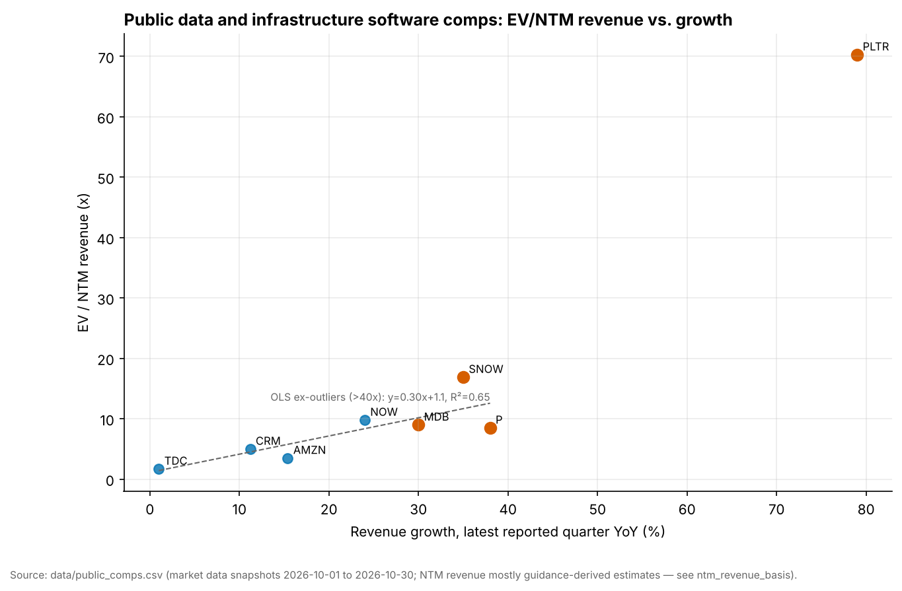
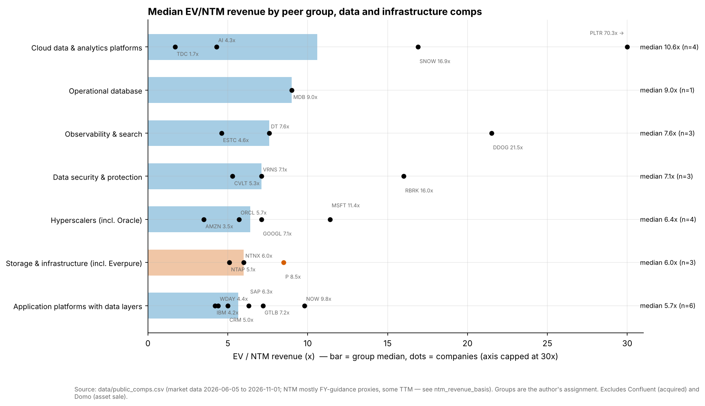
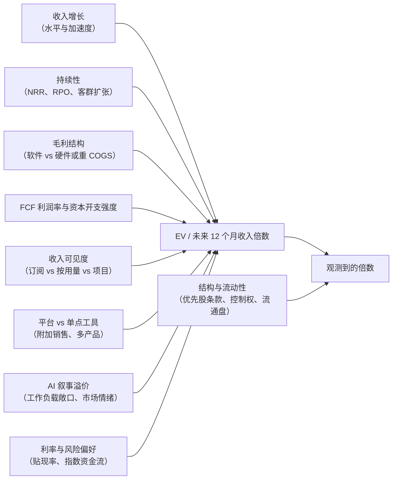
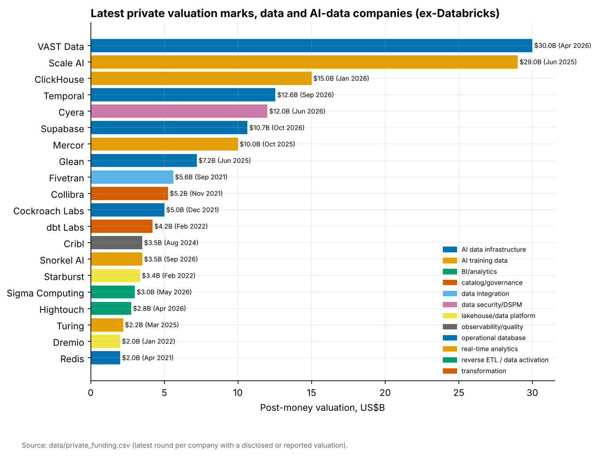
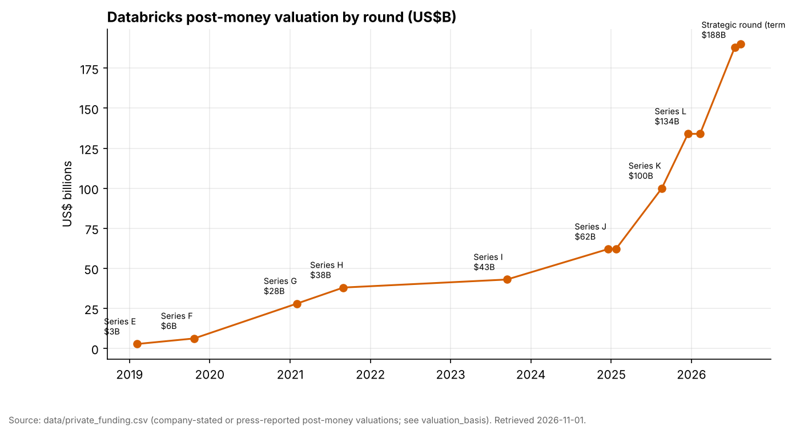
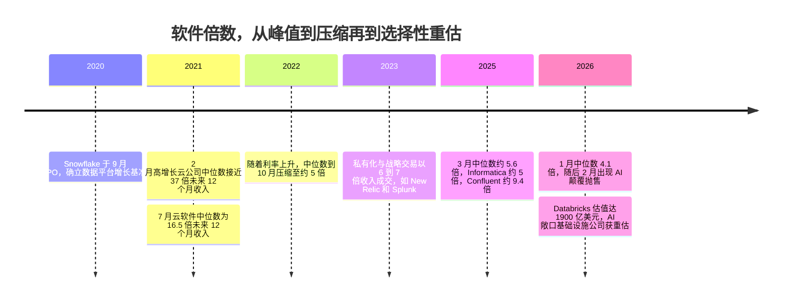

# 37. 上市可比公司与估值
> **深度：** L2 · **阅读时间：** 约 14 分钟 · **最后核实：** 2026-11-01 · **前置阅读：** [第 36 章 — 单位经济学与 KPI](ch36-unit-economics-kpis.md)

## 要点速览（TL;DR）

- **增长是市场定价的主要因素，但它只能解释远不到一半的估值差异。** 在 24 家上市数据与基础设施可比公司中（剔除 Palantir 和已被收购的 Confluent；保留 Domo，其倍数反映的是一项待完成的资产出售），以[企业价值（EV）/未来 12 个月收入](../glossary.md#ntm-revenue-multiple)对最新收入增速做直线回归，斜率约为**每 1 个百分点增长对应 0.19 倍**，**R² 为 0.38**（基于 `data/public_comps.csv` 的本书回归，市场数据截至 2026 年 6 月至 11 月）。增长的持续性、[净收入留存率（NRR）](../glossary.md#net-revenue-retention)、利润结构以及 AI 叙事解释了其余的大部分差异。
- **市场为类软件的质量付费，而不仅仅为速度付费。** Datadog（36% 增速下 21.5 倍）和 Snowflake（35% 增速下 16.9 倍）明显高于回归线。Everpure（38% 增速下 8.5 倍）、NetApp（30% 增速下 5.1 倍）和 Oracle（30% 增速下 5.7 倍）则低于回归线。它们的增长伴随着硬件占比、资本开支或价格顺风，而投资者预期这些因素会消退。[^comps]
- **Palantir 处于完全不同的估值区间。** 在与表中其他公司相同的口径下，其估值约为 **EV/未来 12 个月收入 53 倍**（EV ÷ FY2026 收入指引中值，截至 2026-10-30），最新季度增速为 **93%**；按过去 12 个月收入计算则为 **EV/TTM 70.3 倍**，对应 TTM 增速 79%。此外，其 2026 年第二季度调整后 FCF 利润率为 63%，公司自定义的 [40 法则](../glossary.md#rule-of-40)得分为 155。回归线对 93% 增速的预测值约为 22 倍。按每个增长百分点计（约 0.57 倍），Palantir 的定价与 Datadog 相当；真正非同寻常的是其增长水平，以及市场押注这种增长能够持续。[^pltr]
- **私募估值比公开市场倍数高出 2–4 倍，且口径并不可比。** Databricks 的估值为 1,900 亿美元（$190B），对应超过 $7B 的年化运行率（公司披露），约为**年化运行率的 27 倍**。ClickHouse、Supabase 和 VAST Data 的估值约为收入或 ARR 的 60 倍。优先股条款、一级与二级交易的构成、战略投资资金以及以年化运行率为分母的做法，都会使这些数字相对于公开市场的 EV/未来 12 个月收入被高估。[^db][^ch][^supa][^vast]
- **控制权交易的成交价约为收入的 5–9 倍。** Informatica 的成交价约为未来 12 个月收入的 5 倍（股权价值口径），Splunk 约为过去 12 个月收入的 7 倍，Varonis 按 $6.3B 交易价值计约为其 2026 日历年收入指引的 8.5 倍（按约 $5.71B 股权价值计约为 7.7 倍），Confluent 按约 $11B EV 计约为 FY2025 收入的 9.4 倍。自 2021 年峰值以来，战略买家从未以公开市场增长龙头的倍数收购数据资产。[^infa][^splk][^vrns][^cflt]

## 为何重要（业务视角 + Everpure 视角）

估值是企业发展（corporate development）的通用语言。你用它来判断目标公司的价格、权衡自建还是收购，并向董事会说明一项战略值多少钱。在数据技术栈中，有三组数字很少能对得上。第一组是增长龙头在公开市场上的倍数。第二组是热门私营公司的投后估值。第三组是战略买家为取得控制权而实际支付的倍数。一位无法调和这三者的高管，要么会因为"Snowflake 交易在 17 倍"而为私营资产支付过高价格，要么会因为"Databricks 在 27 倍"而错过一笔便宜的交易。

对 Everpure 而言，这个问题也需要向内审视。公司当前估值为 **EV/未来 12 个月收入 8.5 倍**（EV 为 $43.01B；未来 12 个月收入 = FY2027 收入指引中值 $5.05B；截至 2026-10-01）。这一倍数高于存储同业（NetApp 5.1 倍、Nutanix 6.0 倍），但低于回归模型对 38% 增速软件公司给出的估值水平。[^ep-stock][^comps] 两者之间的差距约为 **$14B 企业价值**（本书测算：2.8 倍 × $5.05B）。这可以合理地衡量市场愿意为一种它尚未看到的业务结构、利润率和持续性特征支付多少溢价。下文的 [Everpure 视角](#everpure-lens-what-a-re-rating-would-require)一节仅基于公开信息，梳理投资者需要看到哪些变化。

## 工作原理

### 可比公司表

下表将 24 家上市公司（剔除 Domo 和 Confluent；见注释）分为七个同业组。除脚注标明为本书补充并暂存的数据外，所有数字均来自 `data/public_comps.csv`。比较各行之前，请先阅读**口径**列。对大多数公司而言，"未来 12 个月收入"以当前财年指引中值作为代理（代码 **G**）。对于不提供总收入指引的公司，则使用过去 12 个月收入（代码 **T**），这会美化高增长公司的倍数。除非标注为 TTM 或 FY，增长率均为最新报告季度的 GAAP 同比增速（代码 **Q**）。

| 组别 | 公司（代码） | 截至日期 | EV（$B） | 未来 12 个月收入（$B，口径） | EV/未来 12 个月收入 | 增速 %（口径） | 毛利率 %（口径） | FCF 利润率 %（口径） | 40 法则 |
|---|---|---|---|---|---|---|---|---|---|
| 云数据与分析 | Snowflake (SNOW) | 2026-10-30 | 106.31 | 6.30 (G) | 16.9x | 35 (Q) | 75（非 GAAP 产品） | 25.5（FY2026 非 GAAP 调整后） | 61 |
| 云数据与分析 | Palantir (PLTR) | 2026-10-30 | 433.23 | 8.15 (G) | 53.1x（按 TTM $6.16B 为 70.3x） | 93 (Q) | 84.8（GAAP，TTM） | 63（2026 年第二季度调整后）[^pltr] | 156 |
| 云数据与分析 | Teradata (TDC) | 2026-10-28 | 2.88 | 1.69 (T) | 1.7x | 1 (TTM) | n/d | n/d | n/d |
| 云数据与分析 | C3.ai (AI) | 2026-06-05（数据陈旧） | 0.975 | 0.225 (G) | 4.3x | −35.7 (FY2026) | n/d | n/d | n/d |
| 运营型数据库 | MongoDB (MDB) | 2026-10-20 | 27.14 | 3.01 (G) | 9.0x | 30 (Q) | 74 (GAAP) | 17.8 (Q2 FY2027)[^mdb] | 48 |
| 可观测性与搜索 | Datadog (DDOG) | 2026-10-02 | 95.80 | 4.46 (G) | 21.5x | 36 (Q) | 79.6（非 GAAP，第二季度）[^ddog] | 25（2026 年第二季度）[^ddog] | 61 |
| 可观测性与搜索 | Dynatrace (DT) | 2026-10-23 | 17.50 | 2.31 (G) | 7.6x | 16 (Q) | n/d | n/d | n/d |
| 可观测性与搜索 | Elastic (ESTC) | 2026-10-12 | 9.28 | 2.00 (G) | 4.6x | 15 (Q) | n/d | n/d | n/d |
| 带数据层的应用平台 | ServiceNow (NOW) | 2026-10-01 | 144.20 | 14.73 (T) | 9.8x | 24 (Q) | n/d | n/d | n/d |
| 带数据层的应用平台 | GitLab (GTLB) | 2026-10-23 | 8.12 | 1.13 (G) | 7.2x | 21 (Q) | 86.5（非 GAAP） | n/d | n/d |
| 带数据层的应用平台 | SAP (SAP) | 2026-10-30 | 273.90 | 43.3（T，汇率换算） | 6.3x | 13（Q，IFRS） | n/d | n/d | n/d |
| 带数据层的应用平台 | Salesforce (CRM) | 2026-10-30 | 219.58 | 43.94 (T) | 5.0x | 11.2 (TTM) | n/d | n/d | n/d |
| 带数据层的应用平台 | Workday (WDAY) | 2026-10-16 | 46.35 | 10.66 (G) | 4.4x | 12.8 (Q) | n/d | n/d | n/d |
| 带数据层的应用平台 | IBM (IBM) | 2026-10-30 | 299.74 | 70.6（估算） | 4.2x | 5（Q，含 Confluent） | n/d | n/d | n/d |
| 超大规模云厂商 | Microsoft (MSFT) | 2026-10-30 | 3,950 | 346.45 (T) | 11.4x | 19 (Q) | n/d | n/d | n/d |
| 超大规模云厂商 | Alphabet (GOOGL) | 2026-10-30 | 3,330 | 471.1 (T) | 7.1x | 25 (Q) | n/d | n/d | n/d |
| 超大规模云厂商 | Oracle (ORCL) | 2026-10-23 | 514.52 | 90（G 下限） | 5.7x | 30 (Q) | n/d | 负值（TTM） | n/d |
| 超大规模云厂商 | Amazon (AMZN) | 2026-10-30 | 2,760 | 797.46 (T) | 3.5x | 15.4 (TTM) | n/d | n/d | n/d |
| 存储与基础设施 | **Everpure (P)** | 2026-10-01 | 43.01 | 5.05 (G) | **8.5x** | 38 (Q) | 68.4 (GAAP) | 16.8 (FY2026)[^ep-10k] | ~55 |
| 存储与基础设施 | Nutanix (NTNX) | 2026-10-13 | 19.12 | 3.21 (G) | 6.0x | 12 (FY2026) | n/d | 29.5 (FY2026) | 42 |
| 存储与基础设施 | NetApp (NTAP) | 2026-10-01 | 41.20 | 8.10 (G) | 5.1x | 30 (Q) | 70.6（非 GAAP） | n/d | n/d |
| 数据安全与保护 | Rubrik (RBRK) | 2026-10-26 | 27.06 | 1.69 (G) | 16.0x | 38 (Q) | 81.0（非 GAAP）[^rbrk] | ~15 (Q2 FY2027)[^rbrk] | ~53 |
| 数据安全与保护 | Varonis (VRNS) | 2026-11-01 | 5.26 | 0.74 (G) | 7.1x | 18 (Q) | 77.7（非 GAAP） | n/d | n/d |
| 数据安全与保护 | Commvault (CVLT) | 2026-10-09 | 6.51 | 1.22 (T) | 5.3x | 13 (Q) | n/d | n/d | n/d |

*图 37.1 — 分组可比公司表。EV/未来 12 个月收入大多为 EV 除以当前财年指引（这是一种估算，会低估高增长公司真实的未来 12 个月收入）；"T" 行（ServiceNow、Salesforce、Microsoft、Alphabet、Amazon、SAP、Teradata、Commvault）实际上是 EV/TTM。Palantir 按其 FY2026 指引（G）列示，与 `data/public_comps.csv` 及下图一致；其 EV/TTM 为 70.3 倍。ServiceNow 的 24% 为 2026 年第二季度数据；其 2026 年第三季度增速为 20.5%（[第 36 章](ch36-unit-economics-kpis.md)）。40 法则 = 增速 % + FCF 利润率 %，采用所示口径，这些口径刻意混合，因此仅供参考；[第 36 章](ch36-unit-economics-kpis.md)对 Snowflake（58）和 Everpure（52）改用 FY2027 FCF 指引。"n/d" = 数据集中无此数据。Varonis 的交易价格反映的是待完成交易的价差。Domo（0.9 倍；向 Progress 出售资产待完成）和 Confluent（已被 IBM 收购）被剔除。资料来源：`data/public_comps.csv` 及公司公告。[^comps][^sf][^ep-q2]*

关于 40 法则一列的说明。它将收入增速与自由现金流利润率相加，因此一家增速 35%、FCF 利润率 25% 的公司得分为 60。[第 36 章](ch36-unit-economics-kpis.md)详细介绍了这一指标。在这里，它作为质量筛选工具使用。在表中我们能够打分的公司里，凡是得分超过 50 的（Palantir、Datadog、Snowflake、Everpure、Rubrik）都交易在下文增长回归线之上，唯独 Everpure 例外。这是第一条线索：市场折价的是 Everpure 增长和现金流的*来源*，而不是其水平。

### EV/未来 12 个月收入对增速：回归分析

*图 37.2 — 增长能换来倍数，但并不可靠。剔除 Palantir（以及已被收购的 Confluent；保留 Domo）后，拟合直线为 EV/未来 12 个月收入 ≈ 4.1 + 0.19 × 增速 %，R² = 0.38（n = 24）。Everpure（P）位于回归线下方约 2.8 倍。资料来源：`data/public_comps.csv`，图表 SV-14。*

拟合直线表明，零增长公司的估值约为收入的 **4.1 倍**，每增加 1 个百分点的增长约增加 **0.19 倍**（n = 24，普通最小二乘法，本书计算）。在 30% 增速下，该直线对应 **9.8 倍**。有两点提醒比系数本身更重要。

第一，这条线被一个高杠杆点压低了。C3.ai 的收入*下降*了 35.7%，但估值仍为 4.3 倍，因为市场看重其现金余额和期权价值。剔除该点后，拟合结果变为 EV/未来 12 个月收入 ≈ 1.1 + 0.33 × 增速，**R² = 0.57**（n = 23）。在 30% 增速下，这条线对应 **10.9 倍**。相比任何单一斜率，"每 10 个百分点增长大约对应 2–3 倍估值"是更站得住脚的解读。

第二，残差本身包含信息。撇开 C3.ai（+6.9 倍，即上述杠杆点），最大的正残差来自 Datadog（+10.6 倍）、Snowflake（+6.2 倍）、Rubrik（+4.7 倍）和 Microsoft（+3.7 倍，以 TTM 为分母）。这些企业拥有高毛利率、可见扩张的按用量计费或订阅收入，以及可信的 AI 工作负载故事。最大的负残差来自 NetApp（−4.7 倍）、Oracle（−4.1 倍）、Amazon（−3.5 倍，以 TTM 为分母）和 Everpure（−2.8 倍）；Domo（−3.3 倍）属于困境下的资产出售案例，不具备信号意义。这几家公司都是在当前强劲增长的同时，伴随着投资者预期会消退或会占用资本的因素：硬件占比、以债务融资的 AI 数据中心资本开支，或元器件价格顺风。

> **类比：拟合工艺曲线。** 可以把这个回归看作跨晶圆厂拟合的良率—缺陷密度模型。缺陷密度可以预测良率，但两条 D0 相同的产线良率可能不同，因为它们的芯片面积和设计敏感度不同，而残差衡量的正是这一点。在这里，增长扮演 D0 的角色，利润结构、NRR 和收入持续性扮演芯片面积和关键面积的角色。R² 为 0.38 意味着增长是一阶变量，但不是模型的全部。远离曲线的点（Palantir）不是可以平均掉的噪声。它属于不同的工艺节点，应当单独建模。

**为什么 Palantir 是离群值。** 四个因素叠加。(1) 增长在*加速*：2026 年第二季度收入增长 93%，美国商业收入增长 149%；过去 12 个月增速（79%）低估了当前增速。(2) 在这样的增速下盈利能力极强：调整后 FCF 利润率达 63%。(3) AI 平台叙事和大量散户持股带来了任何基本面变量都无法捕捉的情绪溢价。(4) 口径很重要。按 FY2026 收入指引 $8.150–8.158B 计算，倍数约为 **53 倍**（本书测算：$433.23B ÷ $8.154B），约为回归线在 93% 增速下预测值（约 22 倍）的 2.4 倍；若按过去 12 个月收入（$6.16B）报价，则为 **EV/TTM 70.3 倍**，其他章节引用该数字时会标注这一口径。[^pltr] 在可比口径下做增长调整（指引倍数 ÷ 最新季度增速），Palantir 每个百分点约 0.57 倍，接近 Datadog 的 0.60 倍，高于 Snowflake 的 0.48 倍；常被引用的 0.89 倍混用了 TTM 倍数与 TTM 增速。这一溢价能否持续，是看多逻辑与看空逻辑之争，回归分析无法给出结论。对于数据平台组的两个锚定公司，[第 26 章](../04-company-deep-dives/ch26-snowflake.md)介绍了 Snowflake 的按用量计费模式，[第 27 章](../04-company-deep-dives/ch27-databricks-vs-snowflake.md)比较了其公开市场倍数与 Databricks 的私募倍数。

### 分组中位数与增长调整倍数

*图 37.3 — 各组中位数区间较窄（5.7–10.6 倍），但组内离散度很大。几乎每个组里，龙头的估值都是中位数的两到三倍。Everpure 位居存储组之首，但若放在软件组中只处于中位数附近。资料来源：`data/public_comps.csv`；脚本 `scripts/charts/ch37_multiples_by_group.py`。*

用倍数除以增速，可以得到一个粗略的**[增长调整倍数](../glossary.md#growth-adjusted-multiple)**：即每个增长百分点所支付的收入倍数。它是 PEG 比率在收入倍数上的"表亲"，对于低增长或负增长公司会失效。但对于本章关心的 15–40% 增速公司进行排序，它仍然有用。

| 公司 | EV/未来 12 个月收入（或所述口径） | 增速 %（口径） | 每个增长百分点对应倍数 | 解读 |
|---|---|---|---|---|
| Palantir | 53.1x（G；EV/TTM 70.3x） | 93（Q；TTM 79） | 0.57（TTM/TTM 口径为 0.89） | 按每个百分点定价与 Datadog 相当；溢价来自增长水平及其假定的持续时间 |
| Datadog | 21.5x | 36 (Q) | 0.60 | 平台广度，高 NRR（120% 出头）[^ddog] |
| Microsoft | 11.4x（EV/TTM） | 19 (Q) | 0.60 | 整体 19% 增速中 Azure 增长 48% |
| Snowflake | 16.9x | 35 (Q) | 0.48 | 用量重新加速，NRR 126% |
| Rubrik | 16.0x | 38 (Q) | 0.42 | 云 ARR 占订阅 ARR 的 89% |
| ServiceNow | 9.8x（EV/TTM） | 24 (Q) | 0.41 | 持久的"席位加平台"业务 |
| Databricks（私营） | 年化运行率约 27x（投后股权价值 ÷ 公司披露的年化运行率；非 EV/未来 12 个月收入） | >80（公司披露） | ~0.34 | 在结构调整前，每个百分点比 Snowflake 便宜 |
| MongoDB | 9.0x | 30 (Q) | 0.30 | Atlas 增长 29%；净 ARR 扩张率约 122%（媒体报道；与 Snowflake 的 NRR 不可比）[^mdb] |
| Everpure | 8.5x | 38 (Q) | 0.22 | 产品驱动增长，部分来自价格 |
| Oracle | 5.7x | 30 (Q) | 0.19 | 净债务约 $132B；FCF 为负 |
| NetApp | 5.1x | 30 (Q) | 0.17 | 全闪存需求激增；毛利率指引下调 |

*图 37.4 — 增长调整倍数。高 NRR 的软件平台每个增长百分点对应 0.4–0.6 倍。硬件或资本开支密集的基础设施公司对应 0.17–0.22 倍。Databricks 的数据使用公司披露的年化运行率和增速。资料来源：`data/public_comps.csv`；公司公告。[^comps][^db]*

### 市场为何给出这样的价格

*图 37.5 — 估值驱动因素。基本面决定倍数。结构与流动性则将观测到的数字（公开报价、私募估值、交易价格）与基本面数字区分开来。回归分析只捕捉了第一个箭头。*

增长之所以重要，是因为收入倍数本质上是一个压缩版的 DCF。在终端利润率固定的情况下，一家再以 35% 增速增长五年的企业，到第五年收入约为当前的 4.5 倍（1.35⁵ ≈ 4.5），而 15% 增速的企业约为 2 倍。**持续性**决定了投资者相信其中多少年。这就是为什么净收入留存率——换个名字的客群分析——是仅次于增长本身最受关注的 KPI。Snowflake 的 126% NRR（产品收入的过去两年客群口径）和 MongoDB 的净 ARR 扩张率（ARR 快照口径，根据其 10-K，FY2026 年末约为 121%；据媒体报道，Q2 FY2027 约为 122%）都表明，仅存量客户就能让各自业务每年增长约五分之一到四分之一，但两者定义不同，因此 4 个百分点的差距意义不大（[第 36 章](ch36-unit-economics-kpis.md)）。[^sf][^mdb]

**利润结构**决定了每一美元收入在终局时能带来多少 FCF。一美元 80% 毛利率的软件收入在成熟期可以转化为 25–35 美分的 FCF。一美元包含硬件、毛利率 68% 的收入通常做不到，因此投资者给的倍数更低。**可见度**的逻辑相同。拥有大额剩余履约义务（RPO）积压的订阅收入是一种类债券的现金流。按用量计费的收入（Snowflake、Datadog、MongoDB Atlas）在景气时增长更快，但可能逐季波动。Datadog 的股价在 2026-08-06 下跌约 19%，尽管当时上调了指引，原因是指引中包含其最大客户用量的下降。[^comps] **平台广度**降低流失率、提高附加销售率，这就是 Datadog 和 ServiceNow 具有正残差的原因。**AI 溢价**真实存在，但具有选择性。它流向了收入明显随 AI 工作负载增长的公司，而不是整个软件类别。

### 私募估值与公开市场倍数

| 公司 | 最新估值 | 日期 | 口径 | 收入参照（口径） | 隐含倍数 |
|---|---|---|---|---|---|
| Databricks | 投后估值 $190B | 2026-08-13 | 公司披露 | 年化运行率 >$7B，增速 >80%（公司披露） | 年化运行率约 27x；未来 12 个月收入约 22x（估算，见[第 25 章](../04-company-deep-dives/ch25-databricks.md)） |
| VAST Data | $30B | 2026-04-21 | 公司披露 | FY2026 末承诺 ARR >$500M（公司披露） | ≤ 承诺 ARR 的约 60x |
| ClickHouse | $15B | 2026-01-16 | 媒体报道 | 2026 年 5 月年化收入约 $250M（媒体报道；在融资四个月之后，因此定价时的倍数更高） | ~60x |
| Temporal | $12.55B | 2026-09-14 | 公司披露 | 年化收入 >$250M（报道） | ~50x |
| Cyera | $12B | 2026-06-10 | 媒体报道 | "约 80 倍 ARR"（媒体报道） | ARR 约 80x |
| Supabase | $10.5B（2026 年 10 月以 $10.65B 追加融资 [VERIFY]） | 2026-06-04 | 媒体报道 | 2026 年 5 月 ARR 约 $170M（Sacra 估算） | ~62x |
| Snorkel AI | $3.5B | 2026-09-22 | 公司披露 | 年化运行率约 $375M（公司披露） | ~9x |
| Fivetran + dbt Labs | 合并后无估值 | 2026-06-01 完成 | — | ARR "接近 $600M"（公司披露） | 上次估值 $5.6B（2021）+ $4.2B（2022）≈ ARR 的 16x（数据陈旧，仅供说明） |
| Pinecone | $0.75B | 2023-04-27 | 媒体报道 | n/d | n/d；未发现之后有定价轮次 |

*图 37.6 — 私募估值与隐含倍数。倍数为本书基于所引分子和分母的测算。每个倍数都混合了投后股权价值与年化运行率或 ARR 分母，因此都无法与公开市场的 EV/未来 12 个月收入直接比较。资料来源：`data/private_funding.csv`。[^db][^vast][^ch][^temporal][^cyera][^supa][^snorkel][^fivetran]*

*图 37.7 — 私募排行榜混合了 2026 年的估值与从未重新定价的 2021–2022 年陈旧估值（Fivetran、Collibra、Cockroach Labs、dbt Labs）。陈旧估值是对未来一轮融资的期权，而不是价格。资料来源：`data/private_funding.csv`。*

*图 37.8 — Databricks 的估值在 20 个月内增长了两倍（从 2024 年 12 月的 $62B 到 2026 年 8 月的 $190B），同期其年化运行率从约 $3B（公司在 $62B 轮次时对截至 2025 年 1 月季度的预测）升至超过 $7B（公司披露）。年化运行率倍数从约 21 倍升至约 27 倍，因此大约四分之三的重估来自收入，四分之一来自倍数（本书对数分解）。资料来源：`data/private_funding.csv`；见[第 25 章](../04-company-deep-dives/ch25-databricks.md)。*

为什么在增速相近的情况下，私募估值会比公开市场倍数高出两到四倍？有五个原因，大致按重要性排序。

1. **年化运行率与未来 12 个月收入。** 年化运行率是将最近一个月或一个季度年化，而未来 12 个月收入是未来四个季度的平均。对于增速 60–200% 的公司，两者差距很大。如果增长持续，ClickHouse 的"约 60 倍"按前瞻口径约为其一半。
2. **优先股结构。** 投后价格由新一类带有[清算优先权](../glossary.md#liquidation-preference)的优先股设定，因此高估了每一股的价值。Cooley 的 2026 年第一季度数据显示，**98.2%** 的风险投资交易采用 1 倍优先权，**96.4%** 为非参与型。[^cooley] 这是较温和的结构，但在边际上仍有影响。
3. **一级与二级交易。** VAST 的 $1B F 轮融资中，超过一半流向了出售股份的员工和早期持有人。二级交易价格可能高于也可能低于一级价格，以要约收购为主的轮次在一定程度上属于流动性事件。[^vast]
4. **战略投资者。** NVIDIA（投资 VAST）、超大规模云厂商和企业风投部门既为财务回报付费，也为生态位置付费，因此它们的价格并非纯粹的财务估值。
5. **流动性不足与稀缺性。** 后期跨界基金愿意为它们在公开市场上买不到的品类龙头的稀缺敞口支付溢价。通常的流动性折价被这种稀缺性所抵消。

> **类比：公允价值层级。** 一股 Snowflake 股票属于 ASC 820 下的**第一层级**输入值：活跃市场中的报价。共同基金持有的一股 Databricks 优先股属于**第三层级**：根据不可观察输入值估值，通常通过期权定价模型反推最近一轮融资价格。"$190B" 这一标题数字是调整最少的第三层级输入值。将它与第一层级的 EV/未来 12 个月收入比较，就像把按模型计价的账簿与按市价计价的账簿作比较。可以这样做，但你必须说明所用的模型。

> **类比：作为期权的清算优先权。** 1 倍非参与型优先股的回报是其本金与按转换后普通股价值两者中的较高者。这相当于普通股加上一个行权价为发行价的看跌期权。在 $190B 的轮次中，如果公司以 $300B 退出，这个看跌期权处于深度价外；如果以 $100B 退出，则处于深度价内。[OPM 反推法](../glossary.md#opm-backsolve)对这个看跌期权进行显式定价，这就是 409A 普通股估值远低于标题轮次价格的原因。

### 先例交易

| 公告日期 | 收购方 → 目标公司 | 交易价值（口径） | 倍数 | 倍数口径 | 交易时目标公司增速 |
|---|---|---|---|---|---|
| 2023-07-31 | Francisco Partners / TPG → New Relic | $6.5B（已披露） | ~6.7x | 年化运行率收入 $970.4M（媒体报道）；本书测算 | ~12% |
| 2023-09-21 | Cisco → Splunk | $28B（已披露） | ~7.1x / ~5.7x | LTM 收入约 $3.9B / 前瞻收入（分析师估算） | 十几个百分点的低位 [VERIFY] |
| 2025-05-27 | Salesforce → Informatica | 股权价值约 $8B，扣除既有持股（已披露） | ~5x | 未来 12 个月收入（Breakingviews / LSEG）；约为 FY2024 收入 $1.64B 的 4.9x（股权价值口径；EV 还需加上 Informatica 的净债务） | ~3% |
| 2025-06-20 | Haveli → Couchbase | $1.5B（已披露） | ~7.2x | FY2025 收入约 $209M（股权价值；本书测算）[VERIFY 收入与 10-K 核对] | ~16% |
| 2025-10-21 | Veeam → Securiti AI | $1.725B（已披露；2025-12-11 完成） | n/d | 收入未披露 | n/d |
| 2025-12-08 | IBM → Confluent | EV 约 $11B（已披露） | ~9.4x | FY2025（日历年）GAAP 收入 $1,166.7M；公告时已接近完结，于 2026-02 报告 | 21% |
| 2026-02-23 | Everpure → 1touch | 现金 $125M（已披露） | n/d | 能力型交易；收入未披露 | n/d |
| 2026-07-22 | Progress → Domo 平台资产 | $400M 加承担负债（媒体报道） | ~1.3x | FY2026（2025 年 2 月–2026 年 1 月）收入约 $318M；资产交易 | ~1% |
| 2026-10-15 | Proofpoint（Thoma Bravo）→ Varonis | 交易价值约 $6.3B（股权价值约 $5.71B） | ~8.5x（按股权价值约 7.7x） | FY2026（2026 日历年，即当年）收入指引中值 $737M；本书测算 | 18%（2026 年第二季度） |

*图 37.9 — 先例交易。规模化数据资产的控制权交易集中在收入的 5–9.5 倍，口径不一。即便是"与 AI 相关"的交易（Confluent、Varonis），成交倍数也低于增长龙头的公开市场倍数。资料来源：`data/ma_deals.csv`、`data/public_comps.csv`、交易公告及媒体报道。[^newr][^splk][^infa][^base][^cflt][^vrns][^comps]*

规律是一致的。买家支付的控制权溢价是相对于*目标公司*未受干扰的股价，而不是相对于行业龙头的倍数。他们也为自己能够承保的增长付费。增速 21% 的 Confluent 获得约 9.4 倍。增速约 3% 的 Informatica 获得约 5 倍。两者都非常接近公开市场回归线。能力型交易（Tabular 约 $2B、Neon 约 $1B、1touch $125M）没有有意义的收入倍数，应当作为基于时间和人才的自建还是收购决策来估值。[第 39 章](ch39-ma-history.md)介绍了交易历史。

## 设计选择与权衡

| 方法 | 适用场景 | 误导之处 | 用途 |
|---|---|---|---|
| EV/未来 12 个月收入 | 未盈利或处于再投资期的成长型公司；横截面可比 | 忽略利润结构；未来 12 个月收入的代理口径不一（指引 vs TTM） | 初步筛选与回归分析 |
| EV/未来 12 个月毛利 | 将软件与含硬件或重 COGS 的模式作比较 | 毛利率定义不一（GAAP vs 非 GAAP，产品 vs 总计） | 将 Everpure、NetApp 和 Oracle 与软件公司标准化比较 |
| 增长调整倍数 | 同一商业模式下 15–60% 增速的公司 | 低增长或负增长时失效；忽略持续性 | 组内相对价值 |
| 40 法则调整倍数 | 拥有真实 FCF 的成熟成长型公司 | FCF 波动较大（库存积累、预付款） | 质量筛选 |
| EV/FCF 或 DCF | 盈利且可预测的企业 | 终值占主导；输入值的微小变化会带来大幅波动 | 内在价值锚；董事会材料 |
| 先例交易 | 为控制权交易定价 | 利率环境与协同效应假设不同 | 报价区间与公允性参考 |
| 私募轮次估值 | 反映投资者兴趣的信号 | 优先股条款、年化运行率分母、陈旧估值 | 绝不能作为独立的价格 |

*图 37.10 — 估值方法及其失效模式。至少使用两种方法。支持简单 EV/收入的最强版本论证是：它是对大多数公司都有定义的唯一指标。反对它的最强版本论证是：它把 68% 毛利率的一美元与 85% 毛利率的一美元同等对待。*

将图 37.1 转换为 EV/毛利后，Everpure 的折价收窄。按 68.4% 的 GAAP 毛利率计算，Everpure 8.5 倍的收入倍数约为毛利的 12.4 倍。Snowflake 在约 75% 毛利率下的 16.9 倍约为毛利的 22.5 倍，MongoDB 在 74% 毛利率下的 9.0 倍约为毛利的 12.2 倍（本书测算，按所标注的口径混合使用 GAAP 与非 GAAP 毛利率）。按毛利口径，Everpure 与 MongoDB 估值相当，而后者的增速低 8 个百分点。剩余的折价关乎持续性和业务结构，而不仅仅是利润率。

## 主要参与者

| 在估值讨论中的角色 | 名称 | 为何重要 |
|---|---|---|
| 公开市场增长锚 | Snowflake、Datadog、MongoDB、Rubrik | 设定"增速 30–40% 的软件公司"的参考倍数 |
| 离群值 / 叙事锚 | Palantir | 展示 AI 叙事与盈利能力同时具备时的估值上限 |
| 基础设施与存储锚 | Everpure、NetApp、Nutanix | 尽管有 AI 驱动的增长，硬件占比仍限制了倍数 |
| 超大型平台收购方 | IBM、Salesforce、Cisco、Microsoft、Alphabet、Oracle | 决定战略报价能力；以 5–10 倍收购 |
| 私募股权买家 | Thoma Bravo（Proofpoint）、Haveli、Francisco/TPG、Clearlake | 以 5–8 倍收购持久但增速较慢的企业 |
| 私营锚 | Databricks、VAST Data、ClickHouse、Supabase、Cyera | 为"AI 原生"数据资产设定预期 |
| 倍数追踪者 | Clouded Judgement（Altimeter 数据）、BVP Nasdaq Emerging Cloud Index、Meritech | 为重估主张提供指数层面的背景 |

*图 37.11 — 谁在设定参考价格。对于这一领域的任何目标公司，报价区间来自私募股权和战略买家两行，而不是私营锚那一行。*

## 历史与发展轨迹

*图 37.12 — 演进轨迹。2025–26 年的"AI 重估"并不是全行业的倍数扩张。软件倍数的中位数持续下降，而资本集中流向了具有 AI 敞口的赢家。*

Clouded Judgement（Altimeter 数据）追踪的云软件 EV/未来 12 个月收入中位数在 2021 年 7 月为 **16.5 倍**，高增长组的中位数在 2021 年 2 月达到 **37.4 倍**。[^cj21] 利率上升使中位数到 2022 年 10 月压缩至约 **5.0 倍**。[^cj22] 2025 年 3 月约为 **5.6 倍**，2026 年 1 月末为 **4.1 倍**，低于 2022 年的谷底。[^cj25][^cj26] BVP Emerging Cloud Index 网站目前显示的平均收入倍数为 **5.8 倍**，未注明日期，口径为过去 12 个月 [VERIFY: BVP 数字的日期与口径]。[^bvp]

2026 年初出现了一个新的驱动因素：担心 AI 智能体会侵蚀按席位计费的软件。媒体报道将 2 月初的一轮急跌与 AI 实验室推出的新智能体式产品联系起来，据报道软件和服务板块市值损失近 1 万亿美元（媒体报道）。[^saas] 然而同期，具有 AI 敞口的数据和基础设施公司获得了重估。NetApp 和 Rubrik 的市值同比上涨约 82%。Snowflake 增速重新加速至 35%，Databricks、ClickHouse 和 VAST 的私募估值增长了两倍。[^comps][^db][^ch][^vast] 2026 年的教训是**分化**。"软件"不再作为单一资产类别定价。市场为 AI 数据工作负载敞口付费，对按席位计费的应用打折扣。这解释了为什么应用平台（中位数 5.7 倍）尽管利润率相近甚至更好，估值却低于运营型数据库组和分析组。

### 实例：为一家 $1B 的数据安全企业定价

设想一个说明性的目标公司：过去 12 个月收入 $1.0B，增速 30%，毛利率 80%。这意味着未来 12 个月收入约为 $1.3B。它在今天的公开市场上能获得多少倍数？

| 方法 | 隐含 EV/未来 12 个月收入 | 隐含 EV（基于 $1.3B 未来 12 个月收入） | 评注 |
|---|---|---|---|
| 完整回归（n = 24）：4.13 + 0.189 × 30 | 9.8x | ~$12.7B | 被 C3.ai 杠杆点压低 |
| 剔除 C3.ai 的回归（n = 23）：1.07 + 0.327 × 30 | 10.9x | ~$14.2B | 拟合更好（R² 0.57） |
| 数据安全组插值：Varonis 18% 增速下 7.1x → Rubrik 38% 增速下 16.0x | 12.4x | ~$16.1B | 针对同业；Rubrik 的云占比抬高了斜率 |
| 按每个百分点 0.42–0.48 倍做增长调整（Rubrik–Snowflake） | 12.6–14.4x | ~$16–19B | 需要软件龙头级别的持续性 |
| 控制权先例：Varonis 8.5x（交易价值 ÷ CY2026 指引）对应 18% 增速，Confluent 9.4x（EV ÷ FY2025 收入）对应 21% 增速 | ~9–11x | ~$12–14B | 买家实际支付的价格；口径混合 |

*图 37.13 — 实例（仅作说明；本书基于 `data/public_comps.csv` 的测算）。合理的公开市场区间是未来 12 个月收入的 10–12 倍，约合 $13–16B EV。区间上限需要 120% 以上的 NRR 和为正的 FCF 利润率。*

80% 的毛利率与 Rubrik（81.0% 非 GAAP）相当，高于 Varonis（77.7%），因此支持同业组方法。关键变量是自由现金流。在 15–20% 的 FCF 利润率下，40 法则得分为 45–50，区间的上半部分站得住脚。若烧钱，估值会被推向回归线。同一家企业的私募轮次定价可能远高于公开市场区间，正如 Cyera 约 80 倍 ARR 的估值所示，但图 37.9 中没有任何战略买家支付过这样的价格。

### Everpure 视角：重估需要什么条件

Everpure 38% 的增速（GAAP 总收入，Q2 FY2027，截至 2026-08-02 的季度）是真实的，但其构成解释了折价。产品收入增长 **54%** 至 $687M，约占该季度收入的 58%。订阅服务增长 **20%** 至 $499M。管理层将部分需求归因于 FY2027 上半年行业历史性的价格上涨以及超大规模云厂商的承诺。第二个前五大超大规模云厂商的设计中标预计要到 FY2028 才会实质性放量。该季度自由现金流为 **−$238M**，而 FY2026 为 **$616M**（占 $3.66B 收入的 16.8%）。[^ep-q2][^ep-10k] 投资者将这种特征解读为伴随库存和营运资本积累的 AI 周期硬件增长。他们给出的定价高于存储同业，但低于软件公司。

| 投资者需要看到什么 | 现状（公开数据） | 软件倍数参照 |
|---|---|---|
| 价格和超大规模云厂商顺风之后增长的持续性 | FY2027 指引约 38%（5.05 ÷ 3.66）；FY2028 未给指引 | Snowflake 和 MongoDB 增速 30–35%，NRR 120% 以上 |
| 经常性收入与软件占比 | 订阅服务约占第二季度收入的 42%；订阅 ARR $2.1B，增长 20% | Rubrik：云 ARR 约占订阅 ARR 的 89% |
| 毛利率 | 68.4% GAAP / 69.9% 非 GAAP（Q2 FY2027） | 75–85%（Snowflake、Datadog、Rubrik、GitLab） |
| 已披露的软件 KPI | Data Intelligence（1touch）无单独 ARR；未披露 NRR | 每季度披露 NRR、云 ARR、RPO |
| FCF 转化 | FY2026 为 16.8%；Q2 FY2027 为负 | 在增长的同时实现 15–25% 的 FCF 利润率 |

*图 37.14 — 基于公开信息，战略团队可能评估的选项：使 Everpure 从"一流存储公司"（8.5 倍）向软件回归线（按当前增速约 11 倍）靠拢的可观察里程碑；在未来 12 个月收入不变的情况下，价值约 $14B EV（本书测算）。*

在一个问题上，算术是无情的。以小规模收购的数据管理软件，例如以 $125M 收购的 1touch，无法凭借其自身收入撬动 $43B 的 EV。只有当它改变投资者对*整体*收入基础的归类方式时，才能影响倍数。这意味着附加销售率、订阅占比，以及让分析师能够像对 Rubrik 或 MongoDB 那样对 Everpure 的经常性收入进行建模的已披露 KPI。存储同业展示了反向的力量。NetApp 30% 的增速只换来 5.1 倍，因为投资者预期全闪存需求会回归常态。

## 关键数字

| 指标 | 数值 | 口径 | 来源 / 日期 |
|---|---|---|---|
| 回归斜率，EV/未来 12 个月收入对增速（剔除 Palantir） | 每个百分点 0.19x；截距 4.1x；R² 0.38（n = 24） | 本书计算 | `data/public_comps.csv`，2026-06-05 至 2026-11-01 |
| 同上，剔除 Palantir 和 C3.ai | 每个百分点 0.33x；截距 1.1x；R² 0.57（n = 23） | 本书计算 | 同上 |
| Snowflake EV/未来 12 个月收入 | 35% 增速下 16.9x | 未来 12 个月收入 = FY2027 指引代理 | 2026-10-30[^sf] |
| Datadog EV/未来 12 个月收入 | 36% 增速下 21.5x | FY2026 指引代理 | 2026-10-02[^comps] |
| Palantir EV/收入 | FY2026 指引约 53x（未来 12 个月收入代理，与 CSV 一致）；TTM 70.3x | 市场数据；本书测算 | 2026-10-30[^pltr] |
| Everpure EV/未来 12 个月收入 | 38% 增速下 8.5x（EV $43.01B；未来 12 个月收入 $5.05B） | FY2027 指引中值 | 2026-10-01[^ep-stock] |
| Everpure 与回归线的差距 | ~2.8x ≈ $14B EV | 本书测算 | — |
| Databricks 私募估值 | $190B，对应 >$7B 年化运行率 ≈ 27x | 公司披露 | 2026-08-13[^db] |
| ClickHouse / Supabase / VAST 估值 | $15B / $10.5B / $30B ≈ 收入或 ARR 的 60x | 媒体报道或公司披露；本书测算 | 2026[^ch][^supa][^vast] |
| Confluent → IBM | EV 约 $11B ≈ FY2025 GAAP 收入（$1,166.7M）的 9.4x | 已披露价值；本书计算倍数 | 2025-12-08 公告；2026-03-17 完成[^cflt] |
| Varonis → Proofpoint | 交易价值约 $6.3B ≈ CY2026 指引中值的 8.5x；股权价值约 $5.71B ≈ 7.7x | 已披露价值；本书计算倍数 | 2026-10-15 公告[^vrns] |
| Informatica → Salesforce | ~$8B ≈ 未来 12 个月收入的 5x | 已披露价值；LSEG 倍数 | 2025-05-27[^infa] |
| 云软件 EV/未来 12 个月收入中位数 | 16.5x（2021 年 7 月）→ 5.0x（2022 年 10 月）→ 4.1x（2026 年 1 月） | Clouded Judgement（Altimeter 数据） | [^cj21][^cj22][^cj26] |
| 风险投资条款：1 倍优先权 / 非参与型 | 分别占交易的 98.2% / 96.4% | Cooley 2026 年第一季度 | 2026-04-29[^cooley] |

*图 37.15 — 关键数字。每个倍数都附有截至日期和口径。如果一份材料省略了口径，请追问。*

## 存储桥接

存储厂商面临结构性的倍数天花板。它们的毛利中包含 NAND、控制器和机箱，增长又暴露于投资者会打折扣的元器件价格周期。这就是为什么 30% 增速的 NetApp 估值为 5.1 倍、38% 增速的 Everpure 为 8.5 倍，而销售运行在他人硬件上的数据保护软件的 Rubrik 估值为 16.0 倍。配套的 *Everpure Tech Atlas* 涵盖了硬件经济学。这里的估值要点是：只有当向技术栈上层移动改变了投资者所建模的收入结构时，倍数才会改变。

## 对话手册

**向产品经理提的三个问题（定价与收入质量）**

1. "明年收入中有多大比例已经以 RPO 或承诺消费额度的形式签约，又有多少是你们预期会落地的用量收入？" *好的回答*会给出一个区间，解释承诺合同如何转化为实际用量，以及为什么这种可见度应当获得更高的倍数。
2. "采用两个或以上产品的客户与单一产品客户相比，净收入留存率有何不同？" *好的回答*会量化平台效应，因为多产品附加销售正是让公司从单点工具倍数迈向平台倍数的关键。
3. "今年的增长中，哪部分来自价格，哪部分来自数量？" *好的回答*会将标价变动和元器件成本转嫁与单位或用量增长区分开来。投资者会把后者资本化，而不是前者。

**向工程师提的三个问题（服务成本与利润率）**

1. "托管服务的毛利率由什么驱动：云计算、存储、出口流量还是支持？" *好的回答：*给出一个成本构成，并指明可调节的杠杆（利用率、分层、预留容量）。
2. "如果大部分查询由 AI 智能体运行，每个客户的成本是否会比每个客户的收入增长更快？" *好的回答：*清楚说明智能体式工作负载是否按与驱动成本相同的用量单位计价。
3. "产品中有多少部分可以不加修改地运行在客户自有的基础设施上？" *好的回答：*坦诚回答利润率是否依赖厂商自己的机群，这会影响投资者对收入的归类。

**好的回答听起来是什么样的。** 它们会说明口径（"基于指引的 EV/未来 12 个月收入，截至……"），区分年化运行率与已确认收入，并说明什么情况会让这个倍数出错。例如："如果用量增速在 FY2028 之前保持在 30% 以上，16.9 倍是合理的。"

**不要这样说**

- "Databricks 是 27 倍，所以 Snowflake 的 17 倍很便宜。" 口径不同：一个是基于年化运行率的投后优先股价格，一个是基于未来 12 个月收入指引的公开市场 EV。
- "软件倍数因 AI 而重估。" 中位数在 2026 年 1 月跌至 4.1 倍。获得重估的只是一小批具有 AI 敞口的公司。
- "一旦我们拥有一家软件公司，就能获得软件倍数。" 倍数跟随的是投资者能够建模的收入结构，而不是组织架构图。
- "Palantir 证明市场愿意为 80% 的增长支付 70 倍。" 70 倍是 EV/TTM；按指引计算，93% 增速对应约 53 倍，与 Datadog 每个百分点的价格相当。离群之处在于增长水平以及价格所假定的持续时间。请基于回归线建模，而不是基于离群值。
- "私募轮次决定了价格。" 它决定的是一类带下行保护的优先股的价格。

## 深入阅读

> **深入（L3）。** 用对数形式拟合回归（ln EV/未来 12 个月收入对增速和 FCF 利润率），以降低异方差和离群值的影响。加入毛利率项，检验利润率是否能解释基础设施公司的残差。对于私募估值，复现一次 OPM 反推：将每类股份的回报建模为退出股权价值上的看涨价差期权，求解使最近一轮优先股定价成立的股权价值，再读出普通股价值。Damodaran 的年度行业倍数数据集和 Meritech 的上市可比公司页面，可作为与 `data/public_comps.csv` 交叉核对的有用工具。

## 关键术语

- [未来 12 个月收入倍数（NTM revenue multiple）](../glossary.md#ntm-revenue-multiple) — 企业价值除以未来 12 个月收入，通常来自公司指引或市场一致预期。
- [企业价值（Enterprise value）](../glossary.md#enterprise-value) — 股权价值加债务减现金，即经营业务的价值。
- [40 法则（Rule of 40）](../glossary.md#rule-of-40) — 收入增速 % 加 FCF（或营业）利润率 %；衡量增长与盈利能力平衡的检验。
- [增长调整倍数（Growth-adjusted multiple）](../glossary.md#growth-adjusted-multiple) — EV/未来 12 个月收入除以增速；每个增长百分点所支付的倍数。
- [净收入留存率（Net revenue retention）](../glossary.md#net-revenue-retention) — 上一年客户群当前的收入除以该客户群一年前的收入。
- [收入年化运行率（Revenue run-rate）](../glossary.md#revenue-run-rate) — 最近一个月或一个季度的年化值；不是已确认收入。
- [投后估值（Post-money valuation）](../glossary.md#post-money-valuation) — 本轮每股价格乘以本轮后的完全稀释股数。
- [清算优先权（Liquidation preference）](../glossary.md#liquidation-preference) — 在出售时，优先股持有人先于普通股收回投资的权利。
- [OPM 反推法（OPM backsolve）](../glossary.md#opm-backsolve) — 一种期权定价方法，从最近一轮融资价格推断每类股份的价值。
- [公允价值层级（Fair value hierarchy）](../glossary.md#fair-value-hierarchy) — ASC 820 按可观察程度对估值输入值进行的第一/二/三层级划分。
- [先例交易（Precedent transaction）](../glossary.md#precedent-transaction) — 用于为控制权价格提供基准的已完成或已公告并购交易。
- [控制权溢价（Control premium）](../glossary.md#control-premium) — 买家为获得控制权而在未受干扰股价之上支付的金额。
- [私有化（Take-private）](../glossary.md#take-private) — 通常由私募股权进行的、使上市公司退市的收购。
- [交易价差（Deal spread）](../glossary.md#deal-spread) — 目标公司交易价格与约定交易价格之间的差距。
- [倍数压缩（Multiple compression）](../glossary.md#multiple-compression) — 独立于基本面的估值倍数下降。
- [二级交易（Secondary sale）](../glossary.md#secondary-sale) — 现有持有人出售股份，没有新资金进入公司。

## 资料来源

[^comps]: AI Data Atlas 数据集 `data/public_comps.csv`。市值与 EV 来自 Stock Analysis（例如 https://stockanalysis.com/stocks/ddog/financials/ratios/），各行快照日期为 2026-06-05 至 2026-11-01；增速与利润率来自各公司最新财报公告，见各行所引。Datadog 2026 年第二季度公告：https://www.sec.gov/Archives/edgar/data/0001561550/000162828026053829/ex-991x20260630x8k.htm，2026-08-06 发布；2026-11-01 检索。
[^sf]: Snowflake Inc., "Snowflake Reports Financial Results for the Second Quarter of Fiscal 2027," https://www.nasdaq.com/press-release/snowflake-reports-financial-results-second-quarter-fiscal-2027-2026-09-02，2026-09-02 发布；Stock Analysis, SNOW statistics, https://stockanalysis.com/stocks/snow/statistics/，数据截至 2026-10-30；2026-11-01 检索。FY2027 = 2026 年 2 月–2027 年 1 月。
[^mdb]: MongoDB, Inc., "MongoDB, Inc. Announces Second Quarter Fiscal 2027 Financial Results," https://investors.mongodb.com/news-releases/news-release-details/mongodb-inc-announces-second-quarter-fiscal-2027-financial，2026-09-01 发布（FCF $137.6M，收入 $771.8M；17.8% 的 FCF 利润率为本书测算）；Zacks via Nasdaq, "Why Is MongoDB (MDB) Down 7.1% Since Last Earnings Report?", https://www.nasdaq.com/articles/why-mongodb-mdb-down-71-last-earnings-report，2026-10 发布（净 ARR 扩张率 122%）；2026-11-01 检索。
[^ddog]: Datadog, Inc., Form 8-K Ex. 99.1, Q2 2026 results, https://www.sec.gov/Archives/edgar/data/0001561550/000162828026053829/ex-991x20260630x8k.htm，2026-08-06 发布（FCF $279M，收入约 $1.12B）；Zacks, "Datadog Q2 Earnings and Revenues Surpass Estimates," https://www.zacks.com/stock/news/2971162/datadog-q2-earnings-and-revenues-surpass-estimates-rise-yy，2026-08 发布（非 GAAP 毛利率 79.6%；过去 12 个月 NRR 为 120% 出头，媒体报道）；2026-11-01 检索。
[^pltr]: Palantir Technologies Inc., Form 8-K Ex. 99.1, Q2 2026 results, https://www.sec.gov/Archives/edgar/data/0001321655/000132165526000039/a2026q2ex991pressrelease.htm，2026-08-03 发布（收入增长 93%，美国商业收入增长 149%，调整后 FCF 利润率 63%，公司自定义 40 法则得分 155，FY2026 指引 $8.150–8.158B）；Stock Analysis, PLTR market cap, https://stockanalysis.com/stocks/pltr/market-cap/，数据截至 2026-10-30；2026-11-01 检索。EV/未来 12 个月收入 53.1 倍 = EV $433.23B ÷ FY2026 指引中值 $8.154B（公司指引，在 `data/public_comps.csv` 中用作未来 12 个月收入代理）；EV/TTM 70.3 倍 = EV ÷ 截至 2026 年第二季度的 TTM 收入 $6.16B（GAAP，来自 Stock Analysis；`data/company_financials.csv`）。两者均为本书测算。
[^rbrk]: Rubrik, Inc., "Rubrik Reports Second Quarter Fiscal Year 2027 Financial Results," https://www.rubrik.com/company/newsroom/press-releases/26/rubrik-reports-second-quarter-fiscal-year-2027-financial-results，2026-08 发布（非 GAAP 毛利率 81.0%；FCF $65.7M，收入 $427.3M ≈ 15%）；StorageNewsletter, https://www.storagenewsletter.com/2026/08/28/rubrik-fiscal-2q27-financial-results/，2026-08-28 发布；2026-11-01 检索。
[^ep-q2]: Everpure, Inc., "Everpure Announces Second Quarter Fiscal 2027 Financial Results," https://investor.everpuredata.com/news-and-events/press-releases/press-release-details/2026/Everpure-Announces-Second-Quarter-Fiscal-2027-Financial-Results/default.aspx，2026-08-26 发布；Pulse 2.0, "Everpure: Revenue Jumps 38% As Product Sales Rise 54%…," https://pulse2.com/everpure-revenue-jumps-38-as-product-sales-rise-54-but-free-cash-flow-swings-to-negative-238-million/，2026-08 发布；Nasdaq, "Everpure Q2 Earnings Call Highlights," https://www.nasdaq.com/articles/everpure-q2-earnings-call-highlights，2026-08 发布（价格上涨、第二个超大规模云厂商设计中标）；2026-11-01 检索。FY2027 = 2026 年 2 月–2027 年 2 月初。
[^ep-10k]: Everpure, Inc., Form 10-K for fiscal year ended 2026-02-01, https://www.sec.gov/Archives/edgar/data/1474432/000147443226000027/pstg-20260201.htm（总收入 $3,662.8M，GAAP），以及 Form 8-K Ex. 99.1, Q4 FY2026 results, https://www.sec.gov/Archives/edgar/data/1474432/000147443226000015/pstg-ex991q4fy2026.htm（FCF $616M，非 GAAP），分别于 2026-02-25 / 2026-03 发布；2026-11-01 检索。16.8% 的 FCF 利润率为本书测算。
[^ep-stock]: Stock Analysis, Everpure (NYSE: P, formerly PSTG) ratios, https://stockanalysis.com/stocks/p/financials/ratios/，数据截至 2026-10-01；2026-11-01 检索。未来 12 个月收入 = FY2027 收入指引中值，区间 $5.03–5.07B（公司指引）。
[^db]: Databricks, "Databricks Grows >80% YoY, Surpasses $7B Revenue Run-Rate…," https://www.databricks.com/company/newsroom/press-releases/databricks-grows-80-yoy-surpasses-7b-revenue-run-rate-scales，2026-08-13 发布；2026-11-01 检索。公司披露，未经审计。
[^ch]: AP via Standard-Journal, ClickHouse $400M Series D at $15B, https://www.standard-journal.com/ap/business/article_fc7656bf-059e-533c-9dae-7646b95fb9eb.html，2026-01-16 发布；TechCrunch, "ClickHouse triples annualized revenue to $250M…," https://techcrunch.com/2026/05/27/clickhouse-triples-anualized-revenue-to-250m-charting-a-path-toward-an-ipo/，2026-05-27 发布；2026-11-01 检索。媒体报道。
[^temporal]: The Next Web, "Temporal raises $550M Series E at $12.55B valuation," https://thenextweb.com/news/temporal-550m-series-e-12-55bn-valuation-lightspeed，2026-09-14 发布；2026-11-01 检索。
[^cyera]: SecurityWeek, "Cyera Raises $600 Million at $12 Billion Valuation," https://www.securityweek.com/cyera-raises-600-million-at-12-billion-valuation/amp/，2026-06-10 发布；2026-11-01 检索。媒体报道。
[^supa]: Orrick, "Supabase Raises $500 Million at $10.5 Billion Valuation…," https://www.orrick.com/en/News/2026/06/Supabase-Raises-500-Million-at-10-5-Billion-Valuation-to-Accelerate-Lead-in-Agentic-Infrastructure，2026-06 发布；Sacra, Supabase profile（ARR 估算约 $170M，2026 年 5 月），https://sacra.com/c/supabase/，2026-11-01 访问；NBR, "Supabase raises another US$150m," https://www.nbr.co.nz/tech/supabase-raises-another-us150m/，2026-10-03 发布（单一来源）；2026-11-01 检索。
[^vast]: VAST Data, "VAST Series F Financing at $30 Billion Valuation," https://www.vastdata.com/press-releases/vast-series-f-financing-at-30-billion-valuation，2026-04-21 发布（FY2026 末承诺 ARR >$500M；累计订单 >$4B；公司披露）；Quartz, https://qz.com/nvidia-vast-data-series-f-billion-valuation-042226，2026-04-22 发布；2026-11-01 检索。
[^snorkel]: Snorkel AI, "Snorkel AI raises $350M to scale the data factory for frontier AI," https://snorkel.ai/press/snorkel-ai-raises-350m-to-scale-the-data-factory-for-frontier-ai/，2026-09-22 发布；2026-11-01 检索。
[^fivetran]: Fivetran, "Fivetran and dbt Labs complete merger…," https://www.fivetran.com/press/fivetran-dbt-labs-complete-merger-to-create-the-data-infrastructure-for-trusted-ai-agents，2026-06-01 发布；Sacra, Fivetran 与 dbt 简介（2021 年和 2022 年估值），https://sacra.com/c/fivetran/ 和 https://sacra.com/c/dbt/；2026-11-01 检索。
[^cooley]: Cooley LLP, "Q1 2026 Venture Financing Report," https://cooley.com/news/insight/2026/2026-04-29-q1-2026-venture-financing-report，2026-04-29 发布；2026-11-01 检索。百分比依据 JD Supra 的摘要，https://www.jdsupra.com/legalnews/q1-2026-venture-financing-report-39-9b-4833136/。
[^newr]: CNBC, "Francisco Partners, TPG to take New Relic private in $6.5 billion deal," https://www.cnbc.com/2023/07/31/francisco-partners-tpg-to-take-new-relic-private-in-6-billion-deal.html，2023-07-31 发布；TechCrunch（年化运行率收入 $970.4M，增速 12%），https://techcrunch.com/?p=2576463，2023-07-31 发布；2026-11-01 检索。
[^splk]: Tomasz Tunguz, "Splunk Cisco Acquisition," https://tomtunguz.com/splunk-cisco-acquisition/，2023-09 发布（约 5.7 倍前瞻收入）；Bloomberg via Yahoo, "Cisco to Buy Splunk for $28 Billion…," https://uk.news.yahoo.com/cisco-buy-splunk-28-billion-155459767.html，2023-09-21 发布；2026-11-01 检索。约 7.1 倍 LTM 的数字来自一个二手交易数据网站，基于约 $3.9B 的 LTM 收入 [VERIFY 与 Splunk 10-Q 核对]。
[^infa]: Reuters Breakingviews via LSEG, "Salesforce's return to M&A fits its sedate remodel," https://lipperalpha.refinitiv.com/2025/05/breakingviews-salesforces-return-to-ma-fits-its-sedate-remodel，2025-05-27 发布（约 5 倍未来 12 个月收入，LSEG 数据）；Briefing.com, https://briefing.com/story-stocks/archive/2025/5/27/salesforce-climbs-higher-as-informatica-acquisition-sets-clear-path-for-more-scalable-ai-(crm)，2025-05-27 发布（FY2024 收入 $1.64B）；2026-11-01 检索。
[^base]: Couchbase, "Haveli Investments Completes Acquisition of Couchbase," https://www.couchbase.com/press-releases/haveli-investments-completes-acquisition-of-couchbase/，2025-09-24 发布；The Register, "Private equity types to snap up NoSQL biz Couchbase," https://www.theregister.com/2025/06/23/private_equity_snaps_up_nosql/，2025-06-23 发布；FY2025 收入约 $209M 来自 ROIC.ai 聚合网站，https://www.roic.ai/quote/BASE [VERIFY 与 10-K 核对]；2026-11-01 检索。
[^cflt]: IBM, Form 10-Q for quarter ended 2026-03-31, https://www.sec.gov/Archives/edgar/data/0000051143/000005114326000038/ibm-20260331.htm；Confluent, Form 10-K FY2025, https://www.sec.gov/Archives/edgar/data/1699838/000169983826000006/cflt-20251231.htm，2026-02 发布；2026-11-01 检索。
[^vrns]: Varonis Systems / Proofpoint, Form 8-K Ex. 99.1 (merger announcement), https://www.sec.gov/Archives/edgar/data/0001361113/000121390026109901/ea030861001ex99-1.htm，2026-10-15 发布；SiliconANGLE, https://siliconangle.com/2026/10/15/proofpoint-agrees-to-buy-data-security-company-varonis-for-6-3b-in-cash/，2026-10-15 发布；2026-11-01 检索。$6.3B 标题数字为交易价值；股权价值约为 $5.71B（8-K）。倍数（8.5 倍 / 7.7 倍）为本书基于 CY2026 收入指引中值 $737M（`data/public_comps.csv`）的测算。
[^cj21]: Jamin Ball, "Clouded Judgement 7.9.21," https://cloudedjudgement.substack.com/p/clouded-judgement-7921，2021-07-09 发布；以及 "Clouded Judgement 2.5.21," https://cloudedjudgement.substack.com/p/clouded-judgement-2521，2021-02-05 发布；2026-11-01 检索。分析师报告（Altimeter 数据）。
[^cj22]: Jamin Ball, "Clouded Judgement 10.21.22," https://cloudedjudgement.substack.com/p/clouded-judgement-102122，2022-10-21 发布；2026-11-01 检索。
[^cj25]: Jamin Ball, "Clouded Judgement 3.7.25," https://cloudedjudgement.substack.com/p/clouded-judgement-3725，2025-03-07 发布；2026-11-01 检索。
[^cj26]: Jamin Ball, "Clouded Judgement 1.30.26," https://cloudedjudgement.substack.com/p/clouded-judgement-13026-software，2026-01-30 发布；2026-11-01 检索。
[^bvp]: Bessemer Venture Partners, "The BVP Nasdaq Emerging Cloud Index," https://cloudindex.bvp.com/，页面未注明日期；2026-11-01 检索。
[^saas]: Axios, "The AI disruption in software is here," https://www.axios.com/2026/02/03/ai-software-anthropic-stock-market，2026-02-03 发布；Bloomberg, "What's Behind the 'SaaSpocalypse' Plunge in Software Stocks," https://www.bloomberg.com/news/articles/2026-02-04/what-s-behind-the-saaspocalypse-plunge-in-software-stocks，2026-02-04 发布；2026-11-01 检索。市值损失数字为媒体报道。
