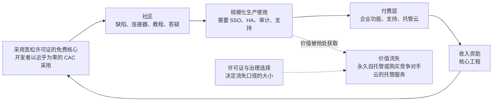

# 38. 作为战略的开源
> **深度：** L2 · **阅读时间：** 约 14 分钟 · **最后核实：** 2026-11-01 · **前置阅读：** [第 35 章 — 商业模式](ch35-business-models.md)，[第 7 章 — 开放表格式](../01-data-systems-foundations/ch07-open-table-formats.md)

## 要点速览（TL;DR）

- 在数据基础设施领域，开源主要是一种分发策略。一个免费、采用宽松许可证的核心能以几乎为零的获客成本赢得开发者。收入随后才来，且来自规模小得多的付费层：支持服务、[开放核心（open core）](../glossary.md#open-core)企业功能，或托管云服务。托管服务已成为主导模式。在 MongoDB，Atlas 占 FY2026 收入的 73%（公司披露）。[^mdb-atlas]
- 许可证决定了这部分价值有多少会流向他人。宽松许可证（Apache 2.0、MIT、BSD）允许任何人——包括 AWS——将软件作为服务出售。著佐权（copyleft）许可证（GPL、[AGPL](../glossary.md#agpl)）强制要求共享修改后的代码。[源码可用许可证（source-available license）](../glossary.md#source-available-license)（[SSPL](../glossary.md#sspl)、[BSL](../glossary.md#business-source-license)、Elastic License 2.0、RSAL）直接禁止竞争性托管服务，也正因如此不符合 OSI 对开源的定义。
- 2018 年至 2024 年间，MongoDB、Confluent、Elastic、HashiCorp、Redis 和 Cockroach Labs 相继更换许可证，以阻止云厂商转售其成果。凡是超大规模云厂商有大量收入面临风险之处，它都资助了一个分叉：OpenSearch（2021）、OpenTofu（2023）、Valkey（2024）。随后，Elastic（2024 年 8 月）和 Redis（2025 年 5 月）又重新加入 AGPL 作为可选许可证。[^elastic-agpl][^redis8]
- 如今，治理与许可证同样重要。由中立基金会持有的项目不能被单一厂商更换许可证。Apache Iceberg 的提交者分布在众多公司，而 Delta Lake 的提交者集中在 Databricks，这一差异帮助决定了表格式之争的结果（[第 7 章](../01-data-systems-foundations/ch07-open-table-formats.md)）。2024 年 Unity Catalog 和 Polaris 的开源，将同一场竞争上移到了目录层（[第 8 章](../01-data-systems-foundations/ch08-catalogs-and-metastores.md)）。
- 其经济性并不像争论所暗示的那样特殊。开源出身并不能带来可见的估值溢价。MongoDB、Elastic 和 GitLab 的估值为 EV/未来 12 个月收入 4.6–9.0 倍，而专有软件 Snowflake 和 Datadog 为 16.9–21.5 倍（EV ÷ 当年指引，估算，截至 2026-10-02 至 2026-10-30）。增长只能解释部分差距：按[第 37 章](ch37-public-comps-valuation.md)的回归，它约占 Snowflake 与 MongoDB 之间约 8 倍差距中的 1 倍。其余由留存率、按用量计费的可见度和 AI 工作负载敞口解释；许可证并不起作用。[^comps] 毛利率取决于软件的交付方式，而不是许可方式。

## 为何重要（业务视角 + Everpure 视角）

对于企业发展团队来说，许可证是资产的一部分。对一家开源出身的公司做尽职调查时，有三个问题决定其价值。超大规模云厂商能否合法地出售同样的产品？厂商以后能否更改条款，还是代码由基金会持有？如果厂商确实更改了条款，客户是否有一个可信的分叉可以迁移？这些答案解释了近期的几笔交易价格。IBM 在 HashiCorp 更换 Terraform 许可证之后以 $6.4B 收购了它，[^ibm-hashi] 并以约 $11B 收购了 Confluent，而 IBM 并不控制后者的核心 Apache Kafka。[^comps] Databricks 以据媒体报道约 $2B 的价格收购了 Tabular，这家公司围绕一个它无法拥有的项目而建立。[^tabular]

对 Everpure 而言，开放格式就像一种合作伙伴关系的通用货币。存储平台并不需要自己的开源社区。但它确实需要成为客户所用引擎依赖的开放项目的一流、经过测试的目标平台：Iceberg、Parquet、Iceberg REST 目录协议和 S3 API。一家"兼容开放格式"的厂商能在 Databricks、Snowflake、Dremio 和 Starburst 的参考架构中占据一席之地。不兼容的厂商则只能为一条专有路径辩护。下文的存储桥接部分列出了基于公开信息、战略团队可能评估的选项。

## 工作原理

### 漏斗：从下载到发票

一家开源数据公司运营着一个四阶段漏斗。**采用：**开发者下载免费版本，通常无需与销售人员接触。**社区：**其中一些人提交缺陷报告、编写连接器和教程，并回答论坛问题。这些工作降低了厂商构建生态系统的成本。**生产：**一部分用户将软件投入生产，并遇到企业级需求，例如单点登录、审计日志、高可用性、合规认证，以及凌晨 3 点可以拨打的电话。**变现：**厂商以订阅、企业功能或托管服务的形式出售这些需求，并用收入为免费核心的进一步开发提供资金。

*图 38.1 — 开放核心飞轮。采用成本很低，但生产用户总是可以转向自托管或超大规模云厂商的托管服务。更换许可证是试图收窄这一出口。*

一个实例可以说明其经济性。假设一个项目每年有 1,000,000 次下载。其中 2%（20,000 次）转化为生产部署，生产部署中有 1.5%（300 个）成为每年支付 $60,000 的付费账户。这带来 $18M 的新增年度经常性收入（ARR），而漏斗顶端的营销支出几乎为零。所有输入值均为说明性假设。业内从业者的经验法则认为，活跃用户向付费账户的转化率在个位数低段，但没有严谨的公开研究支持某个精确比率。[^conv-est] 重点在于漏斗的形状，而不是数字。在一个巨大的免费用户基础上实现 1% 的转化率，就足以支撑一家上市公司。生产用户中转向竞争对手托管服务的比例稍有变化，商业逻辑就会随之改变。

### 三种收费方式

- **支持与订阅（Red Hat 模式）。** 所有代码都是开放的，客户为经过认证的构建版本、补丁、赔偿保障和支持付费。这种模式持久但天花板较低，因为无论是否有人付费，产品都是一样的。IBM 在 2019 年以 $34B 收购 Red Hat，是这种模式的巅峰。[^redhat]
- **开放核心。** 引擎免费，企业所需的功能是专有的：安全、治理、管理工具和部分性能功能。GitLab 是一个清晰的例子，其 Q2 FY2027（2026 年 5 月–7 月）的非 GAAP 毛利率为 86.5%。[^comps] 风险在于界线划错了位置。付费墙圈得太多，社区就会分叉；圈得太少，就没人付费。
- **托管服务。** 厂商为客户运行软件，并按用量收费。在这里，厂商出售的是运维，而不是代码，这就是为什么运行相同代码的超大规模云厂商会构成直接竞争。MongoDB 74% 的 GAAP 毛利率（Q2 FY2027）承担了这种模式所伴随的云基础设施成本。[^mdb-q2]

### L2 层面的许可证：每种许可证实际允许什么

开源促进会（OSI）维护的[开源定义（Open Source Definition）](../glossary.md#open-source-definition)有十项标准。这里最重要的是两项：不得歧视任何个人或群体，不得限制使用领域。一份写着"除以服务形式提供本软件的云厂商之外，任何人均可使用"的许可证，无论公开了多少代码，都同时违反了这两项。这就是开源与源码可用之间的法律界线。

| 许可证 | 是否获 OSI 批准？ | 著佐权范围 | 对云厂商的限制 | 示例 | 商业效果 |
|---|---|---|---|---|---|
| Apache 2.0 | 是 | 无（[宽松型](../glossary.md#permissive-license)）；包含明确的专利授权 | 无 | Iceberg、Spark、Kafka、Arrow、Parquet、Polaris、Unity Catalog OSS | 最大化采用率和企业的安心程度。任何人都可以出售托管服务。 |
| MIT / BSD-3 | 是 | 无 | 无 | DuckDB（MIT）、Valkey（BSD-3）、2024 年之前的 Redis（BSD-3） | 与 Apache 相同，但没有明确的专利授权。 |
| MPL 2.0 | 是 | 文件级：被修改的文件必须保持开放 | 无 | 2023 年之前的 Terraform、OpenTofu | 弱著佐权。易于嵌入专有产品。 |
| GPL（v2 和 v3） | 是 | 整个衍生作品，由分发触发 | 实际上无。运行服务不属于分发。 | Linux 内核（GPLv2）、MySQL Community（GPLv2） | 防范专有分叉，但不防范 SaaS。 |
| AGPLv3 | 是 | 整个衍生作品，通过网络提供服务时也会触发 | 间接。托管方必须公开其修改。 | Redis 8（可选）、Elasticsearch 和 Kibana（自 2024 年起可选）、Grafana | OSI 批准的许可证中威慑力最强的。许多企业通过政策禁止使用。 |
| SSPL v1 | 否（2019 年撤回 OSI 审查） | 扩展到提供该服务所用的整个技术栈 | 实际上的禁止：公开所有服务代码，否则须获取商业许可 | MongoDB（2018）、Elastic（2021）、Redis（2024 年可选） | 阻止超大规模云厂商转售。Linux 发行版不再收录该软件。 |
| BSL 1.1 | 否 | 无；在变更日期（最长 4 年）之前限制生产使用，之后转为开放许可证 | 通常在变更日期之前禁止竞争性托管服务 | HashiCorp（2023）、CockroachDB（2019）、MariaDB MaxScale | 一种延时开放的许可证。旧版本会不断变为开放。 |
| Elastic License 2.0 | 否 | 无 | 禁止以托管服务形式提供软件；禁止绕过许可证密钥 | Elastic（2021）、Airbyte、dbt Fusion 组件（2025） | 简短易读。允许内部使用；竞争性云服务被阻止。 |
| Confluent Community License | 否 | 无 | 禁止以竞争性 SaaS 形式提供受覆盖组件（ksqlDB、Schema Registry、REST Proxy） | Confluent Platform 组件（2018） | 只保护附加组件。Kafka 本身仍为 Apache 2.0。 |
| RSALv2 | 否 | 无 | 禁止以托管服务形式提供 Redis | Redis 7.4+（2024） | Redis 自己版本的 ELv2 式条款。 |
| FSL（"公平源码"） | 否 | 无；2 年后转为 Apache 2.0 或 MIT | 2 年内禁止竞争性商业使用 | Sentry、Codecov（2023） | 一种延迟期更短且固定的 BSL，被宣传为一个中间类别。 |

*图 38.2 — 许可证比较。具有商业意义的是"对云厂商的限制"这一列。OSI 批准要求这一列为空，因此任何阻止超大规模云厂商转售的许可证，按定义都属于源码可用许可证。*[^osi-sspl][^cfl][^elastic-2021][^redis-2024][^hashi-bsl][^fsl][^dbt-fusion]

> **深入（L3）。** 有两个条款承担了大部分作用。AGPL 第 13 条要求，任何允许用户通过网络与修改后软件交互的人，都必须向这些用户提供其源代码。SSPL 第 13 条将"源代码"扩展到运行该服务所需的一切：管理软件、用户界面、API、自动化、监控、备份和托管。这一定义如此宽泛，以至于没有任何云厂商能够遵守，而这正是其意图所在。第二个机制是**[贡献者许可协议（contributor license agreement）](../glossary.md#contributor-license-agreement)**（CLA）。厂商只能对自己有权重新许可的代码更换许可证。一份将贡献者版权转让或广泛授权给公司的 CLA，正是让日后更换许可证成为可能的关键。基金会项目要么使用将权利授予基金会的 CLA，要么依赖"入站即出站"（inbound-equals-outbound）的许可方式，因此没有任何一家公司能够单方面更换许可证。
