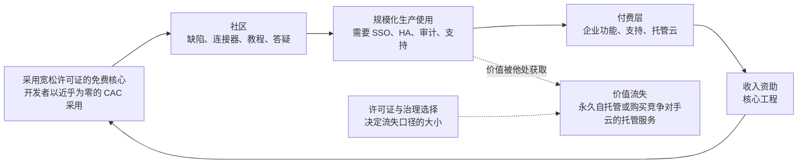
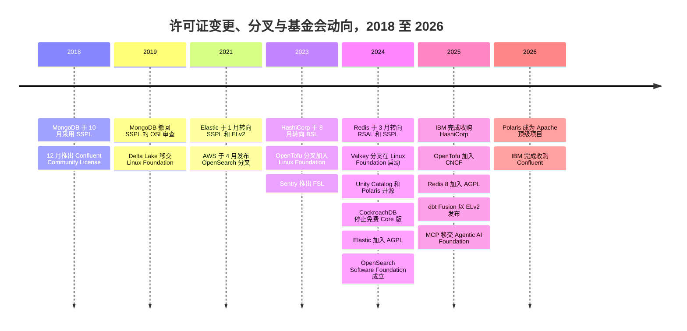
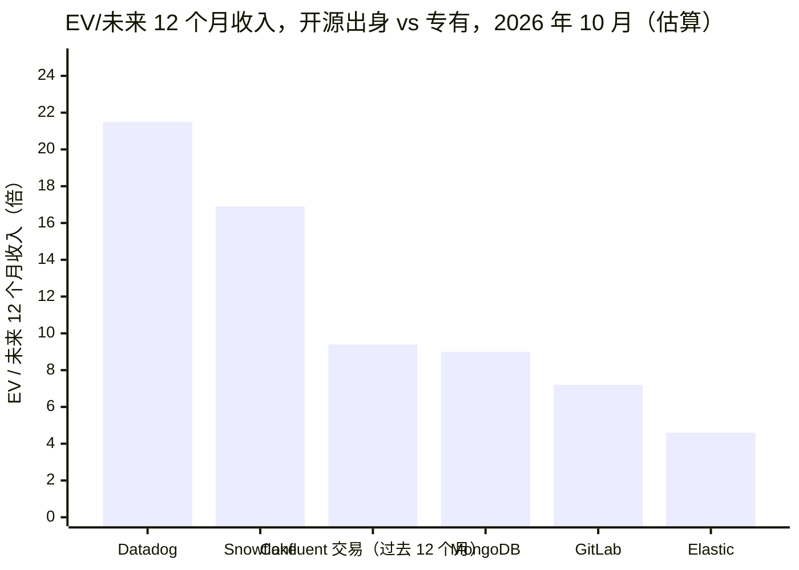

# 38. 作为战略的开源
> **深度：** L2 · **阅读时间：** 约 14 分钟 · **最后核实：** 2026-11-01 · **前置阅读：** [第 35 章 — 商业模式](ch35-business-models.md)，[第 7 章 — 开放表格式](../01-data-systems-foundations/ch07-open-table-formats.md)

## 要点速览（TL;DR）

- 在数据基础设施领域，开源主要是一种分发策略。一个免费、采用宽松许可证的核心能以几乎为零的获客成本赢得开发者。收入随后才来，且来自规模小得多的付费层：支持服务、[开放核心（open core）](../glossary.md#open-core)企业功能，或托管云服务。托管服务已成为主导模式。在 MongoDB，Atlas 占 FY2026 收入的 73%（公司披露）。[^mdb-atlas]
- 许可证决定了这部分价值有多少会流向他人。宽松许可证（Apache 2.0、MIT、BSD）允许任何人——包括 AWS——将软件作为服务出售。著佐权（copyleft）许可证（GPL、[AGPL](../glossary.md#agpl)）强制要求共享修改后的代码。[源码可用许可证（source-available license）](../glossary.md#source-available-license)（[SSPL](../glossary.md#sspl)、[BSL](../glossary.md#business-source-license)、Elastic License 2.0、RSAL）直接禁止竞争性托管服务，也正因如此不符合 OSI 对开源的定义。
- 2018 年至 2024 年间，MongoDB、Confluent、Elastic、HashiCorp、Redis 和 Cockroach Labs 相继更换许可证，以阻止云厂商转售其成果。凡是超大规模云厂商有大量收入面临风险之处，它都资助了一个分叉：OpenSearch（2021）、OpenTofu（2023）、Valkey（2024）。随后，Elastic（2024 年 8 月）和 Redis（2025 年 5 月）又重新加入 AGPL 作为可选许可证。[^elastic-agpl][^redis8]
- 如今，治理与许可证同样重要。由中立基金会持有的项目不能被单一厂商更换许可证。Apache Iceberg 的提交者分布在众多公司，而 Delta Lake 的提交者集中在 Databricks，这一差异帮助决定了表格式之争的结果（[第 7 章](../01-data-systems-foundations/ch07-open-table-formats.md)）。2024 年 Unity Catalog 和 Polaris 的开源，将同一场竞争上移到了目录层（[第 8 章](../01-data-systems-foundations/ch08-catalogs-and-metastores.md)）。
- 其经济性并不像争论所暗示的那样特殊。开源出身并不能带来可见的估值溢价。MongoDB、Elastic 和 GitLab 的估值为 EV/未来 12 个月收入 4.6–9.0 倍，而专有软件 Snowflake 和 Datadog 为 16.9–21.5 倍（EV ÷ 当年指引，估算，截至 2026-10-02 至 2026-10-30）。增长只能解释部分差距：按[第 37 章](ch37-public-comps-valuation.md)的回归，它约占 Snowflake 与 MongoDB 之间约 8 倍差距中的 1 倍。其余由留存率、按用量计费的可见度和 AI 工作负载敞口解释；许可证并不起作用。[^comps] 毛利率取决于软件的交付方式，而不是许可方式。

## 为何重要（业务视角 + Everpure 视角）

对于企业发展团队来说，许可证是资产的一部分。对一家开源出身的公司做尽职调查时，有三个问题决定其价值。超大规模云厂商能否合法地出售同样的产品？厂商以后能否更改条款，还是代码由基金会持有？如果厂商确实更改了条款，客户是否有一个可信的分叉可以迁移？这些答案解释了近期的几笔交易价格。IBM 在 HashiCorp 更换 Terraform 许可证之后以 $6.4B 收购了它，[^ibm-hashi] 并以约 $11B 收购了 Confluent，而 IBM 并不控制后者的核心 Apache Kafka。[^comps] Databricks 以据媒体报道约 $2B 的价格收购了 Tabular，这家公司围绕一个它无法拥有的项目而建立。[^tabular]

对 Everpure 而言，开放格式就像一种合作伙伴关系的通用货币。存储平台并不需要自己的开源社区。但它确实需要成为客户所用引擎依赖的开放项目的一流、经过测试的目标平台：Iceberg、Parquet、Iceberg REST 目录协议和 S3 API。一家"兼容开放格式"的厂商能在 Databricks、Snowflake、Dremio 和 Starburst 的参考架构中占据一席之地。不兼容的厂商则只能为一条专有路径辩护。下文的存储桥接部分列出了基于公开信息、战略团队可能评估的选项。

## 工作原理

### 漏斗：从下载到发票

一家开源数据公司运营着一个四阶段漏斗。**采用：**开发者下载免费版本，通常无需与销售人员接触。**社区：**其中一些人提交缺陷报告、编写连接器和教程，并回答论坛问题。这些工作降低了厂商构建生态系统的成本。**生产：**一部分用户将软件投入生产，并遇到企业级需求，例如单点登录、审计日志、高可用性、合规认证，以及凌晨 3 点可以拨打的电话。**变现：**厂商以订阅、企业功能或托管服务的形式出售这些需求，并用收入为免费核心的进一步开发提供资金。

*图 38.1 — 开放核心飞轮。采用成本很低，但生产用户总是可以转向自托管或超大规模云厂商的托管服务。更换许可证是试图收窄这一出口。*

一个实例可以说明其经济性。假设一个项目每年有 1,000,000 次下载。其中 2%（20,000 次）转化为生产部署，生产部署中有 1.5%（300 个）成为每年支付 $60,000 的付费账户。这带来 $18M 的新增年度经常性收入（ARR），而漏斗顶端的营销支出几乎为零。所有输入值均为说明性假设。业内从业者的经验法则认为，活跃用户向付费账户的转化率在个位数低段，但没有严谨的公开研究支持某个精确比率。[^conv-est] 重点在于漏斗的形状，而不是数字。在一个巨大的免费用户基础上实现 1% 的转化率，就足以支撑一家上市公司。生产用户中转向竞争对手托管服务的比例稍有变化，商业逻辑就会随之改变。

### 三种收费方式

- **支持与订阅（Red Hat 模式）。** 所有代码都是开放的，客户为经过认证的构建版本、补丁、赔偿保障和支持付费。这种模式持久但天花板较低，因为无论是否有人付费，产品都是一样的。IBM 在 2019 年以 $34B 收购 Red Hat，是这种模式的巅峰。[^redhat]
- **开放核心。** 引擎免费，企业所需的功能是专有的：安全、治理、管理工具和部分性能功能。GitLab 是一个清晰的例子，其 Q2 FY2027（2026 年 5 月–7 月）的非 GAAP 毛利率为 86.5%。[^comps] 风险在于界线划错了位置。付费墙圈得太多，社区就会分叉；圈得太少，就没人付费。
- **托管服务。** 厂商为客户运行软件，并按用量收费。在这里，厂商出售的是运维，而不是代码，这就是为什么运行相同代码的超大规模云厂商会构成直接竞争。MongoDB 74% 的 GAAP 毛利率（Q2 FY2027）承担了这种模式所伴随的云基础设施成本。[^mdb-q2]

### L2 层面的许可证：每种许可证实际允许什么

开源促进会（OSI）维护的[开源定义（Open Source Definition）](../glossary.md#open-source-definition)有十项标准。这里最重要的是两项：不得歧视任何个人或群体，不得限制使用领域。一份写着"除以服务形式提供本软件的云厂商之外，任何人均可使用"的许可证，无论公开了多少代码，都同时违反了这两项。这就是开源与源码可用之间的法律界线。

| 许可证 | 是否获 OSI 批准？ | 著佐权范围 | 对云厂商的限制 | 示例 | 商业效果 |
|---|---|---|---|---|---|
| Apache 2.0 | 是 | 无（[宽松型](../glossary.md#permissive-license)）；包含明确的专利授权 | 无 | Iceberg、Spark、Kafka、Arrow、Parquet、Polaris、Unity Catalog OSS | 最大化采用率和企业的安心程度。任何人都可以出售托管服务。 |
| MIT / BSD-3 | 是 | 无 | 无 | DuckDB（MIT）、Valkey（BSD-3）、2024 年之前的 Redis（BSD-3） | 与 Apache 相同，但没有明确的专利授权。 |
| MPL 2.0 | 是 | 文件级：被修改的文件必须保持开放 | 无 | 2023 年之前的 Terraform、OpenTofu | 弱著佐权。易于嵌入专有产品。 |
| GPL（v2 和 v3） | 是 | 整个衍生作品，由分发触发 | 实际上无。运行服务不属于分发。 | Linux 内核（GPLv2）、MySQL Community（GPLv2） | 防范专有分叉，但不防范 SaaS。 |
| AGPLv3 | 是 | 整个衍生作品，通过网络提供服务时也会触发 | 间接。托管方必须公开其修改。 | Redis 8（可选）、Elasticsearch 和 Kibana（自 2024 年起可选）、Grafana | OSI 批准的许可证中威慑力最强的。许多企业通过政策禁止使用。 |
| SSPL v1 | 否（2019 年撤回 OSI 审查） | 扩展到提供该服务所用的整个技术栈 | 实际上的禁止：公开所有服务代码，否则须获取商业许可 | MongoDB（2018）、Elastic（2021）、Redis（2024 年可选） | 阻止超大规模云厂商转售。Linux 发行版不再收录该软件。 |
| BSL 1.1 | 否 | 无；在变更日期（最长 4 年）之前限制生产使用，之后转为开放许可证 | 通常在变更日期之前禁止竞争性托管服务 | HashiCorp（2023）、CockroachDB（2019）、MariaDB MaxScale | 一种延时开放的许可证。旧版本会不断变为开放。 |
| Elastic License 2.0 | 否 | 无 | 禁止以托管服务形式提供软件；禁止绕过许可证密钥 | Elastic（2021）、Airbyte、dbt Fusion 组件（2025） | 简短易读。允许内部使用；竞争性云服务被阻止。 |
| Confluent Community License | 否 | 无 | 禁止以竞争性 SaaS 形式提供受覆盖组件（ksqlDB、Schema Registry、REST Proxy） | Confluent Platform 组件（2018） | 只保护附加组件。Kafka 本身仍为 Apache 2.0。 |
| RSALv2 | 否 | 无 | 禁止以托管服务形式提供 Redis | Redis 7.4+（2024） | Redis 自己版本的 ELv2 式条款。 |
| FSL（"公平源码"） | 否 | 无；2 年后转为 Apache 2.0 或 MIT | 2 年内禁止竞争性商业使用 | Sentry、Codecov（2023） | 一种延迟期更短且固定的 BSL，被宣传为一个中间类别。 |

*图 38.2 — 许可证比较。具有商业意义的是"对云厂商的限制"这一列。OSI 批准要求这一列为空，因此任何阻止超大规模云厂商转售的许可证，按定义都属于源码可用许可证。*[^osi-sspl][^cfl][^elastic-2021][^redis-2024][^hashi-bsl][^fsl][^dbt-fusion]

> **深入（L3）。** 有两个条款承担了大部分作用。AGPL 第 13 条要求，任何允许用户通过网络与修改后软件交互的人，都必须向这些用户提供其源代码。SSPL 第 13 条将"源代码"扩展到运行该服务所需的一切：管理软件、用户界面、API、自动化、监控、备份和托管。这一定义如此宽泛，以至于没有任何云厂商能够遵守，而这正是其意图所在。第二个机制是**[贡献者许可协议（contributor license agreement）](../glossary.md#contributor-license-agreement)**（CLA）。厂商只能对自己有权重新许可的代码更换许可证。一份将贡献者版权转让或广泛授权给公司的 CLA，正是让日后更换许可证成为可能的关键。基金会项目要么使用将权利授予基金会的 CLA，要么依赖"入站即出站"（inbound-equals-outbound）的许可方式，因此没有任何一家公司能够单方面更换许可证。

### 许可证之争，2018–2026

*图 38.3 — 许可证变更分两波出现，分别在 2018–2021 年和 2023–2024 年，每次之后都伴随着分叉或部分回调。从 2024 年起，战略动作从限制许可证转向将项目捐赠给基金会。*[^mdb-sspl][^osi-sspl][^cfl][^delta-lf][^elastic-2021][^hashi-bsl][^opentofu-lf][^fsl][^redis-2024][^valkey][^ucoss][^polaris][^crdb-license][^elastic-agpl][^osf][^ibm-hashi][^tofu-cncf][^redis8][^dbt-fusion][^mcp][^comps]

所有这些变更都只适用于未来版本。以 Apache、BSD 或 MPL 发布的版本永久保持该许可证。这为每一个分叉提供了起点。OpenSearch 从 Elasticsearch 7.10.2 分叉，Valkey 从 Redis 7.2.4 分叉，OpenTofu 从最后一个 MPL 许可的 Terraform 版本分叉。[^elastic-2021][^valkey][^opentofu-lf] 因此，分叉在第一天就继承了一个完整的、生产级的代码库。问题在于它能否吸引维护者。

| 公司 | 变更（日期） | 分叉 | 对收入和社区的影响 | 后续回调 |
|---|---|---|---|---|
| MongoDB | AGPL → SSPL（2018 年 10 月） | 没有代码分叉。AWS 转而构建了 API 兼容的 DocumentDB 服务 | 收入从 $590M（FY2021）增至约 $2.46B（FY2026），GAAP。Atlas 占总收入的 73%。Debian 和 Fedora 移除了 MongoDB。 | 无。SSPL 仍在使用。 |
| Confluent | 附加组件从 Apache → Confluent Community License（2018 年 12 月） | 无。Kafka 在 ASF 下仍为 Apache 许可，因此没有可分叉之物 | FY2025 收入达 $1,167M（GAAP）。IBM 以约 $11B 收购（2026 年 3 月完成）。 | 无需回调 |
| Elastic | Apache → SSPL/ELv2（2021 年 1 月） | OpenSearch（AWS，2021 年 4 月），2024 年 9 月移交 Linux Foundation | 增长持续；FY2027 指引约 $2.0B。OpenSearch 报告截至 2024 年下载量超过 7 亿次。 | 加入 AGPL 作为可选许可证（2024 年 8 月） |
| HashiCorp | MPL → BSL（2023 年 8 月） | OpenTofu（Linux Foundation，2023 年 9 月；自 2025 年 4 月起进入 CNCF Sandbox） | 以 $6.4B 出售给 IBM（2025 年 2 月完成）。OpenTofu 报告截至 2026 年 GitHub 下载量超过 1,000 万次。 | 无 |
| Redis | BSD → RSALv2/SSPLv1（2024 年 3 月） | Valkey（Linux Foundation，2024 年 3 月；获 AWS、Google、Oracle 等支持） | Redis 称此次变更对其业务没有影响（公司披露）。大多数外部贡献者转投 Valkey。AWS 对 Valkey 的定价比 Redis OSS 低 20–33%。 | Redis 8 加入 AGPLv3（2025 年 5 月） |
| Cockroach Labs | BSL（2019）；停止免费 Core 版，改为单一 Enterprise 许可证（2024 年 8 月） | 未见有基金会支持的分叉的报道 | 对年收入低于 $10M 的公司免费（基于诚信原则）；高于此标准按核心收费。结果未披露（私营公司）。 | 无 |
| dbt Labs | 新 Fusion 引擎组件采用 ELv2（2025 年 5 月）；dbt Core 仍为 Apache 2.0 | 无分叉。SQLMesh 等竞争引擎转而与之竞争 | 社区对双轨产品表示担忧。许可证范围后来有所收窄 [VERIFY: 当前 Fusion 许可证的划分]。 | 部分回调（dbt Core v2 采用 Apache 2.0） |

*图 38.4 — 许可证变更的结果。收入很少受损，受损的是对社区的控制。凡是涉及超大规模云厂商自有托管服务的地方（Elasticsearch、Redis），资金充足的分叉都在数周内出现。凡是核心位于基金会的地方（Kafka），这个问题从未出现。*[^mdb-atlas][^comps][^fedora][^cfl][^elastic-2021][^osf][^estc-q1][^ibm-hashi][^tofu-cncf][^redis-ceo][^devclass-redis][^valkey-price][^crdb-license][^dbt-fusion]

由此可得三条教训。第一，更换许可证在短期内保护了收入，但在长期内损失了社区。在 Redis 变更后的一年里，只有 Redis 员工对 Redis 做出了重要贡献，而 Valkey 在头六个月就吸引了来自 10 家公司的 29 位贡献者，其中 18 位此前曾为 Redis 做出贡献。[^foster] 第二，回调只是部分的。Elastic 和 Redis 是在源码可用许可证之外*增加* AGPL，而不是用它替代。AGPL 让它们可以重新称其软件为开源，同时仍能威慑大多数云转售商。Elastic 的 CTO 表示，在分叉之后，与 AWS 的合作关系"比以往任何时候都更牢固"。[^elastic-agpl] 第三，更换过许可证的公司往往会成为收购目标。HashiCorp 和 Confluent 都被 IBM 收购，而 IBM 还拥有 Red Hat。

> **类比：更换许可证如同在合同中途修改授权费条款。** 更换许可证类似于一家 IP 授权方：它无法对已授权的工艺节点重新定价，因为过去的版本保持原有条款，但它宣布所有未来节点对某一类被授权方收取新的授权费。依赖其路线图的被授权方只能接受新条款。规模大到能够自行承担路线图的被授权方，则停留在最后一个旧节点，自行向前设计。这就是分叉。指令集架构（ISA）领域也出现了同样的分化。Arm 的可授权 ISA 赚取授权费，并由 Arm 设定条款。RISC-V International 的开放 ISA 不赚钱，但任何人都无法对其重新定价。超大规模云厂商和大型 OEM 投资 RISC-V 进行对冲，与它们支持 Valkey 的理由相同。

> **类比：分叉即第二供应源。** 半导体买家长期以来都要求在设计采用关键器件之前必须有第二供应源。IBM 在 1982 年要求 Intel 将 x86 授权给 AMD 就是经典案例。Valkey 和 OpenSearch 就是超大规模云厂商的第二供应源，无论大多数客户最终是否切换，它们的存在都约束了原厂商的定价。

### "露天开采"之争

厂商的论点是这样的。它们为几乎所有的工程开发提供资金。超大规模云厂商拿走免费代码，将其包装为托管服务（ElastiCache、Amazon OpenSearch Service、用于 Kafka 的 MSK），与自己的计费、身份认证和支持捆绑在一起，在不承担研发成本的情况下获取客户关系。于是，厂商自己的托管服务要与自己的代码竞争，而销售这些代码的供应商还掌握着客户的云账单。

反方论点同样值得重视。超大规模云厂商确实有所贡献：AWS 称已有超过 225 位贡献者向 Valkey 提交了超过 1,500 个拉取请求。[^valkey-two] 托管服务还通过将技术带给那些永远不会自己运行它的客户而扩大了市场，其中许多客户后来会购买厂商自己的企业版。MongoDB 在与一个 API 兼容的 AWS 服务竞争的同时，让 Atlas 成长为其大部分收入来源。[^mdb-atlas] 大多数更换许可证的厂商最初也是主动选择了宽松许可证，因为这些许可证能最大化采用率。按这种观点，超大规模云厂商提供该软件，正是许可证所换来的分发渠道的代价。证据支持一种折中立场。当厂商的产品主要是"我们替你运行"时，露天开采是真实的风险。当厂商拥有超大规模云厂商版本所缺乏的功能或性能时，风险则小得多。

### 基金会与治理

基金会持有商标、版权许可和治理规则，因此没有任何一家公司能够更换项目的许可证或改变其路线图方向。各种模式的区别在于由谁做决定。

| 维度 | Apache Software Foundation | Linux Foundation（含 LF AI & Data、CNCF） | 厂商控制的项目 |
|---|---|---|---|
| 谁做决定 | 由个人组成、按贡献选举产生的项目管理委员会（PMC）（"Apache 之道"）。雇主没有正式席位。 | 各项目的技术指导委员会。付费会员通常进入理事会，负责预算和市场推广。 | 公司的维护者和产品管理团队 |
| 商标 | 归 ASF 所有 | 由 LF 或项目专属的 LF 实体持有 | 归公司所有 |
| 许可证 | 仅 Apache 2.0 | 通常为 Apache 2.0（CNCF 的默认许可证；OpenTofu 的 MPL 需要例外批准） | 由公司自行选择，并可通过 CLA 更改 |
| 中立性信号 | PMC 和提交者的多样性；ASF 理事会要求项目避免单一厂商控制 | 会员广度和贡献者多样性，但创始厂商仍可能占据主导 | 按其构造本身就没有 |
| 数据与 AI 示例 | Iceberg、Spark、Kafka、Arrow、Parquet、Hudi、Polaris（2026 年成为顶级项目） | Delta Lake、Unity Catalog OSS、Valkey、OpenSearch、Presto、OpenTofu（CNCF）、MCP（Agentic AI Foundation） | MongoDB、Redis、Elasticsearch、Terraform、CockroachDB |

*图 38.5 — 基金会治理。ASF 是最严格的中立性检验，因为投票权掌握在个人手中。Linux Foundation 更灵活、资金更充足，但项目的创始厂商可以继续掌控。厂商控制是唯一可以更换许可证的模式。*[^asf-fy25][^tofu-cncf][^delta-lf][^ucoss][^valkey][^osf][^mcp][^polaris]

> **类比：基金会如同标准组织。** 基金会在软件领域扮演的角色，相当于 JEDEC 和 PCI-SIG 在硬件领域的角色。竞争对手共同编写规范（DDR5、PCIe 6.0、Iceberg 规范），就知识产权规则达成一致以确保所有人都能实现该规范，然后在实现上展开竞争。内存厂商不是靠拥有 JEDEC 取胜，而是靠按共享规范交付最好的器件取胜。区别在于，软件基金会还托管参考实现，因此控制提交者名单更接近于控制参考设计。

**治理如何塑造了格式之争。** Iceberg 起源于 Netflix，后进入 ASF。截至 2026 年，其 PMC 和提交者名单分别增至 25 人和 39 人，来自 Apple、Netflix、AWS、Snowflake、Databricks（通过 Tabular）、Bloomberg 等公司。[^iceberg-board] 目前没有按雇主逐一统计的公开数据 [VERIFY: 按雇主划分的 Iceberg 提交者]。Dremio（一家与 Iceberg 立场一致的厂商）2022 年的一项分析发现，在 Iceberg 或 Hudi 中，没有任何一家公司的贡献占比达到三分之一，而 Delta Lake 的贡献则由一家公司主导。[^dremio-gov] Delta 于 2019 年移交 Linux Foundation，目前报告有来自 70 多个组织的 190 多名开发者，[^delta-lf][^delta-io] 但买家仍将其视为 Databricks 的项目。Snowflake、AWS 和 Google 可以采用 Iceberg 而无需依赖竞争对手的路线图，它们也确实这样做了。Databricks 的回应是在 2024 年 6 月收购了由 Iceberg 创建者创立的公司 Tabular。[^tabular]

**2024 年 6 月的目录之争。** 同一个月，Snowflake 发布了 Iceberg REST 目录 Polaris，随后将其捐赠给 Apache 孵化器。Databricks 在 LF AI & Data 以 Apache 2.0 许可开源了 Unity Catalog。[^polaris][^ucoss] 两者都是防御性举措。每家公司都放弃了对自身目录接口的控制，以向客户表明不会锁定他们的元数据，同时将产生收入的治理功能保留在商业产品中。基金会的选择本身也传递了信号。Polaris 去了 ASF——更严格的中立性检验——并在 2026 年初成为顶级项目（ASF 于 2026-03-05 公告）。[^polaris] Unity Catalog 去了 LF，Databricks 在那里对其方向保留了更大的影响力。

### 开放权重：下一章

AI 模型正以新的形式经历同样的争论。Meta 的 Llama、Mistral、DeepSeek 等公开了模型权重，但条款各不相同。有些采用 Apache 2.0 或 MIT。另一些采用带有使用限制或用户数门槛的定制许可证，这些许可证除了名称之外，实质上都是源码可用许可证。2024 年 10 月，OSI 发布了开源 AI 定义 1.0（Open Source AI Definition 1.0）。它要求提供关于训练数据的足够信息，以便重建一个实质等同的系统，而 OSI 表示 Llama 的许可证不符合要求。[^osaid] 战略逻辑似曾相识：免费权重推动采用，而赚钱靠的是托管、微调和工具。治理在这里也在向基金会转移。Anthropic 于 2025 年 12 月将模型上下文协议（MCP）捐赠给 Linux Foundation 旗下的 Agentic AI Foundation。[^mcp] 可以预期，某个模型提供商会在未来某个版本上收紧条款；如果真的发生，也可以预期会出现一个基于最后一个开放检查点的分叉。

## 设计选择与权衡

| 策略 | 价值获取方式 | 能否防范超大规模云厂商？ | 社区成本 | 最强版本论证 |
|---|---|---|---|---|
| 宽松核心 + 托管服务 | 比任何人都更好地运营软件 | 否 | 最低 | 采用面最广。如果厂商的服务明显更好（MongoDB Atlas、Confluent Cloud），则能胜出。 |
| 宽松核心 + 专有企业功能（开放核心） | 功能门控 | 部分。超大规模云厂商必须重建这些功能。 | 中等 | 毛利率最高（GitLab 86.5% 非 GAAP）[^comps]，产品打包清晰。 |
| 源码可用（SSPL、BSL、ELv2） | 独家托管权 | 是，在法律上 | 高：分叉风险、发行版禁用、企业政策阻力 | 当厂商规模小而超大规模云厂商规模大时，保护托管服务业务。 |
| 与 AGPL 双重许可 | 著佐权威慑加商业许可 | 大部分 | 中等 | 保留"开源"标签（获 OSI 批准），同时仍能威慑转售。 |
| 捐赠给中立基金会 | 设定生态标准；在相邻层变现 | 否，这是设计使然 | 赢得社区 | 将"竞争对手采用"的问题转化为标准。当赚钱的地方在上一层时有效（Polaris、Unity Catalog OSS、Kafka）。 |

*图 38.6 — 选择在于控制代码还是控制标准。源码可用许可证将前者最大化，基金会将后者最大化。*

接下来是经济性比较。无论采用何种许可证，托管服务业务的毛利率都趋于 75% 左右。MongoDB 报告 GAAP 74%、非 GAAP 76%，Elastic 非 GAAP 77%，而专有软件 Snowflake 的非 GAAP 产品毛利率为 74.7%。[^mdb-q2][^estc-q1][^comps] 开源也不能带来估值溢价。

*图 38.7 — 两家专有软件公司（Datadog、Snowflake）的估值约为开源出身公司的两倍。按第 37 章的回归，增速差异（36% 和 35% 对比 15–30%）只能解释这一差距的一小部分；NRR、按用量计费的可见度和 AI 敞口的作用更大。无论如何，该图都不支持开源能带来溢价的观点。Confluent 的柱子并非 EV/未来 12 个月收入：它是 IBM 控制权交易的倍数，即约 $11B EV ÷ FY2025 GAAP 收入 $1,166.7M（2025-12-08 公告，2026-03-17 完成）。数值来自 `data/public_comps.csv`，市场数据截至 2026-10-02 至 2026-10-30。*[^comps]

## 主要参与者

- **更换过许可证的厂商：** MongoDB（SSPL）、Elastic（SSPL/ELv2/AGPL）、Redis（RSAL/SSPL/AGPL）、Cockroach Labs（Enterprise 许可证）、HashiCorp（BSL，现属 IBM）、Confluent（附加组件采用 Community License，现属 IBM）、ScyllaDB（自 2024 年起源码可用）、dbt Labs（Fusion 组件采用 ELv2）。参见[第 29 章](../04-company-deep-dives/ch29-operational-database-vendors.md)和[第 30 章](../04-company-deep-dives/ch30-data-movement-streaming-companies.md)。
- **分叉的赞助方：** AWS（OpenSearch、Valkey 以及 DocumentDB 式的兼容服务）、Google Cloud 和 Oracle（Valkey），以及 OpenTofu 支持者中的 Spacelift、env0、Harness 和 Gruntwork。[^opentofu-lf]
- **基金会：** ASF（FY2025 有 295 个项目、9,905 名提交者），[^asf-fy25] Linux Foundation 及其旗下的 LF AI & Data、CNCF、OpenSearch Software Foundation 和 Agentic AI Foundation，以及作为定义守护者的 OSI。
- **坚持宽松许可的参与者：** DuckDB（MIT，隶属 DuckDB Foundation）、PostgreSQL（社区治理），以及在 ASF 项目之上进行销售的 Apache 原生公司，如 Dremio 和 Starburst。
- **连续收购方：** IBM 先后收购了 Red Hat（2019）、HashiCorp（2025）、DataStax（2025）和 Confluent（2026）。它是开源出身基础设施最明确的买家。

## 历史与发展轨迹

第一个时代（1998–2010）确立了基本词汇。OSI 于 1998 年成立，ASF 成为 Hadoop 时代数据项目的默认归宿，公司靠支持服务赚钱。第二个时代（2010–2018）是开放核心加云。Databricks、Confluent、Elastic 和 MongoDB 围绕宽松许可的核心构建了企业版和托管服务。第三个时代（2018–2024）是上文所述的许可证变更浪潮，由超大规模云厂商的托管服务引发。第四个时代（2024 年起）从限制许可证转向设定标准。厂商将目录和协议捐赠给基金会，超大规模云厂商资助分叉，两家更换过许可证的公司重新加入了 AGPL。"公平源码"试图为延时开放的许可证贴上一个体面的标签。[^fsl] 下一轮值得关注的是：AI 模型许可证、围绕智能体协议治理权的争夺，以及厂商是否会像 dbt Labs 对 Fusion 那样，为 AI 时代的引擎重新引入源码可用条款。[^dbt-fusion][^mcp]

## 关键数字

| 指标 | 数值 | 口径 | 来源 / 日期 |
|---|---|---|---|
| MongoDB Atlas 收入占比 | FY2026（2025 年 2 月–2026 年 1 月）的 73% | 公司披露 | MongoDB 年报，2026[^mdb-atlas] |
| IBM–HashiCorp | EV $6.4B，每股现金 $35 | 公司披露 | 2024-04-24 公告；2025-02-27 完成（IBM）[^ibm-hashi] |
| IBM–Confluent | EV 约 $11B，约为 FY2025 GAAP 收入（$1,166.7M）的 9.4x | 公司披露 / 本书测算 | 2025-12-08 公告，2026-03-17 完成；IBM 10-Q；`data/public_comps.csv`[^comps] |
| 基金会成立时 OpenSearch 下载量 | 7 亿次以上 | 基金会披露 | Linux Foundation，2024-09-16[^osf] |
| 2025 年 Valkey 活跃贡献者 | 346 | 项目披露（LFX 分析） | Valkey 博客，2025-12[^valkey-ye] |
| 分叉以来 Valkey 的贡献者和拉取请求 | 225 名以上贡献者，1,500 个以上 PR；Docker 拉取量 1 亿次以上 | AWS 披露 | AWS Database Blog，2026[^valkey-two] |
| Valkey 早期贡献者基础 | 头六个月有来自 10 家公司的 29 位贡献者 | 研究 | Foster，2024[^foster] |
| ElastiCache for Valkey 与 Redis OSS 价格对比 | 低 20%（基于节点）、低 33%（无服务器） | AWS 标价 | AWS，2024-10[^valkey-price] |
| OpenTofu 下载量 | GitHub 下载量 1,000 万次以上 | 基金会披露 | CNCF 博客，2026-03-09[^tofu-cncf] |
| Iceberg PMC / 提交者 | 25 / 39 | ASF 理事会报告 | ASF Whimsy，2026[^iceberg-board] |
| Delta Lake 贡献者基础 | 190 名以上开发者，70 个以上组织 | 项目披露 | delta.io，2026-11-01 检索[^delta-io] |
| ASF 规模 | 295 个项目，9,905 名提交者（FY2025，截至 2025 年 4 月 30 日的年度） | 基金会披露 | ASF，2025-08-27[^asf-fy25] |
| CockroachDB 免费版门槛 | 年收入低于 $10M | 公司披露 | Cockroach Labs，2024-08-15[^crdb-license] |
| 变更日期延迟 | BSL ≤4 年（HashiCorp：4 年）；FSL 2 年 | 许可证条款 | LWN 2023；TechCrunch 2023[^hashi-bsl][^fsl] |
| 毛利率，托管服务模式 | MongoDB 74% GAAP / 76% 非 GAAP；Elastic 77% 非 GAAP；GitLab 86.5% 非 GAAP | GAAP / 非 GAAP，最新季度 | 公司公告，2026 年 8 月–9 月[^mdb-q2][^estc-q1][^comps] |
| 免费到付费转化率 | 活跃用户的个位数低段百分比 | 估算（经验法则） | 见注释[^conv-est] |

*图 38.8 — 分叉指标（贡献者、下载量、价差）是领先指标。交易价值表明，更换过许可证的公司仍然可以是 $6–11B 的资产。*

## 存储桥接

> **存储桥接。** 对基础设施厂商而言，开放格式取代专有集成，成为入场门票。基于公开信息，战略团队可能评估的选项包括：(1) 公布表格式所依赖的 S3 行为（强一致性、条件写入、高元数据请求速率）的一致性测试结果，并针对 Iceberg、Delta 和 Polaris/Unity Catalog 的各版本进行测试；(2) 向上游贡献，例如贡献给 S3 兼容性测试套件或 Iceberg 的存储 I/O 层，使公司成为 ASF 项目中被认可的参与者，而不仅仅是使用者；(3) 以 Apache 2.0 许可发布连接器和 Kubernetes operator，使其无需许可证审查即可出现在合作伙伴的参考架构中；(4) 对于任何旨在赢得合作伙伴的产品，避免使用源码可用许可证，因为企业的开源政策会拖慢采用。对象协议的细节请参阅配套的 *Everpure Tech Atlas*。

## 对话手册

**向产品经理提的问题**

1. "客户在生产环境中运行的代码采用什么许可证？收入中来自托管服务与自管理许可证的比例分别是多少？"
2. "如果 AWS 或 Google 明天推出你们项目的托管版本，你们还能卖什么是它们卖不了的？"
3. "你们是否拥有所有贡献的版权或签有 CLA？商标归谁所有？"

**向工程师提的问题**

1. "过去 12 个月的提交中，有多大比例来自公司外部？有多少提交者不是你们的员工？"
2. "哪些功能在开放核心中，哪些是专有的？过去两年你们是否移动过这条界线？"
3. "如果出现一个分叉，它的 API 兼容性会以多快的速度与你们产生偏离？用户那边会出现什么问题？"

**好的回答听起来是什么样的。** 它们会按组件说明许可证（"服务器采用 SSPL，驱动程序采用 Apache 2.0"）。它们会量化外部贡献，并指出管理这些贡献的基金会或 CLA。它们描述的变现界线基于运维价值，例如正常运行时间、安全和规模，而不是社区可以重建的功能。它们将超大规模云厂商的产品视为需要与之竞争的需求信号，而不仅仅是威胁。

**不要这样说**

- "SSPL 是开源的。" 它没有获得 OSI 批准。MongoDB 于 2019 年 3 月撤回了 OSI 审查。[^osi-sspl]
- "AGPL 意味着你不能商业使用它。" AGPL 允许商业使用。它要求在通过网络提供软件时共享修改。
- "更换许可证会毁掉公司。" MongoDB、Elastic 和 HashiCorp 之后都实现了增长或以好价钱出售。它们失去的是对社区的控制。
- "Linux Foundation 就意味着厂商中立。" 治理因项目而异。Delta Lake 和 Unity Catalog 位于 LF，但仍由 Databricks 主导。
- "开放权重就是开源。" 大多数模型许可证不符合 OSI 的开源 AI 定义。[^osaid]

## 深入阅读

- OSI 的开源定义，以及其 2019 年 3 月关于 SSPL 的许可证审查摘要。[^osi-sspl]
- Dawn Foster，*The New Dynamics of Open Source: Relicensing, Forks, & Community Impact*（2024），提供 OpenSearch、Valkey 和 OpenTofu 分叉中贡献者所属机构的数据。[^foster]
- 将 SSPL 第 13 条、ELv2 的三项限制以及 BSL 的"附加使用授权"（Additional Use Grant）文本并排阅读。
- ASF 孵化器的毕业标准，了解"社区重于代码"在实践中意味着什么。

## 关键术语

- [开放核心（Open core）](../glossary.md#open-core) — 免费的开源引擎加付费的专有企业功能。
- [开源定义（Open Source Definition）](../glossary.md#open-source-definition) — 许可证要被称为开源所必须满足的 OSI 十项标准。
- [宽松许可证（Permissive license）](../glossary.md#permissive-license) — Apache 2.0、MIT 或 BSD 等许可证，允许以极少的条件进行再利用，包括用于专有产品。
- [著佐权（Copyleft）](../glossary.md#copyleft) — 一种许可条件，要求衍生作品以相同条款共享。
- [AGPL](../glossary.md#agpl) — 一种著佐权许可证，其共享义务也适用于通过网络提供的软件。
- [源码可用许可证（Source-available license）](../glossary.md#source-available-license) — 公开代码但限制使用，通常禁止竞争性托管服务。
- [SSPL](../glossary.md#sspl) — MongoDB 的许可证，要求服务提供商公开其整个服务技术栈。
- [商业源代码许可证（Business Source License）](../glossary.md#business-source-license) — 一种在变更日期之后转为开源的源码可用许可证。
- [Elastic License 2.0](../glossary.md#elastic-license-20) — 一种简短的源码可用许可证，禁止以托管服务形式转售和绕过许可证密钥。
- [公平源码（Fair source）](../glossary.md#fair-source) — 对在固定延迟期后转为开源的源码可用许可证的统称，例如 Sentry 的 FSL。
- [更换许可证（Relicensing）](../glossary.md#relicensing) — 更改项目未来版本的许可证，通常是为了限制竞争对手。
- [软件分叉（Software fork）](../glossary.md#software-fork) — 从另一个项目最后一个宽松许可代码副本出发而启动的独立项目。
- [贡献者许可协议（Contributor license agreement）](../glossary.md#contributor-license-agreement) — 授予项目所有者对所贡献代码权利的合同，使更换许可证成为可能。
- [项目管理委员会（Project Management Committee）](../glossary.md#project-management-committee) — 治理一个 Apache 项目的个人群体。
- [Valkey](../glossary.md#valkey) — Linux Foundation 旗下以 BSD 许可的 Redis 7.2.4 分叉。
- [开放权重（Open weights）](../glossary.md#open-weights) — 公开发布的 AI 模型参数，其许可证不一定是开源许可证。
- [Apache Polaris](../glossary.md#apache-polaris) — 由 Snowflake 捐赠的 Iceberg REST 目录，自 2026 年起为 Apache 顶级项目。
- [Unity Catalog](../glossary.md#unity-catalog) — Databricks 的治理目录，在 LF AI & Data 有一个 Apache 2.0 开源服务器。

## 资料来源

[^mdb-atlas]: MongoDB, Inc., Annual Report / Form 10-K for FY2026（2025 年 2 月–2026 年 1 月），https://www.sec.gov/Archives/edgar/data/0001441816/000162828026036431/ars.htm，2026 发布；2026-11-01 检索。Atlas 占 FY2026 收入的 73%，以及 FY2021/FY2026 收入（$590.4M；约 $2.46B，GAAP），见 `data/company_financials.csv` 记录。
[^mdb-q2]: MongoDB, Inc., "MongoDB, Inc. Announces Second Quarter Fiscal 2027 Financial Results," https://investors.mongodb.com/news-releases/news-release-details/mongodb-inc-announces-second-quarter-fiscal-2027-financial，2026-09-01 发布；2026-11-01 检索。GAAP 毛利率 74%，非 GAAP 76%（Q2 FY2027 = 2026 年 5 月–7 月），依据 `data/company_financials.csv`。
[^comps]: AI Data Atlas, `data/public_comps.csv`（Datadog、Snowflake、MongoDB、GitLab、Elastic、Confluent 各行；EV/未来 12 个月收入为估算，按各行记录使用财年指引或过去 12 个月代理口径；as_of 日期为 2026-10-02 至 2026-10-30，Confluent 为 2026-03-17）。底层来源包括 stockanalysis.com 统计页面、GitLab Q2 FY2027 公告（https://secure.businesswire.com/news/home/20260901768402/en/GitLab-Reports-Second-Quarter-Fiscal-Year-2027-Financial-Results，2026-09-01）、Snowflake Q2 FY2027 公告（https://www.nasdaq.com/press-release/snowflake-reports-financial-results-second-quarter-fiscal-2027-2026-09-02，2026-09-02）以及 IBM Form 10-Q Q1 2026（https://www.sec.gov/Archives/edgar/data/0000051143/000005114326000038/ibm-20260331.htm）；2026-11-01 检索。IBM–Confluent 于 2026-03-17 完成（EV 约 $11B）。
[^estc-q1]: Elastic N.V., "Elastic Reports First Quarter Fiscal 2027 Financial Results"（转载），https://www.01net.it/elastic-reports-first-quarter-fiscal-2027-financial-results/，2026-08-27 发布；2026-11-01 检索。收入 $478M（增长 15%，GAAP）；非 GAAP 总毛利率 77%，订阅毛利率 81%（Q1 FY2027 = 2026 年 5 月–7 月；Elastic 财年截至 4 月 30 日）；FY2027 收入指引 $1.998–2.010B。毛利率数字来自财报电话会议摘要（MarketBeat，https://www.marketbeat.com/instant-alerts/transcript-elastic-q1-earnings-call-highlights-2026-08-27/），媒体报道。
[^tabular]: TechCrunch, "Databricks reportedly paid $2 billion in Tabular acquisition," https://techcrunch.com/2024/08/14/databricks-reportedly-paid-2-billion-in-tabular-acquisition，2024-08-14 发布；2026-11-01 检索。媒体报道；交易于 2024-06-04 公告。
[^ibm-hashi]: IBM, "IBM Completes Acquisition of HashiCorp, Creates Comprehensive, End-to-End Hybrid Cloud Platform," https://newsroom.ibm.com/2025-02-27-ibm-completes-acquisition-of-hashicorp,-creates-comprehensive,-end-to-end-hybrid-cloud-platform，2025-02-27 发布；SiliconANGLE, https://siliconangle.com/2025/02/27/ibm-completes-6-4b-hashicorp-acquisition-following-regulatory-approvals/，2025-02-27 发布；2026-11-01 检索。
[^redhat]: IBM, "IBM Closes Landmark Acquisition of Red Hat for $34 Billion," https://newsroom.ibm.com/2019-07-09-IBM-Closes-Landmark-Acquisition-of-Red-Hat-for-34-Billion-Defines-Open-Hybrid-Cloud-Future，2019-07-09 发布；2026-11-01 检索（标准引用，未重新抓取）。
[^conv-est]: 估算。从业者和咨询机构的文章（例如 Monetizely, "What's the Optimal Conversion Rate from Free to Paid in Open Source SaaS?", https://www.getmonetizely.com/articles/whats-the-optimal-conversion-rate-from-free-to-paid-in-open-source-saas，未注明日期）引用了活跃用户 1–3% 的数字，但没有一手数据；未找到严谨的公开研究。实例中的输入值（2% 转入生产、1.5% 转为付费、$60K ACV）均为说明性假设；2026-11-01 检索。
[^mdb-sspl]: MongoDB, "Server Side Public License FAQ," https://www.mongodb.com/legal/licensing/server-side-public-license/faq，2018-10 发布（SSPL 于 2018-10-16 公布）；2026-11-01 检索（标准引用，未重新抓取）。
[^osi-sspl]: Open Source Initiative, "March 2019 License-Review Summary," https://opensource.org/blog/licensereview032019，2019-04 发布；OSI license-review 邮件列表存档，2019 年 3 月（Eliot Horowitz 的撤回邮件日期为 2019-03-08），https://lists.opensource.org/pipermail/license-review_lists.opensource.org/2019-March/；2026-11-01 检索。
[^fedora]: Fedora Project, "Changes/MongoDB Removal," https://fedoraproject.org/wiki/Changes/MongoDB_Removal，2019-01 发布；2026-11-01 检索。据同期媒体报道，Debian 于 2018 年 12 月移除了 MongoDB。
[^cfl]: Confluent, "A Developer's Guide to the Confluent Community License," https://confluent.io/blog/developers-guide-confluent-community-license，2018-12 发布；Data Center Knowledge, "Confluent Creates New 'Open Source' License to Stop Cloud Poaching," https://www.datacenterknowledge.com/open-source/confluent-creates-new-open-source-license-stop-cloud-poaching，2018-12 发布；2026-11-01 检索。
[^elastic-2021]: FOSSlife, "Amazon Creates ALv2-Licensed Fork of Elasticsearch," https://www.fosslife.org/amazon-creates-alv2-licensed-fork-elasticsearch，2021-01 发布；TechRepublic, "OpenSearch: AWS rolls out its open source Elasticsearch fork," https://www.techrepublic.com/google-amp/article/opensearch-aws-rolls-out-its，2021-04-13 发布；2026-11-01 检索。分叉基于 Elasticsearch/Kibana 7.10.2。
[^elastic-agpl]: Elastic via Business Wire, "Elastic Announces Open Source License for Elasticsearch and Kibana Source Code," https://www.businesswire.com/news/home/20240829537786/en/Elastic-Announces-Open-Source-License-for-Elasticsearch-and-Kibana-Source-Code，2024-08-29 发布；InfoQ, https://www.infoq.com/news/2024/09/elastic-open-source-agpl，2024-09 发布；2026-11-01 检索。引语出自 Shay Banon 的公告，据报道转引。
[^osf]: Linux Foundation, "Linux Foundation Announces OpenSearch Software Foundation to Foster Open Collaboration in Search and Analytics," https://linuxfoundation.org/press/linux-foundation-announces-opensearch-software-foundation-to-foster-open-collaboration-in-search-and-analytics，2024-09-16 发布；2026-11-01 检索。7 亿次以上下载量为基金会披露。
[^redis-2024]: Redis, "Redis Adopts Dual Source-Available Licensing," https://redis.io/blog/redis-adopts-dual-source-available-licensing/，2024-03-20 发布；InfoQ, https://www.infoq.com/news/2024/03/redis-license-open-source/，2024-03 发布；2026-11-01 检索。
[^valkey]: Linux Foundation, "Linux Foundation Launches Open Source Valkey Community," https://www.linuxfoundation.org/press/linux-foundation-launches-open-source-valkey-community，2024-03-28 发布；2026-11-01 检索（标准引用；支持方依据该公告）。
[^redis8]: Phoronix, "Redis 8.0 Released: Now Tri-Licensed With AGPLv3," https://www.phoronix.com/news/Redis-8.0-Goes-AGPLv3，2025-05-01 发布；2026-11-01 检索。
[^redis-ceo]: InfoWorld, "Redis bets big on an open source return," https://infoworld.com/article/3975620/redis-bets-big-on-an-open-source-return.html，2025-05 发布；2026-11-01 检索。CEO 关于 2024 年变更对业务没有影响的表述为公司披露，未经审计。
[^devclass-redis]: DevClass, "One year ago Redis changed its license – and lost most of its external contributors," https://devclass.com/2025/04/01/one-year-ago-redis-changed-its-license-and-lost-most-of-its-external-contributors/，2025-04-01 发布；2026-11-01 检索。
[^foster]: Dawn Foster, "The New Dynamics of Open Source: Relicensing, Forks, & Community Impact," arXiv:2411.04739, https://arxiv.org/abs/2411.04739，2024-11 发布；幻灯片，https://fastwonderblog.com/wp-content/uploads/2024/11/Dawn-Foster-New-Dynamics-Relicensing-Forks-OFA-2024.pdf；The New Stack 摘要，https://thenewstack.io/what-happens-to-relicensed-open-source-projects-and-their-forks/；2026-11-01 检索。Valkey 头六个月的贡献者数字来自幻灯片和二手摘要。
[^valkey-price]: AWS Database Blog, "Amazon ElastiCache and Amazon MemoryDB announce support for Valkey," https://aws.amazon.com/blogs/database/amazon-elasticache-and-amazon-memorydb-announce-support-for-valkey/，2024-10 发布；2026-11-01 检索。折扣相对于 ElastiCache 上的 Redis OSS，为 AWS 披露的上线时标价。
[^valkey-two]: AWS Database Blog, "Valkey turns two," https://aws.amazon.com/blogs/database/valkey-turns-two/，2026 发布（约 3 月）[VERIFY: 发布日期]；2026-11-01 检索。贡献者、PR 和 Docker 拉取量为 AWS 披露。
[^valkey-ye]: Valkey project, "Valkey 2025 Year-End Review: Reflecting on Progress and Looking Ahead," https://valkey.io/blog/2025-year-end/，2025-12 发布；2026-11-01 检索。346 名活跃贡献者经 LFX 分析统计。
[^hashi-bsl]: LWN.net, "LWN.net Weekly Edition for August 24, 2023"（HashiCorp 于 2023-08-10 转向 BSL），https://lwn.net/Articles/941867/，2023-08-24 发布；DevOps.com, "Rebellion against changes to open source Terraform license mounts," https://devops.com/rebellion-against-changes-to-open-source-terraform-license-mounts/，2023-08 发布；2026-11-01 检索。
[^opentofu-lf]: The New Stack, "Linux Foundation Joins OpenTF to Fork for Terraform into OpenTofu," https://thenewstack.io/linux-foundation-joins-opentf-to-fork-for-terraform-into-opentofu/，2023-09-20 发布；OpenTF Manifesto, https://github.com/loopsocial/opentf-manifesto，2023-08 发布；2026-11-01 检索。
[^tofu-cncf]: The New Stack, "OpenTofu Joins CNCF: New Home for Open Source IaC Project," https://thenewstack.io/opentofu-joins-cncf-new-home-for-open-source-iac-project/，2025-04 发布；heise online, https://heise.de/-10367910，2025-04 发布；CNCF blog, "KubeCon + CloudNativeCon Europe 2026 co-located event deep dive: OpenTofu Day," https://www.cncf.io/blog/2026/03/09/kubecon-cloudnativecon-europe-2026-co-located-event-deep-dive-opentofu-day/，2026-03-09 发布；2026-11-01 检索。自 2025-04-23 起进入 CNCF Sandbox；据媒体报道获得 MPL-2.0 许可证例外批准。
[^crdb-license]: Cockroach Labs, "Enterprise license update," https://cockroachlabs.com/enterprise-license-update，2024-08-15 发布；SD Times, "CockroachDB retires self-hosted Core offering, makes Enterprise version free for companies under $10M in annual revenue," https://sdtimes.com/os/cockroachdb-retires-self-hosted-core-offering-makes-enterprise-version-free-for-companies-under-10m-in-annual-revenue/，2024-08 发布；2026-11-01 检索。Core 版随 v24.3（2024-11-18）停止。
[^dbt-fusion]: dbt Labs, "New code, new license: understanding the new license for the dbt Fusion engine," https://www.getdbt.com/blog/new-code-new-license-understanding-the-new-license-for-the-dbt-fusion-engine，2025-05-28 发布；dbt Docs, "About the dbt Fusion engine," https://docs.getdbt.com/docs/fusion/about-fusion，持续更新文档；dbt Docs blog, "dbt Core v2 is here," https://docs.getdbt.com/blog/dbt-core-v2-is-here；2026-11-01 检索。后续有报道称部分 Fusion 运行时已改为 Apache 2.0，但 dbt 文档未予确认 [VERIFY]。
[^fsl]: TechCrunch, "With Functional Source License, Sentry wants to grant developers freedom without harmful free-riding," https://techcrunch.com/2023/11/20/with-functional-source-license-sentry-wants-to-grant-developers-freedom-without-harmful-free-riding/，2023-11-20 发布；TechCrunch, "Some startups are going 'fair source' to avoid the pitfalls of open source licensing," https://techcrunch.com/2024/09/22/some-startups-are-going-fair-source-to-avoid-the-pitfalls-of-open-source-licensing/，2024-09-22 发布；2026-11-01 检索。
[^delta-lf]: Linux Foundation, "The Delta Lake Project Turns to Linux Foundation to Become the Open Standard for Data Lakes," https://linuxfoundation.org/press-release/the-delta-lake-project-turns-to-linux-foundation-to-become-the-open-standard-for-data-lakes，2019-10-16 发布；2026-11-01 检索。
[^delta-io]: Delta Lake project, "Delta Lake"（主页，贡献者说明），https://delta.io/，持续更新文档；2026-11-01 检索。项目披露；未给出统计日期。
[^dremio-gov]: Dremio, "Table Format Governance and Community Contributions: Apache Iceberg, Apache Hudi, and Delta Lake," https://www.dremio.com/blog/table-format-governance-and-community-contributions-apache-iceberg-apache-hudi-and-delta-lake/，2022-06-02 发布；2026-11-01 检索。厂商分析（Dremio 与 Iceberg 立场一致，现已并入 SAP）；应视为利益相关方观点。
[^iceberg-board]: Apache Software Foundation, Board minutes – Iceberg project reports (Whimsy), https://whimsy.apache.org/board/minutes/Iceberg.html，最新报告 2026；2026-11-01 检索。39 名提交者和 25 名 PMC 成员；最近一次增补为 2026-02-23。
[^polaris]: Apache Polaris, "Apache Polaris graduates to top-level project," https://polaris.apache.org/blog/2026/02/19/apache-polaris-graduates-to-top-level-project/，2026-02-19 发布；ASF, https://news.apache.org/foundation/entry/the-apache-software-foundation-graduates-two-open-source-projects-from-incubator，2026-03-05 发布；2026-11-01 检索。Polaris 由 Snowflake 于 2024 年 6 月发布；据二手来源，于 2024 年 8 月进入 Apache 孵化器 [VERIFY: 进入孵化器的日期]。
[^ucoss]: Databricks, "Open Sourcing Unity Catalog," https://www.databricks.com/blog/open-sourcing-unity-catalog，2024-06-12 发布；It's FOSS News, https://itsfoss.com/news/databricks-open-sources-unity-catalog/，2024-06 发布；2026-11-01 检索。以 Apache 2.0 许可托管于 LF AI & Data。
[^asf-fy25]: The Apache Software Foundation, FY2025 年度报告要点（财年截至 2025-04-30），2025-08-27 发布，见 ASF News, https://news.apache.org/foundation/entry/the-apache-software-foundation-strengthens-global-open-source-community-with-new-tools-programs-and-contributor-support；2026-11-01 检索 [VERIFY: 年度报告的确切 URL]。基金会披露。
[^mcp]: Anthropic, "Donating the Model Context Protocol and establishing the Agentic AI Foundation," https://anthropic.com/news/donating-the-model-context-protocol-and-establishing-of-the-agentic-ai-foundation，2025-12-09 发布；2026-11-01 检索。
[^osaid]: Open Source Initiative, "Meta's LLaMa license is still not Open Source," https://opensource.org/blog/metas-llama-2-license-is-not-open-source（及后续文章），2023-07 发布 / 2025 更新；Gigazine, "OSAID version 1.0 ... is released," https://gigazine.net/gsc_news/en/20241030-open-source-ai-definition，2024-10-30 发布；2026-11-01 检索。OSAID 1.0 于 2024-10-28 发布。
