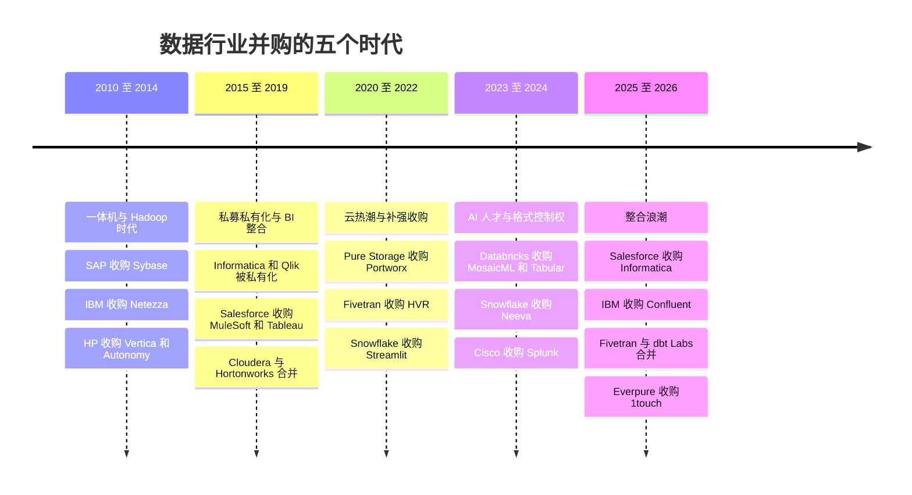
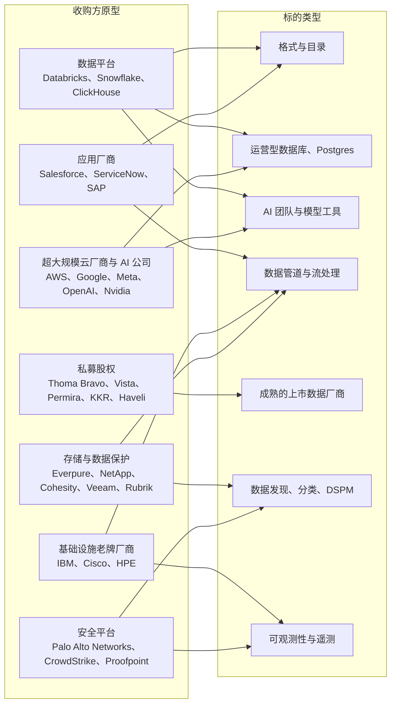

# 39. 数据行业并购史，2010–2026
> **深度：** L2 · **阅读时间：** 约 21 分钟 · **最后核实：** 2026-11-01 · **前置阅读：** [第 37 章 上市可比公司与估值](ch37-public-comps-valuation.md)；有助理解：[第 38 章 开源战略](ch38-open-source-strategy.md)、[第 43 章 现代数据栈](../06-history-and-future/ch43-modern-data-stack.md)

## 要点速览（TL;DR）

- **五个时代，一个方向。** 数据行业的并购经历了以下演变：老牌厂商收购分析一体机（2010–2014）；私募股权将低增长厂商私有化，同时应用厂商收购 BI（2015–2019）；云时代的补强型收购（2020–2022）；AI 人才与格式控制权之争（2023–2024）；最终是大范围的整合浪潮（2025–2026）。在每个时代，买方都在为当时看起来最具战略意义的那一层的控制权付费。
- **数据集。** `data/ma_deals.csv` 收录了 **143 笔精选交易**（2010 年至 2026 年 10 月）。它不是全量统计。只有 **52%** 的交易附有任何金额，只有 **38%** 附有公司披露的金额。有金额交易的中位数为 **$825M**，这高估了典型交易的规模，因为小型补强收购很少披露价格。2025–26 年是文件中最活跃的时期，共 **54 笔交易**，但也是透明度最低的时期：仅 **43%** 有金额。[^ma-csv]
- **七种模式解释了大部分近期交易。** 分别是：(1) 格式与目录控制权（Tabular、Dremio、Select Star）；(2) Postgres 圈地运动（Neon、Crunchy Data、Mooncake、Electric）；(3) 通过[人才收购（acquihire）](../glossary.md#acquihire)和**[许可加聘用（license-and-hire）](../glossary.md#license-and-hire)**结构获取 AI 人才，包括 Meta 以约 $14.3B（媒体报道）取得 Scale AI 49% 股权；(4) 现代数据栈整合（Fivetran + dbt Labs）；(5) 私募股权私有化（take-private）与再度 IPO（Informatica、Cloudera、Couchbase）；(6) 应用厂商和超大规模云厂商为智能体（agent）收购上下文（Informatica、Confluent、DuckLabs）；(7) 存储与数据保护厂商收购数据智能（Cohesity–Veritas、Veeam–Securiti、Everpure–1touch）。
- **哪些奏效，哪些没有。** 买下一个*控制点（control point）*并将其接入分销引擎的交易创造了价值：Salesforce–MuleSoft 以及 Databricks–MosaicML（如今是一项年化运行率超过 $1.4B 的 AI 业务，公司披露）。买下*衰退架构中的收入*的交易则没有：HP–Autonomy 以 $8.8B 的减值告终，Cloudera–Hortonworks 三年后以大致相同的股权价值被私有化。
- **Everpure 视角。** Everpure 以 $125M 收购 1touch（2026 年 5 月完成）符合一个早已确立的模式。存储与数据保护厂商正在收购数据发现、分类和数据治理，也就是紧贴字节之上的那一层。2010 年代的先例（EMC–Greenplum、Hitachi–Pentaho）是一个警示：收购数据*引擎*很少能带动硬件销售。收购数据*元数据*是更新、证据更充分的押注。

## 为何重要（商业 + Everpure 视角）

并购是战略变得可见的地方。产品路线图带有理想色彩，财报电话会经过精心编排，但一份签署的合并协议能显示一家公司愿意花多少钱去拥有什么。按时间顺序阅读，本书数据集中的 143 笔交易构成了一张地图，标出了行业认为控制点在哪里。这张地图不断变化：从一体机，到发行版，到 BI 工具，到云数据仓库，到表格式，到目录，如今到了运营型数据库和智能体的上下文。

对企业发展团队而言，这段历史有三个用途。第一，它设定了**价格锚**。当投行推介一个目录或 DSPM（[数据安全态势管理（data security posture management）](../glossary.md#data-security-posture-management)）标的时，相关可比交易是 Securiti（$1.725B）、Varonis（$6.3B 标题金额）、Dig Security（约 $400M）和 1touch（$125M），而不是泛软件指数。第二，它提供了**整合证据**。保留品牌的标的（Tableau、Portworx、Kaggle）与被吸收的团队（Neeva、Tabular）表现不同，数据集展示了两种结果。第三，它提供了**关于竞争对手的模式识别**。当 NetApp 收购 GPU 数据处理公司（DataPelago）、Veeam 收购 DSPM 公司（Securiti），而 Everpure 在同一个十二个月内收购 1touch 时，说明存储行业正在集体移动，剩余标的会变得更稀缺、更昂贵。

Everpure 自身的交易史很短，也很好解读。Portworx（$370M，2020 年）买下了 Kubernetes 数据服务，1touch（$125M，2026 年）买下了数据发现、分类和语义上下文。[^portworx][^1touch] 两者都是阵列*之上*的层，能让阵列更有价值，又不与客户选定的数据平台竞争。这正是本章末尾"收购"一栏应有的框架，该栏仅使用公开信息。

## 工作原理

### 诚实地解读数据集

在讲历史之前，先说明一下这个工具。`data/ma_deals.csv` 是一份根据新闻稿、SEC 文件和一线媒体整理的**精选**清单。它偏重那些塑造了数据基础设施和 AI 数据的交易，并有意纳入了一些相邻领域的交易（IBM–Red Hat、IBM–HashiCorp，以及可观测性和安全领域的交易），因为它们设定了价格锚。它不是全量统计。数据工具并购的完整统计会包含数千笔小型交易。[^ma-csv]

该文件有三个特性对基于它的任何分析都很重要：

1. **披露稀少且有偏。** 在 143 笔交易中，55 笔（38%）有公司披露的金额，19 笔（13%）有媒体报道的金额，69 笔（48%）没有金额。大型收购方的小型补强收购几乎从不披露，因为价格低于会迫使其在 10-Q 中披露的重要性门槛。有金额交易的中位数为 **$825M**，*公司披露*交易的中位数为 **$1.05B**。两个数字描述的都是露出水面的冰山一角，而不是典型交易。[^ma-csv]
2. **金额口径混杂。** 有些行是股权价值（Splunk，$28B），有些是企业价值（Confluent，约 $11B），有些是合并后公司的数字（Cloudera–Hortonworks，$5.2B 合并股权价值），还有一行是少数股权投资（Meta–Scale AI）。像"按年份统计金额"图表那样将它们加总，只是衡量活跃度的粗略指标，而不是市场规模估算。
3. **私有标的的媒体报道价格往往偏高。** Snowflake 的 10-Q 显示 Crunchy Data 的对价为 $164.5M，而媒体报道约为 $250M；其 10-K 显示 Observe 的对价为 $596.2M，而媒体报道约为 $1B。[^crunchy][^observe] 在相关文件出现之前，应将媒体数字视为上限。

*图 39.1 — 本精选文件中按宣布年份统计的交易数量，因此应将其视为一种模式，而非全量统计。整个 2010 年代活跃度持平，在 2020–2022 年估值热潮期间变少（卖方更愿意做风险投资融资而非退出），随后从 2023 年起急剧上升，因为 AI 对每一项数据资产重新定价。来源：`data/ma_deals.csv`。*

*图 39.2 — 金额呈尖峰状，由一两笔巨型交易决定：2018 年的 Red Hat 和 MuleSoft，2023 年的 Splunk，以及 2025 年的 Scale AI、Confluent 和 Informatica。2026 年的柱子偏低，部分原因是 2026 年大多数交易是未披露金额的补强收购，部分原因是 Proofpoint–Varonis 是迄今文件中唯一一笔数十亿美元级的交易。*

*图 39.3 — 最大的交易集中在三个时间窗口（2010–2011、2018–2019、2023–2026）。除私募股权私有化外，最大的买方几乎总是应用、网络或基础设施领域的老牌厂商，而不是数据原生公司。*

### 五个时代

*图 39.4 — 每个时代的标志性交易都买下了当时看起来是控制点的那一层。每隔几年，控制点就沿技术栈向上移动一次。*

**2010–2014：一体机与 Hadoop 时代。** 大约一年之内，2000 年代几乎所有独立的分析型数据库都被系统厂商或应用厂商吸收。SAP 以 $5.8B 收购 Sybase（2010 年 5 月），获得关系型和列式数据库以对抗 Oracle。[^sybase] EMC 收购 Greenplum（2010 年 7 月，金额未披露），这是一家存储公司向技术栈上层移动。[^greenplum] IBM 以 $1.7B 收购 Netezza，这是一款原本就构建在 IBM 硬件上的一体机。[^netezza] HP 在淘汰自家 Neoview 数据仓库后收购了 Vertica（2011 年 2 月，金额未披露）。[^vertica] Teradata 以 $263M 收购其尚未持有的 89% Aster Data 股份，以增加 MapReduce 式分析能力。[^aster] 其逻辑是硬件带动销售：拥有数据库，卖出机器。随后是 HP–Autonomy（2011 年 8 月，约 $10.3B，媒体报道，以英镑定价）。HP 在 2012 年 11 月对其减值 $8.8B，并将其中超过 $5B 归因于 Autonomy 涉嫌的会计不当行为，Autonomy 创始人对此提出异议。[^autonomy][^autonomy-wd] 这一教训比诉讼更持久：一家急于改变自身故事的收购方，以战略溢价、依据卖方自报的数字收购非结构化数据软件，是科技并购中风险最高的交易。到 2014 年，Hadoop 浪潮也催生了自己的补强收购（Teradata–Hadapt、Teradata–Think Big），而 Firebase（Google，2014 年）这样的云服务则是下一代架构的最初信号。

**2015–2019：私募股权私有化与 BI 整合。** 两类买方占据主导。**私募股权**对低增长的上市厂商进行[私有化（take-private）](../glossary.md#take-private)：Vista 收购 TIBCO（$4.3B，含债务，2014 年），Permira 和 CPPIB 收购 Informatica（$5.3B，2015 年），Thoma Bravo 收购 Qlik（$3.0B，2016 年），这些交易往往发生在激进投资者施压之后。[^tibco][^infa-2015][^qlik] 私募股权所有者随后利用这些平台对较小公司进行滚动并购（Qlik 在 2019 年以 $560M 收购 Attunity，后来又收购了 Talend）。**应用厂商**为数据层支付了这十年的最高价格：Salesforce 收购 MuleSoft（$6.5B，2018 年）和 Tableau（$15.7B，全股票，2019 年），Google 收购 Looker（$2.6B，2019 年）。[^mulesoft][^tableau][^looker] 与此同时，Hadoop 周期走到尽头。Cloudera 与 Hortonworks 以全股票方式合并，合并后公司估值 $5.2B（2018 年 10 月），以停止价格战；HPE 则在 MapR 几近关门后于 2019 年接手了其资产。[^cloudera-hw][^mapr] 超大规模云厂商大多自建引擎（Redshift、BigQuery、Cosmos DB），只收购 Citus 和 Alooma 这类入口工具。

**2020–2022：云热潮与现代数据栈补强收购。** 这个时代在数据集中交易很少（八笔），原因是结构性的：风险投资出价高于收购方。Snowflake 2020 年的 IPO 和创纪录的私募轮次让 Fivetran、dbt Labs 和 Databricks 等初创公司能以任何战略买方都无法匹配的估值融资，因此创始人选择保持独立。确实发生的交易是平台构建者用估值高企的股票收购相邻能力。Fivetran 收购 HVR（$700M，与 $565M D 轮融资同时宣布）以获取企业级 CDC（[变更数据捕获（change data capture）](../glossary.md#change-data-capture)）；Snowflake 收购 Streamlit（$800M）以支持 Python 应用；Pure Storage 收购 Portworx（$370M）以获取 Kubernetes 数据服务。[^hvr][^streamlit][^portworx] 私募股权在背后继续运作：KKR 和 CD&R 于 2021 年以 $5.3B（每股 $16）将 Cloudera 私有化。[^cloudera-tp]

**2023–2024：AI 人才与格式控制权。** ChatGPT 为一切重新定价。Databricks 于 2023 年 6 月以 $1.3B（主要为股票，含留任激励）收购 MosaicML。MosaicML 是一家模型训练初创公司，后来成为 Mosaic AI。[^mosaic] Snowflake 以 $185.4M 收购 Neeva，其联合创始人 Sridhar Ramaswamy 于 2024 年 2 月成为 Snowflake CEO。[^neeva] 接着是格式控制权之争。2024 年 6 月，Databricks 收购了由 Apache Iceberg 创建者创立的公司 Tabular，报道价格约为 $2B，而这家公司总共只融资约 $37M。[^tabular] Cisco 完成了这个时代最大的交易 Splunk，每股 $157（约 $28B 股权价值），使机器数据和可观测性成为一项网络安全业务。[^splunk] 与存储相邻的整合也已开始：Cohesity 同意与 Veritas 的数据保护业务合并，合并后价值约 $7B。[^cohesity]

**2025–2026：整合浪潮。** 文件中 143 笔交易里有 54 笔落在这 22 个月内。大型交易是应用和基础设施厂商直接收购数据控制点。Salesforce 收购 Informatica（约 $8B 股权价值，每股 $25，2025 年 11 月完成；到 Q2 FY2027，Informatica 在 $2.4B 的 Data 360 ARR 中贡献了 $1.1B，公司披露[^crm-q2]）；IBM 收购 Confluent（约 $11B EV，每股现金 $31，2025 年 12 月宣布，2026 年 3 月完成；约为 Confluent FY2025 GAAP 收入 $1,166.7M 的 9.4 倍）；Thoma Bravo 旗下的 Proofpoint 同意收购 Varonis（每股 $49.75，约 $6.3B 标题金额，约 $5.71B 股权价值，预计 2027 年上半年完成）。[^infa-2025][^confluent][^varonis] 现代数据栈内部合并：Fivetran 与 dbt Labs 以全股票方式合并，于 2026 年 6 月完成，合并后年度经常性收入（ARR）"接近 $600M"（公司披露）；Prefect 同意收购 Dagster Labs。[^fivetran-dbt][^prefect] 各平台竞相争夺运营型数据库：Databricks 收购了 Neon（约 $1B，媒体报道）、Mooncake 和 Electric，Snowflake 收购了 Crunchy Data。AI 基础设施买方收购软件层：CoreWeave 收购 Weights & Biases（约 $1.7B，媒体报道），Nscale 同意收购 Anyscale（约 $1.65B，媒体报道）。[^wandb][^ma-csv] 技术栈顶端的引擎易主。SAP 收购 Dremio（2026 年 7 月完成，金额未披露），AWS 同意收购 DuckDB 背后的公司 DuckLabs，同时让该项目在 DuckDB Foundation 下继续采用 MIT 许可。[^dremio][^ducklabs] 存储与数据保护厂商收购数据智能：Veeam–Securiti（$1.725B）、Everpure–1touch（$125M）和 NetApp–DataPelago（金额未披露）。[^securiti][^1touch][^datapelago]

*图 39.5 — 数量和金额讲述的是不同的故事。数据管道和数据库在数量上领先，但大多是未披露金额的补强收购。金额集中在少数巨型交易（Red Hat、Splunk、Tableau）以及私募股权私有化中，因为上市标的必须披露。格式与目录是金额最低的组之一，却是最具战略意义的组之一。来源：`scripts/charts/ch39_deals_by_category.py`，基于 `data/ma_deals.csv` 及 ch39 暂存修正。*

### 七种模式及其背后的交易

| 模式 | 证据交易（来自 CSV） | 战略逻辑 | 下一个是谁（推测，作者判断） |
|---|---|---|---|
| 1. 格式与目录控制权 | Databricks–Tabular（约 $2B，媒体报道，2024 年）；Snowflake–Select Star（2025 年）；Snowflake–Natoma（约 $110M，2026 年）；SAP–Dremio（2026 年）；ServiceNow–data.world（2025 年）；Salesforce–Informatica（目录、MDM） | 谁掌控元数据指针，谁就掌控读取该表的每一个引擎。开放格式把锁定效应上移到了目录层 | 剩余的独立业务数据目录和 Iceberg 原生查询引擎；智能体网关和 MCP 治理初创公司 |
| 2. Postgres 圈地运动 | Databricks–Neon（约 $1B，媒体报道）、Mooncake、Electric；Snowflake–Crunchy Data（据 10-Q 为 $164.5M）；Supabase–Turso（2026 年） | 智能体按需创建数据库；拥有 OLTP 引擎就能抓住新应用，并为湖仓供数 | 剩余的独立 serverless Postgres 和智能体数据库厂商；Postgres 扩展团队（向量、列式） |
| 3. AI 人才、人才收购、许可加聘用 | Databricks–MosaicML（$1.3B）；Snowflake–Neeva（$185.4M）；Nvidia–Run:ai（约 $700M，媒体报道）；OpenAI–Statsig（$1.1B 股票）；Meta–Scale AI（49%，约 $14.3B，媒体报道） | 买下一支经过验证的团队比自己招聘更快；交易结构围绕并购审查和人才留任来设计 | 评估、可观测性和检索团队；缺少算力的小型模型实验室 |
| 4. 现代数据栈整合 | Fivetran–HVR、Census、Tobiko 和 dbt Labs；dbt–Transform 和 SDF；Prefect–Dagster；Boomi–Rivery 和 Elementary | 单点工具无法支撑独立估值；客户希望减少供应商数量 | 数据可观测性、编排和反向 ETL 领域的独立厂商 |
| 5. 私募私有化与再度 IPO | TIBCO、Informatica（2015 年退市、2021 年再度 IPO、2025 年出售）、Qlik、Cloudera、New Relic、Alteryx、Couchbase；Proofpoint–Varonis | 以低倍数买入类似维护费的持久收入，削减成本，滚动并购，然后退出给战略买方或重新上市 | 以较低 EV/收入交易的低增长上市数据、可观测性和安全厂商 |
| 6. 超大规模云厂商和应用厂商为智能体上下文而收购 | Salesforce–Informatica 和 Own；ServiceNow–Moveworks 和 data.world；IBM–DataStax 和 Confluent；SAP–Dremio；AWS–DuckLabs | 智能体需要受治理的、实时的企业上下文；应用厂商拒绝从 Snowflake 或 Databricks 那里租用 | 语义层、流处理和知识图谱厂商 |
| 7. 存储与数据保护收购数据智能 | Pure–Portworx（2020 年）；NetApp–Instaclustr（2022 年）和 DataPelago（2026 年）；Rubrik–Laminar（2023 年）；Cohesity–Veritas（2024 年）；Veeam–Securiti（2025 年）；Everpure–1touch（2026 年） | 从存储字节转向理解字节；在装机基础上销售分类、韧性和 AI 就绪能力 | DSPM、数据访问治理、非结构化数据管道和 GPU 数据处理初创公司 |

*图 39.6 — 模式表。"下一个是谁"一栏是基于公开交易模式对标的**类型**的推测，并非对任何具名公司的预测。*

**1. 格式与目录控制权。** Tabular 交易是为控制权而非收入付费的最清晰案例。Tabular 几乎没有收入，但其创始人主导着 Apache Iceberg 的路线图，而 Databricks 需要让 Iceberg 不再成为 Snowflake 手中的武器。一旦 Databricks 的 Delta Lake 与 Iceberg 趋于融合，争夺的层次就上移到了目录（见[第 7 章](../01-data-systems-foundations/ch07-open-table-formats.md)和[第 8 章](../01-data-systems-foundations/ch08-catalogs-and-metastores.md)）。这就是为什么后续交易都是目录和数据治理（Select Star、data.world、Informatica），以及 2026 年的智能体访问治理（Natoma 的 MCP 网关）。

> **类比：拥有一项标准。** Qualcomm 的授权部门在 FY2025（财年截至 2025 年 9 月，据其 10-K 分部表报告）凭借蜂窝标准必要专利获得 $5.58B 收入，EBT 利润率为 72%。[^qcom] 标准必要专利让标准本身成为一条版税收入流。Iceberg 则不同：它由 Apache 软件基金会治理，无法收取版税。因此收购 Tabular 买到的是*对路线图的影响力*和一个席位，而钱是在上一层赚的，也就是每个 Iceberg 引擎提交写入时都必须调用的目录。这个类比在战略本能（拥有标准）上成立，在变现方式上则不成立（收费关卡是目录，而不是规范本身）。

**2. Postgres 圈地运动。** 2025 年 5 月至 2026 年 10 月间，每个主要数据平台都收购或自建了一项 Postgres 服务（见[第 22 章](../03-ai-data-stack/ch22-agents-and-data.md)和[第 29 章](../04-company-deep-dives/ch29-operational-database-vendors.md)）。其论点是：智能体以机器速度创建和丢弃数据库，因此智能体默认调用谁家的 serverless Postgres，谁就能抓住下一代应用以及流入分析的运营数据。Databricks 表示，基于 Neon 构建的 Lakebase 到 2026 年年中年化运行率已超过 $100M（公司披露）。[^db-7b] 看空逻辑是：Postgres 是开源的，替代性很强，所以支付的价格买到的是一支团队和一项托管服务，而不是护城河。

**3. AI 人才、人才收购与许可加聘用。** 人才收购和数据集一样古老（Apple–Turi、Teradata–Hadapt），但 AI 改变了其规模和结构。Meta 在 2025 年 6 月与 Scale AI 的交易是一笔约 $14.3B（媒体报道）的投资，换取 **49% 无投票权**股份，同时 Scale 的 CEO Alexandr Wang 加入 Meta。[^scale] 由于持股低于控制权门槛，它避开了同等规模的控制权收购会自动触发的合并申报，不过监管机构仍可审查，倡导团体也曾要求 FTC 进行审查。[^scale-axios] Google 在 2025 年 7 月与 Windsurf 的安排沿用了许可加聘用模板：一份非独家技术许可，加上以约 $2.4B（媒体报道，WSJ 经 Reuters）聘用 CEO 和核心研究人员，未购买任何股权。[^windsurf] 对买方而言，这些结构速度快且能避开并购审查。其代价是，剩下的公司、其客户和员工所得更少，这会损害声誉并招致审查。

> **类比：为工艺节点转换收购一支设计团队。** 在半导体行业，面临新工艺节点或接口标准的公司常常收购一支已经在该节点上完成流片的小团队，因为十二个月的进度比收购价格更值钱。MosaicML 就是这样一笔交易：Databricks 买下了一支已经高效训练过大型模型的团队，避免了拿客户的时间来学习。这个类比也预示了风险：设计团队会在留任激励归属后离开，这就是为什么 MosaicML 的 $1.3B 包含留任激励，也是为什么许可加聘用交易直接向人付钱。

**4. 现代数据栈整合。** 2020–2021 年的"[现代数据栈（modern data stack）](../glossary.md#modern-data-stack)"（见[第 43 章](../06-history-and-future/ch43-modern-data-stack.md)）由十几款同类最佳工具组成，每一款都按照会成为平台的预期获得融资。整合是分步进行的。Fivetran 收购了 CDC（HVR），同意收购反向 ETL（Census；完成情况未单独确认），并收购了一个竞争性的数据转换框架（Tobiko 的 SQLMesh），然后与 dbt Labs 合并。dbt 此前已收购了一个语义层（Transform）和一个编译器（SDF）。编排领域随后出现了 Prefect–Dagster。这些交易几乎都没有披露价格，这本身就是一个信号：私有公司之间的全股票合并很少公布价格，尤其是低于上一轮估值时。

**5. 私募私有化与再度 IPO。** Informatica 一家公司就走完了整个周期。Permira 和 CPPIB 于 2015 年以 $5.3B 将其私有化。[^infa-2015] 它于 2021 年 10 月重返公开市场，发行约 $841M，定价每股 $28，低于 $29–32 的推介区间，申报时公司估值约 $10B（媒体报道）。[^infa-ipo] Salesforce 随后在 2025 年以每股 $25 将其收购。[^infa-2025] 发起人从 2015 年的入场中获得了回报，而在 IPO 时买入的投资者没有。Cloudera 以缩小版重复了这一形态：与 Hortonworks 合并、股价下跌，然后以每股 $16、$5.3B 被私有化。[^cloudera-tp] 对战略买方而言，私募股权持有的资产往往是一个类别中最干净的标的，因为所有者想要退出，成本基础也已经削减过。

**6. 应用厂商和超大规模云厂商为智能体收购上下文。** Salesforce、ServiceNow、SAP 和 IBM 都得出结论：智能体的好坏取决于其背后受治理的、最新的数据，而从 Snowflake 或 Databricks 租用这些上下文等于让出经济利益（见[第 34 章](../04-company-deep-dives/ch34-application-giants-data-platforms.md)）。Informatica 为 Salesforce 提供跨系统主数据和目录。Confluent 为 IBM 提供实时事件流（见[第 30 章](../04-company-deep-dives/ch30-data-movement-streaming-companies.md)）。Dremio 为 SAP 提供一个自己掌控的 Iceberg 引擎。AWS 的 DuckLabs 交易是超大规模云厂商的变体：它将一个进程内分析引擎嵌入各项服务，而不是收购一个平台。DuckDB 驱动的分析在数周内就出现在 Aurora PostgreSQL 中，不过交易完成尚未得到一手来源确认 [VERIFY: AWS–DuckLabs 交易完成情况]。[^ducklabs]

**7. 存储与数据保护收购数据智能。** 这是与 Everpure 最接近的模式，将在下文单独一节讨论。

> **类比：半导体整合浪潮。** 2015 年的半导体浪潮由两股力量驱动，而它们如今也在驱动数据并购。第一股是**研发规模**：每个新节点成本更高，因此规模不足的设计公司走向合并。NXP–Freescale（2015 年）以约 $11.8B 股权价值收购 Freescale，组建了价值约 $40B 的合并公司；Avago 以 $37B 收购 Broadcom（2015 年），目标成本协同效应为 $750M。[^nxp][^avago] 第二股是**平台控制权**。AMD–Xilinx 于 2020 年以 $35B 全股票宣布，由于 AMD 股价上涨，2022 年 2 月完成时估值为 $48.8B，它买下了可与 CPU 和 GPU 并列于数据中心的自适应计算。[^amd] 数据行业 2025–26 年的浪潮有同样的两个驱动力。AI 将研发账单（模型、智能体、评估）抬高到中型数据厂商无力承担的程度，而各平台正在收购相邻的控制点（目录、OLTP、流处理），以拥有整个"插槽"。差别在于支付货币。半导体滚动并购使用债务和成本协同效应。Databricks 这类数据平台使用价值持续上涨的私有股票，因此补强收购的"价格"部分是由未来的稀释而非现金支付的。

*图 39.7 — 收购方原型及其收购对象。数据发现、分类与 DSPM 是唯一同时被三类原型争夺的标的类型（存储与数据保护、安全平台，以及通过目录参与的数据平台），这也是这类资产重新定价最快的原因。*

## 设计选择与权衡

每个收购方都要做两个结构性选择：**怎么买**和**怎么整合**。数据集清楚地展示了其中的权衡。

| 结构 | 示例（CSV） | 买方得到什么 | 放弃什么 / 风险 |
|---|---|---|---|
| 全资收购，保留品牌 | Salesforce–Tableau；Pure–Portworx；Google–Kaggle；Datadog–Eppo | 客户信任和产品连续性；更容易留住人才 | 平台整合较慢；品牌可能漂移（Tableau 在 Salesforce 内部失去势头） |
| 全资收购，吸收整合 | Snowflake–Neeva；Databricks–Tabular、Okera、Arcion；MongoDB–mLab | 快速整合进单一平台和目录 | 标的客户常常流失或被迁移；价值难以衡量 |
| 人才收购 | Databricks–Einblick、SiftD；Apple–Turi；Teradata–Hadapt | 以低成本获得团队和速度 | 产品通常关停；激励归属时出现留任断崖 |
| 许可加聘用或少数股权 | Meta–Scale AI（49%）；Google–Windsurf（许可） | 无需控制权交易审查即可获得人才和技术 | 声誉和监管风险；剩下的公司可能被削弱 |
| 对等合并（全股票） | Cloudera–Hortonworks；Fivetran–dbt Labs；Cohesity–Veritas | 无需现金即可获得规模并结束价格战 | 两种文化和重叠产品；很少带来估值重估 |
| 私募私有化 | Informatica、Qlik、Cloudera、Couchbase | 耐心资本、成本重置、滚动并购平台 | 杠杆限制研发；退出倍数风险（Informatica 以低于 IPO 价出售） |

*图 39.8 — 交易结构及其权衡。结构选择对整合结果的预测力通常强于价格。*

**"吸收"的最强版本论证。** 平台型买方选择吸收，是因为它们的产品*本身*就是整合。Databricks 客户从一个独立的 Tabular 品牌中得不到任何好处，而从 Unity Catalog 内的 Iceberg 支持中得到一切。反方观点：吸收摧毁了外部可见的价值信号，股东无法判断交易是否成功。数据集中没有任何一笔被完全吸收的 AI 或目录补强收购曾被公开减值。没有证据不等于成功的证据。

**"保留品牌"的最强版本论证。** 保留品牌能保护装机基础和开发者社区，当标的面向不同的买家时这是常规做法（Portworx 面向平台工程师，Tableau 面向分析师）。风险在于，被保留的品牌会变成孤岛：独立的销售动作、独立的路线图、没有交叉销售。Portworx 是这里有用的内部先例：它保留了名称和负责人，并由 Pure 通过自己的渠道销售。[^portworx]

## 主要参与者

- **连续收购的平台。** Databricks 是文件中最活跃的买方（**16 笔交易**，其中 5 笔在 2026 年），其次是 Snowflake（**12 笔**）。几乎都是未披露金额的补强收购，每笔填补一个缺口：AI（MosaicML、Lilac、Fennel、Tecton）、格式（Tabular）、OLTP（Neon、Mooncake、Electric）、安全（Antimatter、Panther）以及用户界面（Row Zero）。ClickHouse 是同一模式的较小版本（PeerDB、HyperDX、Langfuse）。见[第 25 章](../04-company-deep-dives/ch25-databricks.md)和[第 26 章](../04-company-deep-dives/ch26-snowflake.md)。
- **应用巨头。** 自 2018 年以来，Salesforce 在数据层资产上的支出超过 $32B（MuleSoft、Datorama、Tableau、Own、Informatica；为我们对公司披露和媒体报道金额的加总）。[^ma-csv] ServiceNow（Moveworks、data.world）和 SAP（Dremio）在 2025–26 年跟进。
- **基础设施老牌厂商。** IBM 是文件中最稳定的数据基础设施买方：Netezza、Cloudant、Red Hat、StreamSets 与 webMethods、HashiCorp、DataStax 和 Confluent。Cisco（Splunk、Galileo）和 HPE（MapR）是偶尔出手的买方。
- **超大规模云厂商与 AI 公司。** 历史上这类买方只做小型补强收购，AI 改变了这一点。Meta（Scale AI）、Nvidia（Run:ai、Gretel）、OpenAI（Rockset、Statsig、Neptune）、CoreWeave（Weights & Biases）和 Nscale（Anyscale）如今都在收购数据和机器学习软件层。
- **私募股权。** Thoma Bravo（Qlik、经由 Qlik 收购的 Talend、Proofpoint–Normalyze 和 –Varonis）、Vista（TIBCO）、Permira（Informatica）、KKR 与 CD&R（Cloudera）、Francisco Partners 与 TPG（New Relic、Boomi）、Clearlake 与 Insight（Alteryx）以及 Haveli（Couchbase，并且是 Cohesity–Veritas 的主要出资方）。
- **安全平台。** Palo Alto Networks（Dig、Protect AI、Chronosphere、Portkey）、CrowdStrike（Flow、Onum）、Check Point（Lakera）和 Proofpoint 如今都在收购数据安全和遥测资产。它们是 DSPM 标的的主要竞争买方。
- **存储与数据保护。** Everpure（Portworx、1touch）、NetApp（Instaclustr、DataPelago）、Cohesity（Veritas）、Veeam（Securiti）和 Rubrik（Laminar）。这些交易中标的一方的情况见[第 33 章](../04-company-deep-dives/ch33-governance-catalog-security-companies.md)。

## 历史与发展轨迹

### 最重要的 30 笔交易

| 日期 | 收购方 | 标的 | 类别 | 金额（口径） | 逻辑 | 结果 |
|---|---|---|---|---|---|---|
| 2010-05 | SAP | Sybase | 数据库 | $5.8B（公司披露） | 以关系型和列式数据库对抗 Oracle | 与 HANA 并存；成熟业务 |
| 2010-07 | EMC | Greenplum | 数据仓库 | 未披露 | 存储龙头向上层进入 MPP 分析 | 拆分进入 Pivotal，再到 VMware，再到 Broadcom |
| 2010-09 | IBM | Netezza | 数据仓库 | $1.7B（公司披露） | 基于 IBM 硬件的数据仓库一体机 | 更名；后以 Netezza Performance Server 复兴 |
| 2011-08 | HP | Autonomy | 搜索 | 约 $10.3B（媒体报道） | 以非结构化数据软件摆脱 PC 业务 | $8.8B 减值（2012 年 11 月） |
| 2014-09 | Vista | TIBCO | 私募私有化 | $4.3B 含债务（公司披露） | 增长放缓的集成厂商 | 后与 Citrix 合并（2022 年） |
| 2015-04 | Permira、CPPIB | Informatica | 私募私有化 | $5.3B（公司披露） | 向订阅和云转型 | 2021 年再度 IPO；2025 年出售给 Salesforce |
| 2016-06 | Thoma Bravo | Qlik | 私募私有化 | $3.0B（公司披露） | 承受激进投资者压力的 BI 厂商 | 成为滚动并购平台（Attunity、Talend） |
| 2018-03 | Salesforce | MuleSoft | 集成 | $6.5B（公司披露） | 跨客户系统的 API 主导集成 | Data 360（原 Data Cloud）和 Agentforce 的基础构件 |
| 2018-10 | Cloudera | Hortonworks | Hadoop | $5.2B 合并股权价值（公司披露） | 结束 Hadoop 价格战 | 增长停滞；2021 年被私有化 |
| 2019-06 | Google | Looker | BI | $2.6B（公司披露） | 基于 BigQuery 的语义层 BI | Google Cloud 的 BI 层 |
| 2019-06 | Salesforce | Tableau | BI | $15.7B 全股票（公司披露） | 让分析成为一朵 Salesforce 云 | 保留品牌；势头放缓 |
| 2020-09 | Pure Storage | Portworx | 存储相邻 | 约 $370M 现金（公司披露） | Kubernetes 数据服务 | 保留品牌；Everpure 云原生支柱 |
| 2021-06 | KKR、CD&R | Cloudera | 私募私有化 | $5.3B（公司披露） | 增长放缓的 Hadoop 时代平台 | 私有；重新定位为混合湖仓 |
| 2023-05 | Snowflake | Neeva | AI 人才 | $185.4M（公司披露，10-Q） | AI 搜索团队 | Neeva 联合创始人成为 Snowflake CEO |
| 2023-06 | Databricks | MosaicML | AI 人才 | $1.3B 含留任激励（公司披露） | 定制大语言模型训练 | 成为 Mosaic AI |
| 2023-09 | Cisco | Splunk | 可观测性 | 约 $28B 股权价值（公司披露） | 将机器数据用于安全和网络 | 2024 年 3 月完成；Cisco 最大交易 |
| 2024-02 | Cohesity | Veritas 数据保护业务 | 存储相邻 | 未披露（合并后价值约 $7B） | 数据保护规模 | 2024 年 12 月完成 |
| 2024-06 | Databricks | Tabular | 格式/目录 | 约 $2B（媒体报道） | 化解 Iceberg 格式之争 | 争夺转向目录 |
| 2025-03 | CoreWeave | Weights & Biases | AI 工具 | 约 $1.7B（媒体报道） | GPU 云增加 MLOps 软件 | 2025 年 5 月完成 |
| 2025-05 | Databricks | Neon | Postgres | 约 $1B（媒体报道） | 面向智能体的 serverless Postgres | Lakebase，年化运行率 >$100M |
| 2025-05 | Salesforce | Informatica | 应用厂商数据层 | 约 $8B 股权价值（公司披露） | 面向智能体的目录、MDM、集成 | 2025 年 11 月完成；Data 360 的 $2.4B 中含 $1.1B Informatica Cloud ARR（Q2 FY2027，公司披露） |
| 2025-06 | Snowflake | Crunchy Data | Postgres | $164.5M（公司披露，10-Q） | 对 Neon 的回应 | Snowflake Postgres |
| 2025-06 | Meta | Scale AI（49%） | AI 人才 | 约 $14.3B（媒体报道） | 非控制性持股加聘用 CEO | 投资式人才收购 |
| 2025-10 | Fivetran | dbt Labs | 现代数据栈整合 | 未披露，全股票 | 数据摄取加数据转换 | 2026 年 6 月完成；ARR 接近 $600M |
| 2025-10 | Veeam | Securiti AI | DSPM | $1.725B（公司披露） | 基于备份的 DSPM 和 AI 治理 | 2025 年 12 月完成 |
| 2025-12 | IBM | Confluent | 流处理 | 约 $11B EV（公司披露） | 为 watsonx 和智能体提供实时数据 | 2026 年 3 月完成 |
| 2026-02 | Everpure | 1touch | DSPM / 数据智能 | $125M 现金（公司披露，10-Q） | 数据发现、分类、语义上下文 | 2026 年 5 月完成；Data Intelligence |
| 2026-05 | SAP | Dremio | 应用厂商数据层 | 未披露 | 为 Business Data Cloud 提供 Iceberg 湖仓 | 2026 年 7 月完成 |
| 2026-08 | AWS | DuckLabs | 分析引擎 | 未披露 | 在 AWS 各处嵌入 OLAP | 已宣布；DuckDB 保持 MIT 许可 |
| 2026-10 | Proofpoint | Varonis | DSPM | 约 $6.3B 交易价值；约 $5.71B 股权价值（公司披露） | 面向 AI 时代风险的数据访问治理 | 待完成；预计 2027 年上半年完成 |

*图 39.9 — 主交易表，取自 `data/ma_deals.csv`。日期为宣布日期（Veeam–Securiti：2025-10-21 宣布，2025-12-11 完成）。全部 143 笔交易的完整清单（每行均附逻辑、结果和来源）见仓库根目录下的 `data/ma_deals.csv`。*

### 结果与教训

**创造了价值的交易。** 有两笔交易是明确的成功，而且都买下了一个可由更大分销引擎推动的控制点。**Salesforce–MuleSoft**（$6.5B）成为 Salesforce 数据和智能体战略的连接组织。Salesforce 的 FY2026 10-K 称其集成、自动化和 API 管理产品构建在 MuleSoft 之上，而 MuleSoft Agent Fabric 如今跨厂商治理智能体。[^crm-10k] **Databricks–MosaicML**（$1.3B）是最干净的 AI 案例。大约三十个月内，Databricks 报告的 AI 产品年化运行率已超过 $1.4B（公司披露，2026 年 1 月）。[^db-54] 这并非全部归功于 MosaicML，但这笔交易在 Databricks 最需要的时候为其带来了模型领域的可信度。较小的成功案例遵循同样的逻辑：Elastic–Found 成为 Elastic Cloud，MongoDB–mLab 把用户迁移到 Atlas，Google–Looker 成为 Google Cloud 的 BI 层。Snowflake–Neeva 比较特殊：资产是一支团队，结果是一位 CEO。

**令人失望的交易。** **HP–Autonomy** 是行业的警世故事：完成一年后即减值 $8.8B。[^autonomy-wd] **Cloudera–Hortonworks** 合并了同一架构（本地部署 Hadoop）的两家发行商，而云对象存储和托管 Spark 当时已在取代这一架构。合并后的公司于 2021 年以约 $5.3B 被私有化，与 2018 年合并时约 $5.2B 的合并价值大致相当，因此三年的合并几乎没有增加可见价值。[^cloudera-hw][^cloudera-tp] 云数据仓库出现后，2010–2011 年的一体机交易几乎没有产生品类领导者。Greenplum 经历了四任所有者，Vertica 经历了三任。**Salesforce–Tableau** 是有争议的案例。品牌存活下来，Tableau 至今仍是主要的 BI 产品，但这笔交易并没有让 Salesforce 成为分析领域的领导者，下一个十年的分析价值流向了云数据仓库。

**能预测结果的整合模式。**

1. **买控制点，而不是买收入。** 文件中最好的交易买下的是其他产品必须经过的一层（集成 API、目录、模型训练栈）。最差的交易买下的是即将被取代的架构中的收入（一体机、Hadoop 发行版）。
2. **分销引擎比价格更重要。** MuleSoft 在 Salesforce 内部、Portworx 在 Pure 的渠道中得以规模化，是因为收购方已经拥有客户。Teradata 的 Hadoop 收购则没有，因为 Teradata 的客户正在迁移到云。
3. **存储买方收购元数据而非引擎时才会成功。** EMC–Greenplum 和 Hitachi–Pentaho 没有带动硬件销售。Portworx 做到了，因为它让存储本身对新的买家（平台工程师）更有用。
4. **股票作为支付货币是战略武器，直到它不再是。** Databricks 用价值持续上涨的私有股票支付了大部分补强收购。Fivetran 与 dbt 以股票合并，这种结构完全无需公布价格。在下行市场中，同样的货币会变成负担，因为卖方会对无法出售的私有股票打折。

**未披露金额如何限制分析。** 文件中近一半交易没有价格，而且这一缺口并非随机。未披露的交易大多是小型补强收购，因此任何中位数或平均数描述的都是大型交易。类别比较也有偏差：格式与目录在图 39.5 中显得便宜，部分原因是 Select Star、data.world 和 Dremio 从未披露价格。有两个实用的修正方法。第一，阅读收购方下一份 10-Q 或 10-K，其中常常披露宣布时"未披露"的交易对价（Crunchy、Observe、WarpStream、Neeva 和 1touch 都是这样变得可见的）。[^crunchy][^observe][^warpstream][^neeva][^1touch] 第二，将媒体报道的数字视为上限。

### Everpure 视角：存储与数据保护进入数据智能

第七种模式已有十年历史，但正在加速。2010 年代，存储厂商收购的是**引擎**：EMC–Greenplum、Hitachi–Pentaho、HPE–MapR。2020 年代，它们收购的是**数据服务和元数据**：Pure–Portworx（2020 年）、NetApp–Instaclustr（2022 年）、Rubrik–Laminar（DSPM，2023 年）、Cohesity–Veritas（2024 年）、Veeam–Securiti（$1.725B，2025 年 10 月宣布）、Everpure–1touch（$125M，2026 年）以及 NetApp–DataPelago（GPU 数据处理，2026 年）。[^ma-csv][^securiti][^datapelago] Salesforce–Own（$1.9B 现金，2024 年）则是镜像案例：一家应用厂商为自己的数据收购备份能力。[^own]

Everpure 在更名当天（2026 年 2 月 23 日）宣布收购 1touch，于 2026 年 5 月 7 日完成，并于 2026 年 6 月的 Accelerate 大会上将该技术以 **Data Intelligence** 之名重新发布。该产品可在 Everpure 阵列、第三方存储、云和 SaaS 应用中发现、分类数据并为其添加语义上下文，且无需复制数据。[^1touch][^everpure-di] 从交易角度看它规模很小：$125M，而 Veeam 收购 Securiti 花了 $1.725B。这一差距反映的是规模和发展阶段，而不仅仅是价格纪律。Securiti 是一个更广泛的 DSPM 和隐私平台，拥有约 600 名员工。[^securiti]

**"收购"一栏：基于公开信息，战略团队可能评估的选项。** 以下是公开交易模式显示一家存储公司可能评估的标的*类别*。它们不是关于 Everpure 计划的陈述。

| 标的类别 | 公开先例 | 对存储厂商的逻辑 | 主要风险 |
|---|---|---|---|
| 数据访问治理与 DSPM 纵深 | Veeam–Securiti；Proofpoint–Varonis；Rubrik–Laminar；Cyera–Trail | 将分类延伸到"谁能访问什么"以及修复处置 | 安全平台出价激进；估值已重新定价（按 $6.3B 交易价值计，Varonis 约为其 2026 日历年收入指引的 8.5 倍，按约 $5.71B 股权价值计约为 7.7 倍，为我们的计算；一份媒体报道中约 8.4 倍的"LTM"数字口径未说明）[^varonis] |
| 元数据目录与语义层 | Snowflake–Select Star；ServiceNow–data.world；Salesforce–Informatica | 让分类标签可被 Unity Catalog、Horizon 和智能体使用 | 平台希望自己拥有目录；存在与合作伙伴竞争的风险 |
| 非结构化数据与 AI 摄取数据管道 | Snowflake–Datavolo；Databricks–Lilac；Elastic–Jina AI | 在文件所在位置旁边为检索做好准备 | 开源发展迅速；护城河薄 |
| 存储层的 GPU 加速数据处理 | NetApp–DataPelago | 将过滤和转换下推到存储，以节省 GPU 时间 | 需求未经验证；NVIDIA 自身的软件路线图 |
| Kubernetes 与云原生数据服务 | Pure–Portworx；NetApp–Instaclustr | 将现有业务扩展到数据库和流处理服务 | 超大规模云厂商的托管服务形成竞争 |
| 开放湖仓引擎 | SAP–Dremio；AWS–DuckLabs | 在对象存储上就地查询数据 | 与 Databricks、Snowflake 和 Starburst 合作伙伴的渠道冲突；价格高 |

*图 39.10 — 按类别划分的"收购"选项，仅基于公开信息。前三行直接延伸了 1touch 的投资逻辑。最后一行若不以合作形式进行，就是 2010 年代错误的现代版。*

## 关键数字

| 指标 | 数值 | 口径 | 来源 / 日期 |
|---|---|---|---|
| 本书数据集中的交易数 | 143 笔（2010 年至 2026 年 10 月） | 精选，非穷尽 | `data/ma_deals.csv`，2026-11-01[^ma-csv] |
| 有任何金额 / 有公司披露金额的占比 | 52% / 38% | 我们的计算 | 同上 |
| 有金额交易中位数 / 公司披露交易中位数 | $825M / $1.05B | 我们的计算；偏高 | 同上 |
| 2025–26 年交易数 / 有金额的占比 | 54 / 43% | 我们的计算 | 同上 |
| 最活跃的收购方 | Databricks 16、Snowflake 12、IBM 7 | 数据集中的计数 | 同上 |
| 文件中最大交易 | IBM–Red Hat $34B | 公司披露 | IBM 8-K，2019-07-09[^ma-csv] |
| 最大的纯数据基础设施交易 | Cisco–Splunk 约 $28B 股权价值 | 公司披露 | SecurityWeek，2024-03-18[^splunk] |
| HP–Autonomy 减值 | $8.8B | 公司报告的减值（2012 年 11 月） | Computer Weekly，2012-11-20[^autonomy-wd] |
| Meta–Scale AI | 约 $14.3B 换取 49% 无投票权股份 | 媒体报道 | TechCrunch，2025-06-13[^scale] |
| Salesforce–Informatica | 约 $8B 股权价值，每股 $25 | 公司披露 | Salesforce 10-Q，2025[^infa-2025] |
| IBM–Confluent | 约 $11B EV，每股 $31；约为 FY2025 GAAP 收入（$1,166.7M）的 9.4 倍 | 公司披露；倍数为我们的计算 | 2025-12-08 宣布；IBM 完成公告，2026-03-17[^confluent] |
| Fivetran + dbt Labs 合并 ARR | 接近 $600M | 公司披露 | Fivetran，2026-06[^fivetran-dbt] |
| Everpure–1touch | $125.0M 现金 | 公司披露（10-Q） | Everpure 10-Q，2026-06[^1touch] |
| Veeam–Securiti | $1.725B | 公司披露 | Yahoo Finance/TechCrunch，2025-10-21[^securiti] |
| Proofpoint–Varonis | 约 $6.3B 交易价值；约 $5.71B 股权价值 | 公司披露（8-K） | Varonis 8-K，2026-10-15[^varonis] |
| 媒体报道价格与申报文件价格对比 | Crunchy 约 $250M 对 $164.5M；Observe 约 $1B 对 $596.2M | 媒体报道 对 10-Q/10-K | Snowflake 申报文件[^crunchy][^observe] |

*图 39.11 — 关键数字。*

## 存储桥接

> **存储桥接。** 存储与数据保护厂商拥有数据平台所缺少的一项资产：企业非结构化数据和本地部署数据的物理位置，外加几乎所有数据的备份副本。这就是数据发现、分类和 DSPM 吸引它们的原因。分类可以在字节已经所在的位置运行，而备份副本本身就是整个数据资产的现成索引。FlashBlade 和备份架构如何暴露这些数据，见配套的 *Everpure Tech Atlas*。

## 对话手册

**向产品经理和企业发展同行提出的三个问题**

1. "在为 DSPM 或目录标的做对标时，你们用哪些可比交易：Securiti、Varonis、Dig、1touch，还是安全指数？" *好的回答*会把平台型交易（Securiti、Varonis）与能力型补强收购（Dig、1touch、Normalyze）区分开，并根据金额是股权价值、企业价值还是标题金额进行调整。
2. "这个标的会让我们的装机基础更有价值，还是会让我们与平台合作伙伴形成竞争？" *好的回答*会点名受影响的合作伙伴（Databricks Unity Catalog、Snowflake Horizon），并解释标签或策略如何双向流动。
3. "保留品牌还是吸收整合？" *好的回答*会把这一选择与产品的买家联系起来。买家不同就保留品牌（Portworx）；买家相同、控制台相同就吸收整合（1touch 并入 Data Intelligence）。

**向工程师和架构师提出的三个问题**

1. "标的的分类是就地运行，还是要把数据复制出去？" *好的回答：*带抽样的就地扫描，清楚说明哪些元数据会离开阵列，以及连接器覆盖范围。
2. "它读写哪些开放标准：Iceberg REST、OpenLineage、MCP？" *好的回答：*具体版本号和已上线的集成，而不是一页路线图幻灯片。
3. "在数十亿对象的规模下，准确率和成本会怎样？" *好的回答：*一个附带硬件假设的吞吐量数字，以及增量扫描设计。

**好的回答听起来是什么样的。** 它们会说明金额口径（股权价值、企业价值、标题金额或媒体报道）。它们会区分控制点与收入，并引用数据集中的一个先例及其结果，而不仅仅是价格。

**不要这样说**

- "Databricks 花了 $2B 收购 Tabular。" *该价格为媒体报道（WSJ 称 $1–2B；TechCrunch 称约 $2B）；Databricks 从未披露。*
- "Meta 收购了 Scale AI。" *Meta 买的是 49% 无投票权股份并聘用了其 CEO，这不是控制权收购。*
- "Snowflake 花了 $250M 收购 Crunchy Data。" *10-Q 显示现金对价为 $164.5M，$250M 是媒体报道的数字。*
- "数据交易的中位数大约是 $800M。" *那是有公司披露或媒体报道金额的交易的中位数。大多数小型交易从不披露。*
- "存储公司收购软件总是失败。" *收购引擎（Greenplum、Pentaho）大多失败了，收购数据服务（Portworx）则没有。*
- "Cloudera–Hortonworks 是一笔 $5.2B 的收购。" *$5.2B 是一笔全股票合并的合并股权价值，而不是支付的价格。*

## 深入阅读

> **深入（L3）。** 要估算一笔"未披露"交易的规模，可阅读收购方下一份 10-Q 或 10-K 中的购买价格分摊。关注总购买对价、商誉与无形资产之间的划分，以及作为薪酬费用化而不计入价格的**扣留款（holdback）**或留任激励（Confluent 对 WarpStream 的披露显示对价为 $135.1M，另有最高 $76.2M 的扣留款）。[^warpstream] 商誉占比高而已开发技术很少，表明是人才收购或战略性收购。大额薪酬扣留款表明是人才收购，无论新闻稿如何称呼它。

- `data/ma_deals.csv` 结合 `value_basis` 和 `outcome` 两列阅读，是起点。另见 `meta/research-notes-ma-2010s.md` 和 `meta/research-notes-ma-2020s.md`。
- 相关章节：关于估值倍数见[第 37 章](ch37-public-comps-valuation.md)，关于开源项目为何能在收购后存续见[第 38 章](ch38-open-source-strategy.md)，关于存储向技术栈上层移动战略的完整论述见[第 45 章](../06-history-and-future/ch45-storage-moving-up-the-stack.md)。

## 关键术语

- [人才收购（Acquihire）](../glossary.md#acquihire) — 主要为了聘用标的团队而进行的收购，常常会关停其产品。
- [许可加聘用（License-and-hire）](../glossary.md#license-and-hire) — 许可一家初创公司的技术并聘用其领导者、但不取得公司控制权的交易。
- [私有化（Take-private）](../glossary.md#take-private) — 通常由私募股权进行的收购，使一家上市公司退市。
- [再度 IPO（Re-IPO）](../glossary.md#re-ipo) — 曾被私有化的公司重返公开市场。
- [补强收购（Tuck-in acquisition）](../glossary.md#tuck-in-acquisition) — 并入现有产品线的小型收购，价格通常不披露。
- [对等合并（Merger of equals）](../glossary.md#merger-of-equals) — 规模相近的公司之间的全股票合并，没有大额控制权溢价。
- [扣留款（Holdback）](../glossary.md#holdback) — 被扣留或与持续受雇挂钩的部分交易对价，常作为薪酬费用化。
- [股权价值（Equity value）](../glossary.md#equity-value) — 全部股份的价格；企业价值在此基础上加上净债务。
- [企业价值（Enterprise value）](../glossary.md#enterprise-value) — 股权价值加债务减现金；即经营业务的价值。
- [商誉减值（Goodwill impairment）](../glossary.md#goodwill-impairment) — 当业务价值低于其账面价值时对收购商誉的减记。
- [标准必要专利（Standard-essential patent）](../glossary.md#standard-essential-patent) — 实施某项行业标准时必须获得许可的专利。
- [现代数据栈（Modern data stack）](../glossary.md#modern-data-stack) — 2018–2022 年由独立的数据摄取、数据仓库、数据转换、BI 和数据激活厂商组成的云工具链。
- [数据安全态势管理（Data security posture management）](../glossary.md#data-security-posture-management) — 发现敏感数据并评估其暴露和访问风险的软件。
- [开放表格式（Open table format）](../glossary.md#open-table-format) — 一个元数据层（Iceberg、Delta、Hudi），为对象存储中的文件提供类似数据库的表。
- [Apache Iceberg](../glossary.md#apache-iceberg) — 一种开放表格式，Databricks 于 2024 年收购了其创建者创立的公司。
- [Unity Catalog](../glossary.md#unity-catalog) — Databricks 的治理目录，格式之争后的控制点。
- [变更数据捕获（Change data capture）](../glossary.md#change-data-capture) — 从运营型数据库中以流的方式导出行级变更。
- [反向 ETL（Reverse ETL）](../glossary.md#reverse-etl) — 将数据仓库中的数据推回运营型应用。
- [Lakebase](../glossary.md#lakebase) — Databricks 基于 Neon 构建的 serverless Postgres。
- [模型上下文协议（Model Context Protocol）](../glossary.md#model-context-protocol) — 向 AI 智能体暴露工具和数据的开放标准。

## 资料来源

[^ma-csv]: AI Data Atlas 数据集 `data/ma_deals.csv`（143 行，as_of 2026-11-01；每行来源包括公司公告、SEC 文件和媒体报道），ch39 的修正（包括 Veeam–Securiti 的宣布日期）此后已合并入主文件；统计数据由作者于 2026-11-01 计算，并由第 5 部分审阅者于 2026-11-01 使用 pandas 重新计算（143 行；74 行有金额，55 行公司披露，19 行媒体报道；有金额中位数 $825M / 公司披露中位数 $1,050M；2025–26 年 54 笔交易，43% 有金额）。配套笔记：`meta/research-notes-ma-2010s.md`、`meta/research-notes-ma-2020s.md`；检索于 2026-11-01。
[^sybase]: SAP, "SAP to acquire Sybase" (ad-hoc release), https://www.sap.com/investors/en/financial-news/ad-hoc-news/2010/05/934992.html，发布于 2010-05-12；检索于 2026-11-01。公司披露。
[^greenplum]: EMC (Dell Technologies newsroom), "EMC to acquire Greenplum," https://corporate.delltechnologies.com/en-us/newsroom/announcements/2010/07/20100706-01.htm，发布于 2010-07-06；检索于 2026-11-01。条款未披露。
[^netezza]: WilmerHale, "Netezza to be acquired for $1.7 billion in cash," https://www.wilmerhale.com/en/insights/news/netezza-to-be-acquired-for-1-7-billion-in-cash-september-22-2010，发布于 2010-09-22；检索于 2026-11-01。
[^vertica]: TechCrunch, "HP acquires Vertica," https://techcrunch.com/2011/02/14/hp-acquires-data-management-and-real-time-analytics-company-vertica/，发布于 2011-02-14；检索于 2026-11-01。
[^aster]: Teradata Corp., Form 8-K (Aster Data merger agreement), https://www.sec.gov/Archives/edgar/data/0000816761/000119312511054332/d8k.htm，发布于 2011-03-03；检索于 2026-11-01。
[^autonomy]: The Register, "HP completes Autonomy acquisition," https://www.theregister.com/2011/10/04/hp_buys_autonomy/，发布于 2011-10-04；检索于 2026-11-01。要约定价为每股 GBP 25.50；约 $10.3B 美元金额为媒体报道。
[^autonomy-wd]: Computer Weekly, "HP writes down Autonomy by $8.8bn," https://www.computerweekly.com/news/2240172197/HP-writes-down-Autonomy-by-88bn，发布于 2012-11-20；CNN Money, "HP earnings," https://money.cnn.com/2012/11/20/technology/enterprise/hp-earnings/，发布于 2012-11-20；检索于 2026-11-01。HP 将超过 $5B 的减值归因于涉嫌的不当行为；Autonomy 创始人对 HP 的说法提出异议。
[^tibco]: Financier Worldwide, "Vista Equity acquires TIBCO for $4.3bn," https://financierworldwide.com/vista-equity-acquires-tibco-for-43bn，发布于 2014-09；检索于 2026-11-01。
[^infa-2015]: Permira, "Informatica announces agreement to be acquired by the Permira funds and Canada Pension Plan Investment Board," https://www.permira.com/news-and-insights/news/informatica-announces-agreement-to-be-acquired-by-the-permira-funds-and-canada-pension-plan-investment-board/，发布于 2015-04-07；检索于 2026-11-01。
[^infa-ipo]: Informatica Inc., Form 424B4 prospectus, https://www.sec.gov/Archives/edgar/data/1868778/000119312521309474/d169828d424b4.htm，发布于 2021-10；Bloomberg, "Permira-Backed Technology Company Informatica Files for IPO," https://www.bloomberg.com/news/articles/2021-10-01/permira-backed-technology-company-informatica-files-for-ipo，发布于 2021-10-01；The Globe and Mail, "CPPIB sees large gain in Informatica as firm goes public," 2021-10；检索于 2026-11-01。约 $10B 估值为媒体报道；最终 IPO 价格为每股 $28（424B4；3,000 万股 ≈ $840M 总额，与约 $841M 的发行规模一致）。
[^qlik]: Thoma Bravo, "Thoma Bravo to acquire Qlik," https://www.thomabravo.com/press-releases/thoma-bravo-to-acquire-qlik，发布于 2016-06-02；检索于 2026-11-01。
[^mulesoft]: Salesforce, "Salesforce Signs Definitive Agreement to Acquire MuleSoft," https://investor.salesforce.com/news/news-details/2018/Salesforce-Signs-Definitive-Agreement-to-Acquire-MuleSoft/default.aspx，发布于 2018-03-20；检索于 2026-11-01。
[^tableau]: Cooley, "Tableau enters agreement to sell to Salesforce for $15.7 billion," https://www.cooley.com/news/coverage/2019/2019-06-10-tableau-enters-agreement-to-sell-to-salesforce-for-15-billion，发布于 2019-06-10；检索于 2026-11-01。
[^looker]: TechCrunch, "Google closes $2.6B Looker acquisition," https://techcrunch.com/2020/02/13/google-closes-2-6b-looker-acquisition/，发布于 2020-02-13；检索于 2026-11-01。
[^cloudera-hw]: TechCrunch, "Cloudera and Hortonworks announce $5.2 billion merger," https://techcrunch.com/2018/10/03/cloudera-and-hortonworks-announce-5-2-billion-merger，发布于 2018-10-03；检索于 2026-11-01。$5.2B 为合并股权价值。
[^mapr]: Hewlett Packard Enterprise, "HPE advances its intelligent data platform with acquisition of MapR business assets," https://hpe.com/us/en/newsroom/press-release/2019/08/hpe-advances-its-intelligent-data-platform-with-acquisition-of-mapr-business-assets.html，发布于 2019-08-05；检索于 2026-11-01。
[^hvr]: Fivetran, "Fivetran to Acquire HVR; Announces $565 Million in Series D Funding," https://www.fivetran.com/press/fivetran-to-acquire-hvr-announces-565-million-in-series-d-funding，发布于 2021-09-20；检索于 2026-11-01。
[^streamlit]: TechCrunch, "Snowflake acquires Streamlit for $800M," https://techcrunch.com/2022/03/02/snowflake-acquires-streamlit-for-800m-to-help-customers-build-data-based-apps/，发布于 2022-03-02；检索于 2026-11-01。
[^portworx]: StorageNewsletter, "Pure Storage to Acquire Portworx for $370 Million in Cash," https://www.storagenewsletter.com/2020/09/18/pure-storage-to-acquire-portworx-for-370-million-in-cash/，发布于 2020-09-18；TheStreet, "Pure Storage to Buy Data-Storage Provider Portworx for $370M," https://www.thestreet.com/investing/pure-storage-to-acquire-data-storage-provider-portworx-for-370-million，发布于 2020-09-16；检索于 2026-11-01。公司披露的近似价格。
[^cloudera-tp]: DBTA, "Cloudera Agrees to be Acquired by Clayton, Dubilier & Rice and KKR for $5.3 Billion," https://dbta.com/Editorial/News-Flashes/Cloudera-Agrees-to-be-Acquired-by-Clayton-Dubilier-and-Rice-and-KKR-for-53-Billion-147223.aspx，发布于 2021-06；ZDNet, https://www.zdnet.com.au/finance/cloudera-to-be-acquired-by-private-investment-firm-for-5-3-billion/，2021-06；检索于 2026-11-01。
[^mosaic]: Databricks, "Databricks Completes Acquisition of MosaicML," https://www.databricks.com/company/newsroom/press-releases/databricks-completes-acquisition-mosaicml，发布于 2023-07-19；检索于 2026-11-01。$1.3B 包含留任激励。
[^neeva]: Snowflake Inc., Form 10-Q for the quarter ended 2023-07-31, https://www.sec.gov/Archives/edgar/data/1640147/000164014723000199/snow-20230731.htm，发布于 2023-08/09；检索于 2026-11-01。初步现金对价总额 $185.4M。
[^tabular]: TechCrunch, "Databricks reportedly paid $2 billion in Tabular acquisition," https://techcrunch.com/2024/08/14/databricks-reportedly-paid-2-billion-in-tabular-acquisition，发布于 2024-08-14；检索于 2026-11-01。媒体报道；WSJ 此前报道为 $1–2B；据研究笔记融资约 $37M。
[^splunk]: SecurityWeek, "Cisco Completes $28 Billion Acquisition of Splunk," https://www.securityweek.com/cisco-completes-28-billion-acquisition-of-splunk/，发布于 2024-03-18；Nasdaq, "Cisco completes acquisition of Splunk," https://www.nasdaq.com/articles/cisco-completes-acquisition-of-splunk，2024-03；检索于 2026-11-01。
[^cohesity]: Cohesity via Business Wire (Cohesity–Veritas agreement), https://www.businesswire.com/news/home/20240207468982/en，发布于 2024-02-07/08；Cohesity, "Cohesity becomes world's largest data protection provider after completing combination with Veritas' enterprise data protection business," https://www.cohesity.com/press/cohesity-becomes-worlds-largest-data-protection-provider-after-completing-combination-with-veritas-enterprise-data-protection-business/，发布于 2024-12-10；检索于 2026-11-01。约 $7B 为合并后公司价值，并非价格。
[^infa-2025]: Salesforce, Inc., Form 10-Q for the quarter ended 2025-07-31, https://www.sec.gov/Archives/edgar/data/1108524/000110852425000088/crm-20250731.htm，发布于 2025-09；Business Wire via FinancialContent, "Salesforce Completes Acquisition of Informatica," https://markets.financialcontent.com/clarkebroadcasting.mymotherlode/article/bizwire-2025-11-18-salesforce-completes-acquisition-of-informatica，发布于 2025-11-18；检索于 2026-11-01。约 $8B 股权价值，已扣除 Salesforce 原有持股。
[^confluent]: IBM–Confluent 于 2025-12-08 宣布（`data/ma_deals.csv`）；Confluent FY2025 GAAP 收入 $1,166.7M，据 Confluent 10-K FY2025, https://www.sec.gov/Archives/edgar/data/1699838/000169983826000006/cflt-20251231.htm。IBM 公告 via Stock Titan, "IBM Completes Acquisition of Confluent," https://www.stocktitan.net/news/IBM/ibm-completes-acquisition-of-confluent-making-real-time-data-the-lbuwdbharsqe.html，发布于 2026-03-17；检索于 2026-11-01。
[^varonis]: Varonis Systems, Form 8-K Ex. 99.1, https://www.sec.gov/Archives/edgar/data/0001361113/000121390026109901/ea030861001ex99-1.htm，发布于 2026-10-15；Ynetnews, "Proofpoint to acquire Israeli-founded Varonis for $6.3 billion," https://www.ynetnews.com/business/article/hyyltkk3fl，2026-10；Verdict, https://www.verdict.co.uk/newsletters/proofpoint-varonis-6-3bn-cybersecurity-deal，2026-10；检索于 2026-11-01。$5.71B 股权价值据 8-K（$6.3B 为交易价值）；8.4 倍 LTM 收入数字为媒体报道，口径未说明。
[^fivetran-dbt]: Fivetran, "Fivetran & dbt Labs complete merger to create the data infrastructure for trusted AI agents," https://www.fivetran.com/press/fivetran-dbt-labs-complete-merger-to-create-the-data-infrastructure-for-trusted-ai-agents，发布于 2026-06；检索于 2026-11-01。ARR 为公司披露。
[^prefect]: Dagster Labs, "Prefect is acquiring Dagster," https://dagster.io/blog/prefect-is-acquiring-dagster，发布于 2026-07-13；检索于 2026-11-01。
[^wandb]: CoreWeave, "CoreWeave Completes Acquisition of Weights & Biases," https://investors.coreweave.com/news/news-details/2025/CoreWeave-Completes-Acquisition-of-Weights--Biases/default.aspx，发布于 2025-05-05；检索于 2026-11-01。约 $1.7B 为媒体报道（The Information）。
[^dremio]: SAP News, "SAP Completes Dremio Acquisition," https://news.sap.com/2026/07/sap-completes-dremio-acquisition/，发布于 2026-07-06；Dremio newsroom, "SAP to Acquire Dremio…," https://www.dremio.com/newsroom/sap-to-acquire-dremio-to-unify-sap-and-non-sap-data-to-power-agentic-ai/，发布于 2026-05-04；检索于 2026-11-01。
[^ducklabs]: Amazon, "AWS to acquire DuckLabs," https://www.aboutamazon.com/news/company-news/aws-ducklabs，发布于 2026-08-26；The Register, https://www.theregister.com/databases/2026/08/26/aws-buys-ducklabs-the-people-behind-the-popular-in-process-olap-database/5292590，发布于 2026-08-26；检索于 2026-11-01。
[^securiti]: TechCrunch via Yahoo Finance, "Veeam acquires data security company Securiti AI for $1.7B," https://finance.yahoo.com/news/veeam-acquires-data-security-company-140812256.html，发布于 2025-10-21；CyberScoop, https://cyberscoop.com/veeam-securiti-ai-acquisition/，2025-10；Veeam via Business Wire（完成公告）, https://www.businesswire.com/news/home/20251211040418/en/Veeam-Completes-Acquisition-of-Securiti-AI-to-Create-the-Industrys-First-Trusted-Data-Platform-for-Accelerating-Safe-AI-at-Scale，发布于 2025-12-11；检索于 2026-11-01。
[^1touch]: Everpure, Inc., Form 10-Q for the quarter ended 2026-05-03, https://www.sec.gov/Archives/edgar/data/0001474432/000147443226000061/pstg-20260503.htm，发布于 2026-06；Cleary Gottlieb, "Everpure Completes Acquisition of 1touch," https://www.clearygottlieb.com/news-and-insights/news-listing/everpure-completes-acquisition-of-1touch，发布于 2026-05-11；World Wide Technology（转载公司公告）, https://www.wwt.com/news/pure-storage-rebrands-to-everpure-and-announces-intent-to-acquire-1touch，发布于 2026-02-23；检索于 2026-11-01。
[^everpure-di]: Computer Weekly, "Everpure aims to bridge AI data gap with Universal Data Intelligence," https://www.computerweekly.com/news/366644438/Everpure-aims-to-bridge-AI-data-gap-with-Universal-Data-Intelligence，发布于 2026-06；检索于 2026-11-01。
[^datapelago]: NetApp, "NetApp Acquires DataPelago," https://www.netapp.com/en/newsroom/press-releases/news-rel-20260716-210092/，发布于 2026-07-16；检索于 2026-11-01。
[^own]: Salesforce, "Salesforce Signs Definitive Agreement to Acquire Own Company," https://www.salesforce.com/ca/news/press-releases/2024/09/05/salesforce-signs-definitive-agreement-to-acquire-own-company/，发布于 2024-09-05（完成日期记为 2024-11-18）；检索于 2026-11-01。约 $1.9B 现金，已扣除 Salesforce 约 10% 的原有持股。
[^crunchy]: Snowflake Inc., Form 10-Q for the quarter ended 2025-10-31, https://www.sec.gov/Archives/edgar/data/1640147/000164014725000211/snow-20251031.htm，发布于 2025-12；TechCrunch, "Snowflake to acquire database startup Crunchy Data," https://www.techcrunch.com/2025/06/02/snowflake-to-acquire-database-startup-crunchy-data/，发布于 2025-06-02；检索于 2026-11-01。
[^observe]: Snowflake Inc., Form 10-K for FY2026 (Feb 2025–Jan 2026), https://www.sec.gov/Archives/edgar/data/1640147/000164014726000008/snow-20260131.htm，发布于 2026-03；TechCrunch, https://techcrunch.com/2026/01/08/snowflake-announces-its-intent-to-buy-observability-platform-observe，发布于 2026-01-08；检索于 2026-11-01。初步对价 $596.2M。
[^warpstream]: Confluent, Inc., Form 10-Q for Q3 2024, https://www.sec.gov/Archives/edgar/data/1699838/000095017024119042/cflt-20240930.htm，发布于 2024-11；检索于 2026-11-01。
[^scale]: TechCrunch, "Scale AI confirms 'significant' investment from Meta, says CEO Alexandr Wang is leaving," https://techcrunch.com/2025/06/13/scale-ai-confirms-significant-investment-from-meta-says-ceo-alexandr-wang-is-leaving/，发布于 2025-06-13；检索于 2026-11-01。约 $14.3B 和 49% 无投票权均为媒体报道（部分媒体称 $14.8B）。
[^scale-axios]: Axios, "Meta's big AI deal could invite antitrust scrutiny," https://www.axios.com/2025/06/11/metas-noncontrol-scale-ai-deal-antitrust，发布于 2025-06-11；Axios Pro, "FTC pushed to investigate Meta buying Scale AI," https://www.axios.com/pro/tech-policy/2025/08/07/ftc-pushed-to-investigate-meta-buying-scale-ai，发布于 2025-08-07；检索于 2026-11-01。
[^windsurf]: Reuters via TradingView, "Google to pay $2.4 billion in deal to license tech of Windsurf, WSJ reports," https://tw.tradingview.com/news/reuters.com,2025:newsml_L4N3T900U:0-google-to-pay-2-4-billion-in-deal-to-license-tech-of-windsurf-wsj-reports，发布于 2025-07；Nasdaq, "Google to pay $2.4 billion for AI executives from Windsurf," https://www.nasdaq.com/articles/google-pay-24-billion-ai-executives-windsurf，2025-07；检索于 2026-11-01。媒体报道；Reuters 无法独立证实。
[^db-7b]: Databricks, "Databricks Grows >80% YoY, Surpasses $7B Revenue Run-Rate, Scales Lakebase, Genie and Unity AI Gateway," https://www.databricks.com/company/newsroom/press-releases/databricks-grows-80-yoy-surpasses-7b-revenue-run-rate-scales，发布于 2026-08-13；检索于 2026-11-01。公司披露的年化运行率，未经审计。
[^db-54]: Databricks, "Databricks Grows >65% YoY, Surpasses $5.4 Billion Revenue Run-Rate," https://databricks.com/company/newsroom/press-releases/databricks-grows-65-yoy-surpasses-5-4-billion-revenue-run-rate，发布于 2026-02-09；检索于 2026-11-01。AI 产品年化运行率 >$1.4B，公司披露。
[^crm-q2]: Salesforce, Inc., Q2 FY2027 (May–Jul 2026) results release and investor deck, investor.salesforce.com 及 https://s205.q4cdn.com/626266368/files/doc_financials/2027/q2/，发布于 2026-08-26；检索于 2026-11-01，经由 `meta/verified-facts.md` 第 19 项。Data 360 ARR $2.4B（+>200%），其中包括 $1.1B Informatica Cloud ARR；公司披露，Salesforce 财年截至 1 月 31 日。
[^crm-10k]: Salesforce, Inc., Form 10-K for FY2026 (Feb 2025–Jan 2026), https://www.sec.gov/Archives/edgar/data/1108524/000110852426000060/crm-20260131.htm，发布于 2026-03；检索于 2026-11-01。
[^qcom]: QUALCOMM Inc., Form 10-K for fiscal 2025 (ended 2025-09-28), https://www.sec.gov/Archives/edgar/data/804328/000080432825000085/qcom-20250928.htm，发布于 2025-11；检索于 2026-11-01。QTL 收入 $5,582M，EBT $4,043M（分部数据，按报告口径）。
[^avago]: Broadcom (Avago Technologies), "Avago Technologies to Acquire Broadcom for $37 Billion," https://investors.broadcom.com/news-releases/news-release-details/avago-technologies-acquire-broadcom-37-billion，发布于 2015-05-28；检索于 2026-11-01。
[^nxp]: NXP Semiconductors, Ex. 99.1 to Form 6-K, "NXP and Freescale Announce $40 Billion Merger," https://www.sec.gov/Archives/edgar/data/1413447/000119312515072045/d883199dex991.htm，发布于 2015-03-02；检索于 2026-11-01。Freescale 股权价值约 $11.8B；合并后企业价值约 $40B。
[^amd]: AMD, "AMD Completes Acquisition of Xilinx," https://ir.amd.com/news-events/press-releases/detail/1047/amd-completes-acquisition-of-xilinx，发布于 2022-02-14；AMD Form 10-K FY2022, https://www.sec.gov/Archives/edgar/data/2488/000000248823000047/amd-20221231.htm，发布于 2023-02；检索于 2026-11-01。总购买对价 $48.8B（GAAP，据 10-K）。
