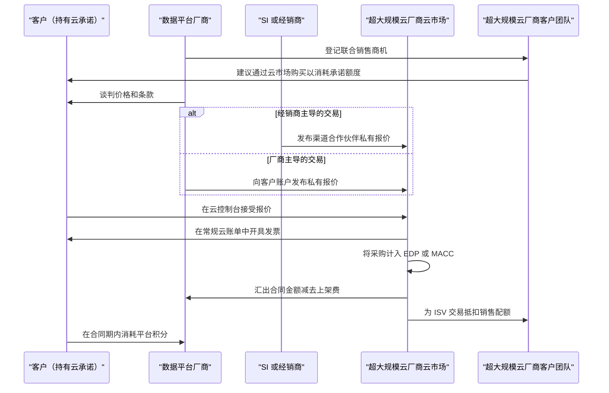
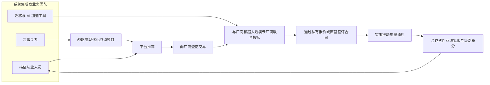
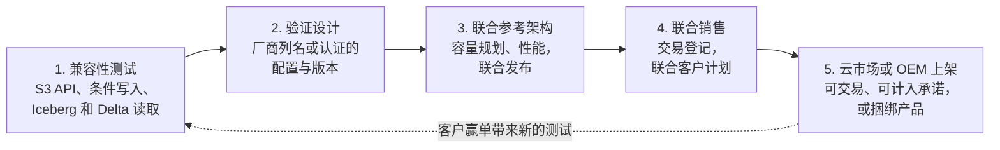
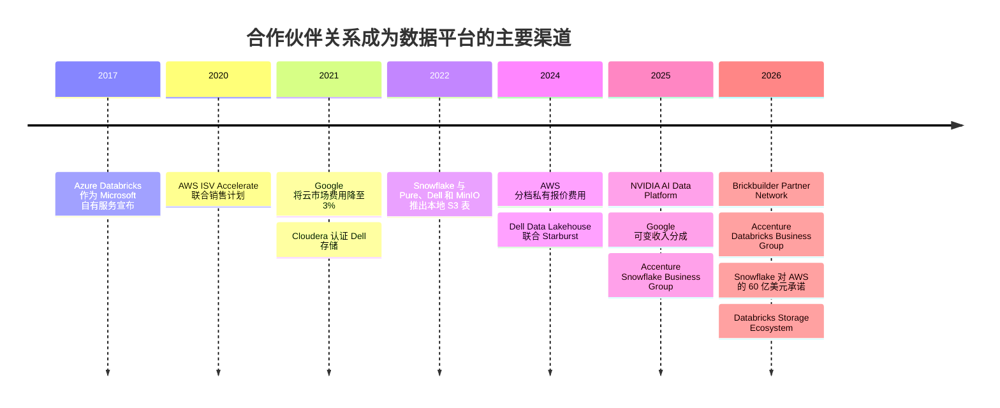

# 40. 市场进入与合作伙伴关系
> **深度：** L2 · **阅读时间：** 约 13 分钟 · **最后核实：** 2026-11-01 · **前置阅读：** [第 35 章 — 商业模式](ch35-business-models.md)、[第 24 章 — 数据栈与计算和存储的交汇](../03-ai-data-stack/ch24-data-meets-compute-and-storage.md)

## 要点速览（TL;DR）

- **超大规模云厂商的云市场（marketplace）如今是数据平台的主要销售渠道，而为其买单的是承诺的云消费额度（committed spend）。** 企业与 AWS、Microsoft 或 Google 签订多年期承诺。通过该云的云市场购买的 Databricks 或 Snowflake 合同计入这份承诺，因此客户用的是早已承诺出去的预算。Snowflake 报告称，2025 日历年 AWS Marketplace 销售额超过 $2B，上架以来累计超过 $7B（公司披露）。[^sf-aws-2b][^sf-aws-6b]
- **费用很低，激励很大。** AWS 根据合同规模对私有报价收取 3% / 2% / 1.5% 的费用。Google 采用相同的档位。Microsoft 报价为 3%。[^aws-fees][^gcp-vrs][^ms-fee] 厂商为这笔费用换来的是云厂商自己的销售人员：在 AWS ISV Accelerate 和 Microsoft 的 IP 联合销售（co-sell）计划下，这些销售人员促成厂商交易后可获得配额抵扣。[^isva][^ms-cosell]
- **系统集成商创造需求。** Accenture 为 Snowflake（2025 年 12 月，超过 5,000 名 SnowPro 认证人员）和 Databricks（2026 年 3 月，超过 25,000 名接受过 Databricks 培训的人员）分别设立了专门的业务集团。迁移和 AI 项目正是通过这类业务团队落到平台上的。[^acn-sf][^acn-dbx]
- **存储厂商通过一套认证阶梯与数据平台合作。** 各级台阶依次为：S3 兼容性测试、验证设计、联合参考架构、联合销售，最后是云市场或 OEM 上架。公开可见的大多数存储–平台关系停留在前两级。Databricks Storage Ecosystem（2026 年 6 月）和 NVIDIA AI Data Platform（2025 年 3 月）是首批将存储厂商列入官方平台名录的计划。[^storage-eco][^aidp]
- **Everpure 视角。** Pure Storage 曾出现在 Snowflake 由厂商自报的 S3 兼容存储厂商名单上（Snowflake 不对其进行验证；FlashBlade 在较新的"tested and compliant"措辞下的状态尚未确认），并位列 NVIDIA AI Data Platform 名录。它拥有 Dremio 和 Starburst 参考架构，也是 Databricks Storage Ecosystem 的首发合作伙伴。[^sf-s3compat][^aidp][^storage-eco] 其下一步的合作选项是将这些上架资质转化为联合销售、可计入 MACC/EDP 的云市场报价以及联合销售管道。

## 为何重要（商业 + Everpure 视角）

[第 35 章](ch35-business-models.md)解释了数据平台如何收费：按用量计费的积分、承诺消费额度合同以及额度消耗。本章讨论这些合同是如何卖出去的，以及沿途谁抽成、谁获得业绩抵扣。对数据平台而言，答案是：越来越大比例的交易通过别人的渠道完成，即超大规模云厂商的云市场、系统集成商（"SI"）的业务团队，或技术合作伙伴的集成。

对企业发展领域的读者而言，合作伙伴关系值得研究，因为它们是获取分销能力的廉价期权。一次云市场上架只需几个百分点的费用和一些工程投入。一份验证设计只需一个测试周期和联合营销资金。两者都可能打开直销团队需要数年才能建立的销售管道。同样这些合作伙伴也是竞争对手。AWS、Microsoft 和 Google 各自都在销售与其联合销售的平台相竞争的自有数据服务（见[第 28 章](../04-company-deep-dives/ch28-hyperscaler-data-platforms.md)）。

对 Everpure（原 Pure Storage；NYSE: P，原代码 PSTG）而言，问题更窄。随着它从阵列走向数据管理，它需要哪些合作伙伴资产，才能让 Databricks、Snowflake、NVIDIA 和各家云厂商把它视为数据平台的一部分，而不是底层的那个存储桶？本章以基于公开信息、战略团队可能评估的选项来作答。

## 工作原理

### 云市场把云承诺变成采购预算

大型企业与其云厂商签订多年期消费承诺以换取折扣。AWS 称之为[企业折扣计划（Enterprise Discount Program）](../glossary.md#enterprise-discount-program)（EDP），也称私有定价协议（Private Pricing Agreement）。Microsoft 的版本是 [Azure 消费承诺（Azure Consumption Commitment）](../glossary.md#azure-consumption-commitment)（MACC）。Google 使用承诺消费协议和[承诺使用折扣（committed use discounts）](../glossary.md#committed-use-discount)（CUD）。客户未能消耗的承诺部分仍需支付。因此，手握未消耗承诺的 CFO 会更愿意通过云市场购买新软件，因为这笔采购可以消耗承诺额度。

Microsoft 对这一规则有明确的文档说明。带有"Azure benefit eligible"标识的报价，只要通过客户 Microsoft 协议下的 Azure 订阅购买，其税前购买金额的 100% 计入 MACC。部署在本地的许可不计入。[^macc] AWS 将云市场额度消耗作为合同条款处理。咨询机构的指引称，云市场采购可计入的部分有一个默认上限，通常为承诺额的 25%，客户可在签约时谈判（估算；非 AWS 公布）。[^edp-cap]

交易本身是一份[私有报价（private offer）](../glossary.md#private-offer)：厂商向单一买方的云账户发布的定制价格和条款。

*图 40.1 — 云市场私有报价把一张新的采购订单换成了现有云账单上的一个条目。客户消耗了承诺额度，厂商由云厂商付款，云厂商的客户团队获得配额抵扣。交易中的每一方都有理由说"是"。*

经济账对厂商有利。2024 年 1 月，AWS 将私有报价上架费设定为：合同总额低于 $1M 的为 **3%**，$1M 至不足 $10M 的为 **2%**，$10M 及以上以及续约的为 **1.5%**。渠道合作伙伴私有报价（[CPPO](../glossary.md#channel-partner-private-offer)，即由经销商代表厂商完成交易）再加 0.5 个百分点。[^aws-fees] Google 在 2021 年将其云市场分成从 20% 降至 3%。[^gcp-2021] 自 2025 年 4 月起，它采用可变费率表，对 $10M 及以上的交易、续约和迁移降至 1.5%。[^gcp-vrs] Microsoft 表示其费用已从行业标准的 20% 降至 3%。[^ms-fee] 十年前，应用商店式的云市场抽成约 20%。如今 2% 的费用低于大多数销售佣金。

**联合销售才是真正的奖赏。** AWS ISV Accelerate 是一项面向在 AWS Marketplace 上架和销售软件的厂商的联合销售计划。其核心好处是，AWS 客户经理在帮助促成合作伙伴的云市场私有报价时可获得激励，包括配额抵扣。[^isva] Microsoft 有类似的阶梯。一份报价从"co-sell ready"升级为"Azure IP co-sell eligible"，Microsoft 销售人员销售符合条件的 IP 解决方案可获得配额抵扣。IP 联合销售资格也是让报价计入 MACC 的条件。[^ms-cosell] AWS 在 2025 年 8 月增加了私有报价推广资金，并在 2025 年 11 月推出"express"私有报价。[^aws-promo]

> **类比：半导体（设计导入与合格供应商名单）。** 一个可计入 EDP 或 MACC 的云市场上架，就是软件版的进入超大规模云厂商合格供应商名单。客户的承诺消费额度是一个早已完成设计导入并编好预算的"插槽"。具备资格意味着你的部件无需新的采购认证就能填进去。联合销售的配额抵扣则相当于超大规模云厂商自己的销售团队在推广你的部件。

### 算例：通过 AWS 私有报价完成的一笔 $2M Databricks 交易（示意）

一家美国银行签有一份三年期、$30M 的 AWS EDP，实际消耗低于计划。它希望为一个 Hadoop 迁移项目采购 Databricks，该项目由一家 Databricks 级别的 SI 执行。Databricks 以 AWS Marketplace 私有报价形式提供一年期 $2M 的承诺 DBU 消费，采用经典计算模式，因此银行还要直接向 AWS 支付集群所用的 EC2 费用。以下所有数字均为示意，只有费率档位来自 AWS 的费率表。[^aws-fees]

| 参与方 | 记账内容 | 金额（示意） | 备注 |
|---|---|---|---|
| 客户 | AWS 账单上的 $2M Databricks 承诺；计入 EDP | 计入 $30M 承诺中的 $2.0M（6.7%） | 若适用 25% 的云市场上限（$7.5M），则在上限之内[^edp-cap] |
| AWS Marketplace | 按 $1M–<$10M 档收取上架费 | 2% × $2M = **$40K** | 若由 SI 以 CPPO 方式转售，则为 $50K（2.5%） |
| Databricks | $2M 合同，扣除费用后汇出 | 约 $1.96M 现金 | 该费用记为收入抵减还是销售费用属于会计判断 |
| AWS 客户经理 | 在 ISV Accelerate 联合销售权益下获得配额抵扣 | 按 $2M 抵扣 | 另外，全部 EC2 消耗也计入 EDP |
| AWS 基础设施 | 经典计算模式下的 EC2 | 例如每年 $1.0–1.5M（假设） | 在 serverless 模式下，由 Databricks 向 AWS 付费，并提高 DBU 定价（[第 25 章](../04-company-deep-dives/ch25-databricks.md)） |
| SI 合作伙伴 | 在 Databricks 计划中获得合作伙伴影响型或合作伙伴来源型业绩抵扣；服务费 | 服务费及任何经销商利润 | 业绩抵扣计入级别资格和激励[^dbx-bpn] |

*图 40.2 — 同样的 $2M 被计算了四次：对客户是承诺额度消耗，对 Databricks 是订单额，对 AWS 销售人员是配额，对 SI 是合作伙伴业绩抵扣。2% 的费用是这条链上最便宜的一项。业绩的重复计算正是合作伙伴渠道获得资金的方式。*

结构性风险在于：一个承诺额度几近耗尽的客户，或一个改变销售激励的超大规模云厂商，可以在需求没有任何明显变化的情况下拖慢厂商的销售管道。这正是[第 25 章](../04-company-deep-dives/ch25-databricks.md)将 Databricks 通过 Azure 销售的收入占比列为待解问题的原因。

### 系统集成商：无人报告的需求引擎

SI 通常不转售软件，它销售的是创造软件消耗的项目。一次数据平台迁移（从 Teradata、Hadoop 或本地数据仓库迁移到湖仓一体（lakehouse））通常在平台厂商敲定价格之前，就已由 SI 完成范围界定、人员配置，并往往完成架构设计。在这个渠道里，规模意味着持证人数。Accenture 的 Snowflake Business Group 成立时拥有超过 5,000 名 SnowPro 认证人员。其 2026 年 3 月成立的 Databricks Business Group 称拥有超过 25,000 名接受过 Databricks 培训的专业人员。[^acn-sf][^acn-dbx]

*图 40.3 — SI 在采购开始之前就塑造了平台选择，随后创造推动合同增长的用量消耗。厂商计划以业绩抵扣、级别资格和激励回报它们，这些回报又用于雇用更多持证人员，从而形成闭环。*

厂商计划将这一闭环制度化。2026 年 2 月，Databricks 将其合作伙伴计划整合为单一的 **Brickbuilder Partner Network**。它设有 Bronze、Silver、Gold 和 Platinum 四个级别、专业化徽章，以及与客户用量挂钩的"Velocity"激励。[^dbx-bpn] Snowflake 的 Partner Network 设有免费的 Registered 级别和三个付费级别：Select、Premier 和 Elite。级别评定取决于认证、已成交的销售管道、交易登记和客户案例。[^spn]

> **类比：半导体（销售代表与分销商）。** 联合销售和 SI 交易登记的运作方式类似半导体公司的销售代表和分销商渠道。制造商的销售代表即使不负责出货，也能从设计导入中赚取佣金。分销商赚取利润，外加设计登记保护。市场开发基金的作用类似合作营销资金。在合作伙伴交易上获得配额抵扣的 AWS 和 Microsoft 销售人员，实际上就是由超大规模云厂商支付佣金的销售代表。

### 技术合作伙伴与数据市场

技术合作伙伴是其产品与平台相连接的 ISV：数据摄取、BI、数据治理、存储。Snowflake 运营"Snowflake Ready"技术验证，以及面向基于 Snowflake 构建的应用的 **Powered by Snowflake** 通道，其中许多应用以原生应用形式在 Snowflake Marketplace 中分发。[^sf-ready][^spn] Databricks 的技术合作伙伴页面列出了从 Registered、Validated 到 Select 和 Elite 的各个级别。[^dbx-tech]

平台自己的[数据市场（data marketplaces）](../glossary.md#data-marketplace)也是一个 GTM 渠道。Snowflake Marketplace 宣称拥有来自超过 750 家提供商的超过 3,000 个上架项（公司披露，页面未注明日期）。[^sf-mkt] Databricks 在 2024 年 6 月报告称拥有超过 2,000 个 Marketplace 上架项和超过 16,000 个 Delta Sharing 接收方（公司披露）。[^ds-stats] 每一个上架项都让平台更难被替换，因为数据提供商只需发布一次，就能触达平台上的每一位客户。[Delta Sharing](../glossary.md#delta-sharing)（现已扩展为 [OpenSharing](../glossary.md#opensharing)）让 Databricks 能够把同一机制延伸到存储厂商。

### 数据平台如何与存储厂商合作

Databricks 和 Snowflake 是云服务，因此存储厂商无法简单地转售它们。关系的方向是反过来的：平台需要一个理由，去信任本地存储可以作为受治理表的存放地，而存储厂商则通过攀登阶梯来提供这个理由。

*图 40.4 — 存储合作伙伴认证路径。每上一级台阶都需要更多的工程和营销投入，也能赢得平台更多的销售关注。大多数存储合作关系止步于第 2 级。*

**第 1–2 级：兼容性。** Snowflake 可以通过外部 stage 和外部表读写 S3 兼容存储。其文档列出了已告知 Snowflake 对自家产品做过测试的厂商，包括 Cloudian、Dell、MinIO、NetApp StorageGRID、Pure Storage 和 Scality。文档明确表示 Snowflake 本身不对其进行测试、验证或认证，而且当前版本要求存储提供商提供"Snowflake S3-compatible tested and compliant"服务；它引导客户使用可在自己设备上运行的公开测试。FlashBlade 是否满足这一较新措辞尚未确认 [VERIFY]。[^sf-s3compat] 在 Databricks 中，对应的对象是[外部位置（external location）](../glossary.md#external-location)。官方支持历来只覆盖云对象存储，因此本地 S3 在 2026 年之前一直处于灰色地带（[第 25 章](../04-company-deep-dives/ch25-databricks.md)）。

**第 3–4 级：参考设计与联合销售。** Cloudera 的 QATS 计划自 2021 年起认证了 Dell PowerScale 和 ECS。[^cloudera-qats] Dell 与 Starburst 更进一步。**Dell Data Lakehouse**（2024 年 3 月）将 Starburst 的 Trino 引擎与 Dell 计算和 ECS/ObjectScale 存储捆绑为单一的 Dell 销售产品，这是一种 OEM 式关系。[^dell-dl]

**第 5 级：平台计划。** 2026 年 6 月，Databricks 推出了 **Storage Ecosystem**。存储厂商在其对象存储旁运行一个 OpenSharing 服务器，从而让 Unity Catalog 可以就地治理和查询 Delta 与 Iceberg 表。首发合作伙伴为 Everpure、MinIO 和 Qumulo，另有更多厂商被列为后续加入。[^storage-eco] MinIO 的集成被列为正式可用（GA），MinIO 还被评为 Databricks 2026 年度 ISV 存储合作伙伴。[^minio-poy] Everpure 的 OpenSharing 连接器于 2026 年 6 月 9 日进入私有预览。[^everpure-os] 在 GPU 方面，NVIDIA 的 **AI Data Platform**（GTC，2025 年 3 月）是一份由存储合作伙伴构建进自家产品的参考设计。它与 NVIDIA-Certified Storage 计划并行，后者设有 Foundation、Enterprise 和 NCP 三个级别。[^aidp][^nv-cert]

> **类比：半导体（合规与认证）。** 第 1 级相当于 PCI-SIG 合规研讨会或 JEDEC 一致性测试：必要、失败成本低，但不构成差异化。第 2–3 级相当于在 OEM 处的客户认证：过程缓慢，绑定具体配置和版本，每个大版本都要重新做一遍。Unity Catalog、Snowflake 或 NVIDIA 的软件升级会重新开启认证，就像新的内存控制器版本一样。

| 存储厂商 | 数据平台 | 关系类型 | 日期 | 来源 |
|---|---|---|---|---|
| Pure Storage（FlashBlade） | Snowflake | 联合解决方案：本地或托管机房中的 S3 兼容外部表 | 2022 年 5 月 | [^pure-sf] |
| Dell（ECS / ObjectScale） | Snowflake | 通过 S3 兼容表访问本地数据 | 2022 年 5 月 | [^dell-sf] |
| MinIO | Snowflake | 外部表集成 | 2022 年 6 月 | [^minio-sf] |
| VAST Data | Dremio | 在 VAST Universal Storage 上验证的湖仓 | 2022 年 9 月 | [^vast-dremio] |
| Dell（ECS） | Databricks | 混合集成（博客记载） | 2023 年 | [^dell-ecs] |
| Cohesity（SmartFiles） | Snowflake | SmartFiles 上的数据可由 Snowflake 查询 | 2023 年 11 月 | [^cohesity-sf] |
| Dell（ECS、ObjectScale、PowerScale） | Starburst | OEM 式产品：Dell Data Lakehouse | 2024 年 3 月（2024 年 7 月扩展） | [^dell-dl] |
| Pure Storage（FlashBlade） | Dremio（2026 年起归属 SAP） | 联合解决方案简介：混合 Iceberg 湖仓 | 2024 年 10 月 | [^dremio-pure][^sap-dremio] |
| Everpure（FlashBlade） | Starburst | 参考架构，"Scalable Lakehouse Analytics" | 未注明日期 | [^starburst-ep] |
| Dell（PowerScale、ECS） | Cloudera | QATS 存储认证 | 2021 年 5 月（持续中） | [^cloudera-qats] |
| Dell（ObjectScale） | Cloudera | 联合"私有 AI"平台 | 2025 年 9 月 | [^cloudera-dell] |
| DDN、Dell、HPE、Hitachi Vantara、IBM、NetApp、Nutanix、Pure、VAST、WEKA | NVIDIA AI Data Platform | 构建进合作伙伴产品的参考设计 | 2025 年 3 月 | [^aidp][^weka-aidp] |
| Everpure（FlashBlade、FlashArray） | Databricks | Storage Ecosystem 首发合作伙伴；OpenSharing 连接器处于私有预览 | 2026 年 6 月 | [^storage-eco][^everpure-os] |
| MinIO（AIStor） | Databricks | Storage Ecosystem，GA；2026 年度 ISV 存储合作伙伴 | 2026 年 6 月 | [^minio-poy] |
| Qumulo | Databricks | ISV 合作；OpenSharing 集成处于预览 | 2026 年 7 月 | [^qumulo] |
| Everpure（FlashBlade + Data Stream） | NVIDIA AI Data Platform | 基于参考设计构建的向量化数据管道 | 2026 年 6 月 | [^data-stream] |

*图 40.5 — 公开的存储–数据平台合作关系。其模式从"我们的阵列可以存放你的外部表"（2022 年）转向 2025–26 年由平台运营的名录（Databricks Storage Ecosystem、NVIDIA AI Data Platform）。名录正是联合销售注意力流向的地方。*

**双方各得到什么，代价是什么。** 数据平台获得了原本无法触达的本地数据和主权数据，外加一支把客户引向其产品的存储厂商销售队伍。存储厂商获得了在数据架构讨论中的话语权、一个上架席位、联合营销，有时还有交易登记。代价包括：测试套件和连接器的工程投入、每次平台发布时的重新认证、用于联合推广活动的市场开发基金（[MDF](../glossary.md#market-development-funds)），以及一线销售赋能。一个拥有十家存储合作伙伴的平台几乎没有理由偏爱其中任何一家，因此差异化必须来自性能证明、支持能力和客户案例。

## 设计选择与权衡

| 市场进入路径 | 谁向谁付款 | 厂商成本 | 优势 | 劣势 |
|---|---|---|---|---|
| 直接企业销售 | 客户 → 厂商 | 全部销售与营销成本 | 掌握客户关系和定价 | 采购流程慢；与云预算竞争 |
| 云市场私有报价 | 客户 → 云厂商 → 厂商 | 1.5–3% 费用（AWS/Google），约 3%（Microsoft）[^aws-fees][^gcp-vrs][^ms-fee] | 消耗承诺额度；使用云厂商的合同文本；联合销售 | 依赖云厂商激励；云厂商可看到交易数据 |
| 云厂商自有服务（如 Azure Databricks） | 客户 → 云厂商；向厂商分成 | 收入分成；产品控制权共享 | 原生计费和销售覆盖[^azure-dbx] | 合作伙伴同时也是对手（Fabric） |
| SI 主导（来源型或影响型） | 客户 → SI 支付服务费；→ 厂商支付软件费 | 合作伙伴激励、赋能、MDF | 创造需求；掌控迁移 | SI 服务多个平台；忠诚度跟着激励走 |
| 经销商或 CPPO | 客户 → 经销商 → 厂商 | 经销商利润 + AWS CPPO 的 0.5 个百分点[^aws-fees] | 覆盖中端市场和公共部门 | 利润层层叠加；渠道冲突 |
| OEM 或捆绑（如 Dell Data Lakehouse） | 客户 → OEM；向 ISV 支付版税或许可费 | 单位价格较低；依赖对方路线图 | 借助 OEM 的装机基础[^dell-dl] | OEM 控制定价和支持 |

*图 40.6 — 每条路径都是以利润换覆盖。云市场已成为大型云交易的默认选择，因为费用低，而且消耗承诺额度对买方有利。*

反对过度依赖云市场的最有力论点是集中度。超大规模云厂商能看到交易、客户和价格，同时还在销售一项与之竞争的自有服务。反对 SI 渠道的最有力论点是 SI 对平台不持立场：同一个 Accenture 同时运营着 Snowflake 和 Databricks 两个业务集团。[^acn-sf][^acn-dbx]

## 主要参与者

| 计划 | 级别或层级 | 主要权益 | 典型要求 |
|---|---|---|---|
| Databricks Brickbuilder Partner Network（2026 年） | C&SI：Bronze、Silver、Gold、Platinum；技术级别 Registered → Elite | 专业化徽章、与用量挂钩的 Velocity 激励、联合销售 | 持证人员、收入影响力、客户成功；Platinum 需具备专业化资质[^dbx-bpn][^dbx-tech] |
| Snowflake Partner Network | Registered（免费）；Select、Premier、Elite（年费） | 联合销售支持、营销投入；Powered by Snowflake；Snowflake Ready 验证 | 认证、已成交销售管道、交易登记、客户案例[^spn][^sf-ready] |
| AWS Partner Network：ISV Accelerate | 计划成员资格（联合销售） | 销售人员配额抵扣、MDF、私有报价推广 | GA 状态的 Marketplace 上架、ACE 资格、已启动的联合销售商机[^isva][^aws-promo] |
| Microsoft 联合销售 | Co-sell ready → Azure IP co-sell eligible | 销售人员配额抵扣；MACC 资格；云市场徽章 | 可交易的基于 Azure 的报价、技术验证、计费收入门槛[^ms-cosell] |
| Google Cloud Partner Advantage 与 Marketplace | 合作伙伴级别 [VERIFY: Partner Advantage 当前级别名称] | 可变收入分成低至 1.5%；承诺额度消耗 | Marketplace 上架；交易规模、续约或迁移属性[^gcp-vrs] |
| NVIDIA AI Data Platform 与 Certified Storage | Certified Storage：Foundation、Enterprise、NCP | 纳入 NVIDIA 企业参考架构和 GTC 发布 | 通过 NVIDIA 测试套件；集成参考设计软件[^nv-cert][^aidp] |

*图 40.7 — 合作伙伴计划对比。平台计划奖励合作伙伴所影响的用量。超大规模云厂商计划奖励云市场交易。NVIDIA 的计划奖励验证设计。存储厂商必须三者兼顾。*

## 历史与发展轨迹

*图 40.8 — 五年内，云市场费用从约 20% 降至 1.5–3%，而联合销售激励不断增加。合作伙伴关系从集成清单转变为可交易、有激励支撑的渠道。*

如今商业关系是双向的。2026 年 5 月，Snowflake 承诺在五年内向 AWS 基础设施投入 $6B，同时报告 AWS Marketplace 累计销售额超过 $7B。这是一种互惠安排：平台购买云容量，云厂商销售平台。[^sf-aws-6b] 下一步很可能是更多可交易的合作伙伴捆绑方案，例如多厂商私有报价和"存储 + 平台"报价，以及更多像 Storage Ecosystem 这样由平台运营的名录。待解问题是，超大规模云厂商是否会继续为那些同时与其竞争的数据平台补贴联合销售。

## 关键数字

| 指标 | 数值 | 口径 | 来源 / 日期 |
|---|---|---|---|
| AWS 私有报价上架费 | 3%（<$1M）、2%（$1M–<$10M）、1.5%（≥$10M、续约）；CPPO +0.5 个百分点 | AWS 公布的费率表 | AWS，2024-01-05 生效[^aws-fees] |
| Google Cloud Marketplace 收入分成 | 按交易规模和类型 3% → 1.5% | Google 公布的费率表 | Google，2025-04-21 生效[^gcp-vrs] |
| Microsoft 云市场交易费 | 3%（由 20% 下调） | 公司披露 | Microsoft ISV 页面，未注明日期[^ms-fee] |
| 符合条件报价对 MACC 的贡献 | 税前金额的 100% | Microsoft 政策 | Microsoft Learn[^macc] |
| AWS EDP 云市场上限 | 默认约为承诺额的 25%；可谈判 | 估算（咨询机构） | Redress Compliance，未注明日期[^edp-cap] |
| Snowflake AWS Marketplace 销售额 | CY2025 >$2B；累计 >$7B | 公司披露（销售额，非收入） | Snowflake，2025-12-03 及 2026-05-27[^sf-aws-2b][^sf-aws-6b] |
| Snowflake 总收入，FY2026 | $4,683.9M（2025 年 2 月–2026 年 1 月） | GAAP | Snowflake 10-K[^sf-10k] |
| Snowflake 对 AWS 的承诺 | 五年 $6B | 公司披露 | Snowflake，2026-05-27[^sf-aws-6b] |
| Accenture 持证/受训人员 | >5,000 名 SnowPro 认证；>25,000 名接受 Databricks 培训 | 公司披露 | 2025-12-03；2026-03-17[^acn-sf][^acn-dbx] |
| Snowflake Marketplace | 3,000+ 上架项，750+ 提供商 | 公司披露 | Snowflake 页面，未注明日期[^sf-mkt] |
| Databricks Marketplace / Delta Sharing | >2,000 上架项；>16,000 接收方 | 公司披露 | Databricks，2024-06[^ds-stats] |
| NVIDIA AI Data Platform 存储合作伙伴 | 发布时 10 家 | 公司披露 | NVIDIA，2025-03[^aidp] |

*图 40.9 — 云市场销售额是成交的合同总额，往往为多年期，因此不能用收入去除。它们显示的是规模，而非占比。*

## 存储桥接

> **存储桥接。** 认证阶梯的每一级都依赖于[第 24 章](../03-ai-data-stack/ch24-data-meets-compute-and-storage.md)和配套的 *Everpure Tech Atlas* 中讨论的存储语义：S3 条件写入、LIST 行为、凭证下发和小对象延迟。兼容性测试失败通常归结为其中某一项，而不是原始吞吐量。基于公开信息，战略团队可能评估的选项：(1) 将 Databricks OpenSharing 连接器从预览推进到 GA，并登记为联合销售；[^everpure-os] (2) 发布与 Starburst 以及 Dremio/SAP 的 Iceberg/Delta 和 Iceberg REST 目录兼容性结果，以便平台团队可以引用；[^starburst-ep][^dremio-pure] (3) 让 Everpure 现有的云上架产品（Cloud Block Store 多年来一直通过 AWS 和 Azure 云市场销售；Azure 自 2021 年 3 月起）可计入承诺额度，并与数据平台私有报价捆绑；[^pcbs] (4) 将 NVIDIA AI Data Platform 和 Data Stream 的工作转化为一份联合参考架构，其中除 GPU 栈外还点名一个数据平台。[^data-stream][^aidp]

## 对话手册

**向产品经理或联盟负责人提出的问题**

1. "你们的新增订单中有多大比例是通过超大规模云厂商云市场成交的，其中多少由承诺额度出资？当报价具备 EDP 或 MACC 资格后，赢单率发生了怎样的变化？"
2. "哪种合作伙伴级别或计划资格真正改变了平台一线销售人员的行为：上架、验证，还是联合销售登记？"
3. "当平台发布重大版本（Unity Catalog、Iceberg v3、Snowflake external volumes）时，重新认证需要多长时间，由谁买单？"

**向工程师或合作伙伴架构师提出的问题**

1. "你们针对 S3 运行哪套兼容性测试？在并发条件下，你们能通过条件写入和分段上传的边界用例，还是只能通过正常路径？"
2. "对于 OpenSharing 或外部表，凭证在哪里下发，支持哪些表格式和版本，查询是会下推，还是全量扫描？"
3. "在 NVIDIA AI Data Platform 设计中，哪些组件运行在存储系统上，哪些运行在 GPU 服务器上？参考架构中测量了什么？"

**好的回答听起来是什么样的。** 它们会给出云市场占比和费率档位，并区分来源型和影响型销售管道。它们会说明计划资格、测试过的版本以及最近一次重新认证的日期。在存储方面，它们会引用具体的测试套件和一个联合客户，而不只是一页 logo 幻灯片。

**不要这样说**

- "云市场要抽 20%。" 那是过去的应用商店费率。私有报价如今只需支付 1.5–3%，说 20% 会显得你信息过时。
- "云市场销售额就是收入。" Snowflake 的 $2B 是一年内成交的合同总额，其中很多是多年期承诺。
- "Snowflake 认证了我们的存储。" Snowflake 的名单是厂商自报的，Snowflake 表示它不认证第三方产品。[^sf-s3compat]
- "联合销售意味着 AWS 替我们卖产品。" 它意味着 AWS 销售人员会因帮助促成交易而获得报酬。交易仍由厂商主导。
- "进入 NVIDIA 名录就是差异化。" 发布时就有十家存储合作伙伴。进入名录只是入场券。

## 深入阅读

- AWS Marketplace 卖家指南中关于上架费和 CPPO 的内容，以及 Microsoft Learn 的 MACC 和联合销售要求页面，了解当前的确切规则。[^aws-fees][^cppo][^macc][^ms-cosell]
- Databricks 的 Storage Ecosystem 公告和合作伙伴计划指南，了解 OpenSharing 集成模式。[^storage-eco][^dbx-bpn]
- Snowflake 的 S3 兼容存储文档及其公开兼容性测试。[^sf-s3compat]
- 关于合作伙伴资质如何契合 Everpure 向技术栈上层移动，见[第 45 章](../06-history-and-future/ch45-storage-moving-up-the-stack.md)；关于 Snowflake 的市场进入，见[第 26 章](../04-company-deep-dives/ch26-snowflake.md)。

## 关键术语

- [云市场（Cloud marketplace）](../glossary.md#cloud-marketplace) — 超大规模云厂商的线上商店，第三方软件可在其中通过云账单购买。
- [私有报价（Private offer）](../glossary.md#private-offer) — 卖方向某一买方的云市场账户发布的定制价格和条款。
- [渠道合作伙伴私有报价（Channel partner private offer）](../glossary.md#channel-partner-private-offer) — 由经销商代表软件厂商完成交易的 AWS 私有报价。
- [上架费（Listing fee）](../glossary.md#listing-fee) — 云市场在每笔交易中保留的合同金额百分比。
- [承诺消费额度消耗（Committed-spend drawdown）](../glossary.md#committed-spend-drawdown) — 通过使用量或符合条件的采购消耗预付或承诺的消费额度。
- [企业折扣计划（Enterprise Discount Program）](../glossary.md#enterprise-discount-program) — AWS 的多年期承诺消费合同，以消费承诺换取折扣。
- [Azure 消费承诺（Azure Consumption Commitment）](../glossary.md#azure-consumption-commitment) — Microsoft 的承诺消费协议（MACC），符合条件的云市场采购可计入其中。
- [承诺使用折扣（Committed use discount）](../glossary.md#committed-use-discount) — Google Cloud 针对承诺一定资源使用量或消费金额提供的折扣。
- [联合销售（Co-sell）](../glossary.md#co-sell) — 超大规模云厂商或合作伙伴的销售人员帮助促成厂商交易并获得业绩抵扣的联合销售方式。
- [配额抵扣（Quota retirement）](../glossary.md#quota-retirement) — 将合作伙伴的交易计入超大规模云厂商销售人员的销售配额。
- [ISV Accelerate](../glossary.md#isv-accelerate) — AWS 面向通过 AWS Marketplace 销售的软件厂商的联合销售计划。
- [市场开发基金（Market development funds）](../glossary.md#market-development-funds) — 厂商提供给合作伙伴、用于联合营销和需求生成的资金。
- [交易登记（Deal registration）](../glossary.md#deal-registration) — 合作伙伴对某一商机的认领，用以保护其业绩抵扣和激励。
- [系统集成商（Systems integrator）](../glossary.md#systems-integrator) — 设计和实施技术项目的咨询公司，常常左右平台选择。
- [合作伙伴来源型收入（Partner-sourced revenue）](../glossary.md#partner-sourced-revenue) — 来自合作伙伴发起的交易的收入，区别于合作伙伴仅提供协助的影响型交易。
- [参考架构（Reference architecture）](../glossary.md#reference-architecture) — 一份公开发布、经过测试的设计，为特定工作负载组合具体产品。
- [OEM 合作（OEM partnership）](../glossary.md#oem-partnership) — 一家公司嵌入或捆绑另一家公司的产品，并以自有品牌销售。
- [S3 兼容存储（S3-compatible storage）](../glossary.md#s3-compatible-storage) — 实现了 Amazon S3 API 的非 AWS 对象存储。
- [外部位置（External location）](../glossary.md#external-location) — 将存储路径与凭证绑定的 Unity Catalog 对象。
- [数据市场（Data marketplace）](../glossary.md#data-marketplace) — 平台的线上商店，提供商在其中向使用者上架数据集、模型和应用。
- [Delta Sharing](../glossary.md#delta-sharing) — Databricks 用于跨平台就地共享表的开放协议。
- [OpenSharing](../glossary.md#opensharing) — 源自 Delta Sharing 的开放共享协议，是 Databricks Storage Ecosystem 的基础。
- [NVIDIA AI Data Platform](../glossary.md#nvidia-ai-data-platform) — NVIDIA 2025 年的参考设计，存储合作伙伴将其构建进 AI 就绪存储产品。
- [NVIDIA-Certified Storage](../glossary.md#nvidia-certified-storage) — NVIDIA 的存储验证计划，设有 Foundation、Enterprise 和 NCP 三个级别。

## 资料来源

[^aws-fees]: AWS, "AWS Marketplace announces simplified and reduced listing fees for sellers," https://aws.amazon.com/about-aws/whats-new/2024/01/aws-marketplace-simplified-reduced-listing-fees/，发布于 2024-01；AWS Marketplace Seller Guide, "Understanding listing fees for AWS Marketplace sellers," https://docs.aws.amazon.com/marketplace/latest/userguide/listing-fees.html，持续更新的文档（费用自 2024-01-05 生效；CPPO +0.5 个百分点）；检索于 2026-11-01。CRN Australia 2026 年的一篇报道称，专业服务上架费已从 2.5% 降至 0.5%，https://www.crn.com.au/news/2026/cloud/aws-marketplace-slashes-listing-fee-for-professional-service [VERIFY: 日期及生效条款]。
[^cppo]: AWS, "Work with channel partner private offers using the AWS Marketplace APIs," https://docs.aws.amazon.com/marketplace/latest/APIReference/work-with-cppos.html，持续更新的文档；检索于 2026-11-01。
[^edp-cap]: Redress Compliance, "The EDP Marketplace Offset Mechanism," https://redresscompliance.com/aws-edp-marketplace-isv-commitment-offset.html，未注明日期；检索于 2026-11-01。咨询机构估算；非 AWS 公布的数字。
[^macc]: Microsoft Learn, "Azure consumption commitment benefit," https://learn.microsoft.com/en-us/marketplace/azure-consumption-commitment-benefit，以及 "MACC frequently asked questions," https://learn.microsoft.com/en-us/marketplace/macc-frequently-asked-questions，持续更新的文档；检索于 2026-11-01。
[^ms-fee]: Microsoft, "Microsoft commercial marketplace for ISVs," https://microsoft.com/isv/marketplace，未注明日期；Microsoft Partner blog, "Reach more customers with new investments in the commercial marketplace," https://blogs.partner.microsoft.com/partner/reach-more-customers-with-new-investments-in-the-commercial-marketplace，未注明日期；检索于 2026-11-01。[VERIFY: Microsoft 由 20% 降至 3% 的日期，据信为 2021 年]
[^ms-cosell]: Microsoft Learn, "Co-sell with Microsoft sales teams and partners overview," https://learn.microsoft.com/en-us/partner-center/co-sell-overview，以及 "Co-sell requirements," https://learn.microsoft.com/partner-center/co-sell-requirements，持续更新的文档；Microsoft Partner blog, "Capturing the marketplace opportunity, part four," https://partner.microsoft.com/en-US/blog/article/capturing-the-marketplace-opportunity-part-four，未注明日期；检索于 2026-11-01。[VERIFY: IP 联合销售资格当前的计费收入门槛]
[^gcp-2021]: CNBC, "Google lowers its cloud marketplace revenue share to 3% from 20%," https://www.cnbc.com/amp/2021/09/26/google-lowers-its-cloud-marketplace-revenue-share-to-3percent-from-20percent.html，发布于 2021-09-26；检索于 2026-11-01。媒体报道。
[^gcp-vrs]: Google Cloud documentation, "Overview of the Vendor Net Revenue Schedule," https://docs.cloud.google.com/marketplace/docs/partners/migrations/variable-revenue-share，持续更新的文档（2025-04-21 生效）；Google Cloud blog, "Upgrades to Google Cloud Marketplace for partners," https://cloud.google.com/blog/topics/partners/upgrades-to-google-cloud-marketplace-for-partners，2025；检索于 2026-11-01。
[^isva]: AWS, "AWS ISV Accelerate Program," https://aws.amazon.com/partners/programs/isv-accelerate/，持续更新的文档；AWS, "AWS ISV Accelerate, a co-sell program for AWS Partners," https://aws.amazon.com/about-aws/whats-new/2020/12/isv-accelerate/，发布于 2020-12；检索于 2026-11-01。
[^aws-promo]: AWS, "Announcing new incentives for ISVs selling in AWS Marketplace," https://aws.amazon.com/about-aws/whats-new/2025/08/aws-marketplace-private-offer-promotions/，发布于 2025-08；AWS, "AWS Marketplace introduces express private offers," https://aws.amazon.com/about-aws/whats-new/2025/11/aws-marketplace-express-private-offers，发布于 2025-11；检索于 2026-11-01。
[^sf-aws-2b]: Snowflake via Business Wire, "Snowflake Doubles AWS Marketplace Growth YoY, Eclipses $2 Billion in Sales…," https://www.businesswire.com/news/home/20251203483596/en/，发布于 2025-12-03；Amazon press, https://press.aboutamazon.com/aws/2025/12/snowflake-doubles-aws-marketplace-growth-yoy-eclipses-2-billion-in-sales-as-new-integrations-accelerate-enterprise-data-and-ai-adoption，2025-12；检索于 2026-11-01。公司披露。
[^sf-aws-6b]: Snowflake press release, "Snowflake Expands AWS Collaboration with $6B Commitment to Accelerate Enterprise Agentic AI Adoption," https://www.snowflake.com/en/news/press-releases/snowflake-expands-aws-collaboration-with-6b-commitment-to-accelerate-enterprise-agentic-ai-adoption/，发布于 2026-05-27；HPCwire/BigDATAwire, https://www.hpcwire.com/bigdatawire/2026/05/29/snowflakes-6b-aws-bet-signals-where-enterprise-ai-spending-is-headed/，2026-05-29；检索于 2026-11-01。公司披露。
[^sf-10k]: Snowflake Inc., Form 10-K for fiscal year ended 2026-01-31, https://www.sec.gov/Archives/edgar/data/1640147/000164014726000008/snow-20260131.htm，发布于 2026-03；检索于 2026-11-01（数值据 `data/company_financials.csv`）。
[^azure-dbx]: TechCrunch, "Microsoft makes Databricks a first-party service on Azure," https://techcrunch.com/2017/11/15/microsoft-makes-databricks-a-first-party-service-on-azure/，发布于 2017-11-15；Databricks blog, "Introducing Azure Databricks," https://www.databricks.com/blog/2017/11/15/introducing-azure-databricks.html，2017-11-15；检索于 2026-11-01。
[^acn-sf]: Accenture via Business Wire, Accenture Snowflake Business Group announcement, https://www.businesswire.com/news/home/20251203397916/en，发布于 2025-12-03；Consulting.us, "Accenture and Snowflake form new business group," https://www.consulting.us/news/12789/accenture-and-snowflake-form-new-business-group，2025-12；检索于 2026-11-01。公司披露。
[^acn-dbx]: Databricks press release, "Accenture and Databricks Accelerate Enterprise Adoption of AI Applications and Agents at Scale," https://www.databricks.com/company/newsroom/press-releases/accenture-and-databricks-accelerate-enterprise-adoption-ai，发布于 2026-03-17；检索于 2026-11-01。公司披露。
[^dbx-bpn]: Databricks blog, "Building what's next, together: introducing the Brickbuilder Partner Network for the agentic AI era," https://www.databricks.com/en/blog/building-whats-next-together-introducing-brickbuilder-partner-network-agentic-ai-era，发布于 2026-02-11；Databricks blog, "New Brickbuilder Partner Network tiers for ISVs and data providers are here," https://www.databricks.com/blog/new-brickbuilder-partner-network-tiers-isvs-and-data-providers-are-here，2026；检索于 2026-11-01。
[^dbx-tech]: Databricks, "Technology Partner Program," https://www.databricks.com/company/partners/technology-partner-program，未注明日期；检索于 2026-11-01。级别名称可能早于 2026 年的重组。
[^spn]: Snowflake, "Service partners" (Select, Premier, Elite; Registered free), https://www.snowflake.com/en/why-snowflake/partners/service-partners/，未注明日期；Snowflake, "Powered by Snowflake," https://www.snowflake.com/partners/poweredby-partners/，未注明日期；检索于 2026-11-01。
[^sf-ready]: Snowflake, "Snowflake Ready Technology Validation Program," https://snowflake.com/partners/technology-partners/snowflake-ready-technology-validation-program，未注明日期；检索于 2026-11-01。
[^sf-mkt]: Snowflake, "Essential apps and AI data products" landing page, https://www.snowflake.com/en/lp/essential-apps-ai-data-products/，未注明日期；检索于 2026-11-01。公司披露，未注明日期。
[^ds-stats]: Databricks press release, "Databricks Doubles Down on Delta Sharing Open Ecosystem With Product Innovations and Strategic Partnerships," https://www.databricks.com/company/newsroom/press-releases/databricks-doubles-down-delta-sharing-open-ecosystem-strategic-partnerships，发布于 2024-06；检索于 2026-11-01。公司披露。
[^sf-s3compat]: Snowflake documentation, "Work with Amazon S3-compatible storage," https://docs.snowflake.com/en/user-guide/data-load-s3-compatible-storage，持续更新的文档；检索于 2026-11-01。厂商名单为厂商自报；"tested and compliant"要求据 `meta/verified-facts.md` #21（由整合者于 2026-11-01 在线核实）。
[^pure-sf]: Blocks & Files, "Pure gets FlashBlade up close and cloud-adjacent co-lo personal with Snowflake," https://blocksandfiles.com/2022/05/11/pure-gets-flashblade-up-close-and-cloud-adjacent-co-lo-personal-with-snowflake/，发布于 2022-05-11；Snowflake blog, "Now in Private Preview: Using On-Premises Data in Place with Snowflake," https://www.snowflake.com/en/blog/external-tables-on-prem/，2022-06；检索于 2026-11-01。
[^dell-sf]: SiliconANGLE, "Dell partners with Snowflake to ease access to on-premises data," https://siliconangle.com/2022/05/02/dell-partners-snowflake-ease-access-premises-data/，发布于 2022-05-02；检索于 2026-11-01。
[^minio-sf]: Blocks & Files, "MinIO plugs its object storage into Snowflake," https://www.blocksandfiles.com/object/2022/06/14/minio-plugs-its-object-storage-into-snowflake/1593509，发布于 2022-06-14；检索于 2026-11-01。
[^vast-dremio]: Blocks & Files, "Dremio data lakes can run on VAST Data storage," https://www.blocksandfiles.com/ai-ml/2022/09/30/dremio-data-lakes-can-run-on-vast-data-storage/1591294，发布于 2022-09-30；检索于 2026-11-01。
[^dell-ecs]: Databricks blog, "Hybrid cloud solutions: Databricks and Dell ECS storage," https://databricks.com/blog/hybrid-cloud-solutions-databricks-and-dell-ecs-storage，发布于 2023；检索于 2026-11-01（引用方式同第 25 章）。
[^cohesity-sf]: Blocks & Files, "Cohesity SmartFiles becomes Snowflake analytics playground," https://www.blocksandfiles.com/ai-ml/2023/11/06/cohesity-smartfiles-becomes-snowflake-analytics-playground/1596232，发布于 2023-11-06；检索于 2026-11-01。
[^dell-dl]: Starburst blog, "Dell Data Lakehouse powered by Starburst," https://starburst.io/blog/dell-data-lakehouse-powered-by-starburst，2024-03；Blocks & Files, "Dell enhances Data Lakehouse with faster query speeds and more," https://www.blocksandfiles.com/ai-ml/2024/07/24/dell-enhances-data-lakehouse-with-faster-query-speeds-and-more/1616308，发布于 2024-07-24；检索于 2026-11-01。
[^cloudera-qats]: Cloudera press release, "Cloudera Announces New Storage Certification for Cloudera Data Platform Private Cloud," https://www.cloudera.com/about/news-and-blogs/press-releases/2021-05-06-cloudera-announces-new-storage-certification-for-cloudera-data-platform-private-cloud.html，发布于 2021-05-06；StorageNewsletter, https://storagenewsletter.com/2021/05/11/cloudera-data-platform-private-cloud-certified-on-dell-emc-powerscale，2021-05-11；检索于 2026-11-01。
[^cloudera-dell]: SiliconANGLE, "Cloudera's AI box gives enterprises new way to build private AI," https://siliconangle.com/2025/09/25/clouderas-ai-box-gives-enterprises-new-way-build-private-ai/，发布于 2025-09-25；iTWire, "Cloudera integrates with Dell ObjectScale…," https://itwire.com/it-industry-news/strategy/cloudera-integrates-with-dell-objectscale-to-deliver-enterprises-a-next-generation-private-ai-platform，2025-09；检索于 2026-11-01。
[^aidp]: HPCwire, "NVIDIA Unveils AI Data Platform for Accelerated AI Query Workloads in Enterprise Storage," https://www.hpcwire.com/off-the-wire/nvidia-unveils-ai-data-platform-for-accelerated-ai-query-workloads-in-enterprise-storage/，发布于 2025-03-18（NVIDIA 公告；合作伙伴名单为 DDN、Dell、HPE、Hitachi Vantara、IBM、NetApp、Nutanix、Pure Storage、VAST Data、WEKA）；StorageNewsletter, "NVIDIA GTC 2025: Pure Storage Integrates NVIDIA AI Data Platform into FlashBlade," https://www.storagenewsletter.com/2025/03/19/nvidia-gtc-2025-pure-storage-integrates-nvidia-ai-data-platform-into-flashblade/，2025-03-19；检索于 2026-11-01。[VERIFY: 合作伙伴名单需与 NVIDIA 新闻中心原文核对]
[^weka-aidp]: WEKA press release, "WEKA Expands NVIDIA Integrations and Certifications, Unveils Augmented Memory Grid at GTC 2025," https://www.weka.io/news/weka-unveils-nvidia-integrations-and-certifications-at-gtc-2025，发布于 2025-03-18；检索于 2026-11-01。
[^nv-cert]: NVIDIA documentation, "NVIDIA-Certified Storage," https://docs.nvidia.com/certification-programs/certified-storage/latest/nvidia-certified-storage.html，持续更新的文档；NVIDIA blog, "NVIDIA-Certified Program Expands to Enterprise Storage," https://blogs.nvidia.com/blog/nvidia-certified-enterprise-storage/，2025；检索于 2026-11-01。
[^storage-eco]: Databricks blog, "Announcing the Databricks Storage Ecosystem: Governing the Enterprise Data Estate Wherever It Lives," https://www.databricks.com/blog/announcing-databricks-storage-ecosystem-governing-enterprise-data-estate-wherever-it-lives，发布于 2026-06-10；StorageNewsletter, https://www.storagenewsletter.com/2026/06/24/announcing-the-databricks-storage-ecosystem-governing-the-enterprise-data-estate-wherever-it-lives/，2026-06-24；检索于 2026-11-01（引用方式同第 25 章）。
[^everpure-os]: Everpure blog, "Everpure OpenSharing Connector," https://blog.everpuredata.com/products/everpure-opensharing-connector/，发布于 2026-06；检索于 2026-11-01。厂商披露；自 2026-06-09 起进入私有预览。
[^minio-poy]: MinIO press release, "MinIO Awarded 2026 Databricks ISV Storage Partner of the Year at Data + AI Summit," https://www.min.io/press/minio-awarded-2026-databricks-isv-storage-partner-of-the-year-at-data-ai-summit，发布于 2026-06-15；检索于 2026-11-01。
[^qumulo]: Blocks & Files, "Qumulo pals up with Databricks," https://blocksandfiles.com/data-management/2026/07/17/qumulo-pals-up-with-databricks/5274406，发布于 2026-07-17；StorageNewsletter, "Qumulo Announces NeuralSearch and ISV Partnership with Databricks," https://www.storagenewsletter.com/2026/07/24/qumulo-announces-neuralsearch-and-isv-partnership-with-databricks/，2026-07-24；检索于 2026-11-01。
[^data-stream]: Everpure via PR Newswire, "Everpure Unveils Data-Primacy Architecture for the AI Era," https://www.prnewswire.com/news-releases/everpure-unveils-data-primacy-architecture-for-the-ai-era-302803097.html，发布于 2026-06-17；检索于 2026-11-01（经由 `meta/research-briefing.md`）。
[^dremio-pure]: Dremio partner page, https://www.dremio.com/partners/pure-storage/，未注明日期；Pure Storage/Dremio solution brief, https://dremio.com/wp-content/uploads/2024/10/Dremio-Pure-Storage-Solutions-Brief-1.pdf，2024-10；检索于 2026-11-01（经由 `meta/research-briefing.md`）。
[^sap-dremio]: Dremio newsroom, "SAP to Acquire Dremio…," https://www.dremio.com/newsroom/sap-to-acquire-dremio-to-unify-sap-and-non-sap-data-to-power-agentic-ai/，发布于 2026-05-04；检索于 2026-11-01（经由 `meta/research-briefing.md`）。
[^starburst-ep]: Everpure partner page, "Starburst," https://www.everpuredata.com/la/partners/technology-alliance-partners/starburst.html，未注明日期；检索于 2026-11-01（经由 `meta/research-briefing.md`）。
[^pcbs]: Blocks & Files, "Hello Azure, Pure Cloud Block Store is here," https://www.blocksandfiles.com/block/2021/03/16/hello-azure-pure-cloud-block-store-is-here/1607078，发布于 2021-03-16；Everpure AWS partner page, https://www.everpuredata.com/kr/partners/technology-alliance-partners/aws.html，未注明日期；检索于 2026-11-01。[VERIFY: Everpure 当前的上架产品是否可计入 MACC/EDP]
