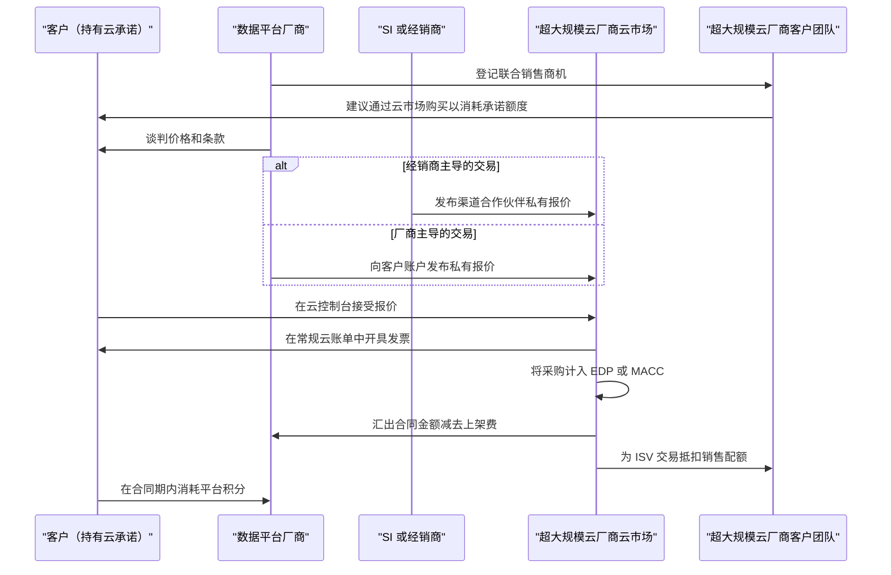

# 40. 市场进入与合作伙伴关系
> **深度：** L2 · **阅读时间：** 约 13 分钟 · **最后核实：** 2026-11-01 · **前置阅读：** [第 35 章 — 商业模式](ch35-business-models.md)、[第 24 章 — 数据栈与计算和存储的交汇](../03-ai-data-stack/ch24-data-meets-compute-and-storage.md)

## 要点速览（TL;DR）

- **超大规模云厂商的云市场（marketplace）如今是数据平台的主要销售渠道，而为其买单的是承诺的云消费额度（committed spend）。** 企业与 AWS、Microsoft 或 Google 签订多年期承诺。通过该云的云市场购买的 Databricks 或 Snowflake 合同计入这份承诺，因此客户用的是早已承诺出去的预算。Snowflake 报告称，2025 日历年 AWS Marketplace 销售额超过 $2B，上架以来累计超过 $7B（公司披露）。[^sf-aws-2b][^sf-aws-6b]
- **费用很低，激励很大。** AWS 根据合同规模对私有报价收取 3% / 2% / 1.5% 的费用。Google 采用相同的档位。Microsoft 报价为 3%。[^aws-fees][^gcp-vrs][^ms-fee] 厂商为这笔费用换来的是云厂商自己的销售人员：在 AWS ISV Accelerate 和 Microsoft 的 IP 联合销售（co-sell）计划下，这些销售人员促成厂商交易后可获得配额抵扣。[^isva][^ms-cosell]
- **系统集成商创造需求。** Accenture 为 Snowflake（2025 年 12 月，超过 5,000 名 SnowPro 认证人员）和 Databricks（2026 年 3 月，超过 25,000 名接受过 Databricks 培训的人员）分别设立了专门的业务集团。迁移和 AI 项目正是通过这类业务团队落到平台上的。[^acn-sf][^acn-dbx]
- **存储厂商通过一套认证阶梯与数据平台合作。** 各级台阶依次为：S3 兼容性测试、验证设计、联合参考架构、联合销售，最后是云市场或 OEM 上架。公开可见的大多数存储–平台关系停留在前两级。Databricks Storage Ecosystem（2026 年 6 月）和 NVIDIA AI Data Platform（2025 年 3 月）是首批将存储厂商列入官方平台名录的计划。[^storage-eco][^aidp]
- **Everpure 视角。** Pure Storage 曾出现在 Snowflake 由厂商自报的 S3 兼容存储厂商名单上（Snowflake 不对其进行验证；FlashBlade 在较新的"tested and compliant"措辞下的状态尚未确认），并位列 NVIDIA AI Data Platform 名录。它拥有 Dremio 和 Starburst 参考架构，也是 Databricks Storage Ecosystem 的首发合作伙伴。[^sf-s3compat][^aidp][^storage-eco] 其下一步的合作选项是将这些上架资质转化为联合销售、可计入 MACC/EDP 的云市场报价以及联合销售管道。

## 为何重要（商业 + Everpure 视角）

[第 35 章](ch35-business-models.md)解释了数据平台如何收费：按用量计费的积分、承诺消费额度合同以及额度消耗。本章讨论这些合同是如何卖出去的，以及沿途谁抽成、谁获得业绩抵扣。对数据平台而言，答案是：越来越大比例的交易通过别人的渠道完成，即超大规模云厂商的云市场、系统集成商（"SI"）的业务团队，或技术合作伙伴的集成。

对企业发展领域的读者而言，合作伙伴关系值得研究，因为它们是获取分销能力的廉价期权。一次云市场上架只需几个百分点的费用和一些工程投入。一份验证设计只需一个测试周期和联合营销资金。两者都可能打开直销团队需要数年才能建立的销售管道。同样这些合作伙伴也是竞争对手。AWS、Microsoft 和 Google 各自都在销售与其联合销售的平台相竞争的自有数据服务（见[第 28 章](../04-company-deep-dives/ch28-hyperscaler-data-platforms.md)）。

对 Everpure（原 Pure Storage；NYSE: P，原代码 PSTG）而言，问题更窄。随着它从阵列走向数据管理，它需要哪些合作伙伴资产，才能让 Databricks、Snowflake、NVIDIA 和各家云厂商把它视为数据平台的一部分，而不是底层的那个存储桶？本章以基于公开信息、战略团队可能评估的选项来作答。

## 工作原理

### 云市场把云承诺变成采购预算

大型企业与其云厂商签订多年期消费承诺以换取折扣。AWS 称之为[企业折扣计划（Enterprise Discount Program）](../glossary.md#enterprise-discount-program)（EDP），也称私有定价协议（Private Pricing Agreement）。Microsoft 的版本是 [Azure 消费承诺（Azure Consumption Commitment）](../glossary.md#azure-consumption-commitment)（MACC）。Google 使用承诺消费协议和[承诺使用折扣（committed use discounts）](../glossary.md#committed-use-discount)（CUD）。客户未能消耗的承诺部分仍需支付。因此，手握未消耗承诺的 CFO 会更愿意通过云市场购买新软件，因为这笔采购可以消耗承诺额度。

Microsoft 对这一规则有明确的文档说明。带有"Azure benefit eligible"标识的报价，只要通过客户 Microsoft 协议下的 Azure 订阅购买，其税前购买金额的 100% 计入 MACC。部署在本地的许可不计入。[^macc] AWS 将云市场额度消耗作为合同条款处理。咨询机构的指引称，云市场采购可计入的部分有一个默认上限，通常为承诺额的 25%，客户可在签约时谈判（估算；非 AWS 公布）。[^edp-cap]

交易本身是一份[私有报价（private offer）](../glossary.md#private-offer)：厂商向单一买方的云账户发布的定制价格和条款。

*图 40.1 — 云市场私有报价把一张新的采购订单换成了现有云账单上的一个条目。客户消耗了承诺额度，厂商由云厂商付款，云厂商的客户团队获得配额抵扣。交易中的每一方都有理由说"是"。*

经济账对厂商有利。2024 年 1 月，AWS 将私有报价上架费设定为：合同总额低于 $1M 的为 **3%**，$1M 至不足 $10M 的为 **2%**，$10M 及以上以及续约的为 **1.5%**。渠道合作伙伴私有报价（[CPPO](../glossary.md#channel-partner-private-offer)，即由经销商代表厂商完成交易）再加 0.5 个百分点。[^aws-fees] Google 在 2021 年将其云市场分成从 20% 降至 3%。[^gcp-2021] 自 2025 年 4 月起，它采用可变费率表，对 $10M 及以上的交易、续约和迁移降至 1.5%。[^gcp-vrs] Microsoft 表示其费用已从行业标准的 20% 降至 3%。[^ms-fee] 十年前，应用商店式的云市场抽成约 20%。如今 2% 的费用低于大多数销售佣金。

**联合销售才是真正的奖赏。** AWS ISV Accelerate 是一项面向在 AWS Marketplace 上架和销售软件的厂商的联合销售计划。其核心好处是，AWS 客户经理在帮助促成合作伙伴的云市场私有报价时可获得激励，包括配额抵扣。[^isva] Microsoft 有类似的阶梯。一份报价从"co-sell ready"升级为"Azure IP co-sell eligible"，Microsoft 销售人员销售符合条件的 IP 解决方案可获得配额抵扣。IP 联合销售资格也是让报价计入 MACC 的条件。[^ms-cosell] AWS 在 2025 年 8 月增加了私有报价推广资金，并在 2025 年 11 月推出"express"私有报价。[^aws-promo]

> **类比：半导体（设计导入与合格供应商名单）。** 一个可计入 EDP 或 MACC 的云市场上架，就是软件版的进入超大规模云厂商合格供应商名单。客户的承诺消费额度是一个早已完成设计导入并编好预算的"插槽"。具备资格意味着你的部件无需新的采购认证就能填进去。联合销售的配额抵扣则相当于超大规模云厂商自己的销售团队在推广你的部件。

### 算例：通过 AWS 私有报价完成的一笔 $2M Databricks 交易（示意）

一家美国银行签有一份三年期、$30M 的 AWS EDP，实际消耗低于计划。它希望为一个 Hadoop 迁移项目采购 Databricks，该项目由一家 Databricks 级别的 SI 执行。Databricks 以 AWS Marketplace 私有报价形式提供一年期 $2M 的承诺 DBU 消费，采用经典计算模式，因此银行还要直接向 AWS 支付集群所用的 EC2 费用。以下所有数字均为示意，只有费率档位来自 AWS 的费率表。[^aws-fees]

| 参与方 | 记账内容 | 金额（示意） | 备注 |
|---|---|---|---|
| 客户 | AWS 账单上的 $2M Databricks 承诺；计入 EDP | 计入 $30M 承诺中的 $2.0M（6.7%） | 若适用 25% 的云市场上限（$7.5M），则在上限之内[^edp-cap] |
| AWS Marketplace | 按 $1M–<$10M 档收取上架费 | 2% × $2M = **$40K** | 若由 SI 以 CPPO 方式转售，则为 $50K（2.5%） |
| Databricks | $2M 合同，扣除费用后汇出 | 约 $1.96M 现金 | 该费用记为收入抵减还是销售费用属于会计判断 |
| AWS 客户经理 | 在 ISV Accelerate 联合销售权益下获得配额抵扣 | 按 $2M 抵扣 | 另外，全部 EC2 消耗也计入 EDP |
| AWS 基础设施 | 经典计算模式下的 EC2 | 例如每年 $1.0–1.5M（假设） | 在 serverless 模式下，由 Databricks 向 AWS 付费，并提高 DBU 定价（[第 25 章](../04-company-deep-dives/ch25-databricks.md)） |
| SI 合作伙伴 | 在 Databricks 计划中获得合作伙伴影响型或合作伙伴来源型业绩抵扣；服务费 | 服务费及任何经销商利润 | 业绩抵扣计入级别资格和激励[^dbx-bpn] |

*图 40.2 — 同样的 $2M 被计算了四次：对客户是承诺额度消耗，对 Databricks 是订单额，对 AWS 销售人员是配额，对 SI 是合作伙伴业绩抵扣。2% 的费用是这条链上最便宜的一项。业绩的重复计算正是合作伙伴渠道获得资金的方式。*

结构性风险在于：一个承诺额度几近耗尽的客户，或一个改变销售激励的超大规模云厂商，可以在需求没有任何明显变化的情况下拖慢厂商的销售管道。这正是[第 25 章](../04-company-deep-dives/ch25-databricks.md)将 Databricks 通过 Azure 销售的收入占比列为待解问题的原因。
