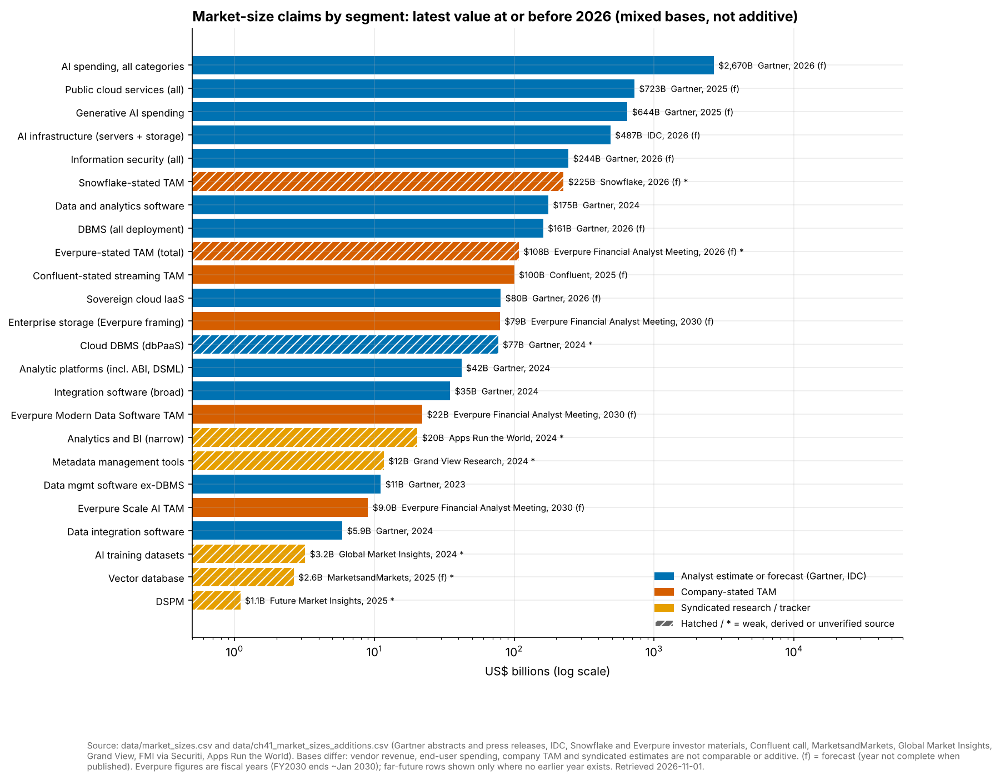
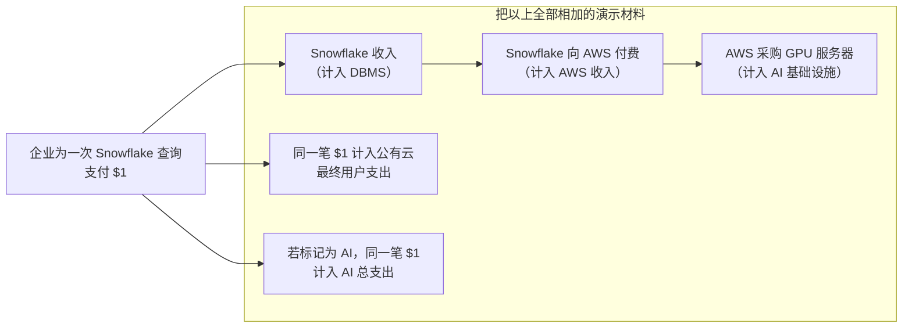
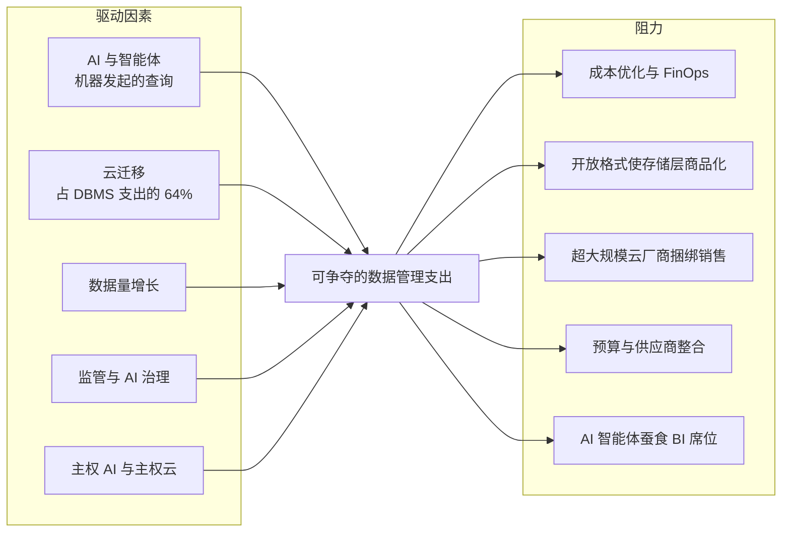

# 41. 市场规模与增长驱动因素
> **深度：** L2 · **阅读时间：** 约 8 分钟 · **最后核实：** 2026-11-01 · **前置阅读：** [第 37 章 — 上市可比公司与估值](ch37-public-comps-valuation.md)

## 要点速览（TL;DR）

- 数据基础设施领域锚定最可靠的数字是 Gartner 的数据库管理系统（DBMS）市场：**2024 年 $119.7B，增长 13.4%**，其中 64% 的支出发生在云端。Gartner 预测 **2026 年为 $161B**。[^g-dbms24][^g-dbms-fc] 该领域的大多数其他"市场规模"都要弱得多，本书数据集中有若干行是推算得出或仅有单一来源的。本章对每一项都做了标注。
- 各家市场规模之所以相互矛盾，是因为它们衡量的是不同的东西：供应商收入、最终用户支出、公司自己声称的可服务市场，或方法未披露的第三方汇编估算。切勿将它们相加。同一笔 AI 支出可能同时出现在其中四个口径里。
- 公司披露的[总可服务市场（total addressable market）](../glossary.md#total-addressable-market)（TAM）远高于分析师统计的市场。Snowflake 约 $225B 的"当前" TAM（来源较弱）比 Gartner 整个 2026 年 DBMS 预测还大。Confluent $100B+ 的流处理 TAM 约为 Gartner $5.9B 数据集成软件市场的 17 倍。[^sf-id26][^cflt-q1][^bf-di]
- 增长驱动因素真实存在且可衡量：2025 年 $318B 的 AI 基础设施支出、云迁移、主权云（2026 年 $80B 的 IaaS）以及监管。[^idc-apr26][^g-sov] 阻力同样存在：成本优化、开放格式使存储层商品化、超大规模云厂商的捆绑销售，以及 AI 智能体（agent）取代 BI 席位。
- 对 Everpure 而言，"向上层移动"的数据管理市场是真实的，但与存储相比规模较小。Everpure 自己的 FY2030 Modern Data Software TAM 为 $22B（公司估算，二手报道），而企业存储为 $79B。[^ep-fam]

## 为何重要（商业 + Everpure 视角）

[第 37 章](ch37-public-comps-valuation.md)中的每一个交易模型，以及[第 39 章](ch39-ma-history.md)中的每一条收购理由，都依赖于一张市场规模幻灯片。这些幻灯片是企业发展团队会看到的审计程度最低的数字。分析师摘要需付费才能阅读，公司 TAM 不经审计师审查，而第三方汇编报告之间常常相差四倍。一个无法拆解 TAM 的团队，会为增长故事支付过高的价格。

对 Everpure 而言，这个问题很具体。公司于 2026 年 2 月更名，并以 $125.0M 收购 1touch，以进入数据发现与数据分类领域（[第 33 章](../04-company-deep-dives/ch33-governance-catalog-security-companies.md)）。其 2026 年 9 月的分析师会议为这一举措给出了数字：到 FY2030 Modern Data Software TAM 达 $22B。[^ep-fam] 这个数字能否实现，取决于哪些数据管理支出真正可以争夺，以及哪些已经被捆绑进超大规模云厂商和平台的账单之中。

## 工作原理

### 四种口径，四个答案

一个市场规模数字有其**口径**，而决定这个数字的更多是口径，而非市场本身。

1. **供应商收入（市场份额）。** Gartner 的市场份额系列将供应商在某一品类中确认的收入加总。DBMS 数字就属于这一类。开源软件只通过付费服务计入，因此免费的 PostgreSQL 使用是看不见的。[^reg]
2. **[最终用户支出（end-user spending）](../glossary.md#end-user-spending)。** 统计买方支付的金额，包括硬件、服务和设备。Gartner 的 AI 支出预测（2026 年 $2.67T）是一个最终用户口径的数字，其中一半以上（约 $1.48T）是 AI 基础设施。[^g-ai26]
3. **公司披露的 TAM。** 这是供应商对其可触达钱包的估算，通常包括相邻品类以及其软件可替代的人力。它未经审计，也不是可观察到的市场。
4. **第三方汇编估算。** 这些来自 MarketsandMarkets 或 Grand View 等报告机构，按报告出售，方法不透明。对于 DSPM、向量数据库和训练数据，这些是唯一可得的公开数字。

*图 41.1 — 这些数字跨越三个以上数量级和四种口径。带阴影线的条形基于推算、单一来源或第三方汇编的数字。这些条形不可相加。来源：`data/market_sizes.csv` 和 `data/ch41_market_sizes_additions.csv`。*

### 逐个细分市场

| 细分市场 | 数值 | 年份 | 口径 | 发布方 | 注意事项 |
|---|---|---|---|---|---|
| DBMS，所有部署方式 | $119.7B | 2024 | 分析师估算，供应商收入 | Gartner[^g-dbms24] | 最佳锚点。2025 年实际值未公开；约 $136B 系由 2026 年预测*推算*得出 |
| DBMS 预测 | $161B | 2026 | 分析师预测 | Gartner[^g-dbms-fc] | 预测，+18.4% |
| 云 DBMS（[dbPaaS](../glossary.md#dbpaas)） | 约 $76.6B | 2024 | *推算*（64% × $119.7B） | Gartner[^g-dbms24] | 取代数据集中早先的 $73.0B（61%）推算 |
| 数据与分析软件（全部） | $175.17B | 2024 | 分析师估算 | Gartner[^g-da] | 包含 DBMS。预测 2029 年达 $358B |
| 分析平台（含 BI、数据科学） | $41.92B | 2024 | 分析师估算 | Gartner[^g-ap] | 仅数据科学与 AI 平台即达 $11.71B，+38.6% |
| 分析与 BI（狭义） | $20.3B | 2024 | 追踪机构估算 | Apps Run the World[^artw] | **较弱：** 方法未公开 |
| 数据集成软件 | $5.9B | 2024 | 分析师估算 | Gartner，经 Blocks & Files[^bf-di] | 二手来源；增速放缓至 8.1% 的 CAGR |
| 不含 DBMS 的数据管理（数据治理代理指标） | $11.1B | 2023 | 分析师估算 | Gartner[^g-dm] | 元数据管理是增长最快的子市场（+14.5%） |
| 元数据管理工具 | $11.69B | 2024 | 第三方汇编 | Grand View[^gvr-meta] | **较弱：** 超过 Gartner 整个不含 DBMS 的市场 |
| [数据安全态势管理（DSPM）](../glossary.md#data-security-posture-management) | 约 $1.1B（区间 $0.4–4.0B） | 2025 | 第三方汇编 | FMI，经 Securiti 汇编[^dspm] | **较弱：** 由供应商汇编；相差 10 倍 |
| 信息安全（全部） | $244B | 2026 | 分析师预测 | Gartner[^g-sec] | 整体安全，而非 DSPM |
| 流处理 | 无分析师数字 | — | — | — | 仅有 Confluent 的公司 TAM（见下文） |
| [向量数据库（vector database）](../glossary.md#vector-database) | $2.65B | 2025 | 第三方汇编 | MarketsandMarkets[^mm-vec] | **较弱。** Gartner 认为到 2029 年独立向量数据库将占 DBMS 的 <1%[^yb] |
| AI 训练数据集 | $3.2B | 2024 | 第三方汇编 | Global Market Insights[^gmi] | **较弱：** 未包括大部分人类反馈服务 |
| AI 基础设施（服务器 + 存储） | $318B | 2025 | 分析师估算 | IDC[^idc-apr26] | 存储仅占 2025 年 Q4 支出的 2.4% |

*图 41.2 — TAM 表。只有 Gartner 的 DBMS、分析和集成相关行基于一手分析师陈述。数据治理、DSPM、向量和训练数据中的每一个第三方汇编行，在引用时都需要附加说明。*

原始数据集中有三行需要明确警示。2023 年的 DBMS 数字（$105.6B）和云 DBMS 拆分是倒推得出的，并非公开发布。2026 年 6 月的 Snowflake TAM 来自一份 AI 生成的会议纪要摘要。向量数据库一行是方法不透明的第三方汇编估算。[^sf-id26] 它们在图表中以阴影线显示。

### 为什么总数不能相加

Gartner 的最终用户预测在设计上避免了*同一*预测内部的重复计算。错误出现在一份演示材料把不同发布方的市场，或同一价值链不同层级的市场叠加在一起的时候。

*图 41.3 — 企业的一美元可能同时出现在 DBMS 供应商收入、云服务商收入、AI 基础设施资本开支、公有云支出和 AI 总支出中。把这些层级相加会把机会夸大数倍。*

> **类比：半导体。** 这与把 TSMC 的晶圆收入加到 NVIDIA 的芯片收入上、再把总数称为"半导体市场"是同一种错误。晶圆是芯片的投入成本。同理，云服务商的基础设施收入是 Snowflake 收入的投入成本。行业芯片销售统计在销售环节对每颗器件只计一次，一个合理的数据市场模型也应如此。

### 公司 TAM 与分析师市场

| 公司 | 披露的 TAM（口径、日期） | 最接近的分析师市场 | 公司收入 | 收入 ÷ 披露 TAM |
|---|---|---|---|---|
| Snowflake | $170B（2024）→ $355B（2029），公司估算，Investor Day 2025[^sf-id25]；当前约 $225B → 五年后 >$460B，2026 年 6 月（**较弱**来源）[^sf-id26] | Gartner 数据与分析软件 $175.17B（2024），*包含*所有 DBMS 供应商[^g-da] | 产品收入 $3.46B，FY2025（2024 年 2 月–2025 年 1 月），GAAP[^sf-fy25] | 约为 2024 年 TAM 的 2.0% |
| Confluent（2026 年 3 月起归属 IBM） | $100B+（公司披露，2025 年 4 月）；$60B（2023）；IPO 时约 $50B（2021）[^cflt-q1][^cflt-ipo] | Gartner 数据集成 $5.9B；广义集成软件 $34.8B（2024）[^bf-di][^g-int] | 总收入 $1.167B，FY2025（自然年），GAAP[^cflt-fy25] | 约 1.2% |
| Everpure | $108B（FY2026）→ $207B（FY2030），公司估算，二手报道（**较弱**）[^ep-fam] | 企业存储 $79B（FY2030，Everpure 的划分口径） | 收入 $3.66B，FY2026（2025 年 2 月–2026 年 2 月 1 日），GAAP[^ep-fy26] | 约 3.4%（以 FY2026 的 $108B TAM 计） |
| MongoDB | 其投资者日的公开摘要中未出现美元计的 TAM[^mdb] | Gartner DBMS $119.7B（2024） | — | — |
| Databricks | 未公开（私营公司） | — | 年化收入运行率 >$7B，公司披露，2026 年 8 月[^dbx] | — |

*图 41.4 — 公司 TAM 高于分析师市场。Snowflake 2026 年的数字超过了 Gartner 整个 DBMS 预测，而 Confluent 的数字约为 Gartner 广义集成软件市场的三倍。较低的收入/TAM 比率，正是投资者日幻灯片要展示的东西。*

TAM 膨胀遵循一种模式。每一次投资者日都会增加相邻品类：应用、AI、数据工程和安全。时间跨度也在向前滚动。2022 年前后，Snowflake 预计 2026 年 TAM 为 $248B（较弱的二手来源）。到了 2026 年，报道的"当前"数字约为 $225B，低于旧的预测。然而标题数字仍在上升，从 2029 年的 $355B 升至五年后的 $460B 以上。[^sf-fool][^sf-id26][^sf-id25] Confluent 的 TAM 从约 $50B（2021）翻倍至 $100B+（2025），而同期 Gartner 的数据集成市场每年增长约 10%。[^cflt-ipo][^cflt-q1][^bf-di] 每次演示都在增长的 TAM，证明的是定义更宽泛，而非市场更大。

> **类比：半导体。** 公司披露的 TAM 是数据行业版的初创公司幻灯片，上面声称"SAM：每一片 3nm 晶圆投片"。它加总的是整个制程节点，而不是产品能够赢得的插槽。严谨的做法是逐个插槽构建[可服务市场（serviceable addressable market）](../glossary.md#serviceable-addressable-market)：具名的工作负载、每个工作负载当前的支出，以及产品能够现实拿下的份额。

### 增长驱动因素与阻力

*图 41.5 — 驱动因素提升总支出，而阻力改变支出的落点。任何一家供应商的净增长取决于它位于捆绑与商品化分界线的哪一侧。*

**驱动因素。** AI 基础设施支出增长了一倍以上，从 2024 年的 $153B 增至 2025 年的 $318B（IDC）。[^idc-apr26] 2024 年，数据科学与 AI 平台增长 38.6%，非关系型 DBMS 增长 22.7%。[^g-ap][^g-dbms24] 主权云 IaaS 将在 2026 年达到约 $80B，增长 35.6%，预计欧洲将在 2027 年超过北美。[^g-sov] 监管催生了数据治理（governance）和 DSPM 预算（[第 15 章](../02-pipelines-and-governance/ch15-governance-security-privacy.md)）。

**阻力。** 调查受访者估计 29% 的云支出被浪费，AI 工作负载在 2026 年推高了这一数字（Flexera，自我报告）。[^flexera] [FinOps](../glossary.md#finops) 项目将其转化为用量削减。[开放表格式（open table format）](../glossary.md#open-table-format)让客户无需迁移数据即可更换引擎，从而限制了存储层的租金（[第 7 章](../01-data-systems-foundations/ch07-open-table-formats.md)）。[超大规模云厂商（hyperscaler）](../glossary.md#hyperscaler)把集成、目录和 BI 捆绑进平台账单。直接查询[语义层（semantic layer）](../glossary.md#semantic-layer)的智能体会降低对[按席位计费（seat-based）](../glossary.md#seat-based-pricing) BI 许可证的需求（[第 14 章](../02-pipelines-and-governance/ch14-semantic-layers-and-bi.md)）。Gartner 预计到 2029 年，数据集成的增速将从 9.8% 放缓至 8.1% 的 CAGR。[^bf-di]

## 设计选择与权衡

| 你要回答的问题 | 使用该口径 | 原因 | 主要陷阱 |
|---|---|---|---|
| 某供应商当前的竞争舞台有多大？ | 供应商收入（Gartner 市场份额） | 可观察，定义一致 | 遗漏开源和自建方案 |
| 买方需求增长有多快？ | 最终用户支出预测 | 涵盖硬件、服务、云 | 在 AI 领域以硬件为主；与其他所有层级重叠 |
| 管理层认为自己能触达多少？ | 公司 TAM | 展示战略意图与相邻品类版图 | 未经审计，逐年膨胀 |
| 一个新细分市场是否真实存在？ | 第三方汇编估算，加上融资与收入披露 | 往往是唯一可得的数字 | 相差 4–10 倍；由供应商赞助 |

*图 41.6 — 让口径与问题匹配。对这种怀疑态度最有力的反驳是：公司 TAM 本意是展示方向和相邻品类，而非预测收入，而品类开创者往往会成长进入分析师尚未定义的市场。即便如此，1–3% 的收入/TAM 比率也很难说明哪一部分份额是可以赢得的。*

## 主要参与者

**Gartner** 发布被引用最多的 DBMS、分析、集成和安全数字，主要通过付费摘要和新闻稿。**IDC** 掌握 AI 基础设施追踪数据，其预测大幅上调：其 2029 年数字从 2025 年 10 月的 $758B 升至 2026 年 4 月的 $1T 以上。[^idc-oct25][^idc-apr26] **第三方汇编机构**（MarketsandMarkets、Grand View、Global Market Insights、Future Market Insights）填补细分品类的空白。**公司**在投资者日上发布 TAM。本章使用的是 Snowflake（2022、2024、2025、2026）、Confluent（S-1 和业绩电话会）以及 Everpure（2026 年 9 月）的数据。

## 历史与发展轨迹

- **2021：** 云已占 DBMS 支出的近一半，在约 $80B 的市场中云 DBMS 为 $39.2B（媒体报道的 Gartner 数字）。[^techrep] Confluent IPO 时的 TAM 约为 $50B。[^cflt-ipo]
- **2024：** DBMS 达到 $119.7B，其中 64% 为云。数据与分析软件达到 $175.17B。[^g-dbms24][^g-da]
- **2025：** Snowflake 的 TAM 为 $170B，预计到 2029 年达 $355B。[^sf-id25] Gartner 预测生成式 AI 支出为 $644B，其中约 80% 为硬件。[^g-genai] 公有云支出预测为 $723.4B。[^g-cloud]
- **2026：** Gartner 的 2026 年 AI 支出预测在三个版本中逐次上调，从 $2.52T 升至 $2.67T。IDC 预计 2029 年 AI 基础设施将超过 $1T。Everpure 发布了其首个分部 TAM，其中 Modern Data Software 到 FY2030 为 $22B。[^g-ai26][^idc-apr26][^ep-fam] 发展轨迹：分析师统计的总数持续上升，也推动公司 TAM 随之上升。参见[第 44 章](../06-history-and-future/ch44-future-trends.md)。

## 关键数字

| 指标 | 数值 | 口径 | 来源/日期 |
|---|---|---|---|
| DBMS 市场，2024 | $119.7B，+13.4% | 分析师估算，供应商收入 | Gartner，2025-05[^g-dbms24] |
| DBMS 预测，2026 | $161B，+18.4% | 分析师预测 | Gartner，2025-12[^g-dbms-fc] |
| 云在 DBMS 中的占比，2024 | 64% | 分析师估算 | Gartner，2025-05[^g-dbms24] |
| 数据与分析软件，2024 → 2029 | $175.17B → $358B | 分析师估算 / 预测 | Gartner，2025[^g-da] |
| 数据集成软件，2024 | $5.9B，+9.8% | 分析师估算，媒体报道 | Blocks & Files，2025-12-12[^bf-di] |
| AI 基础设施，2025 | $318B；存储占 Q4 的 2.4% | 分析师估算 | IDC，2026-04-16[^idc-apr26] |
| AI 总支出，2026 | 约 $2.67T，+49.5% | 分析师预测，最终用户支出 | Gartner，2026-09-16[^g-ai26] |
| 主权云 IaaS，2026 | 约 $80B，+35.6% | 分析师预测 | Gartner，2026-02-09[^g-sov] |
| 估计的云浪费 | 29% | 调查，自我报告 | Flexera，2026[^flexera] |
| Snowflake TAM，2024 / 2029 | $170B / $355B | 公司披露 | Investor Day 演示材料，2025[^sf-id25] |

*图 41.7 — 关键数字及其口径。引用数字时请同时说明口径。*

## 存储桥接

> **存储桥接。** IDC 的追踪数据显示，2025 年 Q4 存储仅占 AI 基础设施支出的 2.4%。[^idc-apr26] 这一数字解释了向上层移动的逻辑：钱在阵列之上。Everpure 的划分口径将企业存储定为 $79B、Modern Data Software 定为到 FY2030 的 $22B（公司估算，二手报道）。其 $22B 的数字已约为 Gartner 整个 2023 年不含 DBMS 的数据管理市场（$11.1B）的两倍；即便按该市场 2023 年的增速（8.1%）复合增长，Gartner 的数字到 2030 年也只有约 $19B（我们的计算），因此该 TAM 必然依赖一个包括 Portworx、韧性和云在内的宽泛定义。[^ep-fam][^g-dm] 基于公开信息，战略团队可能评估的选项：(a) 围绕 1touch 的基础，为数据治理和数据发现构建插槽级的 SAM；(b) 将大型 AI 平台的 TAM 视为合作伙伴领地，而非可触达收入；(c) 依据对已安装存储基础的附加率而非品类 TAM 为数据管理交易估值。参见[第 45 章](../06-history-and-future/ch45-storage-moving-up-the-stack.md)及配套的 *Everpure Tech Atlas*。

## 对话手册

**向产品经理提出的问题**

1. "你们的 TAM 替代的是客户预算中的哪些科目？请说出具体的成本中心。"
2. "你们的 TAM 中有多大比例位于你们无法取代的超大规模云厂商账单之内？"
3. "自上次投资者日以来，你们的 TAM 定义有何变化，为什么？"

**向工程师提出的问题**

1. "迁移后哪些工作负载真正转移到了我们这里，哪些仍留在在位厂商那里？"
2. "你看到的支出中，有多少是存储和计算的转付，有多少是软件价值？"
3. "当智能体生成查询时，是每用户用量上升，还是席位数量下降？"

**好的回答听起来是什么样的。** 它们从工作负载和价格点自下而上构建（"40,000 条数据管道，每条约 $X"），区分总预订额与供应商净收入，并说明口径和年份。它们还会承认自己计入了哪些竞争对手的预算。

**不要这样说**

- "数据市场有 $500B。" 要问它采用哪种口径，以及重复计算了哪些层级。
- "Gartner 说 DSPM 是一个 $2B 的市场。" 尚未发现 Gartner 公开的美元规模数字。被引用的数字来自第三方汇编或供应商来源。
- "向量数据库是一个 $X billion 的品类。" Gartner 预计独立向量数据库将保持在 DBMS 收入的 1% 以下。[^yb]
- "Snowflake 的 TAM 是 $460B。" 该数字来自一份较弱的会议纪要摘要，尚未与演示材料核对。

## 深入阅读

- Gartner 市场份额与预测摘要（DBMS、数据与分析软件）：比较定义有何不同，而不仅仅是总数。[^g-dbms24][^g-da]
- IDC 的 AI 基础设施追踪说明，用于了解服务器与存储的拆分。[^idc-apr26]
- Snowflake 的 Investor Day 2025 演示材料，作为 TAM 构建的实例。[^sf-id25] 可与讨论估值倍数的[第 37 章](ch37-public-comps-valuation.md)配合阅读。

## 关键术语

- [总可服务市场（Total addressable market）](../glossary.md#total-addressable-market) — 假如产品赢得其定义品类中所有可能的客户，可获得的收入。
- [可服务市场（Serviceable addressable market）](../glossary.md#serviceable-addressable-market) — 产品凭借当前的产品、渠道和地域实际能够触达的那部分 TAM。
- [最终用户支出（End-user spending）](../glossary.md#end-user-spending) — 一种统计买方支付金额（包括硬件和服务）的市场规模口径。
- [供应商收入口径（Vendor revenue basis）](../glossary.md#vendor-revenue-basis) — 一种将供应商在某品类中确认的收入加总的市场规模口径。
- [第三方汇编研究（Syndicated research）](../glossary.md#syndicated-research) — 出售给众多买家的市场报告，方法往往不透明。
- [重复计算（Double counting）](../glossary.md#double-counting) — 在价值链的各个层级中将同一笔支出相加不止一次。
- [dbPaaS](../glossary.md#dbpaas) — 以托管云服务形式提供的数据库。
- [FinOps](../glossary.md#finops) — 通过共担成本责任来管理和削减云支出的实践。
- [主权云（Sovereign cloud）](../glossary.md#sovereign-cloud) — 在本地司法管辖和控制下运营的云容量。
- [数据安全态势管理（Data security posture management）](../glossary.md#data-security-posture-management) — 发现敏感数据并对其暴露程度进行排序。
- [向量数据库（Vector database）](../glossary.md#vector-database) — 为基于嵌入（向量）的相似性检索而构建的数据库。
- [超大规模云厂商（Hyperscaler）](../glossary.md#hyperscaler) — 以全球规模运营的云服务商（AWS、Azure、Google Cloud）。
- [开放表格式（Open table format）](../glossary.md#open-table-format) — 将对象存储上的文件变为事务型表的元数据。
- [语义层（Semantic layer）](../glossary.md#semantic-layer) — 供工具和智能体查询的共享业务定义。
- [按席位计费（Seat-based pricing）](../glossary.md#seat-based-pricing) — 按具名用户定价。

## 资料来源

[^g-dbms24]: Gartner, DBMS market-share abstract（2024 年 DBMS 收入 $119.7B，+13.4%；云 64% 对本地部署 36%；非关系型 +22.7%，关系型 +10.8%），https://www.gartner.com/en/documents/6494271，发布 2025-05；检索 2026-11-01。分析师估算；完整报告需付费。
[^g-dbms-fc]: Gartner, "Forecast: Database Management Systems, Worldwide, 2023–2029, 2025 Update," abstract, https://www.gartner.com/en/documents/7229830，发布 2025-12；检索 2026-11-01。分析师预测。
[^reg]: The Register, report on Gartner's DBMS Market Share Ranks 2011–2025, https://www.theregister.com/2026/04/21/gartner_bamboozling_dbms_chart_shows/，发布 2026-04-21；检索 2026-11-01。
[^g-da]: Gartner, "Market Share: Data and Analytics Software, Worldwide, 2024," abstract（$175.17B，+13.9%），https://www.gartner.com/en/documents/6504971，发布 2025-05-22；2029 年预测（$358B，15.4% CAGR）来自日期为 2025-07-15 的 Gartner 市场机会摘要；检索 2026-11-01。[VERIFY: 文档 ID 取自搜索结果]
[^g-ap]: Gartner, analytic platforms market-share abstract（2024 年 $41.92B，+17.3%；数据科学与 AI 平台 $11.71B，+38.6%），https://www.gartner.com/en/documents/6537402，发布 2025-05-29；检索 2026-11-01。
[^artw]: Apps Run the World, "Top 10 Analytics and BI Software Vendors and Market Forecast," https://www.appsruntheworld.com/top-10-analytics-and-bi-software-vendors-and-market-forecast-2015-2020/，发布 2025；检索 2026-11-01。独立追踪机构估算；来源较弱。
[^bf-di]: Blocks & Files, "Data integration market set for slower growth, says Gartner," https://www.blocksandfiles.com/ai-ml/2025/12/12/data-integration-market-set-for-slower-growth-says-gartner/1720515，发布 2025-12-12；检索 2026-11-01。媒体报道的 Gartner 数字。
[^g-int]: Gartner, integration software technologies abstract（2024 年 $34.8B，+10.9%），https://www.gartner.com/en/documents/6739234，发布 2025；检索 2026-11-01。[VERIFY: 文档 ID]
[^g-dm]: Gartner, data management software (excluding DBMS) market-share abstract, 2023（约 $11.1B，+8.1%；元数据管理 +14.5%），https://www.gartner.com/en/documents/5603191，发布 2024；检索 2026-11-01。
[^gvr-meta]: Grand View Research, "Metadata Management Tools Market Report," https://www.grandviewresearch.com/industry-analysis/metadata-management-tools-market-report，发布 2025；检索 2026-11-01。第三方汇编估算；来源较弱。
[^dspm]: Securiti, "DSPM Market Size 2026"（汇编了 Future Market Insights 的 $1.1B、Research and Markets 的 $2–4B 等），https://securiti.ai/dspm-market-size/，发布 2026；Palo Alto Networks Cyberpedia, "DSPM market"（区间 $415M–$2B），https://www.paloaltonetworks.com/cyberpedia/dspm-market，n.d.；检索 2026-11-01。由供应商汇编；较弱。
[^g-sec]: Gartner, information security forecast-analysis abstract（2026 年 $244B，按固定汇率 +11.6%），https://www.gartner.com/en/documents/6998666，发布 2026-02-05；检索 2026-11-01。
[^mm-vec]: MarketsandMarkets, "Vector Database Market," https://www.marketsandmarkets.com/Market-Reports/vector-database-market-24340532.html，发布 2025；检索 2026-11-01。第三方汇编估算；较弱。
[^yb]: Yugabyte, landing page for Gartner emerging-tech research on AI-native databases（Gartner 预测：到 2029 年独立向量数据库占 DBMS 收入 <1%），https://info.yugabyte.com/gartner-emerging-tech-ai-native-databases，n.d.；检索 2026-11-01。由供应商托管。
[^gmi]: Global Market Insights, "AI Training Dataset Market," https://www.gminsights.com/industry-analysis/ai-training-dataset-market，发布 2025；检索 2026-11-01。第三方汇编估算；较弱。
[^cflt-q1]: MarketBeat, Confluent Q1 2025 earnings call transcript（CEO 提及 $100B+ 的可服务市场），https://www.marketbeat.com/earnings/reports/2025-4-30-confluent-inc-stock，发布 2025-04-30；检索 2026-11-01。公司披露。
[^cflt-ipo]: TechTarget, "Confluent goes IPO as Kafka event streaming goes mainstream," https://www.techtarget.com/searchdatamanagement/news/252502989/Confluent-goes-IPO-as-Kafka-event-streaming-goes-mainstream，发布 2021-06；检索 2026-11-01。$60B 数字（2023–2024）为媒体报道，经 diginomica，https://diginomica.com/confluent-continues-deliver-ceo-jay-kreps-pitches-era-data-streaming-platforms，n.d.
[^cflt-fy25]: Confluent, Form 10-K for FY2025, https://www.sec.gov/Archives/edgar/data/1699838/000169983826000006/cflt-20251231.htm，发布 2026-02；检索 2026-11-01（经 `data/ch30_confluent_financials.csv`）。[VERIFY: 与 10-K 核对该数字]
[^sf-id25]: Snowflake, "Investor Day 2025" presentation（TAM 从 2024 年 $170B 至 2029 年 $355B，Snowflake 估算），https://s26.q4cdn.com/463892824/files/doc_presentations/2025/Snowflake-Investor-Day-2025_vF.pdf，发布 2025-06；检索 2026-11-01。
[^sf-id26]: Platform Aeronaut transcript summary, "Summit and welcome to Investor Day 2026," https://transcripts.platformaeronaut.com/summaries/summit-and-welcome-to-investor-day-2026-06-02-SNOW，发布 2026-06-02；检索 2026-11-01。AI 生成的摘要；来源较弱。[VERIFY: Snowflake 2026 年演示材料上的约 $225B 和 >$460B]
[^sf-fool]: The Motley Fool, "Could Snowflake stock help you become a millionaire?"（引用 2026 年 TAM $248B），https://www.fool.com/investing/2023/02/10/could-snowflake-stock-help-you-become-millionaire，发布 2023-02-10；检索 2026-11-01。较弱，二手来源。
[^sf-fy25]: Snowflake, Q4 and FY2025 earnings release（产品收入 $3,462.4M，GAAP），https://www.sec.gov/Archives/edgar/data/1640147/000164014725000016/fy2025q4earnings.htm，发布 2025-02-26；检索 2026-11-01。
[^ep-fam]: NAND Research, "Everpure 2026 Investor Day: Pure's four-vector push beyond enterprise storage," https://nand-research.com/everpure-investor-day-pures-four-vector-push-beyond-enterprise-storage/，发布 2026-09；Blocks & Files, https://www.blocksandfiles.com/flash/2026/09/25/everpures-head-turning-fiscal-2028-guidance/5299205，发布 2026-09-25；StorageNewsletter, https://www.storagenewsletter.com/2026/10/01/everpures-expanding-business-model-fuels-new-long-term-outlook/，发布 2026-10-01；演示材料：https://s21.q4cdn.com/687136699/files/content_files/Financial-Analyst-Meeting-Slide-Deck.pdf（会议于 2026-09-23 举行）；检索 2026-11-01。公司估算，二手报道。[VERIFY: 演示材料上的 $108B/$207B 总数及分部 TAM]
[^ep-fy26]: Everpure, Q4 FY2026 earnings press release (8-K Ex. 99.1), https://www.sec.gov/Archives/edgar/data/1474432/000147443226000015/pstg-ex991q4fy2026.htm，发布 2026-03；检索 2026-11-01。GAAP；FY2026 ≈ 2025 年 2 月–2026 年 2 月 1 日。
[^mdb]: Quartr, "MongoDB (MDB) investor presentation summary," https://quartr.com/events/mongodb-inc-mdb-investor-presentation_3eHbKyfi，发布 2026-09；检索 2026-11-01。摘要中未给出美元计的 TAM。
[^dbx]: Databricks, "Databricks Grows >80% YoY, Surpasses $7B Revenue Run-Rate…," https://www.databricks.com/company/newsroom/press-releases/databricks-grows-80-yoy-surpasses-7b-revenue-run-rate-scales，发布 2026-08-13；检索 2026-11-01（经 `meta/research-briefing.md`）。公司披露的年化运行率。
[^idc-apr26]: IDC, "AI infrastructure spending caps historic year at $90 billion in Q4 2025; 2029 spending to eclipse $1 trillion," https://www.idc.com/resource-center/blog/ai-infrastructure-spending-caps-historic-year-at-90-billion-in-q4-2025-2029-spending-to-eclipse-1-trillion/，发布 2026-04-16；检索 2026-11-01。
[^idc-oct25]: IDC, "Artificial intelligence infrastructure spending to reach $758bn USD mark by 2029," https://www.idc.com/resource-center/press-releases/artificial-intelligence-infrastructure-spending-to-reach-758bn-usd-mark-by-2029-according-to-idc/，发布 2025-10-28；检索 2026-11-01。
[^g-ai26]: Gartner, "Gartner Forecasts Worldwide AI Spending to Grow 49.5% in 2026," https://gartner.com/en/newsroom/press-releases/2026-09-16-gartner-forecasts-worldwide-ai-spending-to-grow-49-point-5-percent-in-2026，发布 2026-09-16；较早版本为 2026-01-15（$2.52T）和 2026-05-19（$2.59T）；检索 2026-11-01。
[^g-genai]: Gartner, "Gartner Forecasts Worldwide GenAI Spending to Reach $644 Billion in 2025," https://www.gartner.com/en/newsroom/press-releases/2025-03-31-gartner-forecasts-worldwide-genai-spending-to-reach-644-billion-in-2025，发布 2025-03-31；检索 2026-11-01。
[^g-cloud]: Gartner, "Gartner Forecasts Worldwide Public Cloud End-User Spending to Total $723 Billion in 2025," https://www.gartner.com/en/newsroom/press-releases/2024-11-19-gartner-forecasts-worldwide-public-cloud-end-user-spending-to-total-723-billion-dollars-in-2025，发布 2024-11-19；检索 2026-11-01。
[^g-sov]: Gartner, "Gartner Says Worldwide Sovereign Cloud IaaS Spending Will Total $80 Billion in 2026," https://www.gartner.com/en/newsroom/press-releases/2026-02-09-gartner-says-worldwide-sovereign-cloud-iaas-spending-will-total-us-dollars-80-billion-in-2026，发布 2026-02-09；检索 2026-11-01。
[^flexera]: Flexera, 2026 State of the Cloud findings（估计浪费 29%，高于此前的 27%），https://www.flexera.com/blog/finops/cloud-cost-management-trends/，发布 2026；经 TechInformed 佐证，https://techinformed.com/ai-workloads-drive-estimated-cloud-waste-to-29/，2026；检索 2026-11-01。自我报告的调查。
[^techrep]: TechRepublic, "New Gartner report shows massive growth in the database market, fueled by cloud," https://www.techrepublic.com/article/new-gartner-report-shows-massive-growth-database-market-fueled-cloud/，发布 2022；检索 2026-11-01。媒体报道。[VERIFY: 约 $80B 总额的确切数值]
