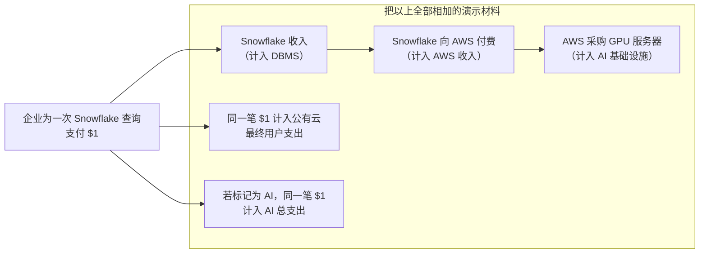
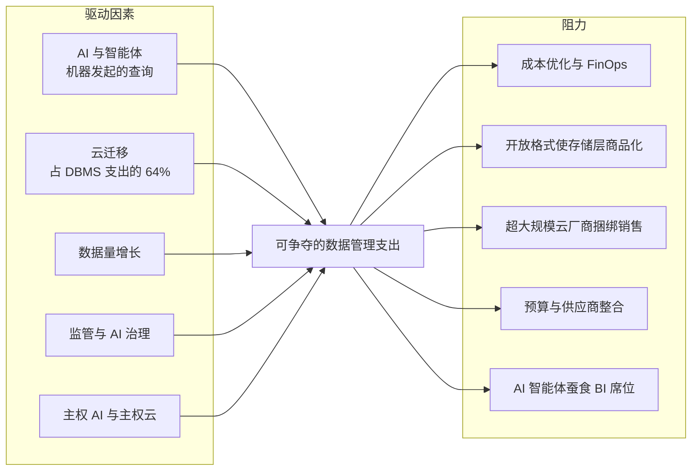

# 41. 市场规模与增长驱动因素
> **深度：** L2 · **阅读时间：** 约 8 分钟 · **最后核实：** 2026-11-01 · **前置阅读：** [第 37 章 — 上市可比公司与估值](ch37-public-comps-valuation.md)

## 要点速览（TL;DR）

- 数据基础设施领域锚定最可靠的数字是 Gartner 的数据库管理系统（DBMS）市场：**2024 年 $119.7B，增长 13.4%**，其中 64% 的支出发生在云端。Gartner 预测 **2026 年为 $161B**。[^g-dbms24][^g-dbms-fc] 该领域的大多数其他"市场规模"都要弱得多，本书数据集中有若干行是推算得出或仅有单一来源的。本章对每一项都做了标注。
- 各家市场规模之所以相互矛盾，是因为它们衡量的是不同的东西：供应商收入、最终用户支出、公司自己声称的可服务市场，或方法未披露的第三方汇编估算。切勿将它们相加。同一笔 AI 支出可能同时出现在其中四个口径里。
- 公司披露的[总可服务市场（total addressable market）](../glossary.md#total-addressable-market)（TAM）远高于分析师统计的市场。Snowflake 约 $225B 的"当前" TAM（来源较弱）比 Gartner 整个 2026 年 DBMS 预测还大。Confluent $100B+ 的流处理 TAM 约为 Gartner $5.9B 数据集成软件市场的 17 倍。[^sf-id26][^cflt-q1][^bf-di]
- 增长驱动因素真实存在且可衡量：2025 年 $318B 的 AI 基础设施支出、云迁移、主权云（2026 年 $80B 的 IaaS）以及监管。[^idc-apr26][^g-sov] 阻力同样存在：成本优化、开放格式使存储层商品化、超大规模云厂商的捆绑销售，以及 AI 智能体（agent）取代 BI 席位。
- 对 Everpure 而言，"向上层移动"的数据管理市场是真实的，但与存储相比规模较小。Everpure 自己的 FY2030 Modern Data Software TAM 为 $22B（公司估算，二手报道），而企业存储为 $79B。[^ep-fam]

## 为何重要（商业 + Everpure 视角）

[第 37 章](ch37-public-comps-valuation.md)中的每一个交易模型，以及[第 39 章](ch39-ma-history.md)中的每一条收购理由，都依赖于一张市场规模幻灯片。这些幻灯片是企业发展团队会看到的审计程度最低的数字。分析师摘要需付费才能阅读，公司 TAM 不经审计师审查，而第三方汇编报告之间常常相差四倍。一个无法拆解 TAM 的团队，会为增长故事支付过高的价格。

对 Everpure 而言，这个问题很具体。公司于 2026 年 2 月更名，并以 $125.0M 收购 1touch，以进入数据发现与数据分类领域（[第 33 章](../04-company-deep-dives/ch33-governance-catalog-security-companies.md)）。其 2026 年 9 月的分析师会议为这一举措给出了数字：到 FY2030 Modern Data Software TAM 达 $22B。[^ep-fam] 这个数字能否实现，取决于哪些数据管理支出真正可以争夺，以及哪些已经被捆绑进超大规模云厂商和平台的账单之中。

## 工作原理

### 四种口径，四个答案

一个市场规模数字有其**口径**，而决定这个数字的更多是口径，而非市场本身。

1. **供应商收入（市场份额）。** Gartner 的市场份额系列将供应商在某一品类中确认的收入加总。DBMS 数字就属于这一类。开源软件只通过付费服务计入，因此免费的 PostgreSQL 使用是看不见的。[^reg]
2. **[最终用户支出（end-user spending）](../glossary.md#end-user-spending)。** 统计买方支付的金额，包括硬件、服务和设备。Gartner 的 AI 支出预测（2026 年 $2.67T）是一个最终用户口径的数字，其中一半以上（约 $1.48T）是 AI 基础设施。[^g-ai26]
3. **公司披露的 TAM。** 这是供应商对其可触达钱包的估算，通常包括相邻品类以及其软件可替代的人力。它未经审计，也不是可观察到的市场。
4. **第三方汇编估算。** 这些来自 MarketsandMarkets 或 Grand View 等报告机构，按报告出售，方法不透明。对于 DSPM、向量数据库和训练数据，这些是唯一可得的公开数字。

*图 41.1 — 这些数字跨越三个以上数量级和四种口径。带阴影线的条形基于推算、单一来源或第三方汇编的数字。这些条形不可相加。来源：`data/market_sizes.csv` 和 `data/ch41_market_sizes_additions.csv`。*

### 逐个细分市场

| 细分市场 | 数值 | 年份 | 口径 | 发布方 | 注意事项 |
|---|---|---|---|---|---|
| DBMS，所有部署方式 | $119.7B | 2024 | 分析师估算，供应商收入 | Gartner[^g-dbms24] | 最佳锚点。2025 年实际值未公开；约 $136B 系由 2026 年预测*推算*得出 |
| DBMS 预测 | $161B | 2026 | 分析师预测 | Gartner[^g-dbms-fc] | 预测，+18.4% |
| 云 DBMS（[dbPaaS](../glossary.md#dbpaas)） | 约 $76.6B | 2024 | *推算*（64% × $119.7B） | Gartner[^g-dbms24] | 取代数据集中早先的 $73.0B（61%）推算 |
| 数据与分析软件（全部） | $175.17B | 2024 | 分析师估算 | Gartner[^g-da] | 包含 DBMS。预测 2029 年达 $358B |
| 分析平台（含 BI、数据科学） | $41.92B | 2024 | 分析师估算 | Gartner[^g-ap] | 仅数据科学与 AI 平台即达 $11.71B，+38.6% |
| 分析与 BI（狭义） | $20.3B | 2024 | 追踪机构估算 | Apps Run the World[^artw] | **较弱：** 方法未公开 |
| 数据集成软件 | $5.9B | 2024 | 分析师估算 | Gartner，经 Blocks & Files[^bf-di] | 二手来源；增速放缓至 8.1% 的 CAGR |
| 不含 DBMS 的数据管理（数据治理代理指标） | $11.1B | 2023 | 分析师估算 | Gartner[^g-dm] | 元数据管理是增长最快的子市场（+14.5%） |
| 元数据管理工具 | $11.69B | 2024 | 第三方汇编 | Grand View[^gvr-meta] | **较弱：** 超过 Gartner 整个不含 DBMS 的市场 |
| [数据安全态势管理（DSPM）](../glossary.md#data-security-posture-management) | 约 $1.1B（区间 $0.4–4.0B） | 2025 | 第三方汇编 | FMI，经 Securiti 汇编[^dspm] | **较弱：** 由供应商汇编；相差 10 倍 |
| 信息安全（全部） | $244B | 2026 | 分析师预测 | Gartner[^g-sec] | 整体安全，而非 DSPM |
| 流处理 | 无分析师数字 | — | — | — | 仅有 Confluent 的公司 TAM（见下文） |
| [向量数据库（vector database）](../glossary.md#vector-database) | $2.65B | 2025 | 第三方汇编 | MarketsandMarkets[^mm-vec] | **较弱。** Gartner 认为到 2029 年独立向量数据库将占 DBMS 的 <1%[^yb] |
| AI 训练数据集 | $3.2B | 2024 | 第三方汇编 | Global Market Insights[^gmi] | **较弱：** 未包括大部分人类反馈服务 |
| AI 基础设施（服务器 + 存储） | $318B | 2025 | 分析师估算 | IDC[^idc-apr26] | 存储仅占 2025 年 Q4 支出的 2.4% |

*图 41.2 — TAM 表。只有 Gartner 的 DBMS、分析和集成相关行基于一手分析师陈述。数据治理、DSPM、向量和训练数据中的每一个第三方汇编行，在引用时都需要附加说明。*

原始数据集中有三行需要明确警示。2023 年的 DBMS 数字（$105.6B）和云 DBMS 拆分是倒推得出的，并非公开发布。2026 年 6 月的 Snowflake TAM 来自一份 AI 生成的会议纪要摘要。向量数据库一行是方法不透明的第三方汇编估算。[^sf-id26] 它们在图表中以阴影线显示。

### 为什么总数不能相加

Gartner 的最终用户预测在设计上避免了*同一*预测内部的重复计算。错误出现在一份演示材料把不同发布方的市场，或同一价值链不同层级的市场叠加在一起的时候。

*图 41.3 — 企业的一美元可能同时出现在 DBMS 供应商收入、云服务商收入、AI 基础设施资本开支、公有云支出和 AI 总支出中。把这些层级相加会把机会夸大数倍。*

> **类比：半导体。** 这与把 TSMC 的晶圆收入加到 NVIDIA 的芯片收入上、再把总数称为"半导体市场"是同一种错误。晶圆是芯片的投入成本。同理，云服务商的基础设施收入是 Snowflake 收入的投入成本。行业芯片销售统计在销售环节对每颗器件只计一次，一个合理的数据市场模型也应如此。

### 公司 TAM 与分析师市场

| 公司 | 披露的 TAM（口径、日期） | 最接近的分析师市场 | 公司收入 | 收入 ÷ 披露 TAM |
|---|---|---|---|---|
| Snowflake | $170B（2024）→ $355B（2029），公司估算，Investor Day 2025[^sf-id25]；当前约 $225B → 五年后 >$460B，2026 年 6 月（**较弱**来源）[^sf-id26] | Gartner 数据与分析软件 $175.17B（2024），*包含*所有 DBMS 供应商[^g-da] | 产品收入 $3.46B，FY2025（2024 年 2 月–2025 年 1 月），GAAP[^sf-fy25] | 约为 2024 年 TAM 的 2.0% |
| Confluent（2026 年 3 月起归属 IBM） | $100B+（公司披露，2025 年 4 月）；$60B（2023）；IPO 时约 $50B（2021）[^cflt-q1][^cflt-ipo] | Gartner 数据集成 $5.9B；广义集成软件 $34.8B（2024）[^bf-di][^g-int] | 总收入 $1.167B，FY2025（自然年），GAAP[^cflt-fy25] | 约 1.2% |
| Everpure | $108B（FY2026）→ $207B（FY2030），公司估算，二手报道（**较弱**）[^ep-fam] | 企业存储 $79B（FY2030，Everpure 的划分口径） | 收入 $3.66B，FY2026（2025 年 2 月–2026 年 2 月 1 日），GAAP[^ep-fy26] | 约 3.4%（以 FY2026 的 $108B TAM 计） |
| MongoDB | 其投资者日的公开摘要中未出现美元计的 TAM[^mdb] | Gartner DBMS $119.7B（2024） | — | — |
| Databricks | 未公开（私营公司） | — | 年化收入运行率 >$7B，公司披露，2026 年 8 月[^dbx] | — |

*图 41.4 — 公司 TAM 高于分析师市场。Snowflake 2026 年的数字超过了 Gartner 整个 DBMS 预测，而 Confluent 的数字约为 Gartner 广义集成软件市场的三倍。较低的收入/TAM 比率，正是投资者日幻灯片要展示的东西。*

TAM 膨胀遵循一种模式。每一次投资者日都会增加相邻品类：应用、AI、数据工程和安全。时间跨度也在向前滚动。2022 年前后，Snowflake 预计 2026 年 TAM 为 $248B（较弱的二手来源）。到了 2026 年，报道的"当前"数字约为 $225B，低于旧的预测。然而标题数字仍在上升，从 2029 年的 $355B 升至五年后的 $460B 以上。[^sf-fool][^sf-id26][^sf-id25] Confluent 的 TAM 从约 $50B（2021）翻倍至 $100B+（2025），而同期 Gartner 的数据集成市场每年增长约 10%。[^cflt-ipo][^cflt-q1][^bf-di] 每次演示都在增长的 TAM，证明的是定义更宽泛，而非市场更大。

> **类比：半导体。** 公司披露的 TAM 是数据行业版的初创公司幻灯片，上面声称"SAM：每一片 3nm 晶圆投片"。它加总的是整个制程节点，而不是产品能够赢得的插槽。严谨的做法是逐个插槽构建[可服务市场（serviceable addressable market）](../glossary.md#serviceable-addressable-market)：具名的工作负载、每个工作负载当前的支出，以及产品能够现实拿下的份额。

### 增长驱动因素与阻力

*图 41.5 — 驱动因素提升总支出，而阻力改变支出的落点。任何一家供应商的净增长取决于它位于捆绑与商品化分界线的哪一侧。*

**驱动因素。** AI 基础设施支出增长了一倍以上，从 2024 年的 $153B 增至 2025 年的 $318B（IDC）。[^idc-apr26] 2024 年，数据科学与 AI 平台增长 38.6%，非关系型 DBMS 增长 22.7%。[^g-ap][^g-dbms24] 主权云 IaaS 将在 2026 年达到约 $80B，增长 35.6%，预计欧洲将在 2027 年超过北美。[^g-sov] 监管催生了数据治理（governance）和 DSPM 预算（[第 15 章](../02-pipelines-and-governance/ch15-governance-security-privacy.md)）。

**阻力。** 调查受访者估计 29% 的云支出被浪费，AI 工作负载在 2026 年推高了这一数字（Flexera，自我报告）。[^flexera] [FinOps](../glossary.md#finops) 项目将其转化为用量削减。[开放表格式（open table format）](../glossary.md#open-table-format)让客户无需迁移数据即可更换引擎，从而限制了存储层的租金（[第 7 章](../01-data-systems-foundations/ch07-open-table-formats.md)）。[超大规模云厂商（hyperscaler）](../glossary.md#hyperscaler)把集成、目录和 BI 捆绑进平台账单。直接查询[语义层（semantic layer）](../glossary.md#semantic-layer)的智能体会降低对[按席位计费（seat-based）](../glossary.md#seat-based-pricing) BI 许可证的需求（[第 14 章](../02-pipelines-and-governance/ch14-semantic-layers-and-bi.md)）。Gartner 预计到 2029 年，数据集成的增速将从 9.8% 放缓至 8.1% 的 CAGR。[^bf-di]
