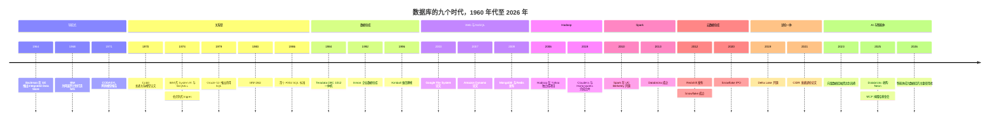
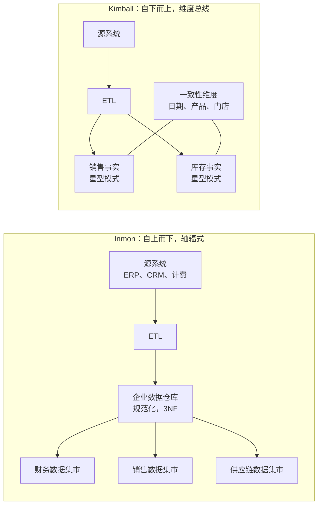
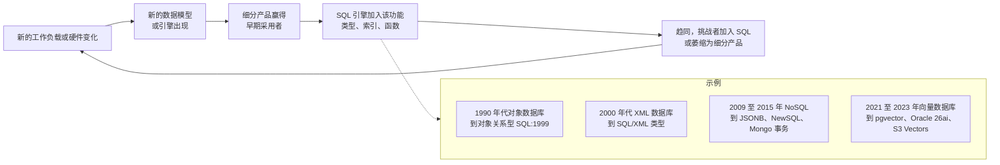

# 42. 数据库简史，1960 年代–2026 年
> **深度：** L2 · **阅读时间：** 约 20 分钟 · **最后核实：** 2026-11-01 · **前置阅读：** [第 1 章 — 数据栈全景图](../01-data-systems-foundations/ch01-data-stack-map.md)

## 要点速览（TL;DR）

- 数据库的历史可以分为九个时代。每个时代的开端，都是硬件或工作负载的变化速度超过了在位者架构的跟进能力：大型机、小型机、客户端-服务器、Web 规模集群、云对象存储，以及如今的 GPU 和智能体。
- [关系模型](../glossary.md#relational-model)和 SQL 在长期博弈中一再胜出。对象数据库、XML 数据库、文档数据库、键值数据库和向量数据库各自打开过一个细分市场，随后 SQL 引擎把其中有用的理念吸收了进去。Stonebraker 的《What Goes Around Comes Around》（2005）及其与 Andy Pavlo 合著的 2024 年续篇对这一论点做了详细论证。[^wgaca05][^wgaca24]
- 接口长存，实现更替。SQL 已存续约 50 年，而存储布局、硬件目标和部署模式都已被多次替换。这与 x86 指令集比其底层众多微架构活得更久的情形非常相似。
- 商业模式的变化比技术变化更大：先是捆绑式大型机软件，然后是永久许可证加维护费，接着是硬件一体机，再是开源加订阅，最后是云上按用量计费。每一次转变都移动了利润池。保住了技术却错过了模式转变的在位者（Teradata、Cloudera）损失的价值最多。
- 对战略人员来说，最主要的教训是：新的数据模型很少能构成持久的护城河。持久的地位来自掌控数据存放在哪里、谁有权读取它：存储层、表格式、目录和计费关系。存储与每个时代共同演进，这正是 Everpure 应当把这段历史当作自己的历史来读的原因。

## 为何重要（商业 + Everpure 视角）

数据基础设施领域的每一份融资路演材料都声称"这次不一样"。历史是检验这一说法成本最低的尽职调查（due diligence）工具。如果一家初创公司的核心论点是"新的数据模型能打败 SQL"，那么基础概率并不乐观：对象数据库、XML 数据库和大多数第一代 NoSQL 供应商都在大约十年内被吸收或边缘化。[^wgaca24] 如果论点是"新的部署模式或商业模式能打败在位者"，基础概率就好得多。Oracle 在商用 SQL 上抢先 IBM 进入市场，Snowflake 则凭借弹性和按用量计费（consumption pricing）击败了 Teradata，而不是靠更好的查询语言。

对 Everpure 而言，这段历史还有第二个用途。每个数据库时代都伴随着与之匹配的存储架构：大型机时代的直连磁盘，客户端-服务器关系数据库时代的存储区域网络（SAN），Hadoop 时代的 Hadoop 分布式文件系统（HDFS），以及云数据仓库和湖仓一体（lakehouse）时代的对象存储（object storage）。每一次存储转变也重新洗牌了存储供应商。Everpure 向上层延伸进入数据管理领域（Enterprise Data Cloud，以及 2026 年为数据发现与分类而收购 1touch），是在押注哪一层将掌控下一个时代。[^everpure-1touch] 本章提供长周期视角，[第 39 章](../05-business-and-economics/ch39-ma-history.md)则提供逐笔交易的记录。

## 工作原理

理解这段历史的有效方式，是把它看作一个反复出现的循环，而不是一份产品清单。硬件或工作负载的变化制造出一个缺口。一种新架构填补这个缺口，它通常来自研究实验室或 Web 公司。一种新的商业模式将其变现。随后，在位的查询接口 SQL 加入这项新能力，挑战者要么变成一个 SQL 引擎，要么萎缩为细分产品。Stonebraker 和 Hellerstein 追溯了截至 2005 年的九个数据模型时代中的这一循环。Stonebraker 和 Pavlo 在 2024 年把分析延伸到其后二十年，结论是关系模型和 SQL 同样吸收了这一时期的主要挑战者。[^wgaca05][^wgaca24]

*图 42.1 — SV-16。九个时代相互重叠，而非彼此取代。IMS 仍在银行中运行，Oracle 仍在几乎每一家大型企业中运行。每个新时代都在上方叠加一层，并移动了利润池。日期以正文所引为准。*

### 时代 1：导航式数据库（1960 年代–1970 年代）

最早的数据库系统回答的是一个大型机时代的问题：许多程序如何在昂贵的磁盘上共享同一组记录？Charles Bachman 在 General Electric 开发的 Integrated Data Store（约 1963–64 年）把记录组织成一张由指针连接的网络。程序从一条属主记录出发，一次一个链接地"导航"到其成员记录。Bachman 1973 年图灵奖演讲的题目就是《The Programmer as Navigator》（程序员即导航员）。[^bachman] CODASYL 数据库任务组在 1969 年和 1971 年发布的报告中对网状模型进行了标准化。IDMS 最初在 B.F. Goodrich 开发，自 1973 年起由 Cullinane 销售，成为该模型最主要的商业实现。

IBM 走的是层次化路线。IMS 从 1966 年起与 North American Rockwell（以及 Caterpillar）合作开发，用于跟踪阿波罗计划土星五号火箭的物料清单。每个零件都隶属于一个父件，因此树形结构是天然的形态。第一个版本于 1968 年在 Rockwell 上线，IBM 于 1969 年将其作为产品 IMS/360 发布。[^ims] IMS 至今仍在销售，仍在处理大量银行和航空交易，这本身就说明了转换成本有多高。

*教训：* 导航式系统之所以快，是因为它把访问路径硬编码进了数据。这同时也是它的弱点。每个新问题都需要程序员介入，往往还需要重组数据库。其商业模式就是大型机的商业模式：软件与 IBM 硬件绑定；在 IBM 于 1969 年 6 月决定将软件与硬件分拆定价之后，变成单独定价的经常性许可费（IMS 是 IBM 最早的这类"程序产品"之一）。数据独立性，即在不重写应用程序的前提下改变存储方式的能力，是下一个时代所要满足的未被满足的需求。

### 时代 2：关系型革命（1970–1990 年代）

1970 年，IBM 研究员 Edgar F. Codd 提出，应以简单的表（关系）向用户呈现数据，并通过声明*要什么*而不是*如何找到*来查询。访问路径由系统来选择。[^codd] 这个想法争议了十年，因为从业者怀疑机器规划查询的能力能否比得上一位熟练的"导航员"。两个研究原型平息了这场争论。

- **System R**（IBM San Jose，1974–79 年）构建了一个完整的关系型系统，并发明了 SEQUEL，后更名为 SQL。Selinger 及其同事在 1979 年描述的基于成本的优化器，至今仍是查询规划器的范本。[^systemr][^selinger79][^sequel]
- **Ingres**（UC Berkeley，始于 1973 年）由 Michael Stonebraker 和 Eugene Wong 领导，使用自己的语言 QUEL。它的毕业生和代码孕育了 Ingres Corp.、Sybase，并通过 Stonebraker 的下一个项目孕育了 Postgres（1986）。[^ingres][^postgres]

IBM 公开发表了 System R 的成果，但产品化行动迟缓。Larry Ellison、Bob Miner 和 Ed Oates 于 1977 年创立了 Software Development Laboratories。他们研读了 IBM 的论文，并在 1979 年推出 Oracle V2，它通常被认为是第一个商用 SQL 关系数据库管理系统（RDBMS）。[^oracle-hist] IBM 随后推出了 SQL/DS（1981）和 DB2（1983）。成立于 1984 年的 Sybase 构建了一个客户端-服务器数据库。Microsoft 于 1988 年为 OS/2 获得了它的许可（最初与 Ashton-Tate 合作），1989 年发布 SQL Server 1.0，并在两家公司于 1993–94 年结束联合开发后自立门户；SQL Server 6.0（1995）是第一个完全由 Microsoft 独立开发的版本。[^chamberlin12] ANSI 于 1986 年发布了第一个 SQL 标准，ISO 于 1987 年跟进。SQL 一旦标准化，就成为工具、技能和应用程序共同面向的统一接口。[^chamberlin12]

> **类比：计算时代。** 每个数据库时代都搭乘着一个计算时代。IMS 和 IDMS 是大型机软件。Oracle 和 Ingres 成长于运行 Unix 和 VMS 的小型机（DEC PDP-11 和 VAX）上。Sybase 和 SQL Server 是为 PC 组成的客户端-服务器网络而构建的。Google、Hadoop 和 NoSQL 运行在成排的通用 x86 服务器上。Snowflake 和 BigQuery 为云对象存储而构建，而 AI 时代则围绕 GPU 组织。与半导体的类比十分贴切。双极型逻辑驱动了大型机。CMOS 微处理器让小型机、继而让通用服务器变得足够便宜，使软件而非硬件成为稀缺资产。如今的片上系统和加速器正在把数据处理拉向 GPU（见[第 24 章](../03-ai-data-stack/ch24-data-meets-compute-and-storage.md)）。

*教训：* 关系型时代的赢家是商业化最快的公司，而不是发明这项技术的公司。IBM 做了研究。Oracle 凭借激进的销售、跨硬件的可移植性以及**永久许可证加年度维护费**模式，攫取了大部分价值。在这一模式下，客户先预付许可费，此后每年支付一笔支持费，业内通常认为约为许可证价格的 22%。[^orcl-sig] 维护费把装机基础变成了一笔年金。这正是 Oracle 后来能够以强势地位为其云转型提供资金的主要原因。

### 时代 3：数据仓库（1979–2010 年代）

在接收订单的同一个数据库上跑报表，会拖慢订单处理。业界的答案是把数据复制到一个专为分析而构建的独立系统中：即 [OLAP](../glossary.md#olap) 一侧，有别于事务型的 [OLTP](../glossary.md#oltp)。成立于 1979 年的 Teradata 在 1983 年向 Wells Fargo 交付一台测试系统之后，于 1984 年发布了 DBC/1012。这是一台采用[无共享](../glossary.md#shared-nothing)（shared-nothing）设计的[大规模并行处理](../glossary.md#massively-parallel-processing)（MPP）机器：每个节点拥有自己的磁盘和每张表的一个分片，因此一次大规模扫描可以在数百个节点上并行执行。[^teradata-10k] Teradata 把硬件和软件作为**一体机**（appliance）一起销售。Netezza（2010 年以 $1.7B 卖给 IBM）和 Greenplum（2010 年卖给 EMC）后来复制了这一模式。[^ma-netezza][^ma-greenplum]

此后，两大学派就数据仓库本身该如何设计展开了争论。

- **Bill Inmon**（《Building the Data Warehouse》，1992）主张建设一个单一的、以第三范式规范化的企业数据仓库（EDW），自上而下构建，作为"唯一真实版本"。部门级数据集市由它供数。[^inmon]
- **Ralph Kimball**（《The Data Warehouse Toolkit》，1996）主张从业务流程出发自下而上构建。每个流程对应一个[星型模式](../glossary.md#star-schema)（star schema）：中央是一张记录度量值（销售、发货）的事实表，周围环绕着[维度](../glossary.md#dimension)表（日期、产品、门店）。共享的"一致性"维度把各个星型结构连接成一条企业级"总线"。[^kimball]

*图 42.2 — Inmon 先构建规范化的企业核心，再从中派生数据集市。Kimball 先构建流程级星型模式，再通过一致性维度将其连接起来。大多数实际的数据仓库最终都是两者的混合体，而今天湖仓上的"奖章"（medallion）分层和 dbt 模型重演了同一场争论。*

围绕数据仓库发展出了一个工具产业。**OLAP 立方体**沿维度对数据进行预聚合，以便快速切片分析。Codd 为一份 1993 年的白皮书《Providing OLAP to User-Analysts: An IT Mandate》署名，该文创造了这个术语。这份白皮书由 Essbase 立方体的开发商 Arbor Software 委托撰写，这种赞助关系后来招致批评，因为论文提出的规则偏向 Arbor 的设计。[^olap] Informatica（成立于 1993 年）等**抽取-转换-加载（[ETL](../glossary.md#etl)）**工具负责把数据搬进来。Business Objects、Cognos 和 Hyperion 等**商业智能（BI）**套件位于最上层。工具层在 2007 年这一年内完成了整合：Oracle 收购 Hyperion（约 $3.3B），SAP 收购 Business Objects（约 €4.8B，约合 $6.8B），IBM 收购 Cognos（约 $5B），合计约 $15B（宣布的交易金额）。[^bi-2007]

*教训：* 数据仓库时代靠**一体机和按席位计费的工具许可证**赚钱，它奖励的是那些客户预算庞大、稳定且集中的供应商。它还培养了一代把数据平台视为资本支出的战略人员。这种习惯让后来向按用量计费的转变显得像一场冲击，而不是一种趋势。

### 时代 4：Web 与 NoSQL 浪潮（2003–2012）

Web 公司遇到了数据仓库供应商从未面对过的极限。Google 要为整个互联网建立索引，Amazon 要运行一个永不宕机的购物车。购买更大的 Oracle 或 Teradata 机器太过昂贵，而且仍然无法扩展到足够大的规模。Google 的答案是一系列论文：Google File System（2003）、MapReduce（2004）和 Bigtable（2006）。它们描述了如何把存储和计算分散到数千台廉价、不可靠的机器上。[^gfs][^mapreduce][^bigtable] Amazon 的 Dynamo 论文（2007）放弃了强一致性，以保证购物车始终可写。[^dynamo]

开源项目在几年之内就复制了这些理念。Facebook 构建了 Cassandra，它把 Dynamo 的分区机制与 Bigtable 的数据模型结合起来，并于 2008 年开源。[^cassandra] 10gen（后来的 MongoDB Inc.）于 2009 年发布了 MongoDB [文档数据库](../glossary.md#document-database)。由 Salvatore Sanfilippo 编写的内存[键值存储](../glossary.md#key-value-store) Redis 也在同一年首次公开发布。[^mdb-10k][^redis-2024] 大约在 2009 年，"NoSQL"成为统称。其卖点是灵活的模式、水平扩展和开发速度，代价是放弃连接和事务。

反击来得很快。Google 自己的 Spanner 论文（2012）展示了一个具备 SQL 和强事务（transaction）能力的全球分布式数据库。[^spanner] 时任 451 Group 分析师的 Matthew Aslett 早在 2011 年就创造了"[NewSQL](../glossary.md#newsql)"一词，用来指代在横向扩展的同时保留 SQL 和 ACID 的系统。[^newsql] MongoDB 在 4.0 版本中加入了多文档事务，后来又加入了类 SQL 的查询接口。NoSQL 的含义从"不要 SQL"变成了"不只是 SQL"。[^mdb-10k]

*教训：* 存活下来的 NoSQL 供应商，卖的是**托管云服务**（managed service）和开发者体验，而不是数据模型。MongoDB 在 FY2026（Feb 2025–Jan 2026）实现约 $2.46B 的 GAAP 收入，其 Atlas 云服务目前约占收入的四分之三。[^mdb-q4][^mdb-ars] 没有云服务的开源 NoSQL 供应商则面临超大规模云厂商托管其代码的竞争。MongoDB（2018 年，SSPL）和 Redis（2024 年）的应对是改用限制更多的许可证，不过 Redis 在 2025 年随 Redis 8 重新加入了经 OSI 批准的 AGPL 选项。[^mdb-sspl][^redis-2024]

### 时代 5：Hadoop 时代（2006–2019）

Doug Cutting 和 Mike Cafarella 对 GFS 和 MapReduce 的开源重新实现，于 2006 年在 Yahoo 独立为 Hadoop，并于 2008 年成为 Apache 顶级项目。[^hadoop] 它承诺以原始形式把所有数据廉价地存放在通用服务器上，只在读取数据时才施加结构（[读时模式](../glossary.md#schema-on-read)，schema-on-read）。其卖点就是"[数据湖](../glossary.md#data-lake)"（data lake）。

三家发行商将其商业化：Cloudera（2008）、MapR（2009）和 Hortonworks（2011 年从 Yahoo 分拆）。资本蜂拥而入。Intel 于 2014 年 3 月对 Cloudera 的投资被广泛报道为约 $740M、换取约 18% 的股份（媒体报道），Hortonworks（2014 年 12 月）和 Cloudera（2017 年 4 月）先后上市。[^hadoop-capital]

随后，经济模型崩溃了。三家供应商都在为同一套免费代码销售订阅，价格随之下跌。Gartner 在 2014 年警告，缺乏治理的数据湖将变成无法使用的"数据沼泽"。[^gartner-lake] MapReduce 速度慢且难以编程。最致命的是，Amazon S3 加按需计算使得租用一个数据湖比自己拥有一个 Hadoop 集群更便宜。Cloudera 与 Hortonworks 以全股票交易合并，合并后估值为 $5.2B（2018 年 10 月宣布，2019 年 1 月完成）。MapR 濒临关闭后，HPE 于 2019 年收购了其资产；KKR 和 CD&R 于 2021 年以约 $5.3B 将 Cloudera 私有化。[^ma-hortonworks][^ma-mapr][^ma-cloudera]

*教训：* 当多家供应商分发同一个项目、而全部运维工作都由客户承担时，**开源加支持订阅**是一种脆弱的模式。Hadoop 供应商销售的是在本地运行的软件，而此时市场恰恰在转向租用服务。它们的技术以文件格式（Parquet、ORC）、Hive 元数据存储和 Spark 的形式延续了下来，但大部分股权价值没有。

### 时代 6：Spark 与 Databricks（2009–）

Apache [Spark](../glossary.md#apache-spark) 于 2009 年诞生于 UC Berkeley，是 Matei Zaharia 开发的更快的、基于内存的 MapReduce 继任者。它始于 RAD Lab，后成为其继任实验室 AMPLab（2011 年成立）的旗舰项目。它于 2010 年开源，2013 年捐赠给 Apache 软件基金会，并于 2014 年 2 月成为顶级项目。[^nsdi][^spark-tlp] 它的创造者们于 2013 年创立了 Databricks。关键的战略决策是*绝不*销售 Hadoop 式的发行版。Databricks 只以云服务的形式运行 Spark，这让使用量变得可计量、可计费。[^wiki]

这一选择是这段历史中最清晰的 A/B 测试。Cloudera 和 Databricks 都把源自 Berkeley 和 Yahoo 谱系的开源大数据引擎商业化。Cloudera 销售本地部署订阅，最终以约 $5.3B 被私有化。[^ma-cloudera] Databricks 销售云上按用量计费的服务，并在 2026 年 8 月宣布收入年化运行率超过 $7B（公司披露），估值为 $190B。[^constellation]

*教训：* 同样的技术，取决于交付模式，可以产生截然不同的股权结果。拥有正在运行的服务，就意味着拥有使用数据、升级路径和账单。

### 时代 7：云数据仓库（2010–2020）

三款产品以各不相同的设计把数据仓库搬上了云。

- **Google BigQuery** 是 Dremel 的公开版本，于 2010 年 5 月以有限预览的形式发布，并在 2011–12 年向所有开发者开放（关于以 2011 年 11 月还是 2012 年 5 月的里程碑作为正式可用，说法不一）。它从一开始就是无服务器的，按扫描的 TB 数计价。[^dremel][^dremel20]
- **Amazon Redshift** 于 2012 年 11 月发布，2013 年 2 月正式可用，基于从 ParAccel 获得许可的代码构建。AWS 宣传其预留定价下每 TB 每年不到 $1,000，仅为一体机价格的一小部分。[^redshift-2012][^ma-paraccel]
- **Snowflake** 成立于 2012 年，2014 年 10 月结束隐身状态，2015 年 6 月正式可用。它把每一张表都放在对象存储中，并按需启动相互独立的计算集群。这种[存算分离](../glossary.md#separation-of-storage-and-compute)（separation of storage and compute）在其 SIGMOD 2016 论文中有详细阐述。[^snowflake16]

存算分离正是让按用量计费得以成立的原因。客户可以按 TB·月为存储付费，按秒为计算付费，两者各自独立扩展。Teradata 的无共享一体机不经过重建就做不到这一点。AWS 在 2019 年 12 月通过 RA3 节点为 Redshift 加入了同样的分离，实际上承认了这一点。[^ra3-launch] Snowflake 于 2020 年 9 月 IPO，定价每股 $120，募资约 $3.4B，是当时有记录以来规模最大的软件 IPO。[^sf-ipo] Teradata 目前的过去十二个月 GAAP 收入约为 $1.69B，市值约 $3.19B（截至 2026-10-28）。[^fin-tdc][^comps-tdc]

*教训：* 云数据仓库时代使**按用量计费**成为主导模式。客户购买积分（credits）或承诺消费额度（committed spend），收入随使用量变动。对在位者而言，一个无法计量的架构所带来的代价，可能比一个更慢的引擎还要大。

### 时代 8：现代数据栈与湖仓一体（2016–2024）

廉价的云数据仓库催生了围绕它的一大批单一用途工具，即所谓的"现代数据栈"。Fivetran 负责数据摄取（ingestion），dbt 负责在数据仓库内部进行 SQL 数据转换（transformation）（即 [ELT](../glossary.md#elt) 而非 ETL），Looker 等则负责 BI。这一技术栈如今正在整合，最显著的例子是已经完成的 Fivetran–dbt Labs 合并。[^fivetran-dbt] [第 43 章](ch43-modern-data-stack.md)讲述了这个故事。

与此同时，数据湖带着事务能力回归了。Netflix 构建了 Apache Iceberg 并于 2018 年捐赠给 Apache，Uber 构建了 Hudi，Databricks 于 2019 年开源了 [Delta Lake](../glossary.md#delta-lake)。它们各自增加了一个元数据层，在对象存储中的 Parquet 文件之上提供 ACID 表。[^delta-vldb][^ice-spec] CIDR 2021 的"Lakehouse"论文提出，开放格式的数据湖加上快速引擎，将使独立的数据仓库变得没有必要。[^cidr] 格式之争在 2024 年基本降温。Databricks 以据报道约 $2B 的价格收购了 Iceberg 创始人创办的公司 Tabular，Databricks 和 Snowflake 如今都支持 Iceberg；Delta 和 Hudi 仍在生产环境中使用，彼此之间有互操作层。[^tabular] [第 7 章](../01-data-systems-foundations/ch07-open-table-formats.md)介绍了其中的机制。

*教训：* 当存储格式变得开放时，价值就上移到目录和数据治理（governance）层，由它来决定谁可以读取什么（见[第 8 章](../01-data-systems-foundations/ch08-catalogs-and-metastores.md)）。这与时代 2 的模式相同：当时标准化的 SQL 把价值转移给了运行最好引擎、签下最具黏性合同的一方。

### 时代 9：AI 与智能体（2021–2026）

大语言模型带来了对嵌入（向量）（embedding）进行相似性检索的需求。Pinecone、Weaviate、Qdrant 和 Milvus 等专用[向量数据库](../glossary.md#vector-database)（vector database）迅速融资。Pinecone 在 2023 年 4 月完成的 $100M 融资使其估值达到约 $750M（媒体报道）。[^pinecone-b] 随后，吸收循环以前所未有的速度运转。[pgvector](../glossary.md#pgvector) 把向量检索带进了 Postgres。[^pgvector] MongoDB Atlas Vector Search 于 2023 年 12 月正式可用。[^mdb-vs] Oracle 在其 AI Database 26ai 中推出了向量检索。[^oracle] AWS 于 2025 年 12 月让 S3 Vectors 正式可用。[^s3v] 在大约三年之内，向量检索就成了现有数据库的一项功能，正如 Stonebraker 和 Pavlo 在 2024 年所预言的那样。[^wgaca24]

AI 时代的第二个转变，是 **Postgres 复兴**以及**智能体成为数据库的使用者**。Databricks 于 2025 年 5 月以约 $1B（媒体报道）收购了 Neon（无服务器 Postgres）。当时 Neon 表示，其平台上超过 80% 的数据库是由 AI 智能体创建的（公司披露）。[^neon-deal] Snowflake 以 $164.5M 现金收购了 Crunchy Data。[^crunchy] 深受 AI 编程工具欢迎的 Postgres 平台 Supabase 于 2026 年 6 月以 $10.5B 估值完成融资（媒体报道）。[^supabase-f] 模型上下文协议（MCP）是智能体调用包括数据库在内的各种工具时所用的标准接口，已于 2025 年 12 月捐赠给 Agentic AI Foundation。[^mcp] [第 22 章](../03-ai-data-stack/ch22-agents-and-data.md)介绍了相关架构，[第 44 章](ch44-future-trends.md)则探讨接下来可能发生什么。

*教训：* 在 AI 时代，稀缺的投入是关于数据的可信上下文：数据意味着什么、谁可以看、是否是最新的。向量的原始存储并不稀缺。商业模式仍然是按用量计费，但使用者越来越多地是机器，它们在没有人参与的情况下创建数据库、运行查询并消耗积分。这有利于具备计量、治理和极低成本资源开通能力的平台。

### 规律：SQL 吸收挑战者

*图 42.3 — 吸收循环。挑战者的数据模型会在大约五到十年内变成主流 SQL 引擎中的一种列类型或索引。存活下来的挑战者靠的是交付模式和商业模式（MongoDB Atlas、Databricks），而不仅仅是数据模型。*

其机制很简单。声明式语言把*要什么*与*怎么做*分开，因此 SQL 引擎可以加入一种新类型（JSON、XML、地理空间、向量）以及相应的新索引，而不会破坏现有应用。Postgres 于 2014 年加入了 JSONB。[^pg-jsonb] SQL 标准在 SQL:1999 中加入了对象关系特性（用户自定义结构化类型），在 SQL:2003 中加入了 XML（第 14 部分，SQL/XML），在 SQL:2016 中加入了 JSON，在 SQL:2023 中加入了属性图查询（第 16 部分，SQL/PGQ），ISO 还在 2024 年另行推出了一种图查询语言 GQL。[^gql] 相比之下，挑战者必须重建 SQL 引擎已经具备的一切（事务、优化器、安全、工具和技能），才有可能赢得通用工作负载。

> **类比：x86 与 RISC。** SQL 之于数据，就如同 x86 指令集之于计算。1980 年代，RISC 设计更简洁、更快速，许多人预期它会取代 x86。结果是，从 1990 年代中期开始，Intel 和 AMD 的芯片在内部把 x86 指令解码为类 RISC 的微操作。它们保留了兼容的接口，同时吸收了更好的微架构。SQL 引擎对列式存储（columnar storage）、向量化执行（vectorized execution）和向量索引做了同样的事。反例同样重要。Arm 在 x86 兼容性负担最无关紧要的地方胜出，先是手机，如今是对能效敏感的数据中心。在数据领域，对应的是没有遗留 SQL 资产的新工作负载，例如基于 Postgres 的 AI 应用或嵌入式 DuckDB，在这些场景中，更轻量、更便宜的设计可以胜出。接口会长存，但在在位者成本结构不适配的边缘地带，它们可能失去份额。

## 设计选择与权衡

下面两张表概括了这段战略史。第一张给出每个时代的教训。第二张展示主导商业模式如何变迁，这对估值的影响比技术更大。

| 时代 | 技术转变 | 赢家 | 失败者或被吸收者 | 主导商业模式 | 给战略人员的启示 |
|---|---|---|---|---|---|
| 1. 导航式（1960–70 年代） | 大型机磁盘上由指针连接的记录 | IBM（IMS）、Cullinet（IDMS） | 关系型出现后的大多数网状模型供应商 | 软件与硬件捆绑，后改为月度许可 | 硬编码的访问路径速度快，但无法回答新问题 |
| 2. 关系型（1970–90 年代） | 声明式 SQL、基于成本的优化器 | Oracle、IBM DB2、Microsoft SQL Server、Sybase | 网状/层次型供应商；Ingres Corp. | 永久许可证 + 约 22% 年度维护费 | 商业化最快者胜过发明者；标准造成对技能和工具的锁定 |
| 3. 数据仓库（1980–2010 年代） | MPP 无共享；星型模式；OLAP 立方体 | Teradata、Informatica、Business Objects、Cognos、Hyperion | 大多数一体机初创公司在 2007–11 年被出售 | 硬件一体机 + 按席位计费的工具许可证 | 当计算可以租用时，资本开支型平台首当其冲 |
| 4. Web 与 NoSQL（2003–12） | 横向扩展、宽松一致性、灵活模式 | MongoDB（通过 Atlas）、DynamoDB、Redis | 众多 NoSQL 初创公司；作为口号的"不要 SQL" | 开源 + 支持，后转为托管服务 | 数据模型不是护城河；交付方式和开发者体验才是 |
| 5. Hadoop（2006–19） | 通用服务器上的分布式文件系统 + MapReduce | 云对象存储；Parquet；Spark | Cloudera、Hortonworks、MapR | 开源订阅，本地部署 | 多家供应商分发同一个免费项目只能打价格战；本地部署输给了租用服务 |
| 6. Spark（2009–） | 基于内存的分布式计算 | Databricks | Hadoop MapReduce | 云上按用量计费服务 | 同样的代码、不同的交付模式，股权价值天差地别 |
| 7. 云数据仓库（2010–20） | 基于对象存储的存算分离 | Snowflake、BigQuery、Redshift | Teradata、Netezza、本地一体机 | 按用量积分与承诺消费额度 | 可计量的架构是按用量计费经济模型的前提 |
| 8. 现代数据栈与湖仓（2016–24） | ELT 工具；开放表格式 | Databricks、Snowflake、dbt、Fivetran | 正在被整合的单点工具 | 按用量计费 + SaaS 席位 | 开放格式把价值转移到目录和数据治理 |
| 9. AI 与智能体（2021–26） | 嵌入、向量索引、智能体工具调用 | Postgres 平台、加入向量能力的在位者 | 承压的独立向量数据库 | 按用量计费，越来越多由机器驱动 | 新数据类型很快被吸收；可信上下文才是稀缺层 |

*图 42.4 — 各时代的教训。一个时代的赢家很少能领跑下一个时代，除非它们及时转变了商业模式。Oracle 依靠维护费现金流熬过了多个时代。Cloudera 没能熬过向云的转变。*

| 商业模式 | 鼎盛时代 | 收入如何确认 | 谁攫取了利润 | 典型失败模式 |
|---|---|---|---|---|
| 捆绑式或月度大型机许可 | 1960–80 年代 | 与硬件绑定的经常性租赁/许可费 | IBM | 锁定于单一硬件系列 |
| 永久许可证 + 维护费 | 1980–2010 年代 | 预付许可费，此后每年约 22% 的支持费[^orcl-sig] | Oracle、IBM、Microsoft、SAP | 客户反感审计和支持费；新许可销售放缓时增长停滞 |
| 一体机（硬件 + 软件） | 1984–2015 | 预付系统销售款 + 支持费 | Teradata、Netezza、Exadata | 容量成块购买；无法弹性计量或租用 |
| 开源 + 订阅 | 2008–2019 | 为支持和企业级功能支付的年度订阅费 | Red Hat（数据领域之外）；Cloudera、Hortonworks 表现乏力 | 免费替代品；超大规模云厂商托管代码；随后改换许可证 |
| 云上按用量计费 | 2012 年至今 | 按承诺额度扣减的使用量（积分、扫描 TB 数、计算秒数） | Snowflake、Databricks、超大规模云厂商 | 客户优化用量时收入波动（2022–23） |

*图 42.5 — 各时代的商业模式。每一次转变都把更多基础设施风险转移给供应商，把更多波动性带入收入。[第 35 章](../05-business-and-economics/ch35-business-models.md)介绍了每种模式的经济学。*

**为对立观点构建最强版本论证（steelman）。** "SQL 永远会赢"的说法可能被夸大了。DynamoDB 和 Redis 等键值存储仍是庞大的业务，从未真正被吸收；它们服务的是不同的延迟层级。文档数据库保住了一个庞大的开发者细分市场，MongoDB 的收入就是证明。大多数数据科学家使用的是 Python 中的 dataframe API，而不是 SQL，而大语言模型可能让自然语言成为主导的查询接口。公允的解读要窄一些。SQL 吸收的是*数据模型和查询功能*，它不吸收*延迟层级*或*交付模式*。而且关系型接口最终可能被隐藏在智能体背后，使得查询语言的重要性不如那些把意图翻译成 SQL 的语义层（semantic layer）和目录（见[第 14 章](../02-pipelines-and-governance/ch14-semantic-layers-and-bi.md)）。

## 主要参与者

那些经久不衰的在位者，要么转变了商业模式，要么成为了默认接口。其余的都被收购了。

| 公司或项目 | 起源时代 | 2026 年状态 | 如何延续，或为何没能延续 |
|---|---|---|---|
| IBM（IMS、DB2） | 1、2 | 上市公司；数据库是其软件业务中的成熟产品线 | 大型机装机基础；收购 Confluent（约 $11B EV，2026 年 3 月完成）和 DataStax 以保持竞争力[^ma-confluent][^ma-datastax] |
| Oracle | 2 | 上市公司；FY2027 收入指引至少 $90B | 维护费年金为 Exadata、Autonomous DB 和 OCI 提供了资金；其数据库如今也在 Azure 和 Google Cloud 数据中心内销售[^comps-orcl][^oracle-dbazure] |
| Microsoft SQL Server | 2 | 隶属 Microsoft | 与 Windows Server 和 Azure 生态捆绑 |
| Sybase | 2 | 2010 年以 $5.8B 被 SAP 收购 | 在客户端-服务器之战中输给 Microsoft；价值在于其装机基础[^ma-sybase] |
| Teradata | 3 | 上市公司；市值约 $3.19B | 一体机模式向云迁移迟缓；如今是一只价值股[^comps-tdc] |
| PostgreSQL | 2（Postgres 1986） | 开源，新应用的默认选择 | 许可证足够宽松，所有云厂商都能托管；扩展机制吸收新的数据类型[^postgres][^pgvector] |
| MongoDB | 4 | 上市公司；FY2026 收入约 $2.46B | 转向 Atlas 托管服务和 SSPL 许可证[^mdb-q4][^mdb-sspl] |
| Cloudera / Hortonworks / MapR | 5 | 合并、被私有化或资产被出售 | 基于共享免费代码的本地部署订阅[^ma-hortonworks][^ma-mapr][^ma-cloudera] |
| Databricks | 6 | 私营公司；年化运行率 >$7B，估值 $190B | 从第一天起就只做云上交付[^constellation] |
| Snowflake | 7 | 上市公司；FY2026 产品收入 $4.47B | 存算分离加按用量计费[^sf-fy26] |
| Pinecone 及同类公司 | 9 | 私营公司；据报道 2025 年曾探讨出售 | 品类在大约三年内被在位者吸收[^pinecone-b][^pinecone-sale] |

*图 42.6 — 幸存者与出局者。每一个长寿的业务，要么拥有接口（SQL、Postgres），要么拥有一项正在运行的服务和计费关系。*

## 历史与发展轨迹

三条长期趋势贯穿了九个时代，每一条都指向未来几年。

**第一，计算不断向数据靠拢，然后数据又迁移到存储最便宜的地方。** 大型机把数据集中起来。客户端-服务器把它分散开来。数据仓库为了分析再度把它集中。Hadoop 试图在本地掌控数据湖，而云则把它放进了对象存储。2026 年悬而未决的问题是：AI 是否会再次移动重心，转向 GPU 集群及其旁边的高性能存储，还是 GPU 会来到湖仓之中（见[第 24 章](../03-ai-data-stack/ch24-data-meets-compute-and-storage.md)）。

**第二，每个时代的利润池都位于被商品化的那一层之上。** 磁盘变便宜后，价值转移到 DBMS。SQL 标准化后，价值转移到最好的引擎和最具黏性的合同。开放表格式（open table format）把存储布局商品化后，价值转移到目录。如果智能体把编写查询商品化，价值很可能转移到语义上下文和数据治理：即说明数据意味着什么、谁可以使用它的那一层。这就是 Salesforce–Informatica、IBM–Confluent 和 Everpure–1touch 背后的逻辑。[^ma-informatica][^ma-confluent][^everpure-1touch]

**第三，循环正在加速。** 关系型从论文（1970）到占据主导花了约 15 年。NoSQL 从炒作（2009）到被吸收花了约六年。向量检索大约只用了三年（2021–2024）。更快的循环有利于出货迅速的在位者和拥有分发渠道的平台。它们对单一功能型初创公司非常不利，这是本章最主要的尽职调查启示。[第 44 章](ch44-future-trends.md)把这些趋势转化为预测。

## 关键数字

| 指标 | 数值 | 口径 | 来源 / 日期 |
|---|---|---|---|
| 2024 年全球 DBMS 市场 | $119.7B，同比 +13.4% | 分析师估算（Gartner） | Gartner 摘要，2025[^gartner-dbms] |
| Oracle FY2027 收入指引（Jun 2026–May 2027） | 至少 $90B | 公司指引 | Sep 2026，来自 `data/public_comps.csv`[^comps-orcl] |
| Oracle Q1 FY2027 收入（Jun–Aug 2026） | 约 $19.35B | GAAP，媒体报道 | StorageNewsletter，2026-09-23[^orcl-q1] |
| Oracle 市值 | $382.45B | 市场数据 | 2026-10-23[^comps-orcl] |
| Teradata 过去十二个月收入 | 约 $1.69B（同比约 +1%） | GAAP，TTM | stockanalysis，2026-10-23[^fin-tdc] |
| Teradata 市值 / EV | $3.19B / $2.88B（EV/收入约 1.7x） | 市场数据 | 2026-10-28[^comps-tdc] |
| Cloudera–Hortonworks 合并 | 合并后股权价值 $5.2B | 公开披露，全股票 | 2018-10-03 宣布[^ma-hortonworks] |
| Cloudera 私有化 | 约 $5.3B（每股 $16） | 公开披露 | 2021-06-01 宣布，Oct 2021 完成[^ma-cloudera] |
| Snowflake IPO | 每股 $120，募资约 $3.4B | 招股说明书 | 2020-09-15 定价，2020-09-16 上市交易[^sf-ipo] |
| Snowflake FY2026 产品收入（Feb 2025–Jan 2026） | $4,472.3M | GAAP | 2026-02-25[^sf-fy26] |
| Snowflake 市值 | $107.88B | 市场数据 | 2026-10-30[^comps-snow] |
| Databricks 收入年化运行率 / 估值 | >$7B / $190B | 公司披露 | 2026-08-13[^constellation] |
| MongoDB FY2026 收入（Feb 2025–Jan 2026） | 约 $2.46B，+23% | GAAP | 2026-03-02[^mdb-q4] |
| Pinecone B 轮估值 | 约 $750M | 媒体报道 | 2023-04-27[^pinecone-b] |
| Databricks–Neon | 约 $1B | 媒体报道 | 2025-05-15[^neon-deal] |
| Supabase 估值 | $10.5B | 媒体报道 | 2026-06[^supabase-f] |

*图 42.7 — 关系型在位者（Oracle）按收入计仍是本表中最大的公司。数据仓库一体机时代的领导者（Teradata）如今的市值，只有 Postgres 初创公司 Supabase 最近一次私募估值的约三分之一。跨口径比较（上市公司市值 vs. 私募投后估值）仅供参考。*

## 存储桥接

> **存储桥接。** 存储与每个数据库时代共同演进。客户端-服务器关系数据库推动了 SAN 和块存储阵列的发展，其卖点是为 OLTP 日志提供的低延迟和一致性。Hadoop 通过 HDFS 在本地磁盘上的三副本复制，把存储搬进了计算服务器内部，这让外部存储供应商受损长达十年。云数据仓库和湖仓一体把数据的持久副本搬进了 S3 API 背后的对象存储，使对象存储成为分析领域的记录系统。AI 时代正在为 GPU 训练增加高吞吐的文件和对象存储层，并为向量索引和 KV 缓存增加高速闪存。协议和介质细节请参见配套的 *Everpure Tech Atlas*。

对战略团队而言，这一规律提示了一个可供评估的选项（基于公开信息）。在每个时代，通过收购数据库向上延伸一层的存储供应商（EMC–Greenplum、HPE–MapR）大多毁掉了价值，因为它们恰好在引擎商品化之际买下了一个引擎。[^ma-greenplum][^ma-mapr] 而进入*控制*层的举措，例如跨任何引擎运作的元数据、分类和数据治理，则顺应了上文所述的利润池走向。Everpure 对 1touch 的收购属于第二类，[第 45 章](ch45-storage-moving-up-the-stack.md)对这些选项做了详细评估。[^everpure-1touch]

## 对话手册

**向产品经理提出的三个问题**

1. "你们的定价类似于哪个时代的商业模式？如果客户像 2022–23 年那样优化用量，收入会怎样？"
2. "你们的新数据模型：要过多久 Postgres 或 Snowflake 就会把它作为扩展或功能推出？到那时你们还拥有什么？"
3. "你们控制的哪一层可能被开放格式或标准商品化？又是哪一层在控制你们？"

**向工程师提出的三个问题**

1. "如果明天某个 SQL 引擎加入了你们的核心索引类型，还有什么难以复制：存储布局、分布式设计，还是运维？"
2. "你们的系统是围绕存算分离设计的吗？还是说要实现计量就得重新架构？"
3. "你们的设计规避了 Hadoop 年代的哪些教训（小文件、元数据存储瓶颈、模式漂移），又是如何规避的？"

**好的回答听起来是什么样的。** 它们会指出一种交付或控制点（control point）优势（托管服务、目录、计费关系、装机基础），而不是一种数据模型。它们会为被吸收的风险给出时间框架。它们引用的是使用量指标，而不仅仅是基准测试速度。

**不要这样说**

- "SQL 已死。"自 1974 年以来，它熬过了每一个挑战者。更好的说法是：SQL 越来越多地由机器来编写。
- "Hadoop 失败了。"它的理念（分布式存储、Parquet、Spark、元数据存储）支撑着当今大多数湖仓。失败的是*供应商*的商业模式。
- "Oracle 发明了关系数据库。"发明者是 Codd 和 IBM 的 System R。Oracle 是第一个销售商用 SQL 的公司。
- "Snowflake 赢在更快。"它主要赢在弹性、存算分离和按用量计费。
- "向量数据库是一个会保持独立的新品类。"历史表明，新的数据类型会在几年内被吸收。独立的幸存者需要另一种优势。

## 深入阅读

- 把 Stonebraker 和 Hellerstein（2005）与 Stonebraker 和 Pavlo（2024）连起来读。两者合在一起，是对吸收论最好的单一论证。[^wgaca05][^wgaca24]
- 关于 SQL 的起源，Chamberlin 2012 年的记述简短且属第一手资料。[^chamberlin12]
- 关于云数据仓库的设计，请把 Snowflake 的 SIGMOD 2016 论文与 Lakehouse 的 CIDR 2021 论文对照阅读。它们是当今 Databricks–Snowflake 之争的两份奠基文献（[第 27 章](../04-company-deep-dives/ch27-databricks-vs-snowflake.md)）。[^snowflake16][^cidr]
- 第 1 部分介绍了这段历史背后的机制：数据模型（[第 2 章](../01-data-systems-foundations/ch02-data-models.md)）、内部原理（[第 3 章](../01-data-systems-foundations/ch03-database-internals.md)）、分布式数据库（[第 4 章](../01-data-systems-foundations/ch04-distributed-databases.md)）和分析引擎（[第 5 章](../01-data-systems-foundations/ch05-analytical-engines.md)）。

## 关键术语

- [导航式数据库](../glossary.md#navigational-database)（Navigational database）— 程序沿着存储的指针从一条记录跳到另一条记录的数据库，如 IMS 和 CODASYL 系统。
- [CODASYL](../glossary.md#codasyl) — 1960–70 年代的委员会，其网状模型规范对 IDMS 等指针连接型数据库进行了标准化。
- [关系模型](../glossary.md#relational-model)（Relational model）— Codd 提出的模型，把数据表示为可声明式查询的表。
- [SQL](../glossary.md#sql) — 源自 IBM System R 的声明式查询语言，1986 年由 ANSI 标准化。
- [数据仓库](../glossary.md#data-warehouse)（Data warehouse）— 专为分析而构建的独立数据库，从业务系统加载数据。
- [企业数据仓库](../glossary.md#enterprise-data-warehouse)（Enterprise data warehouse）— Inmon 提出的单一规范化数据仓库，为部门级数据集市供数。
- [数据集市](../glossary.md#data-mart)（Data mart）— 面向某一部门或流程的、特定主题的数据仓库数据子集。
- [星型模式](../glossary.md#star-schema)（Star schema）— 由一张度量值事实表和环绕其周围的维度表组成。
- [维度建模](../glossary.md#dimensional-modeling)（Dimensional modeling）— Kimball 的数据仓库设计方法，以通过一致性维度相连的星型模式构建数据仓库。
- [一致性维度](../glossary.md#conformed-dimension)（Conformed dimension）— 在多张事实表中以相同含义共享的维度，例如日期或产品。
- [OLAP 立方体](../glossary.md#olap-cube)（OLAP cube）— 沿维度组织、经过预聚合的数据，用于快速切片分析。
- [数据仓库一体机](../glossary.md#data-warehouse-appliance)（Data warehouse appliance）— 作为一个系统一起销售的硬件和数据库软件。
- [NoSQL](../glossary.md#nosql) — 自 2009 年起流行的非关系型数据库（键值、文档、宽列、图）的统称。
- [NewSQL](../glossary.md#newsql) — 在横向扩展的同时保留 SQL 和 ACID 的分布式数据库。
- [Apache Hadoop](../glossary.md#apache-hadoop) — 以 Google 论文为蓝本的开源分布式文件系统和 MapReduce 框架。
- [数据湖](../glossary.md#data-lake)（Data lake）— 存放多种格式原始文件的存储库，只在读取时才赋予结构。
- [数据沼泽](../glossary.md#data-swamp)（Data swamp）— 因缺乏元数据、质量和治理而变得无法使用的数据湖。
- [存算分离](../glossary.md#separation-of-storage-and-compute)（Separation of storage and compute）— 把持久数据保存在共享存储中，而计算独立扩展。
- [湖仓一体](../glossary.md#lakehouse)（Lakehouse）— 对象存储上的开放表格式，加上数据仓库级别的引擎和治理。
- [现代数据栈](../glossary.md#modern-data-stack)（Modern data stack）— 2016–2023 年间围绕云数据仓库构建单一用途云工具的模式。
- [永久许可证](../glossary.md#perpetual-license)（Perpetual license）— 一次性支付的软件许可费，通常随后每年支付维护费。
- [按用量计费](../glossary.md#consumption-pricing)（Consumption pricing）— 按计量的使用量（如积分或扫描的 TB 数）而非席位或许可证计费。

## 资料来源

[^wgaca05]: M. Stonebraker and J. M. Hellerstein, "What Goes Around Comes Around," in *Readings in Database Systems*, 4th ed., MIT Press, 2005，作者版本 https://people.csail.mit.edu/tdanford/6830papers/stonebraker-what-goes-around.pdf [VERIFY: 核实 URL 路径]，发布于 2005；检索于 2026-11-01（经典引用，未实时抓取）。
[^wgaca24]: M. Stonebraker and A. Pavlo, "What Goes Around Comes Around… And Around…," *ACM SIGMOD Record* 53(2), https://sigmodrecord.org/2024/06/30/what-goes-around-comes-around-and-around，发布于 2024-06-30；检索于 2026-11-01（经搜索确认的条目；未打开 PDF）。
[^bachman]: C. W. Bachman, "The Programmer as Navigator" (1973 ACM Turing Award lecture), *Communications of the ACM* 16(11), 653–658, https://doi.org/10.1145/355611.362534，发布于 1973-11；ACM, "Charles W. Bachman," https://amturing.acm.org/award_winners/bachman_9385610.cfm；检索于 2026-11-01（经典引用，未实时抓取）。
[^ims]: IBM, "Information Management System" (IBM Heritage), https://www.ibm.com/history/information-management-system [VERIFY: 核实 URL 路径]，无日期；检索于 2026-11-01（未实时抓取）。阿波罗/Rockwell 起源、1968 年在 Rockwell 上线以及 1969 年 IMS/360 产品发布均为确定的公开历史（审阅者已核定，2026-11-01）。
[^codd]: E. F. Codd, "A Relational Model of Data for Large Shared Data Banks," *Communications of the ACM* 13(6), 377–387, https://doi.org/10.1145/362384.362685，发布于 1970-06；检索于 2026-11-01（经典引用，未实时抓取）。
[^systemr]: M. M. Astrahan et al., "System R: Relational Approach to Database Management," *ACM TODS* 1(2), https://doi.org/10.1145/320455.320457，发布于 1976-06；D. D. Chamberlin et al., "A History and Evaluation of System R," *CACM* 24(10), https://doi.org/10.1145/358769.358784，发布于 1981-10；检索于 2026-11-01（经典引用，未实时抓取）。
[^selinger79]: P. G. Selinger, M. M. Astrahan, D. D. Chamberlin, R. A. Lorie, T. G. Price, "Access Path Selection in a Relational Database Management System," *Proc. ACM SIGMOD*, https://dl.acm.org/doi/10.1145/582095.582099，发布于 1979；检索于 2026-11-01。
[^sequel]: D. D. Chamberlin and R. F. Boyce, "SEQUEL: A Structured English Query Language," *Proc. ACM SIGFIDET Workshop*, https://doi.org/10.1145/800296.811515，发布于 1974；检索于 2026-11-01（经典引用，未实时抓取）。
[^chamberlin12]: D. D. Chamberlin, "Early History of SQL," *IEEE Annals of the History of Computing* 34(4), 78–82, https://doi.org/10.1109/MAHC.2012.61，发布于 2012；检索于 2026-11-01（经典引用，未实时抓取）。涵盖 SEQUEL、SQL/DS、DB2、Oracle 以及 1986 年 ANSI 标准。
[^ingres]: M. Stonebraker, E. Wong, P. Kreps, G. Held, "The Design and Implementation of INGRES," *ACM TODS* 1(3), https://doi.org/10.1145/320473.320476，发布于 1976-09；ACM, "Michael Stonebraker" (2014 Turing Award), https://amturing.acm.org/award_winners/stonebraker_1172121.cfm；检索于 2026-11-01（经典引用，未实时抓取）。
[^postgres]: M. Stonebraker and L. A. Rowe, "The Design of POSTGRES," *Proc. ACM SIGMOD 1986*, https://doi.org/10.1145/16894.16888，发布于 1986；PostgreSQL Global Development Group, "A Brief History of PostgreSQL," https://www.postgresql.org/docs/current/history.html，持续更新文档；检索于 2026-11-01（未实时抓取）。
[^oracle-hist]: Oracle Corporation, "Oracle's history: innovation, leadership, results," https://www.oracle.com/corporate/history/ [VERIFY: 核实 URL 路径]，无日期；检索于 2026-11-01（未实时抓取）。1977 年创立和 1979 年发布 Oracle V2 亦见本图谱第 28 章和第 29 章。
[^orcl-sig]: Oracle, "Software Investment Guide" and "Technical Support Policies," https://www.oracle.com/support/policies.html，无日期；检索于 2026-11-01。约 22% 的年度支持费率是广泛记载的行业惯例，并非取自实时抓取的 Oracle 页面 [VERIFY]。
[^teradata-10k]: Teradata Corporation, annual reports on Form 10-K (business history), SEC EDGAR, https://www.sec.gov/cgi-bin/browse-edgar?action=getcompany&CIK=0000816761&type=10-K；检索于 2026-11-01（申报文件索引，未实时抓取）。1979 年创立，同第 31 章；DBC/1012 于 1983 年交付 Wells Fargo 测试版后于 1984 年发布（确定的公司历史，审阅者已核定，2026-11-01）。
[^ma-netezza]: WilmerHale, "Netezza to be acquired for $1.7 billion in cash," https://www.wilmerhale.com/en/insights/news/netezza-to-be-acquired-for-1-7-billion-in-cash-september-22-2010，发布于 2010-09-22；检索于 2026-11-01（来自 `data/ma_deals.csv`）。
[^ma-greenplum]: EMC press release, "EMC to acquire Greenplum," https://corporate.delltechnologies.com/en-us/newsroom/announcements/2010/07/20100706-01.htm，发布于 2010-07-06；检索于 2026-11-01（来自 `data/ma_deals.csv`；交易条款未披露）。
[^inmon]: W. H. Inmon, *Building the Data Warehouse*, QED Technical Publishing Group / John Wiley & Sons，第一版 1992 [VERIFY: 核实出版商 URL]；检索于 2026-11-01（图书引用；本次会话未核实 URL）。
[^kimball]: R. Kimball, *The Data Warehouse Toolkit*, John Wiley & Sons，第一版 1996；Kimball Group, "Kimball Dimensional Modeling Techniques," https://www.kimballgroup.com/data-warehouse-business-intelligence-resources/kimball-techniques/，无日期；检索于 2026-11-01（未实时抓取）。
[^olap]: E. F. Codd, S. B. Codd, C. T. Salley, "Providing OLAP to User-Analysts: An IT Mandate,"由 Arbor Software 委托撰写的白皮书，1993 [VERIFY: 核实稳定 URL]；检索于 2026-11-01。标题和 Arbor 赞助均为确定的历史（审阅者已核定，2026-11-01）。
[^gfs]: S. Ghemawat, H. Gobioff, S.-T. Leung, "The Google File System," SOSP 2003, https://doi.org/10.1145/945445.945450，发布于 2003-10；检索于 2026-11-01（经典引用，未实时抓取）。
[^mapreduce]: J. Dean and S. Ghemawat, "MapReduce: Simplified Data Processing on Large Clusters," OSDI 2004, https://www.usenix.org/legacy/event/osdi04/tech/full_papers/dean/dean.pdf，发布于 2004-12；检索于 2026-11-01（经典引用，未实时抓取）。
[^bigtable]: F. Chang et al., "Bigtable: A Distributed Storage System for Structured Data," OSDI 2006, https://research.google/pubs/bigtable-a-distributed-storage-system-for-structured-data/，发布于 2006-11；检索于 2026-11-01。
[^dynamo]: G. DeCandia et al., "Dynamo: Amazon's Highly Available Key-value Store," SOSP 2007, https://www.allthingsdistributed.com/files/amazon-dynamo-sosp2007.pdf，发布于 2007-10；检索于 2026-11-01。
[^cassandra]: A. Lakshman and P. Malik, "Cassandra: A Decentralized Structured Storage System," *ACM SIGOPS Operating Systems Review* 44(2), https://doi.org/10.1145/1773912.1773922，发布于 2010-04；检索于 2026-11-01（经典引用，未实时抓取）。Facebook 于 2008 年 7 月开源（确定的项目历史，审阅者已核定，2026-11-01）。
[^spanner]: J. C. Corbett et al., "Spanner: Google's Globally-Distributed Database," OSDI 2012, https://www.usenix.org/conference/osdi12/technical-sessions/presentation/corbett，发布于 2012-10；检索于 2026-11-01。
[^mdb-10k]: MongoDB, Inc., annual reports on Form 10-K（业务描述与历史，包括 2007 年以 10gen 之名创立、2016 年推出 Atlas 以及 4.0 版本的多文档事务）, SEC EDGAR, https://www.sec.gov/cgi-bin/browse-edgar?action=getcompany&CIK=0001441816&type=10-K；检索于 2026-11-01（经典引用，未实时抓取）。
[^mdb-q4]: MongoDB, Inc., Form 8-K Exhibit 99.1, Q4 and FY2026 results, https://www.sec.gov/Archives/edgar/data/1441816/000162828026013199/mdb-13126xex991xrelease.htm，发布于 2026-03-02；检索于 2026-11-01（来自 `data/company_financials.csv`）。GAAP。
[^mdb-ars]: MongoDB, Inc., Annual Report to Shareholders FY2026, SEC EDGAR, https://www.sec.gov/Archives/edgar/data/0001441816/000162828026036431/ars.htm，发布于 2026 [VERIFY: 核实日期]；检索于 2026-11-01。Atlas 占 FY2026 收入的 73%，公司披露（来自第 29 章）。
[^mdb-sspl]: MongoDB, "Server Side Public License FAQ," https://www.mongodb.com/legal/licensing/server-side-public-license/faq，发布于 2018-10；检索于 2026-11-01（经典引用，未实时抓取）。
[^redis-2024]: Redis, "Redis Adopts Dual Source-Available Licensing," https://redis.io/blog/redis-adopts-dual-source-available-licensing/，发布于 2024-03-20；检索于 2026-11-01（经典引用，未实时抓取）。
[^hadoop]: The Apache Software Foundation, "Apache Hadoop," https://hadoop.apache.org/，持续更新的项目网站；检索于 2026-11-01（未实时抓取）。2006 年在 Yahoo 独立（从 Apache Nutch 中拆分）以及 2008 年 1 月成为顶级项目的日期均为确定的公开项目历史（审阅者已核定，2026-11-01）。
[^gartner-lake]: Gartner press release, "Gartner Says Beware of the Data Lake Fallacy," https://www.gartner.com/en/newsroom/press-releases/2014-07-28-gartner-says-beware-of-the-data-lake-fallacy [VERIFY: 核实 URL 路径]，发布于 2014-07-28；检索于 2026-11-01（未实时抓取）。
[^ma-hortonworks]: TechCrunch, "Cloudera and Hortonworks announce $5.2 billion merger," https://techcrunch.com/2018/10/03/cloudera-and-hortonworks-announce-5-2-billion-merger，发布于 2018-10-03；检索于 2026-11-01（来自 `data/ma_deals.csv`）。合并后股权价值，并非支付价格。
[^ma-mapr]: HPE press release, "HPE advances its intelligent data platform with acquisition of MapR business assets," https://hpe.com/us/en/newsroom/press-release/2019/08/hpe-advances-its-intelligent-data-platform-with-acquisition-of-mapr-business-assets.html，发布于 2019-08-05；检索于 2026-11-01（来自 `data/ma_deals.csv`）。
[^ma-cloudera]: `data/ma_deals.csv`，KKR 和 CD&R 对 Cloudera 的私有化（$5.3B，每股 $16，2021-06-01 宣布，Oct 2021 完成）；检索于 2026-11-01。该 CSV 行引用的是 2025 年年中之前的知识；交易条款为确定的公开记录（Cloudera 8-K，June 2021），审阅者已核定，2026-11-01。
[^nsdi]: M. Zaharia et al., "Resilient Distributed Datasets: A Fault-Tolerant Abstraction for In-Memory Cluster Computing," USENIX NSDI 2012, https://www.usenix.org/conference/nsdi12/technical-sessions/presentation/zaharia，发布于 2012-04；检索于 2026-11-01。
[^spark-tlp]: The Apache Software Foundation, "The Apache Software Foundation Announces Apache Spark as a Top-Level Project," https://blogs.apache.org/foundation/entry/the_apache_software_foundation_announces50 [VERIFY: 核实 URL 路径]，发布于 2014-02-27；检索于 2026-11-01（未实时抓取）。
[^wiki]: Wikipedia, "Databricks," https://en.wikipedia.org/wiki/Databricks，访问于 2026-11-01（创始人和创立年份；仅云上交付的战略，如第 25 章所述）；检索于 2026-11-01。
[^constellation]: Databricks press release, "Databricks grows 80% YoY, surpasses $7B revenue run-rate," https://www.databricks.com/company/newsroom/press-releases/databricks-grows-80-yoy-surpasses-7b-revenue-run-rate-scales，发布于 2026-08-13；Constellation Research, https://www.constellationr.com/insights/news/databricks-hits-7-billion-revenue-run-rate-q2-190-billion-valuation，发布于 2026-08；检索于 2026-11-01。公司披露的年化运行率和估值。
[^dremel]: S. Melnik et al., "Dremel: Interactive Analysis of Web-Scale Datasets," PVLDB 3(1), https://research.google/pubs/pub36632/，发布于 2010；检索于 2026-11-01。
[^dremel20]: S. Melnik et al., "Dremel: A Decade of Interactive SQL Analysis at Web Scale," PVLDB 13(12), https://www.vldb.org/pvldb/vol13/p3461-melnik.pdf，发布于 2020；检索于 2026-11-01。
[^redshift-2012]: Computerworld, "Amazon introduces data warehouse service," https://www.computerworld.com/article/1401411/amazon-introduces-data-warehouse-service.html，发布于 2012-11-28；检索于 2026-11-01。AWS 的定价宣传。
[^ma-paraccel]: `data/ma_deals.csv`，Actian–ParAccel（2013-04-25），注明 ParAccel 代码此前曾被授权作为 Amazon Redshift 的基础；来源 VentureBeat（URL 见 CSV）；检索于 2026-11-01。
[^snowflake16]: B. Dageville et al., "The Snowflake Elastic Data Warehouse," SIGMOD 2016, https://doi.org/10.1145/2882903.2903741（副本：https://www.cs.purdue.edu/homes/csjgwang/CloudNativeDB/SnowflakeSIGMOD16.pdf），发布于 2016-06；检索于 2026-11-01。
[^ra3-launch]: AWS What's New, "Amazon Redshift introduces RA3 nodes with managed storage enabling independent compute and storage scaling," https://aws.amazon.com/about-aws/whats-new/2019/12/amazon-redshift-announces-ra3-nodes-managed-storage/，发布于 2019-12；检索于 2026-11-01。
[^sf-ipo]: Snowflake Inc., Prospectus (Form 424B4) and Form S-1, SEC EDGAR filing index, https://www.sec.gov/cgi-bin/browse-edgar?action=getcompany&CIK=0001640147&type=424B4，发布于 2020-09-16；检索于 2026-11-01。IPO 价格（$120）和募资总额（约 $3.4B，28M 股）为确定的公开记录；本次会话未重新打开该申报文件（审阅者已核定，2026-11-01）。
[^sf-fy26]: Snowflake Inc., Q4 and FY2026 earnings release (Form 8-K exhibit), https://www.sec.gov/Archives/edgar/data/1640147/000162828026011631/fy2026q4earnings.htm，发布于 2026-02-25；检索于 2026-11-01（来自 `data/company_financials.csv`）。GAAP；FY2026 = Feb 2025–Jan 2026。
[^comps-snow]: stockanalysis.com, "Snowflake statistics," https://stockanalysis.com/stocks/snow/statistics/，数据截至 2026-10-30；检索于 2026-11-01（来自 `data/public_comps.csv`）。
[^fin-tdc]: stockanalysis.com, "Teradata revenue," https://stockanalysis.com/stocks/tdc/revenue/，数据截至 2026-10-23；检索于 2026-11-01（来自 `data/company_financials.csv`）。TTM GAAP 收入。
[^comps-tdc]: stockanalysis.com, "Teradata statistics," https://stockanalysis.com/stocks/tdc/statistics/，数据截至 2026-10-28；检索于 2026-11-01（来自 `data/public_comps.csv`）。市值 $3.19B，EV $2.88B，TTM 收入 $1.69B。
[^fivetran-dbt]: Fivetran press release, "Fivetran and dbt Labs complete merger to create the data infrastructure for trusted AI agents," https://www.fivetran.com/press/fivetran-dbt-labs-complete-merger-to-create-the-data-infrastructure-for-trusted-ai-agents，发布于 2026-06-01（完成日期，同第 43 章所引）；TechTarget, https://www.techtarget.com/data-technologies/news/366643590/Fivetran-DBT-Labs-complete-merger-to-form-data-layer-for-AI；检索于 2026-11-01（来自 `meta/sources.md`）。
[^delta-vldb]: M. Armbrust et al., "Delta Lake: High-Performance ACID Table Storage over Cloud Object Stores," PVLDB 13(12), https://www.vldb.org/pvldb/vol13/p3411-armbrust.pdf，发布于 2020-08；检索于 2026-11-01。
[^ice-spec]: Apache Iceberg, "Iceberg Table Spec," https://iceberg.apache.org/spec/，持续更新文档；检索于 2026-11-01。Netflix 起源和 2018 年进入 Apache 孵化，同第 7 章。
[^cidr]: M. Armbrust, A. Ghodsi, R. Xin, M. Zaharia, "Lakehouse: A New Generation of Open Platforms that Unify Data Warehousing and Advanced Analytics," CIDR 2021, https://www.cidrdb.org/cidr2021/papers/cidr2021_paper17.pdf，发布于 2021-01；检索于 2026-11-01。
[^tabular]: TechCrunch, "Databricks reportedly paid $2 billion in Tabular acquisition," https://techcrunch.com/2024/08/14/databricks-reportedly-paid-2-billion-in-tabular-acquisition，发布于 2024-08-14；检索于 2026-11-01。媒体报道；据 `data/ma_deals.csv`，WSJ 报道的区间为 $1–2B。
[^pinecone-b]: TechCrunch, "Pinecone drops $100M investment on $750M valuation as vector database demand grows," https://techcrunch.com/2023/04/27/pinecone-drops-100m-investment-on-750m-valuation-as-vector-database-demand-grows/，发布于 2023-04-27；检索于 2026-11-01。媒体报道；与 `data/private_funding.csv` 一致。
[^pinecone-sale]: Calcalist (CTech)，援引 The Information, "Pinecone exploring potential sale," https://www.calcalistech.com/ctechnews/article/rz31q82b5, 2025 [VERIFY: 核实发布日期]；检索于 2026-11-01。媒体报道；截至检索时尚未宣布任何交易。
[^pgvector]: PostgreSQL Global Development Group, "pgvector 0.8.0 Released!," https://www.postgresql.org/about/news/pgvector-080-released-2952/，发布于 2024-11；检索于 2026-11-01。pgvector 于 2021 年 4 月首次发布（确定的项目历史，审阅者已核定，2026-11-01）。
[^pg-jsonb]: PostgreSQL Global Development Group, "PostgreSQL 9.4 release notes," https://www.postgresql.org/docs/release/9.4.0/，发布于 2014-12-18；检索于 2026-11-01（经典引用）。
[^mdb-vs]: Constellation Research, "MongoDB Atlas Vector Search, Atlas Search Nodes generally available," https://www.constellationr.com/insights/news/mongodb-atlas-vector-search-atlas-search-nodes-generally-available，发布于 2023-12-04；检索于 2026-11-01。
[^oracle]: Oracle, "Oracle AI Database 26ai," https://www.oracle.com/database/ai-native-database-26ai/，发布于 2025-10；检索于 2026-11-01。
[^s3v]: AWS News Blog, "Amazon S3 Vectors now generally available with increased scale and performance," https://aws.amazon.com/blogs/aws/amazon-s3-vectors-now-generally-available-with-increased-scale-and-performance，发布于 2025-12-02；检索于 2026-11-01。
[^gql]: ISO, "ISO/IEC 39075:2024 Information technology — Database languages — GQL," https://www.iso.org/standard/76120.html，发布于 2024-04；检索于 2026-11-01。
[^neon-deal]: TechRepublic, "Databricks to Acquire Neon in $1 Billion Deal," https://www.techrepublic.com/article/news-databricks-neon-acquisition/，发布于 2025-05-15；检索于 2026-11-01。约 $1B 为媒体报道；"超过 80% 的数据库由 AI 智能体创建"是公司披露的 Neon 遥测数据，见 2025 年 5 月 Databricks 公告（Neon 上开通的数据库中"超过 80%"由智能体创建）。
[^crunchy]: Snowflake Inc., Form 10-Q for the quarter ended 2025-10-31（Crunchy Data 对价 $164.5M）, https://www.sec.gov/Archives/edgar/data/1640147/000164014725000211/snow-20251031.htm，发布于 2025-12；检索于 2026-11-01。
[^supabase-f]: Orrick, "Supabase Raises $500 Million at $10.5 Billion Valuation to Accelerate Lead in Agentic Infrastructure," https://www.orrick.com/en/News/2026/06/Supabase-Raises-500-Million-at-10-5-Billion-Valuation-to-Accelerate-Lead-in-Agentic-Infrastructure，发布于 2026-06；检索于 2026-11-01。媒体报道（律所公告）。
[^mcp]: Anthropic, "Donating the Model Context Protocol and establishing the Agentic AI Foundation," https://anthropic.com/news/donating-the-model-context-protocol-and-establishing-of-the-agentic-ai-foundation，发布于 2025-12-09；检索于 2026-11-01。
[^ma-sybase]: SAP investor release, "SAP to acquire Sybase," https://www.sap.com/investors/en/financial-news/ad-hoc-news/2010/05/934992.html，发布于 2010-05-12；检索于 2026-11-01（来自 `data/ma_deals.csv`）。
[^ma-confluent]: Stock Titan (IBM press release), "IBM completes acquisition of Confluent," https://www.stocktitan.net/news/IBM/ibm-completes-acquisition-of-confluent-making-real-time-data-the-lbuwdbharsqe.html，发布于 2026-03-17；检索于 2026-11-01（来自 `data/ma_deals.csv`）。企业价值约 $11B，每股 $31 现金。
[^ma-datastax]: DBTA, "IBM Officially Closes Acquisition of DataStax," https://www.dbta.com/Editorial/News-Flashes/IBM-Officially-Closes-Acquisition-of-DataStax-169711.aspx，发布于 2025-05；检索于 2026-11-01（来自 `data/ma_deals.csv`；交易条款未披露）。
[^ma-informatica]: Bloomberg Law, "Salesforce Agrees to Buy Informatica in Deal Worth $8 Billion," https://news.bloomberglaw.com/tech-and-telecom-law/salesforce-agrees-to-buy-informatica-in-deal-worth-8-billion，发布于 2025-05-27；检索于 2026-11-01（来自 `data/ma_deals.csv`；2025-11-18 完成）。
[^comps-orcl]: stockanalysis.com, "Oracle market cap," https://stockanalysis.com/stocks/orcl/market-cap/，数据截至 2026-10-23；FY2027 指引来自 StorageNewsletter, https://storagenewsletter.com/2026/09/23/oracle-fiscal-1q27-financial-results，发布于 2026-09-23；检索于 2026-11-01（来自 `data/public_comps.csv`）。Oracle 财年截至 5 月 31 日。
[^orcl-q1]: StorageNewsletter, "Oracle fiscal 1Q27 financial results," https://storagenewsletter.com/2026/09/23/oracle-fiscal-1q27-financial-results，发布于 2026-09-23；检索于 2026-11-01（来自 `data/company_financials.csv`）。媒体对 Oracle 新闻稿的报道摘要；Q1 FY2027 = Jun–Aug 2026。
[^oracle-dbazure]: Oracle, "Oracle Database@Azure powers cloud migrations for organizations across the world," https://www.oracle.com/news/announcement/ai-world-oracle-database-at-azure-powers-cloud-migrations-for-organizations-across-the-world-2025-10-14/，发布于 2025-10-14；检索于 2026-11-01。
[^gartner-dbms]: Gartner, DBMS market-share abstract, https://www.gartner.com/en/documents/6494271，发布于 2025-05；检索于 2026-11-01（来自 `data/market_sizes.csv`）。分析师估算；完整报告需付费。
[^everpure-1touch]: Everpure, Inc., Form 10-Q for the quarter ended 2026-05-03（1touch，现金对价 $125.0M）, https://www.sec.gov/Archives/edgar/data/0001474432/000147443226000061/pstg-20260503.htm，发布于 2026-06；Computer Weekly, "Everpure aims to bridge AI data gap with Universal Data Intelligence," https://www.computerweekly.com/news/366644438/Everpure-aims-to-bridge-AI-data-gap-with-Universal-Data-Intelligence，发布于 2026-06；检索于 2026-11-01。
[^bi-2007]: Oracle, "Oracle Buys Hyperion"（2007-03-01 宣布，约 $3.3B）；SAP 对 Business Objects 的收购要约（2007-10-07 宣布，约 €4.8B）；IBM, "IBM to Acquire Cognos"（2007-11-12 宣布，约 $5B）；公司新闻稿，本次会话未重新打开 URL；宣布的交易金额为确定的公开记录（审阅者已核定，2026-11-01）。尚未列入 `data/ma_deals.csv`（已暂存于 `data/staging/review-part-6-ma_deals.csv`）。
[^newsql]: A. Pavlo and M. Aslett, "What's Really New with NewSQL?," *ACM SIGMOD Record* 45(2), https://doi.org/10.1145/3003665.3003674，发布于 2016-06；检索于 2026-11-01（经典引用，未实时抓取）。该文将这一术语的创造归功于 Aslett 2011 年的 451 Group 报告。
[^hadoop-capital]: Intel 对 Cloudera 的投资（2014-03-31 宣布；约 $740M 换取约 18% 股份，媒体报道），以及 Hortonworks（2014-12-12，Nasdaq）和 Cloudera（2017-04-28，NYSE）的 IPO；来自当时公司新闻稿和媒体报道的确定公开记录，本次会话未重新打开（审阅者已核定，2026-11-01）。
