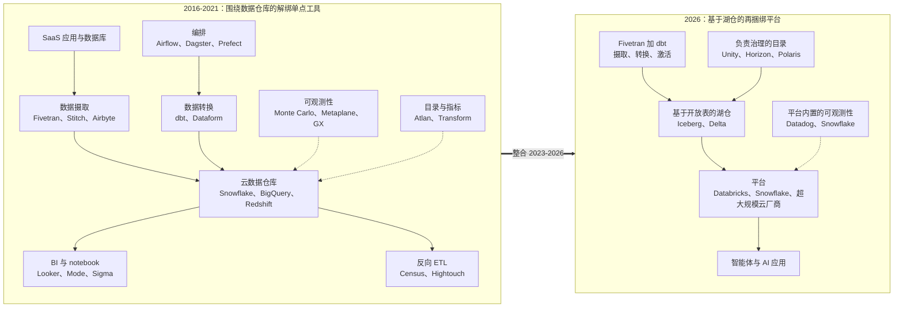
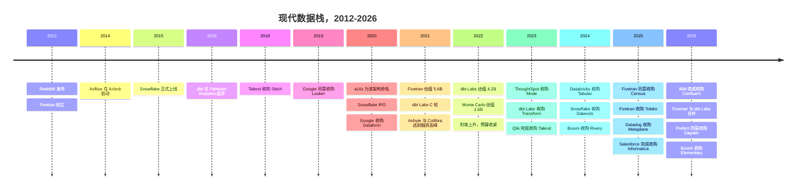
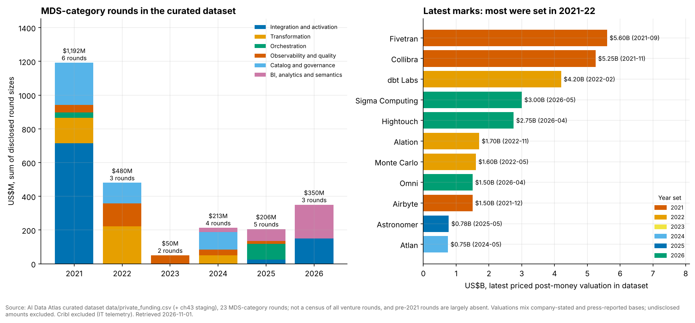

# 43. 现代数据栈：兴起、解绑与再捆绑
> **深度：** L2 · **阅读时间：** 约 10 分钟 · **最后核实：** 2026-11-01 · **前置阅读：** [第 12 章 — 数据转换与编排](../02-pipelines-and-governance/ch12-transformation-and-orchestration.md)

## 要点速览（TL;DR）

- **云数据仓库催生了现代数据栈。** Redshift（2012 年 11 月发布）、BigQuery 和 Snowflake（2015 年 6 月正式上线）让算力变得足够弹性、足够便宜，以至于可以先加载原始数据、再做转换。[^redshift-2012][^dremel20][^snowflake16] 从 ETL 到 [ELT](../glossary.md#elt) 的这一个变化，为围绕数据仓库的十几种专业"单点工具"打开了空间。
- **这一名称是在顶峰时出现的。** Andreessen Horowitz 的《Emerging Architectures for Modern Data Infrastructure》（2020 年 10 月）为这一模式提供了参考架构图。[^a16z] Fivetran 以 $5.6B 估值融资（2021 年 9 月），dbt Labs 以 $4.2B 估值融资（2022 年 2 月），均为公司披露。[^funding-csv] 在我们整理的数据集中，六大核心[现代数据栈（modern data stack）](../glossary.md#modern-data-stack)品类的已披露融资从 2021 年的约 $1.2B 降至 2023 年的 $50M。
- **批评针对的是买家的账单，而非技术。** 以 Benn Stancil 为代表的从业者认为，"栈"已经变成一个营销品类。客户在支付一种[集成税（integration tax）](../glossary.md#integration-tax)：合同众多、故障点众多，且没有人对端到端的结果负责。[^stancil]
- **2025–26 年是再捆绑期。** Fivetran 同意收购 Census，收购了 Tobiko，并与 dbt Labs 完成全股票合并（合并 ARR "接近 $600M"，公司披露）。[^merger-close] Datadog 收购了 Metaplane，Snowflake 收购了 Observe（据其 10-K，初步对价 $596.2M），Prefect 同意收购 Dagster，FICO 和 Boomi 也收购了数据质量工具。[^dd-metaplane][^sf-observe][^prefect-dagster][^gx-2026][^elementary]
- **价值汇聚到平台和元数据控制点。** 幸存者要么成为平台（Snowflake、Databricks），要么成为整合者（Fivetran），要么掌握某个控制点（control point），例如[数据目录（data catalog）](../glossary.md#data-catalog)或[语义层（semantic layer）](../glossary.md#semantic-layer)。后现代数据栈是：建立在[开放表格式（open table format）](../glossary.md#open-table-format)之上的[湖仓一体（lakehouse）](../glossary.md#lakehouse)、一个负责治理的目录、少数几个平台，以及位于顶层的智能体。

## 为何重要（商业 + Everpure 视角）

现代数据栈（MDS）是近年来最清晰的案例，展示了一个技术层如何解绑、吸引资本、然后再捆绑。对于企业发展（corporate development）方向的读者，它回答了三个实际问题：哪些独立数据工具公司仍是收购标的？音乐停止时，买家付了多少钱？当平台吸收各项功能时，哪一层能捕获价值？

这一模式在本书中反复出现。数据摄取（ingestion，[第 10 章](../02-pipelines-and-governance/ch10-ingestion-and-integration.md)）、数据转换（transformation，[第 12 章](../02-pipelines-and-governance/ch12-transformation-and-orchestration.md)）、可观测性（observability，[第 13 章](../02-pipelines-and-governance/ch13-data-quality-observability-lineage.md)）和商业智能（BI，[第 14 章](../02-pipelines-and-governance/ch14-semantic-layers-and-bi.md)）都经历了同样的周期。交易记录见[第 39 章](../05-business-and-economics/ch39-ma-history.md)，公司细节见[第 30 章](../04-company-deep-dives/ch30-data-movement-streaming-companies.md)。

**Everpure 视角。** MDS 的整合表明，数据平台的所有者捕获了大部分价值。独立的基础设施层会逐渐走向商品化，除非它掌握某个控制点——通常是元数据：数据是什么、谁可以使用、如何定义。Everpure 在 2026 年收购用于数据发现和数据分类的 1touch，就是向这一元数据层迈进的一步。[^everpure-1touch] 基于公开信息，战略团队可能评估的一个选项是：驻留在存储中的元数据能否成为一个平台选择与之集成、而非将其取代的控制点。

## 工作原理

### 第一幕：数据仓库成为重心（2012–2016）

2012 年之前，分析能力是按峰值负载配置的固定一体机（Teradata、Netezza、Exadata）。数据转换在单独的 ETL 服务器上运行（Informatica、DataStage），因为一体机的 CPU 太昂贵，不值得花在清洗数据上。Amazon 在发布 Redshift 时将其定价为每 TB 每年不到 $1,000，而它自己对自建数据仓库的估算是 $19,000–25,000。[^redshift-2012] BigQuery 作为 Google Dremel 的公开版本，从一开始就是无服务器的。[^dremel20] Snowflake 实现了存算分离（separation of storage and compute），使多个独立集群可以读取同一份数据。[^snowflake16]

一旦算力变得弹性且按用量计费，把原始数据落到数据仓库中、再在仓库里用 SQL 做转换就变得更便宜。从 ETL 到 ELT 的这一倒置，是此后一切的根源。原本存在于一个 ETL 套件内部的每个步骤，如今都可以成为一个独立的 SaaS 产品，从数据仓库读取或向其写入。

### 第二幕：解绑（2016–2021）

创始人们挑出每个步骤，为其打造一款"同类最佳"产品：

- **数据摄取：** Fivetran（2012 年创立）和 Stitch 销售托管连接器，按[月活跃行数（monthly active rows）](../glossary.md#monthly-active-rows)计价。Airbyte（2020 年）是开源的回应。[^ab-seriesb]
- **数据转换：** dbt 于 2016 年在 Fishtown Analytics 起步，把 SQL 模型变成带有测试和依赖图的版本控制代码。它创造了[分析工程（analytics engineering）](../glossary.md#analytics-engineering)这一职位。[^fishtown]
- **编排：** Airflow（Airbnb，2014 年）成为默认的[编排器（orchestrator）](../glossary.md#orchestrator)，其后是 Dagster 和 Prefect。[^airflow-hist]
- **BI 与 notebook：** Looker（带有 LookML 建模层）、Mode、Sigma，以及后来的 Hex。
- **数据激活：** Census 和 Hightouch 开创了[反向 ETL（reverse ETL）](../glossary.md#reverse-etl)，把建模后的数据推回 Salesforce 和广告平台。
- **信任与元数据：** Monte Carlo（2019 年创立）定义了[数据可观测性（data observability）](../glossary.md#data-observability)。Atlan、Alation 和 Collibra 销售数据目录，Transform 则构建了[指标层（metrics layer）](../glossary.md#metrics-layer)。[^mc-d][^atlan][^transform]

2020 年 10 月的 a16z 文章把这一切画成一张参考架构图，这个名字就此流传开来。[^a16z] 随后，Snowflake 在 2020 年 9 月创纪录的 IPO 向投资者展示了一家成功的数据公司能值多少钱。[^sf-ipo] 2021–22 年，资本涌入了图上的每一个方框。

*图 43.1 — 2016 年的架构图每项工作一个方框、每个方框一家厂商。2026 年的架构图只有少数几个平台，而目录是它们争夺的那一层。*

### 第三幕：批评与洗牌（2022–2024）

反对 MDS 的理由主要关乎经济性。Mode 联合创始人 Benn Stancil 广泛撰文和发言，指出这个"栈"已经从对一种架构的描述漂移成一个营销品类。他认为，它让工具成倍增加，却没有解决让业务用户获得可信答案这一根本问题。[^stancil] 买家把它感受为一种集成税。一个中等规模的数据团队可能要运行六到十家厂商的产品。每家都有自己的合同、计费表（行数、积分、席位、模型）和故障模式，而没有人对端到端的结果负责。数据仓库的按用量账单让问题雪上加霜，因为每个单点工具都在客户自己的数据仓库上运行查询。

2022 年利率上升后，CFO 们开始削减开支。在我们整理的数据集中，六大 MDS 品类的已披露融资从 2021 年的约 $1.2B 降至 2022 年的 $480M 和 2023 年的 $50M（图 43.5）。随后的退出规模小，而且往往是防御性的。ThoughtSpot 以 $200M 现金加股票收购了 Mode（2023 年），dbt Labs 收购了 Transform，Qlik 完成了对 Talend（当时已拥有 Stitch）的收购，Datafold 关停了其开源 data-diff 项目（2024 年）。[^mode][^transform][^qlik-talend][^datafold] 同一时期许多公司裁员或悄然关闭，但我们的数据集并未系统记录这些情况。`[VERIFY: 2022–2024 年具名 MDS 厂商的裁员与关停]`

数据集中没有任何一家核心 MDS 公司在 2026 年之前以高于其 2021–22 年估值的价格重新定价。Fivetran 的 $5.6B 和 dbt Labs 的 $4.2B 从未在新一轮定价融资中接受检验。两者的合并是全股票交易，因此没有公布价格。[^merger-ann][^funding-csv]

### 第四幕：再捆绑（2025–2026）

再捆绑同时朝三个方向推进：

1. **独立厂商合并成套件。** Fivetran 同意收购用于反向 ETL 的 Census（2025 年 5 月宣布；交割未单独确认），收购了拥有 SQLMesh 的 Tobiko Data（2025 年 9 月），随后与 dbt Labs 合并（2025 年 10 月宣布，2026 年 6 月 1 日完成）。[^census][^tobiko][^merger-close] Prefect 于 2026 年 7 月同意收购 Dagster。[^prefect-dagster] 在 FICO 收购 GX Cloud 时，Fivetran 还接手了 Great Expectations 开源项目的管理。[^gx-2026]
2. **平台吸收相邻层。** Snowflake 收购了 Datavolo（集成，现为 Openflow）、Crunchy Data（Postgres）、Select Star（目录）和 Observe（可观测性）。[^datavolo][^crunchy][^selectstar][^sf-observe] Databricks 收购了 Tabular（Iceberg）、Neon（Postgres）以及 Tecton 的资产（特征）。[^tabular][^neon][^tecton] Snowflake 还原生运行 dbt 项目，自 2025 年 11 月起正式上线。[^dbt-sf]
3. **相邻领域的巨头向下收购。** Salesforce 完成了对 Informatica 的收购（约 $8B，2025 年 11 月）。IBM 完成了对 Confluent 的收购（约 $11B 企业价值，2026 年 3 月）。Datadog 收购了 Metaplane，Boomi 先后收购了 Rivery 和 Elementary。[^infa-close][^ibm-close][^dd-metaplane][^rivery][^elementary]

*图 43.2 — 从数据仓库拐点（2012 年）到合并浪潮（2025–26 年）大约经历了 13 年。融资高峰（2021 年）出现在大约三分之二处，此前已有近十年的解绑。*

### 再捆绑为何发生

原因有五个，大致按权重排序：

- **平台推出了"够用"的功能。** Snowflake Dynamic Tables、Databricks Lakeflow、Snowflake 数据指标函数以及原生数据血缘，覆盖了单点工具所售功能中最常用的 70–80%。这是我们的估算，而非实测数字。对大多数买家而言，无需额外合同的捆绑功能胜过需要额外合同的更好产品。
- **预算被整合。** CFO 要求数据负责人削减供应商。在数据仓库用量之上再收费的工具最容易被砍掉。
- **AI 需要集成化的上下文。** 一个回答"EMEA 的净收入是多少？"的智能体，需要在同一处获得数据血缘、定义、质量信号和访问策略（[第 22 章](../03-ai-data-stack/ch22-agents-and-data.md)）。把六家厂商的元数据提供给智能体，比提供一个目录的元数据更难。
- **买家希望供应商更少。** 安全审查、采购和支持成本随供应商数量而非数据量增长。
- **开放表格式转移了重心。** 一旦数据存放在对象存储（object storage）上的 Apache Iceberg 或 Delta 表中，数据仓库就不再是锚点。[控制平面（control plane）](../glossary.md#control-plane)转移到了治理这些表的目录。Databricks 于 2024 年年中开源了 Unity Catalog，Snowflake 开源了 Polaris。[^uc-oss][^polaris-nessie] 参见[第 7 章](../01-data-systems-foundations/ch07-open-table-formats.md)和[第 8 章](../01-data-systems-foundations/ch08-catalogs-and-metastores.md)。

> **类比：无晶圆厂、晶圆代工与再整合。** MDS 的故事与半导体行业遥相呼应。在 1990 年代和 2000 年代，芯片行业分化为无晶圆厂（fabless）设计公司和纯晶圆代工厂，因为专业化降低了每家企业所需的资本，正如云数据仓库让每家 MDS 厂商不必自己构建数据库。这种分工也带来了一种接口税：设计规则、IP 核和封装需要跨公司协调。芯粒（chiplet）和 Intel 的 IDM 2.0 战略都是局部的再整合，目的在于重新掌控昂贵的接口。开放表格式扮演着芯粒互连标准的角色。它让平台可以围绕一个共享接口进行再整合，而不会把数据锁定在某一家厂商的"裸片"上。

> **类比：EDA 补强收购。** MDS 中的单点工具表现得就像小众电子设计自动化（EDA）初创公司。一家专注于时序、验证或功耗分析的公司会赢下设计流程中的某一步，然后被 Synopsys 或 Cadence 收购并整合进套件。这类初创公司真正的退出市场是那两家套件厂商，而不是终端客户。Metaplane（Datadog）、Select Star（Snowflake）、Elementary（Boomi）和 Tobiko（Fivetran）都遵循了这套剧本。[^dd-metaplane][^selectstar][^elementary][^tobiko]

## 设计选择与权衡

| 选择 | 同类最佳单点工具（2019 年默认） | 平台捆绑（2026 年默认） | 何时另一方胜出 |
|---|---|---|---|
| 功能深度 | 在单一步骤上最深入（例如连接器广度、测试框架） | 覆盖最常用的 70–80%（我们的估算） | 在受监管或超大规模的边缘场景中，单点工具胜出 |
| 商业条款 | 合同多、计费表多 | 一份合同、一个按用量计费表 | 当单点工具比平台算力更便宜时，单点工具胜出 |
| 可移植性 | 跨数据仓库通用 | 绑定于单一平台 | 在多平台环境中，单点工具胜出 |
| 面向 AI 的元数据 | 分散在各厂商之间 | 统一在平台目录中 | 如果独立目录能联邦多个平台，则独立目录胜出 |
| 创新速度 | 路线图快速、聚焦 | 较慢，但发布即捆绑 | 在新品类中单点工具胜出，正如 2019–2021 年的可观测性 |
| 供应商风险 | 初创公司可能被收购或关闭 | 平台锁定与定价权 | 取决于董事会层面对锁定的容忍度 |

*图 43.3 — 捆绑在商业条款和 AI 上下文上胜出。单点工具只在深度、可移植性和时机上胜出。*

独立性最有力的最强版本论证（steelman）是**跨平台中立性**。大型企业同时运行 Databricks 和 Snowflake，外加一两家超大规模云厂商（[第 27 章](../04-company-deep-dives/ch27-databricks-vs-snowflake.md)）。一家在所有这些平台上以同样方式工作的厂商，拥有一个可防守的角色。这正是合并后的 Fivetran–dbt 和 Atlan 的卖点，也是 Open Semantic Interchange 这一倡议存在的原因（[第 14 章](../02-pipelines-and-governance/ch14-semantic-layers-and-bi.md)）。

## 主要参与者

下面的幸存者表格涵盖了主要的 MDS 公司，图表则展示了其背后的融资周期。

| 公司 | 品类 | 状态（2026 年 11 月） | 收购方、日期与价值（口径） | 幸存或出局的原因 |
|---|---|---|---|---|
| Fivetran | 数据摄取（ELT） | 独立；整合者 | 收购了 Tobiko 和 dbt Labs；同意收购 Census；最近估值 $5.6B（公司披露，2021）[^funding-csv] | 最广泛的托管连接器库；MAR 定价；自己成为了套件 |
| dbt Labs | 数据转换 | 并入 Fivetran | 2026-06-01 完成；全股票，未披露[^merger-close] | 开源标准，但 >$100M ARR（2025 年 2 月）不足以独自支撑 $4.2B 的估值[^dbt-100m] |
| Stitch | 数据摄取 | 被收购（两次） | Talend，2018 年，$60M（已披露）；Qlik 于 2023 年收购 Talend[^stitch][^qlik-talend] | 在繁荣期之前早早退出；成为套件中的一项功能 |
| Looker | BI、语义建模 | 被收购 | Google，2019-06-06 宣布，2020 年 2 月完成，$2.6B（已披露）[^looker-acq] | LookML 语义层放在云厂商内部更有价值 |
| Dataform | 数据转换 | 被收购 | Google，2020-12，未披露[^dataform] | 成为 BigQuery 内置的免费 dbt 替代品 |
| Mode | BI 与 notebook | 被收购 | ThoughtSpot，2023-06，$200M 现金加股票（已披露）[^mode] | 被夹在 BI 套件与 notebook 之间 |
| Transform | 指标层 | 被收购 | dbt Labs，2023-02，未披露[^transform] | 指标层是一项功能，而不是一家公司 |
| Census | 反向 ETL | 被收购（已达成协议；交割未单独确认） | Fivetran，2025-05-01 宣布，未披露[^census] | 激活是数据管道的最后一步 |
| Hightouch | 反向 ETL、数据激活 | 独立 | 估值 $2.75B（媒体报道，2026 年 4 月）[^hightouch] | 进入了营销预算（AI 营销） |
| Monte Carlo | 数据可观测性 | 独立 | 最近估值 $1.6B（公司披露，2022 年 5 月）[^mc-d] | 品类开创者；正向智能体可观测性拓展 |
| Metaplane | 数据可观测性 | 被收购 | Datadog，2025-04-23，未披露[^dd-metaplane] | 契合可观测性平台 |
| GX Cloud（Great Expectations） | 数据质量 | 被收购；开源项目转移 | FICO，2026 年 5 月，未披露；GX Core 转交 Fivetran[^gx-2026] | 开源质量检查成了基本配置 |
| Elementary | dbt 原生可观测性 | 被收购 | Boomi，2026-10-19，约 $42.5M（媒体报道）[^elementary] | 小规模退出；成为集成套件的一项功能 |
| Datafold data-diff | 数据比对（开源） | 关停（开源项目终止） | 项目于 2024-05-17 终止；公司继续运营[^datafold] | 开源维护没有收入支撑 |
| Atlan | 目录、主动元数据 | 独立 | $750M（公司披露，2024 年 5 月）[^atlan] | 掌握一个跨平台的元数据控制点 |
| Select Star | 目录 | 被收购 | Snowflake，2025-11，未披露[^selectstar] | 被收购以强化 Horizon |
| Astronomer | 编排（Airflow） | 独立 | 约 $775M（媒体报道，2025 年 5 月）[^astro-d] | 默认编排器的商业管理者 |
| Dagster Labs | 编排 | 被收购（已达成协议） | Prefect，2026-07-13 宣布，未披露[^prefect-dagster] | 两家规模不足的编排厂商合并 |
| Tobiko Data（SQLMesh） | 数据转换 | 被收购 | Fivetran，2025-09-03，未披露[^tobiko] | dbt 的挑战者成为 dbt 所有者的一部分 |
| Airbyte | 数据摄取（开放核心） | 独立 | 最近估值 $1.5B（公司披露，2021 年 12 月）[^ab-seriesb] | 开源长尾；自高峰以来未再定价 |
| Informatica | 传统集成、目录 | 被收购 | Salesforce，2025-11-18 完成，约 $8B（已披露）[^infa-close] | 目录和主数据对应用厂商更有价值 |
| Sigma Computing | 云 BI | 独立 | $3B（媒体报道，2026 年 5 月）[^sigma-e] | 基于实时数据仓库数据的电子表格界面；估值上调 |

*图 43.4 — 在 22 家公司中，7 家保持独立。大多数退出是未披露金额的补强收购，因此 2021 年的估值从未接受检验。*

*图 43.5 — 在整理后的数据集中，MDS 融资在 2021 年后崩塌，而大多数标志性估值都来自 2021–22 年。数据激活和 BI 领域的融资推动了 2026 年的回升。该数据集是整理所得，而非全量普查，且 2021 年之前的数据较少。*

## 历史与发展轨迹

这条弧线分为四幕。**2012–2016：**弹性云数据仓库让 ELT 在经济上可行。[^redshift-2012][^snowflake16] **2016–2021：**创始人们把旧的 ETL 套件解绑为单点工具，a16z 为其命名。[^a16z] **2022–2024：**利率上升、供应商疲劳和集成税批评使融资枯竭，迫使小规模退出。[^stancil][^mode] **2025–2026：**独立厂商合并，平台吸收其余部分。[^merger-close][^sf-observe]

接下来是**后现代数据栈**，它由四部分组成：

- **存储：**对象存储上的开放表（Iceberg、Delta），由目录（Unity、Horizon、Polaris）治理。
- **平台：**两三个计算平台，通常是 Databricks、Snowflake 和一家超大规模云厂商，它们捆绑了摄取、转换、质量和 BI。
- **中立层：**少量独立厂商，它们的价值在于能跨平台工作（Fivetran–dbt、Atlan、Hightouch）。
- **智能体：**它们通过语义层和目录 API 消费经过治理的元数据。

悬而未决的问题是，目录本身是会被再捆绑进平台，还是保持为中立层（[第 44 章](ch44-future-trends.md)）。关于这一故事背后的数据库谱系，参见[第 42 章](ch42-history-of-databases.md)。

> **存储桥接。** 再捆绑把数据从数据仓库专有的存储中迁出，迁入对象存储上的开放表。这使对象存储层及其附带的元数据在技术栈中的地位比 2016 年更加核心。对象存储和协议细节参见姊妹篇 *Everpure Tech Atlas*。

## 关键数字

| 指标 | 数值 | 口径 | 来源 / 日期 |
|---|---|---|---|
| Redshift 发布价格 vs 自建数据仓库 | 每 TB 每年 <$1,000 vs $19,000–25,000 | 公司声称（AWS 估算） | Computerworld，2012-11-28[^redshift-2012] |
| Fivetran 峰值估值 | $5.6B（$565M D 轮） | 公司披露 | 2021 年 9 月[^funding-csv] |
| dbt Labs 峰值估值 | $4.2B（$222M D 轮） | 公司披露 | 2022 年 2 月[^funding-csv] |
| MDS 品类已披露融资，2021 vs 2023 | 约 $1.19B vs $50M | 整理数据集（作者加总） | `data/private_funding.csv`，检索 2026-11-01[^funding-csv] |
| Fivetran ARR | >$300M | 公司披露 | 2024-09-27[^ft-300m] |
| dbt Labs ARR | >$100M | 公司披露 | 2025-02-05[^dbt-100m] |
| Fivetran + dbt Labs 合并 ARR | "接近 $600M" | 公司披露，交割时 | 2026-06-01[^merger-close] |
| 合并时隐含的 Fivetran 侧 ARR | 约 $450–500M | 估算（作者根据上面两行计算） | 2026-11-01 |
| Salesforce–Informatica | 约 $8B 股权价值 | 已披露 | 2025-11-18 完成[^infa-close] |
| IBM–Confluent | 约 $11B 企业价值 | 已披露 | 2026-03-17 完成[^ibm-close] |
| Snowflake–Observe | 初步对价 $596.2M（媒体报道约 $1B） | GAAP 收购会计处理（10-K） | FY2026 10-K[^sf-observe] |
| Snowflake 总收入 | $4,683.9M | GAAP，FY2026（2025 年 2 月–2026 年 1 月） | Snowflake 10-K[^sf-10k26] |
| Databricks 收入年化运行率 | >$7B | 公司披露的年化运行率 | 2026-08-13[^dbx-rr] |
| Databricks 投后估值 | $190B | 公司披露 | 2026-08-13[^funding-csv] |

*图 43.6 — 平台如今比最大的合并后单点工具厂商大约高出一个数量级：Snowflake 的 FY2026 GAAP 收入约为合并后 Fivetran–dbt "接近 $600M" ARR 的 8x，Databricks 公司披露的年化运行率约为其 12x（作者跨不同口径计算）。这一规模差距就是再捆绑的一句话概括。*

## 对话手册

**向产品经理和战略负责人提出的问题**

1. 如果 Databricks 或 Snowflake 下个季度推出一个"够用"的版本，客户会失去你们的哪些功能？又是什么让他们仍然愿意付钱给你们？
2. 你们有多少收入运行在某个平台的按用量计费表之上？面对客户削减平台账单的压力，你们如何应对？
3. 你们的控制点能否跨平台移植？有多大比例的客户运行两个或更多平台？

**向工程师提出的问题**

1. 你们的产品在哪里读写元数据：自己的存储、平台目录，还是开放标准（Iceberg REST、OpenLineage、Open Semantic Interchange）？
2. 如果平台更改其 API 或捆绑一项竞争功能，客户那边会出现什么故障？
3. 如今 AI 智能体如何获取你们的数据血缘、质量和定义信号？

**好的回答听起来是什么样的。** 给出多平台客户的具体数字。清晰说明厂商对哪些元数据是唯一可信来源（source of truth）。通过开放接口而非私有 API 进行集成。诚实地看待哪些功能将被商品化。

**不要这样说**

- "现代数据栈已死。"这些工具仍在生产环境中运行。终结的是"每个方框一家公司"的风投模式。
- "dbt Labs 值 $4.2B。"那是 2022 年的私募估值，从未再次接受检验；合并是全股票交易，没有价格。
- "平台会捆绑一切。"跨平台中立性和目录仍有争夺。拥有控制点的独立厂商（Atlan、Fivetran–dbt）依然存在。
- "反向 ETL 失败了。"它正在成为套件的一项功能（Fivetran 同意收购的 Census；交割未单独确认），并在 Hightouch 那里成为一款营销产品。

## 深入阅读

> **深入（L3）。** 把 a16z 的文章与其 2022 年更新版对照阅读，可以看出这张参考架构图是如何扩展的。[^a16z] Snowflake 的 SIGMOD 2016 论文解释了为什么存算分离让 ELT 在经济上可行。[^snowflake16] 关于再捆绑的机制，可比较[第 12 章](../02-pipelines-and-governance/ch12-transformation-and-orchestration.md)中 dbt 的 Fusion 引擎与 SQLMesh 的虚拟环境，以及[第 8 章](../01-data-systems-foundations/ch08-catalogs-and-metastores.md)中的目录之争。

## 关键术语

- [现代数据栈（Modern data stack）](../glossary.md#modern-data-stack) — 2016–2022 年的模式：云数据仓库加上为每个数据管道步骤提供的专业 SaaS 工具。
- [ELT](../glossary.md#elt) — 抽取、加载，然后在数据仓库或湖仓内部进行转换。
- [单点工具（Point tool）](../glossary.md#point-tool) — 只完成工作流中某一步、其余步骤依赖其他产品的产品。
- [集成税（Integration tax）](../glossary.md#integration-tax) — 把众多厂商拼接在一起的成本：合同、故障、重复的元数据。
- [解绑（Unbundling）](../glossary.md#unbundling) — 把一个套件的功能拆分为单独销售的产品。
- [再捆绑（Rebundling）](../glossary.md#rebundling) — 通过合并、收购或原生功能，把这些产品重新组合为套件或平台。
- [反向 ETL（Reverse ETL）](../glossary.md#reverse-etl) — 把建模后的数据仓库数据同步回业务应用。
- [数据可观测性（Data observability）](../glossary.md#data-observability) — 监控新鲜度、数据量、模式和数据血缘，以发现坏数据。
- [指标层（Metrics layer）](../glossary.md#metrics-layer) — 供各工具共享、经过治理的一组业务指标定义。
- [数据目录（Data catalog）](../glossary.md#data-catalog) — 数据资产的清单与治理层。
- [分析工程（Analytics engineering）](../glossary.md#analytics-engineering) — 应用于 SQL 数据转换的软件工程实践。
- [湖仓一体（Lakehouse）](../glossary.md#lakehouse) — 在对象存储中的开放文件之上提供数据仓库功能。
- [开放表格式（Open table format）](../glossary.md#open-table-format) — 一种元数据规范（Iceberg、Delta），让对象存储中的文件表现得像表一样。
- [控制平面（Control plane）](../glossary.md#control-plane) — 负责决定策略和放置位置的一层，与实际搬运数据相对。
- [月活跃行数（Monthly active rows）](../glossary.md#monthly-active-rows) — Fivetran 的计价单位。
- [编排器（Orchestrator）](../glossary.md#orchestrator) — 调度并编排数据管道任务顺序的软件。

## 资料来源

[^redshift-2012]: Computerworld, "Amazon introduces data warehouse service"（Redshift 发布；预留定价低于 $1,000/TB/年；AWS 估算自建成本为 $19,000–25,000/TB/年），https://www.computerworld.com/article/1401411/amazon-introduces-data-warehouse-service.html，发布 2012-11-28；检索 2026-11-01。媒体引用的公司声称。
[^dremel20]: S. Melnik et al., "Dremel: A Decade of Interactive SQL Analysis at Web Scale," PVLDB 13(12): 3461–3472, https://www.vldb.org/pvldb/vol13/p3461-melnik.pdf，发布 2020；检索 2026-11-01。
[^snowflake16]: B. Dageville et al., "The Snowflake Elastic Data Warehouse," SIGMOD 2016, https://www.snowflake.com/resource/sigmod-2016-paper-snowflake-elastic-data-warehouse/，发布 2016-06；检索 2026-11-01。据该论文及第 5 章，2015 年 6 月正式上线。
[^a16z]: Matt Bornstein, Jennifer Li, Martin Casado, "Emerging Architectures for Modern Data Infrastructure," Andreessen Horowitz, https://a16z.com/2020/10/15/emerging-architectures-for-modern-data-infrastructure/，发布 2020-10-15；更新版 https://a16z.com/emerging-architectures-for-modern-data-infrastructure/，2022 [VERIFY: 更新版的确切日期]；检索 2026-11-01。
[^stancil]: dbt Labs, *The Analytics Engineering Podcast*, "Ep 56: The end of the modern data stack (w/ Benn Stancil, Mode)," https://roundup.getdbt.com/p/ep-56-the-end-of-the-modern-data，日期不详；以及 "Ep 23: The Bundling vs Unbundling Debate," https://roundup.getdbt.com/p/ep-26-the-bundling-vs-unbundling，日期不详；Stancil 的文章见 https://benn.substack.com（包括播客引用的 "The problem was the product: How the modern data stack got lost"）[VERIFY: 文章 URL 与发布日期]；检索 2026-11-01。观点概括为我们自己的表述。
[^funding-csv]: AI Data Atlas 数据集 `data/private_funding.csv`（Fivetran D 轮 2021-09-20，$565M，估值 $5.6B，公司披露，经由 Sacra https://sacra.com/c/fivetran/；dbt Labs D 轮 2022-02-24，$222M，估值 $4.2B，公司披露，经由 Sacra https://sacra.com/c/dbt/；Databricks 战略融资轮 2026-08-13，$190B，公司披露；品类加总由作者完成），包括经 ch43 staging 添加的 dbt Labs C 轮行（2021 年 6 月）；检索 2026-11-01。
[^ab-seriesb]: Airbyte via Business Wire, "Airbyte Closes $150 Million Series B Funding Round Led by Altimeter Capital and Coatue Management," https://www.businesswire.com/news/home/20211217005648/en/，发布 2021-12-17；检索 2026-11-01。$1.5B 估值为公司披露。
[^fishtown]: Newswire, "Fishtown Analytics Rebrands as dbt Labs; Closes $150M to Develop Open-Source Analytics Engineering Software," https://www.newswire.com/view/content/fishtown-analytics-rebrands-as-dbt-labs-closes-150m-to-develop-open-21427433，发布 2021-06；Technical.ly, "dbt Labs Series C," https://technical.ly/philly/2021/06/30/dbt-labs-series-c/，发布 2021-06-30；检索 2026-11-01。
[^airflow-hist]: Apache Airflow, "Project"（历史部分），https://airflow.apache.org/docs/apache-airflow/1.10.4/project.html，日期不详（文档 v1.10.4，2019）；检索 2026-11-01。
[^mc-d]: Monte Carlo via Business Wire, "Monte Carlo Raises $135M Series D to Accelerate the Rapid Growth of the Data Observability Category," https://www.businesswire.com/news/home/20220524005417/en/，发布 2022-05-24；检索 2026-11-01。$1.6B 为公司披露。
[^atlan]: Datanami, "Atlan plants itself in the middle of the data governance map with $105M round," https://www.datanami.com/2024/05/09/atlan-plants-itself-in-the-middle-of-the-data-governance-map-with-105m-round，发布 2024-05-09；检索 2026-11-01。$750M 估值据 `data/private_funding.csv`（公司披露）。
[^transform]: Technical.ly, "dbt Labs acquiring Transform," https://technical.ly/startups/dbt-labs-acquiring-transform/，发布 2023-02-08；检索 2026-11-01。条款未披露。
[^sf-ipo]: Snowflake Inc., Prospectus (Form 424B4) and Form S-1, SEC EDGAR filing index, https://www.sec.gov/cgi-bin/browse-edgar?action=getcompany&CIK=0001640147&type=424B4，发布 2020-09-16；检索 2026-11-01。"创纪录的软件 IPO"这一表述据第 26 章。
[^mode]: TechCrunch, "ThoughtSpot acquires Mode Analytics, a BI platform, for $200M in cash and stock," https://techcrunch.com/2023/06/26/thoughtspot-acquires-mode-analytics-a-bi-platform-for-200m-in-cash-and-stock，发布 2023-06-26；检索 2026-11-01。
[^qlik-talend]: Qlik, "Qlik Acquires Talend," 新闻稿, https://www.qlik.com/us/news/company/press-room/press-releases/qlik-acquires-talend，发布 2023-05-16；检索 2026-11-01。条款未披露。
[^datafold]: Datafold, "Sunsetting open-source data-diff," https://www.datafold.com/blog/sunsetting-open-source-data-diff，发布 2024-05-17；检索 2026-11-01。
[^merger-ann]: dbt Labs blog, "dbt Labs and Fivetran merge announcement," https://www.getdbt.com/blog/dbt-labs-and-fivetran-merge-announcement，发布 2025-10-13；Reuters via TradingView, "a16z-backed data firms Fivetran, dbt Labs to merge in all-stock deal," https://de.tradingview.com/news/reuters.com%2C2025%3Anewsml_L6N3VU00K%3A0-a16z-backed-data-firms-fivetran-dbt-labs-to-merge-in-all-stock-deal，发布 2025-10-13；检索 2026-11-01。
[^merger-close]: Fivetran 新闻稿, "Fivetran & dbt Labs Complete Merger to Create the Data Infrastructure for Trusted AI Agents," https://www.fivetran.com/press/fivetran-dbt-labs-complete-merger-to-create-the-data-infrastructure-for-trusted-ai-agents，发布 2026-06-01；检索 2026-11-01。合并 ARR 为公司披露。
[^census]: Business Wire, "Fivetran Signs Agreement to Acquire Census," https://www.businesswire.com/news/home/20250501266140/en，发布 2025-05-01；检索 2026-11-01。交割未单独确认 [VERIFY]。
[^tobiko]: Fivetran 新闻稿, "Fivetran Acquires Tobiko Data to Power the Next Generation of Advanced, AI-Ready Data Transformation," https://www.fivetran.com/press/fivetran-acquires-tobiko-data-to-power-the-next-generation-of-advanced-ai-ready-data-transformation，发布 2025-09-03；检索 2026-11-01。
[^prefect-dagster]: Dagster blog, "Prefect is acquiring Dagster," https://dagster.io/blog/prefect-is-acquiring-dagster，发布 2026-07-13；检索 2026-11-01。条款未披露；交割日期 [VERIFY]。
[^gx-2026]: Great Expectations, "An update from Great Expectations," https://www.greatexpectations.io/blog/an-update-from-great-expectations，发布 2026-05-06；Fivetran, "Fivetran to Become Steward of the Great Expectations Open Source Community and GX Core Project," https://www.fivetran.com/press/fivetran-to-become-steward-of-the-great-expectations-open-source-community-and-gx-core-project，发布 2026-05-13；检索 2026-11-01。
[^datavolo]: Snowflake, "Snowflake Agrees to Acquire Open Data Integration Platform, Datavolo," 新闻稿, https://www.snowflake.com/news/snowflake-agrees-to-acquire-open-data-integration-platform-datavolo/，发布 2024-11-20；检索 2026-11-01。
[^crunchy]: Snowflake Inc., Form 10-Q for the quarter ended 2025-10-31（Crunchy Data，现金 $164.5M，2025-06-06 完成），SEC EDGAR, https://www.sec.gov/Archives/edgar/data/1640147/000164014725000211/snow-20251031.htm，发布 2025-12；检索 2026-11-01。
[^selectstar]: Snowflake blog, "Snowflake to Acquire Select Star," https://www.snowflake.com/en/blog/snowflake-acquire-select-star/，发布 2025-11-24；检索 2026-11-01。条款未披露。
[^sf-observe]: Snowflake via Business Wire, "Snowflake Announces Intent to Acquire Observe to Deliver AI Powered Observability at Enterprise Scale," https://www.businesswire.com/news/home/20260108681865/en/，发布 2026-01-08；Snowflake Form 10-K FY2026（初步对价 $596.2M），https://www.sec.gov/Archives/edgar/data/1640147/000164014726000008/snow-20260131.htm；检索 2026-11-01。
[^tabular]: TechCrunch, "Databricks reportedly paid $2 billion in Tabular acquisition," https://techcrunch.com/2024/08/14/databricks-reportedly-paid-2-billion-in-tabular-acquisition，发布 2024-08-14；检索 2026-11-01。媒体报道。
[^neon]: TechRepublic, "Databricks to Acquire Neon in $1 Billion Deal," https://www.techrepublic.com/article/news-databricks-neon-acquisition/，发布 2025-05-15；检索 2026-11-01。交易价值为媒体报道。
[^tecton]: Fenwick, "Fenwick Represents Databricks in Acquisition of the Assets of Tecton," https://www.fenwick.com/insights/experience/fenwick-represents-databricks-in-acquisition-of-the-assets-of-tecton，发布 2025-08；检索 2026-11-01。
[^dbt-sf]: Snowflake release notes, "Nov 06, 2025: dbt Projects on Snowflake (General availability)," https://docs.snowflake.com/en/release-notes/2025/other/2025-11-06-dbt-projects-on-snowflake-ga，发布 2025-11-06；检索 2026-11-01。
[^infa-close]: Salesforce via Business Wire (FinancialContent), "Salesforce Completes Acquisition of Informatica," https://markets.financialcontent.com/clarkebroadcasting.mymotherlode/article/bizwire-2025-11-18-salesforce-completes-acquisition-of-informatica，发布 2025-11-18；检索 2026-11-01。约 $8B 股权价值、每股 $25，据 `data/ma_deals.csv`。
[^ibm-close]: IBM, "IBM Completes Acquisition of Confluent," via Stock Titan, https://www.stocktitan.net/news/IBM/ibm-completes-acquisition-of-confluent-making-real-time-data-the-lbuwdbharsqe.html，发布 2026-03-17；检索 2026-11-01。约 $11B 企业价值，据 `data/ma_deals.csv`。
[^dd-metaplane]: Datadog, "Datadog Brings Observability to Data Teams by Acquiring Metaplane," https://investors.datadoghq.com/news-releases/news-release-details/datadog-brings-observability-data-teams-acquiring-metaplane，发布 2025-04-23；检索 2026-11-01。条款未披露。
[^rivery]: Boomi via Business Wire, "Boomi Boosts Data Management Capabilities with Acquisition of Modern Data Integration Provider Rivery," https://www.businesswire.com/news/home/20241212909154/en，发布 2024-12-12；检索 2026-11-01。约 $100M 为 Calcalist 媒体报道。
[^elementary]: iTWire/Business Wire, "Boomi acquires Elementary Data to bring trusted, governed data to the AI era," https://itwire.com/it-industry-news/deals/boomi-acquires-elementary-data-to-bring-trusted-governed-data-to-the-ai-era，发布 2026-10-19；检索 2026-11-01。约 $42.5M 为媒体报道（Calcalist），据 `data/ma_deals.csv`。
[^uc-oss]: Databricks 新闻稿, "Databricks Open Sources Unity Catalog, Creating the Industry's Only Universal Catalog for Data and AI," https://www.databricks.com/company/newsroom/press-releases/databricks-open-sources-unity-catalog-creating-industrys-only-open，发布 2024-06-12；检索 2026-11-01。
[^polaris-nessie]: FOSS Force, "Snowflake open sources Apache Iceberg-related Polaris data catalog," https://fossforce.com/2024/07/snowflake-open-sources-apache-iceberg-related-polaris-data-catalog/，发布 2024-07；检索 2026-11-01。
[^stitch]: BigDATAwire, "Talend acquires Stitch"（US$60M），https://bigdatawire.com/2018/11/07/21615，发布 2018-11-07；检索 2026-11-01（据 `data/ma_deals.csv`）。
[^looker-acq]: Alphabet Investor Relations, "Google to Acquire Looker," https://abc.xyz/investor/news/news-details/2019/Google-to-Acquire-Looker-06-06-2019/default.aspx，发布 2019-06-06；TechCrunch, "Google closes $2.6B Looker acquisition," https://techcrunch.com/2020/02/13/google-closes-2-6b-looker-acquisition/，发布 2020-02-13；检索 2026-11-01。
[^dataform]: Google Cloud blog, "Welcoming Dataform to BigQuery," https://cloud.google.com/blog/products/data-analytics/welcoming-dataform-to-bigquery，发布 2020-12-08；检索 2026-11-01。
[^hightouch]: Pulse 2.0, "Hightouch: $150 Million Series D at $2.75 Billion Valuation…," https://pulse2.com/hightouch-150-million-series-d-at-2-75-billion-valuation-raised-to-power-agentic-marketing-platform/amp/，发布 2026-04-29；Adweek, https://www.adweek.com/dealroom/hightouch-raised-322-million-across-six-rounds-heres-how-the-company-skyrocketed-to-a-275-billion-valuation/，发布 2026-04；检索 2026-11-01。媒体报道。
[^astro-d]: Contrary Research, "Astronomer," https://research.contrary.com/company/astronomer，2025（记录于 `data/private_funding.csv`）；检索 2026-11-01。媒体报道。
[^sigma-e]: Sigma, "Series E announcement," https://sigmacomputing.com/resources/announcements/series-e，发布 2026-05-18；SiliconANGLE, https://siliconangle.com/2026/05/18/sigma-computing-seals-80m-funding-round-pivots-toward-agentic-analytics/，发布 2026-05-18；检索 2026-11-01。估值为媒体报道。
[^dbt-100m]: dbt Labs blog, "dbt Labs surpasses $100M ARR," https://getdbt.com/blog/dbt-labs-100m-arr-milestone，发布 2025-02-05；检索 2026-11-01。公司披露。
[^ft-300m]: Fivetran, "Fivetran Surpasses $300M ARR, Driven by Growing AI and Data Movement Demand," 新闻稿, https://www.fivetran.com/press/fivetran-surpasses-300m-arr-driven-by-growing-ai-and-data-movement-demand，发布 2024-09-27；检索 2026-11-01。公司披露。
[^sf-10k26]: Snowflake Inc., Form 10-K for the fiscal year ended January 31, 2026, https://www.sec.gov/Archives/edgar/data/1640147/000164014726000008/snow-20260131.htm，发布 2026-03；检索 2026-11-01（总收入经由 `data/company_financials.csv`）。
[^dbx-rr]: Databricks, "Databricks Grows >80% YoY, Surpasses $7B Revenue Run-Rate…," 新闻稿, https://www.databricks.com/company/newsroom/press-releases/databricks-grows-80-yoy-surpasses-7b-revenue-run-rate-scales，发布 2026-08-13；检索 2026-11-01。公司披露的年化运行率。
[^everpure-1touch]: World Wide Technology（转载 Pure Storage 新闻稿）, "Pure Storage rebrands to Everpure and announces intent to acquire 1touch," https://www.wwt.com/news/pure-storage-rebrands-to-everpure-and-announces-intent-to-acquire-1touch，发布 2026-02-23；检索 2026-11-01。现金对价 $125.0M，据 Everpure 10-Q（经由 `data/ma_deals.csv`）。
