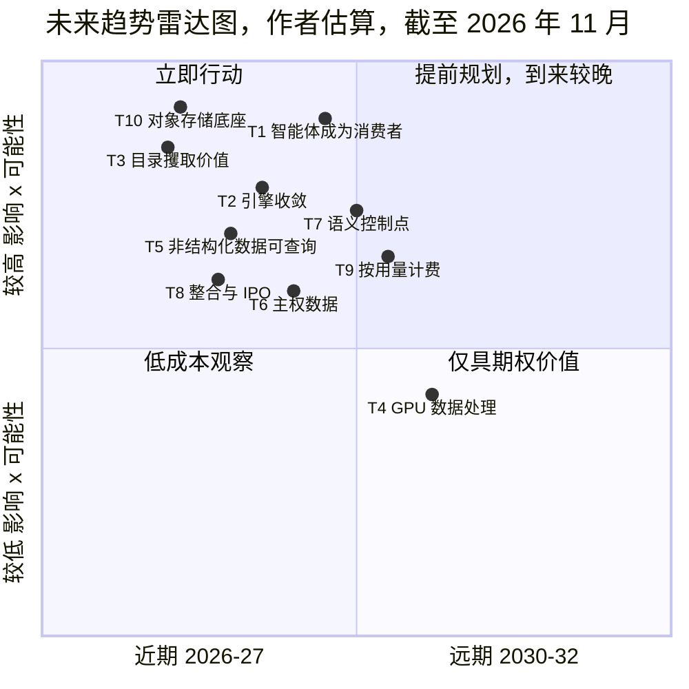
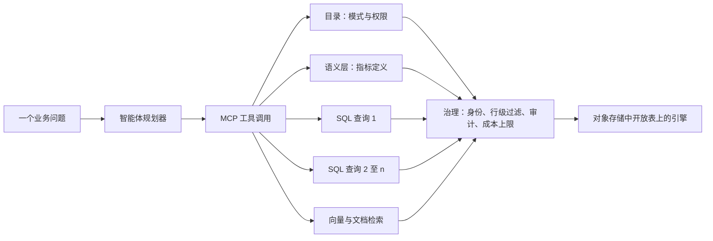
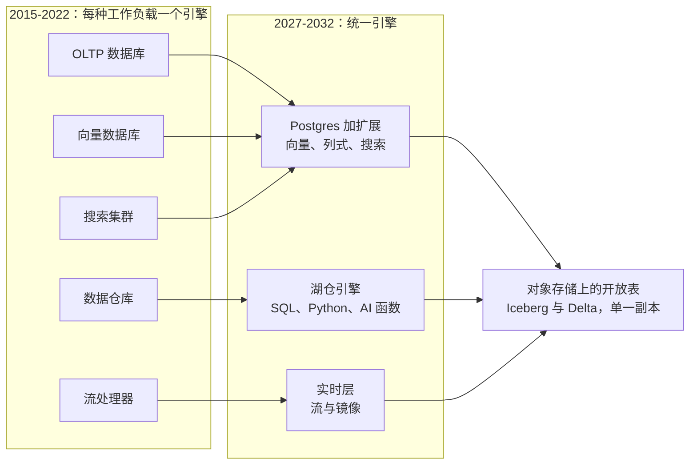
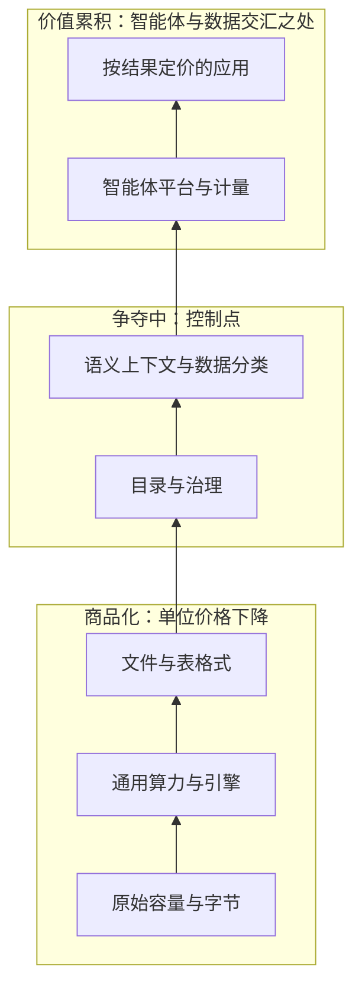
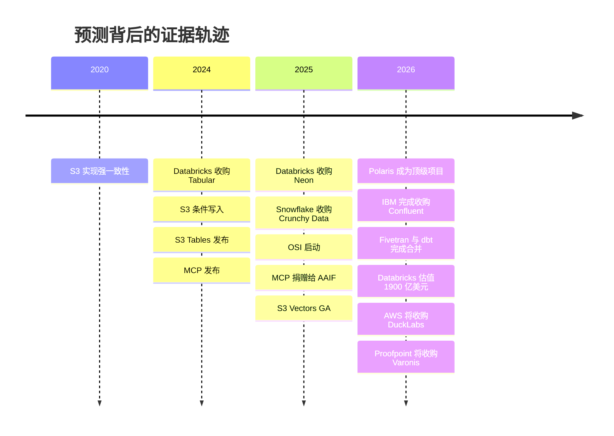

# 44. 未来趋势，2026–2032
> **深度：** L2 · **阅读时间：** 约 18 分钟 · **最后核实：** 2026-11-01 · **前置阅读：** [第 42 章 — 数据库简史](ch42-history-of-databases.md)，[第 43 章 — 现代数据栈](ch43-modern-data-stack.md)

## 要点速览（TL;DR）

- **本章核心论点：价值正在上移。** 存储字节与通用算力正变得更便宜、更可互换。价值正流向那些决定数据*含义*以及谁可以使用数据的层级：目录、语义上下文、数据治理（governance），以及消费数据的智能体（agent）。下文每一项预测都是作者的判断（**估算**）。每一项都锚定在第 1–4 部分已经给出出处的证据上，并附有一个证伪条件。
- **高可能性、近期的判断：** 智能体成为企业数据增长最快的消费者。OLTP、OLAP、向量与搜索持续向"Postgres + 湖仓一体（lakehouse）"平台收敛。Iceberg 成为默认的存储契约，而目录（catalog）攫取租金。对象存储（object storage）成为几乎所有引擎之下的底座。厂商在席位计费之外再加装按用量计费的计量器。
- **中等可能性的判断：** GPU 加速的 SQL 与 ETL 只会在少数大型作业中成为主流。数据主权（data sovereignty）需求增长，但其中大部分会流向超大规模云厂商的"主权云"，而不是本地部署（on-prem）。
- **与市场共识相反的判断：** 独立的向量数据库（vector database）不会成长为一个规模庞大的独立品类，SQL 也不会消失。智能体正在成为 SQL 的一个重要的新*编写者*（估算；尚无厂商披露其占比）。
- **对 Everpure 而言：** 胜算最高的几项趋势（对象存储作为底座、受治理的智能体访问、数据层的语义上下文）与公司的公开举措相吻合：Data Intelligence（1touch）、Data Stream，以及面向 Databricks Storage Ecosystem 的 OpenSharing 连接器（私有预览）。详细的选项分析见[第 45 章](ch45-storage-moving-up-the-stack.md)。

## 为何重要（商业 + Everpure 视角）

企业发展（corporate development）团队承保的是未来，而不是现在。一笔在 2027 年完成的收购，回报期在 2028–2032 年。今天签署的合作，取决于届时哪些平台仍然重要。本章把第 1–4 部分阐释的机制转化为十项预测。每一项都有可能性、时间窗口、赢家、输家、路标（signpost）和证伪条件（falsifier）。合在一起，它们构成一张读者可以按季度更新的记分卡，而不是一个需要去相信的故事。

对于一家正在向上层软件栈延伸的存储公司，利害关系非常具体。过去五年，基础设施层不断获得数据库特性：条件写入、托管表，以及对象存储本身内置的原生向量（[第 24 章](../03-ai-data-stack/ch24-data-meets-compute-and-storage.md)）。与此同时，其上方的平台已开始向下延伸，对本地数据进行就地治理。[^storage-eco] 有价值的问题不是存储是否重要，而是：存储厂商能够可信地拥有哪些软件层，哪些应通过合作获得，哪些应当回避。下文每项趋势都以一行 Everpure 启示收尾，并以"基于公开信息，战略团队可能评估的选项"的方式表述。

**如何阅读这些预测。** *可能性*是作者对该论点在其时间窗口结束前成立的主观概率：高（≥70%）、中（40–70%）、低（<40%）。*时间*是该论点在公开数据中变得可观测的时点：近期（2026–27）、中期（2028–29）或远期（2030–32）。所有可能性与时间均为估算。

## 工作原理

### 雷达图：一页纸看十大趋势

*图 44.1 — SV-17，未来趋势雷达图。横轴是该趋势在公开数据中变得可见的时间（左 = 2026–27，右 = 2030–32）。纵轴是对数据行业经济性的影响乘以可能性。左上象限是战略团队现在就应采取行动的区域。所有位置均为作者估算。*

这张雷达图有意做得粗糙。它按"对经济性的改变有多大"与"有多大可能发生"的乘积对趋势排序，并按证据何时变得具有决定性将其铺开。有两项趋势位于左上方，因为证据已经很强：对象存储作为底座（T10）和目录作为控制点（T3）。GPU 数据处理（T4）位置最低，因为其影响取决于一个尚未解决的瓶颈，即 I/O。

### 趋势 1 — 智能体成为主要的数据消费者

**论点。** 到 2029 年，针对受治理的企业数据存储的大多数查询和工具调用将由 AI 智能体发出。人类仍然设定意图，但大部分流量由机器生成。

**当下证据。** Anthropic 于 2025 年 12 月将[模型上下文协议](../glossary.md#model-context-protocol)（Model Context Protocol，MCP）捐赠给[智能体式 AI 基金会](../glossary.md#agentic-ai-foundation)（Agentic AI Foundation）时，MCP 的 SDK 月下载量超过 9,700 万次，活跃服务器超过 10,000 个（公司披露）。[^mcp-donate] Google 在 Next '26 上正式发布（GA）了面向 BigQuery 的远程 MCP 服务器。[^bq-mcp] Databricks 将 Unity AI Gateway 定位为智能体流量的治理工具。[^db-7b] 在写入侧，Neon 表示其超过 80% 的数据库由智能体创建（公司披露，2025 年 5 月）。[^neon-dbx]

**机制。** 一个人类问题会变成一串相互依赖的调用：模式查找、指标查询、下钻、检索与验证。智能体还会持续运行，而不只在办公时间工作。因此，即使是适度的采用也会使查询数量成倍增加。它还会把瓶颈从引擎吞吐量转移到上下文与治理。在同一配置下，文本转 SQL（text-to-SQL）的准确率从 Spider 1.0 上的 91.2% 跌至企业风格的 Spider 2.0 上的 21.3%，[^spider2] 因此赢家将是那些提供模式、含义和权限的系统，而不是仅仅快速执行 SQL 的系统。

*图 44.2 — 智能体查询扇出。一个问题变成许多受治理的调用，每一个调用都要通过身份、策略和成本控制。查询量成倍上升。价值位于目录、语义层和治理框中，而不仅仅在引擎里。*

**判断。** 可能性：高。"占查询大多数"的时间：中期（2028–29）。**赢家：** 拥有受治理目录与计量能力的平台（Databricks、Snowflake、超大规模云厂商）、ClickHouse 等低延迟引擎（[第 23 章](../03-ai-data-stack/ch23-real-time-analytics-htap.md)），以及"面向智能体的 Postgres"厂商。**输家：** 按席位计价的 BI 前端，以及为少量昂贵查询而定价的引擎。**路标：** 有厂商披露智能体在查询量或 DBU/credit 中的占比；Snowflake 和 Databricks 的托管 MCP 服务器达到 GA [VERIFY: GA 状态]；首次出现大规模公开的智能体数据外泄事件。**证伪条件：** 到 2028 年底，没有任何主要平台报告智能体占查询量的四分之一以上，或安全事件迫使企业把智能体限制在只读沙箱中。**Everpure 启示：** 智能体会产生大量小而突发的读取和短生命周期的数据库，因此值得评估的选项是将存储层与身份感知的访问控制和审计相结合，而不是去争夺智能体前端。

### 趋势 2 — OLTP、OLAP、向量与搜索走向收敛

**论点。** 大多数新应用将运行在一小组统一引擎上：用于运营工作的带扩展 Postgres、用于分析的湖仓，以及在同一份数据副本上连接两者的托管桥梁。专用引擎在规模与延迟的极端场景中得以存续。

**当下证据。** 2025–26 年对 Postgres 的圈地运动已经为这一论点定价。Databricks 以约 $1B 收购 Neon（媒体报道），由此诞生的 Lakebase 年化运行率突破 $100M（公司披露）。[^neon-dbx][^db-7b] Snowflake 以 $164.5M 现金收购 Crunchy Data（10-Q 披露）。[^crunchy] Supabase 以 $10.5B 投后估值完成融资（媒体报道）。[^supabase-f] Microsoft 预览了 Azure HorizonDB。[^horizondb] Databricks 在 DAIS 2026 上宣布 LTAP"即将推出"，它让 Lakebase 与湖仓运行在同一份数据副本之上。[^dais26] 更早的混合事务分析处理（HTAP）举措包括 Snowflake Hybrid Tables（2024 年 11 月在 AWS 上 GA）、pg_duckdb，以及 Aurora PostgreSQL 内部由 DuckDB 驱动的分析功能。[^sf-hybrid][^pgduckdb][^aurora-duck]

*图 44.3 — 收敛。五种面向特定工作负载的引擎坍缩为三大引擎家族，它们在对象存储上的开放表中共享同一份数据副本。极端场景（超大规模 OLTP、10 毫秒以下的分析）仍保留专用引擎。*

**机制。** 保持多个副本同步的成本（数据管道、CDC、对账以及重复的治理）随每新增一个引擎而上升。智能体让情况更糟，因为它们需要在同一个推理循环中同时获取最新的运营状态和历史数据。Postgres 在运营侧胜出，因为其扩展模型无需新数据库即可吸收新的数据类型（pgvector 是典型），也因为每个模型都在大量 Postgres SQL 上训练过。

**判断。** 可能性：高。时间：近期至中期。**赢家：** Databricks、Snowflake、超大规模云厂商的 Postgres 服务、Supabase。**输家：** 没有分销伙伴的单一工作负载引擎，以及以在引擎之间搬运副本为业务的集成工具。**路标：** LTAP 达到 GA；Lakebase 与 Snowflake Postgres 披露年化运行率；MongoDB 相对于 Postgres 服务的增速（[第 29 章](../04-company-deep-dives/ch29-operational-database-vendors.md)）。**证伪条件：** LTAP 推迟到 2027 年以后，且 Lakebase 增长停滞，表明客户更偏好通过 CDC 连接的同类最佳引擎。**Everpure 启示：** 收敛会把事务层和分析层都集中到同一个存储契约上（开放表、将 WAL 分层到对象存储），这有利于同时获得两方认证的厂商。

### 趋势 3 — 开放格式使存储商品化；目录攫取价值

**论点。** 到 2027 年，Iceberg（与 Delta 互操作）成为分析数据的默认存储契约，存储变得可替换。[技术目录](../glossary.md#technical-catalog)（technical catalog）成为控制点（control point），因为它掌握提交权、凭证、策略和使用遥测数据。

**当下证据。** Databricks 以媒体报道的约 $2B 收购了 Tabular，而这家公司累计融资仅约 $37M。[^tabular] Snowflake 捐赠了 Polaris，后者于 2026 年初成为 Apache 顶级项目。[^polaris-tlp] AWS 把托管 Iceberg 直接内置进 S3（S3 Tables，2024 年 12 月）。[^s3tables] Iceberg v3 于 2025 年 12 月登陆各项 AWS 服务。[^iceberg-v3] DuckLake 1.0（2026 年 4 月）提供了一种以数据库为后端的替代方案。[^ducklake] 目录费用依然很低：Glue 在免费额度之上按每 100,000 个对象每月 $1.00 收费，[^glue-pricing] Snowflake 计划对每百万次 Horizon Iceberg REST 调用收取 0.5 credit。[^horizon-irc] 价值在于控制权，而不在于费用。

**机制。** 参见[第 7 章](../01-data-systems-foundations/ch07-open-table-formats.md)和[第 8 章](../01-data-systems-foundations/ch08-catalogs-and-metastores.md)。开放格式（open table format）把字节与引擎分离，因此各引擎在每个工作负载上相互竞争。但每一次读写仍需向目录请求许可和凭证。谁运营目录，谁就能看到全部流量、设定策略，并成为挂载数据血缘、数据分类和语义上下文的默认位置。

> **类比：标准必要专利与 ISA 所有权。** 开放表格式就像 RISC-V 这样的开放指令集：没有人对格式收取专利费，任何人都可以构建兼容引擎。目录则像蜂窝通信领域标准必要专利的持有者。每台兼容设备都必须与其打交道，而开放接口（[Iceberg REST 目录](../glossary.md#iceberg-rest-catalog)规范扮演 FRAND 的角色）会限制但不会消除持有者的议价能力。Arm 能收取版税，是因为它拥有所有人都要适配的 ISA。目录所有者则获得附着在所有人都要适配的命名空间上的治理与 AI 工作负载。

**判断。** 可能性：高。时间：近期。**赢家：** Unity Catalog、Horizon/Polaris、超大规模云厂商的目录；中立目录仅在多平台买家坚持时胜出。**输家：** 专有存储格式，以及不在读写路径上的业务目录（[第 33 章](../04-company-deep-dives/ch33-governance-catalog-security-companies.md)）。**路标：** Unity 与 Polaris 之间的目录联邦；服务端扫描规划的采用；目录级定价；SAP 在收购后如何使用 Dremio 的目录。[^sap-dremio] **证伪条件：** Iceberg REST 规范使目录真正可替换，切换目录成为常规操作，价值转而流向引擎或智能体。**Everpure 启示：** 如果存储桶是一种商品，那么选项是具备表感知能力（REST 目录端点、压缩合并、凭证分发），或在主导目录下获得深度认证，而不是继续做一个被动的存储桶。

### 趋势 4 — GPU 加速的数据处理走向主流（部分地）

**论点。** 到 2029 年，GPU 执行将成为主要 Spark、Velox/Presto 和向量索引服务中的标准选项，但它只承担少数数据处理支出：大型连接、PB 级 ETL 以及索引构建。

**当下证据。** NVIDIA 声称，在 DGX B200 上，`cudf.pandas` 最高可提速约 150 倍，GPU 原生 Velox 约 12 倍（厂商声称）。[^cudf-pandas][^velox-gpu] FINRA 报告某一 Spark 工作负载提速 14 倍、成本节省 90%（客户/厂商披露）。[^finra] 某 OpenSearch GPU 索引构建耗时从约 274 分钟降至 29 分钟（项目基准测试）。[^cuvs] Presto 于 2026 年 6 月发布了 GPU 夜间构建镜像。[^presto-gpu] NetApp 收购 DataPelago，以在存储层实现 GPU 数据处理。[^datapelago]

**机制与反面证据。** 当工作是计算密集型且数据能够放入设备的内存层次结构时，GPU 胜出。但大多数查询都很小：一项对 Amazon Redshift 集群数据的分析发现，只有约 0.03% 的查询扫描超过 10 TB。[^md-redshift][^redset] 许多作业在等待存储和网络，而不是在等待算术运算。由慢速对象存储供数的 GPU 就是一块闲置的 GPU。

**判断。** 可能性：中。时间：中期。**赢家：** NVIDIA（cuDF/cuVS）、拥有富余 GPU 容量的云、具备 GPU 直连数据路径的存储。**输家：** 在最大型 ETL 作业上只用 CPU 的引擎。**路标：** 主要平台推出以 GPU 为后端的 SQL 仓库 SKU；Databricks 或 EMR 披露中 GPU 占 Spark 运行时间的份额；GPU 租赁价格下降到足以让数据处理成为推理集群的非高峰用途。**证伪条件：** 到 2028 年底，没有任何主要数据仓库或湖仓推出 GA 的 GPU SQL 引擎。**Everpure 启示：** 瓶颈论有利于存储。以线速为 GPU 供数是一个存储问题，因此选项是成为经过认证的数据路径（GPUDirect、cuObject），而不是自建引擎。[^cuobject]

### 趋势 5 — 非结构化数据变得可查询

**论点。** 到 2028 年，文档、图像和音频将以与表相同的 SQL 和治理方式被查询。解析、嵌入（embedding）与抽取成为内置函数，按页或按 token 计价。

**当下证据。** Snowflake 的 `AI_PARSE_DOCUMENT` 可处理最多 2,000 页的文件，Databricks 推出了 `ai_parse_document`（Beta）。[^sf-parse][^dbx-parse] Snowflake 通过 Cortex AISQL 把生成式 AI 放进了 SQL（公开预览，2025 年）。[^aisql] 解析价格正在下降：超大规模云厂商的 OCR 标价约为每 1,000 页 $1.50，Reducto 的 r-1 智能体式解析约为每页一美分（公司披露）。[^textract][^reducto-r1] 常被引用的非结构化数据占比约为 90%，但该数字来自厂商赞助的估算。[^idc-box]

**机制。** 一旦模型能以不到一美分的成本把一页文档转成行和向量，文档就只是一张尚未被解析的表。难点转移到 [ACL 传播](../glossary.md#acl-propagation)（ACL propagation）和增量同步上，这需要知道谁可以看到每个分块，并在文件变化时保持索引最新（[第 17 章](../03-ai-data-stack/ch17-unstructured-data-processing.md)）。

**判断。** 可能性：高。时间：近期至中期。**赢家：** 具备 AI 函数的数据平台；[Lance](../glossary.md#lance) 等多模态格式；拥有权限图谱的内容平台。**输家：** 缺乏分销渠道的独立解析 API，它们面临[功能吸收](../glossary.md#feature-absorption)（feature absorption）。**路标：** AI 函数在平台消费中的占比；多模态表类型达到 GA；每页价格下降。**证伪条件：** 权限失败（Copilot 式的过度共享）使企业把非结构化数据挡在 AI 数据管道之外，或长上下文模型完全绕过数据平台。**Everpure 启示：** 大多数非结构化字节本就存放在文件与对象存储上，因此 Data Stream 和 Data Intelligence 为其提供了数据引力（data gravity）论据。选项是成为权限和变更事件的发源地。[^data-stream]

### 趋势 6 — 主权与本地化的 AI 数据

**论点。** 监管与 AI 工厂使数据本地性成为采购标准。主权是一项高可能性趋势。本地部署的*份额*增长只是中等可能性，因为超大规模云厂商也在销售主权能力。

**当下证据。** AWS 于 2026 年 1 月推出其欧洲主权云。[^aws-esc] 欧盟的 AI Omnibus 将独立高风险 AI 义务推迟至 2027 年 12 月 2 日。[^ai-omnibus] 根据自 2025 年 9 月 12 日起适用的法规，欧盟《数据法案》（Data Act）规定的云切换费用须自 2027 年 1 月 12 日起降至零。[^eu-data-act] 一项由厂商委托的 Cloudera 调查发现，66% 的受访者在过去 12 个月内把部分 AI 工作负载迁回了本地。[^cloudera-survey] NVIDIA AI Data Platform 参考设计支撑了 Everpure Data Stream 等存储厂商产品。[^aidp][^data-stream]

**机制。** GPU 集群闲置的代价高昂，而跨广域网移动 PB 级数据既慢又要付费（[第 24 章](../03-ai-data-stack/ch24-data-meets-compute-and-storage.md)）。监管机构越来越多地追问数据和模型物理上位于何处，以及谁可能被强制要求交出它们。这两股力量都把计算拉向数据。

**判断。** 可能性：中（本地部署份额），高（主权作为一项要求）。时间：近期至中期。**赢家：** 主权云区域、本地湖仓技术栈（Iceberg、Trino/Starburst、SAP 内的 Dremio）、进入 NVIDIA 设计方案的存储厂商。**输家：** 没有区域内部署或客户自管选项的纯云平台。**路标：** Databricks 和 Snowflake 的本地部署与主权 SKU；超大规模云厂商资本开支转向主权区域；国家级 AI 工厂采购。**证伪条件：** 超大规模云厂商的主权区域吸收了几乎全部需求，本地 AI 集群仍局限于实验室和新兴云（neocloud）。**Everpure 启示：** 选项是把本地对象存储与治理和目录连接（OpenSharing、Iceberg REST）相结合，让云平台能够就地查询这些数据。[^everpure-os]

### 趋势 7 — 语义上下文与数据智能成为控制点

**论点。** 到 2029 年，记录数据含义的那一层（语义模型、本体、数据分类与数据血缘）将是决定智能体准确率的关键所在，并变得与目录同样具有战略意义。

**当下证据。** 在 data.world 2023 年的研究中，当数据以知识图谱（knowledge graph）形式表示时，GPT-4 在企业问题上的准确率从 16.7% 升至 54.2%。[^dw-bench] dbt 的 2026 年基准测试报告称，语义层（Semantic Layer）准确率为 98–100%，而文本转 SQL 为 84–90%（厂商自行测试）。[^dbt-bench] Open Semantic Interchange 于 2025 年 9 月启动，并于 2026 年 1 月定稿其规范。[^osi-launch][^osi-v1] Microsoft 预览了 Fabric IQ。[^ignite25] Databricks 宣布了 Genie Ontology [VERIFY: 预览版还是 GA]。[^dais26] 本体厂商 Palantir 的估值接近 70 倍 EV/过去 12 个月收入。[^comps] 数据智能资产价格昂贵：Cyera 估值 $12B（私募轮，媒体报道），Varonis 约 $6.3B（交易价值，待完成；股权价值约 $5.71B），Securiti $1.725B（已披露），以及 Everpure 收购 1touch 的 $125.0M（GAAP 现金对价）。[^cyera-g][^varonis-8k][^securiti][^ep-10q]

**机制。** 就这项任务而言，前沿模型日益可以互换，上下文却不能。一个知道"净收入"是扣除退款后的定义、知道某列包含个人数据、知道某张表已被弃用的智能体，会给出正确且安全的答案。谁维护这份上下文，谁就会在每一次智能体调用时被征询。

**判断。** 可能性：中高。时间：近期至中期。**赢家：** 平台语义层（metric views、semantic views、Fabric IQ）、Palantir、具备大规模数据分类能力的数据安全平台，以及合并后的 Fivetran + dbt。**输家：** 唯一护城河就是其语义模型的仪表板；独立的术语表工具。**路标：** OSI 在已发布产品中的采用；语义对象单独计费；针对数据分类资产的并购。**证伪条件：** 模型在原始模式上于 Spider 2.0 式企业基准测试中达到约 80% 以上的准确率，使语义层变得可有可无；或 OSI 使语义高度可移植，以至于没人能为其收费。**Everpure 启示：** 在承载每一个字节的那一层进行数据分类并提供上下文，正是 1touch 的投资逻辑。选项是把这些上下文输送进平台目录，而不是构建一个与之竞争的语义层。

### 趋势 8 — 整合持续；IPO 窗口选择性重开

**论点。** 战略买家持续吞并技术栈的中间层，少数已具规模的独立公司在 2027 至 2029 年间上市。

**当下证据。** IBM 于 2026 年 3 月完成对 Confluent 的收购（约 $11B），Salesforce 于 2025 年 11 月完成对 Informatica 的收购（约 $8B），Fivetran 与 dbt Labs 合并（合并后 ARR"接近 $600M"，公司披露），SAP 收购 Dremio，AWS 同意收购 DuckLabs，Proofpoint 同意收购 Varonis。[^ibm-cflt][^infa-close][^fivetran-dbt][^sap-dremio][^aws-duck][^varonis-8k] Databricks 估值 $190B，约为其公司披露的 >$7B 年化运行率的 27 倍，而 Snowflake 的 EV/未来 12 个月收入为 16.9 倍（2026-10-30）。[^db-7b][^comps-sf] PitchBook 的分析认为 Databricks 的经营价值更接近 $68.7B（估算）。[^ms] ClickHouse（$15B，媒体报道；ARR >$250M，公司披露）、VAST（$30B，公司披露）和 Cyera（$12B）是下一批候选者。[^ch-seriesd][^ch-arr][^vast-f][^cyera-g]

| 情景 | Databricks 结果 | 整合模式 | 表明其正在发生的路标 | 估算概率（作者） |
|---|---|---|---|---|
| **看多** | 2027 年以 ≥$190B 上市；经审计的增速 ≥50%、毛利率接近 80%，验证了私募估值 | IPO 带动整个品类重新估值；ClickHouse、Fivetran + dbt 和 Cyera 于 2028 年前上市；Snowflake 估值上修 | 公开的 S-1 披露经审计的利润率；锁定期表现强劲；后续出现更多 S-1 | 约 25% |
| **基准** | 2027–28 年以约 $120–190B 上市；无服务器 COGS 显示毛利率低于 80% | 稳定的战略并购（超大规模云厂商、SAP、Salesforce、IBM、安全平台）；另有一两家公司 IPO | 年化运行率增速向 50% 放缓；S-1 中披露利润率；上市前进行更多要约收购 | 约 50% |
| **看空** | 推迟到 2028 年以后，或以低于上一轮私募估值的价格上市；估值倍数向 Snowflake 收敛 | IPO 窗口关闭；独立公司以更低倍数出售给战略买家；向量与目录纯业务公司被并入平台 | 增速低于 40%；下调估值的要约收购；AI 支出回落；与 Fabric 和 BigQuery 的价格竞争加剧 | 约 25% |

*图 44.4 — Databricks IPO 与整合情景。概率和估值区间均为作者估算。Ghodsi 曾称 2026 年不是上市的好年份（媒体报道），截至 2026-11-01 我们未发现公开的 S-1。保密递交的文件不会公开可见。*[^ipo][^ms]

**判断。** 可能性：高（整合）。对于 2028 年底前 Databricks IPO，图 44.4 中的情景隐含约 75% 的概率（看多加基准），处于"高"区间的下沿；看空情景即该论点失败之处。时间：近期至中期。**赢家：** 拥有分销能力的买家（超大规模云厂商、应用巨头、安全平台）。**输家：** 处于被吸收品类中、规模不足的独立公司。**路标：** Databricks 公开 S-1；对已具规模的独立公司的私有化（take-private）或战略收购要约；对平台交易的反垄断审查。**证伪条件：** 出现一波以溢价倍数上市的独立 IPO 且没有战略收购，或反垄断机构阻止平台收购。**Everpure 启示：** 数据分类、目录与数据移动领域的标的正在由安全和应用买家定价。存储买家的优势在于与数据路径的整合，而不是价格。

### 趋势 9 — 定价从席位转向用量和智能体结果

**论点。** 到 2030 年，大多数增量数据与 AI 软件收入将按计量收费（credit、DBU、动作），而不是按席位。真正的*结果*定价（按已解决的工单计费）仍属少数，因为结果难以审计。

**当下证据。** Salesforce 把 Agentforce 从每次对话 $2（2024 年）改为每个动作 $0.10 的 Flex Credits（2025 年）[VERIFY: 当前标价]。[^af-price] Salesforce 市值同比下跌约 21%，Workday 下跌约 27%，而 Palantir 的估值接近 70 倍 EV/过去 12 个月收入。[^comps] 数据平台一直按计量收费（Snowflake credit、Databricks DBU），目录也在增加按调用计费的计量器。[^horizon-irc]

**机制。** 智能体使工作量与员工人数脱钩。席位价格是一种与客户员工人数挂钩的年金，计量器则是对用量收取的通行费。厂商会在席位数缩减之前转向通行费模式（[第 34 章](../04-company-deep-dives/ch34-application-giants-data-platforms.md)）。

**判断。** 可能性：高（按用量计费），低至中（结果定价）。时间：中期。**赢家：** 原生按用量计费的平台。**输家：** 转型缓慢、以席位为主的 BI 与应用厂商。**路标：** Agentforce 类收入在披露中的占比；续约时出现混合"credit 池"；财务团队要求为智能体设定成本上限。**证伪条件：** 捆绑 AI 的高级席位档位（ServiceNow 模式）到 2029 年仍是主导模式。**Everpure 启示：** Evergreen//One 已经以服务形式为存储定价。一个选项是对数据智能层按每个被分类的对象或每次受治理的查询计量，从而使收入与智能体活动保持一致。

### 趋势 10 — 对象存储成为通用的数据库底座

**论点。** 到 2028 年，几乎每一个新的数据库、流和向量索引都会把其持久状态保存在兼容 S3 的对象存储上，本地闪存和内存只作为缓存。

**当下证据。** S3 先后获得强一致性（2020 年 12 月）、条件写入（2024 年 8 月和 11 月）、低延迟层（Express One Zone）、托管表（S3 Tables）和原生向量（S3 Vectors，2025 年 12 月 GA，每个索引最多 20 亿个向量，厂商披露）。[^s3-consistency][^s3-cond][^s3-ifmatch][^s3-express][^s3tables][^s3-vectors] Confluent 以 $135.1M 收购了 WarpStream，这是一个构建在对象存储上的 Kafka 兼容引擎（10-Q 披露）。[^warpstream] NVIDIA Dynamo 把 [KV 缓存](../glossary.md#kv-cache)（KV cache）从 HBM 逐级分层到网络存储，而 NVIDIA 的 CMX 定义了一个闪存上下文内存层。[^dynamo-kv][^nvidia-cmx]

**机制。** 一旦存储提供[比较并交换](../glossary.md#compare-and-swap)（compare-and-swap）语义，数据库就可以把它当作自己的日志和磁盘。计算变得无状态且弹性，数据库变成"对象之上的元数据加缓存"。同样的逻辑如今也覆盖了推理：放不进 HBM 的 KV 状态会溢出到闪存和对象层。

**判断。** 可能性：高。时间：近期。**赢家：** 超大规模云厂商的对象存储、完整兼容 S3 API 的平台、缓存与分层层。**输家：** 绑定本地磁盘的无共享（shared-nothing）引擎；用于分析的纯块存储。**路标：** 本地 S3 存储支持条件写入及表/向量 API；基于 S3 的 Kafka 在新流处理部署中的份额；推理基准测试中的 KV 缓存分层。**证伪条件：** 对延迟敏感的 OLTP 和推理仍停留在本地 NVMe 上，对象存储仍只是冷数据层。**Everpure 启示：** 这是对存储厂商最有利的趋势，但前提是 FlashBlade 跟上 S3 的数据库级特性（条件写入、表、向量）以及 Everpure KVA 等 KV 层集成。[^everpure-kva]

### 价值迁移：十大趋势背后的图景

*图 44.5 — 价值迁移，2026–2032（作者估算）。随着格式开放、对象存储商品化，定价权从字节和引擎转向目录、语义上下文和智能体层。存储厂商向上层延伸的路径穿过中间这一框。*

> **类比：半导体。** AI 服务器呈现同样的模式。十年前，CPU 是服务器物料清单中的价值中心。在 AI 系统中，越来越大的价值份额归于加速器及其 HBM 堆栈，而主机 CPU、机箱和通用 DRAM 的重要性下降。价值并未消失，而是转移到了决定系统性能的部件上。在数据基础设施中，这一部件正在从存储引擎转向定义含义和访问的那一层。一家向上层延伸的存储公司，就像一家学会了销售 HBM 的内存厂商：物理原理相同，却更接近约束瓶颈。

### 不会发生的事（作者的逆向判断）

**独立的向量数据库不会成长为一个规模庞大的独立品类。** 向量检索如今已是 Postgres、MongoDB、Elastic、各平台乃至 S3 本身的一项功能。[^s3-vectors] Pinecone 上一次定价融资（$750M 投后估值）还是在 2023 年，Qdrant 2026 年的 B 轮融资为 $50M（媒体报道）。[^pinecone-b][^qdrant] 预计会有一两家作为专业厂商存活，其余被收购（估算）。*证伪条件：* 某家纯向量厂商在 2030 年前披露 ARR 超过 $500M。

**SQL 不会终结。** 智能体以机器速度编写 SQL，语义层也编译为 SQL。SQL 成为机器对机器的接口，就像编译器接管大部分编写工作之后机器码依然存在一样。*证伪条件：* 某主要平台的智能体流量主要转向非 SQL 的查询接口。

**格式之战不会重启。** Iceberg 与 Delta 如今已可互操作，战场已转移到目录。*证伪条件：* 某主要厂商推出一种其引擎读取速度显著更快的专有格式。

**云数据仓库不会被整体迁回本地。** 迁回是选择性的：AI 训练与检索数据、受监管数据以及稳态工作负载会迁移，弹性分析则留在云端。*证伪条件：* 到 2029 年，某主要云数据平台报告其云端消费持续下降，并将其归因于客户把分析迁回本地；或其客户自管/本地部署产品在新增订单中占据实质性份额。

## 设计选择与权衡

| 预测 | 最强反方论点（最强版本论证） | 我们为何仍倾向另一方 | 什么会让我们改变看法 |
|---|---|---|---|
| T1 智能体成为主要消费者 | 智能体试点因准确性和安全问题停滞，正如 2017–2019 年的聊天机器人 | MCP 的采用和由智能体创建的数据库已经可以计量 | 到 2028 年，厂商披露中的智能体占比持平 |
| T2 收敛 | 通过 CDC 连接的同类最佳引擎更便宜、更快 | 副本与治理成本随每个引擎上升，而智能体需要统一视图 | LTAP 与 Lakebase 停滞 |
| T3 目录攫取价值 | Iceberg REST 使目录可替换，因此目录也会商品化 | 即使 API 开放，策略、数据血缘与上下文仍使切换代价高昂 | 目录迁移变得司空见惯 |
| T4 GPU 数据处理 | 大多数查询规模小且受 I/O 限制 | 我们同意，因此可能性为中 | GPU SQL 成为中等规模作业的默认选择 |
| T6 主权本地部署 | 超大规模云厂商的主权区域拿走需求 | 对最大规模的数据集而言，主权与数据引力有利于本地 AI 工厂 | 本地 AI 集群仍局限于实验室 |
| T7 语义控制点 | 模型直接学会模式；语义变得可有可无 | 企业基准测试仍显示巨大的上下文缺口 | 在 Spider 2.0 上的原始模式准确率超过约 80% |
| T9 结果定价 | 买家拒绝不可预测的计量器 | 按用量计费已是数据平台的常态 | "席位 + AI"捆绑在续约中占主导 |

*图 44.6 — 每项预测与其最强反方论点的对照。最右一列即需要监测的证伪条件。*

## 主要参与者

| 趋势 | 可能性 | 时间 | 可能的赢家 | 可能的输家 | 关键路标 |
|---|---|---|---|---|---|
| T1 智能体成为主要消费者 | 高 | 中期 | 受治理的平台、ClickHouse、面向智能体的 Postgres | 按席位计价的 BI、慢速引擎 | 智能体查询占比；MCP GA |
| T2 引擎收敛 | 高 | 近期–中期 | Databricks、Snowflake、Supabase、超大规模云厂商 Postgres | 单一工作负载引擎 | LTAP GA；Lakebase 年化运行率 |
| T3 目录攫取价值 | 高 | 近期 | Unity、Horizon/Polaris、超大规模云厂商目录 | 专有格式；不在路径上的目录 | 目录联邦与定价 |
| T4 GPU 数据处理 | 中 | 中期 | NVIDIA、GPU 云、GPU 直连存储 | 最大规模下只用 CPU 的 ETL | GA 的 GPU SQL SKU |
| T5 非结构化数据可查询 | 高 | 近期–中期 | 具备 AI 函数的平台、Lance、内容平台 | 独立解析 API | AI 函数消费占比 |
| T6 主权数据 | 中–高 | 近期–中期 | 主权区域、本地湖仓、进入 NVIDIA 设计的存储 | 纯云平台 | 主权 SKU；AI 工厂交易 |
| T7 语义控制点 | 中–高 | 近期–中期 | 平台语义层、Palantir、DSPM 领先者 | 仅有仪表板的 BI | 产品中的 OSI；数据分类并购 |
| T8 整合与 IPO | 高 / 高（下沿，约 75%） | 近期–中期 | 战略收购方 | 规模不足的独立公司 | Databricks S-1；收购退出 |
| T9 按用量计费 | 高 / 低–中 | 中期 | 原生按用量计费的厂商 | 以席位为主的应用 | 续约中的 credit 池 |
| T10 对象存储底座 | 高 | 近期 | S3 与完整 API 兼容 S3 的存储 | 本地磁盘无共享架构 | 本地条件写入与向量 API |

*图 44.7 — 趋势表：在一个视图中呈现可能性、时间、赢家、输家与路标（作者估算）。公司层面的细节见[第 4 部分](../04-company-deep-dives/ch25-databricks.md)。*

## 历史与发展轨迹

*图 44.8 — 这些预测是对一条有日期可考的轨迹的外推。2024 至 2026 年间，行业先是买格式，然后买 Postgres，再买上下文，而对象存储则在底层不断获得数据库特性。*[^mcp-launch][^tabular][^s3-cond][^s3tables][^neon-dbx][^crunchy][^osi-launch][^mcp-donate][^s3-vectors][^polaris-tlp][^ibm-cflt][^fivetran-dbt][^db-7b][^aws-duck][^varonis-8k]

[第 42 章](ch42-history-of-databases.md)中的长周期是一段先分离、后重新捆绑的历史。存储与计算分离（Snowflake，2012–2016），格式与引擎分离（Iceberg 与 Delta，2017–2024），现代数据栈先拆分为数十种工具，随后再走向整合（[第 43 章](ch43-modern-data-stack.md)）。2026–2032 年这一阶段，是围绕控制点的重新捆绑：谁拥有目录和上下文，谁就能在开放存储之上重建整套产品。

## 关键数字

| 指标 | 数值 | 口径 | 来源 / 日期 |
|---|---|---|---|
| MCP SDK 月下载量 / 活跃服务器 | >97M / >10,000 | 公司披露 | Anthropic，2025-12-09[^mcp-donate] |
| 文本转 SQL 准确率，Spider 1.0 对比 Spider 2.0 | 91.2% 对比 21.3% | 学术论文 | Lei et al.，2025-03[^spider2] |
| 由智能体创建的 Neon 数据库 | >80% | 公司披露 | 2025-05[^neon-dbx] |
| Databricks 年化运行率与增速 | >$7B，同比 >80%（财季 Q2，2026 年 5–7 月） | 公司披露的年化运行率，未经审计 | Databricks，2026-08-13[^db-7b] |
| Databricks 估值 | $190B 投后估值（约 27 倍年化运行率） | 私募估值；倍数为估算 | Databricks，2026-08-13[^db-7b] |
| Snowflake EV/未来 12 个月收入 | 16.9x | 市场数据；未来 12 个月收入取自指引 | `public_comps.csv`，2026-10-30[^comps-sf] |
| Lakebase 年化运行率 | >$100M | 公司披露的年化运行率 | Databricks，2026-08-13[^db-7b] |
| Supabase 估值 | $10.5B 投后估值 | 媒体报道 | Orrick，2026-06[^supabase-f] |
| Databricks–Tabular | 约 $2B | 媒体报道 | TechCrunch，2024-08-14[^tabular] |
| S3 Vectors 规模 | 每个索引 20 亿个向量 | 厂商披露 | AWS，2025-12[^s3-vectors] |
| 扫描 >10 TB 的 Redshift 查询 | 约 0.03% | 厂商对公开数据集的分析 | MotherDuck / PVLDB 2024[^md-redshift][^redset] |
| 迁回本地的 AI 工作负载（12 个月） | 66% 的受访者 | 厂商委托的调查 | Cloudera，2026-08[^cloudera-survey] |
| 企业 SQL 准确率，原始模式对比知识图谱 | 16.7% → 54.2% | 预印本（厂商作者） | data.world，2023-11[^dw-bench] |
| IBM–Confluent | 约 $11B | 已披露 | IBM，2026-03-17 完成[^ibm-cflt] |
| Cyera 估值 | $12B 投后估值 | 媒体报道 | SecurityWeek，2026-06[^cyera-g] |
| Everpure–1touch | $125.0M 现金 | GAAP 披露（10-Q） | Everpure 10-Q，2026-06[^ep-10q] |
| Agentforce 单价 | $2/次对话 → $0.10/个动作 | 公司标价 [VERIFY] | Salesforce，2024–2025[^af-price] |

*图 44.9 — 关键数字：支撑各项预测的证据点。年化运行率为公司披露；私募估值并非公开企业价值；除另有说明外，调查与基准测试数据均由厂商赞助。*

## 存储桥接

> **存储桥接。** 十项趋势中有六项（T2、T3、T5、T6、T7、T10）提升了承载字节那一层的战略价值，但前提是该层能够提供数据库级语义（条件写入、表与向量 API、变更事件、权限元数据），并接入其上方的目录与语义层。风险同样存在于反方向：S3 Tables 和 S3 Vectors 表明，超大规模云厂商可以把表和向量功能吸收进存储本身。基于公开信息，战略团队可能评估的选项在[第 45 章](ch45-storage-moving-up-the-stack.md)中展开。协议与性能细节请参阅配套的 *Everpure Tech Atlas*。

## 对话手册

**向产品经理（PM）提问**

1. "目前你们的查询（或 credit/DBU）中有多大比例来自智能体？你们如何衡量？"
2. "如果客户把其 Iceberg 表迁到另一个目录，他们会失去什么：策略、数据血缘、语义定义，还是使用历史？"
3. "如果客户的员工人数减少，你们的哪些计量项会增长？"

**向工程师提问**

1. "你们的引擎需要哪些 S3 特性：条件写入、强一致性、低延迟层？它能在兼容 S3 的本地存储上运行吗？"
2. "对于一个 GPU 加速的作业，切换之后瓶颈在哪里：计算、PCIe、网络还是存储？"
3. "源文件上的权限变更如何传递到由它派生出的分块和向量？需要多长时间？"

**好的回答听起来是什么样。** 它们给出可衡量的占比而不是形容词（"智能体占查询数量的 18%，每季度增长 4 个百分点"），点名具体的 API 原语（"在提交文件上执行 put-if-absent"），并把公司披露的年化运行率与经审计的收入区分开。优秀的回答还会主动说明什么情况能证明他们错了。

**不要这样说**

- "向量数据库是下一个重要的数据库品类。"向量检索已经成了一项功能；独立厂商只能融到小额资金。
- "开放格式意味着没有锁定。"锁定已经转移到目录及其策略上。
- "GPU 将在 SQL 上取代 CPU。"大多数查询规模小且受 I/O 限制。
- "Databricks 值 $190B，所以它的 IPO 也会以这个价格定价。"基于优先股的私募估值并不是公开的企业价值。
- "主权就意味着本地部署。"超大规模云厂商也在销售主权区域。

## 深入阅读

- 阅读证伪条件，而不是论点：建立一个季度跟踪表，为图 44.7 中的每个路标设一行。
- Spider 2.0（Lei et al.），了解基准测试与企业级文本转 SQL 之间的差距。[^spider2]
- Redset 论文，了解真实的查询规模分布。[^redset]
- Iceberg REST 目录规范和 OSI 规范，二者定义了两个被争夺的接口。[^osi-v1]
- PitchBook 对 Databricks 估值的分析，可作为一个审慎的看空逻辑参考。[^ms]

## 关键术语

- [模型上下文协议（Model Context Protocol）](../glossary.md#model-context-protocol) — 将 AI 智能体连接到工具和数据的开放标准。
- [智能体式 AI 基金会（Agentic AI Foundation）](../glossary.md#agentic-ai-foundation) — 目前负责管理 MCP 的 Linux 基金会旗下基金。
- [技术目录（Technical catalog）](../glossary.md#technical-catalog) — 将表名映射到元数据，并控制提交、凭证和策略的服务。
- [Iceberg REST 目录（Iceberg REST catalog）](../glossary.md#iceberg-rest-catalog) — 面向 Iceberg 目录的厂商中立 HTTP API。
- [语义层（Semantic layer）](../glossary.md#semantic-layer) — 编译成 SQL 的受治理业务定义。
- [功能吸收（Feature absorption）](../glossary.md#feature-absorption) — 平台把某家初创公司的产品作为一项功能加入自身。
- [比较并交换（Compare-and-swap）](../glossary.md#compare-and-swap) — 仅当当前值与预期值匹配时才成功的原子更新。
- [KV 缓存（KV cache）](../glossary.md#kv-cache) — 为已处理 token 存储的注意力键和值。
- [ACL 传播（ACL propagation）](../glossary.md#acl-propagation) — 把源文件权限一路传递到派生的分块和向量。
- [Lance](../glossary.md#lance) — 面向多模态 AI 数据的开放列式格式与表规范。
- [价值迁移（Value migration）](../glossary.md#value-migration) — 利润池从价值链的一层转移到另一层。
- [路标（Signpost）](../glossary.md#signpost) — 证实或削弱某项预测的可观测事件。
- [证伪条件（Falsifier）](../glossary.md#falsifier) — 一旦出现即证明预测错误的明确结果。
- [按用量计费（Consumption-based pricing）](../glossary.md#consumption-based-pricing) — 按使用单位（credit、DBU、动作）而非按席位收费。
- [按结果计费（Outcome-based pricing）](../glossary.md#outcome-based-pricing) — 按完成的业务结果（如已解决的工单）收费。
- [AI 工厂（AI factory）](../glossary.md#ai-factory) — 配备自身数据与网络、为大规模产出 AI 结果而建的专用 GPU 集群。

## 资料来源

[^storage-eco]: Databricks blog, "Announcing the Databricks Storage Ecosystem: Governing the Enterprise Data Estate Wherever It Lives," https://www.databricks.com/blog/announcing-databricks-storage-ecosystem-governing-enterprise-data-estate-wherever-it-lives, 发布于 2026-06-10; 检索于 2026-11-01 （引自第 25 章）.
[^everpure-os]: Everpure blog, "Everpure OpenSharing Connector," https://blog.everpuredata.com/products/everpure-opensharing-connector/, 发布于 2026-06; 检索于 2026-11-01. 厂商披露；自 2026-06-09 起私有预览（引自第 25 章）。
[^mcp-launch]: Anthropic, "Introducing the Model Context Protocol," https://www.anthropic.com/news/model-context-protocol, 发布于 2024-11-25; 检索于 2026-11-01 （引自第 22 章；未重新抓取）.
[^mcp-donate]: Anthropic, "Donating the Model Context Protocol and establishing the Agentic AI Foundation," https://anthropic.com/news/donating-the-model-context-protocol-and-establishing-of-the-agentic-ai-foundation, 发布于 2025-12-09; 检索于 2026-11-01. 下载量与服务器数量为公司披露（引自第 22 章）。
[^bq-mcp]: G-gen (Google Cloud partner), "Next '26 What's new in BigQuery," https://blog.g-gen.co.jp/entry/next-26-whats-new-in-bigquery, 发布于 2026-04; 检索于 2026-11-01. 二手来源，日文（来自 `meta/research-briefing.md`).
[^db-7b]: Databricks, "Databricks Grows >80% YoY, Surpasses $7B Revenue Run-Rate, Scales Lakebase, Genie and Unity AI Gateway," https://www.databricks.com/company/newsroom/press-releases/databricks-grows-80-yoy-surpasses-7b-revenue-run-rate-scales, 发布于 2026-08-13; 检索于 2026-11-01. 公司披露的年化运行率，未经审计；约 27 倍的倍数为估算（$190B ÷ $7B），计算方法见第 25 章。
[^neon-dbx]: TechRepublic, "Databricks to Acquire Neon in $1 Billion Deal to Boost AI-Driven Databases," https://www.techrepublic.com/article/news-databricks-neon-acquisition/, 发布于 2025-05; Constellation Research, "Databricks acquires Neon, sees Postgres scaling key to agentic AI," https://www.constellationr.com/insights/news/databricks-acquires-neon-sees-postgres-scaling-key-agentic-ai, 发布于 2025-05; 检索于 2026-11-01. 价格为媒体报道；>80% 的数字为公司披露。
[^spider2]: Fangyu Lei et al., "Spider 2.0: Evaluating Language Models on Real-World Enterprise Text-to-SQL Workflows," ICLR 2025, arXiv:2411.07763v2, https://arxiv.org/abs/2411.07763v2, 发布于 2025-03-17; 检索于 2026-11-01.
[^crunchy]: Snowflake Inc., Form 10-Q for the quarter ended 2025-10-31 （Crunchy Data 现金对价 $164.5M）, https://www.sec.gov/Archives/edgar/data/1640147/000164014725000211/snow-20251031.htm, 发布于 2025-12; 检索于 2026-11-01（来自 `data/ma_deals.csv`；媒体报道的约 $250M 数字已被取代）。
[^supabase-f]: Orrick, "Supabase Raises $500 Million at $10.5 Billion Valuation to Accelerate Lead in Agentic Infrastructure," https://www.orrick.com/en/News/2026/06/Supabase-Raises-500-Million-at-10-5-Billion-Valuation-to-Accelerate-Lead-in-Agentic-Infrastructure, 发布于 2026-06; 检索于 2026-11-01. 媒体报道。
[^horizondb]: Microsoft Tech Community, "Announcing Azure HorizonDB," https://techcommunity.microsoft.com/blog/adforpostgresql/-/4469710, 发布于 2025-11; 检索于 2026-11-01. 预览版。
[^dais26]: Flexera, "Databricks Data + AI Summit 2026 recap: Genie One, LTAP, Lakehouse RT and every major launch," https://www.flexera.com/blog/perspectives/databricks-data-ai-summit-2026-recap-genie-one-ltap-lakehouse-rt-and-every-major-launche/, 发布于 2026-06; 检索于 2026-11-01. 二手回顾文章；产品状态依据该回顾。
[^sf-hybrid]: Snowflake press release, "Snowflake's Unistore Unifies Transactional and Analytical Data with the General Availability of Hybrid Tables," https://www.businesswire.com/news/home/20241112313046/en/, 发布于 2024-11-12; 检索于 2026-11-01.
[^pgduckdb]: BigDATAwire, "MotherDuck Launches Beta Extension to Enhance PostgreSQL with DuckDB Analytics," https://www.hpcwire.com/bigdatawire/2024/10/28/motherduck-launches-beta-extension-to-enhance-postgresql-with-duckdb-analytics/, 发布于 2024-10-28; 检索于 2026-11-01.
[^aurora-duck]: AWS documentation, "How Aurora PostgreSQL analytics works," https://docs.aws.amazon.com/AmazonRDS/latest/AuroraUserGuide/aurora-analytics-how-it-works.html, 无日期; SiliconANGLE, https://siliconangle.com/?p=848849, 发布于 2026-09-30; 检索于 2026-11-01 （引自第 23 章）.
[^tabular]: TechCrunch, "Databricks reportedly paid $2 billion in Tabular acquisition," https://techcrunch.com/2024/08/14/databricks-reportedly-paid-2-billion-in-tabular-acquisition, 发布于 2024-08-14; 检索于 2026-11-01. 媒体报道；Tabular 约 $37M 的融资额依据 `data/ma_deals.csv` 及第 7 章。
[^polaris-tlp]: Apache Polaris blog, "Apache Polaris graduates to top-level project," https://polaris.apache.org/blog/2026/02/19/apache-polaris-graduates-to-top-level-project/, 发布于 2026-02-19; ASF 公告, https://news.apache.org/foundation/entry/the-apache-software-foundation-graduates-two-open-source-projects-from-incubator, 发布于 2026-03-05; 检索于 2026-11-01.
[^s3tables]: AWS News Blog, "New Amazon S3 Tables: Storage optimized for analytics workloads," https://aws.amazon.com/blogs/aws/new-amazon-s3-tables-storage-optimized-for-analytics-workloads/, 发布于 2024-12-03; 检索于 2026-11-01.
[^iceberg-v3]: AWS Big Data Blog, "AWS analytics at re:Invent 2025: unifying data, AI and governance at scale," https://aws.amazon.com/blogs/big-data/aws-analytics-at-reinvent-2025-unifying-data-ai-and-governance-at-scale, 发布于 2025-12; 检索于 2026-11-01（来自 `meta/research-briefing.md`).
[^ducklake]: DuckDB blog, "DuckLake 1.0," https://duckdb.org/2026/04/13/ducklake-10.html, 发布于 2026-04-13; 检索于 2026-11-01.
[^glue-pricing]: AWS, "AWS Glue pricing," https://aws.amazon.com/glue/pricing/, 标价页面，无日期; 检索于 2026-11-01.
[^horizon-irc]: Snowflake documentation, "Access Apache Iceberg tables with an external engine through Snowflake Horizon Catalog," https://docs.snowflake.com/en/user-guide/tables-iceberg-access-using-external-query-engine-snowflake-horizon, 无日期; 检索于 2026-11-01. 计划于 2026 年计费；标价，可能变动。
[^sap-dremio]: Dremio newsroom, "SAP to Acquire Dremio to Unify SAP and Non-SAP Data to Power Agentic AI," https://www.dremio.com/newsroom/sap-to-acquire-dremio-to-unify-sap-and-non-sap-data-to-power-agentic-ai/, 发布于 2026-05-04; 检索于 2026-11-01. 条款未披露；约于 2026 年 7 月完成 [VERIFY: 完成日期]。
[^cudf-pandas]: NVIDIA Technical Blog, "RAPIDS cuDF Accelerates pandas Nearly 150x with Zero Code Changes," https://developer.nvidia.com/blog/rapids-cudf-accelerates-pandas-nearly-150x-with-zero-code-changes, 发布于 2023-11; 检索于 2026-11-01. 厂商基准测试。
[^velox-gpu]: NVIDIA Technical Blog, "Accelerating Large-Scale Data Analytics with GPU-Native Velox and NVIDIA cuDF," https://developer.nvidia.com/blog/accelerating-large-scale-data-analytics-with-gpu-native-velox-and-nvidia-cudf, 发布于 2025; 检索于 2026-11-01. 厂商声称。
[^finra]: DEV Community 对 AWS re:Invent 2025 AIM279 场次的摘要, "FINRA: accelerate massive data processing with NVIDIA on AWS EMR," https://dev.to/kazuya_dev/aws-reinvent-2025-finra-accelerate-massive-data-processing-with-nvidia-on-aws-emr-aim279-4cae, 发布于 2025-12; 检索于 2026-11-01. 二手摘要；单一工作负载。
[^cuvs]: OpenSearch, "GPU-accelerated vector search in OpenSearch: A new frontier," https://opensearch.org/blog/gpu-accelerated-vector-search-opensearch-new-frontier, 发布于 2025; 检索于 2026-11-01. 项目基准测试（10M × 768 维）。
[^presto-gpu]: Presto Foundation blog, "GPU-Accelerated Presto C++ is Here: Nightly Images for NVIDIA GPUs," https://prestodb.io/blog/2026/06/24/gpu-accelerated-presto-c/, 发布于 2026-06-24; 检索于 2026-11-01.
[^datapelago]: NetApp press release, "NetApp Acquires DataPelago, Making Data AI-Ready at the Infrastructure Layer," https://www.netapp.com/en/newsroom/press-releases/news-rel-20260716-210092/, 发布于 2026-07-16; 检索于 2026-11-01. 条款未披露。
[^md-redshift]: MotherDuck blog, "Redshift Files: The Hunt for Big Data," https://motherduck.com/blog/redshift-files-hunt-for-big-data/, 发布于 2024 [VERIFY: 确切日期]; 检索于 2026-11-01. 厂商对公开数据的分析。
[^redset]: A. van Renen et al., "Why TPC Is Not Enough: An Analysis of the Amazon Redshift Fleet," PVLDB 17(11), https://vldb.org/pvldb/vol17/p3694-saxena.pdf, 发布于 2024; 检索于 2026-11-01.
[^cuobject]: NVIDIA, "NVIDIA cuObject: Accelerated CUDA libraries for Object Storage," https://docs.nvidia.com/gpudirect-storage/cuobject/index.html, 日期 2026-01-12; 检索于 2026-11-01.
[^sf-parse]: Snowflake documentation, "AI_PARSE_DOCUMENT increased page limit to 2,000 pages," https://docs.snowflake.com/release-notes/2026/other/2026-04-30-ai-parse-document-2000-pages, 发布于 2026-04-30; 检索于 2026-11-01.
[^dbx-parse]: Databricks documentation, "ai_parse_document function" (Beta), https://docs.databricks.com/aws/sql/language-manual/functions/ai_parse_document, 持续更新文档; Databricks blog, "From PDFs to Production," https://www.databricks.com/blog/pdfs-production-announcing-state-art-document-intelligence-databricks-article, 发布于 2025-11; 检索于 2026-11-01.
[^aisql]: Constellation Research, "Snowflake Summit 2025: Everything you need to know," https://www.constellationr.com/insights/news/snowflake-summit-2025-everything-you-need-know, 发布于 2025-06; 检索于 2026-11-01（来自 `meta/research-briefing.md`).
[^textract]: AWS, "Amazon Textract pricing," https://aws.amazon.com/textract/pricing/, 持续更新文档; 检索于 2026-11-01. 标价；因区域而异（引自第 17 章）。
[^reducto-r1]: Reducto, "Introducing r-1," https://reducto.ai/blog/parse-r-1-model, 发布于 2026-09 [VERIFY: 具体日期]; 检索于 2026-11-01. 公司披露。
[^idc-box]: IDC（Box 赞助）, "Untapped Value: What Every Executive Needs to Know About Unstructured Data," IDC #US51128223, https://bitpipe.computerweekly.com/resource/1706846435_778, 发布于 2023-08; 检索于 2026-11-01. 厂商赞助的估算。
[^data-stream]: Everpure via PR Newswire, "Everpure Unveils Data-Primacy Architecture for the AI Era," https://www.prnewswire.com/news-releases/everpure-unveils-data-primacy-architecture-for-the-ai-era-302803097.html, 发布于 2026-06-17; Everpure newsroom, https://www.everpuredata.com/company/newsroom/press-releases/everpure-announces-data-stream.html, 2026-06-17; 检索于 2026-11-01.
[^aws-esc]: Amazon press release, "AWS Launches AWS European Sovereign Cloud and Announces Expansion Across Europe," https://press.aboutamazon.com/2026/1/aws-launches-aws-european-sovereign-cloud-and-announces-expansion-across-europe, 发布于 2026-01-14; 检索于 2026-11-01.
[^ai-omnibus]: Council of the EU, "Artificial intelligence: Council and Parliament agree to simplify and streamline rules," https://www.consilium.europa.eu/en/press/press-releases/2026/05/07/artificial-intelligence-council-and-parliament-agree-to-simplify-and-streamline-rules/, 发布于 2026-05-07; Future of Privacy Forum, "The AI Act implementation timeline: What changes under the AI Omnibus?," https://fpf.org/blog/the-ai-act-implementation-timeline-what-changes-under-the-ai-omnibus/, 2026; 检索于 2026-11-01. Regulation (EU) 2026/1744 于 2026-07-27 生效，依据 `meta/research-briefing.md`.
[^eu-data-act]: Regulation (EU) 2023/2854 (Data Act), *Official Journal of the EU*, https://eur-lex.europa.eu/eli/reg/2023/2854/oj, 发布于 2023-12-22 （第 29 条：自 2027-01-12 起取消切换费用；第 50 条：自 2025-09-12 起适用）; `meta/research-briefing.md`，F 节； 检索于 2026-11-01 （规范引用，未实时抓取；日期为已确定的法律规定，审阅者于 2026-11-01 确认）.
[^cloudera-survey]: Virtualization Review, "Cloudera survey: 66 percent repatriated AI workloads from public cloud," https://virtualizationreview.com/articles/2026/08/12/cloudera-survey-66-percent-repatriated-ai-workloads-from-public-cloud.aspx, 发布于 2026-08-12; 检索于 2026-11-01. 厂商委托的调查。
[^aidp]: StorageNewsletter, "NVIDIA GTC 2025: Pure Storage Integrates NVIDIA AI Data Platform into FlashBlade," https://www.storagenewsletter.com/2025/03/19/nvidia-gtc-2025-pure-storage-integrates-nvidia-ai-data-platform-into-flashblade/, 发布于 2025-03-19; 检索于 2026-11-01.
[^dw-bench]: Juan Sequeda, Dean Allemang, Bryon Jacob (data.world), "A Benchmark to Understand the Role of Knowledge Graphs on Large Language Model's Accuracy for Question Answering on Enterprise SQL Databases," arXiv:2311.07509, https://arxiv.org/abs/2311.07509, 发布于 2023-11-13; 检索于 2026-11-01.
[^dbt-bench]: dbt Labs, "Semantic Layer vs. Text-to-SQL: 2026 benchmark update," https://docs.getdbt.com/blog/semantic-layer-vs-text-to-sql-2026, 发布于 2026-04; 检索于 2026-11-01. 厂商自行测试；11 个问题 × 20 次运行。
[^osi-launch]: Snowflake press release, "Snowflake, Salesforce, dbt Labs, and More, Revolutionize Data Readiness for AI with Open Semantic Interchange Initiative," https://snowflake.com/en/news/press-releases/snowflake-salesforce-dbt-labs-and-more-revolutionize-data-readiness-for-ai-with-open-semantic-interchange-initiative, 发布于 2025-09-23; 检索于 2026-11-01.
[^osi-v1]: Snowflake blog, "Open Semantic Interchange's specs finalized," https://www.snowflake.com/en/blog/open-semantic-interchanges-specs-finalized/, 发布于 2026-01-27; dbt Labs, "The OSI spec updates," https://www.getdbt.com/blog/the-osi-spec-updates, 发布于 2026-01-29; 检索于 2026-11-01. Databricks 于 2026 年 1 月加入 OSI，依据 `meta/research-briefing.md`.
[^ignite25]: Microsoft Azure blog, "Azure at Microsoft Ignite 2025: all the intelligent cloud news explained," https://azure.microsoft.com/en-us/blog/azure-at-microsoft-ignite-2025-all-the-intelligent-cloud-news-explained/, 发布于 2025-11; 检索于 2026-11-01. Fabric IQ 处于预览阶段。
[^comps]: AI Data Atlas 数据集 `data/public_comps.csv`：Palantir EV/过去 12 个月收入 70.3x（截至 2026-10-30，stockanalysis.com；基于过去 12 个月而非未来 12 个月）；Salesforce 市值同比下跌约 21%（2026-10-30），Workday 同比下跌约 27%（2026-10-16），引自第 34 章； 检索于 2026-11-01.
[^cyera-g]: SecurityWeek, "Cyera raises $600 million at $12 billion valuation," https://www.securityweek.com/cyera-raises-600-million-at-12-billion-valuation/amp/, 发布于 2026-06; 检索于 2026-11-01. 媒体报道。
[^varonis-8k]: Varonis Systems, Inc., Form 8-K Exhibit 99.1 （与 Proofpoint 的合并协议）, https://www.sec.gov/Archives/edgar/data/0001361113/000121390026109901/ea030861001ex99-1.htm, 发布于 2026-10-15; SiliconANGLE, https://siliconangle.com/2026/10/15/proofpoint-agrees-to-buy-data-security-company-varonis-for-6-3b-in-cash/, 2026-10-15; 检索于 2026-11-01. 已披露；待完成。
[^securiti]: Veeam via Business Wire, "Veeam Completes Acquisition of Securiti AI…," https://www.businesswire.com/news/home/20251211040418/en/, 发布于 2025-12-11; 检索于 2026-11-01. $1.725B 为已披露数字。
[^ep-10q]: Everpure, Inc., Form 10-Q for the quarter ended 2026-05-03 （1touch 于 2026-05-07 完成交割；现金对价 $125.0M）, https://www.sec.gov/Archives/edgar/data/0001474432/000147443226000061/pstg-20260503.htm, 发布于 2026-06; 检索于 2026-11-01. GAAP 披露。
[^ibm-cflt]: Stock Titan （IBM 新闻稿）, "IBM Completes Acquisition of Confluent…," https://www.stocktitan.net/news/IBM/ibm-completes-acquisition-of-confluent-making-real-time-data-the-lbuwdbharsqe.html, 发布于 2026-03-17; ChannelWeb UK, https://www.channelweb.co.uk/news-network/2026/ibm-completes-11bn-confluent-acquisition, 2026-03; 检索于 2026-11-01. 约 $11B 企业价值，依据 `data/ma_deals.csv`.
[^infa-close]: Salesforce via Business Wire (FinancialContent), "Salesforce Completes Acquisition of Informatica," https://markets.financialcontent.com/clarkebroadcasting.mymotherlode/article/bizwire-2025-11-18-salesforce-completes-acquisition-of-informatica, 发布于 2025-11-18; 检索于 2026-11-01. 约 $8B 股权价值。
[^fivetran-dbt]: Fivetran press release, "Fivetran & dbt Labs Complete Merger to Create the Data Infrastructure for Trusted AI Agents," https://www.fivetran.com/press/fivetran-dbt-labs-complete-merger-to-create-the-data-infrastructure-for-trusted-ai-agents, 发布于 2026-06-01; 检索于 2026-11-01. 合并后 ARR 为公司披露。
[^aws-duck]: Amazon, "AWS to acquire DuckLabs, the Amsterdam-based company behind DuckDB," https://www.aboutamazon.com/news/company-news/aws-ducklabs, 发布于 2026-08-26; 检索于 2026-11-01. 条款未披露。
[^comps-sf]: AI Data Atlas 数据集 `data/public_comps.csv`，Snowflake 行（EV $106.31B，未来 12 个月收入 $6.30B 取自指引，16.9x），截至 2026-10-30； 检索于 2026-11-01.
[^ms]: Morningstar （转载 PitchBook 分析）, "Ahead of an IPO, the Math Behind Databricks' $190 Billion Valuation Doesn't Add Up," https://www.morningstar.com/stocks/ahead-an-ipo-math-behind-databricks-190-billion-valuation-doesnt-add-up, 发布于 2026 （2026-08-13 之后）; 检索于 2026-11-01. 估算；数字来自搜索摘要（引自第 25 章）。
[^ipo]: Let's Data Science（概述一段 Bloomberg Television 访谈）, "Databricks CEO Says Company Won't Go Public This Year," https://letsdatascience.com/news/databricks-ceo-says-company-wont-go-public-this-year-e4312233, 发布于 2026-06; 检索于 2026-11-01. 二手来源 [VERIFY: Bloomberg 原始视频片段]。
[^ch-seriesd]: Bloomberg, "ClickHouse Lands $15 Billion Valuation in AI Database Race," https://bloomberg.com/news/articles/2026-01-16/clickhouse-lands-15-billion-valuation-in-ai-database-race, 发布于 2026-01-16; 检索于 2026-11-01. 媒体报道。
[^ch-arr]: ClickHouse via Business Wire, "ClickHouse Tops $250M ARR and 4,000 Customers…," https://www.businesswire.com/news/home/20260527813115/en/, 发布于 2026-05-27; 检索于 2026-11-01. ARR 为公司披露。
[^vast-f]: Quartz, "Nvidia-backed VAST Data Series F at $30B," https://qz.com/nvidia-vast-data-series-f-billion-valuation-042226, 发布于 2026-04-22; 检索于 2026-11-01. 公司披露；约一半为老股交易。
[^af-price]: Salesforce newsroom, Agentforce 定价（每次对话 $2，2024 年）及 Flex Credits（每个动作 $0.10）, https://www.salesforce.com/news/, 发布于 2024-09 及 2025-05 [VERIFY: 确切 URL 与当前标价]; 检索于 2026-11-01 （引自第 34 章）.
[^s3-consistency]: AWS, "Amazon S3 now delivers strong read-after-write consistency automatically for all applications," https://aws.amazon.com/about-aws/whats-new/2020/12/amazon-s3-now-delivers-strong-read-after-write-consistency-automatically-for-all-applications/, 发布于 2020-12-01; 检索于 2026-11-01.
[^s3-cond]: AWS, "Amazon S3 now supports conditional writes," https://aws.amazon.com/about-aws/whats-new/2024/08/amazon-s3-conditional-writes/, 发布于 2024-08-20; 检索于 2026-11-01.
[^s3-ifmatch]: AWS, "Amazon S3 adds new functionality for conditional writes," https://aws.amazon.com/about-aws/whats-new/2024/11/amazon-s3-functionality-conditional-writes, 发布于 2024-11-25; 检索于 2026-11-01.
[^s3-express]: AWS News Blog, "New Amazon S3 Express One Zone high performance storage class," https://aws.amazon.com/blogs/aws/new-amazon-s3-express-one-zone-high-performance-storage-class/, 发布于 2023-11-28; 检索于 2026-11-01.
[^s3-vectors]: AWS News Blog, "Top announcements of AWS re:Invent 2025," https://aws.amazon.com/blogs/aws/top-announcements-of-aws-reinvent-2025, 发布于 2025-12; Blocks & Files, "AWS piles on S3 upgrades from vector search to 50 TB objects," https://www.blocksandfiles.com/ai-ml/2025/12/03/aws-piles-on-s3-upgrades-from-vector-search-to-50-tb-objects/1704690, 发布于 2025-12-03; 检索于 2026-11-01. 厂商披露。
[^warpstream]: AI Data Atlas 数据集 `data/ma_deals.csv`，Confluent–WarpStream 行（依据 Confluent 10-Q 的初步对价 $135.1M；TechCrunch，https://techcrunch.com/2024/09/09/confluent-acquires-streaming-data-startup-warpstream/, 发布于 2024-09-09) [VERIFY: TechCrunch URL 路径]; 检索于 2026-11-01.
[^dynamo-kv]: NVIDIA, "Dynamo Distributed KV Cache Manager," https://docs.nvidia.com/dynamo/latest/architecture/kv_cache_manager.html, 持续更新文档; 检索于 2026-11-01.
[^nvidia-cmx]: NVIDIA, "CMX context memory storage platform," https://www.nvidia.com/en-us/data-center/ai-storage/cmx/, 持续更新文档; Blocks & Files, "Nvidia standardizes GPU cluster KV cache offload to NVMe SSDs," https://blocksandfiles.com/2026/01/06/nvidia-standardizes-gpu-cluster-kv-cache-offload-to-nvme-ssds/, 发布于 2026-01-06; 检索于 2026-11-01.
[^everpure-kva]: Everpure blog, "Pure KVA integrates NVIDIA Dynamo for scalable, low-latency LLM inference," https://blog.everpuredata.com/news-events/pure-kva-integrates-nvidia-dynamo-for-scalable-low-latency-llm-inference/, 发布于 2025–2026; 检索于 2026-11-01. 厂商声称 [VERIFY: GA 日期]（引自第 19 章）。
[^pinecone-b]: Crunchbase News, "Pinecone raises $100M Series B," https://news.crunchbase.com/ai-robotics/startup-venture-funding-database-pinecone, 发布于 2023-04-27; 检索于 2026-11-01. 估值为媒体报道。
[^qdrant]: TechTarget, "Qdrant raises $50M in funding to fuel vector database growth," https://techtarget.com/searchdatamanagement/news/366640132/Qdrant-raises-50M-in-funding-to-fuel-vector-database-growth, 发布于 2026-03; 检索于 2026-11-01. 媒体报道（来自 `data/private_funding.csv`).
