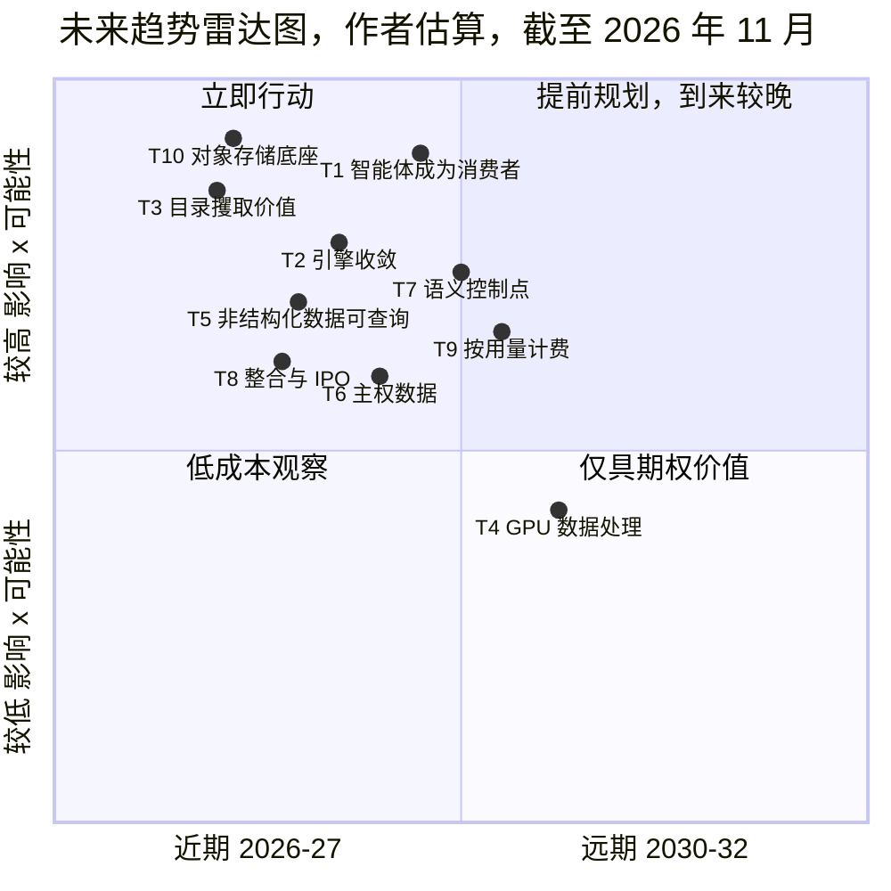
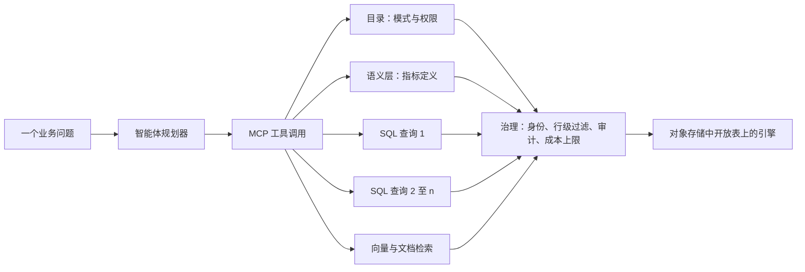

# 44. 未来趋势，2026–2032
> **深度：** L2 · **阅读时间：** 约 18 分钟 · **最后核实：** 2026-11-01 · **前置阅读：** [第 42 章 — 数据库简史](ch42-history-of-databases.md)，[第 43 章 — 现代数据栈](ch43-modern-data-stack.md)

## 要点速览（TL;DR）

- **本章核心论点：价值正在上移。** 存储字节与通用算力正变得更便宜、更可互换。价值正流向那些决定数据*含义*以及谁可以使用数据的层级：目录、语义上下文、数据治理（governance），以及消费数据的智能体（agent）。下文每一项预测都是作者的判断（**估算**）。每一项都锚定在第 1–4 部分已经给出出处的证据上，并附有一个证伪条件。
- **高可能性、近期的判断：** 智能体成为企业数据增长最快的消费者。OLTP、OLAP、向量与搜索持续向"Postgres + 湖仓一体（lakehouse）"平台收敛。Iceberg 成为默认的存储契约，而目录（catalog）攫取租金。对象存储（object storage）成为几乎所有引擎之下的底座。厂商在席位计费之外再加装按用量计费的计量器。
- **中等可能性的判断：** GPU 加速的 SQL 与 ETL 只会在少数大型作业中成为主流。数据主权（data sovereignty）需求增长，但其中大部分会流向超大规模云厂商的"主权云"，而不是本地部署（on-prem）。
- **与市场共识相反的判断：** 独立的向量数据库（vector database）不会成长为一个规模庞大的独立品类，SQL 也不会消失。智能体正在成为 SQL 的一个重要的新*编写者*（估算；尚无厂商披露其占比）。
- **对 Everpure 而言：** 胜算最高的几项趋势（对象存储作为底座、受治理的智能体访问、数据层的语义上下文）与公司的公开举措相吻合：Data Intelligence（1touch）、Data Stream，以及面向 Databricks Storage Ecosystem 的 OpenSharing 连接器（私有预览）。详细的选项分析见[第 45 章](ch45-storage-moving-up-the-stack.md)。

## 为何重要（商业 + Everpure 视角）

企业发展（corporate development）团队承保的是未来，而不是现在。一笔在 2027 年完成的收购，回报期在 2028–2032 年。今天签署的合作，取决于届时哪些平台仍然重要。本章把第 1–4 部分阐释的机制转化为十项预测。每一项都有可能性、时间窗口、赢家、输家、路标（signpost）和证伪条件（falsifier）。合在一起，它们构成一张读者可以按季度更新的记分卡，而不是一个需要去相信的故事。

对于一家正在向上层软件栈延伸的存储公司，利害关系非常具体。过去五年，基础设施层不断获得数据库特性：条件写入、托管表，以及对象存储本身内置的原生向量（[第 24 章](../03-ai-data-stack/ch24-data-meets-compute-and-storage.md)）。与此同时，其上方的平台已开始向下延伸，对本地数据进行就地治理。[^storage-eco] 有价值的问题不是存储是否重要，而是：存储厂商能够可信地拥有哪些软件层，哪些应通过合作获得，哪些应当回避。下文每项趋势都以一行 Everpure 启示收尾，并以"基于公开信息，战略团队可能评估的选项"的方式表述。

**如何阅读这些预测。** *可能性*是作者对该论点在其时间窗口结束前成立的主观概率：高（≥70%）、中（40–70%）、低（<40%）。*时间*是该论点在公开数据中变得可观测的时点：近期（2026–27）、中期（2028–29）或远期（2030–32）。所有可能性与时间均为估算。

## 工作原理

### 雷达图：一页纸看十大趋势

*图 44.1 — SV-17，未来趋势雷达图。横轴是该趋势在公开数据中变得可见的时间（左 = 2026–27，右 = 2030–32）。纵轴是对数据行业经济性的影响乘以可能性。左上象限是战略团队现在就应采取行动的区域。所有位置均为作者估算。*

这张雷达图有意做得粗糙。它按"对经济性的改变有多大"与"有多大可能发生"的乘积对趋势排序，并按证据何时变得具有决定性将其铺开。有两项趋势位于左上方，因为证据已经很强：对象存储作为底座（T10）和目录作为控制点（T3）。GPU 数据处理（T4）位置最低，因为其影响取决于一个尚未解决的瓶颈，即 I/O。

### 趋势 1 — 智能体成为主要的数据消费者

**论点。** 到 2029 年，针对受治理的企业数据存储的大多数查询和工具调用将由 AI 智能体发出。人类仍然设定意图，但大部分流量由机器生成。

**当下证据。** Anthropic 于 2025 年 12 月将[模型上下文协议](../glossary.md#model-context-protocol)（Model Context Protocol，MCP）捐赠给[智能体式 AI 基金会](../glossary.md#agentic-ai-foundation)（Agentic AI Foundation）时，MCP 的 SDK 月下载量超过 9,700 万次，活跃服务器超过 10,000 个（公司披露）。[^mcp-donate] Google 在 Next '26 上正式发布（GA）了面向 BigQuery 的远程 MCP 服务器。[^bq-mcp] Databricks 将 Unity AI Gateway 定位为智能体流量的治理工具。[^db-7b] 在写入侧，Neon 表示其超过 80% 的数据库由智能体创建（公司披露，2025 年 5 月）。[^neon-dbx]

**机制。** 一个人类问题会变成一串相互依赖的调用：模式查找、指标查询、下钻、检索与验证。智能体还会持续运行，而不只在办公时间工作。因此，即使是适度的采用也会使查询数量成倍增加。它还会把瓶颈从引擎吞吐量转移到上下文与治理。在同一配置下，文本转 SQL（text-to-SQL）的准确率从 Spider 1.0 上的 91.2% 跌至企业风格的 Spider 2.0 上的 21.3%，[^spider2] 因此赢家将是那些提供模式、含义和权限的系统，而不是仅仅快速执行 SQL 的系统。

*图 44.2 — 智能体查询扇出。一个问题变成许多受治理的调用，每一个调用都要通过身份、策略和成本控制。查询量成倍上升。价值位于目录、语义层和治理框中，而不仅仅在引擎里。*

**判断。** 可能性：高。"占查询大多数"的时间：中期（2028–29）。**赢家：** 拥有受治理目录与计量能力的平台（Databricks、Snowflake、超大规模云厂商）、ClickHouse 等低延迟引擎（[第 23 章](../03-ai-data-stack/ch23-real-time-analytics-htap.md)），以及"面向智能体的 Postgres"厂商。**输家：** 按席位计价的 BI 前端，以及为少量昂贵查询而定价的引擎。**路标：** 有厂商披露智能体在查询量或 DBU/credit 中的占比；Snowflake 和 Databricks 的托管 MCP 服务器达到 GA [VERIFY: GA 状态]；首次出现大规模公开的智能体数据外泄事件。**证伪条件：** 到 2028 年底，没有任何主要平台报告智能体占查询量的四分之一以上，或安全事件迫使企业把智能体限制在只读沙箱中。**Everpure 启示：** 智能体会产生大量小而突发的读取和短生命周期的数据库，因此值得评估的选项是将存储层与身份感知的访问控制和审计相结合，而不是去争夺智能体前端。
