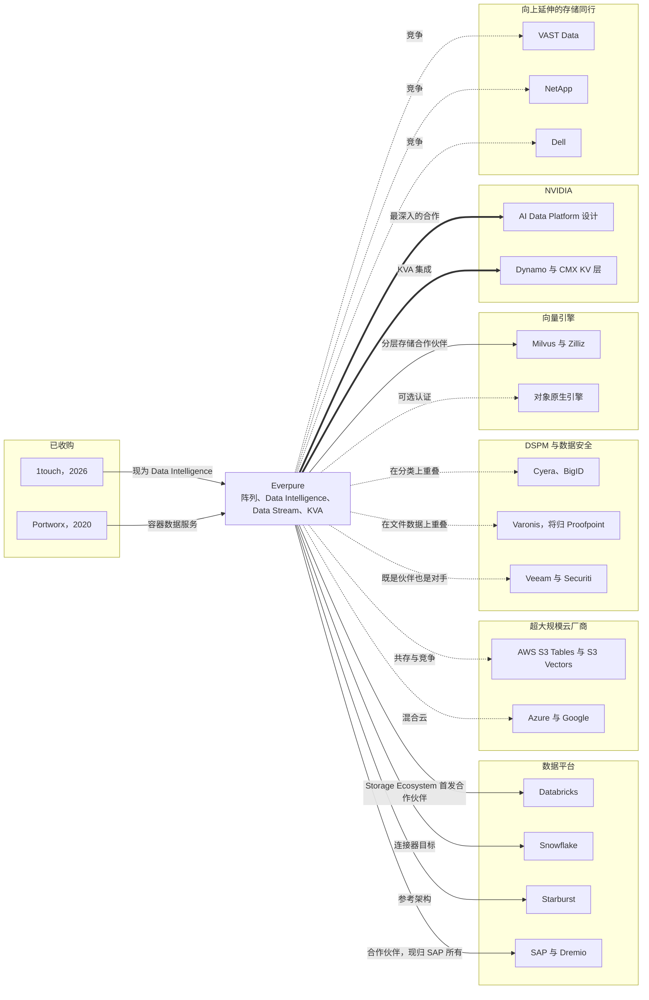
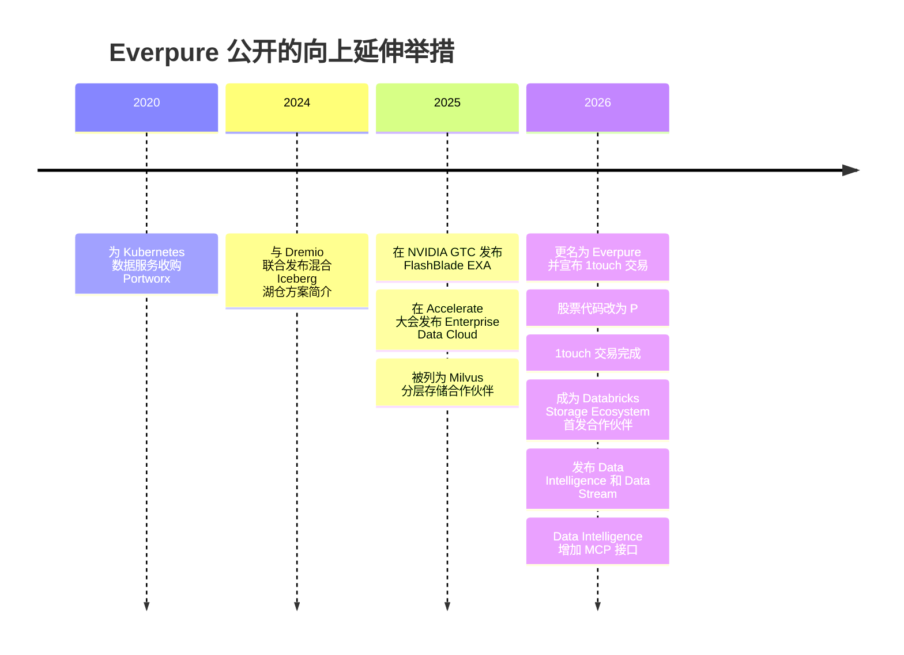

# 45. 对一家向上层延伸的存储公司意味着什么
> **深度：** L2 · **阅读时间：** 约 12 分钟 · **最后核实：** 2026-11-01 · **前置阅读：** [第 24 章 — 数据栈与计算和存储的交汇点](../03-ai-data-stack/ch24-data-meets-compute-and-storage.md)，[第 44 章 — 未来趋势](ch44-future-trends.md)

## 要点速览（TL;DR）

- **存储如今在四个地方与数据交汇：**[湖仓一体](../glossary.md#lakehouse)（lakehouse）底座（[对象存储](../glossary.md#object-storage)（object storage）上的开放表）、被 AI 检索和推理推到闪存上的向量层和 [KV 缓存](../glossary.md#kv-cache)（KV cache）层、元数据智能（数据发现、数据分类和语义上下文），以及网络弹性。每一个都是独立的市场，买家、合作伙伴和竞争对手各不相同。
- **Everpure 已公开的举措覆盖了七层技术栈中最底下的三层，以及向量/KV 层的一部分。** 它们包括 Enterprise Data Cloud 和智能控制平面（2025–26）、1touch（$125.0M 现金，2026-05-07 完成）即如今的 **Data Intelligence**、基于 NVIDIA 的 **Data Stream**（June 2026）、**Key-Value Accelerator（KVA）**，以及 Databricks Storage Ecosystem 的首发合作伙伴身份（2026-06-10）。引擎、目录和智能体平台仍是合作伙伴的领地。
- **每一家存储同行都在向上延伸，路径各不相同。** VAST 自建数据库和引擎。NetApp 打造了 AI Data Engine 并收购了 DataPelago。Dell 内嵌 Starburst 和 Elastic。Hammerspace 在其他厂商的存储之上销售元数据能力。Veeam 以 $1.725B 收购了 Securiti。这些路径的主要区别在于，各自愿意与 Databricks、Snowflake 和超大规模云厂商承受多大的[渠道冲突](../glossary.md#channel-conflict)（channel conflict）。
- **按层级划分的选项（仅基于公开信息）：** 在引擎层和目录层*合作*；在阵列已经能看到数据的地方（元数据、向量/KV 层）*自建或扩展*；在 Data Intelligence 周边*收购*小型能力；只在不会伤害合作伙伴的地方*竞争*。从 EMC–Greenplum（2010）到 NetApp–DataPelago（2026）的先例表明，收购整个引擎是风险最大的路径。
- **投资者将根据软件收入占比而非口号来评判这一举措。** 截至 Q2 FY2027，订阅 ARR 为 $2.1B（+20%），订阅服务约占季度收入的 42%（估算）。市值为 $43.79B，EV/未来 12 个月收入约 8.5x（2026-10-01）。这一倍数介于 NetApp 的约 5.1x 和 Rubrik 的约 16x 之间，而向上延伸的故事正是试图弥合这一差距。

## 为何重要（商业 + Everpure 视角）

一家始终只做存储的公司卖的是容量和性能。这是一门好生意，但市场按硬件为其定价：2026-10-01，NetApp 的企业价值（EV）/未来 12 个月收入约为 5.1x。而以备份副本为基础的数据安全公司 Rubrik 约为 16x。[^comps-peers] 这两个倍数之间的差距，正是本章每一则"向上层延伸"公告背后的经济奖赏。这也是为什么在这些公告体现为已报告的软件收入之前，投资者会对其打折扣。

Everpure（原 Pure Storage；NYSE: P，原代码 PSTG）把新名称定位为这一转型的信号。2026-02-23，公司更名，并宣布有意收购 1touch，这家公司的软件可以发现数据、对数据分类并为其添加语义上下文。公司表示，其目标是让客户从控制数据走向理解数据。[^ep-wwt] 股票代码于 2026-04-17 改为 P。[^ep-ticker] 在 2026 年 9 月的金融分析师会议上，公司将"现代数据软件"的总可服务市场（TAM）测算为到 FY2030 达 $22B（公司披露，转引自二手报道）[VERIFY: 在分析师日材料中确认]。[^ep-fam]

本章不重复讲解存储。它描绘存储与第 1–3 部分所述数据层和 AI 层的交汇之处，列出 Everpure 在每一层已公开宣布的内容，并与同行进行比较。随后，它列出战略团队可能评估的选项（基于公开信息）。其中没有任何内容描述 Everpure 的非公开计划。

## 工作原理

### 七层地图

从字节开始向上阅读这个技术栈。第 1–2 层是传统存储：介质、阵列和对象存储，然后是快照（snapshot）、复制（replication）和网络恢复等数据服务。第 3 层是元数据智能：知道数据是什么、是否敏感，以及它与其他数据有何关联。第 4–5 层是数据平台：开放表格式和目录（[第 7 章](../01-data-systems-foundations/ch07-open-table-formats.md)、[第 8 章](../01-data-systems-foundations/ch08-catalogs-and-metastores.md)），以及查询它们的引擎。第 6 层是 AI 检索：嵌入（向量）、向量索引，以及推理服务器从 GPU 显存中溢出的 KV 缓存。第 7 层是消费上述一切的应用和智能体。

*图 45.1 — Everpure 的公开宣布集中在存储层、元数据智能层以及向量/KV 层的一部分。表格式、引擎和智能体平台通过合作伙伴和连接器触达，而这条边界正是战略选择所在之处。来源：本章脚注。*

各层的价值并不相等。越往上，毛利率（gross margin）和估值倍数越高，但资金雄厚的在位者也越多。第 4–5 层是 Databricks（收入年化运行率 >$7B，公司披露，August 2026）和 Snowflake 交锋的地方[^db-7b]（[第 27 章](../04-company-deep-dives/ch27-databricks-vs-snowflake.md)）。第 3 层是 DSPM 和目录供应商以高价整合的地方（[第 33 章](../04-company-deep-dives/ch33-governance-catalog-security-companies.md)）。第 6 层仍在定义之中。

### 机会 1：湖仓底座

每一个湖仓都是构建在对象存储之上的一套软件栈（[第 24 章](../03-ai-data-stack/ch24-data-meets-compute-and-storage.md)）。超大规模云厂商花了五年时间，把数据库功能下沉到这一存储层。AWS 在 2024 年加入了条件写入，在存储桶内提供托管的 [Apache Iceberg](../glossary.md#apache-iceberg) 表（S3 Tables，December 2024），以及原生向量索引（S3 Vectors，December 2025 正式可用）。[^s3tables][^s3-vectors] 任何本地 S3 兼容平台如今都要以此为标杆接受评判。

Everpure 在这里的公开定位是合作。FlashBlade 有与 Dremio（现归 SAP 所有）和 Starburst 合作的 Iceberg 湖仓参考架构。[^dremio-pure][^starburst-ep][^sap-dremio] 当 Databricks 于 2026-06-10 宣布其 Storage Ecosystem 时，Everpure 与 MinIO 和 Qumulo 一同成为首发合作伙伴。[^storage-eco] 在该计划下，一个处于私有预览阶段的 OpenSharing 连接器让 Databricks 能够治理和查询存放在 Everpure 对象存储上的 Delta 和 Iceberg 表，而无需复制数据 [VERIFY: 正式可用状态]。[^everpure-os] 在 Snowflake 一侧，公开记录较少：Pure Storage 出现在 Snowflake 文档中自称已测试其产品的 S3 兼容厂商名单里（Snowflake 表示不对其进行认证），双方于 2022 年 5 月宣布了一项本地外部表解决方案。目前未发现 Snowflake 对 FlashBlade 的现行认证（[第 40 章](../05-business-and-economics/ch40-gtm-partnerships.md)）。[^sf-s3compat][^pure-sf] 对存储供应商而言，价值在于位置。受监管或涉及主权的数据留在本地，每个引擎都读取同一份副本。

### 机会 2：闪存上的向量层与 KV 层

两类 AI 工作负载已经从 DRAM 迁移到闪存。第一类是十亿规模的[近似最近邻](../glossary.md#approximate-nearest-neighbor)（ANN）检索。[DiskANN](../glossary.md#diskann) 论文用一台 64 GB 内存的工作站加一块 SSD 提供了十亿向量的检索服务，平均延迟低于 3 ms（作者的基准测试）。[^diskann] Milvus 2.6 加入了跨 RAM、SSD 和对象存储的[分层存储](../glossary.md#tiered-storage)（tiered storage），对该版本的报道将 Pure Storage 列为其存储合作伙伴之一。[^milvus26] 2026-06-17 发布的 Data Stream，让 Everpure 站到了同一工作负载的生产一侧。它利用 NVIDIA AI Data Platform 参考设计，筛选数据，在 FlashBlade 上借助 NVIDIA GPU 将其向量化，并施加流级别的访问控制。[^ep-ds][^aidp]

第二类工作负载是推理上下文。一个采用分组查询注意力的 70B 级模型，每个 token 约占用 0.33 MB 的 KV 状态，因此一百万 token 的上下文大约需要 330 GB（估算）。[^kv-math] 这超出了单块 GPU 的容量。NVIDIA 的 Dynamo 将 KV 块从 GPU 显存逐级下放到网络存储，而 NVIDIA 的 CMX 上下文内存平台则为此正式确立了一个闪存层。行业报道称 Dell、IBM、VAST 和 WEKA 是 CMX 的支持者。[^dynamo-kv][^nvidia-cmx] Everpure 的 KVA 与 Dynamo 集成，通过 NFS 和 S3 把可复用的提示词前缀保存在 FlashBlade 上（厂商声明）[VERIFY: 正式可用日期]。[^ep-kva] 这是所有向上延伸机会中最具存储原生属性的一个。但它也是由 NVIDIA 设定接口的一个，因此差异化必须来自延迟、密度和运维，而不是来自专有 API。

### 机会 3：元数据与数据智能

1touch 的逻辑分三步。**数据发现**（discovery）找到数据，无论它存放在哪里。**数据分类**（classification）标注数据是什么，包括敏感数据。**语义上下文**记录数据意味着什么，以及它与其他数据有何关联。输出是元数据，而元数据正是目录、策略引擎和智能体所消费的东西。Everpure 于 2026 年 6 月将 1touch 重新发布为 **Data Intelligence**。行业报道称，它可以跨 Everpure 阵列、第三方存储、公有云和 SaaS 工作而无需复制数据，其连接器包括 Databricks、Snowflake、Oracle 和 SQL Server。[^ep-cw][^ep-tz] 2026 年 10 月的一次更新增加了仅处理元数据的 File Edition 和一个[模型上下文协议](../glossary.md#model-context-protocol)（MCP）接口，使智能体可以直接查询元数据。[^ep-oct]

结构性论点是：存储系统能看到没有在任何目录中登记的副本，包括快照、克隆和临时卷（[第 15 章](../02-pipelines-and-governance/ch15-governance-security-privacy.md)）。反方论点是：分类只有在策略得到执行的地方才有意义。执行环节位于 Unity Catalog、Horizon、Purview 和身份系统中，而它们都自带分类器。因此，更可能胜出的设计是"在靠近字节处分类，把标签发布到执行发生的地方"，而不是一个与之竞争的控制台。

### 机会 4：与网络弹性相邻的领域

备份供应商从另一侧抵达了同一层。备份保存着所有数据的一份已建索引、带版本的副本，因此对其分类成本很低。Rubrik 于 2023 年 8 月收购了 Laminar（DSPM），交易条款未披露 [VERIFY: 一手新闻稿]。Veeam 于 2025 年 10 月宣布收购 Securiti，并于 2025 年 12 月以 $1.725B 完成交易，Securiti 的创始人出任 Veeam 安全与 AI 总裁。[^dspm-tuckins][^securiti] Everpure 的智能控制平面包括网络异常检测和合规报告。[^ep-cp] 结果是竞合关系（coopetition）。备份供应商在 Everpure 阵列上是合作伙伴，在数据智能领域则是竞争对手。双方都希望自己的标签成为记录系统。

> **类比：存储器厂商和 Arm 的向上延伸。** SK hynix 和 Samsung 把商品化的 DRAM 变成了 HBM，这是一种协同设计、纳入 NVIDIA 路线图销售的产品，而这一举措之所以提升了利润率，是因为平台所有者需要它。它们的存内处理产品（Samsung HBM-PIM、SK hynix AiM）则更进一步向上，把计算放在 DRAM 存储体旁边。采用进展缓慢，因为编程模型归主机厂商所有，软件必须重写（[存内计算](../glossary.md#compute-in-memory)）。Arm 从授权 IP 转向销售预集成的 Neoverse 计算子系统，以及有报道称它正在设计自己的芯片，则展示了另一种风险：向上延伸可能让你成为自己被授权方的竞争对手。[^tk-bridge] 对存储的启示是直接的。Data Stream 和 KVA 类似于 HBM，因为它们接入 NVIDIA 的参考设计。一个存储原生的数据库则类似于 PIM 或 Arm 自己的芯片：可能有价值，但需要合作伙伴改变行为或接受一个新的竞争对手。

## 设计选择与权衡

战略问题不是"要不要向上延伸"，而是*在哪一层采取何种姿态*。下面的矩阵列出了战略团队可能评估的选项（基于公开信息）。它并不描述 Everpure 的计划。

| 层级 | 合作 | 自建 / 扩展 | 收购 | 竞争 | 关键考量 |
|---|---|---|---|---|---|
| 对象存储底座 | 获得 Databricks、Snowflake、Starburst、SAP-Dremio 的认证 | 感知 Iceberg 的服务：REST 目录端点、表维护（如 S3 Tables 所做） | 很少需要；所需能力是工程能力而非 IP | 在价格和性能上与 VAST、NetApp、Dell、MinIO 和超大规模云厂商 S3 竞争 | 存储合作伙伴之间的转换成本低；发布条件写入和元数据基准测试 |
| 表与目录集成 | 推动 OpenSharing 连接器正式可用；与 Unity、Polaris、Horizon 集成 | 从 Data Intelligence 进行双向标签同步 | 仅在集成停滞时收购小型目录团队 | 避免：目录是平台的控制点 | 如果被视为竞争性目录，渠道风险很高 |
| 向量 / KV 层 | NVIDIA Dynamo 和 CMX；Milvus、LanceDB 类引擎 | KVA、Data Stream、闪存原生的索引服务 | 在检索或解析领域进行 1touch 规模的补强收购 | 在 KV 缓存层与 VAST、WEKA、DDN 竞争 | NVIDIA 设定接口；差异化在于延迟、密度和运维 |
| 分类 / 元数据智能 | 向 Collibra、Atlan、Cyera、BigID 输送标签 | 扩展 Data Intelligence 的覆盖范围和准确性 | 连接器或模型团队 | 在跨厂商元数据上与 Hammerspace 竞争 | 生产阵列上的扫描成本；对第三方存储的覆盖能力是差异化所在 |
| 数据治理 / DSPM | 与 DSPM 领导者和备份供应商合作 | 仅针对存储内数据提供态势视图 | 大型 DSPM 交易定价在 $1.7B–$6.3B（已披露交易金额） | 避免由 CISO 主导的正面竞争 | 买家不同（安全团队），销售模式也不同 |
| 语义层 / 智能体访问 | Open Semantic Interchange、目录语义 | 基于元数据的 MCP 接口（Oct 2026 已推出） | 不太可能需要 | 避免：语义归平台所有 | 智能体需要的是权限和上下文，而不是又一个 BI 层 |
| 数据移动 | Fivetran-dbt、Confluent（IBM）、Hammerspace | Fusion 工作负载迁移；Data Stream 数据管道 | 有选择地进行，如果出现从复制到数据管道的能力缺口 | 有限 | 竞争拥挤；价值在于感知策略的数据放置，而非通用 ETL |

*图 45.2 — 选项矩阵（仅基于公开信息）。姿态因层级而异：在平台拥有控制点的地方合作，在阵列已经能看到数据的地方自建，只在 Data Intelligence 周边收购小型能力。*

**渠道冲突是硬约束。** Databricks 的 Storage Ecosystem 列出了十家存储供应商，三家首发，七家随后跟进。[^storage-eco] 一家推出自有查询引擎或向量数据库的存储供应商，等于给了平台合作伙伴一个偏向其余九家的理由。VAST 接受这种风险，因为它想*成为* AI 数据平台本身。Dell 的做法是内嵌合作伙伴（Starburst、Elastic），而不是自建引擎。[^dell-aidp] Everpure 迄今的公开姿态是准备和理解数据、在引擎层开展合作，这使冲突保持在低水平。代价是第 3 层以上更多的价值流向了合作伙伴。

**各层所需的能力不同。** 第 1–2 层需要硬件和系统工程能力。第 3 层需要连接器广度、分类器准确性以及云/SaaS 交付能力。第 6 层需要 GPU 生态工程能力。向第 3 层及以上销售还会带来新的买家（数据、安全和 AI 平台团队）、按用量计费以及与合作伙伴的联合销售（co-sell）。1touch 交易买到的是一款产品和一批连接器，而不是一支安全销售团队。[^ep-10q]

*图 45.3 — 合作、竞争与收购地图。粗线表示最深入的公开合作关系（NVIDIA），实线表示已宣布的合作或收购，虚线表示重叠领域或可选项。仅基于公开信息。*

## 主要参与者

下面的比较保持中立，仅限于公开宣布的内容。其中几行依据的是 2025 年之前的知识，已作标注。

| 供应商 | 起点 | 向上延伸的举措（公开） | 路径 | 与 Everpure 的重叠 | 来源 |
|---|---|---|---|---|---|
| VAST Data | 软件定义全闪存 | VAST DataBase（表）、DataEngine（函数）、InsightEngine（与 NVIDIA 合作的嵌入）、"AI 操作系统" | 自建；以 $30B 估值融资 $1B（Apr 2026，公司披露） | 高：存储、向量、KV 层 | [^tk-vast][^vast-ie][^vast-f] |
| NetApp | 统一存储（ONTAP） | AFX 解耦式系统和 AI Data Engine（Oct 2025）；DataPelago GPU 数据处理（Jul 2026） | 自建加收购 | 高：存储、AI 数据准备 | [^netapp-aide][^datapelago] |
| Dell | 服务器和存储 | AI Data Platform，含 Starburst 分析引擎和 Elastic 搜索引擎、MCP 服务器（Oct 2025 宣布） | 合作并内嵌 | 高：存储；在 Starburst 上存在合作伙伴重叠 | [^dell-aidp] |
| DDN | HPC 并行文件系统 | 面向 AI 的 Infinia 对象存储 | 自建 | 中：AI 存储 | [^tk-weka-ddn] |
| Hammerspace | 运行在他人存储之上的软件 | 全局命名空间和元数据驱动的数据放置 | 自建；估值 >$500M（Apr 2025，公司披露） | 中：跨厂商元数据 | [^hammerspace-b][^tk-hammerspace] |
| WEKA | 并行文件系统 | NeuralMesh 平台；被列为 KV 卸载的 CMX 支持者 | 自建 | 中：KV 层 | [^tk-weka-ddn][^nvidia-cmx] |
| Cohesity | 备份 | 与 Veritas 数据保护业务合并（Dec 2024 完成）；基于备份的 AI 搜索 | 通过收购扩大规模 | 中：基于副本的数据智能 | [^cohesity][^tk-backup-ai] |
| Rubrik | 备份与网络恢复 | Laminar DSPM（2023）；基于备份副本的 AI 数据访问 | 收购加自建 | 中：数据分类 | [^dspm-tuckins][^tk-backup-ai] |
| Veeam | 备份 | Securiti（$1.725B，Dec 2025 完成）：DSPM、隐私、AI 治理 | 收购 | 中高：数据分类、数据治理 | [^securiti] |
| Everpure（参照） | 闪存阵列、订阅 | EDC、控制平面、Data Intelligence（1touch）、Data Stream、KVA | 自建加收购，在上层合作 | — | [^ep-edc][^ep-cp][^ep-10q][^ep-ds][^ep-kva] |

*图 45.4 — 可比公司。出现了三条路径：自建平台（VAST）、内嵌合作伙伴（Dell），或收购数据安全软件（Veeam、Rubrik）。NetApp 和 Everpure 则把自建与小型收购结合起来。来源中标注为训练知识的行需要重新核实 [VERIFY: VAST、WEKA、DDN、Hammerspace 及备份供应商的 AI 功能细节]。*

各同行在中立性上也有差别。Hammerspace 和 Everpure 的 Data Intelligence 都声称能在客户已有的存储（包括竞争对手的阵列）上创造价值。VAST 的引擎主要运行在 VAST 上。Veeam 的 Securiti 既能处理备份，也能处理主存储和 SaaS 数据，因此它与存储侧的分类争夺同样的标签。[^securiti]

## 历史与发展轨迹

存储供应商以前就尝试过这条路，结果好坏参半。EMC 于 2010 年收购 Greenplum，以进军分析型数据库。Greenplum 于 2013 年被并入 Pivotal，并于 2015 年开源。Hitachi Data Systems 于 2015 年收购 Pentaho，后来将其并入 Hitachi Vantara。在这家 Hadoop 发行商濒临关闭后，HPE 于 2019 年收购了 MapR 的资产。[^ma-csv] 那些交易买下的是整个引擎，并要求存储销售团队去销售它们。2023–2026 年的交易规模更小，也更贴近阵列：数据分类、数据保护和就地处理。

| 日期 | 收购方 → 标的 | 金额（口径） | 启示 |
|---|---|---|---|
| 2010-07 | EMC → Greenplum | 未披露 | 整体引擎收购在存储销售模式下举步维艰；后被分拆 |
| 2015-02 | Hitachi Data Systems → Pentaho | 未披露 | 把 OEM 工具收归旗下；保留品牌，并入 Vantara |
| 2020-09 | Pure Storage → Portworx | 约 $370M 现金（公司宣布） | 面向 Kubernetes 的数据服务；至今仍是 Everpure 的一项业务 |
| 2023-08 | Rubrik → Laminar | 未披露 | 首个从备份走向 DSPM 的举措 |
| 2024-06 | Databricks → Tabular | 约 $2B（媒体报道） | 表格式的控制权对平台而言价值数十亿 |
| 2025-12 | Veeam → Securiti | $1.725B（已披露） | 数据保护厂商买下一个完整的数据智能平台 |
| 2026-05 | Everpure → 1touch | $125.0M 现金（GAAP） | 小型、相邻、迅速产品化（六周即重新发布） |
| 2026-05 | SAP → Dremio | 未披露 | 存储合作伙伴的引擎合作伙伴可能被应用厂商买走 |
| 2026-07 | NetApp → DataPelago | 未披露 | 存储内 GPU 数据处理 |
| 2026-10 | Proofpoint → Varonis | 交易价值约 $6.3B；股权价值约 $5.71B（已披露，待完成） | DSPM 整合按规模定价 |

*图 45.5 — 来自 `data/ma_deals.csv` 的先例交易。近期与存储相邻的交易规模更小，紧贴阵列；而引擎和目录的控制权则以数十亿美元的价格流向了平台。[^ma-csv][^securiti][^varonis-8k][^ep-10q][^datapelago]*

*图 45.6 — Everpure 已宣布的举措集中在 2025–2026 年，此前十年，产品一直是阵列和 Evergreen 订阅模式。来源：本章脚注。[^ma-csv][^dremio-pure][^ep-edc][^milvus26][^ep-wwt][^ep-ticker][^ep-10q][^storage-eco][^ep-ds][^ep-oct]*

发展轨迹有三条主线。超大规模云厂商不断把表语义和向量语义拉进对象存储，这抬高了本地存储的门槛。NVIDIA 不断标准化 AI 数据路径（AI Data Platform、Dynamo、CMX），这奖励那些选择接入而非另起炉灶的存储供应商。安全和备份供应商不断收购数据分类能力，因此元数据智能领域正在迅速变得拥挤。[第 44 章](ch44-future-trends.md)把这些主线放进了更广阔的未来趋势图景中。

## 投资者会关注的 KPI 与路标

| KPI 或路标 | 最新公开数值 | 口径 | 为何重要 |
|---|---|---|---|
| 订阅 ARR | $2.1B，+20%（Q2 FY2027）；$1.924B，+16%（FY2026 年末） | 公司披露的 KPI | 软件附加销售必须推动增长的经常性收入基础 |
| 订阅服务占收入比例 | 约占 Q2 FY2027 的 42%（约 $1.19B 中的 $499M）；Q4 FY2026 约 40% | 基于 GAAP 数据的估算 | 产品收入激增时会下降；要看趋势，而不是单个季度 |
| 剩余履约义务（RPO） | $4.1B（Q2 FY2027）；$3.7B，+40%（FY2026） | GAAP | 已签约的未交付合同，含订阅 |
| 毛利率 | GAAP 68.4% / 非 GAAP 69.9%（Q2 FY2027） | GAAP / 非 GAAP | 软件占比提升应会逐步推高毛利率 |
| Data Intelligence 和 Data Stream 附加率 | 未披露 | — | 最能证明上层需求的指标；关注首次披露 |
| Data Intelligence 中第三方存储的占比 | 未披露 | — | 检验它是中立产品还是阵列附属功能 |
| 合作伙伴里程碑 | OpenSharing 连接器处于私有预览阶段（Jun 2026） | 厂商声明 | 正式可用、联合销售和 Snowflake 认证是下一批路标 |
| 估值差距 | EV/未来 12 个月收入约 8.5x，对比 NetApp 约 5.1x、Rubrik 约 16x（2026-10-01 至 10-26） | 估算，基于指引的未来 12 个月收入 | 估值重估将表明投资者接受了软件故事 |

*图 45.7 — KPI 与路标。目前的披露显示的是订阅基础，而不是新数据软件的附加销售情况。第一个明确的附加率或软件 ARR 数据将是关键路标。[^ep-q2][^ep-q4][^comps-peers][^everpure-os]*

解读收入结构数字时要谨慎。Q2 FY2027 收入增长 38%（GAAP），产品收入（$687M）增速快于订阅服务。[^ep-q2] 在产品强劲的季度里订阅占比下降，并不能作为反对软件战略的证据。但这确实意味着，仅凭总体 ARR 无法判断 Data Intelligence 是否卖得好。能说明问题的是[附加率](../glossary.md#attach-rate)（attach rate）、数据软件的[净收入留存率](../glossary.md#net-revenue-retention)（NRR），以及卖给数据或安全买家的交易占比。这些目前都没有披露。

## 关键数字

| 指标 | 数值 | 口径 | 来源 / 日期 |
|---|---|---|---|
| Everpure 市值 / EV | $43.79B / $43.01B | 市场数据 | `public_comps.csv`，2026-10-01[^ep-comps] |
| Everpure EV/未来 12 个月收入 | 约 8.5x | 估算；未来 12 个月收入 = FY2027 指引中值 | `public_comps.csv`，2026-10-01[^ep-comps] |
| FY2027 收入指引 | $5.03–5.07B（中值 $5.05B） | 公司指引（FY2027 ≈ Feb 2026–Jan 2027） | Q2 FY2027 新闻稿，2026-08[^ep-q2] |
| FY2026 收入 | >$3.6B，+16% | GAAP（FY2026 ≈ Feb 2025–Feb 1 2026） | Q4 FY2026 新闻稿，2026-02[^ep-q4] |
| 订阅 ARR | $2.1B，+20% | 公司披露的 KPI，Q2 FY2027 | Q2 FY2027 新闻稿[^ep-q2] |
| Q2 FY2027 收入 / 产品 / 订阅服务 | 约 $1.19B / $687M / $499M | GAAP | Q2 FY2027 新闻稿[^ep-q2] |
| FY2026 自由现金流（FCF） | $616M | 非 GAAP | Q4 FY2026 新闻稿[^ep-q4] |
| 1touch 对价 | $125.0M 现金；约占市值 0.3% | GAAP（10-Q）；比率为估算 | 10-Q，2026-06[^ep-10q] |
| 现代数据软件 TAM | 到 FY2030 达 $22B，CAGR 26% | 公司披露，转引自二手报道 [VERIFY] | 分析师会议，2026-09-23[^ep-fam] |
| Veeam–Securiti | $1.725B（约为 1touch 价格的 14 倍） | 已披露；比率为估算 | Business Wire，2025-12-11[^securiti] |
| Proofpoint–Varonis | 交易价值约 $6.3B（股权价值约 $5.71B） | 已披露，待完成（预计 1H 2027 完成） | 8-K，2026-10-15[^varonis-8k] |
| VAST Data 估值 | 投后估值 $30B | 公司披露，约一半为老股转让 | Apr 2026[^vast-f] |
| 70B 级模型上 1M token 的 KV 缓存 | 约 330 GB | 估算 | 作者测算[^kv-math] |

*图 45.8 — 与同行的数据智能交易相比，1touch 交易规模很小。这与"自建加合作"的姿态相符，而不是试图买下一个平台。*

## 存储桥接

> **存储桥接。** 上述所有向上延伸的选项，都依赖于本图谱不再重复讲解的存储特性：湖仓提交所需的 S3 条件写入正确性和元数据延迟、驻留闪存的 ANN 索引所需的小块随机读尾延迟、KV 缓存重新加载所需的持续吞吐量，以及以较低生产影响进行分类所需的快照和元数据访问能力。配套的 *Everpure Tech Atlas* 介绍了 FlashBlade、FlashArray 和协议细节。这里的要点是：第 3 层到第 6 层的每一款产品，其可信度都来自与合作伙伴共同发布的第 1 层基准测试。

## 对话手册

**向产品经理提出的问题**

1. "哪些 Data Intelligence 部署覆盖了非 Everpure 存储？有多大比例的客户是从这里起步，而不是从 Everpure 阵列起步？"
2. "当客户运行 Unity Catalog 或 Horizon 时，我们的分类结果最终落在哪里？由谁来执行？"
3. "对于 KVA 和 Data Stream，客户最先要求哪些 NVIDIA 参考设计认证？我们与 CMX 合作伙伴相比如何？"

**向工程师提出的问题**

1. "一次全量分类扫描相比增量扫描，对生产性能的代价是多少？采样是如何调优的？"
2. "对于 KV 缓存重新加载，把前缀放在 FlashBlade 上与重新计算相比，p99 首 token 时间分别是多少？在什么并发水平下？"
3. "在并发提交的情况下，OpenSharing 连接器为 Iceberg 和 Delta 读取提供的一致性保证，是否与云对象存储相同？"

**好的回答听起来是什么样的。** 它们会区分集成（与某个产品的连接器）和合作关系（联合工程与联合销售）。它们引用印有合作伙伴名字的基准测试。它们把分类描述为向执行点输送的数据，而不是一个与之竞争的控制台。在经济性方面，它们会区分订阅 ARR（其中包括 Evergreen 硬件订阅）与无需 Everpure 阵列即可销售的软件。

**不要这样说**

- "Everpure 正在变成像 Databricks 那样的数据平台。"它的公开举措止步于引擎层之下，并与 Databricks 合作。
- "Data Intelligence 取代了 DSPM 工具。"它在数据发现和数据分类上有重叠，但 DSPM 供应商向安全团队销售的是态势管理和修复。
- "订阅 ARR 证明了软件战略。"ARR 包括存储即服务；数据软件的附加销售并未披露。
- "存储公司收购软件总是失败。"EMC–Greenplum 确实举步维艰，但 Portworx 和 1touch 规模更小、更相邻，且已产品化。
- "KV 缓存卸载是 Everpure 自己的标准。"接口由 NVIDIA 定义（Dynamo、CMX）；存储供应商在其框架内竞争。

## 深入阅读

- [第 24 章](../03-ai-data-stack/ch24-data-meets-compute-and-storage.md)介绍湖仓对对象存储的要求，[第 18 章](../03-ai-data-stack/ch18-embeddings-and-vector-search.md)介绍 DiskANN 和驻留闪存的向量索引。
- [第 15 章](../02-pipelines-and-governance/ch15-governance-security-privacy.md)介绍数据发现和数据分类数据管道的工作方式，[第 33 章](../04-company-deep-dives/ch33-governance-catalog-security-companies.md)介绍 DSPM 和目录供应商。
- [第 32 章](../04-company-deep-dives/ch32-ai-native-data-companies.md)介绍 VAST、Hammerspace 和 AI 原生数据公司；[第 39 章](../05-business-and-economics/ch39-ma-history.md)介绍完整的并购历史；[第 40 章](../05-business-and-economics/ch40-gtm-partnerships.md)介绍存储与平台的合作关系如何销售。
- NVIDIA 的 Dynamo KV 缓存管理器文档，了解存储必须满足的分层接口。[^dynamo-kv]

## 关键术语

- [向上层延伸](../glossary.md#moving-up-the-stack)（Moving up the stack）— 从较低层级（如存储）扩展到其上方价值更高的软件层。
- [数据智能](../glossary.md#data-intelligence)（Data intelligence）— 发现数据、对数据分类并为其添加语义上下文，使其他工具和智能体能够使用这些数据的软件。
- [数据发现](../glossary.md#data-discovery)（Data discovery）— 跨系统查找和盘点数据。
- [数据分类](../glossary.md#data-classification)（Data classification）— 按类型和敏感度为数据打标签。
- [数据安全态势管理](../glossary.md#data-security-posture-management)（DSPM）— 将数据分类与访问权限和暴露情况结合起来、对数据风险进行排序的工具。
- [网络弹性](../glossary.md#cyber-resilience)（Cyber resilience）— 主要通过受保护的副本，检测、抵御勒索软件等攻击并从中恢复的能力。
- [湖仓一体](../glossary.md#lakehouse)（Lakehouse）— 基于对象存储上开放表格式的数据仓库级管理。
- [Apache Iceberg](../glossary.md#apache-iceberg) — 湖仓数据领域领先的开放表格式。
- [OpenSharing](../glossary.md#opensharing) — 用于就地共享表的开放协议，被 Databricks Storage Ecosystem 采用。
- [近似最近邻](../glossary.md#approximate-nearest-neighbor)（Approximate nearest neighbor）— 以少量召回率换取大幅加速的向量检索。
- [DiskANN](../glossary.md#diskann) — 基于图的 ANN 索引，旨在从 SSD 提供十亿规模的向量检索服务。
- [分层存储](../glossary.md#tiered-storage)（Tiered storage）— 根据访问频率把数据放置在内存、闪存和对象存储层。
- [KV 缓存](../glossary.md#kv-cache)（KV cache）— 存储的注意力键和值，使模型无需重新计算之前的 token。
- [KV 缓存卸载](../glossary.md#kv-cache-offload)（KV-cache offload）— 将 KV 缓存块从 GPU 显存移到 CPU 内存、本地闪存或网络存储以供复用。
- [模型上下文协议](../glossary.md#model-context-protocol)（Model Context Protocol）— 将 AI 智能体连接到工具和数据源的开放协议。
- [存内计算](../glossary.md#compute-in-memory)（Compute-in-memory）— 把处理单元放在存储器旁边，以避免数据移动。
- [渠道冲突](../glossary.md#channel-conflict)（Channel conflict）— 当供应商的产品与转售或集成该产品的合作伙伴竞争时产生的摩擦。
- [竞合](../glossary.md#coopetition)（Coopetition）— 公司之间同时合作与竞争。
- [附加率](../glossary.md#attach-rate)（Attach rate）— 同时购买附加产品的客户或交易所占比例。
- [订阅 ARR](../glossary.md#subscription-arr)（Subscription ARR）— Everpure 自行定义的、来自订阅产品的年化经常性收入。
- [软件收入占比](../glossary.md#software-mix)（Software mix）— 来自软件和订阅（而非硬件）的收入所占比例。
- [净收入留存率](../glossary.md#net-revenue-retention)（Net revenue retention）— 现有客户群当前收入与一年前相比的比率。

## 资料来源

[^db-7b]: Databricks, "Databricks Grows >80% YoY, Surpasses $7B Revenue Run-Rate, Scales Lakebase, Genie and Unity AI Gateway," https://www.databricks.com/company/newsroom/press-releases/databricks-grows-80-yoy-surpasses-7b-revenue-run-rate-scales，发布于 2026-08-13；检索于 2026-11-01（同第 25 章所引）。公司披露的年化运行率，未经审计。
[^comps-peers]: AI Data Atlas 数据集 `data/public_comps.csv`，NetApp（EV/未来 12 个月收入 5.1x，截至 2026-10-01）、Rubrik（16.0x，截至 2026-10-26）、Commvault 和 Varonis 各行，引用 https://stockanalysis.com/stocks/ntap/financials/ratios/ 和 https://stockanalysis.com/stocks/rbrk/market-cap/；检索于 2026-11-01。未来 12 个月收入采用指引或 TTM 作为替代（估算）。
[^ep-wwt]: World Wide Technology（转载 Pure Storage 新闻稿）, "Pure Storage rebrands to Everpure and announces intent to acquire 1touch," https://www.wwt.com/news/pure-storage-rebrands-to-everpure-and-announces-intent-to-acquire-1touch，发布于 2026-02-23；检索于 2026-11-01。
[^ep-ticker]: Everpure press release, "Everpure to change ticker symbol," https://www.purestorage.com/company/newsroom/press-releases/everpure-to-change-ticker-symbol.html，发布于 2026-04-07（2026-04-17 生效）；Nasdaq，2026-04-07；检索于 2026-11-01（来自 `meta/research-briefing.md`）。
[^ep-fam]: NAND Research, "Everpure investor day: Pure's four-vector push beyond enterprise storage," https://nand-research.com/everpure-investor-day-pures-four-vector-push-beyond-enterprise-storage/，发布于 2026-09（会议日期 2026-09-23）；检索于 2026-11-01，来自 `data/ch41_market_sizes_additions.csv`。公司披露的 TAM，转引自二手报道（来源较弱）[VERIFY: 在金融分析师会议材料中确认]。
[^s3tables]: AWS News Blog, "New Amazon S3 Tables: Storage optimized for analytics workloads," https://aws.amazon.com/blogs/aws/new-amazon-s3-tables-storage-optimized-for-analytics-workloads/，发布于 2024-12-03；检索于 2026-11-01。
[^s3-vectors]: AWS News Blog, "Top announcements of AWS re:Invent 2025," https://aws.amazon.com/blogs/aws/top-announcements-of-aws-reinvent-2025，发布于 2025-12；Blocks & Files, "AWS piles on S3 upgrades from vector search to 50 TB objects," https://www.blocksandfiles.com/ai-ml/2025/12/03/aws-piles-on-s3-upgrades-from-vector-search-to-50-tb-objects/1704690，发布于 2025-12-03；检索于 2026-11-01。
[^dremio-pure]: Dremio 合作伙伴页面, https://www.dremio.com/partners/pure-storage/，无日期；Pure Storage/Dremio solution brief, https://dremio.com/wp-content/uploads/2024/10/Dremio-Pure-Storage-Solutions-Brief-1.pdf，发布于 2024-10；检索于 2026-11-01（来自 `meta/research-briefing.md`）。
[^starburst-ep]: Everpure 合作伙伴页面, "Starburst," https://www.everpuredata.com/la/partners/technology-alliance-partners/starburst.html，无日期；检索于 2026-11-01（来自 `meta/research-briefing.md`）。
[^sap-dremio]: Dremio newsroom, "SAP to Acquire Dremio…," https://www.dremio.com/newsroom/sap-to-acquire-dremio-to-unify-sap-and-non-sap-data-to-power-agentic-ai/，发布于 2026-05-04；CIO.com, https://www.cio.com/article/4166881/sap-to-acquire-data-lakehouse-vendor-dremio.html，2026-05；检索于 2026-11-01。交易条款未披露；据 `meta/research-briefing.md`，约于 2026 年 7 月完成。
[^storage-eco]: Databricks blog, "Announcing the Databricks Storage Ecosystem: Governing the Enterprise Data Estate Wherever It Lives," https://www.databricks.com/blog/announcing-databricks-storage-ecosystem-governing-enterprise-data-estate-wherever-it-lives，发布于 2026-06-10；StorageNewsletter, https://www.storagenewsletter.com/2026/06/24/announcing-the-databricks-storage-ecosystem-governing-the-enterprise-data-estate-wherever-it-lives/，2026-06-24；检索于 2026-11-01。
[^everpure-os]: Everpure blog, "Everpure OpenSharing Connector," https://blog.everpuredata.com/products/everpure-opensharing-connector/，发布于 2026-06；检索于 2026-11-01（同第 25 章所引）。厂商声明；自 2026-06-09 起处于私有预览 [VERIFY: 正式可用状态]。
[^sf-s3compat]: Snowflake 文档, "Work with Amazon S3-compatible storage," https://docs.snowflake.com/en/user-guide/data-load-s3-compatible-storage，持续更新文档；检索于 2026-11-01（同第 40 章所引）。厂商名单为厂商自报的测试结果，并非 Snowflake 认证。
[^pure-sf]: Blocks & Files, "Pure gets FlashBlade up close and cloud-adjacent co-lo personal with Snowflake," https://blocksandfiles.com/2022/05/11/pure-gets-flashblade-up-close-and-cloud-adjacent-co-lo-personal-with-snowflake/，发布于 2022-05-11；Snowflake blog, "Now in Private Preview: Using On-Premises Data in Place with Snowflake," https://www.snowflake.com/en/blog/external-tables-on-prem/，2022-06；检索于 2026-11-01（同第 40 章所引）。
[^diskann]: S. Jayaram Subramanya, Devvrit, R. Kadekodi, R. Krishnaswamy, H. V. Simhadri, "DiskANN: Fast Accurate Billion-point Nearest Neighbor Search on a Single Node," NeurIPS 2019, https://papers.nips.cc/paper/2019/hash/09853c7fb1d3f8ee67a61b6bf4a7f8e6-Abstract.html，发布于 2019-12；检索于 2026-11-01。作者的基准测试。
[^milvus26]: Zilliz, "Milvus 2.6: Built for Scale, Designed to Reduce Costs," https://zilliz.com/news/milvus-2-6-built-for-scale-designed-to-reduce-costs，发布于 2025-06-12；BigDATAwire, "Zilliz Releases Milvus 2.6 with Tiered Storage and Int8 Compression to Cut Vector Search Costs," https://www.bigdatawire.com/this-just-in/zilliz-releases-milvus-2-6-with-tiered-storage-and-int8-compression-to-cut-vector-search-costs，发布于 2025-06；检索于 2026-11-01。存储合作伙伴名单（Cohesity、Pure Storage、MinIO、NetApp）依据该报道。
[^ep-ds]: Everpure via PR Newswire, "Everpure Unveils Data-Primacy Architecture for the AI Era," https://www.prnewswire.com/news-releases/everpure-unveils-data-primacy-architecture-for-the-ai-era-302803097.html，发布于 2026-06-17；Everpure newsroom, "Everpure Announces Data Stream," https://www.everpuredata.com/company/newsroom/press-releases/everpure-announces-data-stream.html，发布于 2026-06-17；SiliconANGLE, https://siliconangle.com/2026/06/17/everpure-accelerates-ai-workloads-data-stream-unveils-data-primacy-architectural-vision/，2026-06-17；检索于 2026-11-01。
[^aidp]: StorageNewsletter, "NVIDIA GTC 2025: Pure Storage Integrates NVIDIA AI Data Platform into FlashBlade," https://www.storagenewsletter.com/2025/03/19/nvidia-gtc-2025-pure-storage-integrates-nvidia-ai-data-platform-into-flashblade/，发布于 2025-03-19；检索于 2026-11-01。
[^kv-math]: 作者估算（非厂商数据）：每 token 的 KV 字节数 = 2（K 和 V）× 80 层 × 8 个 KV 头 × 128 头维度 × 2 字节（FP16）≈ 327,680 字节 ≈ 0.33 MB，采用公开的 Llama-3-70B 类分组查询注意力维度；× 1,000,000 token ≈ 328 GB。与第 19 章的估算一致。计算于 2026-11-01。
[^dynamo-kv]: NVIDIA, "Dynamo Distributed KV Cache Manager," https://docs.nvidia.com/dynamo/latest/architecture/kv_cache_manager.html，持续更新文档；检索于 2026-11-01。
[^nvidia-cmx]: NVIDIA, "CMX context memory storage platform," https://www.nvidia.com/en-us/data-center/ai-storage/cmx/，持续更新文档；Blocks & Files, "Nvidia standardizes GPU cluster KV cache offload to NVMe SSDs," https://blocksandfiles.com/2026/01/06/nvidia-standardizes-gpu-cluster-kv-cache-offload-to-nvme-ssds/，发布于 2026-01-06；检索于 2026-11-01。合作伙伴名单依据行业报道。
[^ep-kva]: Everpure blog, "Pure KVA integrates NVIDIA Dynamo for scalable, low-latency LLM inference," https://blog.everpuredata.com/news-events/pure-kva-integrates-nvidia-dynamo-for-scalable-low-latency-llm-inference/，以及 "Everpure KVA Meets FlashBlade//EXA," https://blog.everpuredata.com/purely-technical/everpure-kva-meets-flashblade-exa-enterprise-kv-caching-at-neocloud-scale/，发布于 2025–2026；检索于 2026-11-01（同第 19 章所引）。厂商声明 [VERIFY: Dynamo 集成的正式可用日期，据报道为 Feb–Apr 2026]。
[^ep-cw]: Computer Weekly, "Everpure aims to bridge AI data gap with Universal Data Intelligence," https://www.computerweekly.com/news/366644438/Everpure-aims-to-bridge-AI-data-gap-with-Universal-Data-Intelligence，发布于 2026-06；检索于 2026-11-01。
[^ep-tz]: Techzine, "Stop vectorizing garbage: inside Everpure's smart AI data pipeline," https://www.techzine.eu/blogs/infrastructure/144105/stop-vectorizing-garbage-inside-everpures-smart-ai-data-pipeline/，发布于 2026-06；检索于 2026-11-01。连接器名单是集成清单，并非已宣布的合作关系。
[^ep-oct]: HPCwire/AIwire, "Everpure enhances Data Intelligence to bolster customer AI projects," https://www.hpcwire.com/aiwire/2026/10/07/verpure-enhances-data-intelligence-to-bolster-customer-ai-projects/，发布于 2026-10-07；检索于 2026-11-01（行业媒体）。
[^dspm-tuckins]: Rubrik–Laminar（2023-08 宣布，交易条款未披露），依据交易追踪网站摘要 https://www.privsource.com/acquisitions/deal/3ASll0（来源较弱）和 `data/ma_deals.csv`；检索于 2026-11-01 [VERIFY: Rubrik–Laminar 一手新闻稿]。
[^securiti]: Veeam via Business Wire, "Veeam Completes Acquisition of Securiti AI to Create the Industry's First Trusted Data Platform for Accelerating Safe AI at Scale," https://www.businesswire.com/news/home/20251211040418/en/Veeam-Completes-Acquisition-of-Securiti-AI-to-Create-the-Industrys-First-Trusted-Data-Platform-for-Accelerating-Safe-AI-at-Scale，发布于 2025-12-11；检索于 2026-11-01。已披露 $1.725B；据 `data/staging/ch39-ma_deals.csv`，于 2025-10-21 宣布。
[^ep-cp]: Blocks & Files, "Everpure extends data and control planes for agentic AI," https://www.blocksandfiles.com/data-management/2026/06/17/everpure-extends-data-and-control-planes-for-agentic-ai/5257407，发布于 2026-06-17；TechTarget, "7 highlights from Pure Accelerate 2026," https://www.techtarget.com/it-infrastructure/opinion/7-highlights-from-Pure-Accelerate-2026，发布于 2026-06；检索于 2026-11-01。
[^tk-bridge]: Samsung HBM-PIM（2021 年发布）、SK hynix GDDR6-AiM（2022）、Arm Neoverse Compute Subsystems（2023），以及有关 Arm 正在设计自有芯片的媒体报道（2025）；训练知识（2025 年年中之前），未于 2026-11-01 重新核实 [VERIFY: 各项的一手公告]。
[^dell-aidp]: ITPro, "Dell Technologies just announced a major data platform overhaul – here's what customers can expect," https://itpro.com/infrastructure/dell-technologies-touts-major-data-platform-overhaul-with-nvidia-elastic-and-starburst-collaborations，发布于 2025-10；SiliconANGLE, https://siliconangle.com/2025/10/22/dell-unveils-ai-platform-unlock-enterprise-data-ai-era-dellaidataplatform/，发布于 2025-10-22；Blocks & Files, https://www.blocksandfiles.com/ai-ml/2025/10/22/dell-expands-ai-data-platform-with-search-analytics/1607930，发布于 2025-10-22；检索于 2026-11-01。Data Analytics Engine 的 MCP 服务器计划于 Feb 2026 推出，Data Search Engine 计划于 1H 2026 推出（发布时的厂商声明）。
[^ep-10q]: Everpure, Inc., Form 10-Q for the quarter ended 2026-05-03, SEC EDGAR, https://www.sec.gov/Archives/edgar/data/0001474432/000147443226000061/pstg-20260503.htm，发布于 2026-06；Cleary Gottlieb, "Everpure Completes Acquisition of 1touch," https://www.clearygottlieb.com/news-and-insights/news-listing/everpure-completes-acquisition-of-1touch，发布于 2026-05-11；检索于 2026-11-01。所述现金对价为 $125.0M，可能根据调整和托管安排变动；2026-05-07 完成。
[^tk-vast]: VAST Data 产品公告：VAST DataBase（2023）、DataEngine 以及"AI 操作系统"定位（2025）；训练知识（2025 年年中之前），未于 2026-11-01 重新核实 [VERIFY]。
[^vast-ie]: VAST Data, "VAST Data Unveils VAST InsightEngine with NVIDIA," press release, https://www.vastdata.com/press-releases/vast-data-unveils-vast-insightengine-with-nvidia，发布于 2024-10-01；检索于 2026-11-01。
[^vast-f]: AI Data Atlas 数据集 `data/private_funding.csv`，VAST Data F 轮一行（以 $30B 投后估值融资 $1B，公司披露，约一半为老股转让），引用 Quartz, https://qz.com/nvidia-vast-data-series-f-billion-valuation-042226，发布于 2026-04-22；检索于 2026-11-01。
[^netapp-aide]: Blocks & Files, "NetApp disaggregates ONTAP storage and provides an AI Data Engine," https://blocksandfiles.com/2025/10/14/netapp-disaggregates-ontap-storage-and-provides-an-ai-data-engine/，发布于 2025-10-14；TechTarget, https://www.techtarget.com/searchstorage/news/366632757/NetApp-adds-AI-Data-Engine-expands-Nvidia-partnership，2025-10；检索于 2026-11-01。
[^datapelago]: NetApp press release, "NetApp Acquires DataPelago, Making Data AI-Ready at the Infrastructure Layer," https://www.netapp.com/en/newsroom/press-releases/news-rel-20260716-210092/，发布于 2026-07-16；检索于 2026-11-01。交易条款未披露。
[^tk-weka-ddn]: WEKA 更名为 NeuralMesh（2025）及 DDN Infinia 对象存储；训练知识，未于 2026-11-01 重新核实 [VERIFY]。
[^hammerspace-b]: NAND Research, "Research note: Hammerspace $100M Series B to accelerate AI infrastructure growth," https://nand-research.com/research-note-hammerspace-100m-series-b-to-accelerate-ai-infrastructure-growth/，发布于 2025-04；检索于 2026-11-01。估值"超过 $500M"，公司披露。
[^tk-hammerspace]: Hammerspace 技术资料（全局数据平台，使用标准 Linux pNFS 客户端在现有存储之上进行元数据驱动的数据放置）；训练知识（2025 年年中之前），未于 2026-11-01 重新核实 [VERIFY]。
[^cohesity]: Cohesity 关于完成与 Veritas 数据保护业务合并的新闻稿, https://www.cohesity.com/press/，发布于 2024-12-10；检索于 2026-11-01（依据 `data/ma_deals.csv`；合并后公司估值 >$7B，并非交易价格）。
[^tk-backup-ai]: Cohesity Gaia（基于备份数据的 AI 搜索，2024）以及 Rubrik 基于备份副本的 AI 数据访问功能（2024–2025）；训练知识，未于 2026-11-01 重新核实 [VERIFY: 当前产品名称和状态]。
[^ep-edc]: Blocks & Files, "Pure Storage Enterprise Data Cloud," https://blocksandfiles.com/2025/06/18/pure-storage-enterprise-data-cloud/，发布于 2025-06-18；IT Brief UK, "Pure Storage unveils Enterprise Data Cloud…," https://itbrief.co.uk/story/pure-storage-unveils-enterprise-data-cloud-flash-upgrades，2025-06；检索于 2026-11-01。
[^ma-csv]: AI Data Atlas 数据集 `data/ma_deals.csv`，包括 EMC–Greenplum（2010-07-06）、Hitachi Data Systems–Pentaho（2015-02-10）、HPE–MapR（2019-08-05）、Pure Storage–Portworx（2020-09-16 宣布；据 Pure Storage 公告约 $370M 现金；为 2025 年前确定的公开记录，审阅者已核定，2026-11-01）、Rubrik–Laminar、Databricks–Tabular（约 $2B，媒体报道，TechCrunch 2024-08）和 SAP–Dremio 各行；各行来源列于 CSV 中（例如 EMC 新闻稿 https://corporate.delltechnologies.com/en-us/newsroom/announcements/2010/07/20100706-01.htm）；检索于 2026-11-01。
[^varonis-8k]: Varonis Systems, Inc., Form 8-K Exhibit 99.1, SEC EDGAR, https://www.sec.gov/Archives/edgar/data/0001361113/000121390026109901/ea030861001ex99-1.htm，发布于 2026-10-15；检索于 2026-11-01。每股 $49.75 现金；预计 1H 2027 完成。
[^ep-q2]: Everpure, "Everpure Announces Second Quarter Fiscal 2027 Financial Results," https://investor.everpuredata.com/news-and-events/press-releases/press-release-details/2026/Everpure-Announces-Second-Quarter-Fiscal-2027-Financial-Results/default.aspx，发布于 2026-08-26；检索于 2026-11-01（数值依据 `data/company_financials.csv`）。Q2 FY2027 = May–Aug 2 2026。订阅服务占比（约 42%）为我们的估算：$499M ÷ 约 $1.19B。
[^ep-q4]: Everpure, Q4 FY2026 earnings press release (8-K Ex. 99.1), https://www.sec.gov/Archives/edgar/data/1474432/000147443226000015/pstg-ex991q4fy2026.htm，发布于 2026-02-25；检索于 2026-11-01。FY2026 收入 >$3.6B（+16%），订阅 ARR $1.924B，RPO $3.7B，FCF $616M（非 GAAP）；Q4 订阅服务 $440M，占约 $1.1B 收入的约 40%（我们的估算）。
[^ep-comps]: AI Data Atlas 数据集 `data/public_comps.csv`，Everpure 一行：市值 $43.79B，EV $43.01B，EV/未来 12 个月收入约 8.5x，截至 2026-10-01，来自 https://stockanalysis.com/stocks/p/financials/ratios/；检索于 2026-11-01。1touch 比率：$125.0M ÷ $43.79B ≈ 0.3%（估算）。
