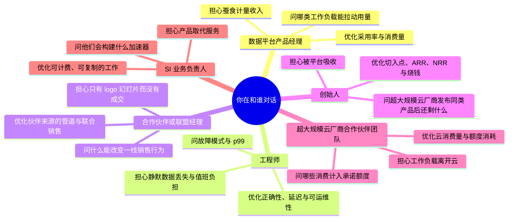
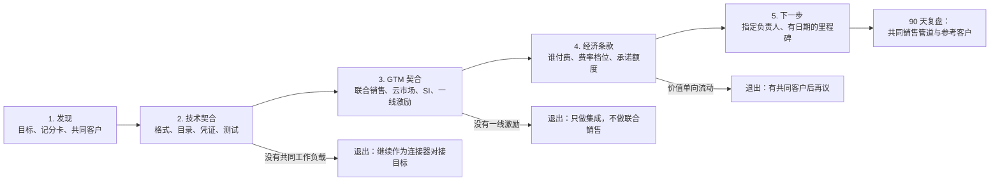

# 46. 与数据平台产品经理、工程师、合作伙伴和创始人对话
> **深度：** L2 · **阅读时间：** 约 17 分钟 · **最后核实：** 2026-11-01 · **前置阅读：** [第 27 章 — Databricks 对比 Snowflake](../04-company-deep-dives/ch27-databricks-vs-snowflake.md)，[第 36 章 — 单位经济与 KPI](../05-business-and-economics/ch36-unit-economics-kpis.md)，[第 40 章 — 市场进入与合作伙伴](../05-business-and-economics/ch40-gtm-partnerships.md)，[第 45 章 — 存储向上层软件栈延伸](../06-history-and-future/ch45-storage-moving-up-the-stack.md)

## 要点速览（TL;DR）

- **每一类角色都因优化不同的东西而获得报酬。** 数据平台产品经理（PM）的考核看采用率和消费量；工程师看正确性、延迟和可运维性；合作伙伴经理看销售管道（pipeline）和联合销售（co-sell）；创始人看切入点（wedge）、ARR、NRR、烧钱速度和下一轮融资；超大规模云厂商的合作伙伴团队看云消费量和承诺消费额度（committed spend）的消耗；系统集成商（SI）业务负责人看可计费、可复制的服务。问每个人他们负责的那个数字，并用他们的单位来问。
- **对话有其弧线。** 一场合作洽谈会从发现需求推进到技术契合，再到市场进入（GTM）契合，然后是经济条款，最后是一个具体的下一步。大多数失败的合作洽谈要么跳过技术契合、直接谈客户 logo，要么跳过经济条款，最终变成一个没人去卖的集成。
- **好的回答有共同的质感。** 它们先给定义再给数字，标明口径（GAAP、公司披露的年化运行率、估算），点明取舍，并承认短板。闪烁其词的回答会偷换单位、引用匿名客户，或回答另一个问题。
- **少数几个术语错误会在几秒钟内让你丧失可信度。** 把 Iceberg 称为数据库、把年化运行率当作收入引用、把向量数据库等同于 RAG、把零 ETL（zero-ETL）理解为"没有数据管道"、把湖仓一体（lakehouse）称为"不过是个数据湖"——每一个都会让技术型听众意识到你是从新闻稿里学到这个领域的。
- **把存储专长当作手术刀，而不是讲座。** 一个关于条件写入、小文件、元数据延迟或出口流量费（egress fees）的精准问题，比花五分钟讲闪存介质更能赢得尊重。作为 Everpure 的从业者，请坚持使用公开定位：Enterprise Data Cloud、Data Intelligence（源自 1touch）以及 Databricks Storage Ecosystem 首发合作伙伴身份。绝不暗示非公开计划。

## 为何重要（商业 + Everpure 视角）

企业发展工作主要就是对话。一份合作条款书、一笔少数股权投资或一宗收购，都始于一连串会议，你在会上试图弄清三件事：这个团队真正相信什么？他们因做什么而拿报酬？当你们的利益与他们的利益出现分歧时，他们会怎么做？本章之前的 45 章为你提供了内容。本章讲的是：在对方比你更懂技术的会议室里，如何运用这些内容。

利害关系很大，因为数据行业依赖的是没人审计的数字，以及每隔几个月就会变化的术语。Databricks 报告称其公司披露的收入年化运行率超过 $7B，同比增长超过 80%（2026 年 8 月）。[^db-7b] 其最近一次披露的全年收入约为 $2.6B，对应截至 2025 年 1 月的财年，该数字为媒体报道。[^cnbc-25] Snowflake 126% 的净收入留存率（net revenue retention，NRR）是一个过去 12 个月的客户群比率，而不是增长率。[^sf-q2] 产品名称可能在两次会议之间就变了：Snowflake Intelligence 于 2026 年 6 月更名为 Snowflake CoWork（[第 26 章](../04-company-deep-dives/ch26-snowflake.md)）。如果你引用了错误的口径或旧名称，对话就会悄然从同行对同行变成厂商对潜在客户，你也就再听不到有用的信息了。

对 Everpure 而言，这一视角十分具体。Pure Storage 于 2026 年 2 月 23 日更名为 Everpure，并于同日宣布收购 1touch。[^ep-wwt] 公司现以 NYSE: P 交易。[^ep-ticker] 1touch 于 2026 年 5 月 7 日以 $125.0M 现金完成交割（GAAP，依据 10-Q）。[^ep-10q] 2026 年 6 月 10 日，Everpure 被列为 Databricks Storage Ecosystem 的首发合作伙伴，其 OpenSharing 连接器处于私有预览阶段（厂商披露）。[^storage-eco][^everpure-os] 一家正向上层软件栈延伸的公司（[第 45 章](../06-history-and-future/ch45-storage-moving-up-the-stack.md)）中的战略从业者，将不断与数据平台产品经理、联盟团队和创始人打交道。他们每个人都会掂量：一家存储公司究竟是合作伙伴、渠道，还是未来的竞争对手。你的用词和你的问题，就是他们做判断的依据。

## 每类角色如何思考

在任何会议之前，先弄清对方的记分卡。人们回答问题的方式，会保护他们赖以获得报酬的那个指标。了解这个指标，你就能读出回答中刻意略去的部分。

*图 46.1 — 每类角色优化不同的指标，也担心不同的失败。正确的问题瞄准的是对方实际负责的那个指标。*

**数据平台产品经理。** 在 Databricks、Snowflake 或超大规模云厂商，产品经理的功能按采用率（活跃账户、工作区、查询）来评判，并且越来越多地按其在公司计量器上带来的消费量来评判：DBU、credit 或 slot（[第 35 章](../05-business-and-economics/ch35-business-models.md)）。这造成了一种不寻常的张力。一项降低客户账单的性能改进实际上就是降价，产品经理必须论证需求弹性会把收入赚回来。产品经理还要面对[功能吸收](../glossary.md#feature-absorption)（feature absorption）：他们的路线图就是一份他们打算让其变得多余的初创公司名单。在合作会议中，产品经理只在问一个问题：你的产品是让客户在我的平台上运行更多工作负载，还是把工作负载从我的平台上拉走？如果你无法用他们的单位回答这个问题，你就只是一个 logo，而不是合作伙伴。

**工程师。** 工程师的考核——无论是否正式——看的是正确性、延迟和可运维性。正确性意味着系统在并发和故障下兑现其承诺：提交是原子的，删除确实删除了，"恰好一次"确实是恰好一次。延迟指的是[尾延迟](../glossary.md#tail-latency)（tail latency），即真实并发下的 p99，而不是空闲集群上的平均值。可运维性意味着升级、可观测性、值班负担和故障影响范围。工程师不信幻灯片，而信测试套件、事故故事和代码。赢得他们尊重的最快方式是问一个故障模式（"当两个写入方通过不同目录向同一张 Iceberg 表提交时会发生什么？"）。索要基准测试则要慢得多。

**合作伙伴或联盟经理。** 联盟团队的考核指标包括伙伴来源的销售管道（由伙伴发起的交易）、伙伴影响的销售管道（伙伴参与过的交易）、联合销售登记、云市场（marketplace）交易、完成的认证以及可作参考的共同客户（[第 40 章](../05-business-and-economics/ch40-gtm-partnerships.md)）。他们的结构性问题在于，他们并不掌控一线销售。一个消耗工程时间、产出一篇新闻稿、却没有改变销售行为的合作，是他们的噩梦，也是你的噩梦。问一问什么能让他们的销售把你带进交易。答案通常是配额认定，而不是技术上的优雅。

**创始人。** 数据基础设施创始人以 18 到 24 个月为周期思考，这个周期受资金跑道约束。其记分卡包括切入点（产品比任何人都做得更好的第一项细分工作）、ARR 及其增长、净收入留存率、烧钱速度与烧钱倍数（burn multiple），以及下一轮融资的故事。最根本的恐惧是被平台吸收：Databricks、Snowflake 或 AWS 把这一切入点作为免费功能推出。AWS 在 re:Invent 2025 上推出了 S3 Vectors，这正是那种会让一家向量数据库初创公司不得不重写融资叙事的事件。[^s3-vectors] 创始人通常是对战略最坦率、而对指标定义最不精确的角色。你的任务是在不破坏关系的前提下，让他们严守定义。

**超大规模云厂商的合作伙伴团队。** AWS、Microsoft 和 Google 的合作伙伴团队按云消费量拿报酬。云市场私有报价、联合销售赢单以及对客户承诺额度（[EDP](../glossary.md#edp)、[MACC](../glossary.md#macc)）的消耗是主要渠道（[第 28 章](../04-company-deep-dives/ch28-hyperscaler-data-platforms.md)）。他们在 Databricks 与 Snowflake 之间比外人预想的更中立，因为无论哪个平台胜出，超大规模云厂商都能赚到基础设施收入和云市场费用。对于本地部署的存储厂商，他们的兴趣更窄。他们想要的是最终落到自家云上的混合和迁移工作负载，并对任何把数据留在云外的东西保持警惕。

**SI 业务负责人。** 在系统集成商（Accenture、Deloitte、精品数据咨询公司）中，业务负责人的考核指标是可计费利用率、业务线收入、持证人数和合作伙伴等级。可复制的服务最为重要：一个迁移工厂或一个行业加速器可以卖五十次。Accenture 于 2025 年 12 月成立了专门的 Snowflake 业务集团，并于 2026 年 3 月扩大了与 Databricks 的联盟，两者均为公司披露。[^acn-sf][^acn-dbx] 每一步都表明业务负责人预期可计费工作将出现在哪里。SI 会问：你的产品是创造服务工作（迁移、数据治理、AI 数据管道），还是消除服务工作？消除服务工作的产品只会得到礼貌的会面，而不会有销售管道。

| 角色 | 主要记分卡 | 典型盲点 | 可信度"货币" | 延伸阅读章节 |
|---|---|---|---|---|
| 数据平台产品经理 | 采用率、计量器上的消费量、附加率 | 夸大其目录对合作伙伴的中立性 | 他们的单位（DBU、credit）、当前产品名称 | [第 25 章](../04-company-deep-dives/ch25-databricks.md)，[第 26 章](../04-company-deep-dives/ch26-snowflake.md) |
| 工程师 | 正确性、p99 延迟、值班负担 | 低估 GTM 与定价的现实 | 精准的故障模式问题 | [第 3 章](../01-data-systems-foundations/ch03-database-internals.md)，[第 7 章](../01-data-systems-foundations/ch07-open-table-formats.md) |
| 合作伙伴 / 联盟经理 | 伙伴来源与伙伴影响的管道、联合销售、认证 | 把集成当作合作关系 | 来源 vs 影响；伙伴计划等级 | [第 40 章](../05-business-and-economics/ch40-gtm-partnerships.md) |
| 创始人 | 切入点、ARR、NRR、烧钱倍数、下一轮融资 | 指标定义松散；低估被吸收风险 | 严格区分 ARR 与年化运行率；熟悉许可证 | [第 36 章](../05-business-and-economics/ch36-unit-economics-kpis.md)，[第 38 章](../05-business-and-economics/ch38-open-source-strategy.md) |
| 超大规模云厂商合作伙伴团队 | 云消费量、云市场、承诺额度消耗 | 只把本地部署当作迁移来源 | 云市场费率档位、EDP/MACC 规则 | [第 28 章](../04-company-deep-dives/ch28-hyperscaler-data-platforms.md) |
| SI 业务负责人 | 可计费利用率、可复制服务、合作伙伴等级 | 优化服务量，而非客户的总拥有成本（TCO） | 了解有哪些加速器 | [第 40 章](../05-business-and-economics/ch40-gtm-partnerships.md)，[第 43 章](../06-history-and-future/ch43-modern-data-stack.md) |

*图 46.2 — 角色记分卡。读每一个回答时都要看它在保护什么：产品经理保护计量收入，联盟经理保护管道认定，创始人保护下一轮融资。*

## 问题集

下面的矩阵是一页纸版本。随后的四个小节给出完整的问题集及其背后的理由。[第 48 章](ch48-question-bank.md)收录了带标签的问题库，[第 47 章](ch47-diligence-checklist.md)则把尽职调查（due diligence）问题整理成一份清单。

| 角色 | (a) 合作洽谈 | (b) 技术尽职调查 | (c) 创始人 / 投资 | (d) 客户背调 |
|---|---|---|---|---|
| 数据平台产品经理 | 我们的集成会加速你们路线图上的哪些事项，又会与哪些事项竞争？ | 哪些 API 足够稳定、可以在其上构建，哪些在最近两个版本中发生了变化？ | 哪些初创公司的切入点在你们未来 12 个月的路线图上？ | 你们最大的客户实际启用了哪些伙伴集成？ |
| 工程师 | 目录在我们的存储上治理什么：权限、数据血缘、审计？ | 给我看证明两个并发提交中恰好一个胜出的测试。 | 在数据量或租户数增加 10 倍时，什么最先出问题？ | 生产环境中出过什么故障，厂商修复得有多快？ |
| 合作伙伴经理 | 什么会让你们的一线销售把合作伙伴带进交易？ | 哪套认证测试、哪些版本、最近一次重新认证是哪天？ | 目前哪些合作伙伴为你们带来销售管道，各占多少？ | 是谁引荐了这家厂商：平台销售、SI 还是直接接触？ |
| 创始人 | 如果平台推出了你们的功能，你们还能卖什么？ | 云基础设施占销售成本（COGS）的多少，它如何随规模变化？ | 请定义 ARR、NRR 客户群和烧钱倍数。 | 按今天的价格，你还会再买一次吗？ |
| 超大规模云厂商团队 | 通过云市场购买我们的产品，能否消耗 EDP 或 MACC？ | 产品必须调用哪些托管服务，出口流量费是多少？ | 对处于这一阶段的公司，哪些云市场销售模式转化最好？ | 这次采购是否消耗了现有的承诺额度？ |
| SI 业务负责人 | 你们会基于这个集成构建什么可复制的服务？ | 部署需要多少名持证顾问？ | 哪些数据厂商为你们创造的服务工作最多？ | 上线实际花了多少 SI 工时，与计划相比如何？ |

*图 46.3 — 问题集矩阵。每个单元格都瞄准该角色在这类对话中负责的那个数字。*

### (a) 与 Databricks、Snowflake 及超大规模云厂商的合作洽谈

合作对话有一条可预测的弧线，最常见的失败是跳过某个阶段。下面的流程图展示了各个阶段及其退出匝道。退出并不等于失败。"只做集成，不做联合销售"是一个完全不错的结果，前提是双方都明确说出来。

*图 46.4 — 合作弧线。每个阶段都有一个坦诚的退出口，90 天复盘检查的是销售管道和参考客户，而不是新闻稿。*

**发现。** 从对方的记分卡开始，而不是从你的推介开始。问一问哪些共同客户已经同时运行两家的产品，以及这些客户在抱怨什么。对 Databricks，问 Storage Ecosystem 打算如何扩大 Unity Catalog 对云外数据的覆盖。[^storage-eco] 对 Snowflake，问外部卷上的 Iceberg 表在一年后会如何影响客户的消费量（[第 26 章](../04-company-deep-dives/ch26-snowflake.md)）。对超大规模云厂商，问其一线团队今年在追逐哪些混合工作负载。

**技术契合。** 这是你证明自己值得第二次会面的环节。问一问支持哪些表格式及版本、凭证在哪里分发、查询是下推还是全量扫描，以及哪个目录是记录系统（system of record）（[第 8 章](../01-data-systems-foundations/ch08-catalogs-and-metastores.md)）。问一问"认证"是什么意思。Snowflake 的文档列出了兼容 S3 的存储厂商（其中包括 Pure Storage），但说明 Snowflake 本身并不测试或验证第三方产品，当前页面要求存储提供商提供"Snowflake S3-compatible tested and compliant"服务。[^sf-s3compat] 声称"Snowflake 认证了我们"的合作伙伴，要么是搞错了，要么是在宽泛地使用这个词。

**GTM 契合。** 问一问什么会改变一线行为：上架、验证，还是联合销售登记。问一问伙伴来源的交易是否计入平台销售的配额。除了等级之外，也要问一问表彰计划。例如，MinIO 被评为 Databricks 2026 年度 ISV 存储合作伙伴，[^minio-poy] 这能告诉你联盟团队奖励的是什么。

**经济条款。** 问清楚谁付钱给谁、怎么付。在 AWS Marketplace 上，私有报价的上架费为：合同金额低于 $1M 的部分收 3%，$1M 至低于 $10M 收 2%，$10M 及以上以及续约收 1.5%。[^aws-fees] 真正的经济性在于承诺额度消耗和联合销售配额认定。Snowflake 表示其一年内的 AWS Marketplace 销售额超过 $2B（公司披露，合同总额）。[^sf-aws-2b] 问一问你的报价是否符合承诺额度抵扣条件，以及按什么比例抵扣。

**下一步。** 每次会议都以指定负责人和有日期的里程碑收尾：一份联合参考架构、一个共同客户试点，或针对平台下一个版本的重新认证。"保持联系"意味着这条弧线停在了第三阶段。

### (b) 对数据基础设施初创公司的技术尽职调查

尽职调查是术语转化为风险评估的地方。按照各领域导致交易失败的频率顺序，逐一过以下六个方面。

1. **并发下的正确性。** "给我看证明两个并发提交中恰好一个胜出的测试，以及你们用它发现的 bug。"在对象存储上构建产品的团队，应当能流利地谈论[条件写入](../glossary.md#conditional-write)（conditional write）和乐观并发控制（[第 7 章](../01-data-systems-foundations/ch07-open-table-formats.md)）。
2. **真实负载形态下的性能。** "给我你们最大客户的并发度、其数据规模、开启过滤条件时的 p99。"厂商在空闲集群上做的基准测试说明不了多少问题（[第 5 章](../01-data-systems-foundations/ch05-analytical-engines.md)）。
3. **服务成本。** "云基础设施占销售成本的多少？毛利率在你们最小档和最大档之间如何变化？"转售算力的按用量计费业务，可能在结构上毛利率偏低（[第 36 章](../05-business-and-economics/ch36-unit-economics-kpis.md)）。
4. **可运维性。** "谁负责值班？上个季度告警响了多少次？最严重的事故是什么？"一个说不出任何事故的团队，要么没有在规模化场景下交付过产品，要么不够坦诚。
5. **依赖与许可证。** "关键路径上有哪些开源组件，采用什么许可证？你们是否对自己的代码持有贡献者许可协议（CLA）？"SSPL 并未获得 OSI 批准；MongoDB 于 2019 年 3 月将其从 OSI 审核中撤回。[^osi-sspl] 某个依赖项更换许可证，可能会变成你的问题（[第 38 章](../05-business-and-economics/ch38-open-source-strategy.md)）。
6. **相对平台的路线图。** "你们的哪些功能出现在某个平台的公开路线图上？"这是下文"被吸收"问题的技术版本。

### (c) 与创始人的对话

与创始人的会面，最好是以真诚的好奇心提出一连串尖锐问题。有五个话题最重要。

**切入点。** "你们做的哪项工作，即使你们别的什么都不做，买家也愿意为之付费？"好的切入点细分、痛点明确且可衡量：高并发下的实时分析、连接器维护、权限感知的检索。模糊的切入点（"AI 数据平台"）意味着公司尚未找到第一个市场。

**护城河与平台吸收。** "如果 Databricks、Snowflake 或 AWS 下个季度免费推出你们的核心功能，你们还能卖什么？"好的回答会指向平台在结构上不擅长的东西：跨多个平台的中立性、在某一项高难度工作负载上的深度，或对目录这类控制点（control point）的掌控。历史在这里很有参考价值。Databricks 在 2024 年以媒体报道的约 $2B 收购 Tabular，是因为该格式的创建者本身就是一个控制点，[^tabular] 而许多单一功能工具则直接被吸收了（[第 43 章](../06-history-and-future/ch43-modern-data-stack.md)）。

**开源战略。** "哪些是开源的，哪些是专有的，这条界线在两年内移动过吗？商标归谁所有？"创始人应当把社区采用和收入区分开，并解释为什么超大规模云厂商托管的版本不会抢走他们的客户（[第 38 章](../05-business-and-economics/ch38-open-source-strategy.md)）。

**计价单位与云 COGS。** "你们计量什么，为什么选这个单位？什么能防止客户钻空子？每一美元收入中有多少流向 AWS？"计价单位决定了效率提升是让利给客户还是由公司留存。云账单决定了增长是改善还是恶化毛利率（[第 35 章](../05-business-and-economics/ch35-business-models.md)）。

**指标与下一轮融资。** "请定义 ARR。它是合同金额，还是年化用量？NRR 使用哪个客户群？你们的烧钱倍数是多少，下一轮融资要支撑到哪个里程碑？"用一个公开的锚点。ClickHouse 报告的公司披露 ARR 超过 $250M，[^ch-arr] 对应的是 2026 年 1 月媒体报道的 $15B 估值。[^ch-seriesd] 同时说出这两个数字及其口径，表明你懂得估值与收入之间的区别。

### (d) 客户背调电话

厂商挑选的参考客户，是厂商预先排练过的参考客户。你的目标是越过剧本，触及实际操作者的体验。要求与日常运维该系统的人交谈，而不只是高管发起人。提开放式问题，并留意具体细节。

- "你们替换了什么，当时还考虑过哪些方案？"这能揭示真正的竞争对手集合。
- "你们是怎么采购的：直接、通过云市场，还是通过 SI？是否消耗了现有的云承诺额度？"这能检验 (a) 节中的 GTM 说法。
- "头 90 天里出了什么故障，厂商是如何响应的？"事故故事的质量比没有事故更重要。
- "上线以来你们的月度账单如何变化，为什么？"随价值增长的按用量账单是健康的。随低效增长的账单则是潜在的流失。
- "如果这家厂商明天消失，你们需要多长时间才能迁走？"这是锁定问题，而且有现实先例。OpenAI 在 2024 年收购 Rockset 后，该托管服务被关停，其客户只得迁往别处。[^rockset]
- "按今天的价格，你们还会再买一次吗？"

在这些电话中要严守商业纪律。除了已经商定的内容外，不要透露你所在公司的意图，也不要分享其他方在保密协议（NDA）下告诉你的任何信息。

## 强回答与弱回答的信号

无论角色如何，强回答都有共同的质感。它们先给定义再给数字，标明口径，点明取舍，并主动说出发言者自己公司做得不好的一件事。闪烁其词的回答也有其质感：单位在句子中途变了、客户是匿名的、问题在另一个抽象层次上被回答，或者"在路线图上"却不附带具体季度。

| 问题 | 强回答听起来像 | 闪烁其词的回答听起来像 | 你的追问 |
|---|---|---|---|
| "你们如何定义所披露的年化运行率？" | "最近一个季度的收入乘以四；其中包含按用量消费，所以会随使用量波动。" | "这是我们的年化数字，大致与 ARR 一致。" | "是季度 × 4 还是期末月 × 12？是否包含基础设施转嫁成本？" |
| "哪个目录治理共享表？" | "Unity Catalog 是记录系统；Snowflake 通过 Iceberg REST 读取，只有表级授权。" | "我们完全开放，所以任何目录都可以。" | "哪些策略会随表一起流转，哪些止步于边界？" |
| "你们的 p99 是多少？" | "在 2 TB 工作集、每秒 400 次查询时为 38 ms；超过 1,000 次后因合并压力而下降。" | "大多数查询亚秒级。" | "在什么并发度和数据规模下，使用哪些过滤条件？" |
| "如果 AWS 推出这个，你们还卖什么？" | "跨云中立性和治理平面；我们最大的客户同时运行三朵云。" | "我们好十倍，他们追不上。" | "如果 AWS 的版本免费，哪个客户会留下来，为什么？" |
| "'认证'是什么意思？" | "我们在 X 版本上通过了他们公开的兼容性测试套件，并于 7 月重新认证。" | "我们是顶级合作伙伴，完全通过认证。" | "由谁认证，依据哪项测试，在哪一天？" |
| "NRR 的趋势如何？" | "过去 12 个月、按金额计算为 118%；总留存率 95%；连续四个季度持平。" | "业界最佳，远高于 120%。" | "哪个客户群、哪个时间窗口，总留存率是多少？" |

*图 46.5 — 好回答与闪烁其词的回答。强回答一栏给出定义、标明口径并承认局限。闪烁其词的一栏偷换单位或抽象层次。强回答一栏中的答案仅为示例，并非引用任何公司的说法。*

## 危险信号

有些回答应当改变你对这笔交易的看法，而不只是多一个追问。下表列出了数据基础设施对话中最常见的危险信号。

| 危险信号 | 为何重要 | 追问 | 延伸阅读 |
|---|---|---|---|
| 把年化运行率当作收入引用，且没有定义 | 年化运行率可能把峰值月份年化，并包含转嫁成本 | 索要计算公式以及最近一个经审计或已披露的财年 | [第 36 章](../05-business-and-economics/ch36-unit-economics-kpis.md) |
| 引用 NRR 却不说明客户群或时间窗口 | 同一批客户在不同定义下可得出差异很大的 NRR | 询问客户群规则和总留存率 | [第 36 章](../05-business-and-economics/ch36-unit-economics-kpis.md) |
| 所谓"合作"只是一个连接器上架 | 没有一线激励就没有销售管道 | 询问伙伴来源管道的占比和一个共同赢单 | [第 40 章](../05-business-and-economics/ch40-gtm-partnerships.md) |
| 只有厂商自己在空闲集群上做的基准测试 | 客户感受到的是并发下的尾延迟 | 索要某个具名客户并发度下的 p99 | [第 5 章](../01-data-systems-foundations/ch05-analytical-engines.md) |
| 毛利率"会随规模改善"，却没有机制 | 转售的云算力有成本底线 | 索要 COGS 构成和利用率杠杆 | [第 35 章](../05-business-and-economics/ch35-business-models.md) |
| 切入点出现在某平台的公开路线图上 | 功能吸收会压缩定价权 | 询问在平台推出免费版本后还剩下什么 | [第 32 章](../04-company-deep-dives/ch32-ai-native-data-companies.md) |
| 近期更换许可证却未说明理由 | 暗示来自超大规模云厂商的压力或社区冲突 | 询问商标归谁所有，以及有多大比例的提交来自公司外部 | [第 38 章](../05-business-and-economics/ch38-open-source-strategy.md) |
| "文本转 SQL 已经解决了" | 企业风格的基准测试依然很难：Spider 2.0 报告一个强系统的准确率约为 21%[^spider2] | 询问业务定义如何解析 | [第 22 章](../03-ai-data-stack/ch22-agents-and-data.md) |
| 只有高管发起人作为参考客户 | 操作者才知道什么会出故障 | 要求与值班工程师交谈 | 本章 (d) 节 |

*图 46.6 — 危险信号。每一项都是一个追问点，而非定论；但一次会议中出现三个或更多，通常意味着故事跑在了业务前面。*

## 术语陷阱

技术型听众把术语当作过滤器。一次失误不会终结会议，但会改变对方愿意为你解释多少。下面的陷阱来自整部图谱中各章的"不要这样说"清单。

| 不要说 | 应当说 | 章节 |
|---|---|---|
| "Iceberg 是一个数据库"（或一种文件格式） | Iceberg 是一种开放表格式（open table format）：位于 Parquet 文件之上、提供 ACID 提交的元数据。引擎查询它，目录提交它。 | [第 7 章](../01-data-systems-foundations/ch07-open-table-formats.md) |
| "Databricks 的收入是 $7B" | Databricks 披露的收入年化运行率超过 $7B（公司披露）；其最近一次披露的财年收入约为 $2.6B（截至 2025 年 1 月的财年，媒体报道）。 | [第 25 章](../04-company-deep-dives/ch25-databricks.md) |
| "向量数据库 = RAG" | RAG 是一种模式：检索、重排序（reranking），然后生成。它常常在现有数据库内部使用混合检索（hybrid search）。 | [第 19 章](../03-ai-data-stack/ch19-retrieval-architectures.md) |
| "零 ETL 就是没有数据管道" | 零 ETL 意味着厂商替你运行数据管道，通常是 CDC。中间的跳转及其成本依然存在。 | [第 9 章](../02-pipelines-and-governance/ch09-pipeline-patterns.md) |
| "湖仓不过是个数据湖" | 湖仓在对象存储中的开放文件之上增加了表格式、目录和事务保证。 | [第 7 章](../01-data-systems-foundations/ch07-open-table-formats.md) |
| "开放格式意味着没有锁定" | 锁定已经转移到目录、其策略及其凭证上。 | [第 8 章](../01-data-systems-foundations/ch08-catalogs-and-metastores.md) |
| "$190B 是 Databricks 的市值" | $190B 是由优先股确定的私募投后估值。 | [第 37 章](../05-business-and-economics/ch37-public-comps-valuation.md) |
| "Snowflake 是盈利的" | Q2 FY2027 的非 GAAP 营业利润率为 15.3%；GAAP 营业利润率为 −17.0%。 | [第 26 章](../04-company-deep-dives/ch26-snowflake.md) |
| "云市场抽成 20%" | AWS Marketplace 私有报价如今的上架费为 1.5–3%，按合同规模而定。 | [第 40 章](../05-business-and-economics/ch40-gtm-partnerships.md) |
| "Databricks 和 Snowflake 可以本地部署运行" | 它们是云服务，可以通过兼容 S3 的表、OpenSharing 或联邦查询读取本地数据。 | [第 24 章](../03-ai-data-stack/ch24-data-meets-compute-and-storage.md) |
| "Kafka 是一个消息队列" | Kafka 是一个可重放的日志；队列语义是很晚才加入的。 | [第 11 章](../02-pipelines-and-governance/ch11-streaming-and-event-platforms.md) |

*图 46.7 — 术语陷阱。每项纠正只需一句话。主动说出这句话，往往就是技术型对话者开始把你当作同行的那一刻。*

其中三个陷阱值得用一句话交代历史，因为这些误解都有可追溯的来源。"零 ETL"是通过 AWS 在 2022 年 11 月宣布的 Aurora 到 Redshift 集成进入行业词汇的。[^aws-zetl-2022] 这个名称描述的是客户体验，而不是架构，其架构仍然是变更数据捕获（CDC）。"向量数据库 = RAG"在 2023 年流行开来，当时独立的向量数据库是引人注目的新品类。此后，这项能力已扩散到 Postgres、搜索引擎、湖仓乃至对象存储本身。[^s3-vectors] 年化运行率的混淆之所以持续，是因为私营公司自行选择披露哪个指标，而媒体把它当作"收入"重复报道。S3 Vectors 的发布也提醒了第四个陷阱：一家初创公司的品类可能在一个产品周期内就变成一项云功能。

## 以存储专长建立可信度

在这些会议室里，存储背景是一项资产，前提是你用它来就对方的系统提出更犀利的问题，而不是给他们讲解你的系统。数据平台工程师把对象存储理解为一个附带价目表的 API。他们往往不了解它在争用下、在规模化场景中或在本地部署时的表现。一个恰到好处的问题，就能表明你理解他们整个架构所依托的那一层。

模式是：一句存储背景，再加一个关于其设计的问题。示例：

- "你们的提交依赖条件 put。在非 AWS 的 S3 兼容端点上，你们如何测试两个写入方不会同时胜出？"（[第 24 章](../03-ai-data-stack/ch24-data-meets-compute-and-storage.md)）
- "流式摄取会产生小文件。你们的压缩合并预算占算力的多少，由谁来承担？"（[第 7 章](../01-data-systems-foundations/ch07-open-table-formats.md)）
- "对象存储上的查询规划受限于元数据延迟，而不是吞吐量。在一张有一百万个文件的表上，你们的规划时间是多少？"
- "如果 GPU 在一朵云上、湖仓在另一朵云上，客户每个训练轮次（epoch）要付多少出口流量费？"

避免反其道而行之：向不需要这些知识的人解释闪存寿命、纠删码或协议细节。这些内容在配套的 *Everpure Tech Atlas* 中。只有在有人问起时才引入。

> **存储桥接。** 对数据平台而言重要的存储问题关乎语义，而非介质：条件写入的正确性、LIST 和 HEAD 延迟、小对象性能、并发提交下的一致性，以及出口流量定价。就这些问题提问，让对方看到你理解他们的表格式为什么需要这些特性。配套的 *Everpure Tech Atlas* 涵盖了每一项背后的硬件与协议深度。

## 面向 Everpure 战略从业者的表述框架

本节的所有内容均基于公开信息。战略团队可能会在技术栈的每一层评估选项（[第 45 章](../06-history-and-future/ch45-storage-moving-up-the-stack.md)）。但在对话中，你的任务是学习，而不是释放信号。

**如何描述 Everpure。** 使用公司的公开定位。它提供带有智能控制平面的 Enterprise Data Cloud。它销售 Data Intelligence，该产品基于收购的 1touch 技术构建，能够在 Everpure 及第三方存储上发现数据、对数据进行分类并添加语义上下文。它提供面向 NVIDIA 上 AI 数据管道的 Data Stream。它是 Databricks Storage Ecosystem 的首发合作伙伴。[^storage-eco][^everpure-os] 它也位列 NVIDIA AI Data Platform 的合作伙伴名单。该名单在发布时有十家存储合作伙伴，[^aidp] 因此它是一张入场券，而不是差异化因素。

**不应暗示什么。** 不要暗示 Everpure 正在构建引擎或与 Databricks、Snowflake 竞争。它的公开举措止步于引擎层之下。不要在合作会议中暗示并购意向。不要引用内部的销售管道、定价或路线图。当对方问"Everpure 的方向是什么？"时，用已经宣布的内容回答，然后把问题抛回去："你们需要存储合作伙伴提供什么，才能让本地数据成为你们的一等数据源？"

**信息纪律。** 合作、投资和收购对话常常在不同时间涉及同一批人。让每一场对话都处于其适用的保密条款之内，并在笔记中把你从公开渠道获得的信息与在 NDA 下获得的信息分开。

## 对话手册

这是一份元手册：无论话题是什么，这些问题在与数据平台对口人的几乎任何首次会面中都适用。

**问产品经理（或创始人、联盟负责人）的三个问题**

1. "你们今年按哪个指标考核？哪项功能或哪个合作伙伴对它推动最大？"这能直接揭示记分卡。好的回答会说出一个单位（credit、DBU、活跃账户、伙伴来源管道）和一个原因。
2. "你们路线图上的哪些事项会让我们这样的合作伙伴变得多余，哪些会让我们更有价值？"好的回答会坦率谈论吸收问题，并点明边界所在。
3. "当客户同时运行 Databricks 和 Snowflake 时，你们的产品处于什么位置，哪个目录是记录系统？"好的回答会具体说明治理边界，而不是说"我们是开放的"。

**问工程师的三个问题**

1. "在生产环境中你最担心的故障是什么，你们如何检测它？"好的回答会说出一个具体模式（脑裂提交、过期元数据、停滞的 CDC 消费者把磁盘写满）以及一个告警。
2. "在你们最大客户的并发度下，p99 是多少，什么最先饱和？"好的回答会给出带条件的数字，并点明瓶颈。
3. "你们依赖哪些 S3 API 文档中没有写明的存储行为？"好的回答会提到条件写入、LIST 一致性、分段上传的边界情况或请求速率限制。

**好的回答听起来是什么样。** 它们先给定义再给数字，并标明口径（GAAP、非 GAAP、公司披露的年化运行率、估算）。它们把存储、目录和引擎区分开。它们引用基准测试时附带条件和合作伙伴的名称，并主动承认一个弱点。当他们不知道时，会直说并表示会后跟进，这本身就是一个强烈的积极信号。

**不要这样说**

- "Iceberg 是一个数据库。"它是一种表格式；参见图 46.7。
- "他们的收入是 $7B。"应说年化运行率、公司披露，并给出口径。
- "我们需要一个向量数据库来做 RAG。"检索是一条数据管道，而索引只是其中最小的部分。
- "零 ETL，所以没有数据管道。"是厂商替你运行了数据管道。
- "Everpure 正在变成一个数据平台。"它的公开举措止步于引擎层之下，并与各平台合作。

## 关键术语

- [收入年化运行率（Revenue run-rate）](../glossary.md#revenue-run-rate) — 将近期收入年化（季度 × 4 或月度 × 12），通常为公司披露且未经审计。
- [年度经常性收入（Annual recurring revenue）](../glossary.md#annual-recurring-revenue) — 某一时点经常性合同的年化价值；与按用量计费的年化运行率不同。
- [净收入留存率（Net revenue retention）](../glossary.md#net-revenue-retention) — 上一年客户群当前的收入，除以同一客户群一年前的收入。
- [烧钱倍数（Burn multiple）](../glossary.md#burn-multiple) — 同期净现金消耗除以净新增 ARR。
- [切入点（Wedge）](../glossary.md#wedge) — 初创公司比任何人都做得更好的第一项细分工作，用于打入客户。
- [功能吸收（Feature absorption）](../glossary.md#feature-absorption) — 独立产品的核心功能变成平台捆绑的一项功能。
- [伙伴来源的销售管道（Partner-sourced pipeline）](../glossary.md#partner-sourced-pipeline) — 由合作伙伴发起的销售机会，有别于合作伙伴仅施加影响的机会。
- [联合销售（Co-sell）](../glossary.md#co-sell) — 合作伙伴的销售人员协助厂商成交并因此获得认定的联合销售方式。
- [私有报价（Private offer）](../glossary.md#private-offer) — 面向单一买家发布的定制云市场价格与条款。
- [EDP](../glossary.md#edp) 与 [MACC](../glossary.md#macc) — AWS 和 Microsoft 的承诺消费协议，云市场采购可以消耗这些额度。
- [云 COGS（Cloud COGS）](../glossary.md#cloud-cogs) — SaaS 厂商销售成本中属于公有云基础设施的部分。
- [背调电话（Reference call）](../glossary.md#reference-call) — 与被评估公司的现有客户进行的尽职调查对话。
- [Apache Iceberg](../glossary.md#apache-iceberg) — 一种开放表格式；位于数据文件之上的元数据，在对象存储上提供 ACID 表。
- [湖仓一体（Lakehouse）](../glossary.md#lakehouse) — 对象存储之上的开放表格式、目录和引擎，在开放文件上提供数据仓库级保证。
- [零 ETL（Zero-ETL）](../glossary.md#zero-etl) — 由厂商管理的服务间复制，底层通常是 CDC。
- [向量数据库（Vector database）](../glossary.md#vector-database) — 专门针对嵌入（向量）进行近似最近邻（ANN）检索的系统。
- [检索增强生成（Retrieval-augmented generation）](../glossary.md#retrieval-augmented-generation) — 在模型作答前检索相关内容并将其放入模型上下文。
- [条件写入（Conditional write）](../glossary.md#conditional-write) — 仅当对象处于预期状态时才成功的存储写入；是安全表提交的基础。
- [尾延迟（Tail latency）](../glossary.md#tail-latency) — 高百分位响应时间（p99），用户对它的感受比平均值更强烈。
- [OpenSharing](../glossary.md#opensharing) — 源自 Delta Sharing 的开放数据共享协议，是 Databricks Storage Ecosystem 的基础。
- [开放核心（Open core）](../glossary.md#open-core) — 以开源核心加专有付费功能或服务为特征的模式。

## 资料来源

[^db-7b]: Databricks, "Databricks Grows >80% YoY, Surpasses $7B Revenue Run-Rate, Scales Lakebase, Genie and Unity AI Gateway," https://www.databricks.com/company/newsroom/press-releases/databricks-grows-80-yoy-surpasses-7b-revenue-run-rate-scales, 发布于 2026-08-13; 检索于 2026-11-01. 公司披露的年化运行率，未经审计（来自第 25 章).
[^cnbc-25]: CNBC（由 NBC San Diego 转载）, "Databricks says annualized revenue will reach $3.7 billion by next month," https://www.nbcsandiego.com/news/business/money-report/databricks-says-annualized-revenue-will-reach-3-7-billion-by-next-month/3845982/, 发布于 2025-06; 检索于 2026-11-01. 媒体报道的财年收入（约 $2.6B，截至 2025 年 1 月的财年）（来自第 25 章).
[^sf-q2]: Snowflake via Business Wire, "Snowflake Reports Financial Results for the Second Quarter of Fiscal 2027," https://secure.businesswire.com/news/home/20260902386235/en/Snowflake-Reports-Financial-Results-for-the-Second-Quarter-of-Fiscal-2027, 发布于 2026-09-02; 检索于 2026-11-01. GAAP 与非 GAAP 利润率均按标注；NRR 为公司 KPI。FY2027 = 2026 年 2 月–2027 年 1 月（来自第 26 章).
[^ep-wwt]: World Wide Technology（转载 Pure Storage 新闻稿）, "Pure Storage rebrands to Everpure and announces intent to acquire 1touch," https://www.wwt.com/news/pure-storage-rebrands-to-everpure-and-announces-intent-to-acquire-1touch, 发布于 2026-02-23; 检索于 2026-11-01（来自第 33 章).
[^ep-ticker]: Everpure press release, "Everpure to change ticker symbol," https://www.purestorage.com/company/newsroom/press-releases/everpure-to-change-ticker-symbol.html, 发布于 2026-04-07（2026-04-17 生效）; 检索于 2026-11-01（来自第 45 章).
[^ep-10q]: Everpure, Inc., Form 10-Q for the quarter ended 2026-05-03（1touch 于 2026-05-07 完成交割；所述现金对价 $125.0M，可能调整并受托管安排约束）, SEC EDGAR, https://www.sec.gov/Archives/edgar/data/0001474432/000147443226000061/pstg-20260503.htm, 发布于 2026-06; Cleary Gottlieb, "Everpure Completes Acquisition of 1touch," https://www.clearygottlieb.com/news-and-insights/news-listing/everpure-completes-acquisition-of-1touch, 发布于 2026-05-11; 检索于 2026-11-01（来自第 33 章).
[^storage-eco]: Databricks blog, "Announcing the Databricks Storage Ecosystem: Governing the Enterprise Data Estate Wherever It Lives," https://www.databricks.com/blog/announcing-databricks-storage-ecosystem-governing-enterprise-data-estate-wherever-it-lives, 发布于 2026-06-10; StorageNewsletter, https://www.storagenewsletter.com/2026/06/24/announcing-the-databricks-storage-ecosystem-governing-the-enterprise-data-estate-wherever-it-lives/, 2026-06-24; 检索于 2026-11-01（来自第 25 章及第 40 章).
[^everpure-os]: Everpure blog, "Everpure OpenSharing Connector," https://blog.everpuredata.com/products/everpure-opensharing-connector/, 发布于 2026-06; 检索于 2026-11-01. 厂商披露；自 2026-06-09 起私有预览（来自第 25 章).
[^s3-vectors]: Amazon Web Services, "Top announcements of AWS re:Invent 2025," https://aws.amazon.com/blogs/aws/top-announcements-of-aws-reinvent-2025, 发布于 2025-12; Blocks & Files, "AWS piles on S3 upgrades from vector search to 50 TB objects," https://www.blocksandfiles.com/ai-ml/2025/12/03/aws-piles-on-s3-upgrades-from-vector-search-to-50-tb-objects/1704690, 发布于 2025-12-03; 检索于 2026-11-01. 公司披露（来自第 32 章).
[^acn-sf]: Accenture via Business Wire, Accenture Snowflake 业务集团公告, https://www.businesswire.com/news/home/20251203397916/en, 发布于 2025-12-03; 检索于 2026-11-01. 公司披露（来自第 40 章).
[^acn-dbx]: Databricks press release, "Accenture and Databricks Accelerate Enterprise Adoption of AI Applications and Agents at Scale," https://www.databricks.com/company/newsroom/press-releases/accenture-and-databricks-accelerate-enterprise-adoption-ai, 发布于 2026-03-17; 检索于 2026-11-01. 公司披露（来自第 40 章).
[^sf-s3compat]: Snowflake documentation, "Work with Amazon S3-compatible storage," https://docs.snowflake.com/en/user-guide/data-load-s3-compatible-storage, 持续更新文档; 检索于 2026-11-01（来自第 40 章).
[^minio-poy]: MinIO press release, "MinIO Awarded 2026 Databricks ISV Storage Partner of the Year at Data + AI Summit," https://www.min.io/press/minio-awarded-2026-databricks-isv-storage-partner-of-the-year-at-data-ai-summit, 发布于 2026-06-15; 检索于 2026-11-01. 厂商披露（来自第 40 章).
[^aws-fees]: AWS, "AWS Marketplace announces simplified and reduced listing fees for sellers," https://aws.amazon.com/about-aws/whats-new/2024/01/aws-marketplace-simplified-reduced-listing-fees/, 发布于 2024-01; AWS Marketplace Seller Guide, "Understanding listing fees for AWS Marketplace sellers," https://docs.aws.amazon.com/marketplace/latest/userguide/listing-fees.html, 持续更新文档（费率自 2024-01-05 起生效）; 检索于 2026-11-01（来自第 40 章).
[^sf-aws-2b]: Snowflake via Business Wire, "Snowflake Doubles AWS Marketplace Growth YoY, Eclipses $2 Billion in Sales…," https://www.businesswire.com/news/home/20251203483596/en/, 发布于 2025-12-03; 检索于 2026-11-01. 公司披露；为成交合同总额，而非收入（来自第 40 章).
[^osi-sspl]: Open Source Initiative, "March 2019 License-Review Summary," https://opensource.org/blog/licensereview032019, 发布于 2019-04; 检索于 2026-11-01（来自第 38 章).
[^tabular]: TechCrunch, "Databricks reportedly paid $2 billion in Tabular acquisition," https://techcrunch.com/2024/08/14/databricks-reportedly-paid-2-billion-in-tabular-acquisition, 发布于 2024-08-14; 检索于 2026-11-01. 媒体报道；Databricks 从未披露（来自第 7 章).
[^ch-arr]: ClickHouse via Business Wire, "ClickHouse Tops $250M ARR and 4,000 Customers, Launches Claude-Powered Agents at Open House 2026," https://www.businesswire.com/news/home/20260527813115/en/, 发布于 2026-05-27; 检索于 2026-11-01. ARR 为公司披露，属下限值（来自第 23 章及第 31 章).
[^ch-seriesd]: Bloomberg, "ClickHouse Lands $15 Billion Valuation in AI Database Race," https://bloomberg.com/news/articles/2026-01-16/clickhouse-lands-15-billion-valuation-in-ai-database-race, 发布于 2026-01-16; 检索于 2026-11-01. 媒体报道的投后估值（来自第 31 章及 `data/private_funding.csv`).
[^rockset]: Rockset blog, "OpenAI Acquires Rockset," https://rockset.com/blog/openai-acquires-rockset, 发布于 2024-06-21; TechCrunch, "OpenAI buys Rockset to bolster its enterprise AI," https://techcrunch.com/2024/06/21/openai-buys-rockset-to-bolster-its-enterprise-ai, 2024-06-21; 检索于 2026-11-01. 条款未披露；客户迁出情况依据第 23 章。
[^spider2]: Fangyu Lei et al., "Spider 2.0: Evaluating Language Models on Real-World Enterprise Text-to-SQL Workflows," ICLR 2025, arXiv:2411.07763v2, https://arxiv.org/abs/2411.07763v2, 发布于 2025-03-17; 检索于 2026-11-01（来自第 22 章).
[^aws-zetl-2022]: Amazon, "AWS Announces Two New Capabilities to Move Toward a Zero-ETL Future on AWS," https://press.aboutamazon.com/2022/11/aws-announces-two-new-capabilities-to-move-toward-a-zero-etl-future-on-aws, 发布于 2022-11-29; 检索于 2026-11-01（来自第 9 章).
[^aidp]: HPCwire, "NVIDIA Unveils AI Data Platform for Accelerated AI Query Workloads in Enterprise Storage," https://www.hpcwire.com/off-the-wire/nvidia-unveils-ai-data-platform-for-accelerated-ai-query-workloads-in-enterprise-storage/, 发布于 2025-03-18（合作伙伴名单：DDN、Dell、HPE、Hitachi Vantara、IBM、NetApp、Nutanix、Pure Storage、VAST Data、WEKA）; 检索于 2026-11-01（来自第 40 章).
