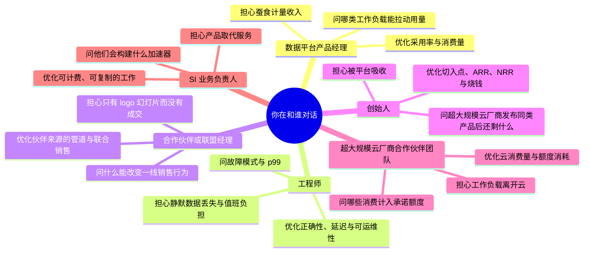

# 46. 与数据平台产品经理、工程师、合作伙伴和创始人对话
> **深度：** L2 · **阅读时间：** 约 17 分钟 · **最后核实：** 2026-11-01 · **前置阅读：** [第 27 章 — Databricks 对比 Snowflake](../04-company-deep-dives/ch27-databricks-vs-snowflake.md)，[第 36 章 — 单位经济与 KPI](../05-business-and-economics/ch36-unit-economics-kpis.md)，[第 40 章 — 市场进入与合作伙伴](../05-business-and-economics/ch40-gtm-partnerships.md)，[第 45 章 — 存储向上层软件栈延伸](../06-history-and-future/ch45-storage-moving-up-the-stack.md)

## 要点速览（TL;DR）

- **每一类角色都因优化不同的东西而获得报酬。** 数据平台产品经理（PM）的考核看采用率和消费量；工程师看正确性、延迟和可运维性；合作伙伴经理看销售管道（pipeline）和联合销售（co-sell）；创始人看切入点（wedge）、ARR、NRR、烧钱速度和下一轮融资；超大规模云厂商的合作伙伴团队看云消费量和承诺消费额度（committed spend）的消耗；系统集成商（SI）业务负责人看可计费、可复制的服务。问每个人他们负责的那个数字，并用他们的单位来问。
- **对话有其弧线。** 一场合作洽谈会从发现需求推进到技术契合，再到市场进入（GTM）契合，然后是经济条款，最后是一个具体的下一步。大多数失败的合作洽谈要么跳过技术契合、直接谈客户 logo，要么跳过经济条款，最终变成一个没人去卖的集成。
- **好的回答有共同的质感。** 它们先给定义再给数字，标明口径（GAAP、公司披露的年化运行率、估算），点明取舍，并承认短板。闪烁其词的回答会偷换单位、引用匿名客户，或回答另一个问题。
- **少数几个术语错误会在几秒钟内让你丧失可信度。** 把 Iceberg 称为数据库、把年化运行率当作收入引用、把向量数据库等同于 RAG、把零 ETL（zero-ETL）理解为"没有数据管道"、把湖仓一体（lakehouse）称为"不过是个数据湖"——每一个都会让技术型听众意识到你是从新闻稿里学到这个领域的。
- **把存储专长当作手术刀，而不是讲座。** 一个关于条件写入、小文件、元数据延迟或出口流量费（egress fees）的精准问题，比花五分钟讲闪存介质更能赢得尊重。作为 Everpure 的从业者，请坚持使用公开定位：Enterprise Data Cloud、Data Intelligence（源自 1touch）以及 Databricks Storage Ecosystem 首发合作伙伴身份。绝不暗示非公开计划。

## 为何重要（商业 + Everpure 视角）

企业发展工作主要就是对话。一份合作条款书、一笔少数股权投资或一宗收购，都始于一连串会议，你在会上试图弄清三件事：这个团队真正相信什么？他们因做什么而拿报酬？当你们的利益与他们的利益出现分歧时，他们会怎么做？本章之前的 45 章为你提供了内容。本章讲的是：在对方比你更懂技术的会议室里，如何运用这些内容。

利害关系很大，因为数据行业依赖的是没人审计的数字，以及每隔几个月就会变化的术语。Databricks 报告称其公司披露的收入年化运行率超过 $7B，同比增长超过 80%（2026 年 8 月）。[^db-7b] 其最近一次披露的全年收入约为 $2.6B，对应截至 2025 年 1 月的财年，该数字为媒体报道。[^cnbc-25] Snowflake 126% 的净收入留存率（net revenue retention，NRR）是一个过去 12 个月的客户群比率，而不是增长率。[^sf-q2] 产品名称可能在两次会议之间就变了：Snowflake Intelligence 于 2026 年 6 月更名为 Snowflake CoWork（[第 26 章](../04-company-deep-dives/ch26-snowflake.md)）。如果你引用了错误的口径或旧名称，对话就会悄然从同行对同行变成厂商对潜在客户，你也就再听不到有用的信息了。

对 Everpure 而言，这一视角十分具体。Pure Storage 于 2026 年 2 月 23 日更名为 Everpure，并于同日宣布收购 1touch。[^ep-wwt] 公司现以 NYSE: P 交易。[^ep-ticker] 1touch 于 2026 年 5 月 7 日以 $125.0M 现金完成交割（GAAP，依据 10-Q）。[^ep-10q] 2026 年 6 月 10 日，Everpure 被列为 Databricks Storage Ecosystem 的首发合作伙伴，其 OpenSharing 连接器处于私有预览阶段（厂商披露）。[^storage-eco][^everpure-os] 一家正向上层软件栈延伸的公司（[第 45 章](../06-history-and-future/ch45-storage-moving-up-the-stack.md)）中的战略从业者，将不断与数据平台产品经理、联盟团队和创始人打交道。他们每个人都会掂量：一家存储公司究竟是合作伙伴、渠道，还是未来的竞争对手。你的用词和你的问题，就是他们做判断的依据。

## 每类角色如何思考

在任何会议之前，先弄清对方的记分卡。人们回答问题的方式，会保护他们赖以获得报酬的那个指标。了解这个指标，你就能读出回答中刻意略去的部分。

*图 46.1 — 每类角色优化不同的指标，也担心不同的失败。正确的问题瞄准的是对方实际负责的那个指标。*

**数据平台产品经理。** 在 Databricks、Snowflake 或超大规模云厂商，产品经理的功能按采用率（活跃账户、工作区、查询）来评判，并且越来越多地按其在公司计量器上带来的消费量来评判：DBU、credit 或 slot（[第 35 章](../05-business-and-economics/ch35-business-models.md)）。这造成了一种不寻常的张力。一项降低客户账单的性能改进实际上就是降价，产品经理必须论证需求弹性会把收入赚回来。产品经理还要面对[功能吸收](../glossary.md#feature-absorption)（feature absorption）：他们的路线图就是一份他们打算让其变得多余的初创公司名单。在合作会议中，产品经理只在问一个问题：你的产品是让客户在我的平台上运行更多工作负载，还是把工作负载从我的平台上拉走？如果你无法用他们的单位回答这个问题，你就只是一个 logo，而不是合作伙伴。

**工程师。** 工程师的考核——无论是否正式——看的是正确性、延迟和可运维性。正确性意味着系统在并发和故障下兑现其承诺：提交是原子的，删除确实删除了，"恰好一次"确实是恰好一次。延迟指的是[尾延迟](../glossary.md#tail-latency)（tail latency），即真实并发下的 p99，而不是空闲集群上的平均值。可运维性意味着升级、可观测性、值班负担和故障影响范围。工程师不信幻灯片，而信测试套件、事故故事和代码。赢得他们尊重的最快方式是问一个故障模式（"当两个写入方通过不同目录向同一张 Iceberg 表提交时会发生什么？"）。索要基准测试则要慢得多。

**合作伙伴或联盟经理。** 联盟团队的考核指标包括伙伴来源的销售管道（由伙伴发起的交易）、伙伴影响的销售管道（伙伴参与过的交易）、联合销售登记、云市场（marketplace）交易、完成的认证以及可作参考的共同客户（[第 40 章](../05-business-and-economics/ch40-gtm-partnerships.md)）。他们的结构性问题在于，他们并不掌控一线销售。一个消耗工程时间、产出一篇新闻稿、却没有改变销售行为的合作，是他们的噩梦，也是你的噩梦。问一问什么能让他们的销售把你带进交易。答案通常是配额认定，而不是技术上的优雅。

**创始人。** 数据基础设施创始人以 18 到 24 个月为周期思考，这个周期受资金跑道约束。其记分卡包括切入点（产品比任何人都做得更好的第一项细分工作）、ARR 及其增长、净收入留存率、烧钱速度与烧钱倍数（burn multiple），以及下一轮融资的故事。最根本的恐惧是被平台吸收：Databricks、Snowflake 或 AWS 把这一切入点作为免费功能推出。AWS 在 re:Invent 2025 上推出了 S3 Vectors，这正是那种会让一家向量数据库初创公司不得不重写融资叙事的事件。[^s3-vectors] 创始人通常是对战略最坦率、而对指标定义最不精确的角色。你的任务是在不破坏关系的前提下，让他们严守定义。

**超大规模云厂商的合作伙伴团队。** AWS、Microsoft 和 Google 的合作伙伴团队按云消费量拿报酬。云市场私有报价、联合销售赢单以及对客户承诺额度（[EDP](../glossary.md#edp)、[MACC](../glossary.md#macc)）的消耗是主要渠道（[第 28 章](../04-company-deep-dives/ch28-hyperscaler-data-platforms.md)）。他们在 Databricks 与 Snowflake 之间比外人预想的更中立，因为无论哪个平台胜出，超大规模云厂商都能赚到基础设施收入和云市场费用。对于本地部署的存储厂商，他们的兴趣更窄。他们想要的是最终落到自家云上的混合和迁移工作负载，并对任何把数据留在云外的东西保持警惕。

**SI 业务负责人。** 在系统集成商（Accenture、Deloitte、精品数据咨询公司）中，业务负责人的考核指标是可计费利用率、业务线收入、持证人数和合作伙伴等级。可复制的服务最为重要：一个迁移工厂或一个行业加速器可以卖五十次。Accenture 于 2025 年 12 月成立了专门的 Snowflake 业务集团，并于 2026 年 3 月扩大了与 Databricks 的联盟，两者均为公司披露。[^acn-sf][^acn-dbx] 每一步都表明业务负责人预期可计费工作将出现在哪里。SI 会问：你的产品是创造服务工作（迁移、数据治理、AI 数据管道），还是消除服务工作？消除服务工作的产品只会得到礼貌的会面，而不会有销售管道。

| 角色 | 主要记分卡 | 典型盲点 | 可信度"货币" | 延伸阅读章节 |
|---|---|---|---|---|
| 数据平台产品经理 | 采用率、计量器上的消费量、附加率 | 夸大其目录对合作伙伴的中立性 | 他们的单位（DBU、credit）、当前产品名称 | [第 25 章](../04-company-deep-dives/ch25-databricks.md)，[第 26 章](../04-company-deep-dives/ch26-snowflake.md) |
| 工程师 | 正确性、p99 延迟、值班负担 | 低估 GTM 与定价的现实 | 精准的故障模式问题 | [第 3 章](../01-data-systems-foundations/ch03-database-internals.md)，[第 7 章](../01-data-systems-foundations/ch07-open-table-formats.md) |
| 合作伙伴 / 联盟经理 | 伙伴来源与伙伴影响的管道、联合销售、认证 | 把集成当作合作关系 | 来源 vs 影响；伙伴计划等级 | [第 40 章](../05-business-and-economics/ch40-gtm-partnerships.md) |
| 创始人 | 切入点、ARR、NRR、烧钱倍数、下一轮融资 | 指标定义松散；低估被吸收风险 | 严格区分 ARR 与年化运行率；熟悉许可证 | [第 36 章](../05-business-and-economics/ch36-unit-economics-kpis.md)，[第 38 章](../05-business-and-economics/ch38-open-source-strategy.md) |
| 超大规模云厂商合作伙伴团队 | 云消费量、云市场、承诺额度消耗 | 只把本地部署当作迁移来源 | 云市场费率档位、EDP/MACC 规则 | [第 28 章](../04-company-deep-dives/ch28-hyperscaler-data-platforms.md) |
| SI 业务负责人 | 可计费利用率、可复制服务、合作伙伴等级 | 优化服务量，而非客户的总拥有成本（TCO） | 了解有哪些加速器 | [第 40 章](../05-business-and-economics/ch40-gtm-partnerships.md)，[第 43 章](../06-history-and-future/ch43-modern-data-stack.md) |

*图 46.2 — 角色记分卡。读每一个回答时都要看它在保护什么：产品经理保护计量收入，联盟经理保护管道认定，创始人保护下一轮融资。*

## 问题集

下面的矩阵是一页纸版本。随后的四个小节给出完整的问题集及其背后的理由。[第 48 章](ch48-question-bank.md)收录了带标签的问题库，[第 47 章](ch47-diligence-checklist.md)则把尽职调查（due diligence）问题整理成一份清单。

| 角色 | (a) 合作洽谈 | (b) 技术尽职调查 | (c) 创始人 / 投资 | (d) 客户背调 |
|---|---|---|---|---|
| 数据平台产品经理 | 我们的集成会加速你们路线图上的哪些事项，又会与哪些事项竞争？ | 哪些 API 足够稳定、可以在其上构建，哪些在最近两个版本中发生了变化？ | 哪些初创公司的切入点在你们未来 12 个月的路线图上？ | 你们最大的客户实际启用了哪些伙伴集成？ |
| 工程师 | 目录在我们的存储上治理什么：权限、数据血缘、审计？ | 给我看证明两个并发提交中恰好一个胜出的测试。 | 在数据量或租户数增加 10 倍时，什么最先出问题？ | 生产环境中出过什么故障，厂商修复得有多快？ |
| 合作伙伴经理 | 什么会让你们的一线销售把合作伙伴带进交易？ | 哪套认证测试、哪些版本、最近一次重新认证是哪天？ | 目前哪些合作伙伴为你们带来销售管道，各占多少？ | 是谁引荐了这家厂商：平台销售、SI 还是直接接触？ |
| 创始人 | 如果平台推出了你们的功能，你们还能卖什么？ | 云基础设施占销售成本（COGS）的多少，它如何随规模变化？ | 请定义 ARR、NRR 客户群和烧钱倍数。 | 按今天的价格，你还会再买一次吗？ |
| 超大规模云厂商团队 | 通过云市场购买我们的产品，能否消耗 EDP 或 MACC？ | 产品必须调用哪些托管服务，出口流量费是多少？ | 对处于这一阶段的公司，哪些云市场销售模式转化最好？ | 这次采购是否消耗了现有的承诺额度？ |
| SI 业务负责人 | 你们会基于这个集成构建什么可复制的服务？ | 部署需要多少名持证顾问？ | 哪些数据厂商为你们创造的服务工作最多？ | 上线实际花了多少 SI 工时，与计划相比如何？ |

*图 46.3 — 问题集矩阵。每个单元格都瞄准该角色在这类对话中负责的那个数字。*
