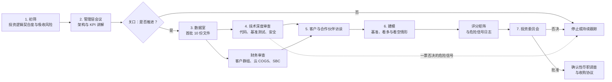
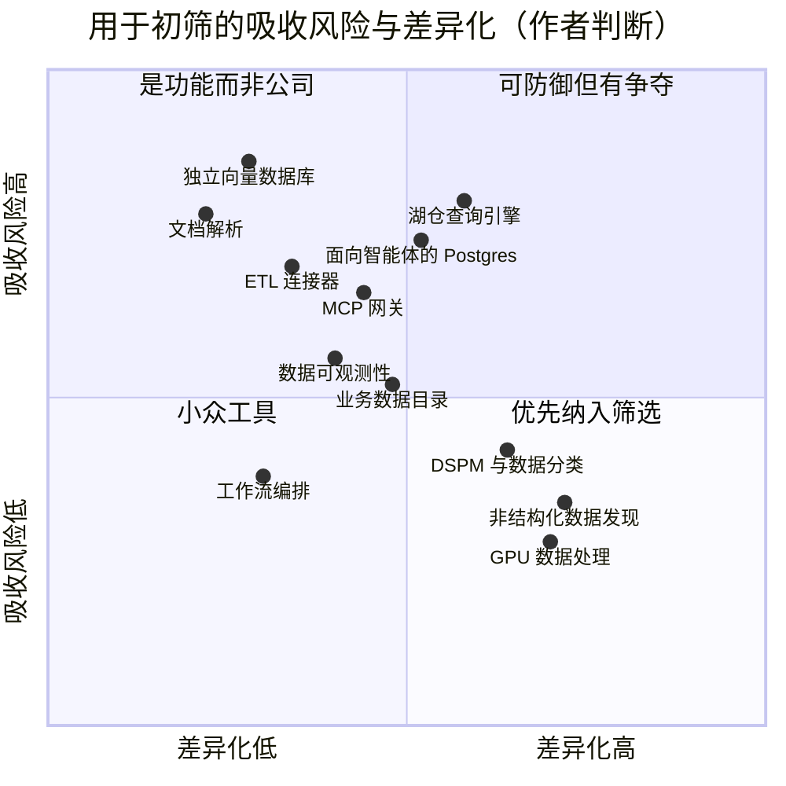

# 47. 数据基础设施标的的技术与商业尽职调查清单
> **深度：** L2 · **阅读时间：** 约 13 分钟 · **最后核实：** 2026-11-01 · **前置阅读：** [第 36 章 单位经济与 KPI](../05-business-and-economics/ch36-unit-economics-kpis.md)、[第 38 章 开源作为战略](../05-business-and-economics/ch38-open-source-strategy.md)、[第 39 章 并购史](../05-business-and-economics/ch39-ma-history.md)

## 要点速览（TL;DR）

- **数据基础设施的尽职调查（due diligence）总是在可预见的地方失败。** 大多数失败可以追溯到四类缺口之一：一个没有人与 GAAP 核对过的收入指标；一份买方无法控制的许可证或一个买方无法掌控的社区；一个 Databricks、Snowflake 或某家超大规模云厂商即将免费推出的功能；或者一种与收购方自身定价模式相冲突的定价模式。本章针对这四类缺口给出一份清单，并按八个工作流加以组织。
- **每个工作流都遵循相同的模式：问什么、要什么材料、好的样子是什么、以及危险信号。** 危险信号表（图 47.5）列出了 18 项测试。加权评分矩阵（图 47.6）把调查发现转化为一个投资委员会（IC）可以在不同标的之间比较的数字，并包含可以否决总分的一票否决标准。
- **单位经济的权重最高，因为其定义最不标准。** [收入年化运行率](../glossary.md#revenue-run-rate)、[ARR](../glossary.md#annual-recurring-revenue) 和 GAAP 收入是三个不同的数字。Databricks 披露的公司年化运行率超过 $7B，而 Fivetran 与 dbt Labs 披露的合计 ARR "接近 $600M"。两者都不是经审计的收入。[^db-7b][^fivetran-dbt]
- **平台吸收风险是决定性的产品问题。** 向量检索（vector search）、文档解析、Postgres、湖仓一体（lakehouse）引擎以及 MCP 网关，在 2024 至 2026 年间都变成了平台功能或被平台收购。[^s3-vectors][^datavolo][^dremio][^ducklabs][^natoma] 在投入尽职调查费用之前，应先按差异化程度与吸收风险对标的进行筛选（图 47.2）。
- **对于存储类收购方，整合契合度本身就是一个独立的工作流。** 需要回答的问题包括：与数据平台合作伙伴的渠道冲突、交易后能否留住开源社区，以及如何调和按 TB 计价与按用量计费（consumption pricing）。1touch 交易（$125.0M 现金，2026 年 5 月 7 日完成交割）是近期一个小型、元数据层收购的例子，其结构设计规避了上述大部分陷阱；现在判断结果还为时过早。[^1touch]

## 为何重要（商业 + Everpure 视角）

数据基础设施标的比大多数软件更难做尽职调查。产品对终端用户不可见，因此与业务买方的客户访谈对底层引擎所知甚少。收入往往按用量确认，因此上一季度的数字告诉你的是客户实际运行了多少，而不是他们承诺了多少。而且大量代码可能是开源的，这意味着你要买的资产可以被超大规模云厂商合法地复制。最具警示意义的案例仍然是 HP–Autonomy：交割后约一年内减记 $8.8B，而起因是收入质量问题，而不是技术问题。[^autonomy-wd] 现代的对应情形更为隐蔽：把年化运行率当作 ARR 报出；只有净收入留存率（NRR）而没有毛收入留存率支撑；或者毛利率（gross margin）随着无服务器（serverless）占比上升而下降。

对 Everpure 而言，这个视角是具体的。公司在 2026 年通过收购 1touch 并于 2026 年 6 月以 Data Intelligence 名义重新发布，进入数据智能领域，这使其成为元数据、数据治理与 AI 数据管道资产的潜在买家。[^1touch] 该市场中的每个标的都向 Databricks 和 Snowflake 所服务的同一批数据团队销售产品，而 Everpure 本身也是 Databricks Storage Ecosystem（2026 年 6 月）的首发合作伙伴。[^storage-eco] 因此，一份在常规技术与财务问题之外同时检验渠道冲突和定价契合度的清单，是战略团队基于公开信息可能评估的选项之一。它并不是对 Everpure 内部流程的描述。

## 尽职调查流程

下面的工作流是大多数企业发展团队遵循的顺序。其中有用的纪律在于两道关口。未通过初筛或管理层会议的标的不应进入数据室，因为数据室阶段正是尽职调查成本和交易惯性同时累积的地方。

*图 47.1 — 尽职调查漏斗。技术深度审查与财务审查基于同一个数据室并行开展，任何一方都可以叫停流程。评分矩阵位于模型与 IC 之间，使判断在投票之前就被记录下来。*

有两个习惯能提升产出质量。第一，从第一次会议起就维护一份持续更新的危险信号日志，为每个信号指定负责人和检验方法，这样早期提出的问题不会在 IC 召开之前被遗忘。第二，先写看空逻辑（bear case），再写基准情形。先构建基准情形的团队往往会锚定在管理层给出的数字上。

## 各工作流清单

### 1. 架构与技术

核心问题是：产品能否在收购方关心的规模和环境中运行，以及它是否足够开放，能够融入客户现有的技术栈。请先阅读[第 7 章](../01-data-systems-foundations/ch07-open-table-formats.md)和[第 8 章](../01-data-systems-foundations/ch08-catalogs-and-metastores.md)，因为开放格式立场如今决定了大多数企业架构评审的结果。

- **问什么。** 存储引擎（storage engine）是什么，磁盘格式归谁所有？系统如何扩展，按数据量、并发量和租户数计，最大的生产部署有多大？[多租户](../glossary.md#multi-tenancy)是通过独立计算、独立进程实现隔离，还是仅靠行级过滤？它是否原生读写 Apache Iceberg 和 Delta Lake，是否支持 [Iceberg REST 目录](../glossary.md#iceberg-rest-catalog)协议？[^irc-spec] 它持有哪些认证：SOC 2 Type II、ISO 27001、HIPAA 证明、FedRAMP？
- **要什么材料。** 架构文档、五大客户的生产遥测数据、基准测试脚本与配置、最新的渗透测试报告和附例外事项的 SOC 2 报告，以及一次把客户表导出到 Iceberg 的导出测试。
- **好的样子。** 基准测试可以在你自己的硬件上用公开配置复现。原生的开放格式读写，而不是单向导出。租户隔离可以在进程或账户层面讲清楚。SOC 2 Type II 报告例外事项少，且有整改记录。
- **危险信号。** 由厂商自行运行且不提供配置的基准测试。专有格式且没有开放的导出路径，这会造成[厂商锁定](../glossary.md#vendor-lock-in)，而企业买方如今正对此进行抵制。所谓的"Iceberg 支持"结果只是只读。认证仍处于"进行中"。

> **类比：数据手册典型值与工艺角表征。** 厂商的基准测试相当于数据手册上的"典型"值：在标称电压、室温和友好负载下测得。半导体买方会在工艺角（process corner）上对器件进行认证。请向数据平台索取对应的东西：最坏情况下的并发、最大的租户、冷缓存查询以及最慢的存储层级，而不是那个 TPC 风格的标题数字。

### 2. 开源与许可

如果标的的核心是开源的，许可证就是资产的一部分。[第 38 章](../05-business-and-economics/ch38-open-source-strategy.md)介绍了相关机制。尽职调查需要回答三个问题：超大规模云厂商能否售卖同样的东西？厂商能否修改条款？如果厂商修改了条款，客户能否获得一个可信的分叉？

- **问什么。** 核心采用什么许可证，付费层采用什么许可证（[开放核心（open core）](../glossary.md#open-core)、[源码可见许可](../glossary.md#source-available-license)或专有）？是否有[贡献者许可协议](../glossary.md#contributor-license-agreement)赋予公司重新授权的权利？商标归公司还是归基金会所有？许可证是否曾经变更过，之后社区发生了什么？
- **要什么材料。** 许可证变更历史、CLA 文本、过去三年按雇主划分的提交与维护者数据，以及下载量或使用遥测数据。
- **好的样子。** 公司无需加以限制的开放核心与超大规模云厂商难以复制的付费层之间界限清晰。[贡献者集中度](../glossary.md#contributor-concentration)足够高，使公司掌握路线图控制权，但又不至于高到少数工程师离开项目就会死掉。
- **危险信号。** 正在考虑重新授权。存在同一项目的超大规模云厂商托管版本。近期历史很有启发性。Redis 于 2024 年 3 月转向源码可见许可。在头六个月里，Linux Foundation 的分叉项目 Valkey 吸引了来自 10 家公司的 29 名贡献者，其中 18 人此前曾为 Redis 贡献过代码。[^redis-2024][^valkey][^foster] Elasticsearch 在 2021 年也经历了 AWS 推出 OpenSearch 分叉的同样模式。[^elastic-2021] 重新授权不一定会压低价格：在 Terraform 重新授权之后，IBM 仍为 HashiCorp 支付了 $6.4B。[^ibm-hashi] 但它确实改变了你买到的东西。你得到了代码和客户，却得不到社区。

### 3. 产品与路线图

核心风险是[功能吸收](../glossary.md#feature-absorption)，即标的的核心功能变成客户已经付费的某个平台的捆绑功能。从 2024 年底到 2026 年底，Snowflake 为文档数据摄取收购了 Datavolo；AWS 把向量检索变成了 S3 的一项功能（S3 Vectors，2025 年 12 月正式发布）；SAP 收购了 Dremio；AWS 同意收购 DuckLabs；Snowflake 同意以约 $110M 的披露对价收购 MCP 网关公司 Natoma。[^datavolo][^s3-vectors][^dremio][^ducklabs][^natoma] 各公司章节（[第 25 章](../04-company-deep-dives/ch25-databricks.md)至[第 34 章](../04-company-deep-dives/ch34-application-giants-data-platforms.md)）跟踪了每个平台的路线图。

- **问什么。** 你们排名前十的功能中，有哪些出现在过去 18 个月 Databricks、Snowflake、AWS、Microsoft 或 Google 的发布说明中？平台版本推出之后，客户为什么还继续向你们付费？产品对 AI 智能体（agent）的就绪程度如何：是否提供 [MCP 服务器](../glossary.md#mcp-server)，是否发布智能体可以使用的语义上下文（[语义层](../glossary.md#semantic-layer)或业务定义）？
- **要什么材料。** 与各平台逐项功能对比的重叠图、与平台原生方案对比的赢单/丢单记录，以及带有日期和负责人的路线图。
- **好的样子。** 存在某类工作负载，标的在其上便宜数倍或能力显著更强，而不仅仅是"集成得更好"。[模型上下文协议（Model Context Protocol）](../glossary.md#model-context-protocol)支持已经交付并在使用中——如今 MCP 已归属于一个中立基金会（2025 年 12 月捐赠给 Agentic AI Foundation）。[^mcp-donate]
- **危险信号。** 路线图追着平台的发布公告跑。平台发布后赢单率下降。宣称"智能体就绪"却没有已交付的 MCP 端点。

*图 47.2 — 标的类别的初筛视图，基于作者判断而非数据。上半部分的类别已经出现过平台发布或平台收购。右下象限是最靠近字节所在位置的类别，存储类收购方在这里拥有平台所不具备的优势。*

### 4. 单位经济

这个工作流在评分矩阵中权重最高，因为这些指标由公司自行定义、未经审计且容易被美化。SEC 2020 年的指引要求上市公司定义每一项关键指标并保持一致的计算口径。私有标的对你没有这样的义务。[^sec-kpi] [第 35 章](../05-business-and-economics/ch35-business-models.md)和[第 36 章](../05-business-and-economics/ch36-unit-economics-kpis.md)解释了相关机制。

- **问什么。** ARR 如何定义，定义是否变更过？用量部分是按过往用量年化计入，还是按合同承诺计入？云账单由谁支付：客户（传统部署，[自带云](../glossary.md#bring-your-own-cloud)）还是厂商（[无服务器计算](../glossary.md#serverless-compute)）？每个账户的用量波动有多大？
- **要什么材料。** 自成立以来按客户和产品划分的月度收入文件；[净收入留存率](../glossary.md#net-revenue-retention)与[毛收入留存率](../glossary.md#gross-revenue-retention)的客户群组表；云账单与承诺消费额度协议；按季度的销售与市场费用；以及完全稀释后的股权结构表。
- **好的样子。** ARR 与 GAAP 收入之间的差距已知且可解释，能够对上。NRR 有按客户群组的 GRR 支撑。随着无服务器业务增长，毛利额在上升，即使毛利率百分比略有下滑。Snowflake 体现了这一模式：Q2 FY2027（2026 年 5–7 月）非 GAAP 产品毛利率为 74.7%，全年指引因 AI 工作负载使用更昂贵的算力而下调至 74%。[^sf-q2]
- **危险信号。** NRR 只以混合口径给出。超大规模云厂商承诺额度大于预测用量。把[股权激励费用](../glossary.md#stock-based-compensation)当作免费。用量下降的速度可能和上升一样快。Snowflake 的 NRR 从 FY2022（2021 年 2 月–2022 年 1 月）的 178% 降至 FY2025（2024 年 2 月–2025 年 1 月）的 126%，而在 FY2022–FY2024 期间，随着客户优化支出，产品收入增速从 106% 降至 38%（公司披露的 KPI；GAAP 增速）。[^fin-csv]

| KPI | 公式 | 参考点（口径、日期） | 尽职调查陷阱 |
|---|---|---|---|
| ARR | 某一时点经常性合同的年化价值 | Fivetran + dbt Labs "接近 $600M"（公司披露，2026 年 6 月）[^fivetran-dbt] | 用量型 ARR 是对用量的年化，而不是合同 |
| 收入年化运行率 | 最近一季度收入 × 4（或单月 × 12） | Databricks >$7B（公司披露，未经审计，2026 年 8 月）[^db-7b] | 用峰值月份年化；混杂一次性与经常性收入 |
| 净收入留存率 | 客户群组第 2 年支出 ÷ 同一群组第 1 年支出 | Snowflake 126%（公司披露，Q2 FY2027）[^sf-q2] | 群组和窗口口径不一；滞后于季度拐点 |
| 毛收入留存率 | （上期支出 − 缩减 − 流失）÷ 上期支出，上限为 100% | 上市可比公司很少披露[^fin-csv] | 强劲的 NRR 可能掩盖正在流失的客户基础 |
| 毛利率 | （收入 − COGS）÷ 收入；按部署模式拆分 | Snowflake 产品 70.9% GAAP / 74.7% 非 GAAP；GitLab 约 86.5% 非 GAAP（Q2 FY2027）[^sf-q2][^comps] | 无服务器占比会压低百分比，但可能提高金额 |
| Magic number（魔法数字） | （本季度收入 − 上季度收入）× 4 ÷ 上季度销售与市场费用 | 约 0.7 是常用的健康阈值[^scale] | 天数差异和单季度噪声 |
| CAC 回收期 | 12 ÷（魔法数字 × 毛利率），单位为月 | 由上面两行推导 | 忽略流失；继承噪声 |
| SBC 强度 | SBC ÷ 收入 | Snowflake 约 27%（媒体报道，Q2 FY2027）[^secapi] | 被排除在非 GAAP 之外；稀释是永久性的 |
| 40 法则 | 收入增速 % + FCF 利润率 %（需说明是哪个期间的增速和哪种利润率：FCF、调整后 FCF、非 GAAP 营业利润率） | Snowflake 约 58：35% GAAP 总收入增速（Q2 FY2027）+ 23% FY2027 调整后 FCF 利润率指引（作者计算，估算）[^r40] | 混合了不同期间和利润率口径；经 SBC 调整的 FCF 得分会低得多 |
| RPO 与 cRPO | RPO：已签约但尚未确认的收入（GAAP 披露）。cRPO：其中预计在 12 个月内确认的部分 | Snowflake RPO 约 $9.0B，约 54% 预计在 12 个月内确认（GAAP，Q2 FY2027）[^fin-csv] | 对用量型厂商而言，确认取决于用量，未使用的额度可以结转；RPO 有季节性（财年 Q4 续约后偏高） |
| 按需占比 | 按需收入 ÷ 总收入 | Snowflake 约 1%（FY2026）[^sf-10k26] | 占比低并不意味着波动低，因为预付额度同样只在消耗时才确认 |

*图 47.3 — 单位经济工作流的 KPI 定义。每个指标都应从月度收入文件重新计算，而不是直接接受管理层的数字。参考点是用于比较的锚点，而不是及格线。*

### 5. 客户与市场进入

数据平台越来越多地通过超大规模云厂商的云市场（marketplace）和系统集成商销售，因此标的的销售管道可能依赖于它无法控制的合作伙伴（[第 40 章](../05-business-and-economics/ch40-gtm-partnerships.md)）。Snowflake 披露 2025 日历年 AWS Marketplace 销售额超过 $2B（公司披露），而 AWS 私有报价（private offer）的费率根据合同规模分别为 3%、2% 或 1.5%。[^sf-aws-2b][^aws-fees]

- **问什么。** 前 10 大和前 25 大客户占收入的比例是多少？新签订单中有多大比例通过[云市场](../glossary.md#cloud-marketplace)成交，或来自超大规模云厂商的[联合销售](../glossary.md#co-sell)？客户数流失率（与金额流失率相区分）是多少？哪个合作伙伴带来的销售管道最多？
- **要什么材料。** 按来源（直销、云市场、SI、联合销售）划分的订单；包含终止和排他条款的合作伙伴协议；附原因的流失客户名单；以及由调查团队而非管理层挑选的客户访谈名单。
- **好的样子。** 没有任何单一客户或合作伙伴大到足以拖垮模型。云市场被用作支付渠道，而不是唯一的需求来源。客户访谈覆盖流失客户和缩减客户，而不仅仅是满意的客户。
- **危险信号。** [客户集中度](../glossary.md#customer-concentration)高，且续约集中在交割后的第一年。单一超大规模云厂商的联合销售项目带来了大部分销售管道，例如 AWS ISV Accelerate 这类项目，而超大规模云厂商可以单方面更改其规则。[^isva] 不断上升的[客户数流失](../glossary.md#logo-churn)被最大客户的扩张所掩盖。

### 6. 团队与组织

在小型数据基础设施公司中，存储引擎或查询优化器（query optimizer）的知识往往掌握在少数几名工程师手中。因此[关键人员风险](../glossary.md#key-person-risk)是一个估值项目，而不仅仅是人力资源项目。

- **问什么。** 核心引擎是谁写的，他们还在吗？交割后每位创始人将担任什么角色？公司招聘资深工程师的速度有多快，又在哪些环节流失人才？
- **要什么材料。** 附任职年限的组织架构图、每名关键员工的归属（vesting）时间表、三年来按职能划分的人员流失率，以及空缺岗位及其招聘周期。
- **好的样子。** 核心知识分散在多名工程师身上。创始人希望在交割后担任运营角色。保留计划的规模与风险相匹配。
- **危险信号。** 关键工程师在签约时已全部归属。创始人计划离开。保留措施仅依赖现金。收购方会为此使用[暂扣款（holdback）](../glossary.md#holdback)。Confluent 对 WarpStream 的披露显示，对价为 $135.1M，另加最高 $76.2M 的暂扣款，这提醒我们保留资金可能占真实价格的很大一部分。[^warpstream]

### 7. 法律、知识产权与数据隐私

数据基础设施产品会处理客户的个人数据，而 AI 功能扩大了风险敞口（[第 15 章](../02-pipelines-and-governance/ch15-governance-security-privacy.md)）。GDPR 罚款最高可达 €20M 或全球营业额的 4%，以较高者为准。[^gdpr] 在 2026 年 AI Omnibus 之后，EU AI Act 对高风险系统的数据治理义务现自 2027 年 12 月 2 日（附件 III）和 2028 年 8 月 2 日（附件 I）起适用。[^omnibus] EU Data Act 的云服务切换规则自 2025 年 9 月 12 日起已经适用。[^dataact]

- **问什么。** 标的是否是客户个人数据的数据处理者，依据哪些协议？数据在哪里存储和处理，客户能否锁定区域？是否有任何功能落入 AI Act 的高风险类别？它拥有哪些专利，是否收到过侵权主张？
- **要什么材料。** 数据处理协议（DPA）和子处理者名单、区域分布图、专利清单、开源软件成分分析（SCA）报告，以及诉讼记录。
- **好的样子。** 标准的 DPA、按区域的数据驻留、专有组件中未混入 copyleft 代码，以及干净的索赔历史。
- **危险信号。** 闭源产品中含有 AGPL 或 GPL 代码。没有面向 EU 客户的数据驻留控制。在没有合同依据的情况下使用训练数据或遥测数据。

### 8. 存储类收购方的整合契合度

这个工作流因买方而异。对存储公司而言，它决定了标的是为装机基础增加价值，还是与客户已经在运行的数据平台产生摩擦。[第 39 章](../05-business-and-economics/ch39-ma-history.md)表明，存储类买方收购元数据和数据服务（Portworx；1touch 于 2026 年 5 月完成交割，时间太近尚无法评判）时，结果好于收购引擎（Greenplum、Pentaho）。

- **问什么。** 适用哪条整合路径：接入现有数据智能层的连接器、在阵列上运行的软件、把元数据发布到 Unity Catalog 或 Horizon，还是联合打包的一体机？标的是否与 Databricks、Snowflake 或 Starburst 竞争——这三家都与存储厂商有公开的合作关系？[^storage-eco][^starburst-ep] 如果标的是开源的，在存储公司拥有该项目后社区是否会留下来？按用量计费如何映射到按 TB 计价或预留承诺计价？
- **要什么材料。** 附各合作伙伴收入的合作伙伴名单、社区的治理文件，以及一份将标的前十大客户套入收购方定价模型的定价对账。
- **好的样子。** 标的让存储对数据平台更有价值，而不是取代它们。公开承诺保持许可证和治理结构不变，或将项目捐赠给基金会。一座销售团队能讲清楚的定价桥。Everpure 自己的 Evergreen//One 模式已经将预留承诺与按需收费结合在一起，两者都计入其 Subscription ARR KPI，因此按用量计费的标的对它来说并不陌生。[^ep-10k]
- **危险信号。** 与带来联合销售管道的平台合作伙伴发生[渠道冲突](../glossary.md#channel-conflict)。社区释放出将要分叉的信号。销售薪酬方案无法同时对按 TB 收入和按用量收入计提佣金。

| 整合路径 | 含义 | 公开先例 | 渠道冲突风险 | 与按 TB 或预留承诺定价的契合度 |
|---|---|---|---|---|
| 吸收进现有数据智能层 | 标的成为收购方控制台中的一项功能 | 1touch 以 Everpure Data Intelligence 名义重新发布[^1touch] | 低：增加的是元数据，而不是竞争性引擎 | 好：捆绑进现有合同 |
| 保留品牌，面向新买方 | 面向不同用户角色销售的独立产品线 | Pure–Portworx，面向平台工程师销售（[第 39 章](../05-business-and-economics/ch39-ma-history.md)） | 低到中等 | 需要单独的价格手册 |
| 发布到合作伙伴目录 | 标签和策略流入 Unity Catalog 或 Horizon | Databricks Storage Ecosystem；Everpure OpenSharing 连接器处于私有预览阶段[^storage-eco][^everpure-os] | 低：让合作伙伴的平台变得更好 | 中性 |
| 联合打包的湖仓或查询引擎 | 收购方在自有存储上提供引擎 | 2010 年代的引擎收购（EMC–Greenplum、Hitachi–Pentaho）（[第 39 章](../05-business-and-economics/ch39-ma-history.md)） | 高：与 Databricks、Snowflake 和 Starburst 竞争 | 差：在容量合同上运行按用量计费的引擎 |

*图 47.4 — 存储类收购方的整合路径。一条路径离元数据越远、越靠近查询引擎，渠道冲突越高，定价契合度越差。*

> **存储桥接。** 存储类收购方的优势在于位置：它已经持有企业的非结构化数据和本地部署数据的字节，往往还持有备份副本。把这一位置转化为元数据（发现、分类、语义上下文）的标的能够继承这一优势。与客户的查询引擎竞争的标的则不能。阵列如何暴露这些数据，请参见配套的 *Everpure Tech Atlas*。

## 危险信号表

| # | 危险信号 | 为何重要 | 如何检验 |
|---|---|---|---|
| 1 | ARR 定义在过去两年内变更过，或把年化运行率当作 ARR 呈现 | 放大了估值倍数所乘的基数 | 逐季度将 ARR 与 GAAP 收入核对；索取所有历史定义 |
| 2 | 披露 NRR 却未披露 GRR 或未按客户群组披露 | 少数账户的扩张可能掩盖正在流失的客户基础 | 从月度客户收入文件重新计算 NRR 和 GRR |
| 3 | 头部客户主导收入或扩张 | 一次续约就可能打破模型 | 按季度、按客户的收入；交割后第一年的续约日历 |
| 4 | 毛利率随无服务器增长而下降，毛利额却持平 | 厂商在以微薄利润转售云算力 | 按部署模式划分的 COGS；云账单与 COGS 对账 |
| 5 | 超大规模云厂商承诺消费额度超过预测用量 | "照付不议"负债转移给买方 | 阅读承诺协议；对照预测为额度消耗建模 |
| 6 | 用量集中在客户可以优化的工作负载上 | 收入可能迅速下滑，如 2022–23 年的优化周期 | 按头部账户和工作负载的月度用量；性价比改进的发布历史 |
| 7 | 正在讨论重新授权，或 CLA 允许重新授权 | 引发分叉风险和社区流失 | 许可证历史；董事会会议纪要；任何变更前后的社区指标 |
| 8 | 贡献者集中度过高或过低 | 过高：关键人员风险。过低：公司不掌控路线图 | 三年来按雇主划分的提交与维护者数据 |
| 9 | 超大规模云厂商提供同一项目的托管版本 | 价格天花板以及客户关系的流失 | 与该托管服务对比的赢单/丢单；价格对比 |
| 10 | 基准测试由厂商运行且配置未公开 | 性能宣称在你的工作负载下可能站不住 | 在你的硬件上用公开配置复现 |
| 11 | 专有格式或目录且无开放导出 | 客户越来越拒绝锁定；买方将继承这种抵制 | 导出到 Iceberg 的测试；Iceberg REST 目录一致性测试 |
| 12 | 路线图与近期平台发布重叠 | 功能吸收压缩定价 | 将功能与 Databricks、Snowflake 及超大规模云厂商的发布说明逐一对照 |
| 13 | 单一云市场或联合销售项目带来大部分销售管道 | 合作伙伴可以修改条款或与之竞争 | 按来源划分的订单；合作伙伴合同的终止条款 |
| 14 | 核心工程师已全部归属或创始人将离开 | 知识在交割后流失 | 归属时间表；保留计划；暂扣款规模 |
| 15 | SBC 高且在上升，期权悬置量（overhang）大 | 真实成本转移到收购方的股本上 | SBC ÷ 收入趋势；完全稀释后的股权结构表 |
| 16 | 处理个人数据却没有 DPA 或驻留选项 | GDPR 风险敞口最高可达全球营业额的 4% | DPA 清单；子处理者名单；区域分布图 |
| 17 | 专有组件中含有 copyleft 代码 | 交割后被迫公开代码或重写 | 独立的 SCA 扫描，而不是标的自己做的扫描 |
| 18 | 价格锚点取自媒体报道 | 媒体报道的数字往往高于申报价格 | 使用申报数字：Snowflake–Crunchy Data 申报为 $164.5M，而媒体报道约为 $250M[^crunchy] |

*图 47.5 — 十八个危险信号及对应的检验方法。第 1–6 行由财务团队负责，第 7–13 行由技术与产品团队负责，第 14–18 行由人力资源、法务和企业发展团队负责。第 1、7、16 和 17 行通常是一票否决项，与图 47.6 中的一票否决列相对应。*

## 评分矩阵

该矩阵把各工作流转化为 1 到 5 分的加权得分。权重反映了数据基础设施交易历史上出问题的地方。权重属于作者判断，应针对每个投资逻辑重新设定。

| 标准 | 权重 | 1 = 弱 | 3 = 可接受 | 5 = 强 | 一票否决？ |
|---|---|---|---|---|---|
| 架构与技术 | 15% | 基准测试无法复现；专有格式；无 SOC 2 | 在中等规模下可复现；可读 Iceberg；SOC 2 Type II | 在最大规模下可复现；原生 Iceberg/Delta 和 REST 目录；审计干净 | 否 |
| 开源与许可 | 10% | 重新授权待定；已存在超大规模云厂商的分叉 | 许可证稳定；与超大规模云厂商有部分重叠 | 开放核心划分清晰；核心由基金会持有；社区健康 | 是，如果重新授权会引发分叉 |
| 产品与吸收风险 | 15% | 头部功能已由平台推出 | 部分重叠；工作负载可防御 | 在平台忽视的工作负载上好数倍；MCP 和语义上下文已交付 | 否 |
| 单位经济 | 20% | ARR 未核对；NRR 无 GRR；毛利额下降 | ARR 已核对；按客户群组的 NRR 和 GRR；毛利率稳定 | 核对干净；GRR 强劲；毛利额上升；魔法数字接近或高于健康阈值 | 是，如果 ARR 无法核对 |
| 客户与 GTM | 10% | 集中；单一合作伙伴带来大部分销售管道 | 集中度中等；来源多元 | 分散；云市场用作支付通道 | 否 |
| 团队与组织 | 10% | 核心工程师已归属；创始人退出 | 保留覆盖不完全 | 知识分散；创始人投入；保留规模匹配 | 否 |
| 法律、知识产权与隐私 | 5% | copyleft 污染；无 DPA | 需要少量整改 | SCA 干净；标准 DPA；数据驻留 | 是，针对 copyleft 或隐私违规 |
| 整合契合度 | 15% | 与关键平台合作伙伴直接冲突；定价冲突 | 冲突可控；存在定价桥 | 让合作伙伴的平台在我们的存储上表现更好；社区得以保留 | 否 |

*图 47.6 — 加权评分矩阵，基于作者判断。加权总分 = Σ（权重 × 得分）。一票否决项得"1"分时，无论总分多少交易都应停止，这样可以防止很高的技术得分压过许可或收入质量方面的失败。*

举一个示意性的例子（并非真实标的）：一家数据目录公司在架构上得 4 分，许可 4 分，吸收风险 2 分，单位经济 3 分，GTM 3 分，团队 4 分，法律 4 分，整合契合度 4 分，加权总分为 3.4。吸收风险的低分是需要上报的事项。IC 应当追问：报价是否假设了平台自带的目录会一直落后，因为 Unity Catalog 和 Horizon 正在进入同一领域（[第 33 章](../04-company-deep-dives/ch33-governance-catalog-security-companies.md)）。

## 首批需索取的 10 份文件

1. **自成立以来按客户和产品划分的月度收入。** 每一个单位经济指标都可以从这个文件重新计算。如果对方拒绝提供，应将拒绝本身视为危险信号。
2. **ARR、年化运行率和 NRR 的定义及其历史。** 这些可以显示标题指标是否在变得不利时被修改过。
3. **云账单以及超大规模云厂商承诺消费额度协议。** 这些可以显示云账单由谁支付，以及有哪些"照付不议"风险敞口会被转移。
4. **NRR 和 GRR 的客户群组表。** 应按签约年份、规模区间和产品索取。
5. **架构文档和基准测试工具包。** 这能让你的工程师复现性能宣称。
6. **许可证历史、CLA 以及按雇主划分的贡献者数据。** 这些合在一起可以检验重新授权的权利和对社区的依赖程度。
7. **SOC 2 Type II 报告、渗透测试和安全事件日志。** 这些呈现的是含例外事项的安全态势，而不是营销宣传。
8. **前 25 大客户合同及合作伙伴协议。** 关注终止权、排他性、最惠国定价以及控制权变更条款。
9. **附任职年限的组织架构图、归属时间表和人员流失数据。** 这些用于衡量关键人员风险和保留成本。
10. **DPA、子处理者名单、区域分布图和 SCA 报告。** 这些可以一次性覆盖隐私、数据驻留和开源合规。

如有可能，在管理层会议之前就索取第 1–4 份文件。愿意提前分享这些文件的标的，通常数字都比较干净。

## 对话手册

**向产品经理和企业发展同行提出的三个问题**

1. "这个标的有哪些功能，Databricks、Snowflake 或超大规模云厂商在过去 18 个月里已经发布过？" *好的回答*会点出具体的发布，并解释哪个客户群体仍然会为独立产品付费。
2. "标题 ARR 能否与 GAAP 收入对上，差额里有什么？" *好的回答*会给出这座桥：用量年化、多年期承诺、服务收入以及任何一次性项目。
3. "如果我们收购它，平台合作伙伴中谁会受损？" *好的回答*会点出具体合作伙伴、涉及的联合销售管道，以及维护这段关系的计划。

**向标的工程师和架构师提出的三个问题**

1. "给我们看看你们最大的租户和最坏情况下的查询。" *好的回答：*附硬件假设的遥测数据、冷缓存数字和并发上限。
2. "如果某个客户明天就想离开，他们的数据和元数据要怎么迁出？" *好的回答：*Iceberg 或 Delta 导出以及 Iceberg REST 目录端点，要现场演示，而不是口头描述。
3. "哪三个人如果离开，会让路线图停滞？" *好的回答：*一份坦诚的名单和分散知识的计划，而不是"没有人"。

**好的回答听起来是什么样的。** 它们会说明每个数字的口径（GAAP、公司披露、年化运行率）。它们会区分毛留存与净留存。它们把与平台的重叠当作需要管理的事实，而不是需要否认的事情。

**不要这样说**

- "他们的 ARR 是 $X，所以收入就是 $X。" *ARR、年化运行率和 GAAP 收入是不同的数字，而用量型 ARR 是对用量的年化。*
- "NRR 是 130%，所以客户基础很有黏性。" *NRR 包含扩张。黏性看的是 GRR，而 GRR 往往不披露。*
- "它是开源的，所以对我们没有锁定风险。" *CLA 可能允许重新授权，超大规模云厂商也可以售卖同样的代码。请阅读许可证和治理结构。*
- "无服务器压低了他们的毛利率，所以是坏事。" *评价无服务器要看毛利额，而不是毛利率的百分点。*
- "平台会选择合作，而不是竞争。" *2024–2026 年平台发布和平台收购的记录说明事实并非如此。*[^datavolo][^dremio][^natoma]

## 关键术语

- [年度经常性收入（Annual recurring revenue）](../glossary.md#annual-recurring-revenue) — 某一时点经常性合同的年化价值。
- [收入年化运行率（Revenue run-rate）](../glossary.md#revenue-run-rate) — 将最近一个季度或月份的收入年化，由公司披露且未经审计。
- [净收入留存率（Net revenue retention）](../glossary.md#net-revenue-retention) — 固定客户群组今年的支出除以其去年的支出。
- [毛收入留存率（Gross revenue retention）](../glossary.md#gross-revenue-retention) — 扣除缩减和流失后、不含扩张时，客户群组上期支出中被保留下来的比例。
- [魔法数字（Magic number）](../glossary.md#magic-number) — 年化新增收入除以上一季度的销售与市场费用。
- [CAC 回收期（CAC payback）](../glossary.md#cac-payback) — 收回获客支出所需的毛利月数。
- [40 法则（Rule of 40）](../glossary.md#rule-of-40) — 收入增速加上一个说明口径的利润率（通常是 FCF）；40 或以上是常用基准。
- [剩余履约义务（Remaining performance obligations）](../glossary.md#remaining-performance-obligations)和[当期剩余履约义务（current remaining performance obligations）](../glossary.md#current-remaining-performance-obligations) — 已签约但尚未确认的收入，分别为总额和 12 个月内的部分。
- [股权激励费用（Stock-based compensation）](../glossary.md#stock-based-compensation) — 以股权支付的员工薪酬，是真实但非现金的成本。
- [无服务器计算（Serverless compute）](../glossary.md#serverless-compute) — 由厂商运行的计算，其云成本计入厂商的 COGS。
- [自带云（Bring your own cloud）](../glossary.md#bring-your-own-cloud) — 由客户的云账户运行并支付计算费用的部署方式。
- [功能吸收（Feature absorption）](../glossary.md#feature-absorption) — 独立产品的核心功能变成平台的一项功能。
- [贡献者集中度（Contributor concentration）](../glossary.md#contributor-concentration) — 开源项目的提交或维护者中来自一家公司或少数几个人的比例。
- [贡献者许可协议（Contributor license agreement）](../glossary.md#contributor-license-agreement) — 授予项目所有者对贡献内容之权利的合同，通常包括重新授权的权利。
- [开放核心（Open core）](../glossary.md#open-core) — 免费的开源引擎，外围配以付费的专有功能或服务。
- [源码可见许可（Source-available license）](../glossary.md#source-available-license) — 公开代码但限制竞争性用途的许可证。
- [厂商锁定（Vendor lock-in）](../glossary.md#vendor-lock-in) — 客户离开厂商的格式、目录或合同所需承担的成本。
- [多租户（Multi-tenancy）](../glossary.md#multi-tenancy) — 以共享基础设施服务众多客户，并在客户之间实现隔离。
- [Iceberg REST 目录（Iceberg REST catalog）](../glossary.md#iceberg-rest-catalog) — 引擎用来查找和提交 Iceberg 表的厂商中立 API。
- [模型上下文协议（Model Context Protocol）](../glossary.md#model-context-protocol) — AI 智能体调用工具和数据源所使用的开放协议。
- [MCP 服务器（MCP server）](../glossary.md#mcp-server) — 通过 MCP 向智能体暴露工具或数据的服务。
- [语义层（Semantic layer）](../glossary.md#semantic-layer) — 供工具和智能体查询的、关于指标和实体的共享业务定义。
- [云市场（Cloud marketplace）](../glossary.md#cloud-marketplace) — 超大规模云厂商的线上商店，客户可以用承诺的云消费额度购买第三方软件。
- [联合销售（Co-sell）](../glossary.md#co-sell) — 由合作伙伴的销售人员协助完成厂商交易的联合销售方式。
- [客户集中度（Customer concentration）](../glossary.md#customer-concentration) — 最大客户贡献的收入占比。
- [客户数流失（Logo churn）](../glossary.md#logo-churn) — 一定期间内流失的客户比例，按账户数而非金额计算。
- [关键人员风险（Key-person risk）](../glossary.md#key-person-risk) — 少数个人离开时所损失的价值。
- [暂扣款（Holdback）](../glossary.md#holdback) — 被扣留或与持续任职挂钩的交易对价。
- [渠道冲突（Channel conflict）](../glossary.md#channel-conflict) — 厂商的产品与转售或集成该产品的合作伙伴相竞争时产生的摩擦。
- [数据室（Data room）](../glossary.md#data-room) — 标的共享尽职调查文件的受控存放库。

## 资料来源

[^db-7b]: Databricks, "Databricks Grows >80% YoY, Surpasses $7B Revenue Run-Rate, Scales Lakebase, Genie and Unity AI Gateway," https://www.databricks.com/company/newsroom/press-releases/databricks-grows-80-yoy-surpasses-7b-revenue-run-rate-scales, 发布 2026-08-13; 检索 2026-11-01. 公司披露的年化运行率，未经审计。
[^fivetran-dbt]: Fivetran, "Fivetran & dbt Labs complete merger to create the data infrastructure for trusted AI agents," https://www.fivetran.com/press/fivetran-dbt-labs-complete-merger-to-create-the-data-infrastructure-for-trusted-ai-agents, 发布 2026-06; 检索 2026-11-01. 公司披露的 ARR。
[^s3-vectors]: Amazon Web Services, "Top announcements of AWS re:Invent 2025," https://aws.amazon.com/blogs/aws/top-announcements-of-aws-reinvent-2025, 发布 2025-12; Blocks & Files, "AWS piles on S3 upgrades from vector search to 50 TB objects," https://www.blocksandfiles.com/ai-ml/2025/12/03/aws-piles-on-s3-upgrades-from-vector-search-to-50-tb-objects/1704690, 发布 2025-12-03; 检索 2026-11-01. 公司披露。
[^datavolo]: Snowflake 新闻稿， "Snowflake Agrees to Acquire Open Data Integration Platform Datavolo," https://www.snowflake.com/news/snowflake-agrees-to-acquire-open-data-integration-platform-datavolo/, 发布 2024-11-20; TechCrunch, 2024-11-20; 检索 2026-11-01.
[^dremio]: SAP News, "SAP Completes Dremio Acquisition," https://news.sap.com/2026/07/sap-completes-dremio-acquisition/, 发布 2026-07-06; Dremio newsroom, "SAP to Acquire Dremio to Unify SAP and Non-SAP Data to Power Agentic AI," https://www.dremio.com/newsroom/sap-to-acquire-dremio-to-unify-sap-and-non-sap-data-to-power-agentic-ai/, 发布 2026-05-04; 检索 2026-11-01. 条款未披露。
[^ducklabs]: Amazon, "AWS to acquire DuckLabs," https://www.aboutamazon.com/news/company-news/aws-ducklabs, 发布 2026-08-26; The Register, https://www.theregister.com/databases/2026/08/26/aws-buys-ducklabs-the-people-behind-the-popular-in-process-olap-database/5292590, 发布 2026-08-26; 检索 2026-11-01.
[^natoma]: Snowflake Inc., Form 10-Q for the quarter ended 2026-04-30 （Natoma Labs，约 $110M 披露对价）, https://www.sec.gov/Archives/edgar/data/0001640147/000164014726000030/snow-20260430.htm, 发布 2026-05/06; 检索 2026-11-01 （依据 `data/ma_deals.csv`）.
[^1touch]: Everpure, Inc., Form 10-Q for the quarter ended 2026-05-03, https://www.sec.gov/Archives/edgar/data/0001474432/000147443226000061/pstg-20260503.htm, 发布 2026-06; Cleary Gottlieb, "Everpure Completes Acquisition of 1touch," https://www.clearygottlieb.com/news-and-insights/news-listing/everpure-completes-acquisition-of-1touch, 发布 2026-05-11; World Wide Technology （转载公司新闻稿）, https://www.wwt.com/news/pure-storage-rebrands-to-everpure-and-announces-intent-to-acquire-1touch, 发布 2026-02-23; 检索 2026-11-01.
[^autonomy-wd]: Computer Weekly, "HP writes down Autonomy by $8.8bn," https://www.computerweekly.com/news/2240172197/HP-writes-down-Autonomy-by-88bn, 发布 2012-11-20; CNN Money, "HP earnings," https://money.cnn.com/2012/11/20/technology/enterprise/hp-earnings/, 发布 2012-11-20; 检索 2026-11-01. 公司报告的减值。
[^storage-eco]: Databricks blog, "Announcing the Databricks Storage Ecosystem: Governing the Enterprise Data Estate Wherever It Lives," https://www.databricks.com/blog/announcing-databricks-storage-ecosystem-governing-enterprise-data-estate-wherever-it-lives, 发布 2026-06-10; StorageNewsletter, https://www.storagenewsletter.com/2026/06/24/announcing-the-databricks-storage-ecosystem-governing-the-enterprise-data-estate-wherever-it-lives/, 2026-06-24; 检索 2026-11-01 （引自第 25 章）.
[^irc-spec]: Apache Iceberg, "REST Catalog Spec," https://iceberg.apache.org/rest-catalog-spec/, 无日期（持续更新的规范）; 检索 2026-11-01.
[^redis-2024]: Redis, "Redis Adopts Dual Source-Available Licensing," https://redis.io/blog/redis-adopts-dual-source-available-licensing/, 发布 2024-03-20; InfoQ, https://www.infoq.com/news/2024/03/redis-license-open-source/, 发布 2024-03; 检索 2026-11-01.
[^valkey]: Linux Foundation, "Linux Foundation Launches Open Source Valkey Community," https://www.linuxfoundation.org/press/linux-foundation-launches-open-source-valkey-community, 发布 2024-03-28; 检索 2026-11-01 （标准引用；支持方以公告为准）.
[^foster]: Dawn Foster, "The New Dynamics of Open Source: Relicensing, Forks, & Community Impact," arXiv:2411.04739, https://arxiv.org/abs/2411.04739, 发布 2024-11; slides, https://fastwonderblog.com/wp-content/uploads/2024/11/Dawn-Foster-New-Dynamics-Relicensing-Forks-OFA-2024.pdf; The New Stack summary, https://thenewstack.io/what-happens-to-relicensed-open-source-projects-and-their-forks/; 检索 2026-11-01. Valkey 六个月贡献者数据来自演示文稿和二手摘要。
[^elastic-2021]: FOSSlife, "Amazon Creates ALv2-Licensed Fork of Elasticsearch," https://www.fosslife.org/amazon-creates-alv2-licensed-fork-elasticsearch, 发布 2021-01; TechRepublic, "OpenSearch: AWS rolls out its open source Elasticsearch fork," https://www.techrepublic.com/google-amp/article/opensearch-aws-rolls-out-its-open-source-elasticsearch-fork/, 发布 2021-04; 检索 2026-11-01.
[^ibm-hashi]: IBM, "IBM Completes Acquisition of HashiCorp, Creates Comprehensive, End-to-End Hybrid Cloud Platform," https://newsroom.ibm.com/2025-02-27-ibm-completes-acquisition-of-hashicorp,-creates-comprehensive,-end-to-end-hybrid-cloud-platform, 发布 2025-02-27; 检索 2026-11-01.
[^mcp-donate]: Anthropic, "Donating the Model Context Protocol and establishing the Agentic AI Foundation," https://anthropic.com/news/donating-the-model-context-protocol-and-establishing-of-the-agentic-ai-foundation, 发布 2025-12-09; 检索 2026-11-01.
[^sec-kpi]: U.S. Securities and Exchange Commission, "Commission Guidance on Management's Discussion and Analysis of Financial Condition and Results of Operations," Release No. 33-10751, https://www.sec.gov/rules/final/33-10751.htm, 发布 2020-01-30 （2020-02-25 生效）; 检索 2026-11-01.
[^sf-q2]: Snowflake Inc., "Snowflake Reports Financial Results for the Second Quarter of Fiscal 2027," https://www.nasdaq.com/press-release/snowflake-reports-financial-results-second-quarter-fiscal-2027-2026-09-02 （另见 Business Wire， https://secure.businesswire.com/news/home/20260902386235/en/Snowflake-Reports-Financial-Results-for-the-Second-Quarter-of-Fiscal-2027), 发布 2026-09-02; 检索 2026-11-01. FY2027 = 2026 年 2 月–2027 年 1 月；产品毛利率 70.9% GAAP / 74.7% 非 GAAP；NRR 126%；FY2027 非 GAAP 产品毛利率指引 74%。
[^fin-csv]: AI Data Atlas 数据集 `data/company_financials.csv` （Snowflake FY2020–Q2 FY2027 产品收入、NRR、RPO、利润率、SBC；各行来源：Snowflake 10-K 和财报新闻稿，包括 https://www.sec.gov/Archives/edgar/data/1640147/000162828026011631/fy2026q4earnings.htm, 发布 2026-02-25); 检索 2026-11-01. NRR 与毛留存披露情况见第 36 章的汇总。
[^comps]: AI Data Atlas 数据集 `data/public_comps.csv` （GitLab 非 GAAP 毛利率 86.5%，Q2 FY2027 = 2026 年 5–7 月），来源为 stockanalysis.com 和公司新闻稿； 检索 2026-11-01.
[^scale]: Scale Venture Partners, "A History of the Magic Number," https://www.scalevp.com/blog/a-history-of-the-magic-number, 发布 [VERIFY: 发布日期]; 检索 2026-11-01 （该术语于 2005 年提出；约 0.7 为健康基线）.
[^secapi]: sec-api.io, "Snowflake (SNOW) stock after the $3.75bn convertible notes: Q2 FY2027 product revenue, RPO, insider sales and scenarios to FY2030," https://sec-api.io/insights/snowflake-snow-stock-after-the-3-75bn-convertible-notes-q2-fy2027-product-revenue-rpo-insider-sales-and-scenarios-to-fy2030, 发布 2026-10-10; 检索 2026-11-01. 媒体报道（引用 10-Q 的二手分析）：SBC 约 $424M，约占收入的 27%。
[^sf-10k26]: Snowflake Inc., Form 10-K for the fiscal year ended January 31, 2026 （容量合同与按需安排；按需收入在 FY2026/FY2025/FY2024 分别约占收入的 1%/2%/3%；未使用额度可结转；收入在消耗时确认）, https://www.sec.gov/Archives/edgar/data/1640147/000164014726000008/snow-20260131.htm, 发布 2026-03; 检索 2026-11-01.
[^sf-aws-2b]: Snowflake via Business Wire, "Snowflake Doubles AWS Marketplace Growth YoY, Eclipses $2 Billion in Sales…," https://www.businesswire.com/news/home/20251203483596/en/, 发布 2025-12-03; Amazon 新闻稿， https://press.aboutamazon.com/aws/2025/12/snowflake-doubles-aws-marketplace-growth-yoy-eclipses-2-billion-in-sales-as-new-integrations-accelerate-enterprise-data-and-ai-adoption, 2025-12; 检索 2026-11-01. 公司披露。
[^aws-fees]: AWS, "AWS Marketplace announces simplified and reduced listing fees for sellers," https://aws.amazon.com/about-aws/whats-new/2024/01/aws-marketplace-simplified-reduced-listing-fees/, 发布 2024-01; AWS Marketplace Seller Guide, "Understanding listing fees for AWS Marketplace sellers," https://docs.aws.amazon.com/marketplace/latest/userguide/listing-fees.html, 持续更新的文档（费率自 2024-01-05 起生效）; 检索 2026-11-01.
[^isva]: AWS, "AWS ISV Accelerate Program," https://aws.amazon.com/partners/programs/isv-accelerate/, 持续更新的文档； AWS, "AWS ISV Accelerate, a co-sell program for AWS Partners," https://aws.amazon.com/about-aws/whats-new/2020/12/isv-accelerate/, 发布 2020-12; 检索 2026-11-01.
[^warpstream]: Confluent, Inc., Form 10-Q for Q3 2024, https://www.sec.gov/Archives/edgar/data/1699838/000095017024119042/cflt-20240930.htm, 发布 2024-11; 检索 2026-11-01 （对价 $135.1M，另加最高 $76.2M 暂扣款，见第 39 章的汇总）.
[^gdpr]: Regulation (EU) 2016/679 (General Data Protection Regulation), EUR-Lex, https://eur-lex.europa.eu/eli/reg/2016/679/oj, 发布 2016-05-04 （自 2018-05-25 起适用）；第 83 条； 检索 2026-11-01.
[^omnibus]: Council of the EU, "Artificial intelligence: Council and Parliament agree to simplify and streamline rules," https://www.consilium.europa.eu/en/press/press-releases/2026/05/07/artificial-intelligence-council-and-parliament-agree-to-simplify-and-streamline-rules/, 发布 2026-05-07; Future of Privacy Forum, "The AI Act implementation timeline: What changes under the AI Omnibus?," https://fpf.org/blog/the-ai-act-implementation-timeline-what-changes-under-the-ai-omnibus/, 2026 （Regulation (EU) 2026/1744；附件 III 推迟至 2027-12-02，附件 I 推迟至 2028-08-02）; 检索 2026-11-01.
[^dataact]: Regulation (EU) 2023/2854 (Data Act), EUR-Lex, https://eur-lex.europa.eu/eli/reg/2023/2854/oj, 发布 2023-12-22 （自 2025-09-12 起适用）; Society for Computers and Law, "EU Data Act in force from 12 September 2025," https://www.scl.org/eu-data-act-in-force-from-12-september-2025/, 2025-09; 检索 2026-11-01.
[^starburst-ep]: Everpure partner page, "Starburst" （Scalable Lakehouse Analytics 参考架构）, https://www.everpuredata.com/la/partners/technology-alliance-partners/starburst.html, 无日期； 检索 2026-11-01 （经由 `meta/research-briefing.md`）.
[^everpure-os]: Everpure blog, "Everpure OpenSharing Connector," https://blog.everpuredata.com/products/everpure-opensharing-connector/, 发布 2026-06; 检索 2026-11-01. 厂商披露；自 2026-06-09 起私有预览。
[^ep-10k]: Everpure, Inc. (formerly Pure Storage), Form 10-K for the fiscal year ended February 1, 2026 （Subscription ARR 定义，包括按需账单 × 4；Evergreen//One 预留承诺与按需结构）, https://www.sec.gov/Archives/edgar/data/1474432/000147443226000027/pstg-20260201.htm, 发布 2026-03; 检索 2026-11-01.
[^r40]: AI Data Atlas 数据集 `data/ch36_rule_of_40.csv`, Snowflake 行（Q2 FY2027 GAAP 总收入增速 35% 加上 FY2027 公司非 GAAP 调整后 FCF 利润率指引 23% = 58），来源为 Snowflake Q2 FY2027 新闻稿， https://www.nasdaq.com/press-release/snowflake-reports-financial-results-second-quarter-fiscal-2027-2026-09-02, 发布 2026-09-02; 检索 2026-11-01. 得分为作者计算（估算）；FY2027 = 2026 年 2 月–2027 年 1 月。
[^crunchy]: Snowflake Inc., Form 10-Q for the quarter ended 2025-10-31, https://www.sec.gov/Archives/edgar/data/1640147/000164014725000211/snow-20251031.htm, 发布 2025-12; TechCrunch, "Snowflake to acquire database startup Crunchy Data," https://www.techcrunch.com/2025/06/02/snowflake-to-acquire-database-startup-crunchy-data/, 发布 2025-06-02; 检索 2026-11-01. 申报 $164.5M，媒体报道约 $250M，见第 39 章的汇总。
