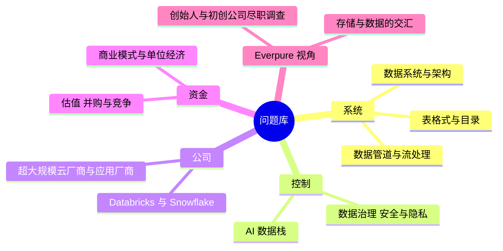
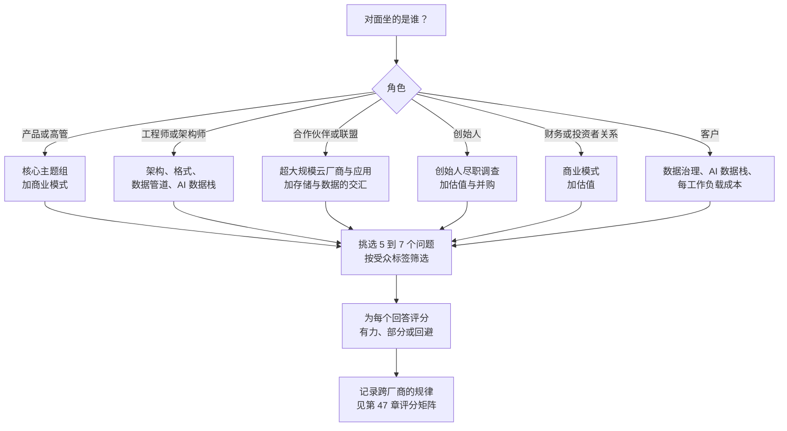

# 48. 问题库：154 个问题
> **深度：** L2 · **阅读时间：** 约 36 分钟 · **最后核实：** 2026-11-01 · **前置阅读：** [第 46 章 — 与数据从业者对话](ch46-talking-with-data-people.md)，[第 47 章 — 尽职调查清单](ch47-diligence-checklist.md)

## 要点速览（TL;DR）

- **这是一个包含 154 个编号问题的实用问题库**，适用于与数据平台厂商、超大规模云厂商合作伙伴团队、创始人、客户及财务对口人员的会谈。每个问题都带有一个主题标签和一个受众标签，大多数问题还附有一条*关注点*说明，指出一个有力的回答应包含哪些内容。
- **十一个主题组**覆盖从数据库内部机制到创始人尽职调查（due diligence）的各个方面。每个主题组都链接到解释答案的相关章节，因此，如果某个问题你无法追问下去，所需的背景知识只需一次点击即可获得。
- **最好的问题会索要一个数字、一个机制和一个权衡。** 薄弱的回答堆砌形容词（"无缝"、"完全开放"、"企业级"）。有力的回答会说出一个单位、一个百分位数、一个客户队列或一个底层原语，并坦承自己放弃了什么。
- **许多问题是围绕前面各章指出的常见误解设计的**：年化运行率（run-rate）不等于 GAAP 收入，开放格式并不能终结锁定，零 ETL（zero-ETL）本质上仍是一条数据管道，而模型本身不执行任何权限控制。善于提问是避免说错话的最快方式。
- **"存储与数据的交汇"主题组是为 Everpure 的战略视角而写的。** 它仅使用公开信息，并将每个问题都设定为战略团队可能向合作伙伴、客户或自身提出的问题，绝不作为对非公开计划的陈述。

## 为何重要（业务 + Everpure 视角）

在数据行业从事企业发展（corporate development）工作的人，每周大部分时间都在进行这样的对话：对方比你更了解产品。Databricks 的合作伙伴经理了解 Storage Ecosystem 计划。创始人了解客户流失队列。客户的架构师知道到底是哪个目录（catalog）持有授权。你不可能比他们知道得更多，但你可以比他们问得更好。一个精准的问题表明你理解其中的机制。它还能让回避变得显而易见，并为你当月会见的五家公司提供可比较的依据。

提问还能保护你的信誉。前面各章的"不要这样说"清单中，大多数是新人可能出于善意说出的陈述："Databricks 的收入是 $7B"、"Snowflake 已经盈利"、"Iceberg 意味着没有锁定"。把同样的观点转化为一个问题（"你们披露的年化运行率是如何定义的？"），就能在不冒风险的情况下获得信息。本问题库正是有意按这种方式构建的。

对于 Everpure（前身为 Pure Storage；NYSE：P，原代码 PSTG）而言，这些对话集中在三个地方。第一是 Databricks、Snowflake、各超大规模云厂商和 NVIDIA 的合作伙伴团队，问题围绕认证、凭证分发（credential vending）和联合销售（co-sell）。第二是 Data Intelligence（基于收购 1touch 构建的产品）附近的标的公司和创始人，问题围绕分类准确率、买方和可比公司。第三是正在决定其湖仓一体（lakehouse）表和 AI 检索层放在何处的客户。本问题库对这三类对话有所侧重，但对任何数据行业会谈都依然有用。

## 如何使用本章

**先读标签。** 每个问题都以 *[Topic: … · Audience: …]* 形式的标签结尾。主题（Topic）对应下面十一个 `##` 主题组之一。受众（Audience）列出应由谁来回答：**PM**（产品经理）、**Engineer**（工程师或解决方案架构师）、**Partner manager**（联盟或合作伙伴工程）、**Founder/CEO**（创始人/CEO）、**CFO/Finance**（财务、投资者关系、FP&A）以及 **Customer**（运行该产品的买方或实践者）。为工程师设计的问题会让 CFO 感到厌烦，反之亦然。会前请先按受众筛选。

**挑五到七个，而不是二十个。** 一小时的会议大约能容纳五个带追问的真正问题。从对方的核心主题中选两个，商业模式或经济性方面选一个，存储或合作伙伴角度选一个，再加一个开放式问题，邀请对方告诉你还遗漏了什么。另外准备三个备用问题，以便在某个回答打开新话题时使用。

**把*关注点*说明当作评分标准。** 它们描述了一个有力回答应包含的内容：一个单位、一个实测数字、一个具名的底层原语、一个坦诚的权衡。会后，将每个回答标记为有力、部分或回避。一个季度下来，不同厂商之间呈现的规律比任何单个回答都更有信息量。[第 47 章](ch47-diligence-checklist.md)将同样的思路转化为一个尽职调查评分矩阵。

**围绕名词追问。** 当回答含糊时，把其中的关键名词变成一个问题重复回去。"我们支持 Iceberg"变成"支持读、写还是提交？用哪个目录？""我们的利润率在改善"变成"是毛利率百分比，还是每客户毛利金额？"追问往往比第一个问题更能揭示真相。

**使用警示表格。** 每个主题组末尾都有一张简短的表格，列出应当引起警惕的回答（取自前面各章指出的误解），并附上用于检验每个回答的追问。如果你听到其中某个回答，请先问追问再继续。

**不要问你无法跟进的问题。** 每个主题组都链接到解释答案的章节。如果某个问题涉及你尚未读过的机制（删除向量、凭证分发、"致命三要素"），请先阅读链接的章节，或者跳过该问题。一个无法跟进的问题比一个没问的问题更损害信誉。

*图 48.1 — 十一个主题组分为五个簇：系统如何运作、谁控制数据、公司、资金，以及 Everpure 特有的视角。*

*图 48.2 — 为一次会议挑选问题，从对方的角色出发，从两到三个主题组中选题，最后为回答评分，以便在不同会议之间进行比较。*

### 覆盖范围：主题 × 受众

一个问题可以标注多个受众，因此每行的受众合计会超过该组的问题数。计数根据本文件中的标签统计得出。

| 主题组 | 问题数 | PM | Engineer | Partner manager | Founder/CEO | CFO/Finance | Customer |
|---|---:|---:|---:|---:|---:|---:|---:|
| architecture（架构） | 14 | 6 | 9 | 2 | 3 | 1 | 3 |
| table formats（表格式） | 14 | 6 | 7 | 3 | 1 | 1 | 7 |
| pipelines（数据管道） | 14 | 5 | 8 | 1 | 2 | 5 | 4 |
| governance（数据治理） | 14 | 5 | 8 | 2 | 2 | 3 | 6 |
| AI data stack（AI 数据栈） | 16 | 7 | 10 | 0 | 3 | 2 | 7 |
| Databricks & Snowflake | 14 | 5 | 7 | 5 | 0 | 6 | 3 |
| hyperscalers & apps（超大规模云厂商与应用） | 14 | 4 | 6 | 6 | 2 | 5 | 3 |
| business model（商业模式） | 14 | 5 | 4 | 1 | 2 | 11 | 1 |
| valuation & M&A（估值与并购） | 14 | 3 | 0 | 2 | 9 | 9 | 0 |
| storage meets data（存储与数据的交汇） | 14 | 4 | 7 | 5 | 1 | 2 | 6 |
| founder diligence（创始人尽职调查） | 12 | 2 | 3 | 1 | 10 | 5 | 2 |
| **合计** | **154** | **52** | **69** | **28** | **35** | **50** | **42** |

*图 48.3 — 工程师（69 个标签）、产品经理（52 个）和财务负责人（50 个）的问题储备最为充足。合作伙伴经理类问题集中在 Everpure 合作伙伴对话发生的领域：超大规模云厂商、Databricks 和 Snowflake，以及存储与数据的交汇。空白是有意为之：AI 数据栈没有合作伙伴经理类问题，估值主题也没有工程师类问题。*

*图 48.4 — 本问题库有意保持均衡：没有任何主题组少于 12 个问题，AI 数据栈问题最多，因为它有最多需要探查的新术语。由 `scripts/charts/ch48_question_counts.py` 根据本章中的标签生成。*

## 数据系统与架构

背景阅读：[第 1 章 — 数据栈全景图](../01-data-systems-foundations/ch01-data-stack-map.md)，[第 3 章 — 数据库内部机制](../01-data-systems-foundations/ch03-database-internals.md)，[第 4 章 — 分布式数据库](../01-data-systems-foundations/ch04-distributed-databases.md)，[第 5 章 — 分析引擎](../01-data-systems-foundations/ch05-analytical-engines.md)，[第 23 章 — 实时分析与 HTAP](../03-ai-data-stack/ch23-real-time-analytics-htap.md)，[第 42 章 — 数据库发展史](../06-history-and-future/ch42-history-of-databases.md)。

**1.** 请带我走一遍：一条记录如何从你们客户的业务数据库到达你们的产品？中间有多少跳、多少份副本，你们消除了哪些？ *[Topic: architecture · Audience: PM, Customer]* — *关注点：* 具名的各跳环节，一个新鲜度数字（例如"Postgres 数据源延迟低于一分钟"），以及对仍然存在的副本的坦诚说明。

**2.** 哪个工作负载类别是你们的核心，哪些相邻工作负载你们只能勉强支持？ *[Topic: architecture · Audience: PM, Founder/CEO]* — *关注点：* 在他们真正为之构建的引擎与他们对外推销的"融合"叙事之间做出坦诚的区分。

**3.** 你们的存储引擎（storage engine）是基于 B 树还是 LSM 树，是什么工作负载促使你们做出这个选择？ *[Topic: architecture · Audience: Engineer]* — *关注点：* 目标客户的读写比例，以及他们接受的代价，例如压实（compaction）停顿或范围扫描变慢。

**4.** 客户默认获得的隔离级别（isolation level）是什么，他们仍可能遇到哪些异常？ *[Topic: architecture · Audience: Engineer, Customer]* — *关注点：* "默认快照隔离，可串行化需以吞吐量为代价"，而不是"我们完全符合 ACID"。

**5.** 你们端到端的写放大是多少，包括设备层面？ *[Topic: architecture · Audience: Engineer]* — *关注点：* 分别量化引擎层和设备层的写放大，以及压实如何调优。存储经济性就隐藏在这里。

**6.** 你们的提交延迟预算是多少，其中存储刷盘时间占多少？ *[Topic: architecture · Audience: Engineer]* — *关注点：* 平台的 `fsync` 延迟，以及组提交在负载下的表现。

**7.** 在三区域部署中，主节点（leader）默认位于何处？来自最远区域的一次写入需要多少次往返、多少毫秒？ *[Topic: architecture · Audience: PM, Engineer]* — *关注点：* 一个尊重物理规律的数字。强一致性写入总要有人承担一次跨区域往返。

**8.** 你们的客户中，实际在生产环境中运行多区域双活（active-active）的比例是多少，相比之下单区域加灾备的比例又是多少？ *[Topic: architecture · Audience: PM, Partner manager]* — *关注点：* 一个比例，而不是一个形容词。宣传册与生产环境之间的差距通常很大。

**9.** 你们的执行器是向量化、编译型还是混合型，为什么选择那个批大小？ *[Topic: architecture · Audience: Engineer]* — *关注点：* 与 CPU 缓存挂钩的批大小，以及编译代码占优的查询形态。

**10.** 你们对对象存储（object storage）发出的请求大小和并行度是多少，每个节点需要多少吞吐量才能让 CPU 保持忙碌？ *[Topic: architecture · Audience: Engineer, Partner manager]* — *关注点：* 明确的请求大小、每节点在途请求数，以及实测的缓存命中率。

**11.** 你们在峰值并发下的 p99 延迟是多少（而不是空闲集群上的中位数），在合并或数据摄取（ingestion）高峰期间它会发生什么变化？ *[Topic: architecture · Audience: Engineer, Customer]* — *关注点：* 在具名负载下的百分位数，以及一份清晰的清单，列出快速模式（按键过滤、时间窗口）和慢速模式（临时的多路连接）。

**12.** 对于每秒数百个小查询的工作负载，你们会如何定价，客户每百万次查询需要支付多少？ *[Topic: architecture · Audience: PM, CFO/Finance]* — *关注点：* 计费单位（计算时间、查询次数或扫描字节数）以及一个算出来的数字。为较少、较大查询而构建的数据仓库往往难以回答这个问题。

**13.** 哪些引擎组件是你们自己构建的，哪些取自 Arrow、Velox 或 DataFusion？ *[Topic: architecture · Audience: Founder/CEO, Engineer]* — *关注点：* 在执行层商品化之后，差异化落在何处的观点：优化器、缓存、目录还是运维。

**14.** 如果一个主流 SQL 引擎明天就推出了你们的核心索引类型，还有什么是难以复制的？ *[Topic: architecture · Audience: Founder/CEO, PM]* — *关注点：* 交付或控制点（control point）层面的优势（托管服务、目录、装机基础），以及被吸收风险的时间框架，而不是关于数据模型的论证。

### 应当引起警惕的回答

| 你可能听到的回答 | 为何应当警惕 | 追问 |
|---|---|---|
| "我们完全符合 ACID。" | 大多数引擎默认使用读已提交或快照隔离，这些级别允许已知的异常。 | "在默认级别下，客户可能遇到哪些异常？" |
| "更快的存储能让整个数据库更快。" | 如果工作集能装入内存，系统受限于 CPU 或锁；存储的作用在于提交和缓存未命中。 | "在 p99 下，I/O 等待占查询时间的比例是多少？" |
| "双活且没有延迟损失。" | 强一致性的跨区域写入必须付出一次往返。 | "由谁承担这次往返，它是多少毫秒？" |

*图 48.5 — 三个关于架构的回答，它们透露的是营销话术而非机制，每个都附有能揭穿它的追问。*

## 表格式与目录

背景阅读：[第 6 章 — 文件格式](../01-data-systems-foundations/ch06-file-formats.md)，[第 7 章 — 开放表格式](../01-data-systems-foundations/ch07-open-table-formats.md)，[第 8 章 — 目录与元数据存储](../01-data-systems-foundations/ch08-catalogs-and-metastores.md)。

**15.** 你们的客户在生产环境中写入哪些表格式和目录，自 2024 年年中以来这一组合发生了怎样的变化？ *[Topic: table formats · Audience: PM, Partner manager]* — *关注点：* 一个带有变化方向的组合，以及"写入"这个词，而不是"支持"。

**16.** 由谁为你们的客户运行压实和快照（snapshot）过期清理：你们、引擎厂商还是客户自己？你们是否为此收费？ *[Topic: table formats · Audience: PM, Customer]* — *关注点：* 一个具名的负责方和一个时间表。无人负责的维护工作日后会以查询变慢和存储膨胀的形式显现。

**17.** 你们如何实现原子提交：目录比较并交换（compare-and-swap）、条件 PUT 还是外部锁？发生冲突重试时会怎样？ *[Topic: table formats · Audience: Engineer]* — *关注点：* 确切的底层原语，例如通过 REST 目录进行基于 ETag 的提交，或对下一个日志条目执行 put-if-absent，并与 Iceberg 规范中的乐观并发规则保持一致。[^ice-spec]

**18.** 对于流式数据摄取，你们的小文件策略是什么，压实前后的文件大小分布如何？ *[Topic: table formats · Audience: Engineer]* — *关注点：* 目标文件大小、压实频率，以及承认读时合并（merge-on-read）在压实运行之前会拖慢读取。

**19.** 考虑到快照和时间旅行（time travel，历史版本查询），你们如何保证被删除的行在保留策略期限内被物理清除？ *[Topic: table formats · Audience: Engineer, Customer]* — *关注点：* 压实加快照过期加孤立文件清理，并为每一步给出时间上限。

**20.** 你们在 Iceberg v3 特性（如删除向量、行级血缘和 variant 类型）上进展如何，你们生态中的哪些引擎落后了？ *[Topic: table formats · Audience: PM, Partner manager]* — *关注点：* 具名的版本和具名的落后者。

**21.** 哪个目录是你们 Iceberg 表的权威记录系统，哪些引擎可以向它提交（而不仅仅是读取）？ *[Topic: table formats · Audience: Customer, Engineer]* — *关注点：* 每个领域一个目录，并明确列出写入方。"所有引擎都可以"是一个危险信号，因为多目录并发写入有损坏数据的风险。

**22.** 如果你离开现有的平台厂商，你需要重建什么：授权、数据血缘（lineage）、标签还是指标定义？ *[Topic: table formats · Audience: Customer, CFO/Finance]* — *关注点：* 一个有定价的退出方案。数据文件可以自由迁移，策略和上下文则不能。

**23.** 你们的引擎获得的是分发的临时凭证，还是长期有效的存储桶密钥？ *[Topic: table formats · Audience: Engineer, Customer]* — *关注点：* 短期有效、按前缀限定范围的凭证分发。每个引擎共享长期密钥是一个危险信号。

**24.** 你们是否测试过目录联邦，哪些策略能在跨目录时得以保留？ *[Topic: table formats · Audience: Engineer, Partner manager]* — *关注点：* 坦诚承认行过滤和脱敏（masking）往往无法跨目录传递。

**25.** 当客户的数据以 Iceberg 格式存放在其自有存储桶中时，与你们的托管存储相比，他们在性能上损失多少，你们如何缩小这一差距？ *[Topic: table formats · Audience: PM, Customer]* — *关注点：* 一个实测的差距，以及具名的手段，如缓存、聚簇和对清单（manifest）统计信息的利用。

**26.** 你们最大的数据集实际使用哪些文件格式（file format），Lance 或 Vortex 是否开始出现在招标需求书（RFP）中？ *[Topic: table formats · Audience: PM, Founder/CEO]* — *关注点：* Parquet 作为默认格式，更新的格式出现在多模态和 AI 工作负载中，并有具体的交易证据支撑。

**27.** 你们写入的行组和页大小是多少，是针对扫描还是针对点查询调优的？ *[Topic: table formats · Audience: Engineer]* — *关注点：* 具体的大小和编解码器设置，以及清楚说明每种布局服务于哪种工作负载。

**28.** 你们的 AI 智能体（agent）从哪里获取表描述和经过认证的指标？ *[Topic: table formats · Audience: PM, Customer]* — *关注点：* 目录或语义层（semantic layer），而不是塞满了模式转储的提示词。

### 应当引起警惕的回答

| 你可能听到的回答 | 为何应当警惕 | 追问 |
|---|---|---|
| "开放格式，所以没有锁定。" | 锁定转移到了目录：授权、凭证、数据血缘和维护服务。 | "如果我们更换目录，需要重建什么？" |
| "每个引擎都可以写入。" | 缺乏协调的多目录写入有损坏表状态的风险。 | "由哪个目录仲裁提交，哪些引擎是经过认证的写入方？" |
| "被删除的行会立即消失。" | 数据会一直存在，直到压实、快照过期和文件清理全部运行完毕。 | "从 DELETE 到物理清除的时间上限是多少？" |

*图 48.6 — 需要深挖的表格式回答：关于开放性的说法通常需要一个目录层面的追问。*

## 数据管道、流处理与集成

背景阅读：[第 9 章 — 数据管道模式](../02-pipelines-and-governance/ch09-pipeline-patterns.md)，[第 10 章 — 数据摄取与集成](../02-pipelines-and-governance/ch10-ingestion-and-integration.md)，[第 11 章 — 流处理与事件平台](../02-pipelines-and-governance/ch11-streaming-and-event-platforms.md)，[第 12 章 — 数据转换与编排](../02-pipelines-and-governance/ch12-transformation-and-orchestration.md)，[第 30 章 — 数据移动与流处理公司](../04-company-deep-dives/ch30-data-movement-streaming-companies.md)。

**29.** 对于你们的头部客户，一张核心表（例如订单表）在你们和他们的平台上共有多少份物理副本，你们是否为每一份收费？ *[Topic: pipelines · Audience: PM, CFO/Finance]* — *关注点：* 一个实际的数量。副本会随着每一跳成倍增加，而每一份都带来存储和计算成本。

**30.** 当你们说零 ETL 时，底层实际运行的是什么？与客户自建的数据管道相比，客户放弃了什么？ *[Topic: pipelines · Audience: PM, Customer]* — *关注点：* "这是由我们运营的变更数据捕获（CDC）"，以及对数据转换、格式选择和可移植性限制的坦诚说明。

**31.** 你们的 CDC 是基于日志的吗？如果你们的连接器停止 48 小时，源数据库的预写日志（WAL）或 binlog 会发生什么？ *[Topic: pipelines · Audience: Engineer]* — *关注点：* 保留期告警和复制槽大小阈值。一个停滞的消费者可能会写满主库的磁盘。

**32.** "恰好一次"（exactly-once）究竟在哪里得到保证：在源连接器、在日志中，还是通过目标端的幂等 `MERGE`？你们依据哪个键去重？ *[Topic: pipelines · Audience: Engineer]* — *关注点：* 将投递与效果区分开，例如"至少一次"投递加上基于主键与日志位置的幂等合并。

**33.** 你们如何在不暂停实时数据流的情况下回填一张表？ *[Topic: pipelines · Audience: Engineer]* — *关注点：* 与变更流交错执行的增量快照，以及分区级别的幂等重处理。

**34.** 你们的数据行数和收入中，前十大连接器与长尾连接器各占多少比例？哪一部分增长更快？ *[Topic: pipelines · Audience: PM, CFO/Finance, Founder/CEO]* — *关注点：* 意识到平台捆绑的连接器在争夺头部，而长尾才是维护成本和客户黏性所在。

**35.** 每月有多少工程师工时投入连接器维护，其中多少来自上游 API 变动而非缺陷修复？ *[Topic: pipelines · Audience: Engineer, Founder/CEO]* — *关注点：* 一个实测的比例。"连接器是商品"是错误的回答：构建一个很便宜，维护数百个则不然。

**36.** 当数据源新增、删除某一列或更改其类型时，默认会发生什么：演进、阻断还是隔离？ *[Topic: pipelines · Audience: Engineer, Customer]* — *关注点：* 一个明确的默认行为、一个可配置的策略，以及一条通知表负责人的告警路径。

**37.** 流数据量中有多大比例对延迟足够宽容、可以使用对象存储层，你们如何为该层相对于传统集群定价？ *[Topic: pipelines · Audience: PM, CFO/Finance]* — *关注点：* 关于数据量增长能否超过每 GB 收入下降的判断。

**38.** 在无盘、以对象存储为后端的 Kafka 设计中，由什么来为记录排序？如果元数据服务失去法定多数（quorum），在途批次会发生什么？ *[Topic: pipelines · Audience: Engineer]* — *关注点：* 一个具名的排序器，以及在明确刷盘间隔下给出的 p99 延迟。这是一个不同的延迟等级，而不只是更便宜的 Kafka。

**39.** 自 IBM 于 2026 年 3 月完成对 Confluent 的收购以来，对非 IBM 云和数据平台的哪些承诺是合同约定的，而不仅仅是愿景？ *[Topic: pipelines · Audience: Partner manager, Customer]* — *关注点：* 具名的承诺和支持条款。该交易于 2026-03-17 完成，企业价值约 $11B（公司披露）。[^ibm-confluent]

**40.** 自 Fivetran 与 dbt Labs 合并以来，合并后的 ARR 中有多少来自同时购买数据摄取和数据转换（transformation）的客户，净收入留存率（NRR）如何变化？ *[Topic: pipelines · Audience: CFO/Finance, PM]* — *关注点：* 一个交叉购买率和一个客户队列视角，对照两家公司所称接近 $600M 的合并 ARR（公司披露）。[^fivetran-dbt]

**41.** 当上游模式发生变化时，最先在哪里失败：生产者端 CI、dbt 契约，还是生产环境？ *[Topic: pipelines · Audience: Engineer, Customer]* — *关注点：* "在生产者端 CI，通过契约检查"。"我们是从仪表板上发现的"是薄弱的回答。

**42.** 你们的 gold 层表存在多少份环境副本，由谁来删除它们？ *[Topic: pipelines · Audience: Engineer, CFO/Finance]* — *关注点：* 零拷贝（zero-copy）克隆或虚拟环境，加上一项保留策略。这也是本组中与存储最相关的问题。

### 应当引起警惕的回答

| 你可能听到的回答 | 为何应当警惕 | 追问 |
|---|---|---|
| "零 ETL 意味着没有数据管道。" | 数据管道依然存在；只是由厂商来运行，通常以 CDC 形式。 | "当源端发生模式变更或删除时会怎样？" |
| "Kafka 为我们提供恰好一次语义，所以不可能有重复。" | 恰好一次只在 Kafka 内部成立；外部目标端必须是幂等的或事务性的。 | "目标端依据哪个键去重？" |
| "连接器是商品。" | 构建一个很便宜；真正的成本在于针对不断变化的 API 维护数百个连接器。 | "每月有多少工程师工时投入维护？" |

*图 48.7 — 掩盖了工作量的数据管道回答：每一个都把工作转嫁给了不在场的人。*

## 数据治理、安全与隐私

背景阅读：[第 13 章 — 数据质量、可观测性与数据血缘](../02-pipelines-and-governance/ch13-data-quality-observability-lineage.md)，[第 14 章 — 语义层与 BI](../02-pipelines-and-governance/ch14-semantic-layers-and-bi.md)，[第 15 章 — 数据治理、安全与隐私](../02-pipelines-and-governance/ch15-governance-security-privacy.md)，[第 33 章 — 数据治理、目录与安全公司](../04-company-deep-dives/ch33-governance-catalog-security-companies.md)。

**43.** 当你们的分类器为某一列打上标签时，这个标签去了哪里：你们自己的控制台，还是 Unity Catalog、Horizon 和 Purview，以便由它们的引擎来执行？需要多长时间？ *[Topic: governance · Audience: PM, Partner manager]* — *关注点：* 具名的回写 API、一个同步延迟以及冲突处理规则。

**44.** 敏感数据发现结果中，有多大比例来自非结构化存储，以及任何目录都不知道的副本？ *[Topic: governance · Audience: PM, Customer]* — *关注点：* 影子副本存在的证据。这个比例正是在目录之下进行数据发现（discovery）的理由。

**45.** 你们如何定价：按扫描的 GB 数、按数据存储数量，还是按身份数量？当客户的数据翻倍时，账单会怎样？ *[Topic: governance · Audience: CFO/Finance, Customer]* — *关注点：* 一个不惩罚增长的计费单位，或者坦诚承认它确实会惩罚增长。

**46.** 请带我走一遍你们针对数 PB 级对象存储资产和大型文件共享的抽样策略。在真实客户数据上，漏检率和误报率是多少？ *[Topic: governance · Audience: Engineer]* — *关注点：* 明确的抽样规则、触发全量扫描的置信度阈值，以及实测的错误率。

**47.** 你们的 LLM 分类器在哪里运行，哪些数据会离开客户的边界，你们如何让标签具备足以满足审计要求的可重复性？ *[Topic: governance · Audience: Engineer, Customer]* — *关注点：* 边界内推理、固定的模型版本，以及为每个标签保存的证据。

**48.** 你们如何将一次检测结果关联到具体的数据主体，又如何证明一项删除请求已在备份和衍生表中完成？ *[Topic: governance · Audience: Engineer, Customer]* — *关注点：* 一种具有实测精确度的实体解析方法，以及一条能延伸到向量和缓存的删除链。

**49.** 当一个智能体查询你们的平台时，查询以谁的身份运行，审计日志是否同时显示用户和智能体？ *[Topic: governance · Audience: PM, Engineer, Customer]* — *关注点：* 一个代表用户（on-behalf-of）的令牌、执行该用户的行过滤规则，以及一个单独的执行者字段。一个拥有自己管理员账户的智能体正是"混淆代理人"（confused deputy）模式。

**50.** 行级和列级策略是在语义层执行、在数据仓库中执行，还是两者兼有？ *[Topic: governance · Audience: Engineer]* — *关注点：* 在数据仓库中以最终用户身份执行，而不是使用共享的服务账户。

**51.** 你们的数据血缘是从 SQL 中解析的、通过 OpenLineage 发出的，还是从平台读取的？哪些部分会成为漏网之鱼？ *[Topic: governance · Audience: Engineer]* — *关注点：* 具名的盲区，例如 Python 数据转换、基于路径的读取和 BI 抽取，以及数据血缘是否达到列级。

**52.** 当 Databricks 和 Snowflake 免费提供新鲜度和数据量检查时，客户还为什么向你们付费？ *[Topic: governance · Audience: Founder/CEO, PM]* — *关注点：* 跨平台数据血缘、事件处理工作流、分布检查以及面向智能体的可信度 API，并附上客户名称。

**53.** 你们新增 ARR 中有多大比例来自已在运行 Unity Catalog、Horizon 或 Purview 的客户，他们在此之上向你们购买什么？ *[Topic: governance · Audience: Founder/CEO, CFO/Finance]* — *关注点：* 跨平台的广度和对非结构化数据的覆盖，以及承认对于单一平台的企业而言，平台自带目录已经足够好。

**54.** 你们每分类 1 TB 数据的扫描成本是多少，抽样如何改变了毛利率（gross margin）？ *[Topic: governance · Audience: CFO/Finance, Engineer]* — *关注点：* 将首次扫描与增量扫描分开，并承认在准确率上的权衡。

**55.** 买方是谁，首席数据官还是首席信息安全官？这如何改变销售周期和竞争对手组合？ *[Topic: governance · Audience: PM, Partner manager]* — *关注点：* 清楚地认识到态势管理工具卖给安全团队，而目录则向数据团队销售数据管理（stewardship）能力。

**56.** 你们的产品在 GDPR 框架下如何对待经过令牌化（tokenization）或假名化的数据？ *[Topic: governance · Audience: Customer, Engineer]* — *关注点：* 认识到只要有人能够重新识别，假名化数据通常仍属于个人数据。

### 应当引起警惕的回答

| 你可能听到的回答 | 为何应当警惕 | 追问 |
|---|---|---|
| "我们有 RBAC，所以已经实现了治理。" | 角色保护的是表，而不是表中的敏感列和文档。 | "敏感列是如何被发现和打标签的？" |
| "我们有数据血缘。" | 往往只到表级，并且看不到 Python 数据转换和 BI 抽取。 | "是列级的吗，能否跨越系统边界？" |
| "分类是一个一次性项目。" | 数据资产每天都在变化；漂移监控才是真正的产品。 | "多久重新扫描一次数据资产，由什么触发？" |

*图 48.8 — 听起来很完整、却让敏感数据本身无人管理的数据治理回答。*

## AI 数据栈（RAG、向量、智能体、训练数据）

背景阅读：[第 16 章 — AI 数据生命周期](../03-ai-data-stack/ch16-ai-data-lifecycle.md)，[第 17 章 — 非结构化数据处理](../03-ai-data-stack/ch17-unstructured-data-processing.md)，[第 18 章 — 嵌入与向量检索](../03-ai-data-stack/ch18-embeddings-and-vector-search.md)，[第 19 章 — 检索架构](../03-ai-data-stack/ch19-retrieval-architectures.md)，[第 20 章 — 训练数据供应链](../03-ai-data-stack/ch20-training-data-supply-chain.md)，[第 21 章 — ML 平台、特征存储与 LLMOps](../03-ai-data-stack/ch21-ml-platforms-feature-stores-llmops.md)，[第 22 章 — 智能体与数据](../03-ai-data-stack/ch22-agents-and-data.md)，[第 32 章 — AI 原生数据公司](../04-company-deep-dives/ch32-ai-native-data-companies.md)。

**57.** 你们的客户目前为 AI 生命周期的哪些阶段向你们付费，哪些阶段仍由他们自建？自 2024 年以来这一情况有何变化？ *[Topic: AI data stack · Audience: PM, Founder/CEO]* — *关注点：* 按阶段逐一作答，并将前沿实验室的需求与企业需求区分开来。

**58.** 你们如何知道某个客户的检索增强生成（RAG）或智能体系统在上个季度变得更好了，评估集由谁负责？ *[Topic: AI data stack · Audience: PM, Customer]* — *关注点：* 一个经过评分的黄金测试集，有具名的负责人，并作为每次发布的准入关卡。

**59.** 你们能否复现六个月前某个模型或智能体给出的答案：数据集提交版本、检查点、索引版本和提示词？ *[Topic: AI data stack · Audience: Engineer, Customer]* — *关注点：* 像对待代码一样对数据和索引进行版本管理。大多数团队做不到，而这本身就很能说明问题。

**60.** 你们是在向量排序之前还是之后按访问控制列表过滤？如何处理嵌套组和匿名共享链接？ *[Topic: AI data stack · Audience: Engineer]* — *关注点：* 预过滤或图内过滤。模型本身不执行任何控制；访问控制必须在令牌进入上下文窗口之前完成。

**61.** 当源系统中的组成员关系发生变化时，需要多长时间才能在搜索和 RAG 结果中体现出来，这在合同中有保证吗？ *[Topic: AI data stack · Audience: Customer, PM]* — *关注点：* 针对组变更和删除操作分别给出实测的传播延迟。

**62.** 当一份文档被删除时，你们如何找到并清除由它衍生的每一个分块、向量和缓存答案？ *[Topic: AI data stack · Audience: Engineer, Customer]* — *关注点：* 从源文档到分块再到向量的血缘关系，以及一种能延伸到答案缓存的清除机制。

**63.** 你们是在多高的 recall@10 下报出延迟的，过滤选择性如何，基于哪个数据集？ *[Topic: AI data stack · Audience: Engineer]* — *关注点：* 在明确的百分位数下同时报出延迟和召回率。近似最近邻（ANN）检索在设计上就是近似的。

**64.** 你们的向量索引存放在哪里，DRAM、NVMe 还是对象存储？自 S3 Vectors 推出以来，你们每百万向量的成本如何变化？ *[Topic: AI data stack · Audience: PM, Engineer, CFO/Finance]* — *关注点：* 每一层中每个向量占用的字节数，例如在 RAM 中存放量化向量，在闪存中存放全精度向量用于重新打分。

**65.** 在客户技术栈中已有 pgvector 或 S3 Vectors 的情况下，你们在新工作负载中的胜率是多少，依靠什么标准取胜？ *[Topic: AI data stack · Audience: Founder/CEO, PM]* — *关注点：* 一个可衡量的优势，例如在明确召回率下的每百万向量成本，而不是"我们是专门打造的"。

**66.** 当客户更换嵌入（embedding）模型时，重新嵌入需要花费多少时间和资金，你们是否提供帮助？ *[Topic: AI data stack · Audience: Customer, PM]* — *关注点：* 一个算出来的估计值，以及一条不会让索引规模连续数周翻倍的迁移路径。

**67.** 你们是否运行混合检索（hybrid search）？如何融合各个排序列表，重排序器（reranker）在质量和延迟上带来了什么？ *[Topic: AI data stack · Audience: Engineer]* — *关注点：* 关键词检索加向量检索、一种具名的融合方法，以及每增加一毫秒带来的实测质量提升。

**68.** 目前客户在哪些场景下选择长上下文而不是检索，提示词缓存如何改变了这一组合？ *[Topic: AI data stack · Audience: PM, Engineer]* — *关注点：* 一种观点，即缓存缩小了成本差距，但权限、新鲜度和规模问题依然存在。

**69.** 你们的文本转 SQL（text-to-SQL）流水线如何进行模式关联和修复，在我们的问题上（而不是公开基准上）准确率如何？ *[Topic: AI data stack · Audience: Engineer, Customer]* — *关注点：* 一个基于真实问题构建的内部评估集。在企业风格的 Spider 2.0 基准上，原论文中最好的系统仅解决了约 21% 的任务。[^spider2]

**70.** 你们的哪些 MCP 工具可以写入、发送或从互联网获取内容，是否有任何会话能将这些能力与不可信输入结合起来？ *[Topic: AI data stack · Audience: Engineer, Customer]* — *关注点：* 明确说出"致命三要素"（lethal trifecta），以及每种配置去掉了其中哪一条腿。

**71.** 你们的训练数据支出中，人工数据、授权许可和合成数据（synthetic data）生成各占多少？如果你们最大的数据供应商接受了某个竞争实验室的战略投资，你们会怎么做？ *[Topic: AI data stack · Audience: Founder/CEO, CFO/Finance]* — *关注点：* 一个大致的构成比例，以及一项带有集中度上限的多供应商策略。

**72.** 你们运行什么样的去重技术栈，如何针对你们报告的基准进行去污染？ *[Topic: AI data stack · Audience: Engineer]* — *关注点：* 精确去重、MinHash 去重和语义去重，并给出明确的阈值，以及展示效果的消融实验。

### 应当引起警惕的回答

| 你可能听到的回答 | 为何应当警惕 | 追问 |
|---|---|---|
| "RAG 消除了幻觉。" | 当检索正确时它能减少幻觉；但模型仍可能误读检索到的文本。 | "你们如何在自己的黄金测试集上衡量忠实度？" |
| "模型会遵守文档权限。" | 模型本身不执行任何控制；过滤必须在令牌进入上下文窗口之前完成。 | "访问控制列表过滤是在流水线的哪个环节执行的？" |
| "文本转 SQL 已经解决了。" | 高分来自简单的基准；企业风格任务的得分要低得多。[^spider2] | "在我们的问题上你们看到的准确率是多少？" |

*图 48.9 — 需要质疑的 AI 数据栈回答：演示与生产之间的差距通常落在权限和评估上。*

## Databricks 与 Snowflake

背景阅读：[第 25 章 — Databricks](../04-company-deep-dives/ch25-databricks.md)，[第 26 章 — Snowflake](../04-company-deep-dives/ch26-snowflake.md)，[第 27 章 — Databricks 对比 Snowflake](../04-company-deep-dives/ch27-databricks-vs-snowflake.md)。

**73.** 目前有多大比例的 DBU 运行在无服务器（serverless）模式上，无服务器 SQL 的毛利率与传统 Jobs 计算相比如何？ *[Topic: Databricks & Snowflake · Audience: PM, CFO/Finance]* — *关注点：* 一个方向和一个机制，例如来自预热资源池和引擎效率的利用率提升。

**74.** 你们披露的收入年化运行率是如何定义的，净收入留存是按金额计算还是按 DBU 计算？ *[Topic: Databricks & Snowflake · Audience: CFO/Finance]* — *关注点：* 具体算法：季度乘以四，还是期末月份乘以十二。2026 年 8 月公布的 >$7B 数字是公司披露的、未经审计的年化运行率，而不是 GAAP 收入。[^db-7b]

**75.** 对于 Databricks Storage Ecosystem 中的存储合作伙伴，Unity Catalog 在本地部署环境中治理哪些内容（权限、数据血缘、审计），共享服务器的服务水平由谁负责？ *[Topic: Databricks & Snowflake · Audience: Partner manager, Engineer]* — *关注点：* 在目录负责执行的内容与存储合作伙伴必须保证的内容之间做出清晰的划分。该计划于 2026-06-10 宣布。[^dbx-storage]

**76.** 当外部引擎读取存放在 S3 兼容存储上的 Unity Catalog 表时，凭证如何分发？在非 AWS 端点上会怎样？ *[Topic: Databricks & Snowflake · Audience: Engineer, Partner manager]* — *关注点：* 临时凭证的范围限定，以及端点和签名方面的要求。

**77.** 借助 UniForm，第三方引擎目前能读取哪些 Iceberg 特性？Delta 提交之后，元数据生成的滞后是多少？ *[Topic: Databricks & Snowflake · Audience: Engineer]* — *关注点：* 具体的版本号，以及元数据生成是同步还是异步的。

**78.** Lakebase 将页面和预写日志存放在哪里，这一层能否放在客户管理的对象存储上？ *[Topic: Databricks & Snowflake · Audience: Engineer, Partner manager]* — *关注点：* 对日志服务与页面服务器之间分工的清晰解释，如果确实如此，坦诚地说"目前还不行"。

**79.** 目前 Snowflake 积分（credits）中有多大比例来自 AI（Cortex 函数、智能体、CoWork），这部分消耗的毛利率与 SQL 仓库相比如何？ *[Topic: Databricks & Snowflake · Audience: PM, CFO/Finance]* — *关注点：* 明确指出模型托管成本是驱动因素，并关注毛利金额而不仅仅是毛利率百分比。

**80.** 当客户把表从托管存储迁移到其自有存储卷上的 Iceberg 时，一年之后该客户的消耗会发生什么变化？ *[Topic: Databricks & Snowflake · Audience: PM, CFO/Finance]* — *关注点：* 客户队列证据（计算上升、存储收入下降），而不是断言开放性对所有人都有利。

**81.** 你们如何决定是否发布一项会降低客户账单的性能改进？ *[Topic: Databricks & Snowflake · Audience: PM, CFO/Finance]* — *关注点：* 价格弹性、胜率和工作负载迁移。效率提升相当于一次降价，需要靠弹性来弥补。

**82.** 对于存放在三大云之外的 S3 兼容外部存储卷上的 Iceberg 表，支持哪些操作，适用哪些端点、TLS 和签名要求？ *[Topic: Databricks & Snowflake · Audience: Engineer, Partner manager]* — *关注点：* 一份针对读取、写入和 Snowflake 托管目录的具体支持矩阵。

**83.** 当外部引擎通过 Iceberg REST 端点读取受 Horizon 治理的表时，脱敏和行访问策略是否会被执行，还是只执行表级授权？ *[Topic: Databricks & Snowflake · Audience: Engineer, Customer]* — *关注点：* 一份坦诚的清单，列出哪些策略能传递到第三方引擎。

**84.** 请为这个工作负载在你们的平台上报价：一个每晚运行两小时的 ETL 作业，以及一个运行十小时的 BI 仪表板。概念验证显示每个完成的作业成本是多少？ *[Topic: Databricks & Snowflake · Audience: Customer, CFO/Finance]* — *关注点：* 每工作负载成本。DBU 和积分计量的工作量不同，因此单价无法直接比较。

**85.** 当一个客户同时运行两个平台时，由哪个目录治理共享的 Iceberg 表，权限如何在两者之间流转？ *[Topic: Databricks & Snowflake · Audience: Customer, Partner manager]* — *关注点：* 一个具名的权威记录目录，以及 Iceberg REST 路径。大多数大型企业同时运行两者。

**86.** 你们的智能体（Databricks 上的 Genie、Snowflake 上的 CoWork）如何解析业务定义：通过语义层、目录还是提示词上下文？ *[Topic: Databricks & Snowflake · Audience: PM, Engineer]* — *关注点：* 一个具名的、受治理的语义对象，例如指标视图（metric views）或语义视图（semantic views）。

### 应当引起警惕的回答

| 你可能听到的回答 | 为何应当警惕 | 追问 |
|---|---|---|
| "Databricks 的收入是 $7B。" | 这是公司披露的、未经审计的年化运行率，而不是 GAAP 收入。[^db-7b] | "年化运行率是如何计算的？" |
| "Snowflake 已经盈利。" | 仅在非 GAAP 口径下成立；Q2 FY2027 的 GAAP 营业利润率为负。[^sf-q2] | "这一差距中有多少来自股权激励费用？" |
| "一个 DBU 比一个积分便宜。" | 这两个单位计量的工作量不同。 | "这个工作负载在两个平台上每个完成作业的成本分别是多少？" |

*图 48.10 — 关于两大平台的常见错误表述，以及用来替代它们的问题。*

## 超大规模云厂商与应用厂商

背景阅读：[第 28 章 — 超大规模云厂商数据平台](../04-company-deep-dives/ch28-hyperscaler-data-platforms.md)，[第 29 章 — 业务型数据库厂商](../04-company-deep-dives/ch29-operational-database-vendors.md)，[第 34 章 — 作为数据平台的应用巨头](../04-company-deep-dives/ch34-application-giants-data-platforms.md)，[第 40 章 — 市场进入与合作伙伴关系](../05-business-and-economics/ch40-gtm-partnerships.md)。

**87.** 你们的数据与分析消耗中，有多大比例来自你们云市场（marketplace）上的第三方平台，相比之下原生服务占多少？一线销售在两者上分别如何获得报酬？ *[Topic: hyperscalers & apps · Audience: Partner manager]* — *关注点：* 承认两者都计入销售配额和承诺消费额度（committed spend）的消耗，这正是超大规模云厂商能从 Databricks 和 Snowflake 获利的原因。

**88.** 哪些云市场采购可以计入客户的云承诺消费，比例是多少，上限如何？ *[Topic: hyperscalers & apps · Audience: Partner manager, CFO/Finance]* — *关注点：* 资格规则和私有报价（private offer）条款。私有报价的上架费用如今是较低的个位数百分比，而不是过去应用商店约 20% 的费率。[^aws-fees]

**89.** 你们的目录是用于治理其他引擎读取的数据，还是只治理你们自己引擎读取的数据？ *[Topic: hyperscalers & apps · Audience: PM, Engineer]* — *关注点：* 具名的 Iceberg REST 端点、凭证分发，以及一份受支持的外部引擎清单。

**90.** 当你们的引擎写入一张 S3 Tables 或 BigLake Iceberg 表时，Databricks 或 Snowflake 也能安全地写入它吗？ *[Topic: hyperscalers & apps · Audience: Engineer]* — *关注点：* 由目录协调的提交，以及经过写入认证（而不仅是读取认证）的引擎。

**91.** 零 ETL 或镜像如何处理模式变更和删除，端到端延迟是多少？ *[Topic: hyperscalers & apps · Audience: Engineer, Customer]* — *关注点：* 对 CDC 路径、其局限性以及源端模式变更时会发生什么的清晰描述。

**92.** 在 Oracle Database@Azure 或 @AWS 中，由谁运营硬件，许可、支持和基础设施收入在两家公司之间如何分配？ *[Topic: hyperscalers & apps · Audience: Partner manager, CFO/Finance]* — *关注点：* 由 Oracle 运营、位于宿主云数据中心内的硬件，自带许可与含许可两种模式的区别，以及谁确认哪部分收入。

**93.** 哪个合作伙伴等级或计划身份能真正改变平台一线销售的行为：上架、验证，还是联合销售注册？ *[Topic: hyperscalers & apps · Audience: Partner manager, Founder/CEO]* — *关注点：* 联合销售注册和承诺消费资格。仅仅上架改变不了多少。

**94.** 当平台发布一个重大版本时，重新认证需要多长时间，费用由谁承担？ *[Topic: hyperscalers & apps · Audience: Partner manager, Engineer]* — *关注点：* 最近一次重新认证的日期和所测试的版本。

**95.** 当 Agentforce 或 Joule 智能体需要存放在 Databricks 中的数据时，它是就地查询、缓存还是复制，这部分计算由谁付费？ *[Topic: hyperscalers & apps · Audience: PM, Customer]* — *关注点：* 精确区分联邦查询与缓存，并给出延迟和计费方式。

**96.** 智能体操作中有多大比例是回写到权威记录系统，而不是回答问题？ *[Topic: hyperscalers & apps · Audience: PM, Engineer]* — *关注点：* 一个实测的比例，以及审批和审计如何适用于写入操作。

**97.** 客户在续约时如何将席位许可转换为智能体消耗？ *[Topic: hyperscalers & apps · Audience: CFO/Finance, Customer]* — *关注点：* 合同机制，例如积分池和转换比率，而不是一句口号。

**98.** 你们的"零拷贝"集成是通过开放协议（Iceberg REST、Delta Sharing、OpenSharing）还是专有连接器提供的？ *[Topic: hyperscalers & apps · Audience: Engineer, Partner manager]* — *关注点：* 协议名称以及元数据的权威来源。查询仍然会移动数据，缓存仍然持有副本。

**99.** 对于一项文档数据库服务，近期增长中有多少来自新工作负载，多少来自现有工作负载的消耗增长？你们如何在遥测数据中识别 AI 工作负载？ *[Topic: hyperscalers & apps · Audience: CFO/Finance, PM]* — *关注点：* 将新工作负载增长与现有工作负载增长分开，并说明标记 AI 用途的方法。

**100.** 对于一个无服务器 Postgres 平台，有多大比例的数据库是由智能体创建的，其中多少能存活 30 天，每个存活数据库的收入是多少？ *[Topic: hyperscalers & apps · Audience: Founder/CEO, CFO/Finance]* — *关注点：* 客户队列的存活率和转化率，而不是创建数量。

### 应当引起警惕的回答

| 你可能听到的回答 | 为何应当警惕 | 追问 |
|---|---|---|
| "超大规模云厂商想要干掉 Databricks 和 Snowflake。" | 它们通过基础设施、云市场费用和承诺消费从两者身上获利。 | "你们的一线销售在合作伙伴消耗上如何获得报酬？" |
| "云市场抽成 20%。" | 私有报价的上架费用如今是较低的个位数百分比。[^aws-fees] | "私有报价适用哪个费率区间？" |
| "零拷贝意味着数据不会移动。" | 查询仍会在网络间移动数据，缓存也持有副本。 | "这是联邦查询还是缓存，计算由谁付费？" |

*图 48.11 — 听起来像是对立关系或免费午餐的合作伙伴生态回答，以及其背后的经济逻辑。*

## 商业模式与单位经济

背景阅读：[第 35 章 — 商业模式](../05-business-and-economics/ch35-business-models.md)，[第 36 章 — 单位经济与 KPI](../05-business-and-economics/ch36-unit-economics-kpis.md)，[第 41 章 — 市场规模测算](../05-business-and-economics/ch41-market-sizing.md)。

**101.** 你们的收入中有多大比例按消耗确认，多少按期间平均确认？按消耗确认的部分中，有多少处于带结转条款的承诺合同之下？ *[Topic: business model · Audience: CFO/Finance]* — *关注点：* 将现金（开票额、剩余履约义务 RPO）与收入（消耗）分开，以及按需部分的占比。

**102.** 当你们发布上一次重大性能改进时，假设了怎样的弹性，随后两个季度的工作负载增长如何？ *[Topic: business model · Audience: PM, CFO/Finance]* — *关注点：* 以"每查询成本下降 X，查询量上升 Y"形式呈现的证据。

**103.** 客户经理（account executive）的薪酬依据是什么：签约额、消耗还是两者兼有？如果某位销售的客户过度承诺，这位销售会怎样？ *[Topic: business model · Audience: CFO/Finance, Partner manager]* — *关注点：* 一个奖励消耗的薪酬方案，因为过度承诺日后会以结转和流失的形式显现。

**104.** 客户账单中哪部分是你们的软件，哪部分是你们转售的云基础设施？这在传统模式和无服务器模式之间有何变化？ *[Topic: business model · Audience: CFO/Finance, Engineer]* — *关注点：* 认识到无服务器模式可能降低毛利率百分比，同时提高每客户的毛利金额。

**105.** 你们使用哪些遥测数据来预测消耗，能提前多久预见到某个客户即将启动优化项目？ *[Topic: business model · Audience: CFO/Finance, Engineer]* — *关注点：* 领先指标，例如查询构成和仓库规格，并给出明确的提前期。

**106.** 如果我们按查询次数而不是按 TB 为这项功能定价，我们需要计量什么，又有什么能防止客户钻计费单位的空子？ *[Topic: business model · Audience: PM, Engineer]* — *关注点：* 一个与成本驱动因素挂钩的计量方式，以及对客户将如何针对它进行优化的判断。

**107.** 你们如何定义净收入留存率：哪个客户队列、哪个时间窗口，是否包括经销商的终端客户？ *[Topic: business model · Audience: CFO/Finance]* — *关注点：* 客户队列的纳入规则、基于收入还是 ARR 的计量方式，以及滚动平滑处理。Snowflake 报告 Q2 FY2027（2026 年 5 月–7 月）的 NRR 为 126%，这与其他公司的 NRR 不能直接比较。[^sf-q2]

**108.** 剩余履约义务中有多大比例会在未来十二个月内转化，当前收入中有多少是按需收入？ *[Topic: business model · Audience: CFO/Finance]* — *关注点：* 当期 RPO 对下一年收入的覆盖程度，以及结转条款。

**109.** AI 工作负载如何改变产品毛利率，你们的定价是否旨在保护每单位的毛利金额？ *[Topic: business model · Audience: CFO/Finance, PM]* — *关注点：* 明确指出 GPU 或计算强度是成本驱动因素，以及与之相匹配的定价。

**110.** 一次典型查询的成本中，计算、存储和出口流量各占多少比例？ *[Topic: business model · Audience: Engineer, Customer]* — *关注点：* 计算在分析账单中占主导，存储占比很小，出口流量费（egress fees）主要在跨云共享时才有影响。

**111.** 你们将哪些引擎效率提升以降低消耗的形式让利给了客户？ *[Topic: business model · Audience: PM, CFO/Finance]* — *关注点：* 具体的例子，以及承认收入会先下降，然后才由弹性带回增长。

**112.** 你们如何调节 GAAP 与非 GAAP 营业利润率，这一差距中有多少来自股权激励费用（SBC）？ *[Topic: business model · Audience: CFO/Finance]* — *关注点：* 将股权激励费用视为真实成本。在 Q2 FY2027，Snowflake 的营业利润率为 15.3%（非 GAAP）和 −17.0%（GAAP）。[^sf-q2]

**113.** 你们的总可服务市场（TAM）替代的是客户预算中的哪些项目？请说出具体的成本中心。 *[Topic: business model · Audience: Founder/CEO, CFO/Finance]* — *关注点：* 一个基于工作负载和价格点自下而上的测算，并注明基础和年份。

**114.** 如果你们客户的员工人数减少，你们的哪些计量指标会增长？ *[Topic: business model · Audience: PM, Founder/CEO]* — *关注点：* 按用量或按结果的计量方式而非按席位计量，以及一种观点，认为智能体既是对席位的威胁，也是查询量的驱动因素。

### 应当引起警惕的回答

| 你可能听到的回答 | 为何应当警惕 | 追问 |
|---|---|---|
| "按用量计费的收入就是经常性收入。" | 只有使用量持续，收入才会持续；承诺锁定的是现金，而不是收入确认的时点。 | "按需部分与从承诺额度中消耗的部分各占多少？" |
| "RPO 就是明年的收入。" | 只有当期部分预计会在十二个月内确认，而且容量可以结转。 | "RPO 中当期部分占多少，结转条款是什么？" |
| "毛利率更低意味着业务更差。" | 无服务器模式可能降低毛利率百分比，同时提高毛利金额。 | "每客户的毛利金额发生了什么变化？" |

*图 48.12 — 混淆了现金、收入和利润率的商业模式回答；追问能将它们区分开来。*

## 估值、并购与竞争

背景阅读：[第 37 章 — 上市可比公司与估值](../05-business-and-economics/ch37-public-comps-valuation.md)，[第 38 章 — 开源战略](../05-business-and-economics/ch38-open-source-strategy.md)，[第 39 章 — 并购历史](../05-business-and-economics/ch39-ma-history.md)，[第 43 章 — 现代数据栈](../06-history-and-future/ch43-modern-data-stack.md)。

**115.** 明年收入中有多大比例已经以 RPO 或承诺消费额度的形式签约，相比之下有多少是你们预期会落地的消耗？ *[Topic: valuation & M&A · Audience: CFO/Finance]* — *关注点：* 一个区间，以及对承诺如何转化为消耗的解释。

**116.** 使用两个及以上产品的客户与单一产品客户之间，净收入留存率有何差异？ *[Topic: valuation & M&A · Audience: CFO/Finance, PM]* — *关注点：* 一个量化的平台效应。多产品交叉购买正是让一家公司从单点工具估值倍数跃升到平台估值倍数的关键。

**117.** 今年的增长中哪部分来自价格，哪部分来自用量？ *[Topic: valuation & M&A · Audience: CFO/Finance]* — *关注点：* 将标价变动和成本转嫁与使用量增长区分开来。投资者资本化的是后者，而不是前者。

**118.** 当你把一轮私募融资与一个公开市场倍数进行比较时，你如何针对优先权、年化运行率与 GAAP 的差异、股权价值与企业价值的差异以及流动性不足进行调整？ *[Topic: valuation & M&A · Audience: CFO/Finance]* — *关注点：* 全部四项调整。Databricks 的 $190B 是一个以公司披露的年化运行率为参照的优先股投后价格，而不是一个 EV/未来 12 个月收入倍数。[^db-7b]

**119.** 当你为一家态势管理或目录类标的公司做基准比较时，你使用哪些可比公司，为什么选它们？ *[Topic: valuation & M&A · Audience: CFO/Finance, Founder/CEO]* — *关注点：* 将平台型交易与能力补强型收购（tuck-in）区分开，并说明每笔交易的价值口径。

**120.** 这个标的会让我们的装机基础更有价值，还是会让我们与平台合作伙伴形成竞争？ *[Topic: valuation & M&A · Audience: Partner manager, Founder/CEO]* — *关注点：* 受影响的具名合作伙伴，以及标签或策略将如何流向它们的目录。

**121.** 保留品牌还是吸收品牌？ *[Topic: valuation & M&A · Audience: Founder/CEO, PM]* — *关注点：* 一个与买方挂钩的选择。买方不同则支持保留品牌；买方相同且共用控制台则支持吸收品牌。

**122.** 你为那笔交易引用的是哪种价值口径：股权价值、企业价值、名义总价还是媒体报道值？ *[Topic: valuation & M&A · Audience: CFO/Finance]* — *关注点：* 无需提示就主动说明口径。监管文件中的价格往往与媒体数字不同。

**123.** 先例交易的结果如何，而不仅仅是它的价格？ *[Topic: valuation & M&A · Audience: Founder/CEO, CFO/Finance]* — *关注点：* 整合结果。收购数据库引擎的存储公司大多举步维艰；收购数据服务的则表现更好。

**124.** 你们客户在生产环境中运行的代码采用哪种许可证，收入中有多大比例来自托管服务，多少来自自主管理的许可？ *[Topic: valuation & M&A · Audience: Founder/CEO, CFO/Finance]* — *关注点：* 按组件说明许可证。例如，SSPL 并未获得 OSI 批准；MongoDB 于 2019 年 3 月撤回了对它的审核申请。[^osi-sspl]

**125.** 如果 AWS 或 Google 明天推出了你们项目的托管版本，你们还能卖出什么它们卖不了的东西？ *[Topic: valuation & M&A · Audience: Founder/CEO]* — *关注点：* 托管之外的控制点或能力，例如专有功能、支持深度或跨云定位。

**126.** 谁持有贡献代码的版权或贡献者许可协议（CLA），谁拥有商标？ *[Topic: valuation & M&A · Audience: Founder/CEO, CFO/Finance]* — *关注点：* 清晰的所有权。更换许可证的选择权在尽职调查中是一项资产。

**127.** 如果某个平台在下个季度推出一个"够用"的版本，客户会失去你们的哪些功能，又是什么让他们仍然继续向你们付费？ *[Topic: valuation & M&A · Audience: Founder/CEO, PM]* — *关注点：* 跨平台的中立性，或平台不想自己承担的某个工作流。

**128.** 你们的控制点能否跨平台迁移，有多大比例的客户运行两个及以上平台？ *[Topic: valuation & M&A · Audience: Founder/CEO, Partner manager]* — *关注点：* 一个实测的多平台客户比例。在客户运行不止一个平台的地方，中立性最有价值。

### 应当引起警惕的回答

| 你可能听到的回答 | 为何应当警惕 | 追问 |
|---|---|---|
| "Databricks 的倍数更高，所以 Snowflake 很便宜。" | 口径不同：一个是基于年化运行率的优先股投后估值，另一个是基于未来 12 个月指引的公开市场 EV。 | "哪些调整能让两者具有可比性？" |
| "私募融资轮决定了价格。" | 它为一类带有下行保护的优先股定价。 | "普通股之上叠加了哪些优先权和参与权？" |
| "存储公司收购软件总会失败。" | 收购数据库引擎的案例大多举步维艰；收购相邻数据服务的案例表现更好。 | "哪个先例最接近，它是如何整合的？" |

*图 48.13 — 跳过口径说明的估值与并购回答；每个倍数都需要一个日期、一个分子和一个分母。*

## 存储与数据的交汇（Everpure 视角，仅基于公开信息）

背景阅读：[第 24 章 — 数据栈与计算和存储的交汇之处](../03-ai-data-stack/ch24-data-meets-compute-and-storage.md)，[第 44 章 — 未来趋势](../06-history-and-future/ch44-future-trends.md)，[第 45 章 — 对一家向技术栈上层移动的存储公司的启示](../06-history-and-future/ch45-storage-moving-up-the-stack.md)。以下是战略团队基于公开信息，可能向合作伙伴、客户或自身产品团队提出的问题。它们不暗示任何非公开计划。

> **存储桥接。** 这里的问题检验的是存储阵列与其上方数据层之间的接缝：用于表提交的条件写入、用于查询规划的元数据请求速率，以及为平台执行点提供输入的数据分类。配套的 *Everpure Tech Atlas* 涵盖存储机制本身；本组问题关注的是数据平台需要从这些机制中获得什么。

**129.** 本地部署的客户目前针对 S3 兼容存储运行哪些引擎和目录，他们最先要求哪些验证（Databricks Storage Ecosystem、Snowflake 外部存储卷、Starburst、Dremio）？ *[Topic: storage meets data · Audience: Partner manager, Customer]* — *关注点：* 一份以实际交易为依据的排序清单，而不是一页 logo 幻灯片。

**130.** 客户的 GPU 集群相对于其湖仓表位于何处，当两者分离时，他们报告的出口流量或复制成本是多少？ *[Topic: storage meets data · Audience: Customer, PM]* — *关注点：* 真实的副本数量和账单。退出费减免并不涵盖稳态下的跨云读取。

**131.** 请给我看在大规模扫描运行期间，高请求速率下小型 GET 和 HEAD 请求的 p99 延迟。Iceberg 的查询规划时间会发生什么变化？ *[Topic: storage meets data · Audience: Engineer]* — *关注点：* 将元数据性能与吞吐量分开，并分别给出两者的数值。

**132.** 在跨节点争用的情况下，你们如何实现 `If-Match` 和 `If-None-Match`，又是如何测试确保只有一个提交胜出的？ *[Topic: storage meets data · Audience: Engineer]* — *关注点：* 条件写入的正确性测试，而不仅仅是 API 覆盖。"S3 兼容"并不保证行为完全相同。

**133.** 对于一个 GPU 加速的 Spark 或 cuDF 作业，运行时间中 I/O 与计算各占多少？ *[Topic: storage meets data · Audience: Engineer, Customer]* — *关注点：* 一份将两者拆开的性能剖析。GPU 对连接和聚合密集型作业的帮助大于对小型、受 I/O 限制的扫描的帮助。

**134.** 哪些 Data Intelligence 部署覆盖了非 Everpure 存储，有多大比例的客户是从那里起步，而不是从 Everpure 阵列起步？ *[Topic: storage meets data · Audience: PM, CFO/Finance]* — *关注点：* 与存储无关的需求拉动的证据。Data Intelligence 是基于 1touch 构建的产品，Everpure 于 2026-02-23 宣布将收购 1touch，并于 2026 年 5 月完成交易。[^everpure-1touch]

**135.** 当客户运行 Unity Catalog 或 Horizon 时，我们的分类结果最终去了哪里，由谁来执行？ *[Topic: storage meets data · Audience: PM, Partner manager]* — *关注点：* 将分类作为平台执行点的输入，并有一条具名的同步路径。

**136.** 一次全量分类扫描与增量扫描相比，对生产性能的影响成本是多少，抽样如何调优？ *[Topic: storage meets data · Audience: Engineer, Customer]* — *关注点：* 限流控制、具体的吞吐量上限，以及面向数十亿对象的增量设计。

**137.** 在并发提交的情况下，OpenSharing 连接器能否以与云对象存储相同的一致性保证提供 Iceberg 和 Delta 读取？ *[Topic: storage meets data · Audience: Engineer, Partner manager]* — *关注点：* 一个经过测试的回答，并明确说明条件写入和列举（listing）行为。

**138.** 对于 KV 缓存卸载，从存储重新加载前缀与重新计算相比，首个令牌生成时间（time-to-first-token）的 p99 是多少，在什么并发度下？ *[Topic: storage meets data · Audience: Engineer, Customer]* — *关注点：* 署有合作伙伴名称的基准测试。NVIDIA 定义接口；存储厂商在这些接口内部展开竞争。

**139.** 平台对本地对象存储究竟认证了什么，这是一个正式计划，还是一份由厂商自行报告的兼容性清单？ *[Topic: storage meets data · Audience: Partner manager]* — *关注点：* 两者的区别。Databricks 运营着一个具名的 Storage Ecosystem 计划；[^dbx-storage] Snowflake 的文档列出了 S3 兼容厂商（Pure Storage 位列其中），但表示 Snowflake 本身并不测试或验证第三方产品，并且现在要求提供商提供"经过测试且合规"的服务（[第 40 章](../05-business-and-economics/ch40-gtm-partnerships.md)）。

**140.** 如果你们的文档存放在本地对象存储上，AI 流水线能否就地读取它们，权限如何一路传递到检索环节？ *[Topic: storage meets data · Audience: Customer, Engineer]* — *关注点：* 一条 S3 兼容的读取路径加上权限传播，而不是"先复制到我们的云上"。

**141.** 你们的哪些数据服务运行在 NVIDIA 参考设计之内，哪些要求开发者采用你们自己的 API？ *[Topic: storage meets data · Audience: Partner manager, Founder/CEO]* — *关注点：* 将标准接口（S3、NFS、Iceberg）与专有接口区分开。进入名单只是入场券，而不是差异化所在。

**142.** 随着客户在自有存储中采用开放表格式（open table format），他们数据平台支出中有多大比例会转向存储层？ *[Topic: storage meets data · Audience: CFO/Finance, PM]* — *关注点：* 认识到开放格式把表搬进了客户自己的账户，而计算仍然主导着账单。

### 应当引起警惕的回答

| 你可能听到的回答 | 为何应当警惕 | 追问 |
|---|---|---|
| "S3 兼容就意味着兼容。" | 条件写入、LIST 行为和分段上传的边界情况差异很大。 | "在并发情况下，你们通过了哪套兼容性测试？" |
| "我们的存储获得了平台认证。" | 有些平台发布的是厂商自行报告的清单，并不认证第三方。 | "这是一个正式计划，还是一份自行报告的清单？" |
| "GPU 能让每个查询都更快。" | 小型和受 I/O 限制的查询收益甚微。 | "性能剖析中 I/O 与计算的比例是多少？" |

*图 48.14 — 存储与数据交汇领域中，合作伙伴幻灯片夸大了实际测试范围的回答。*

## 创始人与初创公司尽职调查

背景阅读：[第 47 章 — 尽职调查清单](ch47-diligence-checklist.md)，[第 32 章 — AI 原生数据公司](../04-company-deep-dives/ch32-ai-native-data-companies.md)，[第 38 章 — 开源战略](../05-business-and-economics/ch38-open-source-strategy.md)，[第 43 章 — 现代数据栈](../06-history-and-future/ch43-modern-data-stack.md)。

**143.** 你们最近丢掉的十笔交易，客户最终选择了什么，为什么？ *[Topic: founder diligence · Audience: Founder/CEO, PM]* — *关注点：* 具名的替代方案，包括"在平台上自建"和"什么也没做"。一个从未输给平台的创始人，说明他根本没去看。

**144.** 收入中有多大比例来自前三大客户，你们如何向彼此竞争的客户证明自己的中立性？ *[Topic: founder diligence · Audience: Founder/CEO, CFO/Finance]* — *关注点：* 一个集中度区间，以及数据隔离控制措施。

**145.** 过去 12 个月的代码提交中有多大比例来自公司外部，有多少提交者（committer）不是你们的员工？ *[Topic: founder diligence · Audience: Engineer, Founder/CEO]* — *关注点：* 一个实测的外部贡献比例，以及一个具名的基金会或 CLA。没有外部提交者的"社区"只是一个营销渠道。

**146.** 你们的收入中有多少是建立在某个平台的消耗计量之上的，当客户削减该平台账单时你们怎么办？ *[Topic: founder diligence · Audience: Founder/CEO, CFO/Finance]* — *关注点：* 一个应对客户 FinOps 团队介入时刻的计划。

**147.** 你们的产品在哪里读写元数据：自有存储、平台目录还是开放标准？ *[Topic: founder diligence · Audience: Engineer, Founder/CEO]* — *关注点：* 明确说出 Iceberg REST、OpenLineage 或 Open Semantic Interchange。私有 API 是不牢靠的根基。

**148.** 如果平台更改其 API 或捆绑了一个竞争功能，客户那边会有什么出问题？ *[Topic: founder diligence · Audience: Engineer, Customer]* — *关注点：* 一份具体的依赖清单，以及针对每一项的缓解措施。

**149.** AI 智能体目前如何获取你们的数据血缘、数据质量和定义信号？ *[Topic: founder diligence · Audience: PM, Founder/CEO]* — *关注点：* 一个具名的 MCP 服务器或 API，真实客户以此作为智能体操作的准入关卡，以及与这种用途挂钩的定价。

**150.** 你们引用的 ARR 是合同约定的经常性收入、年化运行率，还是扣除转嫁成本之前的总开票额？ *[Topic: founder diligence · Audience: CFO/Finance, Founder/CEO]* — *关注点：* 无需提示就主动给出口径标签。那些在支付外包人员报酬之前引用总年化运行率的劳务平台会夸大净收入。

**151.** 扣除云基础设施成本后你们的毛利率是多少，随着最大客户规模扩大它会如何变化？ *[Topic: founder diligence · Audience: CFO/Finance]* — *关注点：* 一份列明调节手段（利用率、分层、预留容量）的成本结构，以及对大客户折扣的坦诚看法。

**152.** 上一轮融资之后，股权结构表上的清算优先权、参与权和老股转让情况如何？ *[Topic: founder diligence · Audience: CFO/Finance, Founder/CEO]* — *关注点：* 透明度。一轮私募融资为一类带有下行保护的优先股定价，而不是为整家公司定价。

**153.** 你们愿意让我们联系哪位已经在生产环境中使用超过一年、并且差点流失的客户？ *[Topic: founder diligence · Audience: Founder/CEO, Customer]* — *关注点：* 愿意提供一个有分量的参考客户，以及一个清晰的故事：出了什么问题、修复了什么。

**154.** 如果我们选择合作而不是收购，在头 90 天里你们需要我们提供什么？ *[Topic: founder diligence · Audience: Founder/CEO, Partner manager]* — *关注点：* 具体的诉求，例如一个连接器、联合销售或一项联合基准测试。这些诉求揭示了价值所在。

### 应当引起警惕的回答

| 你可能听到的回答 | 为何应当警惕 | 追问 |
|---|---|---|
| "我们的 ARR 是 $X。"（未标注口径） | 它可能是总开票额、年化运行率或合同约定的经常性收入。 | "是合同约定的、年化的，还是扣除转嫁成本之前的总额？" |
| "我们没有真正的竞争对手。" | 平台的捆绑功能和"什么也不做"永远是竞争对手。 | "你们最近丢掉的十笔交易，客户最终选择了什么？" |
| "我们的社区非常庞大。" | 下载量不等于贡献者；外部提交者才体现真正的社区。 | "有多少提交者不是你们的员工？" |

*图 48.15 — 应当触发尽职调查追问而不是点头附和的创始人回答。*

## 关键术语

- [收入年化运行率（Revenue run-rate）](../glossary.md#revenue-run-rate) — 将近期收入年化（季度乘以四或月度乘以十二）；不是经审计的年度收入。
- [净收入留存率（Net revenue retention）](../glossary.md#net-revenue-retention) — 某一客户队列本期的收入除以同一队列一年前的收入。
- [剩余履约义务（Remaining performance obligations）](../glossary.md#remaining-performance-obligations) — 已签约但尚未确认的收入；在按用量计费的合同下，只有随着客户消耗才会转化为收入。
- [DBU](../glossary.md#dbu) — Databricks Unit，Databricks 计算消耗的计量单位。
- [Snowflake 积分（Snowflake credit）](../glossary.md#snowflake-credit) — Snowflake 的计算消耗单位，按版本和区域定价。
- [开放表格式（Open table format）](../glossary.md#open-table-format) — 一个元数据层和提交协议（Iceberg、Delta、Hudi），将对象存储上的文件转变为事务性表。
- [技术目录（Technical catalog）](../glossary.md#technical-catalog) — 位于访问路径上的服务，负责解析表名、仲裁提交并执行访问控制。
- [凭证分发（Credential vending）](../glossary.md#credential-vending) — 目录向获得授权的引擎签发短期有效、按表限定范围的存储凭证。
- [变更数据捕获（Change data capture）](../glossary.md#change-data-capture) — 读取数据库日志，将每一次已提交的变更作为事件发出。
- [零 ETL（Zero-ETL）](../glossary.md#zero-etl) — 由厂商运营、客户无需自建的复制管道，通常基于 CDC。
- [权限感知检索（Permission-aware retrieval）](../glossary.md#permission-aware-retrieval) — 在内容到达模型之前，按请求用户的访问权限过滤结果的检索方式。
- [模型上下文协议（Model Context Protocol）](../glossary.md#model-context-protocol) — 将 AI 智能体连接到工具和数据源的开放标准。
- [致命三要素（Lethal trifecta）](../glossary.md#lethal-trifecta) — 一个同时具备私有数据访问权限、接触不可信内容以及向外发送数据途径的智能体。
- [文本转 SQL（Text-to-SQL）](../glossary.md#text-to-sql) — 根据自然语言问题生成 SQL 查询。
- [黄金测试集（Golden set）](../glossary.md#golden-set) — 一套经过精选和标注的问答集合，用于评估模型或检索系统。
- [数据安全态势管理（Data security posture management）](../glossary.md#data-security-posture-management) — 在整个数据资产范围内发现、分类敏感数据并对其风险评分的工具。
- [OpenSharing](../glossary.md#opensharing) — Databricks 的开放共享协议，存储合作伙伴用它将本地表暴露给 Unity Catalog。
- [企业价值（Enterprise value）](../glossary.md#enterprise-value) — 股权价值加债务减现金；EV/收入倍数的基础。
- [清算优先权（Liquidation preference）](../glossary.md#liquidation-preference) — 优先股股东在出售时先于普通股股东获得偿付的权利。
- [关注点说明（Listen-for note）](../glossary.md#listen-for-note) — 在本问题库中，对一个问题的有力回答应包含哪些内容的简短描述。

## 资料来源

这些问题综合了第 1–45 章的"对话手册"部分；这些章节中的脚注为每一项底层论断提供了出处。本章引用的数字出处如下。

[^db-7b]: Databricks, "Databricks Grows >80% YoY, Surpasses $7B Revenue Run-Rate, Scales Lakebase, Genie and Unity AI Gateway," https://www.databricks.com/company/newsroom/press-releases/databricks-grows-80-yoy-surpasses-7b-revenue-run-rate-scales, 发布 2026-08-13；与 IT Brief 交叉核对，https://itbrief.com.au/story/databricks-tops-usd-7-billion-run-rate-after-funding, 2026-08；检索 2026-11-01。公司披露的年化运行率，未经审计；投后估值 $190B（公司披露）。

[^sf-q2]: Snowflake via Business Wire, "Snowflake Reports Financial Results for the Second Quarter of Fiscal 2027," https://secure.businesswire.com/news/home/20260902386235/en/Snowflake-Reports-Financial-Results-for-the-Second-Quarter-of-Fiscal-2027, 发布 2026-09-02；检索 2026-11-01（通过 `data/company_financials.csv`）。GAAP 营业利润率 −17.0%，非 GAAP 营业利润率 15.3%，与第 26 章和第 36 章所报告的一致；NRR 126% 为公司 KPI。FY2027 = 2026 年 2 月–2027 年 1 月。

[^dbx-storage]: Databricks blog, "Announcing the Databricks Storage Ecosystem: Governing the Enterprise Data Estate Wherever It Lives," https://www.databricks.com/blog/announcing-databricks-storage-ecosystem-governing-enterprise-data-estate-wherever-it-lives, 发布 2026-06-10；检索 2026-11-01（第 25 章引用）。

[^everpure-1touch]: World Wide Technology (reposting Pure Storage release), "Pure Storage rebrands to Everpure and announces intent to acquire 1touch," https://www.wwt.com/news/pure-storage-rebrands-to-everpure-and-announces-intent-to-acquire-1touch, 发布 2026-02-23；Everpure, Inc., Form 10-Q for the quarter ended 2026-05-03（交易于 2026-05-07 完成；现金对价 $125.0M），https://www.sec.gov/Archives/edgar/data/0001474432/000147443226000061/pstg-20260503.htm, 发布 2026-06；检索 2026-11-01。

[^ibm-confluent]: IBM, "IBM Completes Acquisition of Confluent…," press release as syndicated by Stock Titan, https://www.stocktitan.net/news/IBM/ibm-completes-acquisition-of-confluent-making-real-time-data-the-lbuwdbharsqe.html, 发布 2026-03-17；检索 2026-11-01。交易价值依据 `data/ma_deals.csv`（公司披露，企业价值约 $11B）。

[^fivetran-dbt]: Fivetran, "Fivetran & dbt Labs Complete Merger to Create the Data Infrastructure for Trusted AI Agents," press release, https://www.fivetran.com/press/fivetran-dbt-labs-complete-merger-to-create-the-data-infrastructure-for-trusted-ai-agents, 发布 2026-06-01；检索 2026-11-01。合并 ARR 为公司披露。

[^ice-spec]: Apache Iceberg, "Iceberg Table Spec"（乐观并发、行级删除、删除向量），https://iceberg.apache.org/spec/, 持续更新的文档，最近更新于 2026-10-30；检索 2026-11-01。

[^spider2]: Fangyu Lei et al., "Spider 2.0: Evaluating Language Models on Real-World Enterprise Text-to-SQL Workflows," ICLR 2025, arXiv:2411.07763v2, https://arxiv.org/abs/2411.07763v2, 发布 2025-03-17（v1 2024-11）；检索 2026-11-01。

[^aws-fees]: AWS, "AWS Marketplace announces simplified and reduced listing fees for sellers," https://aws.amazon.com/about-aws/whats-new/2024/01/aws-marketplace-simplified-reduced-listing-fees/, 发布 2024-01；AWS Marketplace Seller Guide, "Understanding listing fees for AWS Marketplace sellers," https://docs.aws.amazon.com/marketplace/latest/userguide/listing-fees.html, 持续更新的文档；检索 2026-11-01。

[^osi-sspl]: Open Source Initiative, "March 2019 License-Review Summary," https://opensource.org/blog/licensereview032019, 发布 2019-04；检索 2026-11-01。
