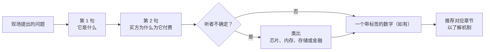
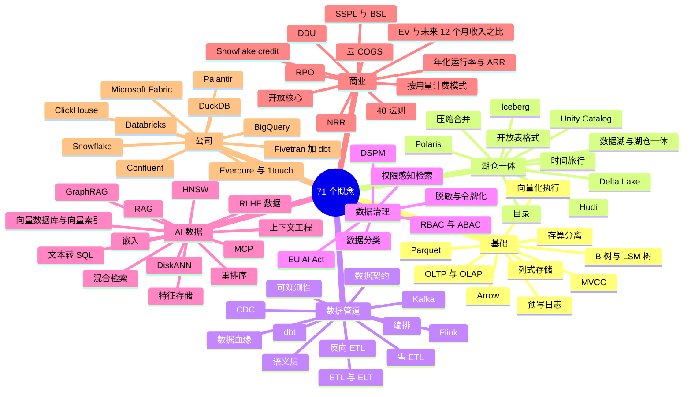
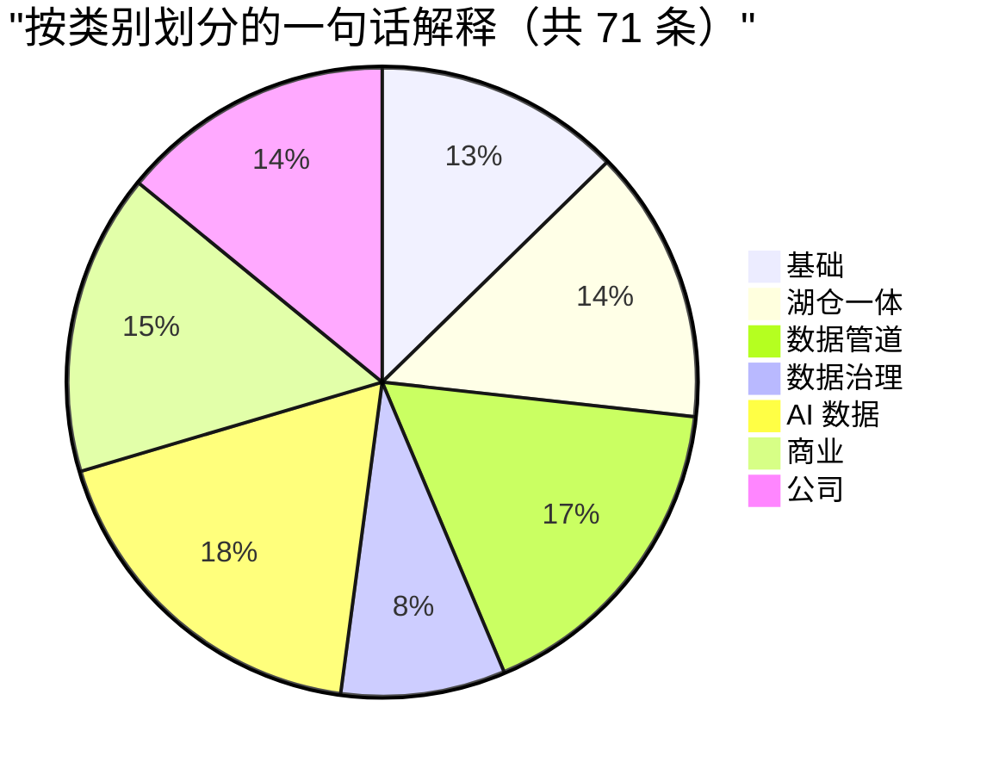

# 49. 30 秒讲清楚
> **深度：** L1–L2 · **阅读时间：** 约 20 分钟 · **最后核实：** 2026-11-01 · **前置阅读：** 无；每条一句话解释都链接到详细讲解它的章节（[第 1 章 — 数据栈全景图](../01-data-systems-foundations/ch01-data-stack-map.md)是最好的单一起点）

## 要点速览（TL;DR）

- 本章收录 **71 条一句话解释**，编号并分为七类：基础、湖仓一体、数据管道、数据治理、AI 数据、商业以及公司。每一条都说明这个东西是什么、为什么重要，并给出一个类比。每一条都链接到深入讲解它的章节。
- 每条大约需要 30 秒说完。这大致就是一位高管在判断你究竟是理解这个话题还是在背诵之前愿意听的时长。
- 类比取材于读者熟悉的领域：半导体与存储层次结构、存储、数据中心以及金融。如果某个类比在追问之下站不住，就放弃它，直接讲机制。链接的章节里有机制。
- 这里的数字是一小组带日期的数据，取自本知识库的数据集（`data/*.csv`）和已核实事实登记表。每个数字都带有标签（GAAP、公司披露的年化运行率、媒体报道或估算）和脚注。复述时不要向上取整。
- 两张图展示了概念之间如何关联，以及哪些概念对最常被混淆。数据话题对话中的许多信誉损失，来自混淆相邻术语：ARR 与年化运行率、数据湖与湖仓一体、向量索引与向量数据库。

## 为何重要

一位加入 Everpure（原 Pure Storage）的企业发展专业人士，会在一周之内、在非常不同的场合中听到这些术语：一次关于 Data Intelligence 的产品评审、一位投行人士关于某家数据目录初创公司的推介、一场 Snowflake 的财报电话会、一次与湖仓厂商的合作伙伴会议。这些场合里没有人会停下来给 Iceberg 或 NRR 下定义。能够干净利落地定义一个术语、把它放到技术栈中的正确位置并说出其商业后果的人，才会被托付下一个问题。

这些一句话解释也是对理解程度的检验。如果你说不出一个东西做什么、买方为什么为它付费、以及它在你已经熟悉的世界里像什么，那么你对它的了解还不足以评估一笔建立在它之上的交易。会前把这些条目当作速览摘要使用；当会议讨论超过 30 秒的深度时，再去看链接的章节。

此外还有一个具体的 Everpure 视角。公司在 2026 年通过收购 1touch 并发布 Data Intelligence，从"存储数据"转向"理解数据"，这使它与下文的若干类别相邻：数据分类、DSPM、数据目录、语义上下文、向量数据管道。能够准确解释这些相邻领域，正是战略团队得以基于公开信息讨论选项、合作伙伴和竞争对手的前提。

## 如何使用本章

1. **会议之前**，浏览相关的类别。与湖仓合作伙伴的电话需要第 10–19 条和第 62–63 条。对一家 AI 初创公司的尽职调查电话需要第 38–50 条和第 57–59 条。
2. **说完第一句就停下。** 每条的第一句是定义，应当能够独立成立。如果对方点头，再补上第二句（为什么重要）。只有在对方看起来不太确定时才使用类比。
3. **绝不即兴编造数字。** 如果需要数字，就使用条目中的数字，并附上其标签和日期（"公司披露的年化运行率，2026 年 8 月"）。一个被自信地说出口的错误数字，比说"我会再确认"造成的损害更大。
4. **把文末的易混淆概念对照表**当作"不要这样说"清单使用。
5. **当有人问"这到底是怎么运作的？"时，去看链接的章节。** 那是一个 L2 问题，而本章大部分是 L1。

*图 49.1 — 一个 30 秒回答的结构。先给出定义，赢得说第二句的机会，只在听者需要时才使用类比。数字是可选的，但如果给出，就要给出其标签和日期。*

*图 49.2 — 71 个概念分为七类。基础和湖仓一体解释数据存放在哪里，数据管道和数据治理解释数据如何流动以及谁可以接触它，AI 数据解释模型如何使用数据，商业和公司则解释谁在赚钱。*

| 类别 | 条目 | 数量 | 主要章节 |
|---|---|---|---|
| 基础 | 1–9 | 9 | [第 1 章](../01-data-systems-foundations/ch01-data-stack-map.md)、[第 3 章](../01-data-systems-foundations/ch03-database-internals.md)、[第 5 章](../01-data-systems-foundations/ch05-analytical-engines.md)、[第 6 章](../01-data-systems-foundations/ch06-file-formats.md) |
| 湖仓一体 | 10–19 | 10 | [第 7 章](../01-data-systems-foundations/ch07-open-table-formats.md)、[第 8 章](../01-data-systems-foundations/ch08-catalogs-and-metastores.md)、[第 27 章](../04-company-deep-dives/ch27-databricks-vs-snowflake.md) |
| 数据管道 | 20–31 | 12 | [第 9 章](../02-pipelines-and-governance/ch09-pipeline-patterns.md)至[第 14 章](../02-pipelines-and-governance/ch14-semantic-layers-and-bi.md) |
| 数据治理 | 32–37 | 6 | [第 15 章](../02-pipelines-and-governance/ch15-governance-security-privacy.md)、[第 33 章](../04-company-deep-dives/ch33-governance-catalog-security-companies.md) |
| AI 数据 | 38–50 | 13 | [第 16 章](../03-ai-data-stack/ch16-ai-data-lifecycle.md)至[第 22 章](../03-ai-data-stack/ch22-agents-and-data.md) |
| 商业 | 51–61 | 11 | [第 35 章](../05-business-and-economics/ch35-business-models.md)至[第 38 章](../05-business-and-economics/ch38-open-source-strategy.md) |
| 公司 | 62–71 | 10 | [第 25 章](../04-company-deep-dives/ch25-databricks.md)至[第 34 章](../04-company-deep-dives/ch34-application-giants-data-platforms.md) |
| **合计** | 1–71 | **71** | |

*图 49.3 — 类别汇总。AI 数据和数据管道两组条目最多，因为高管们最常在这两个领域听到陌生的行话。商业术语较少，但在这里答错最损信誉。*

*图 49.4 — 各类别条目占比。本章大约三分之一的内容（第 38–61 条）涉及 AI 数据和商业术语，这两个领域是战略对话推进最快、定义也最常被引申的地方。*

## 基础

**1. OLTP vs OLAP（联机事务处理与联机分析处理）.** 联机事务处理（OLTP）一次记录一笔小交易，记录的是业务本身；联机分析处理（OLAP）扫描数以百万计的此类记录，以回答关于业务的问题。两者的调优方向相反，因此大多数公司同时运行两者，并为在它们之间搬运数据付费，就像收银机旁边放着总账。（[第 1 章](../01-data-systems-foundations/ch01-data-stack-map.md)、[第 2 章](../01-data-systems-foundations/ch02-data-models.md)）

**2. B-tree vs LSM-tree（B 树与 LSM 树）.** B 树原地更新有序页面，读取速度快；日志结构合并树（LSM 树）追加写入、之后再合并有序文件，因此写入速度快。选择哪一种，决定了由读还是由写来付出代价，这与原地更新的文件系统和异地写入、事后垃圾回收的闪存转换层（FTL）之间的权衡相同。（[第 3 章](../01-data-systems-foundations/ch03-database-internals.md)）

**3. MVCC（多版本并发控制）.** 多版本并发控制为每一行保留多个版本，因此读者看到的是一致的快照，而写入者可以继续工作。这就是为什么一份长时间运行的报表不会冻结结账页面，正如会计在冻结的试算平衡表上结账，而应付账款部门仍在继续过账。（[第 3 章](../01-data-systems-foundations/ch03-database-internals.md)）

**4. Columnar storage（列式存储）.** 把每一列的值存放在一起，而不是把每一行的值存放在一起，这样一个只涉及 200 列中 3 列的查询只需读取那 3 列，而且压缩效果好。这是分析型数据库速度快的主要原因，就像 DRAM 突发传输读取连续字节而不是零散字节。（[第 5 章](../01-data-systems-foundations/ch05-analytical-engines.md)）

**5. Vectorized execution（向量化执行）.** 引擎每次操作处理约一千个值的批次，而不是一次处理一行，从而让 CPU 缓存和 SIMD 单元保持忙碌。所有现代引擎（DuckDB、Photon、Velox）都这样工作；它是从标量指令转向 SIMD 指令在软件层面的翻版。（[第 5 章](../01-data-systems-foundations/ch05-analytical-engines.md)）

**6. Separation of storage and compute（存算分离）.** 持久化数据存放在共享的对象存储中，计算集群启动后查询这些数据，空闲时停止。它把数据仓库从一次性的容量采购变成了按量计费的公用事业，并由 Snowflake 实现了商业化，就像无晶圆厂公司租用代工产能而不是自建晶圆厂。（[第 5 章](../01-data-systems-foundations/ch05-analytical-engines.md)、[第 26 章](../04-company-deep-dives/ch26-snowflake.md)）

**7. Apache Parquet.** 默认的开放列式文件格式：行组按列存储并压缩，附带最小/最大值统计，使引擎可以跳过不需要的数据块。从物理上看，几乎每一张湖仓表都是一堆 Parquet 文件，就像任何板卡厂商都能贴装的标准封装。（[第 6 章](../01-data-systems-foundations/ch06-file-formats.md)）

**8. Apache Arrow.** 一种标准的内存列式布局，使系统之间传递数据时无需逐行转换。Parquet 是数据在磁盘上静止时的形态，Arrow 是数据在内存中和网络上流动时的形态，就像 PCIe 这样的通用总线协议。（[第 6 章](../01-data-systems-foundations/ch06-file-formats.md)）

**9. Write-ahead log（预写日志，WAL）.** 数据库在改动数据文件之前，先把每一项变更追加到一个持久化的顺序日志中，这样崩溃之后可以重放。同一个日志之后还会为变更数据捕获（第 21 条）提供数据；先记日记账，后过总账。（[第 3 章](../01-data-systems-foundations/ch03-database-internals.md)）

## 湖仓一体

**10. Data lake vs lakehouse（数据湖与湖仓一体）.** 数据湖是存放在对象存储中的廉价文件，没有事务；湖仓一体在此基础上增加了表格式和目录，使同样的文件表现得像数据仓库的表。区别在于元数据层，而不在于存储，就像库存管理系统上线前后的同一片托盘仓库。（[第 7 章](../01-data-systems-foundations/ch07-open-table-formats.md)）

**11. Open table format（开放表格式）.** 一个元数据层加一套提交协议，把一个装满不可变 Parquet 文件的文件夹变成一张支持原子提交、快照和模式演进的表。每次提交只替换一个小指针，很像更新页表，因此多个引擎可以安全地共享同一份数据。（[第 7 章](../01-data-systems-foundations/ch07-open-table-formats.md)）

**12. Apache Iceberg.** 诞生于 Netflix 的开放表格式，它把一张表跟踪为一棵元数据文件树，并依赖目录来完成原子提交。它已成为中立的行业标准，相当于表格领域的 JEDEC；2024 年 6 月，Databricks 以媒体报道的约 $2B 收购了其创建者的公司 Tabular。[^tabular]（[第 7 章](../01-data-systems-foundations/ch07-open-table-formats.md)）

**13. Delta Lake.** Databricks 的开放表格式：Parquet 文件加上一个有序的 JSON 提交日志，并定期生成检查点，就像带定期试算平衡的日记账。它在 Databricks 环境中占主导地位，而 UniForm 让 Delta 表也能发布 Iceberg 元数据，供其他引擎使用。（[第 7 章](../01-data-systems-foundations/ch07-open-table-formats.md)、[第 25 章](../04-company-deep-dives/ch25-databricks.md)）

**14. Apache Hudi.** 来自 Uber 的表格式，围绕操作时间线构建，并针对更新插入（upsert）和流式数据摄取进行了调优。它擅长处理频繁的行级变更，但在三者中商业生态最小，就像一个客户寥寥的专用工艺节点。（[第 7 章](../01-data-systems-foundations/ch07-open-table-formats.md)）

**15. Catalog（目录）.** 记录有哪些表、其当前元数据存放在哪里以及谁可以读取它们的服务；对于 Iceberg，它还负责执行提交。每个引擎都要先问它，因此它是湖仓一体的控制点，就像股份登记机构，其登记簿决定了所有权。（[第 8 章](../01-data-systems-foundations/ch08-catalogs-and-metastores.md)）

**16. Unity Catalog.** Databricks 面向表、文件、模型和函数的治理目录，负责权限、数据血缘、审计和短期存储凭证，并有一个开源版本。即使数据以开放格式存放，Databricks 也正是借此保持对策略的控制，就像握有钥匙的房东控制着一栋开放式布局的大楼。（[第 8 章](../01-data-systems-foundations/ch08-catalogs-and-metastores.md)、[第 25 章](../04-company-deep-dives/ch25-databricks.md)）

**17. Apache Polaris.** 由 Snowflake 于 2024 年捐赠的开源 Iceberg REST 目录，此后已晋升为 Apache 顶级项目。这是 Snowflake 以中立姿态争取成为其他引擎注册表的地方的尝试，而其更丰富的治理能力仍保留在专有的 Horizon 中，就像由一家厂商发起的标准组织。（[第 8 章](../01-data-systems-foundations/ch08-catalogs-and-metastores.md)、[第 27 章](../04-company-deep-dives/ch27-databricks-vs-snowflake.md)）

**18. Time travel（时间旅行，历史版本查询）.** 按照表在某个较早快照时的状态进行查询；之所以可行，是因为旧文件在快照过期之前一直保留。它服务于审计、可复现的机器学习训练集以及撤销错误的加载，而且成本低廉，原因与阵列快照相同：只有发生变化的数据才是新的。（[第 7 章](../01-data-systems-foundations/ch07-open-table-formats.md)）

**19. Compaction（压缩合并）.** 在后台把大量小文件重写为少量大文件，并执行快照过期和孤立文件清理。流式写入者不断产生小文件，因此这种类似 SSD 的垃圾回收，如今是湖仓一体运营成本和厂商差异化的主要所在。（[第 7 章](../01-data-systems-foundations/ch07-open-table-formats.md)）

## 数据管道

**20. ETL vs ELT.** 抽取-转换-加载（ETL）在数据落地之前对其进行重塑；抽取-加载-转换（ELT）先让原始数据落地，再在数据仓库内用 SQL 进行转换。廉价的云计算使 ELT 成为默认做法，并造就了 Fivetran 和 dbt 的市场，就像把原矿运到大型冶炼厂，而不是在矿山就地精炼。（[第 9 章](../02-pipelines-and-governance/ch09-pipeline-patterns.md)）

**21. Change data capture（变更数据捕获，CDC）.** 变更数据捕获（CDC）读取数据库的事务日志，并把每一次已提交的插入、更新和删除作为事件发出。它让分析只比生产系统落后几分钟，而又不给源系统增加负载，就像读取银行的实时流水，而不是每晚重新打印一次对账单。（[第 10 章](../02-pipelines-and-governance/ch10-ingestion-and-integration.md)）

**22. Apache Kafka.** 一个开源的分布式日志：生产者把事件追加到主题（topic）中，众多消费者各自独立读取，就像各个交易台读取同一条交易所行情带。它是默认的事件流骨干，而 IBM 已于 2026 年 3 月完成对 Kafka 主要厂商 Confluent 约 $11B 的收购。[^ibm-close]（[第 11 章](../02-pipelines-and-governance/ch11-streaming-and-event-platforms.md)）

**23. Apache Flink.** 一个流处理引擎，在事件到达时对其持续运行关联、聚合和时间窗口计算，并提供托管状态和精确一次（exactly-once）保证。Kafka 负责搬运事件，Flink 负责对事件进行计算：一个是传送带，一个是传送带上的检测工位。（[第 11 章](../02-pipelines-and-governance/ch11-streaming-and-event-platforms.md)）

**24. dbt.** 一个开源框架，分析师在其中编写 SQL SELECT"模型"，dbt 将其编译为依赖图，并在数据仓库内进行测试和运行。它把数据转换变成了有版本控制的工程工作（分析工程），就像每次改动都要跑回归测试的芯片设计流程。（[第 12 章](../02-pipelines-and-governance/ch12-transformation-and-orchestration.md)）

**25. Orchestration（编排）.** 编排器（Airflow、Dagster、Prefect）以有向无环图的形式，按依赖顺序调度、运行、重试并记录数据管道任务。它是数据领域的晶圆厂制造执行系统（MES）：很少光鲜亮丽，但早上 6 点的仪表盘一迟到，挨骂的总是它。（[第 12 章](../02-pipelines-and-governance/ch12-transformation-and-orchestration.md)）

**26. Reverse ETL（反向 ETL）.** 把数据仓库中建模好的数据同步回 CRM 或广告平台等运营工具，让一线团队据此采取行动。它让数据仓库既是数据的汇集地，也是数据的来源，就像一座同时经营配送车队的炼油厂；Fivetran 于 2025 年同意为此收购 Census。（[第 9 章](../02-pipelines-and-governance/ch09-pipeline-patterns.md)、[第 30 章](../04-company-deep-dives/ch30-data-movement-streaming-companies.md)）

**27. Zero-ETL（零 ETL）.** 由厂商管理的、从运营数据库到分析服务的复制（Aurora 到 Redshift、Fabric 镜像），客户无需自建任何数据管道。"零"指的是你不需要建管道，而不是零副本，就像银行的自动资金归集：钱仍然在移动。（[第 9 章](../02-pipelines-and-governance/ch09-pipeline-patterns.md)）

**28. Data contract（数据契约）.** 一份由数据生产方负责并强制执行的协议，约定数据集的模式、含义和质量，并在变更发布之前自动检查。它把质量责任前移给那些可能破坏数据的工程师，就像芯片模块之间的接口规范：改动一个引脚，集成测试就会失败。（[第 12 章](../02-pipelines-and-governance/ch12-transformation-and-orchestration.md)、[第 13 章](../02-pipelines-and-governance/ch13-data-quality-observability-lineage.md)）

**29. Data observability（数据可观测性）.** 对每张表的新鲜度、数据量、模式、值分布和数据血缘进行自动化监控，以便在用户发现之前捕捉到损坏的数据。其商业理由是"数据停机时间"，其工作方式就像晶圆厂的在线量测，在最终测试之前就捕捉到漂移。（[第 13 章](../02-pipelines-and-governance/ch13-data-quality-observability-lineage.md)）

**30. Data lineage（数据血缘）.** 描述数据如何从源头经过各种转换流向仪表盘和模型的图，越来越多地细化到列级。它回答"如果我改了这个，什么会坏？"和"这个数字是从哪里来的？"，相当于从一个报告数字追溯回其会计分录的审计轨迹。（[第 13 章](../02-pipelines-and-governance/ch13-data-quality-observability-lineage.md)）

**31. Semantic layer（语义层）.** 一套受治理的业务定义，例如"收入"或"活跃客户"，所有 BI 工具和 AI 智能体都查询它，而不是各自重新推导。在 AI 时代它更加重要，因为直接编写原始 SQL 的模型只能猜测定义；语义层就是会计科目表。（[第 14 章](../02-pipelines-and-governance/ch14-semantic-layers-and-bi.md)）

## 数据治理

**32. RBAC vs ABAC（基于角色与基于属性的访问控制）.** 基于角色的访问控制（RBAC）把权限授予角色；基于属性的访问控制（ABAC）则根据敏感度标签、区域和用途等属性对每个请求作出决定。规模一大，RBAC 就会膨胀出成千上万个角色，而 ABAC 通过标签实现扩展，就像办公室钥匙与检查安全级别的门禁读卡器之间的区别。（[第 15 章](../02-pipelines-and-governance/ch15-governance-security-privacy.md)）

**33. DSPM（数据安全态势管理）.** 数据安全态势管理（DSPM）持续发现敏感数据存放在哪里、谁能够接触它以及其暴露程度，覆盖各个云、SaaS 和本地存储。它相当于审计前的存货盘点；Proofpoint 待完成的 Varonis 交易于 2026 年 10 月宣布，交易价值约 $6.3B（股权价值约 $5.71B；预计 2027 年上半年完成交割），为该类别定了价。[^varonis]（[第 15 章](../02-pipelines-and-governance/ch15-governance-security-privacy.md)、[第 33 章](../04-company-deep-dives/ch33-governance-catalog-security-companies.md)）

**34. Data classification（数据分类）.** 按类型和敏感度（电子邮件地址、卡号、健康记录）给数据贴标签，使策略附着在标签上，而不是附着在每一张表上。分类器结合模式匹配、校验和以及机器学习模型，而规则随标签而行，就像集装箱上的危险品标识。（[第 15 章](../02-pipelines-and-governance/ch15-governance-security-privacy.md)）

**35. Masking vs tokenization（脱敏与令牌化）.** 动态脱敏根据查询者的身份在查询时改写敏感值（`****1234`）；令牌化则用一个替代值取代存储的原值，只有经授权的保险库才能将其还原。脱敏是视图上的磨砂玻璃；令牌化是保护每一份下游副本的保险箱。（[第 15 章](../02-pipelines-and-governance/ch15-governance-security-privacy.md)）

**36. EU AI Act（欧盟《人工智能法案》）.** Regulation (EU) 2024/1689 为 AI 系统规定了按风险分级的义务，其中包括高风险系统的训练数据治理（第 10 条）。在 2026 年 AI Omnibus 之后，这些义务自 2027 年 12 月 2 日（独立系统）和 2028 年 8 月 2 日（嵌入产品的系统）起生效，使数据血缘和质量记录成为合规证据，正如 SOX 对内部控制所起的作用。[^aiact][^omnibus]（[第 15 章](../02-pipelines-and-governance/ch15-governance-security-privacy.md)）

**37. Permission-aware retrieval（权限感知检索）.** 在查询时强制执行源系统的访问权限，使 AI 助手只检索提问用户本来就能直接打开的段落。没有它，检索就成了泄露人力资源文件夹的快捷方式；它就像一座逐本书核验借书证、而不只是在门口查验的图书馆。（[第 17 章](../03-ai-data-stack/ch17-unstructured-data-processing.md)、[第 19 章](../03-ai-data-stack/ch19-retrieval-architectures.md)）

## AI 数据

**38. Embedding（嵌入向量）.** 由模型生成的一串数字，长度从几百到几千不等，使相似的条目彼此靠近。嵌入让软件能够按含义而不是按精确字词进行搜索：它是含义的 GPS 坐标，"invoice"（发票）和"bill"（账单）只隔一个街区。（[第 18 章](../03-ai-data-stack/ch18-embeddings-and-vector-search.md)）

**39. Vector database vs vector index（向量数据库与向量索引）.** 向量索引（HNSW、IVF、DiskANN）是快速查找最近邻的数据结构；向量数据库则在索引之外包裹了存储、过滤、更新、访问控制和扩展能力。如今大多数主流数据库都自带索引，这挤压了独立向量数据库的空间，正如集成内存控制器挤压了独立北桥芯片。（[第 18 章](../03-ai-data-stack/ch18-embeddings-and-vector-search.md)）

**40. HNSW（分层可导航小世界图）.** Hierarchical Navigable Small World，一种分层图索引：搜索先在稀疏的上层跳跃，再在稠密的下层精细查找——先走高速公路，再走主干道，最后走本地街道。它是内存向量检索的默认选择，快速而准确，但很耗内存。（[第 18 章](../03-ai-data-stack/ch18-embeddings-and-vector-search.md)）

**41. DiskANN.** Microsoft 的图向量索引，把图和完整向量放在 SSD 上，只把压缩后的向量放在 RAM 中，从而在单台机器上实现十亿级向量检索。它把向量检索的成本从 DRAM 转移到 NAND，是存储层次结构的实际应用，这一点对存储厂商有直接意义。（[第 18 章](../03-ai-data-stack/ch18-embeddings-and-vector-search.md)、[第 24 章](../03-ai-data-stack/ch24-data-meets-compute-and-storage.md)）

**42. RAG（检索增强生成）.** 检索增强生成（RAG）在提问时取回相关段落并加入提示词中，使大语言模型（LLM）依据你的数据而不是凭记忆作答。它就像开卷考试，是获得最新、私有且可引用答案的最便宜途径，而质量更多取决于检索，而不是模型。（[第 19 章](../03-ai-data-stack/ch19-retrieval-architectures.md)）

**43. Reranking（重排序）.** 一个第二阶段模型（通常是交叉编码器）把查询与排名靠前的几十个候选逐一对照阅读，并按真实相关性重新排序。快速的第一轮换取召回率，较慢的第二轮换取精确率，就像先做晶圆探针测试，再做最终测试。（[第 19 章](../03-ai-data-stack/ch19-retrieval-architectures.md)）

**44. GraphRAG.** Microsoft Research 于 2024 年提出的方法：由 LLM 把实体和关系抽取到知识图谱中，对聚类进行摘要，再基于该结构进行检索。它有助于回答需要跨大量文档"串联线索"的问题，但索引成本高得多，就像分析师手中的交易关系图与一摞申报文件之间的区别。（[第 19 章](../03-ai-data-stack/ch19-retrieval-architectures.md)）

**45. Context engineering（上下文工程）.** 在每一次模型调用时决定哪些指令、检索到的数据、工具结果和记忆进入有限的上下文窗口，以及以什么顺序进入。它已经取代提示词措辞，成为提升智能体质量的主要杠杆，因为冗长嘈杂的上下文会降低模型表现；它就是对模型最快一级存储的缓存管理。（[第 16 章](../03-ai-data-stack/ch16-ai-data-lifecycle.md)、[第 22 章](../03-ai-data-stack/ch22-agents-and-data.md)）

**46. MCP（模型上下文协议）.** 模型上下文协议（MCP）是一项通过"MCP 服务器"把 AI 应用连接到工具和数据的开放标准，由 Anthropic 于 2024 年 11 月推出，并于 2025 年 12 月捐赠给 Linux Foundation 旗下的 Agentic AI Foundation。[^mcp] 它是智能体的 USB-C：做好一个连接器，任何兼容的智能体都能使用，这也是为什么大多数主要数据厂商如今都提供 MCP 服务器。（[第 22 章](../03-ai-data-stack/ch22-agents-and-data.md)）

**47. Text-to-SQL（文本转 SQL）.** 由 LLM 把一个用自然英语提出的问题翻译成 SQL 查询。演示很容易，生产很难，因为在真实的企业模式上准确率会下降，除非模型以语义层为依据，就像一位精通 SQL 却不了解你们会计科目表的新分析师。（[第 14 章](../02-pipelines-and-governance/ch14-semantic-layers-and-bi.md)、[第 22 章](../03-ai-data-stack/ch22-agents-and-data.md)）

**48. Feature store（特征存储）.** 一个对每个机器学习特征（例如"过去七天的交易笔数"）只定义一次，并向训练（离线）和实时预测（在线）提供完全相同取值的系统。它防止训练与服务之间的偏差，充当测试和生产共同校准的黄金基准；作为一个独立类别，它已经在很大程度上被平台吸收。（[第 21 章](../03-ai-data-stack/ch21-ml-platforms-feature-stores-llmops.md)）

**49. RLHF data（RLHF 数据）.** 人类反馈强化学习（RLHF）以一个奖励模型为目标来调优模型，而该奖励模型是用人类对"哪个回答更好"的判断训练出来的。稀缺的投入是偏好数据和专家数据，这就是数据标注公司和专家网络公司能获得高估值的原因；它相当于良率学习，工程师的判断变成了训练信号。（[第 20 章](../03-ai-data-stack/ch20-training-data-supply-chain.md)）

**50. Hybrid search（混合检索）.** 把关键词检索（BM25）与向量检索结合起来，并合并两份排序列表，通常采用倒数排名融合（reciprocal rank fusion）。关键词能抓住嵌入会模糊掉的精确零件号和名称，向量能抓住同义改写，就像一只基金把量化筛选与分析师判断相结合。（[第 18 章](../03-ai-data-stack/ch18-embeddings-and-vector-search.md)）
