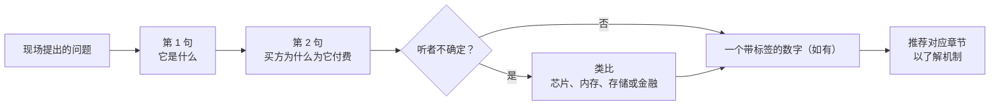
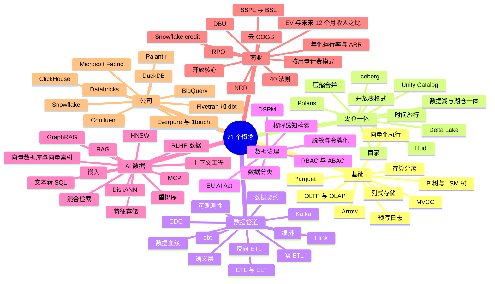
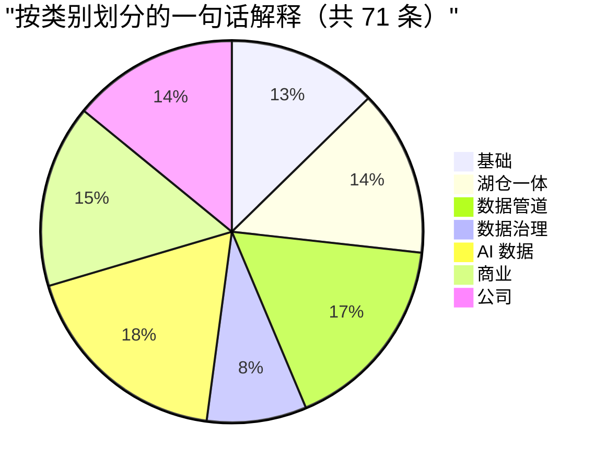

# 49. 30 秒讲清楚
> **深度：** L1–L2 · **阅读时间：** 约 20 分钟 · **最后核实：** 2026-11-01 · **前置阅读：** 无；每条一句话解释都链接到详细讲解它的章节（[第 1 章 — 数据栈全景图](../01-data-systems-foundations/ch01-data-stack-map.md)是最好的单一起点）

## 要点速览（TL;DR）

- 本章收录 **71 条一句话解释**，编号并分为七类：基础、湖仓一体、数据管道、数据治理、AI 数据、商业以及公司。每一条都说明这个东西是什么、为什么重要，并给出一个类比。每一条都链接到深入讲解它的章节。
- 每条大约需要 30 秒说完。这大致就是一位高管在判断你究竟是理解这个话题还是在背诵之前愿意听的时长。
- 类比取材于读者熟悉的领域：半导体与存储层次结构、存储、数据中心以及金融。如果某个类比在追问之下站不住，就放弃它，直接讲机制。链接的章节里有机制。
- 这里的数字是一小组带日期的数据，取自本知识库的数据集（`data/*.csv`）和已核实事实登记表。每个数字都带有标签（GAAP、公司披露的年化运行率、媒体报道或估算）和脚注。复述时不要向上取整。
- 两张图展示了概念之间如何关联，以及哪些概念对最常被混淆。数据话题对话中的许多信誉损失，来自混淆相邻术语：ARR 与年化运行率、数据湖与湖仓一体、向量索引与向量数据库。

## 为何重要

一位加入 Everpure（原 Pure Storage）的企业发展专业人士，会在一周之内、在非常不同的场合中听到这些术语：一次关于 Data Intelligence 的产品评审、一位投行人士关于某家数据目录初创公司的推介、一场 Snowflake 的财报电话会、一次与湖仓厂商的合作伙伴会议。这些场合里没有人会停下来给 Iceberg 或 NRR 下定义。能够干净利落地定义一个术语、把它放到技术栈中的正确位置并说出其商业后果的人，才会被托付下一个问题。

这些一句话解释也是对理解程度的检验。如果你说不出一个东西做什么、买方为什么为它付费、以及它在你已经熟悉的世界里像什么，那么你对它的了解还不足以评估一笔建立在它之上的交易。会前把这些条目当作速览摘要使用；当会议讨论超过 30 秒的深度时，再去看链接的章节。

此外还有一个具体的 Everpure 视角。公司在 2026 年通过收购 1touch 并发布 Data Intelligence，从"存储数据"转向"理解数据"，这使它与下文的若干类别相邻：数据分类、DSPM、数据目录、语义上下文、向量数据管道。能够准确解释这些相邻领域，正是战略团队得以基于公开信息讨论选项、合作伙伴和竞争对手的前提。

## 如何使用本章

1. **会议之前**，浏览相关的类别。与湖仓合作伙伴的电话需要第 10–19 条和第 62–63 条。对一家 AI 初创公司的尽职调查电话需要第 38–50 条和第 57–59 条。
2. **说完第一句就停下。** 每条的第一句是定义，应当能够独立成立。如果对方点头，再补上第二句（为什么重要）。只有在对方看起来不太确定时才使用类比。
3. **绝不即兴编造数字。** 如果需要数字，就使用条目中的数字，并附上其标签和日期（"公司披露的年化运行率，2026 年 8 月"）。一个被自信地说出口的错误数字，比说"我会再确认"造成的损害更大。
4. **把文末的易混淆概念对照表**当作"不要这样说"清单使用。
5. **当有人问"这到底是怎么运作的？"时，去看链接的章节。** 那是一个 L2 问题，而本章大部分是 L1。

*图 49.1 — 一个 30 秒回答的结构。先给出定义，赢得说第二句的机会，只在听者需要时才使用类比。数字是可选的，但如果给出，就要给出其标签和日期。*

*图 49.2 — 71 个概念分为七类。基础和湖仓一体解释数据存放在哪里，数据管道和数据治理解释数据如何流动以及谁可以接触它，AI 数据解释模型如何使用数据，商业和公司则解释谁在赚钱。*

| 类别 | 条目 | 数量 | 主要章节 |
|---|---|---|---|
| 基础 | 1–9 | 9 | [第 1 章](../01-data-systems-foundations/ch01-data-stack-map.md)、[第 3 章](../01-data-systems-foundations/ch03-database-internals.md)、[第 5 章](../01-data-systems-foundations/ch05-analytical-engines.md)、[第 6 章](../01-data-systems-foundations/ch06-file-formats.md) |
| 湖仓一体 | 10–19 | 10 | [第 7 章](../01-data-systems-foundations/ch07-open-table-formats.md)、[第 8 章](../01-data-systems-foundations/ch08-catalogs-and-metastores.md)、[第 27 章](../04-company-deep-dives/ch27-databricks-vs-snowflake.md) |
| 数据管道 | 20–31 | 12 | [第 9 章](../02-pipelines-and-governance/ch09-pipeline-patterns.md)至[第 14 章](../02-pipelines-and-governance/ch14-semantic-layers-and-bi.md) |
| 数据治理 | 32–37 | 6 | [第 15 章](../02-pipelines-and-governance/ch15-governance-security-privacy.md)、[第 33 章](../04-company-deep-dives/ch33-governance-catalog-security-companies.md) |
| AI 数据 | 38–50 | 13 | [第 16 章](../03-ai-data-stack/ch16-ai-data-lifecycle.md)至[第 22 章](../03-ai-data-stack/ch22-agents-and-data.md) |
| 商业 | 51–61 | 11 | [第 35 章](../05-business-and-economics/ch35-business-models.md)至[第 38 章](../05-business-and-economics/ch38-open-source-strategy.md) |
| 公司 | 62–71 | 10 | [第 25 章](../04-company-deep-dives/ch25-databricks.md)至[第 34 章](../04-company-deep-dives/ch34-application-giants-data-platforms.md) |
| **合计** | 1–71 | **71** | |

*图 49.3 — 类别汇总。AI 数据和数据管道两组条目最多，因为高管们最常在这两个领域听到陌生的行话。商业术语较少，但在这里答错最损信誉。*

*图 49.4 — 各类别条目占比。本章大约三分之一的内容（第 38–61 条）涉及 AI 数据和商业术语，这两个领域是战略对话推进最快、定义也最常被引申的地方。*
