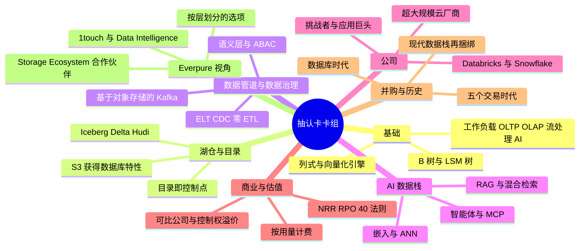
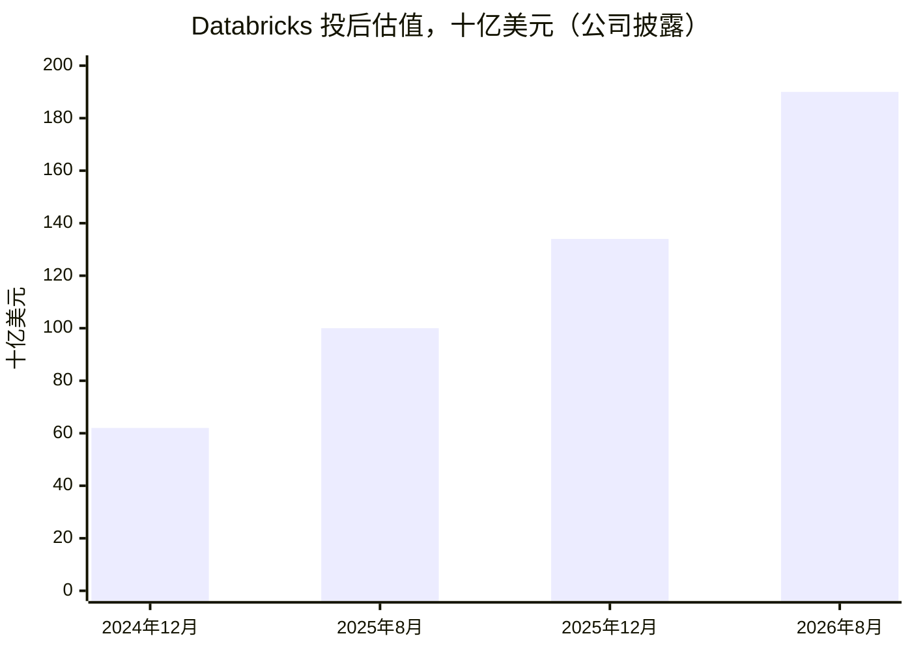
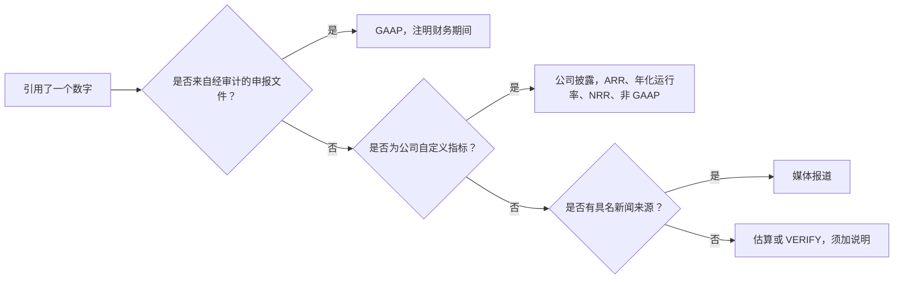
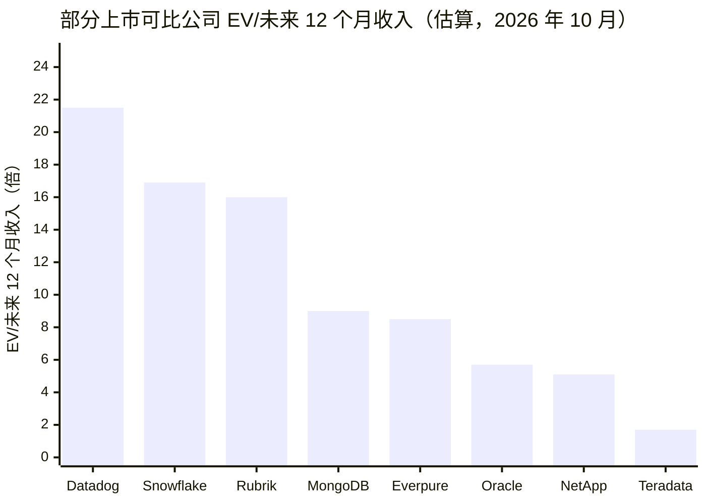
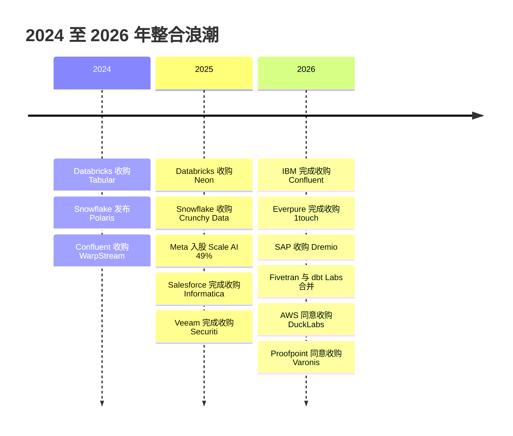
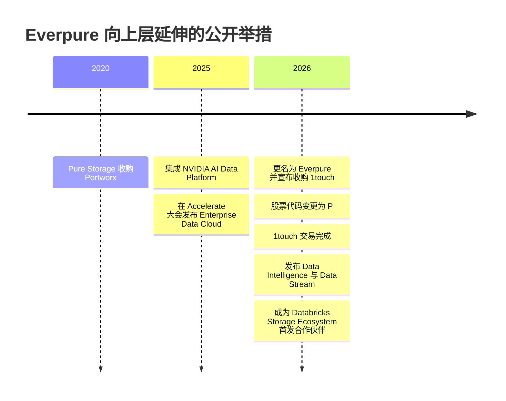

# 50. 自测与速查表
> **深度：** L1–L2 · **阅读时间：** 约 57 分钟 · **最后核实：** 2026-11-01 · **前置阅读：** 速查表无需前置阅读；抽认卡默认读者已读过第 1–5 部分（[第 1 章](../01-data-systems-foundations/ch01-data-stack-map.md)、[第 25 章](../04-company-deep-dives/ch25-databricks.md)、[第 37 章](../05-business-and-economics/ch37-public-comps-valuation.md)）

## 要点速览（TL;DR）

- **8 个主题卡组，共 253 张抽认卡。** 每张卡是一个问题，配一段简短答案和一个指向讲解该内容章节的链接。卡组涵盖定义、机制、带标签的数字（"公司披露的年化运行率"、"GAAP"、"媒体报道"）以及"哪个更大、为什么"之类的比较。每个数字都与所引章节或 `data/*.csv` 中出现的数字相同，标签也相同。
- **4 张单页海报。** 一张缩略语表（79 个条目）、一张约 40 家代表性公司的分层市场地图、一张最能解释本行业的 25 笔交易表（取自 `data/ma_deals.csv`），以及一张与[第 27 章](../04-company-deep-dives/ch27-databricks-vs-snowflake.md)对应的 Databricks 与 Snowflake 对比单页。
- **最常被说错的三个数字。** Databricks 的 **>$7B** 是公司披露的年化运行率，不是 GAAP 收入。Snowflake 约 **$1.49B** 的季度产品收入（+37%）是 GAAP 口径。**$190B** 的私募投后估值与 Snowflake **$106.31B** 的企业价值（EV）是两种不同的东西。[^db-7b][^sf-q2][^comps-sf]
- **贯穿所有卡组的核心观点：** 价值已从字节和引擎转移到元数据。目录（catalog）、语义层（semantic layer）和数据治理（governance）决定数据的含义以及谁可以使用它，这也是 2024–2026 年大多数交易都在收购这几层的原因。
- **Everpure 视角。** 最后一个卡组仅使用公开信息，涵盖对 1touch 的收购（$125.0M）、Data Intelligence 与 Data Stream、Databricks Storage Ecosystem 首发合作伙伴席位，以及"向上层延伸"叙事试图推动的约 8.5x EV/未来 12 个月收入倍数。[^ep-10q][^storage-eco][^ep-comps]

## 为何重要（业务 + Everpure 视角）

公司发展（corporate development）从业者在会议室里靠的是即时记忆。当创始人说"我们是面向智能体的 Iceberg 原生目录"，或者投行人士报出"约 27 倍年化运行率"时，有用的回应是追问下一个问题：是基于什么口径的年化运行率？是哪些引擎的权威目录？前三家尝试这么做的公司后来怎样了？这种反射来自于随时备好的词汇和锚定数字，而不是在火车上重读一章 4,000 字的内容。

本图谱约有 50 章。本章把它们压缩成可以自测的材料。抽认卡的写法是*可以在 30 秒内说出口的答案*：先讲机制，再给数字，并且总会说明这是哪一类数字。最后这个习惯最重要。在这个行业里，最常见的可信度失误是把年化运行率当成收入、把私募估值当成市值、把厂商基准测试当成实测结果。因此每张带数字的卡片都附有标签。

对 Everpure 而言，利害关系很具体。公司正从存储走向数据管理：Enterprise Data Cloud、对 1touch 的收购（现为 Data Intelligence）、基于 NVIDIA 的 Data Stream、Key-Value Accelerator，以及 Databricks Storage Ecosystem 的首发合作伙伴地位。[^ep-10q][^ep-ds][^storage-eco] 与 Databricks、Snowflake、超大规模云厂商、目录厂商以及潜在收购标的的对话，都将从这些卡组中的词汇开始，并会以交易海报上的交易先例为参照来评判——从 2010 年的 EMC–Greenplum 到 2026 年的 NetApp–DataPelago。[^ma] 这些海报的设计初衷就是打印出来带进这类会议。

> **类比：间隔重复即良率学习闭环。** 晶圆厂提升良率的方法是测试每一片晶圆、对失效品分箱，再把缺陷图反馈给导致缺陷的工艺步骤。抽认卡的原理相同：先冷启动自测，把答错的卡片归入"重学"一堆，然后只针对这些卡片回到所链接的章节。每张卡片上的章节链接就相当于缺陷图：它告诉你该修正哪个工艺步骤（哪一章）。

## 如何使用本章

**三种使用方式。** 第一，*会前自测*。挑选与会议相匹配的一两个卡组（与投行通话选"公司"和"商业与估值"；产品评审选"AI 数据栈"和"Everpure 视角"）。读每个问题，大声回答，然后再翻开卡片。第二，*刷新数字*。带数字的卡片是检查你所引用的数字是否为最新、标签是否正确的最快途径。对于每季度都会变化的数字（Snowflake、MongoDB、超大规模云厂商），卡片会注明所属季度。第三，*打印海报*。缩略语表、市场地图、交易表和对比单页各自只有一到两页，且可独立阅读。

**卡片的构成方式。** 每张卡片有一个编号问题（Q1 至 Q253）和一个答案，答案末尾附有指向来源章节的链接。若答案中含有数字，脚注会指向该章节所用的一手来源或图谱数据集中的对应行。卡组按图谱的各部分编排，但问题类型是混合的。约三分之一是定义题（"什么是语义层？"），约三分之一是机制题（"为什么提交延迟是一种存储属性？"），其余是数字与比较题（"按增长调整后，Databricks 和 Snowflake 哪个更便宜，为什么？"）。比较题在对话中最有用，因为它迫使你同时记住两个事实和一个理由。

**建议的学习节奏。** 第一天，把 253 张卡片全部过一遍，标记答错的。第三天，只重做答错的。第七天，重做整个"公司"和"商业与估值"卡组，因为这些数字会变动。每天约 20 分钟、坚持一周，足以让核心词汇变成本能。如需更深入的练习，可将本章与[第 48 章](ch48-question-bank.md)的题库和[第 49 章](ch49-explain-in-30-seconds.md)的 30 秒讲解搭配使用。

| 如果你有…… | 这样做 | 卡组 / 海报 |
|---|---|---|
| 通话前 10 分钟 | 阅读对比单页和五条"各自何时胜出"要点 | Databricks 与 Snowflake 对比单页 |
| 30 分钟 | 自测一个卡组，然后浏览缩略语表 | "公司"或"商业与估值" |
| 2 小时 | 所有卡组过一遍；标记答错的；阅读交易表 | 全部 |
| 一周 | 第 1 天全部卡片；第 3 天答错的；第 7 天两个"数字会变动"的卡组 | "公司"；"商业与估值" |
| Everpure 战略会议前 | "Everpure 视角"卡组，外加市场地图和交易表 | "Everpure 视角"；海报 |

*图 50.1 — 学习路线。让复习深度与会议相匹配。数字每季度都会变化的两个卡组（"公司"；"商业与估值"）最需要经常刷新。*

*图 50.2 — 八个卡组及各自考查的内容。卡组自下而上贯穿技术栈（先是基础，然后是湖仓、数据管道和 AI），接着覆盖公司、经济模型和交易历史，最后以 Everpure 视角收尾。*

## 抽认卡

各卡组共有 253 张卡片：基础（29）、湖仓与目录（25）、数据管道与数据治理（39）、AI 数据栈（46）、公司（44）、商业与估值（29）、并购与历史（22）以及 Everpure 视角（19）。点击问题即可显示答案。数字均注明口径。财年遵循各公司自身的日历：Snowflake、MongoDB、Databricks 和 Salesforce 的财年截至 1 月 31 日，Everpure 的财年截至最接近 2 月 1 日的那个星期日。Microsoft 的财年截至 6 月 30 日，Oracle 的截至 5 月 31 日。

### 基础

这些卡片讲的是数据库如何存储、查找和保护数据。先从下面六组概念对开始，因为混淆任何一组中的两端，是最快失去工程师注意力的方式。

| 容易混淆的概念对 | 一句话说清区别 | 章节 |
|---|---|---|
| OLTP 与 OLAP | 大量小而正确的写入 vs. 对历史数据的大规模扫描 | [第 1 章](../01-data-systems-foundations/ch01-data-stack-map.md) |
| B 树（B-tree）与 LSM 树（LSM-tree） | 原地更新页面（利于读） vs. 追加并合并（利于写） | [第 3 章](../01-data-systems-foundations/ch03-database-internals.md) |
| 分片（sharding）与复制（replication） | 拆分数据以扩展 vs. 复制数据以容灾 | [第 4 章](../01-data-systems-foundations/ch04-distributed-databases.md) |
| 行存储与列存储 | 获取整条记录 vs. 跨大量行扫描少数几列 | [第 5 章](../01-data-systems-foundations/ch05-analytical-engines.md) |
| 向量化执行（vectorized execution）与编译执行 | 每批约 1,000 个值 vs. 针对每个查询生成机器码 | [第 5 章](../01-data-systems-foundations/ch05-analytical-engines.md) |
| Parquet 与 Arrow | 磁盘上的列式文件 vs. 内存中的列式标准 | [第 6 章](../01-data-systems-foundations/ch06-file-formats.md) |

*图 50.3 — 需要分清的六组概念对。每一组都是一种权衡，而非谁胜谁负；大多数厂商的推介都是在某一组中选了一边。*

Q1：企业数据的四大工作负载类别是什么？

答：OLTP 快速且正确地记录每一个业务事件；OLAP 扫描历史数据以回答问题；流处理（streaming）在事件发生时传输事件并作出响应；AI 准备训练数据、对内容进行嵌入与检索，并为智能体（agent）提供上下文。每一类对底层系统的要求都不同，这正是每一类都发展出自己一批厂商的原因。（→ [第 1 章](../01-data-systems-foundations/ch01-data-stack-map.md)）

Q2：数据栈为什么分化成了众多专用引擎？是谁预言了这一点？

答：没有任何单一引擎能很好地服务所有访问模式。Stonebraker 和 Çetintemel 在 2005 年提出"一刀切"（one size fits all）的时代已经结束，市场在此后约 15 年里证明了他们的判断，直到湖仓一体（lakehouse）、混合事务分析处理（HTAP）、Postgres 扩展和智能体开始把各层重新拉到一起。[^stonebraker]（→ [第 1 章](../01-data-systems-foundations/ch01-data-stack-map.md)）

Q3：在数据管道的每一跳中，哪两个横向层会不断积累控制力和数据引力？

答：存储——它位于每一跳之下；以及目录与数据治理层——它横跨所有各跳。这是与 Everpure 最相关的两层，因为每一份数据副本都落在前者之上，并由后者来描述。（→ [第 1 章](../01-data-systems-foundations/ch01-data-stack-map.md)）

Q4：一笔客户订单在 AI 智能体能够讨论它之前，可能要经过多少个系统？每一跳会发生什么变化？

答：六到八个。每经过一跳，订单的形态都会改变（行、变更事件、列式文件、指标、向量），延迟从毫秒级增加到分钟级，而且会再被复制一次。（→ [第 1 章](../01-data-systems-foundations/ch01-data-stack-map.md)）

Q5：什么是数据模型？为什么这一选择在商业上很重要？

答：数据模型是数据库保存数据的形态：表、文档、键值对、宽行、图、时间序列、倒排索引或向量。形态决定了哪些问题便宜、哪些问题昂贵，因此也决定了一个引擎能赢下哪些工作负载以及哪些厂商的生意。（→ [第 2 章](../01-data-systems-foundations/ch02-data-models.md)）

Q6：Codd 何时发表了关系模型？如今关系型的主导地位如何？

答：1970 年，发表于 Communications of the ACM。50 多年后，PostgreSQL 在 2024 年和 2025 年的 Stack Overflow 开发者调查中均位列数据库使用率第一。[^codd][^so25]（→ [第 2 章](../01-data-systems-foundations/ch02-data-models.md)）

Q7："SQL 赢了。"更准确的概括是什么？

答：SQL 吸收了其他模型。Postgres 在一个引擎中运行 JSONB 文档、pgvector 嵌入（向量）和 PostGIS 几何数据，MongoDB 也推出了向量检索（vector search）。多模型引擎吸收了每个 NoSQL 细分领域中有用的思想。（→ [第 2 章](../01-data-systems-foundations/ch02-data-models.md)）

Q8：搜索模型和向量模型与关系查询有何不同？

答：它们按相关性或相似度对结果排序，而不是返回精确匹配。SQL 的 WHERE 子句非真即假；BM25 或余弦得分是一种排序，因此"前 10 条"取代了"所有匹配的行"。（→ [第 2 章](../01-data-systems-foundations/ch02-data-models.md)）

Q9：每个数据库的两大组成部分是什么？

答：存储引擎（storage engine），决定字节如何存放在磁盘和内存中；以及查询处理器，把 SQL 转换为执行计划并运行它。大多数厂商的性能宣称，实际上针对的都是其中某一部分。（→ [第 3 章](../01-data-systems-foundations/ch03-database-internals.md)）

Q10：B 树与 LSM 树：各自针对什么进行优化？谁在使用？

答：B 树原地更新固定大小的页面，利于读取（PostgreSQL、MySQL InnoDB、Oracle、SQL Server）。LSM 树先在内存中缓冲写入，再刷写为不可变的有序文件，并在后台进行合并，利于写入（RocksDB、Cassandra）。（→ [第 3 章](../01-data-systems-foundations/ch03-database-internals.md)）

Q11：RUM 猜想说的是什么？

答：一种访问方法在读取成本、更新成本和内存或空间开销三者中，最多只能优化两项。每一种索引设计都是在选择放弃哪一项。（→ [第 3 章](../01-data-systems-foundations/ch03-database-internals.md)）

Q12：为什么数据库的提交延迟本质上是一种存储属性？

答：持久性来自预写日志（WAL）：变更被顺序写入日志，并在提交返回前通过 fsync 强制落到稳定介质上，数据页稍后才更新。因此提交延迟主要由日志刷写延迟决定。（→ [第 3 章](../01-data-systems-foundations/ch03-database-internals.md)）

Q13：MVCC 带来了什么？PostgreSQL 和 Oracle 的实现方式有何不同？

答：多版本并发控制让写入方创建新的行版本，从而读取方永远无需等待。PostgreSQL 把旧版本保留在表中，并通过 vacuum 清理；Oracle 和 InnoDB 则把旧版本保存在 undo 日志中。（→ [第 3 章](../01-data-systems-foundations/ch03-database-internals.md)）

Q14：查询优化器（query optimizer）最大的弱点是什么？

答：基数估计。当它对行数的估计出错时，所选执行计划可能比最优计划慢十到一百倍。（→ [第 3 章](../01-data-systems-foundations/ch03-database-internals.md)）

Q15：对数据库进行分布式部署的三个理由是什么？

答：一台机器太小；一台机器构成单点故障；或者出于延迟或法律上的数据主权（data sovereignty）要求，数据必须存放在多个地点。每一种分布式设计都是在这些目标与光速之间进行权衡。（→ [第 4 章](../01-data-systems-foundations/ch04-distributed-databases.md)）

Q16：分片与复制：哪个更难？为什么？

答：保持副本一致更难。分片拆分数据以便系统扩展；复制拷贝数据以便系统在故障中存活，而副本之间会逐渐偏离（复制延迟），除非系统付出代价，通过共识（consensus）让它们保持一致。分片也有自己的难点，即跨分片的事务和连接。（→ [第 4 章](../01-data-systems-foundations/ch04-distributed-databases.md)）

Q17：一个五副本的 Raft 组能容忍多少个副本故障？每次写入的代价是什么？

答：两个。一次写入在多数派（五个中的三个）存储后即提交，因此每次写入的代价是到最近多数派的一次往返。（→ [第 4 章](../01-data-systems-foundations/ch04-distributed-databases.md)）

Q18：Spanner、CockroachDB 和 TiDB 如何对事务进行时间排序？

答：Spanner 使用 GPS 和原子钟（TrueTime）；CockroachDB 和 YugabyteDB 使用混合逻辑时钟；TiDB 使用中心化的时间戳服务。Aurora DSQL 使用乐观并发控制，加上 AWS 微秒级精度的时钟服务。（→ [第 4 章](../01-data-systems-foundations/ch04-distributed-databases.md)）

Q19：为什么说分布式 SQL（NewSQL）技术成熟但商业上小众？

答：单节点 Postgres 能满足大多数需求。Cockroach Labs 于 2024 年终止了免费的自托管 Core 版，Fauna 以资本密集为由于 2025 年关闭了服务，而超大规模云厂商的服务（Spanner、Aurora DSQL）占据的份额越来越大。[^crdb-license][^fauna]（→ [第 4 章](../01-data-systems-foundations/ch04-distributed-databases.md)）

Q20：为什么列式存储（columnar storage）能把扫描的字节数降低一到两个数量级？

答：分析型查询只涉及数十亿行中的少数几列。把每一列连续存放，引擎就只需读取这些列；而且相似的值彼此相邻，压缩效果很好（字典编码、游程编码、差值编码）。（→ [第 5 章](../01-data-systems-foundations/ch05-analytical-engines.md)）

Q21：向量化执行与编译执行：两者解决的是什么问题？

答：让 CPU 持续从缓存获得数据，而不是因等待内存而停顿。向量化引擎在每次算子调用中处理约一千个值的批次（MonetDB/X100、DuckDB、ClickHouse、Velox、Photon）；编译型引擎则把每个查询转换成机器码（HyPer、Spark whole-stage codegen）。[^x100][^hyper]（→ [第 5 章](../01-data-systems-foundations/ch05-analytical-engines.md)）

Q22：什么是无共享（shared-nothing）MPP？它在运维上的弱点是什么？

答：每个节点拥有自己那一片数据（Teradata、Netezza、Greenplum、经典版 Redshift）。它在读取上扩展性好，但调整集群规模意味着要在物理上重新分布数据，因此弹性既慢又贵。（→ [第 5 章](../01-data-systems-foundations/ch05-analytical-engines.md)）

Q23：Snowflake 2016 年论文中的哪一个设计决策带来了弹性扩展和按使用付费？

答：把云对象存储（object storage）作为持久化磁盘，配以在本地 SSD 上做缓存的无状态计算集群，以及一个掌管元数据的独立服务层。弹性、隔离的并发和按秒计费都源自这一选择。[^sigmod16]（→ [第 5 章](../01-data-systems-foundations/ch05-analytical-engines.md)）

Q24：分析引擎正在被拆解成哪些可复用的组件？

答：内存格式用 Arrow，执行用 Velox 或 DataFusion，存储用 Parquet 加 Iceberg。性能变成了大宗商品，控制力转移到存储吞吐、缓存和目录。[^velox][^datafusion]（→ [第 5 章](../01-data-systems-foundations/ch05-analytical-engines.md)）

Q25：Parquet 文件内部是什么结构？它从何而来？

答：行组（row group）包含列块（column chunk），列块包含页（page）；最后写入的文件尾（footer）记录模式和最小/最大值统计信息。它由 Twitter 和 Cloudera 于 2013 年基于 Google 的 Dremel 论文创建。[^dremel10]（→ [第 6 章](../01-data-systems-foundations/ch06-file-formats.md)）

Q26：Parquet 与 Arrow：区别是什么？

答：Parquet 是磁盘上的列式文件格式（file format）；Arrow 是与之对应的内存列式标准。两个都支持 Arrow 的引擎可以直接交接数据而无需转换，从而免除了序列化开销。（→ [第 6 章](../01-data-systems-foundations/ch06-file-formats.md)）

Q27：Parquet 在哪方面表现不佳而 AI 工作负载恰恰对此要求很高？谁在挑战它？

答：对单行的快速随机访问，这是训练数据洗牌、向量检索和多模态大对象所必需的。Lance、Vortex 和 Nimble 是主要挑战者；Parquet 则保有生态系统。（→ [第 6 章](../01-data-systems-foundations/ch06-file-formats.md)）

Q28：Parquet 扫描与 Lance 式的机器学习访问分别产生哪种 I/O 模式？

答：Parquet 扫描表现为大块的顺序范围读取，需要的是吞吐量；Lance 式访问表现为小块的随机读取，需要的是 IOPS。小文件过多对两者都有害。（→ [第 6 章](../01-data-systems-foundations/ch06-file-formats.md)）

Q29：ACID 中的各个字母保证了什么？

答：原子性（全部成功或全部失败）、一致性（约束始终成立）、隔离性（并发事务看不到彼此尚未完成的部分工作）和持久性（已提交的数据在崩溃后依然存在）。开放表格式（open table format）之所以存在，很大程度上就是为了给对象存储上的文件带来 ACID。（→ [第 7 章](../01-data-systems-foundations/ch07-open-table-formats.md)）

### 湖仓与目录

这些卡片讲的是湖仓：对象存储上的开放表格式，以及管理它们的目录。下表展示了在每一层中，开放标准止于何处、厂商控制始于何处。

| 层级 | 开放标准 | 厂商掌握控制的位置 | 章节 |
|---|---|---|---|
| 对象存储 API | S3 API（一致性、条件写入） | S3 Tables、S3 Vectors、S3 Express One Zone | [第 24 章](../03-ai-data-stack/ch24-data-meets-compute-and-storage.md) |
| 文件格式 | Apache Parquet、Arrow | 很少：格式已是大宗商品 | [第 6 章](../01-data-systems-foundations/ch06-file-formats.md) |
| 表格式 | Iceberg、Delta Lake、Hudi | 维护（压实）、UniForm、托管表 | [第 7 章](../01-data-systems-foundations/ch07-open-table-formats.md) |
| 目录 | Iceberg REST 目录 API | Unity Catalog、Horizon、Glue、OneLake、Knowledge Catalog | [第 8 章](../01-data-systems-foundations/ch08-catalogs-and-metastores.md) |
| 共享 | Delta Sharing / OpenSharing、Iceberg REST | Snowflake Secure Data Sharing 与 Marketplace | [第 9 章](../02-pipelines-and-governance/ch09-pipeline-patterns.md) |

*图 50.4 — 各层的开放程度。文件和表格式如今都已开放；提交权限、凭证和策略——以及随之而来的锁定——已转移到目录层。*

Q30：为什么对象存储上的一个 Parquet 文件夹不能算一张表？

答：它没有原子化的多文件提交，在作业写入期间没有一致的视图，也没有安全变更模式的办法。开放表格式增加了一个元数据层，同时解决了这三个问题。（→ [第 7 章](../01-data-systems-foundations/ch07-open-table-formats.md)）

Q31：所有开放表格式共有的核心提交机制是什么？

答：数据文件不可变。一次提交会写入新文件和新元数据，只有当一个小指针或日志条目被原子化地交换（compare-and-swap，比较并交换）时，表才向前推进。并发写入方使用乐观并发：失败的一方重新读取并重试。（→ [第 7 章](../01-data-systems-foundations/ch07-open-table-formats.md)）

Q32：Iceberg、Delta Lake、Hudi：分别由谁打造？各自如何存储元数据？

答：Iceberg（Netflix 打造，2018 年捐赠给 Apache）维护一棵元数据文件树，并依赖目录完成交换。Delta Lake（Databricks）维护一个由 JSON 提交组成的有序日志，并带有检查点。Hudi（Uber）维护一条针对 upsert 和流处理调优的时间线。（→ [第 7 章](../01-data-systems-foundations/ch07-open-table-formats.md)）

Q33：2020–2024 年的表格式之争是如何收场的？

答：以趋同告终，而非决出赢家。Databricks 于 2024 年 6 月以媒体报道的约 $2B 收购 Tabular；Snowflake、AWS、Google 和 Microsoft 都支持写入 Iceberg；Delta 通过 UniForm 暴露 Iceberg 元数据。筹码向上转移到了目录层。[^tabular]（→ [第 7 章](../01-data-systems-foundations/ch07-open-table-formats.md)）

Q34：什么是 UniForm？

答：Delta Lake 的一项功能，在同一次提交中写入 Iceberg 元数据，使同一张物理表无需第二份副本即可被 Delta 引擎和 Iceberg 引擎读取。（→ [第 7 章](../01-data-systems-foundations/ch07-open-table-formats.md)）

Q35：开放表格式隐藏的运营成本是什么？

答：维护。流式写入会产生大量小文件和成堆的快照（snapshot），因此每张表都需要压实（compaction）、快照过期和孤儿文件清理。剩下的产品差异化大多就体现在这些工作上。（→ [第 7 章](../01-data-systems-foundations/ch07-open-table-formats.md)）

Q36：写时复制与读时合并：哪种对写入方更有利？

答：读时合并（merge-on-read）。写时复制（copy-on-write）在更新时重写整个数据文件（读便宜、写昂贵）；读时合并写入小型删除文件或删除向量，并在读取时进行调和（写便宜，在压实之前读取成本较高）。（→ [第 7 章](../01-data-systems-foundations/ch07-open-table-formats.md)）

Q37：表格式中的时间旅行是什么？为什么 AI 关心它？

答：时间旅行（time travel，历史版本查询）是指按某个较早的快照来查询表。它带来了可复现性：一次训练运行或一次审计可以精确指向它所使用的数据版本，就像晶圆厂追溯批次谱系一样。（→ [第 16 章](../03-ai-data-stack/ch16-ai-data-lifecycle.md)）

Q38：技术目录与业务目录：区别是什么？

答：技术目录（元数据存储，metastore）位于读写路径上：它把表名映射到其当前元数据，使提交具备原子性，执行策略并分发凭证。业务目录（Collibra、Alation、Atlan）帮助人们找到并信任数据，不在数据路径上。（→ [第 8 章](../01-data-systems-foundations/ch08-catalogs-and-metastores.md)）

Q39：梳理技术目录的演进谱系。

答：Hive Metastore（约 2010 年，基于关系数据库的 Thrift API）→ AWS Glue Data Catalog（2017 年）→ 厂商中立的 Iceberg REST 目录 API（2022 年）→ Unity Catalog OSS、Apache Polaris 以及每家超大规模云厂商各自的目录（2024 年起）。[^hive-icde][^glue-ga][^irc-spec]（→ [第 8 章](../01-data-systems-foundations/ch08-catalogs-and-metastores.md)）

Q40：什么是"开放格式、封闭目录"之争？

答：开放格式让文件变得可迁移，但每个引擎仍需向目录申请提交权限、凭证和策略。谁运营目录，谁就掌握控制点（control point），因此文件层面的开放可以与上一层的锁定并存。（→ [第 8 章](../01-data-systems-foundations/ch08-catalogs-and-metastores.md)）

Q41：什么是凭证分发（credential vending）？

答：目录向引擎发放短期有效的存储凭证，其范围仅限于该引擎获准读取的表，因此引擎从不持有访问存储桶的长期密钥。（→ [第 8 章](../01-data-systems-foundations/ch08-catalogs-and-metastores.md)）

Q42：为什么 AWS、Google 和 Microsoft 几乎免费提供各自的目录？

答：因为目录会把数据和工作负载吸引到云厂商的付费计量项（计算、存储、出口流量）上。目录是引流产品，计量项才是生意本身。（→ [第 28 章](../04-company-deep-dives/ch28-hyperscaler-data-platforms.md)）

Q43：Apache Polaris 是什么？目前状态如何？

答：一个开放的 Iceberg REST 目录，由 Snowflake 于 2024 年发布并捐赠。它于 2026 年初毕业成为 Apache 顶级项目（Polaris 博客 2026-02-19；ASF 公告 2026-03-05）。[^polaris-pr][^polaris]（→ [第 8 章](../01-data-systems-foundations/ch08-catalogs-and-metastores.md)）

Q44：Unity Catalog 管理哪些对象？何时开源？

答：表、文件、机器学习模型、函数，以及自 2026 年起通过 Unity AI Gateway 管理的模型与智能体流量。Databricks 于 2024 年 6 月将其开源并交由 Linux Foundation 托管。[^uc-oss][^uc-dais26]（→ [第 25 章](../04-company-deep-dives/ch25-databricks.md)）

Q45：Horizon Catalog 与 Apache Polaris：Snowflake 把哪一个保留为专有？

答：Horizon，即 Snowflake 内部的数据治理层。Snowflake 开源的是第二个目录（Polaris），而不是其主目录；相比之下，Databricks 开源的是其主目录（Unity Catalog）。[^polaris]（→ [第 27 章](../04-company-deep-dives/ch27-databricks-vs-snowflake.md)）

Q46：哪篇论文定义了湖仓？它提出了什么主张？

答：CIDR 2021 的 Lakehouse 论文（Armbrust、Ghodsi、Xin、Zaharia）。论文认为，存放在客户自有存储桶中的开放 Parquet 文件，加上事务日志、缓存和向量化引擎，可以在单份数据上达到数据仓库级别的性能。[^cidr]（→ [第 25 章](../04-company-deep-dives/ch25-databricks.md)）

Q47：什么是 S3 Tables？

答：AWS 的托管 Apache Iceberg 表，存放在 S3 的"表存储桶"（table bucket）中，具备自动压实和快照清理功能，于 2024 年 12 月在 re:Invent 上发布。[^s3tables-pr]（→ [第 28 章](../04-company-deep-dives/ch28-hyperscaler-data-platforms.md)）

Q48：Databricks 和 Snowflake 默认把数据放在哪里？

答：Databricks 把 Delta 表写入客户自己的对象存储。Snowflake 写入其自有的托管存储（专有的微分区），除非客户选择在外部卷中使用 Iceberg 表。（→ [第 27 章](../04-company-deep-dives/ch27-databricks-vs-snowflake.md)）

Q49：自 2020 年以来，S3 API 获得了哪些数据库特性？

答：强读后写一致性（2020 年 12 月）、条件式"不存在则创建"写入和比较并交换写入（2024 年 8 月和 11 月）、一个低延迟层级（S3 Express One Zone）、托管 Iceberg（S3 Tables）以及原生向量（S3 Vectors，2025 年 12 月正式发布）。[^s3-consistency][^s3-cond][^s3-ifmatch][^s3v]（→ [第 24 章](../03-ai-data-stack/ch24-data-meets-compute-and-storage.md)）

Q50：为什么对象存储上的条件写入对湖仓很重要？

答：它让写入方可以直接在对象存储上以比较并交换的方式提交，而这正是表格式实现安全并发提交所需的原语。如今任何兼容 S3 的存储（包括本地部署的）都会以这一标准来衡量。[^s3-cond]（→ [第 24 章](../03-ai-data-stack/ch24-data-meets-compute-and-storage.md)）

Q51：什么是微分区（micro-partition）？

答：Snowflake 的内部存储单元：一个不可变、经过压缩的列式文件，附带值范围元数据，使优化器可以剪除不需要读取的分区。（→ [第 5 章](../01-data-systems-foundations/ch05-analytical-engines.md)）

Q52：哪些交易把目录和表格式纳入了更大的东家旗下？

答：Databricks–Tabular（2024 年，媒体报道约 $2B）、Snowflake–Select Star（2025 年，金额未披露，用于 Horizon）以及 SAP–Dremio（2026 年 5 月宣布，金额未披露）。每个买方买的都是元数据控制权，而不是存储。[^ma]（→ [第 8 章](../01-data-systems-foundations/ch08-catalogs-and-metastores.md)）

Q53：什么是 OneLake？

答：Microsoft Fabric 的单一租户级数据湖（data lake）。快捷方式（Shortcuts）让它无需复制即可引用其他云或存储中的数据，因此 Fabric 可以宣称拥有一个逻辑上统一的数据湖。（→ [第 28 章](../04-company-deep-dives/ch28-hyperscaler-data-platforms.md)）

Q54：什么是 Google 的 Knowledge Catalog？

答：Google Cloud 的数据治理与元数据目录，前身为 Dataplex，它把数据发现和策略捆绑进 BigQuery 体系，与 Unity Catalog 和 Horizon 竞争。（→ [第 28 章](../04-company-deep-dives/ch28-hyperscaler-data-platforms.md)）

### 数据管道与数据治理

这些卡片讲的是数据的移动、转换、检查与治理。如下表所示，每种模式在消除一项成本的同时都会增加另一项成本。

| 模式 | 消除了什么 | 代价是什么 | 章节 |
|---|---|---|---|
| ELT | 独立的转换服务器 | 数据仓库计算资源，以及原始数据进入数据仓库 | [第 9 章](../02-pipelines-and-governance/ch09-pipeline-patterns.md) |
| 基于日志的 CDC | 源数据库的负载；遗漏的删除操作 | 日志访问权限、复制槽、模式变更处理 | [第 9 章](../02-pipelines-and-governance/ch09-pipeline-patterns.md) |
| 零 ETL（zero-ETL） | 数据管道工程 | 被运行该管道的厂商锁定 | [第 9 章](../02-pipelines-and-governance/ch09-pipeline-patterns.md) |
| 零拷贝（zero-copy）共享 | 副本本身 | 依赖提供方的平台或协议 | [第 9 章](../02-pipelines-and-governance/ch09-pipeline-patterns.md) |
| 无盘 Kafka | 跨可用区复制流量 | 额外数百毫秒的延迟 | [第 11 章](../02-pipelines-and-governance/ch11-streaming-and-event-platforms.md) |
| 语义层 | 相互冲突的指标定义 | 建模工作量和一个新的控制点 | [第 14 章](../02-pipelines-and-governance/ch14-semantic-layers-and-bi.md) |
| ABAC 策略 | 角色爆炸 | 正确给数据打标签的纪律 | [第 15 章](../02-pipelines-and-governance/ch15-governance-security-privacy.md) |

*图 50.5 — 作为权衡的数据管道与数据治理模式。产品名称中的"零"通常意味着成本转移到了别处，而不是消失了。*

Q55：ETL 与 ELT：为什么 ELT 成了默认做法？

答：云数据仓库（data warehouse）让计算变得便宜且具备弹性，因此先落地原始数据、再在数据仓库内部进行转换变得更简单。2012 年 Redshift 发布时，Amazon 的定价低于每 TB 每年 $1,000，而它对自建数据仓库成本的估算为 $19,000–25,000。[^redshift-2012]（→ [第 9 章](../02-pipelines-and-governance/ch09-pipeline-patterns.md)）

Q56：什么情况下 ETL 仍然优于 ELT？

答：当敏感数据必须在落地前清洗掉时；或者当数据仓库计算是你拥有的最昂贵资源，而一个更便宜的引擎可以在上游完成数据重塑时。（→ [第 9 章](../02-pipelines-and-governance/ch09-pipeline-patterns.md)）

Q57：什么是基于日志的 CDC？其整合程度如何？

答：变更数据捕获（CDC）读取数据库的预写日志，而不是查询其表，因此几乎不增加负载，也不会遗漏删除操作。Qlik 收购了 Attunity（$560M，2019 年），Fivetran 收购了 HVR（$700M，2021 年），Databricks 收购了 Arcion（约 $100M，2023 年）。[^ma]（→ [第 9 章](../02-pipelines-and-governance/ch09-pipeline-patterns.md)）

Q58："零 ETL"实际上是什么意思？

答：并不是没有数据管道（pipeline），而是由厂商在其自己的平台内部运行它（通常是 CDC 加复制加格式转换）。你省下了工程投入，付出的代价是锁定。（→ [第 9 章](../02-pipelines-and-governance/ch09-pipeline-patterns.md)）

Q59：零 ETL 与零拷贝共享：哪个理念更有力？为什么？

答：零拷贝共享（Snowflake Secure Data Sharing、Delta Sharing/OpenSharing），因为它消除的是副本本身，而不仅仅是生成副本的代码。消费方在原处查询提供方的数据。（→ [第 9 章](../02-pipelines-and-governance/ch09-pipeline-patterns.md)）

Q60：哪两个习惯能让数据管道保持正确？

答：幂等加载——同一次加载运行两次得到相同结果；以及有计划的回填——历史数据可以被重建。奖章架构（medallion architecture）主要就是让这两件事成为常规操作的一种方法。（→ [第 9 章](../02-pipelines-and-governance/ch09-pipeline-patterns.md)）

Q61：什么是奖章架构？

答：由铜层（原始数据，按落地原样）、银层（经过清洗和统一）和金层（可供业务使用的汇总数据）构成的表分层。每一层都可以从其下一层重建。（→ [第 9 章](../02-pipelines-and-governance/ch09-pipeline-patterns.md)）

Q62：什么是反向 ETL？

答：反向 ETL（reverse ETL）是把数据仓库中建模好的数据复制回运营类 SaaS 工具（CRM、广告、客服），以便业务团队据此采取行动。Census（Fivetran 于 2025 年同意收购）和 Hightouch 是最知名的厂商。（→ [第 9 章](../02-pipelines-and-governance/ch09-pipeline-patterns.md)）

Q63：为什么连接器既是资产也是负债？

答：每当上游 API 变化时，每个连接器都需要打补丁。Fivetran 和 Airbyte 各自宣称拥有 700 多个连接器：这是一道护城河，因为竞争对手必须支付同样的维护账单；出于同样的原因，它也是一个成本中心。[^ft-700][^ab-700]（→ [第 10 章](../02-pipelines-and-governance/ch10-ingestion-and-integration.md)）

Q64：数据摄取厂商如何定价？为什么各家的计费单位无法换算？

答：Fivetran 按每个连接的月活跃行数计量；Airbyte 出售容量（Data Workers）或额度；Informatica 出售共享池化的 IPU；Matillion 出售额度；超大规模云厂商按计算时间或数据量计费。每种单位追踪的是不同的成本驱动因素。（→ [第 10 章](../02-pipelines-and-governance/ch10-ingestion-and-integration.md)）

Q65：Fivetran 和 dbt Labs 发生了什么？合并后的规模有多大？

答：双方达成全股票合并（2025 年 10 月宣布），并于 2026-06-01 完成交割。合并后的年度经常性收入（ARR）"接近 $600M"（公司披露）。[^ft-dbt-close]（→ [第 10 章](../02-pipelines-and-governance/ch10-ingestion-and-integration.md)）

Q66：Kafka 的核心抽象是什么？它从何而来？

答：一个共享的、仅追加的、分区的日志，任意数量的系统都可以按各自的节奏向其写入和从中读取，从而将生产者与消费者解耦。LinkedIn 于 2011 年开源了 Kafka，其创建者于 2014 年创立了 Confluent。[^kreps-log]（→ [第 11 章](../02-pipelines-and-governance/ch11-streaming-and-event-platforms.md)）

Q67：什么是消费者组？

答：一组消费者，它们在彼此之间分摊一个主题的分区，使每个事件在每个组内只被处理一次，而不同的组可以各自独立地读取同一份日志。（→ [第 11 章](../02-pipelines-and-governance/ch11-streaming-and-event-platforms.md)）

Q68：为什么 Kafka 正在围绕对象存储被重构？

答：经典 Kafka 会把每个字节复制到三个可用区中的三个 broker 上。AWS 对跨可用区流量按每个方向 $0.01/GB 收费，因此在大流量下，网络账单可能超过计算成本。无盘设计直接写入 S3，并接受数百毫秒的延迟。[^aws-xaz]（→ [第 11 章](../02-pipelines-and-governance/ch11-streaming-and-event-platforms.md)）

Q69：什么是 KIP-1150？

答：Apache Kafka 已获通过的"无盘主题"（diskless topics）提案（投票于 2026-03-02 通过），它让 Kafka 本身可以直接写入对象存储，就像 WarpStream、AutoMQ 等已经在做的那样。[^kip1150]（→ [第 11 章](../02-pipelines-and-governance/ch11-streaming-and-event-platforms.md)）

Q70：流是如何变成表的？

答：Confluent Tableflow 和 Redpanda Iceberg Topics 把 Kafka 主题物化为 Apache Iceberg 表，把"Kafka → ETL 作业 → 数据湖"这条数据管道压缩成一个存储层面的配置项。（→ [第 11 章](../02-pipelines-and-governance/ch11-streaming-and-event-platforms.md)）

Q71：哪个流处理器是事实标准？谁在追赶？

答：Apache Flink，用于有状态的、基于事件时间的处理。Spark 4.1 增加了实时模式，而流式数据库（RisingWave、Materialize）则通过 SQL 物化视图实现类似效果。（→ [第 11 章](../02-pipelines-and-governance/ch11-streaming-and-event-platforms.md)）

Q72：dbt 把什么变成了一门软件工程学科？

答：SQL 数据转换（transformation）。它把版本控制、测试、文档和依赖图应用到 SQL 模型上，创造了分析工程师这一角色。（→ [第 12 章](../02-pipelines-and-governance/ch12-transformation-and-orchestration.md)）

Q73：Airflow 起源于哪里？3.0 何时发布？

答：2014 年起源于 Airbnb。重写后的 Airflow 3.0 于 2025 年 4 月发布（发布说明日期为 2025-04-22）。[^airflow3]（→ [第 12 章](../02-pipelines-and-governance/ch12-transformation-and-orchestration.md)）

Q74：Dagster、Prefect、Temporal：这些 Airflow 替代品有何不同？

答：Dagster 以资产为中心（它对数据管道产出的表进行建模），Prefect 是 Python 原生的，Temporal 提供具备重试和状态保存能力的持久化执行。Temporal 的 E 轮融资于 2026 年 9 月将其估值定为 $12.55B（公司披露）。[^temporal]（→ [第 12 章](../02-pipelines-and-governance/ch12-transformation-and-orchestration.md)）

Q75：Prefect 在 2026 年 7 月达成了什么协议？

答：收购 Dagster Labs（2026-07-13 宣布，条款未披露），整合了三大主要 Airflow 替代品中的两家。[^prefect-dagster]（→ [第 12 章](../02-pipelines-and-governance/ch12-transformation-and-orchestration.md)）

Q76：各平台如何吸收数据转换功能？

答：Snowflake Dynamic Tables、Databricks Lakeflow Spark Declarative Pipelines（前身为 Delta Live Tables）和 Google Dataform 把数据转换内置到引擎中，而 Snowflake 可以原生运行 dbt 项目。（→ [第 12 章](../02-pipelines-and-governance/ch12-transformation-and-orchestration.md)）

Q77：什么是数据契约？

答：数据契约（data contract）是数据生产方与其消费方之间就模式、语义、新鲜度和质量达成的一份有版本、可由机器校验的约定，使上游变更无法在不知不觉中破坏下游用户。（→ [第 12 章](../02-pipelines-and-governance/ch12-transformation-and-orchestration.md)）

Q78：什么是数据宕机？那个著名的 $12.9M 成本数字有多可靠？

答：数据延迟、缺失、错误或具有误导性的任何时段。Gartner 所称的每个组织每年 $12.9M，依据的是 2020 年一项以厂商推荐客户为对象、由受访者自行估算成本的调查，因此应将其视为"该问题很普遍"的软性证据。[^gartner-129]（→ [第 13 章](../02-pipelines-and-governance/ch13-data-quality-observability-lineage.md)）

Q79：测试与可观测性：各自能发现什么？

答：测试（dbt tests、Great Expectations、Soda）检查事先写好的规则：已知的未知。可观测性（observability）监视元数据中无人预料到的漂移：未知的未知。（→ [第 13 章](../02-pipelines-and-governance/ch13-data-quality-observability-lineage.md)）

Q80：Monte Carlo 提出的数据可观测性五大支柱是什么？

答：新鲜度、数据量、模式、分布和数据血缘（lineage）。[^mc-pillars]（→ [第 13 章](../02-pipelines-and-governance/ch13-data-quality-observability-lineage.md)）

Q81：捕获数据血缘的三种方式是什么？

答：解析查询日志中的 SQL；运行时事件（由 Airflow、Spark 和 dbt 发出的 OpenLineage 标准事件）；或者在平台中原生捕获（Unity Catalog、Snowflake Horizon、Microsoft Purview）。列级数据血缘是有用但也最难的级别。（→ [第 13 章](../02-pipelines-and-governance/ch13-data-quality-observability-lineage.md)）

Q82：2025–2026 年哪些数据质量厂商被收购？

答：Datadog 收购了 Metaplane（2025 年 4 月），FICO 收购了 GX Cloud，同时 Fivetran 接管了 GX Core 的维护（2026 年 5 月），Boomi 收购了 Elementary Data（2026 年 10 月）。Monte Carlo 仍是融资最多的独立厂商，最近一次定价为 2022 年 5 月的 $1.6B（公司披露）。[^ma][^funding]（→ [第 13 章](../02-pipelines-and-governance/ch13-data-quality-observability-lineage.md)）

Q83：什么是语义层？

答：一部受治理的业务含义词典（实体、度量、维度、连接路径、访问规则），它把"按地区划分的净收入"之类的请求编译成正确的 SQL，使每个指标只需定义一次。（→ [第 14 章](../02-pipelines-and-governance/ch14-semantic-layers-and-bi.md)）

Q84：语义层正在向哪里转移？

答：从各个商业智能（BI）工具（多维立方体、BusinessObjects universes、LookML）中移出，进入数据平台（Snowflake semantic views、Databricks metric views）或中立服务（dbt Semantic Layer/MetricFlow、Cube、AtScale）。（→ [第 14 章](../02-pipelines-and-governance/ch14-semantic-layers-and-bi.md)）

Q85：为什么大语言模型让语义层变得具有战略意义？

答：基于受治理定义来回答的自然语言问题，其准确率远高于在原始表上进行文本转 SQL（text-to-SQL）。在 data.world 2023 年的研究中，准确率从 16.7% 提高到 54.2%（厂商自行组织的基准测试）。[^dw-bench]（→ [第 14 章](../02-pipelines-and-governance/ch14-semantic-layers-and-bi.md)）

Q86：2026 年的 BI 融资说明了这个品类的什么情况？

答：资金正流向数据仓库原生的前端：Sigma 于 2026 年以 $3B 估值融资（媒体报道），Omni 以 $1.5B 估值融资（公司披露），而 Microsoft 把 Power BI 捆绑进 Fabric。控制点正从仪表盘转移到其下层的定义。[^sigma-e][^omni-c]（→ [第 14 章](../02-pipelines-and-governance/ch14-semantic-layers-and-bi.md)）

Q87：数据治理要为每一份数据回答哪三个问题？

答：它是什么（数据分类），谁可以出于什么目的使用它（访问策略），以及它流向了哪里（数据血缘）。每个问题都依赖于前一个，而大多数失败都始于第一个。（→ [第 15 章](../02-pipelines-and-governance/ch15-governance-security-privacy.md)）

Q88：RBAC 与 ABAC：区别是什么？

答：基于角色的访问控制逐表把权限授予角色。基于属性的访问控制针对数据上的标签和用户的属性编写一条策略，因此可以覆盖尚不存在的表。Unity Catalog ABAC 于 2026 年正式发布。[^uc-abac]（→ [第 15 章](../02-pipelines-and-governance/ch15-governance-security-privacy.md)）

Q89：数据发现与分类引擎包括哪些步骤？

答：连接、采样、检测（模式匹配加校验和、词典、机器学习与大语言模型分类器、精确数据指纹）、将检测结果关联到具体个人、为置信度打分、把标签写入目录，然后监视漂移。（→ [第 15 章](../02-pipelines-and-governance/ch15-governance-security-privacy.md)）

Q90：DSPM 在数据分类之外增加了什么？

答：数据安全态势管理（DSPM）增加了一张地图，显示谁能接触到敏感数据以及敏感数据在何处暴露（公开存储桶、权限过宽的角色、陈旧副本），从而把一份清单变成一份风险排序。（→ [第 15 章](../02-pipelines-and-governance/ch15-governance-security-privacy.md)）

Q91：监管罚款和数据泄露成本的数字是多少？

答：截至 2026 年 1 月，GDPR 罚款累计约 €7.1B（DLA Piper）。IBM 2025 年的研究显示，全球平均每次数据泄露成本为 $4.44M，美国为 $10.22M。[^dla][^ibm-breach]（→ [第 15 章](../02-pipelines-and-governance/ch15-governance-security-privacy.md)）

Q92：欧盟《AI 法案》针对高风险系统的数据治理义务现在何时适用？

答：在 2026 年 AI Omnibus 之后：独立型（附件 III）系统为 2027 年 12 月 2 日，嵌入产品型（附件 I）系统为 2028 年 8 月 2 日。[^omnibus]（→ [第 15 章](../02-pipelines-and-governance/ch15-governance-security-privacy.md)）

Q93：行级安全与动态数据脱敏有何区别？

答：行级安全过滤用户能看到哪些行；动态脱敏（masking）返回这些行，但在查询时遮蔽敏感列的值（例如只显示卡号的最后四位）。（→ [第 15 章](../02-pipelines-and-governance/ch15-governance-security-privacy.md)）

### AI 数据栈

这些卡片涵盖 AI 数据生命周期、非结构化数据处理、向量检索（vector search）、检索、训练数据、MLOps、智能体（agent）、实时引擎与 GPU。下表列出的是 AI 数据相关讨论中最常被引用的数字，每项均注明其依据。

| 需记住的数字 | 数值 | 依据 | 章节 |
|---|---|---|---|
| 混合检索（hybrid retrieval）质量阶梯（NDCG@10） | 0.22 → 0.49 → 0.53 → 0.59 | 厂商报告的基准测试[^sf-cortex] | [第 19 章](../03-ai-data-stack/ch19-retrieval-architectures.md) |
| 文本转 SQL（text-to-SQL）：Spider 1.0 对比 Spider 2.0 | 91.2% 对比 21.3% | 学术论文，相同设置[^spider2] | [第 22 章](../03-ai-data-stack/ch22-agents-and-data.md) |
| 每次查询成本：长上下文对比 RAG（80 万 token） | 未缓存约 $1.61，缓存约 $0.17，RAG 约 $0.03 | 示意性测算，2026 年 11 月标价[^anthropic-pricing] | [第 19 章](../03-ai-data-stack/ch19-retrieval-architectures.md) |
| 10 亿个 768 维 float32 向量 | 原始约 3.1 TB | 本书自行计算（估算） | [第 18 章](../03-ai-data-stack/ch18-embeddings-and-vector-search.md) |
| Redshift 集群数据中扫描量 >10 TB 的查询 | 约 0.03% | 厂商对公开数据的分析[^md-redshift] | [第 23 章](../03-ai-data-stack/ch23-real-time-analytics-htap.md) |
| 由智能体创建的 Neon 数据库 | >80% | 公司披露，2025 年 5 月[^neon-dbx] | [第 22 章](../03-ai-data-stack/ch22-agents-and-data.md) |

*图 50.6 — AI 数据锚点数字。六项中有两项由厂商产出，一项为本书自行计算。引用时请说明这一点。*

Q94：AI 数据生命周期的八个阶段是什么？

答：原始数据、数据筛选整理（curation）、预训练、后训练、评估、部署上下文、智能体与反馈。每个阶段都有各自的数据形态、数据量、工具和风险；大多数 AI 质量问题，其实是在某个阶段暴露出来的数据问题。（→ [第 16 章](../03-ai-data-stack/ch16-ai-data-lifecycle.md)）

Q95：前沿模型的预训练数据规模有多大？

答：Llama 3 使用了超过 15 万亿个 token，Qwen3 约 36 万亿个；2026 年的单个 Common Crawl 快照约为 360 TiB。全球运行这一生命周期的机构大概只有十几家。[^llama3-blog][^qwen3][^cc-aug26]（→ [第 16 章](../03-ai-data-stack/ch16-ai-data-lifecycle.md)）

Q96：前沿实验室的生命周期与企业的生命周期有何不同？

答：前沿实验室从网络规模的爬取数据出发，最终得到训练好的模型。企业则从一个现成的模型出发，在运行时通过 RAG、轻量微调以及在受治理数据之上调用工具的智能体加入自有数据，而这正是 Databricks、Snowflake 与各大云厂商竞争的地方。（→ [第 16 章](../03-ai-data-stack/ch16-ai-data-lifecycle.md)）

Q97：自 2024 年以来，AI 数据的价值转移到了哪里？

答：从预训练规模转向数据筛选质量、后训练数据（偏好数据、强化学习环境、验证器），对企业而言则转向上下文：即在模型作答的那一刻，哪些受治理的事实能够送达模型。（→ [第 16 章](../03-ai-data-stack/ch16-ai-data-lifecycle.md)）

Q98：不同 AI 阶段对存储的需求有何差异？

答：数据筛选与训练需要高吞吐的顺序读取，外加用于数据打乱（shuffle）的随机读取；检查点（checkpoint）以突发方式写入；RAG 需要对向量进行低延迟随机读取；反馈日志则会无限增长。（→ [第 16 章](../03-ai-data-stack/ch16-ai-data-lifecycle.md)）

Q99：“80–90% 的企业数据是非结构化数据”这一说法的测量依据有多扎实？

答：很薄弱。它可追溯到 1998 年的一个说法，其现代版本是 Box 赞助的一份 IDC 报告（2023 年 8 月），该报告将这一比例定为约 90%。方向大致正确，但测量粗糙。[^idc-box]（→ [第 17 章](../03-ai-data-stack/ch17-unstructured-data-processing.md)）

Q100：把一个文件变成可检索的 AI 上下文需要哪七个步骤？

答：摄取、解析、清洗、分块、增强、嵌入和索引。解析与分块决定回答质量；索引则已接近商品化。（→ [第 17 章](../03-ai-data-stack/ch17-unstructured-data-processing.md)）

Q101：文档解析的三个层级及其标价分别是什么？

答：廉价 OCR 约每 1,000 页 $1–2，版面感知解析约 $10，由视觉语言模型驱动的智能体式解析约每 1,000 页 $10–60（标价，2026 年末）。[^textract][^llamaparse]（→ [第 17 章](../03-ai-data-stack/ch17-unstructured-data-processing.md)）

Q102：非结构化数据管道中（除解析外）的两大企业级难题是什么？

答：ACL 传播（每个分块都携带源文件的权限）与增量同步（索引能够跟踪编辑、权限变更和删除，而无需全部重新处理）。Microsoft 自己发布的 Copilot 过度共享指南，正说明了源头权限混乱时会出什么问题。（→ [第 17 章](../03-ai-data-stack/ch17-unstructured-data-processing.md)）

Q103：什么是嵌入（embedding），典型模型使用多少维？

答：嵌入是一种向量，它把一段文本、一张图像或一段代码放置到大约 384 到 3,072 维的空间中，使语义相近的内容彼此靠近。检索因此变成几何问题，以余弦相似度或点积打分。[^openai-emb]（→ [第 18 章](../03-ai-data-stack/ch18-embeddings-and-vector-search.md)）

Q104：为什么要用近似最近邻（ANN）检索，主要的索引类别有哪些？

答：精确检索需要把查询与每一个向量逐一比较，在大规模下太慢。ANN 以少量召回率为代价，换取 100 倍甚至更高的加速。主要类别：图（HNSW、DiskANN）、聚类（IVF）与压缩（乘积量化）。（→ [第 18 章](../03-ai-data-stack/ch18-embeddings-and-vector-search.md)）

Q105：10 亿个 768 维 float32 向量需要多少内存？

答：在加上任何索引结构之前约为 3.1 TB（1B × 768 × 4 字节；本书自行计算，属估算）。这就是为什么十亿级规模的纯内存 HNSW 需要多台大内存服务器。（→ [第 18 章](../03-ai-data-stack/ch18-embeddings-and-vector-search.md)）

Q106：DiskANN 如何改变十亿级向量检索的成本？

答：它在 DRAM 中只保留一份压缩副本（十亿级规模下约 64 GB），而把完整向量和图放在 NVMe 闪存上。仅就存储介质而言，本章估算在召回率相近的情况下成本可降低 25 倍以上（示意性估算）。[^diskann]（→ [第 18 章](../03-ai-data-stack/ch18-embeddings-and-vector-search.md)）

Q107：专用向量数据库与“向量作为功能”：各方阵营分别有谁？

答：专用阵营：Pinecone、Weaviate、Qdrant、Milvus/Zilliz、Chroma、LanceDB、turbopuffer、Vespa。功能阵营：Postgres（pgvector）、MongoDB、Oracle、SQL Server、Elasticsearch、Redis、Databricks、Snowflake，以及自 2025 年 12 月起的 Amazon S3 本身（S3 Vectors 正式发布）。[^s3v]（→ [第 18 章](../03-ai-data-stack/ch18-embeddings-and-vector-search.md)）

Q108：recall@k 衡量的是什么？

答：真实的 k 个最近邻中，被近似索引实际返回的比例。它是 ANN 速度与质量权衡中“质量”的那一端。（→ [第 18 章](../03-ai-data-stack/ch18-embeddings-and-vector-search.md)）

Q109：RAG 的两个组成部分是什么？

答：索引阶段（解析、分块、嵌入、存储）与查询阶段（改写问题、检索、重排序、组装上下文、生成带引用的回答）。该术语出自 Lewis 等人在 NeurIPS 2020 发表的论文。[^lewis2020]（→ [第 19 章](../03-ai-data-stack/ch19-retrieval-architectures.md)）

Q110：在 Snowflake 的基准测试中，混合检索的每一步分别带来多少提升？

答：NDCG@10 从 0.22（仅关键词）升至 0.49（向量）、0.53（混合）和 0.59（混合加重排序器）。此为厂商报告的内部基准测试。[^sf-cortex]（→ [第 19 章](../03-ai-data-stack/ch19-retrieval-architectures.md)）

Q111：什么是倒数排名融合（reciprocal rank fusion）？

答：一种合并多个排序列表（例如 BM25 结果与向量结果）的简单方法：对每个文档在各列表中的 1/(k + 排名) 求和，从而让在两类列表中都排名靠前的条目上升到顶部，无需对分数进行校准。（→ [第 19 章](../03-ai-data-stack/ch19-retrieval-architectures.md)）

Q112：双编码器与交叉编码器：哪一个是重排序器，为什么？

答：交叉编码器。双编码器分别对查询和文档进行嵌入（速度快，用于第一阶段检索）；交叉编码器则将二者放在一起阅读，相关性打分更准确但更慢，因此只对排名靠前的候选进行重排序。（→ [第 19 章](../03-ai-data-stack/ch19-retrieval-architectures.md)）

Q113：GraphRAG 解决了什么问题，代价是什么？

答：解决针对整个语料库的“全局”问题，这类问题分块检索处理得很差。由 LLM 抽取实体和关系，将其聚类成社区并预先撰写摘要（Microsoft Research，2024）。索引成本高昂。[^edge2024]（→ [第 19 章](../03-ai-data-stack/ch19-retrieval-architectures.md)）

Q114：百万 token 上下文窗口是否终结了 RAG？请给出成本对比。

答：没有。在一个 80 万 token 的示意性工作负载中，把全部内容塞进提示词，每次查询未缓存约 $1.61，使用提示词缓存约 $0.17，而 RAG 约 $0.03（Claude Sonnet 5.5 标价，2026 年 11 月）。过长的输入还会降低质量。[^anthropic-pricing]（→ [第 19 章](../03-ai-data-stack/ch19-retrieval-architectures.md)）

Q115：什么是上下文工程（context engineering）？

答：对进入模型稀缺上下文窗口的一切内容进行选择、压缩和排序：指令、工具、检索到的文档、记忆与历史记录。检索只是多种输入之一。（→ [第 19 章](../03-ai-data-stack/ch19-retrieval-architectures.md)）

Q116：什么是 KV 缓存，存储行业为何关心它？

答：Transformer 为已处理过的 token 保存的注意力键（key）和值（value），使其无需重新计算。长上下文会让它变得很大（在 70B 级模型上，100 万 token 约需 330 GB，作者估算），从而为卸载出来的缓存催生了一个新的闪存层级。[^kv-math]（→ [第 45 章](../06-history-and-future/ch45-storage-moving-up-the-stack.md)）

Q117：前沿训练数据的四个输入渠道是什么？

答：网络爬取数据、授权内容、人工生产的数据（标注、偏好排序、专家示范）以及来自其他模型的合成数据。数据筛选整理（去重、质量过滤、去除 PII、配比混合）是位于中间的“炼油厂”。（→ [第 20 章](../03-ai-data-stack/ch20-training-data-supply-chain.md)）

Q118：人工数据向高端市场移动了多远？

答：专家网络如今处于领先地位：Mercor 的定价估值达到 $10B（2025 年 10 月，公司确认），Snorkel AI 达到 $3.5B（2026 年 9 月，公司披露），而依靠自有资金发展的 Surge AI 据报道 2024 年收入超过 $1B（媒体报道）。[^mercor-c][^snorkel-e][^surge-reuters]（→ [第 20 章](../03-ai-data-stack/ch20-training-data-supply-chain.md)）

Q119：Scale AI 在中立性方面带来了什么教训？

答：2025 年 6 月，Meta 以媒体报道的约 $14.3B 收购 Scale AI 49% 的股份，并聘请了其 CEO。数周之内，就有报道称 Google 和 OpenAI 正在逐步终止与 Scale 的合作。一个客户的大额持股把其他客户赶走了。[^meta-scale][^scale-customers]（→ [第 20 章](../03-ai-data-stack/ch20-training-data-supply-chain.md)）

Q120：Bartz v. Anthropic 一案作出了什么裁决，代价是多少？

答：基于当时的案卷记录，法院认定用图书训练可以构成合理使用，但用盗版副本建立图书库是另一个问题。该问题导致了 $1.5B 的集体诉讼和解，并于 2026 年 7 月获得最终批准。[^bartz-final]（→ [第 20 章](../03-ai-data-stack/ch20-training-data-supply-chain.md)）

Q121：FineWeb-Edu 在数据筛选方面说明了什么？

答：从一个 15T token 的网络语料中只保留 1.3T 个“教育类”token，训练出的模型在知识与推理基准上的得分明显更高。数据筛选胜过原始规模。[^fineweb]（→ [第 20 章](../03-ai-data-stack/ch20-training-data-supply-chain.md)）

Q122：MinHash 在训练数据管道中有何用途？

答：网络规模的近似重复检测：它通过很小的签名来近似估计文档之间的 Jaccard 相似度，从而可以在无需两两比较的情况下对数十亿网页去重。（→ [第 20 章](../03-ai-data-stack/ch20-training-data-supply-chain.md)）

Q123：特征存储（feature store）解决了什么问题？

答：训练与服务之间的偏差（training-serving skew）。它把离线存储（湖仓上的历史数据）与在线存储（键值数据库中的最新值）配对，并通过时间点关联（point-in-time join）构建训练集，确保未来数据不会泄漏到过去。（→ [第 21 章](../03-ai-data-stack/ch21-ml-platforms-feature-stores-llmops.md)）

Q124：MLflow 的地位如何？

答：MLOps 默认的记录系统。Databricks 于 2018 年将其开源，并在 2025 年 6 月 MLflow 3 发布前后表示其月下载量已超过 3,000 万次（公司披露）。[^mlflow3]（→ [第 21 章](../03-ai-data-stack/ch21-ml-platforms-feature-stores-llmops.md)）

Q125：把 MLOps 的名词翻译成 LLMOps 的名词。

答：特征变成提示词，预测日志变成追踪记录（trace），准确率指标变成评估（eval）和 LLM 评审（LLM-as-judge），请求路径上则新增了护栏（guardrail）和 AI 网关。（→ [第 21 章](../03-ai-data-stack/ch21-ml-platforms-feature-stores-llmops.md)）

Q126：独立的 MLOps 和 LLMOps 厂商被谁吸收了？

答：数据平台（Databricks–Tecton）、GPU 云（CoreWeave–Weights & Biases，媒体报道约 $1.7B；Nscale–Anyscale，媒体报道约 $1.65B，2026 年 7 月宣布）以及安全或可观测性厂商（ClickHouse–Langfuse、Cisco–Galileo、Palo Alto–Portkey）。[^wandb][^nscale][^ma]（→ [第 21 章](../03-ai-data-stack/ch21-ml-platforms-feature-stores-llmops.md)）

Q127：智能体获取数据的三种方式是什么？

答：自己编写 SQL（文本转 SQL）、调用受治理的工具（例如语义层的指标 API），或检索文档与记忆。大多数生产系统会在同一个协议背后把这三种方式结合起来。（→ [第 22 章](../03-ai-data-stack/ch22-agents-and-data.md)）

Q128：文本转 SQL 问题已经解决了吗？请给出基准测试的差距。

答：在真实的模式（schema）上还没有。在同一篇 2025 年论文中，同一种设置在 Spider 1.0 上得分 91.2%，在 BIRD 上得分 73.0%，但在企业风格的 Spider 2.0 上仅得 21.3%。解决之道在于上下文（目录、语义层、测试与修复循环），而不是更大的模型。[^spider2]（→ [第 22 章](../03-ai-data-stack/ch22-agents-and-data.md)）

Q129：什么是 MCP，它是如何成为标准的？

答：Model Context Protocol（模型上下文协议），一种向智能体暴露工具和数据的标准方式。Anthropic 于 2024 年 11 月推出；OpenAI、Google 和 Microsoft 于 2025 年采纳；Anthropic 于 2025 年 12 月将其捐赠给 Linux Foundation 旗下的 Agentic AI Foundation。[^mcp-launch][^mcp-donate]（→ [第 22 章](../03-ai-data-stack/ch22-agents-and-data.md)）

Q130：什么是身份传递（identity propagation），为什么它才是真正的智能体治理问题？

答：智能体以某个具体用户的身份行事，拥有且仅拥有该用户的权限，因此行过滤、脱敏和审计依然适用。没有它，智能体就会变成超级用户。与之并列的头号安全风险，是隐藏在智能体所读取数据中的提示词注入。（→ [第 22 章](../03-ai-data-stack/ch22-agents-and-data.md)）

Q131：Neon 的数据库中有多大比例由智能体创建，这为何重要？

答：超过 80%（公司披露，2025 年 5 月）。这一说法助推了 Postgres 的“圈地运动”：Databricks–Neon（Lakebase）、Snowflake–Crunchy Data（Snowflake Postgres），以及估值 $10.5B 的 Supabase（媒体报道，2026 年 6 月）。[^neon-dbx][^supabase-f]（→ [第 22 章](../03-ai-data-stack/ch22-agents-and-data.md)）

Q132：什么是实时分析，它与数据仓库 BI 有何不同？

答：对仅数秒前产生的数据进行亚秒级查询，并同时服务数千个并发调用方（面向客户的仪表盘、可观测性、广告技术、智能体）。数据仓库 BI 的查询耗时为数秒到数分钟，服务对象是几十名分析师。（→ [第 23 章](../03-ai-data-stack/ch23-real-time-analytics-htap.md)）

Q133：ClickHouse、Druid 和 Pinot 的速度从何而来？

答：靠在写入时做功：数据落地时就进行排序、预聚合和建索引，使每次读取只触及 KB 到 MB 级的数据。（→ [第 23 章](../03-ai-data-stack/ch23-real-time-analytics-htap.md)）

Q134：什么是 HTAP，谁在提供它？

答：混合事务分析处理（HTAP）：在同一个 SQL 前端背后，用行存储处理写入，再配一个持续复制的列存储处理扫描。SingleStore、TiDB、Oracle Database In-Memory、SAP HANA、AlloyDB、Snowflake Hybrid Tables 以及 Postgres 内嵌 DuckDB 都采用了其某种变体。（→ [第 23 章](../03-ai-data-stack/ch23-real-time-analytics-htap.md)）

Q135：Redshift 集群数据揭示了查询规模的什么规律？

答：只有约 0.03% 的查询扫描超过 10 TB（这是 MotherDuck 对 Amazon 公开的 Redset 数据的解读）。大多数查询规模很小，这正是 DuckDB 这类进程内引擎的立足之处。[^md-redshift]（→ [第 23 章](../03-ai-data-stack/ch23-real-time-analytics-htap.md)）

Q136：为什么智能体偏爱为大量廉价查询而构建的引擎？

答：一个发出八个相互依赖查询的智能体，要承受八次引擎延迟，而且智能体以机器速率产生流量。单次查询的成本和延迟，比单个大查询的峰值吞吐更重要。（→ [第 23 章](../03-ai-data-stack/ch23-real-time-analytics-htap.md)）

Q137：GPU 在数据处理中何时胜出、何时落败？

答：在大型关联（join）、聚合和向量索引构建上胜出（NVIDIA RAPIDS：cuDF、cuML、cuVS，以及 RAPIDS Accelerator for Spark）。当作业在等待存储或网络时则落败，而这种情况很常见。（→ [第 24 章](../03-ai-data-stack/ch24-data-meets-compute-and-storage.md)）

Q138：数据引力（data gravity）在出口流量费上要付出多少代价？

答：AWS 第一档的互联网出口流量标价约为 $0.09/GB，因此每月从另一朵云重新读取数据湖中的很大一部分，其成本可能超过存储本身。[^s3-pricing]（→ [第 24 章](../03-ai-data-stack/ch24-data-meets-compute-and-storage.md)）

Q139：应对数据引力的战略答案是什么？

答：把计算带到数据身边：联邦查询、零拷贝共享、缓存，以及在数据所在之处运行的引擎，包括本地部署的 Iceberg 湖仓。存储厂商正在据此行动（NetApp–DataPelago、Everpure Data Stream）。（→ [第 24 章](../03-ai-data-stack/ch24-data-meets-compute-and-storage.md)）

### 公司

这些卡片涵盖第 4 部分中的公司。如规模指标表所示，各公司的标题数字基于不同口径；其后的图表则展示了 Databricks 一级市场估值变动之快。

| 公司 | 最新规模指标 | 口径 | 期间 |
|---|---|---|---|
| Databricks | 收入年化运行率 >$7B，增长 >80% | 公司披露，未经审计[^db-7b] | Q2，2026 年 5–7 月 |
| Snowflake | 产品收入 $1.49B，+37% | GAAP[^sf-q2] | Q2 FY2027，2026 年 5–7 月 |
| MongoDB | 收入 $771.8M，+30% | GAAP[^mdb-q2] | Q2 FY2027，2026 年 5–7 月 |
| Confluent | 收入 $1,166.7M，+21% | GAAP[^cflt-fin] | FY2025（自然年） |
| ClickHouse | ARR >$250M | 公司披露[^ch-arr] | 2026 年 5 月 |
| AWS | 分部销售额 $46.0B，+39% | GAAP 分部[^amzn-q3] | Q3 2026 |
| Google Cloud | 收入 $30.7B，+103% | GAAP 分部[^goog-q3] | Q3 2026 |
| Salesforce Data 360 | ARR $2.4B（含 Informatica $1.1B） | 公司披露[^crm-q2fy27] | Q2 FY2027，2026 年 5–7 月 |

*图 50.7 — 不同口径下的规模指标。只有 GAAP 行可以直接相加或比较；年化运行率和 ARR 均由公司自行定义。*

*图 50.8 — Databricks 的估值在 20 个月内大约翻了三倍，从 $62B（J 轮）升至 $190B。这些是私募优先股融资轮的价格，而非市场价值。资料来源：`data/private_funding.csv`；Databricks 新闻稿。[^funding][^db-7b]*

Q140：Databricks 为其 2026 财年第二季度披露了怎样的年化运行率和增速？

答：收入年化运行率超过 $7B，同比增长超过 80%（财季 Q2 = 2026 年 5–7 月）。此为公司披露且未经审计；Databricks 不发布 GAAP 财务报表。[^db-7b]（→ [第 25 章](../04-company-deep-dives/ch25-databricks.md)）

Q141：说出 Databricks 披露的各细分业务年化运行率。

答：数据仓库超过 $1.5B（2026 年 7 月），AI 产品超过 $1.4B（2026 年 1 月），Lakebase 超过 $100M（2026 年 7 月），净留存率超过 140%。以上均为公司披露的年化运行率或 KPI，定义未公开。[^db-7b][^db-54][^constellation]（→ [第 25 章](../04-company-deep-dives/ch25-databricks.md)）

Q142：梳理 Databricks 从 J 轮到 2026 年 8 月的估值轨迹。

答：$62B（J 轮，2024 年 12 月）→ $100B（K 轮，2025 年 8 月）→ $134B（L 轮，2025 年 12 月）→ 投后 $190B（$5B 融资于 2026-08-13 完成交割）。均为公司披露；20 个月内大约翻了三倍。[^funding][^db-7b]（→ [第 25 章](../04-company-deep-dives/ch25-databricks.md)）

Q143：Databricks 最近一次披露的全年收入是多少？

答：截至 2025 年 1 月的财年约为 $2.6B（CNBC 媒体报道）。此后的每一个数字都是年化运行率的下限。[^cnbc-25]（→ [第 25 章](../04-company-deep-dives/ch25-databricks.md)）

Q144：Databricks 声称拥有多少大客户？

答：年化运行率超过 $1M 的客户逾 800 家，超过 $10M 的逾 70 家（2026 年 1 月，公司披露）。[^db-54]（→ [第 25 章](../04-company-deep-dives/ch25-databricks.md)）

Q145：什么是 DBU？

答：Databricks Unit：一种按小时计的标准化处理单位，Databricks 按工作负载 SKU（Jobs、All-Purpose、SQL、serverless）对其计量和定价。在经典计算模式下，客户需另行支付云虚拟机账单。（→ [第 27 章](../04-company-deep-dives/ch27-databricks-vs-snowflake.md)）

Q146：什么是 Lakebase？

答：Databricks 的无服务器 Postgres，基于对 Neon 的收购（2025 年）构建，于 2026 年正式发布，披露的年化运行率超过 $100M。它把运营数据同步到湖仓中，并瞄准由智能体创建的数据库。[^db-7b]（→ [第 25 章](../04-company-deep-dives/ch25-databricks.md)）

Q147：Databricks 由谁创立，由谁执掌？

答：2013 年由 UC Berkeley AMPLab 的七位研究人员围绕 Apache Spark 创立，其中包括 Ali Ghodsi、Matei Zaharia 和 Ion Stoica。Ghodsi 自 2016 年起担任 CEO。（→ [第 25 章](../04-company-deep-dives/ch25-databricks.md)）

Q148：Snowflake 在 Q2 FY2027 报告了什么业绩？

答：2026 年 5–7 月产品收入约 $1.49B（+37%），总收入 $1,546.8M（+35%），GAAP（FY2027 = 2026 年 2 月–2027 年 1 月）。[^sf-q2]（→ [第 26 章](../04-company-deep-dives/ch26-snowflake.md)）

Q149：Snowflake 在 FY2026 报告了什么业绩？

答：产品收入 $4,472.3M（+29%），总收入 $4,683.9M，GAAP（FY2026 = 2025 年 2 月–2026 年 1 月）。[^sf-10k]（→ [第 26 章](../04-company-deep-dives/ch26-snowflake.md)）

Q150：Snowflake 的 FY2027 产品收入指引是多少，增速走势如何？

答：$6.07B（+36%），已两次上调。产品收入增速从 30%（Q4 FY2026）加速至 34%（Q1 FY2027），再到 37%（Q2 FY2027）。[^sf-q2][^sf-fin]（→ [第 26 章](../04-company-deep-dives/ch26-snowflake.md)）

Q151：Snowflake 在 Q2 FY2027 的 NRR 和 $1M 以上客户数是多少？

答：净收入留存率（NRR）为 126%（过去 12 个月），过去 12 个月产品收入超过 $1M 的客户为 828 家（同比 +27%）。均为公司披露的 KPI。[^sf-q2]（→ [第 26 章](../04-company-deep-dives/ch26-snowflake.md)）

Q152：Snowflake 在 Q2 FY2027 的 GAAP 与非 GAAP 营业利润率分别是多少，差异的主要原因是什么？

答：GAAP 为 −17.0%，非 GAAP 为 +15.3%。差异主要来自股权激励费用（SBC），FY2026 该项为 $1,599.5M，约占收入的 34%。[^sf-q2][^sf-fin]（→ [第 26 章](../04-company-deep-dives/ch26-snowflake.md)）

Q153：什么是 Snowflake credit？

答：Snowflake 的计算消耗单位。一个虚拟仓库（warehouse）按其规格每小时消耗若干 credit（规格每提升一档消耗翻倍），每个 credit 的美元价格则由版本（Standard、Enterprise、Business Critical）以及云和区域决定。基础设施费用始终包含在内。（→ [第 27 章](../04-company-deep-dives/ch27-databricks-vs-snowflake.md)）

Q154：Snowflake 在 Summit 2026 上更名了哪些产品？

答：Snowflake Intelligence 更名为 Snowflake CoWork（面向业务用户的智能体），Cortex Code 更名为 CoCo（面向开发者的智能体）。[^summit26]（→ [第 27 章](../04-company-deep-dives/ch27-databricks-vs-snowflake.md)）

Q155：哪些人执掌过 Snowflake？

答：Mike Speiser（创始 CEO，2012–2014）、Bob Muglia（2014–2019）、Frank Slootman（2019–2024），以及自 2024 年 2 月起的 Sridhar Ramaswamy，他是随 Neeva 收购案加入的。[^ceo-sf]（→ [第 26 章](../04-company-deep-dives/ch26-snowflake.md)）

Q156：2026 年 10 月底，Snowflake 的市值、企业价值（EV）和 EV/未来 12 个月收入倍数分别是多少？

答：市值 $107.88B，EV $106.31B，EV/未来 12 个月收入为 16.9 倍（2026-10-30；未来 12 个月收入为基于指引推导的估算）。[^comps-sf]（→ [第 26 章](../04-company-deep-dives/ch26-snowflake.md)）

Q157：数据库市场有多大，谁处于领先地位？

答：Gartner 测算 2024 年 DBMS 市场规模为 $119.7B，增长 13.4%（分析机构估算）。AWS、Microsoft、Oracle 和 Google 位居其份额排名前列。[^g-dbms24]（→ [第 28 章](../04-company-deep-dives/ch28-hyperscaler-data-platforms.md)）

Q158：AWS 在 2026 年第三季度报告了什么业绩？

答：分部销售额 $46.0B，增长 39%（GAAP，约五年来最快增速，高于 2026 年第二季度的 37%），年化运行率 $184B（公司披露）。[^amzn-q3]（→ [第 28 章](../04-company-deep-dives/ch28-hyperscaler-data-platforms.md)）

Q159：Google Cloud 在 2026 年第三季度报告了什么业绩？

答：收入 $30.7B，增长 103%（GAAP 分部收入，含 TPU 系统销售），分部营业利润 $11.1B。[^goog-q3]（→ [第 28 章](../04-company-deep-dives/ch28-hyperscaler-data-platforms.md)）

Q160：Azure 和 OCI 最近一个季度的增速是多少？

答：在 Microsoft 的 Q1 FY2027（2026 年 7–9 月），Azure 增长 48%（媒体报道的摘要）。Oracle 的 OCI 在其 Q1 FY2027（2026 年 6–8 月）增长 121%，Oracle 的剩余履约义务（RPO）达到 $664B（媒体报道的摘要）。[^msft-q1][^orcl-q1]（→ [第 28 章](../04-company-deep-dives/ch28-hyperscaler-data-platforms.md)）

Q161：为什么超大规模云厂商对 Databricks 和 Snowflake 而言既是对手又是供应商？

答：两家平台都租用超大规模云厂商的基础设施并计入收入成本，并通过云市场销售，而且 Azure Databricks 是 Microsoft 的第一方服务。然而，Redshift、BigQuery、Fabric 和 Oracle 的湖仓也在争夺同一批预算。（→ [第 28 章](../04-company-deep-dives/ch28-hyperscaler-data-platforms.md)）

Q162：MongoDB 在 Q2 FY2027 报告了什么业绩？

答：收入 $771.8M，增长 30%（GAAP，2026 年 5–7 月），从 Q3 FY2026 19% 的低谷重新加速。Atlas 约占收入的 73%。[^mdb-q2]（→ [第 29 章](../04-company-deep-dives/ch29-operational-database-vendors.md)）

Q163：截至 2026 年 11 月，谁在执掌 MongoDB？

答：Dev Ittycheria，担任临时 CEO。2025 年 11 月被任命为 CEO 的 CJ Desai 于 2026 年 9 月离职加盟 Meta，公司正在物色正式 CEO。[^mdb-ceo]（→ [第 29 章](../04-company-deep-dives/ch29-operational-database-vendors.md)）

Q164：Valkey 为何存在？

答：Redis 于 2024 年改用源码可见（source-available）许可证；AWS、Google 等支持了 Linux Foundation 对最后一个开源版本的分叉，即 Valkey。Redis 于 2025 年重新加入 AGPLv3 作为可选许可。[^valkey][^redis8]（→ [第 29 章](../04-company-deep-dives/ch29-operational-database-vendors.md)）

Q165：哪些独立的运营型数据库厂商被出售了？

答：DataStax 卖给 IBM（2025 年），Couchbase 卖给 Haveli Investments（$1.5B，2025 年），SingleStore 卖给 Vector Capital（2025 年）。没有自有云的幸存者大多被出售。[^ma][^funding]（→ [第 29 章](../04-company-deep-dives/ch29-operational-database-vendors.md)）

Q166：概述 Confluent 的 FY2025 概况。

答：收入 $1,166.7M，增长 21%（GAAP，2025 自然年）；Confluent Cloud $624M（+27%），约占收入的 53%；非 GAAP 营业利润率 7.4%；GAAP 营业亏损 $380.1M。增速已从 FY2021 的 64% 放缓。[^cflt-fin][^comps-cflt]（→ [第 30 章](../04-company-deep-dives/ch30-data-movement-streaming-companies.md)）

Q167：IBM 为 Confluent 支付了多少，对应什么倍数？

答：企业价值约 $11B，于 2025-12-08 宣布、2026-03-17 完成交割：约为 Confluent FY2025 GAAP 收入的 9.4 倍。[^ibm-close][^comps-cflt]（→ [第 30 章](../04-company-deep-dives/ch30-data-movement-streaming-companies.md)）

Q168：ClickHouse 的规模和估值如何？

答：ARR 超过 $250M，客户超过 4,000 家（2026 年 5 月，公司披露）；2026 年 1 月以 $400M 融资获得 $15B 估值（媒体报道），是其 2025 年 5 月 $6.35B 估值的 2.4 倍。[^ch-arr][^ch-seriesd][^funding]（→ [第 31 章](../04-company-deep-dives/ch31-analytical-engine-challengers-legacy.md)）

Q169：2026 年 DuckDB 背后的公司发生了什么？

答：AWS 同意收购 DuckDB 背后的阿姆斯特丹公司 DuckLabs（2026-08-26 宣布，条款未披露）。DuckDB 本身仍在 DuckDB Foundation 名下保持 MIT 许可。[^aws-duck]（→ [第 31 章](../04-company-deep-dives/ch31-analytical-engine-challengers-legacy.md)）

Q170：SAP 在 2026 年收购了什么，Everpure 为何关心？

答：Iceberg 湖仓引擎 Dremio（2026-05-04 宣布，2026-07-06 完成，条款未披露）。Dremio 原本是 FlashBlade 的参考合作伙伴，因此现在的交易对手方变成了 SAP。[^sap-dremio][^ma][^dremio-pure]（→ [第 31 章](../04-company-deep-dives/ch31-analytical-engine-challengers-legacy.md)）

Q171：Teradata 与 Palantir：估值倍数相差多远？

答：Teradata 的 EV/收入约为 1.7 倍，收入大致持平；Palantir 的 EV/未来 12 个月收入约为 53 倍（基于 FY2026 指引，依据 `data/public_comps.csv`），EV/过去 12 个月收入约为 70 倍（均截至 2026 年 10 月下旬）。传统厂商便宜是有原因的；Palantir 则处于完全不同的估值体系。[^comps]（→ [第 31 章](../04-company-deep-dives/ch31-analytical-engine-challengers-legacy.md)）

Q172：用数据栈的术语来说，Palantir 的本体（ontology）是什么？

答：一个带有运营回写能力的语义层：包括业务对象、对象之间的关系以及允许对其执行的操作，Palantir 将其作为 AI 操作系统卖给高管。（→ [第 31 章](../04-company-deep-dives/ch31-analytical-engine-challengers-legacy.md)）

Q173：AI 原生数据公司分为哪五类？

答：向量数据库；文档解析与面向 AI 的 ETL；训练数据与数据标注供应商；从存储发展而来的 AI 数据基础设施平台（VAST）；以及企业 AI 搜索（Glean）。买方相同，但利润率和退出路径差异极大。（→ [第 32 章](../04-company-deep-dives/ch32-ai-native-data-companies.md)）

Q174：VAST Data 对比 Pinecone：AI 数据领域的资金流向了哪里？

答：流向了技术栈的底层和顶层。VAST 于 2026 年 4 月以 $30B 估值融资（公司披露，约一半为老股转让）。Pinecone 最近一次定价融资是 2023 年的投后 $750M（媒体报道），距今已超过三年。[^vast-f][^pinecone-b]（→ [第 32 章](../04-company-deep-dives/ch32-ai-native-data-companies.md)）

Q175：什么是功能吸收（feature absorption）？

答：独立产品的核心能力变成了更大平台的一项功能。向量检索已被 Postgres、MongoDB、Elastic、Databricks、Snowflake 和 S3 吸收；文档解析正在被数据平台以及能直接读取 PDF 的模型吸收。（→ [第 32 章](../04-company-deep-dives/ch32-ai-native-data-companies.md)）

Q176：业务数据目录公司的估值有多陈旧？

答：Collibra $5.25B（2021 年，媒体报道），Alation $1.7B（2022 年，媒体报道），Atlan $750M（2024 年，公司披露）。平台自带的目录（Unity、Horizon、Purview、Knowledge Catalog）捆绑了“够用”的数据治理能力。[^funding]（→ [第 33 章](../04-company-deep-dives/ch33-governance-catalog-security-companies.md)）

Q177：Cyera 的估值上涨有多快？

答：从 $3B（2024 年 11 月）升至投后 $12B（2026 年 6 月），均为媒体报道：19 个月内约 4 倍，使其成为仅存的主要独立数据安全态势管理（DSPM）厂商。[^funding][^cyera-g]（→ [第 33 章](../04-company-deep-dives/ch33-governance-catalog-security-companies.md)）

Q178：Proofpoint–Varonis 交易的条款是什么？

答：每股 $49.75 现金：交易价值约 $6.3B，股权价值约 $5.71B，于 2026-10-15 宣布，预计 2027 年上半年完成交割。按交易价值计约为 2026 自然年收入指引的 8.5 倍，按股权价值计约 7.7 倍（估算）。[^varonis-8k]（→ [第 33 章](../04-company-deep-dives/ch33-governance-catalog-security-companies.md)）

Q179：Veeam 为 Securiti AI 支付了多少？

答：$1.725B 现金加股票（2025-10-21 宣布，2025-12-11 完成）：一家备份厂商收购了数据发现与 DSPM 能力。[^securiti]（→ [第 33 章](../04-company-deep-dives/ch33-governance-catalog-security-companies.md)）

Q180：Salesforce 的 Data 360 业务有多大？

答：Q2 FY2027（2026 年 5–7 月）Data 360 ARR 为 $2.4B（增长 >200%），其中包括 $1.1B 的 Informatica Cloud ARR，属于合计约 $3.9B 的 Agentforce + Data 360 ARR 的一部分。均为公司披露。[^crm-q2fy27]（→ [第 34 章](../04-company-deep-dives/ch34-application-giants-data-platforms.md)）

Q181：应用巨头的数据层论点是什么？

答：智能体需要跨系统的上下文，以及回写记录系统（system of record）的权限。Salesforce、ServiceNow、SAP 和 Workday 掌握着写入路径和业务语义，因此各自都在构建数据层，力图让自家的智能体成为“智能系统”（system of intelligence）。（→ [第 34 章](../04-company-deep-dives/ch34-application-giants-data-platforms.md)）

Q182：为什么说应用厂商与数据平台之间的零拷贝是“休战，而非合并”？

答：双方如今都就地开放表数据（Salesforce 与 Snowflake、Databricks、BigQuery 和 Redshift 互通；SAP 在 Business Data Cloud 中内嵌 Databricks），但各方仍都希望成为智能体运行的地方。（→ [第 34 章](../04-company-deep-dives/ch34-application-giants-data-platforms.md)）

Q183：ServiceNow 为其数据与智能体层收购了什么？

答：Moveworks（披露金额 $2.85B，2025 年 12 月完成交割）和 data.world（2025 年 5 月宣布，条款未披露）。[^moveworks][^ma]（→ [第 34 章](../04-company-deep-dives/ch34-application-giants-data-platforms.md)）

### 商业与估值

这些卡片涵盖定价模式、KPI、可比公司、开源经济学、市场进入（GTM）与市场规模测算。引用任何数字之前，先用下方的标签检查流程过一遍。随后的图表展示了主要上市可比公司的估值水平。

*图 50.9 — 标签检查流程。这些卡组中每一张含数字的卡片都经过了这棵决策树。引用数字时要连同标签一起引用。*

| 数字类型 | 卡组中的示例 | 陷阱 |
|---|---|---|
| GAAP 收入 | Snowflake 产品收入 $1.49B，Q2 FY2027 | 忘记其财年于 1 月 31 日结束 |
| 公司披露的年化运行率 | Databricks >$7B | 把它当作收入；计算方法未披露 |
| 非 GAAP 利润率 | Snowflake 营业利润率 +15.3% | 忽视约 32 个百分点由 SBC 造成的差距 |
| 一级市场投后估值 | Databricks $190B | 拿它与上市公司的 EV 比较 |
| 媒体报道的交易价值 | Tabular 约 $2B；Neon 约 $1B | 把它当作已披露数字 |
| 分析机构估算 | Gartner DBMS $119.7B（2024 年） | 把它与其他市场规模相加 |

*图 50.10 — 六类数字及各自容易引发的错误。每个示例的出处见引用它的卡片。*

*图 50.11 — 可比公司的估值区间。Everpure（8.5 倍）介于重硬件的 NetApp（5.1 倍）与类软件的 Rubrik（16.0 倍）之间。市场数据日期为 2026-10-01 至 2026-10-30。资料来源：`data/public_comps.csv`。[^comps]*

Q184：数据基础设施的四种基本销售方式是什么？

答：按用量计费（credit、DBU、slot、扫描字节数）、订阅（按席位、节点或数据源）、开放核心（open core，引擎免费，高级功能或支持收费）以及托管云服务（软件加基础设施）。大多数大额交易都是混合模式：先承诺一定容量，再按使用量逐步消耗。（→ [第 35 章](../05-business-and-economics/ch35-business-models.md)）

Q185：为什么 Snowflake 几乎全部收入都按消耗确认，而按需计费只占约 1%？

答：客户预付容量，但预付容量只有在被消耗时才确认为收入。Snowflake 的 FY2026 10-K 显示，按需计费约占收入的 1%。[^sf-10k26]（→ [第 35 章](../05-business-and-economics/ch35-business-models.md)）

Q186：按用量计费的收入弹性有多大？以 Snowflake 为例。

答：产品收入在 FY2022（2021 年 2 月–2022 年 1 月）增长 106%，随后在 FY2024 回落至 38% 的增速，原因是客户优化支出，以及厂商自身的性能提升降低了账单。管理层曾指引，其自身效率改进将对 FY2023 造成约 $97M 的逆风。[^sf-hist][^sf-fy22]（→ [第 35 章](../05-business-and-economics/ch35-business-models.md)）

Q187：为什么毛利率取决于由谁支付云账单？

答：如果客户直接向 AWS 付费（经典部署），厂商赚取的类似于软件利润率下的特许权使用费。如果由厂商付费（无服务器、托管），每个工作负载的收入会上升，但毛利率百分比下降。Snowflake 的非 GAAP 产品毛利率约为 75%；GitLab 约为 86%。[^sf-q2][^comps]（→ [第 35 章](../05-business-and-economics/ch35-business-models.md)）

Q188：为什么 Everpure 的 Evergreen//One 已经接近按用量计费？

答：它把预留承诺作为下限计费，超出部分按需收费，两者都计入订阅 ARR（Subscription ARR）这一 KPI。对数据智能软件而言，悬而未决的问题是计费单位：按 TB、按查询，还是按受治理资产。[^ep-10k]（→ [第 35 章](../05-business-and-economics/ch35-business-models.md)）

Q189：在按用量计费模式中，哪个 KPI 主导增长方程？

答：净收入留存率（NRR）。Snowflake 的 NRR 从 178%（FY2022）降至 126%（FY2025），产品收入增速随之下降；此后 NRR 稳定在 125–126%，而增速在 Q2 FY2027 重新加速至 37%。[^fin][^sf-q2]（→ [第 36 章](../05-business-and-economics/ch36-unit-economics-kpis.md)）

Q190：RPO 衡量的是什么，Snowflake 的 RPO 在 2026 年如何变化？

答：剩余履约义务（RPO）：已签约但尚未确认的积压订单，而非预测。在截至 2026 年 7 月的两个季度里，Snowflake 的 RPO 从 $9.77B 降至约 $9.0B，而同期收入在加速。部分原因是季节性：许多续约在财年第四季度签署，随后客户消耗预付容量的速度快于 Q1–Q2 新承诺的到来速度。Q2 数字中约 54% 预计将在 12 个月内确认（cRPO）。[^fin][^sf-q2]（→ [第 36 章](../05-business-and-economics/ch36-unit-economics-kpis.md)）

Q191：Snowflake 的 GAAP 与非 GAAP 差距有多大，驱动因素是什么？

答：Q2 FY2027 营业利润率相差约 32 个百分点（−17.0% 对比 +15.3%），主要来自约 $424M 的股权激励费用，约占当季收入的 27%（媒体报道）。[^sf-q2][^secapi]（→ [第 36 章](../05-business-and-economics/ch36-unit-economics-kpis.md)）

Q192：为什么说 40 法则（Rule of 40）是“一族公式”？

答：它是增速加利润率，但用哪种利润率（GAAP 营业利润率、非 GAAP 营业利润率、FCF、经 SBC 调整的 FCF）会改变结果。对 Snowflake 而言，得分从约 18 到约 58 不等（本书自行计算）；经 SBC 调整的读数是最保守的。[^fin]（→ [第 36 章](../05-business-and-economics/ch36-unit-economics-kpis.md)）

Q193：能否将 Snowflake 的 NRR 与 MongoDB 的净 ARR 扩张率直接比较？

答：不能直接比较。二者都在问去年的客户多花了多少钱，但所用的客户群组、单位和时间窗口各不相同。先读 10-K 中各自的定义。（→ [第 36 章](../05-business-and-economics/ch36-unit-economics-kpis.md)）

Q194：在上市数据类可比公司中，增速能解释多少估值差异？

答：远不到一半。在 24 家可比公司中（不含 Palantir），EV/未来 12 个月收入对增速的回归斜率约为每个增速百分点 0.19 倍，R² 为 0.38（本书回归，市场数据为 2026 年 6 月–11 月）。[^comps]（→ [第 37 章](../05-business-and-economics/ch37-public-comps-valuation.md)）

Q195：谁位于增长回归线之上、谁位于其下，为什么？

答：之上：Datadog（增速 36% 时 21.5 倍）和 Snowflake（增速 35% 时 16.9 倍）。之下：Everpure（增速 38% 时 8.5 倍）、NetApp（增速 30% 时 5.1 倍）和 Oracle（增速 30% 时 5.7 倍），它们的增长伴随着硬件占比、资本开支或价格顺风，而投资者预期这些因素会消退。[^comps]（→ [第 37 章](../05-business-and-economics/ch37-public-comps-valuation.md)）

Q196：为什么一级市场估值不能与上市公司的 EV/未来 12 个月收入相比？

答：优先股条款、新股与老股的比例、战略投资资金以及以年化运行率作为分母，都会抬高一级市场数字。Databricks（约 27 倍年化运行率）以及 ClickHouse、Supabase 和 VAST（约 60 倍收入或 ARR）的一级市场估值，比上市公司倍数高出 2–4 倍。[^db-7b][^funding]（→ [第 37 章](../05-business-and-economics/ch37-public-comps-valuation.md)）

Q197：控股权交易通常以多少倍收入成交？

答：大约 5–9 倍：Informatica 约为未来 12 个月收入的 5 倍，Splunk 约为过去收入的 7 倍，Varonis 约为财年指引收入的 8.5 倍（按 $6.3B 交易价值计；按股权价值计约 7.7 倍），Confluent 约为过去收入的 9.4 倍。自 2021 年以来，战略买家从未为数据资产支付过上市增长龙头的倍数。[^infa37][^splk][^varonis-8k][^comps-cflt]（→ [第 37 章](../05-business-and-economics/ch37-public-comps-valuation.md)）

Q198：企业价值与投后估值：区别是什么？

答：EV 等于市值加债务减现金，由流动性普通股的边际买家每日定价。投后估值是最新一轮优先股价格乘以完全稀释后的股数；由于优先权条款和流动性不足，它会高估一股普通股的价值。（→ [第 27 章](../04-company-deep-dives/ch27-databricks-vs-snowflake.md)）

Q199：Databricks 与 Snowflake：经增速调整后哪个更便宜？

答：按其自身数字，Databricks 更便宜：约 27 倍年化运行率 ÷ >80% 增速 ≈ 每个百分点 0.34 倍，而 Snowflake 为 16.9 倍 EV/未来 12 个月收入 ÷ 35% ≈ 0.48 倍。需要注意：Databricks 的分子是一级市场股权估值，分母则是未经审计的年化运行率。[^db-7b][^comps-sf]（→ [第 27 章](../04-company-deep-dives/ch27-databricks-vs-snowflake.md)）

Q200：以 Snowflake 的上市倍数推算，Databricks 价值几何？

答：取决于锚定方式，从约 $120B（按 Snowflake 约 17 倍年化运行率）到约 $270B（把 Snowflake 经增速调整后的 0.48 倍应用于 >80% 的增速）不等。此为第 27 章的示意性计算。[^comps-sf][^db-7b]（→ [第 27 章](../04-company-deep-dives/ch27-databricks-vs-snowflake.md)）

Q201：为什么说开源主要是一种分发策略？

答：免费的核心以几乎为零的获客成本赢得开发者；收入随后来自技术支持、开放核心功能，或越来越多地来自托管服务。在 MongoDB，Atlas 占 FY2026 收入的 73%（公司披露）。[^mdb-atlas]（→ [第 38 章](../05-business-and-economics/ch38-open-source-strategy.md)）

Q202：宽松型、著佐权（copyleft）、源码可见型许可证：各自允许什么？

答：宽松型（Apache 2.0、MIT、BSD）允许任何人（包括 AWS）把软件作为服务出售。著佐权型（GPL、AGPL）强制要求共享修改后的代码。源码可见型（SSPL、BSL、Elastic License 2.0）阻止竞争性托管服务，且不符合 OSI 的开源定义。（→ [第 38 章](../05-business-and-economics/ch38-open-source-strategy.md)）

Q203：厂商为阻止云厂商转售而更改许可证后发生了什么？

答：凡是超大规模云厂商有收入利益的地方，它都资助了分叉：OpenSearch（2021 年）、OpenTofu（2023 年）、Valkey（2024 年）。随后 Elastic（2024 年 8 月）和 Redis（2025 年 5 月）又把 AGPL 重新加为可选许可。[^elastic-agpl][^redis8]（→ [第 38 章](../05-business-and-economics/ch38-open-source-strategy.md)）

Q204：开源出身能带来估值溢价吗？

答：看不出有。MongoDB、Elastic 和 GitLab 的 EV/未来 12 个月收入为 4.6–9.0 倍，而闭源的 Snowflake 和 Datadog 为 16.9–21.5 倍（2026 年 10 月市场数据）。增速只能解释差距的一小部分（按第 37 章的回归，Snowflake 与 MongoDB 之间约 8 倍的差距中，增速仅解释约 1 倍）；留存率、按用量计费的可见性和 AI 敞口解释得更多，而许可证则无法解释。[^comps]（→ [第 38 章](../05-business-and-economics/ch38-open-source-strategy.md)）

Q205：超大规模云厂商的云市场如何为数据平台交易提供资金？

答：通过云市场购买的平台合同可抵扣客户的承诺云消费额度（AWS EDP、Microsoft MACC），因此动用的是已经承诺的预算。Snowflake 报告 2025 自然年 AWS Marketplace 销售额超过 $2B（公司披露）。[^sf-aws-2b]（→ [第 40 章](../05-business-and-economics/ch40-gtm-partnerships.md)）

Q206：云市场私有报价（private offer）让厂商付出多少成本？

答：AWS 按合同规模收取 3% / 2% / 1.5%；Google 采用相同档位。这笔费用换来的是云厂商销售人员通过联合销售计划获得的业绩配额认定。[^aws-fees][^gcp-vrs]（→ [第 40 章](../05-business-and-economics/ch40-gtm-partnerships.md)）

Q207：两大平台的系统集成商业务规模有多大？

答：Accenture 的 Snowflake 业务组（2025 年 12 月）拥有超过 5,000 名 SnowPro 认证员工；其 Databricks 业务组（2026 年 3 月）拥有超过 25,000 名受过 Databricks 培训的员工（公司披露）。[^acn-sf][^acn-dbx]（→ [第 40 章](../05-business-and-economics/ch40-gtm-partnerships.md)）

Q208：存储厂商认证阶梯有哪几级？

答：S3 兼容性测试、验证设计、联合参考架构、联合销售，然后是云市场或 OEM 上架。公开可见的大多数存储与平台合作关系都处在前两级。（→ [第 40 章](../05-business-and-economics/ch40-gtm-partnerships.md)）

Q209：数据基础设施领域锚定最扎实的市场规模数据是什么？

答：Gartner 的 DBMS 市场：2024 年 $119.7B（+13.4%），其中 64% 在云端，预测 2026 年为 $161B（分析机构估算）。[^g-dbms24][^g-dbms-fc]（→ [第 41 章](../05-business-and-economics/ch41-market-sizing.md)）

Q210：为什么永远不应把多个市场规模相加？

答：它们衡量的是不同的东西（厂商收入、最终用户支出、公司自称的 TAM、第三方联合估算），因此同一美元的 AI 支出可能同时出现在其中四个口径里。（→ [第 41 章](../05-business-and-economics/ch41-market-sizing.md)）

Q211：公司自称的 TAM 比分析机构的市场规模超前多少？

答：超前很多。Snowflake 约 $225B 的“当前”TAM（来源依据薄弱）超过了 Gartner 对 2026 年整个 DBMS 市场的预测，而 Confluent $100B+ 的流处理 TAM 约为 Gartner $5.9B 数据集成软件市场的 17 倍。[^sf-id26][^cflt-q1][^bf-di]（→ [第 41 章](../05-business-and-economics/ch41-market-sizing.md)）

Q212：数据基础设施领域中，哪些增长驱动因素是真正经过测量的？

答：2025 年 $318B 的 AI 基础设施支出（IDC）和 2026 年 $80B 的主权云 IaaS（Gartner），外加云迁移和监管。逆风因素：成本优化、开放格式、捆绑销售，以及智能体取代 BI 席位。[^idc-apr26][^g-sov]（→ [第 41 章](../05-business-and-economics/ch41-market-sizing.md)）

### 并购与历史

这些卡片涵盖并购的各个时代、数据库的各个时代，以及现代数据栈的兴起与再整合。下面的时间线浓缩了 2024–2026 年的并购浪潮；随后的表格说明为何同一笔交易会出现两个价格。

*图 50.12 — 一张图看懂 2024–2026 年浪潮。买方先为格式和目录付费，然后是 Postgres，再后是上下文与数据治理。来源：`data/ma_deals.csv`。[^ma]*

| 交易 | 数字 A | 数字 B | 差异原因 |
|---|---|---|---|
| Snowflake–Crunchy Data | $164.5M（10-Q 收购对价） | 约 $250M（媒体报道） | 申报文件披露的是收购对价；媒体数字的口径未说明 |
| Snowflake–Observe | $596.2M（10-K，初步） | 约 $1B（媒体报道） | 初步购买价格分摊会计 vs. 标题数字 |
| Proofpoint–Varonis | 约 $6.3B 交易价值 | 约 $5.71B 股权价值 | 口径不同：总交易价值 vs. 普通股股权价值 |
| Databricks–Tabular | 约 $2B（媒体报道） | 未披露 | 私营买方，无申报文件 |
| IBM–Confluent | 约 $11B 企业价值 | 约 9.4 倍 FY2025 GAAP 收入 | 同一交易以倍数表达 |

*图 50.13 — 一笔交易，两个数字。务必追问所讨论的是哪种口径。来源：`data/ma_deals.csv`；`data/public_comps.csv`。[^ma][^comps-cflt]*

Q213：数据行业并购的五个时代是什么？

答：老牌厂商收购分析一体机（2010–2014）；私募股权私有化（take-private）与应用厂商收购 BI（2015–2019）；云时代的补强型收购（2020–2022）；AI 人才与格式控制权（2023–2024）；全面整合浪潮（2025–2026）。（→ [第 39 章](../05-business-and-economics/ch39-ma-history.md)）

Q214：本书并购数据集在统计上呈现什么特征？

答：143 笔精选交易，时间跨度为 2010 年至 2026 年 10 月；52% 带有任何金额，38% 带有公司披露的金额；有金额交易的中位数为 $825M（偏高，因为小型补强型收购很少披露）；2025–26 年共 54 笔交易，仅 43% 有金额。[^ma]（→ [第 39 章](../05-business-and-economics/ch39-ma-history.md)）

Q215：说出近期数据交易背后的七种模式。

答：格式与目录控制权；Postgres 圈地战；通过人才收购（acquihire）和"许可加招聘"获取 AI 人才；现代数据栈整合；私募私有化与再次 IPO；应用厂商和超大规模云厂商为智能体（agent）购买上下文；存储与数据保护厂商收购位于字节之上的那一层。（→ [第 39 章](../05-business-and-economics/ch39-ma-history.md)）

Q216：哪些交易创造了价值，哪些毁灭了价值？

答：买下一个控制点并接入分销渠道的做法奏效了（Salesforce–MuleSoft；Databricks–MosaicML，如今已并入年化运行率超过 $1.4B 的 AI 业务）。在衰退架构中购买收入则失败了：HP–Autonomy 以 $8.8B 减值收场，Cloudera–Hortonworks 三年后以大致相同的股权价值被私有化。[^ma][^db-54]（→ [第 39 章](../05-business-and-economics/ch39-ma-history.md)）

Q217：人才收购与"许可加招聘"有何区别？

答：人才收购主要是为了团队而收购一家公司。"许可加招聘"则是取得该技术的非独家许可并聘用其领导层，而不收购公司本身，通常是为了规避并购审查；Meta 入股 Scale AI 49% 并延揽其 CEO 是一种变体。（→ [第 39 章](../05-business-and-economics/ch39-ma-history.md)）

Q218：数据集中 2010 年代最大的数据工具交易是哪一笔？

答：Salesforce–Tableau，披露金额 $15.7B（2019 年 6 月宣布，2019 年 8 月完成）。IBM–Red Hat（$34B，2018）和 Cisco–Splunk（$28B，2023）规模更大，但处于数据类别的边缘。[^ma]（→ [第 39 章](../05-business-and-economics/ch39-ma-history.md)）

Q219：Databricks 与 Snowflake 的收购预算如何比较？

答：Databricks：在有金额的交易上花费约 $4.4B（MosaicML、Tabular、Neon、Arcion；其中两笔为媒体报道）。Snowflake：按申报数字约 $1.86B（Streamlit、Neeva、Crunchy Data、Observe、Natoma），若对 Crunchy 和 Observe 采用媒体数字则约 $2.35B。[^ma]（→ [第 27 章](../04-company-deep-dives/ch27-databricks-vs-snowflake.md)）

Q220：Snowflake–Observe：为何有两个价格？

答：Snowflake 的 FY2026 10-K 显示初步收购对价为 $596.2M；媒体报道约为 $1B。交易于 2026-02-02 完成。Observe 补充的是 IT 遥测，而非数据质量。[^ma]（→ [第 26 章](../04-company-deep-dives/ch26-snowflake.md)）

Q221：Neon 与 Crunchy Data：逻辑相同，价格相差多少？

答：Databricks 于 2025 年 5 月以约 $1B（媒体报道）收购 Neon；一个月后 Snowflake 以 $164.5M（10-Q 收购对价；媒体报道约 $250M）收购 Crunchy Data。按 Snowflake 的申报数字约为 6 倍，按媒体数字约为 4 倍。[^ma][^neon]（→ [第 27 章](../04-company-deep-dives/ch27-databricks-vs-snowflake.md)）

Q222：Snowflake 为 Streamlit 付了多少钱，它后来怎样了？

答：$800M（2022 年 3 月）。它成为 Streamlit in Snowflake，即应用层，并且仍保持开源。[^ma]（→ [第 26 章](../04-company-deep-dives/ch26-snowflake.md)）

Q223：Databricks 为 MosaicML 付了多少钱？

答：$1.3B（2023 年 6 月宣布，2023 年 7 月完成），含留任激励，且主要以股票支付。它后来成为 Mosaic AI。[^ma]（→ [第 25 章](../04-company-deep-dives/ch25-databricks.md)）

Q224：哪些存储与数据保护厂商收购过数据软件，教训是什么？

答：EMC–Greenplum（2010）、Hitachi–Pentaho（2015）、NetApp–Instaclustr（2022）、Veeam–Securiti（2025）、Everpure–1touch（2026）以及 NetApp–DataPelago（2026）。收购数据引擎很少能带动硬件销售；收购元数据（数据发现、数据分类）是证据更充分的押注。[^ma]（→ [第 39 章](../05-business-and-economics/ch39-ma-history.md)）

Q225：是什么触发了新的数据库时代？

答：硬件或工作负载的变化速度超过了老牌厂商架构的跟进能力：大型机、小型机、客户端-服务器、Web 规模集群、云对象存储，以及如今的 GPU 和智能体。本书共划分了九个时代。（→ [第 42 章](../06-history-and-future/ch42-history-of-databases.md)）

Q226：Stonebraker 的"What Goes Around Comes Around"（风水轮流转）论点是什么？

答：每一种新的数据模型（对象、XML、文档、键值、向量）都会打开一个细分市场，随后 SQL 引擎会吸收其中有用的理念。他与 Hellerstein 合著的 2005 年文章在 2024 年由他与 Andy Pavlo 推出了续篇。[^wgaca05]（→ [第 42 章](../06-history-and-future/ch42-history-of-databases.md)）

Q227：为何把 SQL 与 x86 指令集相比较？

答：接口长存，实现更替。SQL 已存续约 50 年，而存储布局、硬件目标和部署模式都各自被替换过多次，正如 x86 比众多微架构都活得更久。（→ [第 42 章](../06-history-and-future/ch42-history-of-databases.md)）

Q228：哪些商业模式转变迁移了数据库的利润池？

答：捆绑式大型机软件 → 永久许可加维护费 → 硬件一体机 → 开源加订阅 → 云端按用量计费。保住了技术却错过了模式转变的老牌厂商（Teradata、Cloudera）损失的价值最多。（→ [第 42 章](../06-history-and-future/ch42-history-of-databases.md)）

Q229：Hadoop 对外置存储厂商造成了什么影响？

答：HDFS 把存储搬进了计算服务器，在本地磁盘上做三副本复制，这让外置存储厂商受挫长达十年，直到云对象存储使"租一个数据湖"比"自建一个集群"更便宜。（→ [第 42 章](../06-history-and-future/ch42-history-of-databases.md)）

Q230：哪些产品发布催生了现代数据栈？

答：让 ELT 变得廉价的云数据仓库：Redshift（2012 年 11 月发布）、BigQuery，以及 Snowflake（2015 年 6 月正式商用）。[^redshift-2012][^sigmod16]（→ [第 43 章](../06-history-and-future/ch43-modern-data-stack.md)）

Q231：按融资衡量，现代数据栈何时达到顶峰？

答：a16z 的参考架构图发布于 2020 年 10 月；Fivetran 以 $5.6B 估值融资（2021 年 9 月），dbt Labs 以 $4.2B 估值融资（2022 年 2 月），两者均为公司披露。本数据集中六大核心 MDS 类别的已披露融资额从 2021 年的约 $1.2B 降至 2023 年的 $50M。[^a16z][^funding]（→ [第 43 章](../06-history-and-future/ch43-modern-data-stack.md)）

Q232：对现代数据栈的"集成税"批评是什么？

答：以 Benn Stancil 为代表的从业者认为，这套技术栈已沦为一个营销类别：客户要为众多合同、众多故障点买单，却没有人对端到端的结果负责。[^stancil]（→ [第 43 章](../06-history-and-future/ch43-modern-data-stack.md)）

Q233：2025–26 年的"再整合"（rebundling）指什么？

答：Fivetran 同意收购 Census（交割未单独确认）、收购了 Tobiko 并与 dbt Labs 合并；Datadog 收购 Metaplane；Snowflake 收购 Observe；Prefect 同意收购 Dagster；FICO 和 Boomi 收购了数据质量工具。价值向平台、整合者和元数据控制点集中。[^ma]（→ [第 43 章](../06-history-and-future/ch43-modern-data-stack.md)）

Q234：哪三家独立的数据移动企业在 18 个月内易主？

答：Informatica 归入 Salesforce（股权价值约 $8B，2025 年 11 月完成）、Confluent 归入 IBM（EV 约 $11B，2026 年 3 月完成），以及 dbt Labs 并入 Fivetran（全股票交易，2026 年 6 月完成）。[^infa-close][^ibm-close][^ft-dbt-close]（→ [第 30 章](../04-company-deep-dives/ch30-data-movement-streaming-companies.md)）

### Everpure 视角（仅限公开信息）

这些卡片仅使用公开信息。它们把战略表述为战略团队可能评估的选项，而非对 Everpure 计划的陈述。下面的时间线列出了公司向技术栈上层延伸的公开举措；随后的表格把这些举措映射到市场地图中的各个层级。

*图 50.14 — 六年内从存储走向数据管理，其中大部分发生在 2025–2026 年。来源：`data/ma_deals.csv`；卡片中引用的 Everpure 申报文件与新闻稿。[^ma][^ep-10q][^ep-ticker][^storage-eco]*

| 市场地图层级 | Everpure 公开举措 | 战略团队可能评估的姿态 |
|---|---|---|
| 1. 存储与对象 | FlashBlade S3 兼容对象存储；Enterprise Data Cloud | 核心：正面竞争 |
| 2. 格式与目录 | OpenSharing 连接器（私有预览）；Iceberg 参考设计 | 与目录所有者合作 |
| 3. 引擎与平台 | Dremio 与 Starburst 参考架构；Storage Ecosystem 席位 | 合作而非自建 |
| 5. 数据治理与安全 | Data Intelligence（1touch）的数据发现与数据分类 | 自建或扩展；在邻近领域做小型收购 |
| 6. AI 数据 | 基于 NVIDIA 的 Data Stream；Key-Value Accelerator | 在阵列已能"看到"数据的地方自建 |

*图 50.15 — 按层级划分的 Everpure 公开举措。其模式是"自建加合作"，而非"收购一个平台"。来源：本卡组中的卡片；[第 45 章](../06-history-and-future/ch45-storage-moving-up-the-stack.md)。*

Q235：Pure Storage 何时更名为 Everpure，股票代码是什么？

答：更名于 2026-02-23 宣布（与 1touch 交易同时）；NYSE 股票代码自 2026-04-17 起由 PSTG 变更为 P。[^ep-wwt][^ep-ticker]（→ [第 45 章](../06-history-and-future/ch45-storage-moving-up-the-stack.md)）

Q236：Everpure 为 1touch 付了多少钱，相对公司体量有多大？

答：$125.0M 现金（GAAP，据 10-Q），2026-02-23 宣布，2026-05-07 完成：约占 Everpure $43.79B 市值的 0.3%（2026-10-01；该比例为估算）。[^ep-10q][^ep-comps]（→ [第 33 章](../04-company-deep-dives/ch33-governance-catalog-security-companies.md)）

Q237：1touch 做什么，现在叫什么？

答：它能在数据所在的任何位置发现数据、对其进行分类（包括敏感数据），并构建关于数据是什么以及数据之间如何关联的语义上下文。它于 2026 年 6 月以 Everpure Data Intelligence 的名称重新发布。[^ep-cw]（→ [第 45 章](../06-history-and-future/ch45-storage-moving-up-the-stack.md)）

Q238：Data Intelligence 与 Data Stream 有何区别？

答：Data Intelligence（源自 1touch）在 Everpure 及第三方存储、云和 SaaS 中发现、分类数据并为其构建上下文。Data Stream（2026 年 6 月发布）在 FlashBlade 加 NVIDIA GPU 上将选定数据向量化，供 AI 数据管道使用，构建于 NVIDIA AI Data Platform 设计之上。[^ep-ds][^ep-tz]（→ [第 45 章](../06-history-and-future/ch45-storage-moving-up-the-stack.md)）

Q239：Everpure 与 Databricks 最具体的公开关联是什么？

答：Databricks Storage Ecosystem 的首发合作伙伴地位（2026-06-10 宣布），以及自 2026-06-09 起处于私有预览阶段、面向 FlashBlade/FlashArray 对象存储的 Everpure OpenSharing 连接器。[^storage-eco][^everpure-os]（→ [第 25 章](../04-company-deep-dives/ch25-databricks.md)）

Q240：根据公开信息，Everpure 与 Snowflake 是什么关系？

答：没有具名的存储合作伙伴计划。Snowflake 通过外部 stage 和 Iceberg 外部卷读取 S3 兼容存储。其文档曾将 Pure Storage 列为 S3 兼容厂商之一，但 Snowflake 表示其本身不测试或验证第三方产品，现在要求供应商提供"Snowflake S3-compatible tested and compliant"（经 Snowflake S3 兼容测试且合规）的服务；FlashBlade 在这一新表述下的状态尚未确认 [VERIFY]。Pure Storage 与 Snowflake 于 2022 年 5 月宣布了基于 FlashBlade 的本地部署与托管机房联合解决方案。Data Intelligence 将 Snowflake 列为连接器目标之一。[^sf-s3compat][^pure-sf]（→ [第 27 章](../04-company-deep-dives/ch27-databricks-vs-snowflake.md)）

Q241：Everpure 的估值倍数相对存储与数据保护同业处于什么位置？

答：约 8.5 倍 EV/未来 12 个月收入（市值 $43.79B，EV $43.01B，2026-10-01），介于 NetApp 的约 5.1 倍与 Rubrik 的约 16 倍之间。缩小这一差距，正是"向上层延伸"叙事试图实现的目标。[^ep-comps][^comps]（→ [第 45 章](../06-history-and-future/ch45-storage-moving-up-the-stack.md)）

Q242：Everpure 的核心财务指标有哪些？

答：FY2026 收入超过 $3.6B（+16%，GAAP；FY2026 ≈ 2025 年 2 月至 2026 年 2 月 1 日），自由现金流（FCF）$616M（非 GAAP）；Q2 FY2027 订阅 ARR 为 $2.1B（+20%，公司披露）；FY2027 收入指引为 $5.03–5.07B。[^ep-q4][^ep-q2]（→ [第 45 章](../06-history-and-future/ch45-storage-moving-up-the-stack.md)）

Q243：Everpure 自己对数据软件市场的主张有多大？

答：到 FY2030 年现代数据软件（Modern Data Software）TAM 为 $22B（26% 年复合增长率，公司估算，经二手渠道报道），而企业存储为 $79B。真实存在，但与存储相比规模较小。[^ep-fam]（→ [第 41 章](../05-business-and-economics/ch41-market-sizing.md)）

Q244：存储如今在哪四个地方与数据交汇？

答：湖仓底座（对象存储上的开放表）；被推到闪存上的向量层与 KV 缓存层；元数据智能（数据发现、数据分类、语义上下文）；以及网络韧性。每一处的买家、合作伙伴和竞争对手各不相同。（→ [第 45 章](../06-history-and-future/ch45-storage-moving-up-the-stack.md)）

Q245：存储同业如何向上层延伸？

答：VAST 自建数据库和引擎；NetApp 打造了 AI Data Engine 并收购 DataPelago；Dell 内嵌 Starburst 和 Elastic；Hammerspace 在他人的存储之上销售元数据能力；Veeam 以 $1.725B 收购 Securiti。各条路线的区别在于愿意承受多大的渠道冲突。[^securiti]（→ [第 45 章](../06-history-and-future/ch45-storage-moving-up-the-stack.md)）

Q246：本书为 Everpure 按层级梳理了哪些选项（仅限公开信息）？

答：在引擎层和目录层合作；在阵列已能"看到"数据的地方（元数据、向量层与 KV 层）自建或扩展；在 Data Intelligence 周边收购小型能力；仅在不会伤及合作伙伴的地方竞争。（→ [第 45 章](../06-history-and-future/ch45-storage-moving-up-the-stack.md)）

Q247：为何对存储厂商而言，收购一整个数据引擎是风险最高的路线？

答：先例：EMC–Greenplum（2010）以分拆出 Pivotal 并开源告终，而引擎交易很少能带动硬件销售。引擎还会让买方与 Databricks、Snowflake 及超大规模云厂商发生冲突，而这些恰恰是渠道。[^ma]（→ [第 39 章](../05-business-and-economics/ch39-ma-history.md)）

Q248：什么是 Enterprise Data Cloud？

答：Everpure 于 2025 年 6 月在 Pure//Accelerate 大会上发布的架构，用于将本地、公有云和混合环境中的存储作为一个统一控制的虚拟化资源池来管理；Pure Fusion 是其实现机制。[^ep-edc]（→ [第 45 章](../06-history-and-future/ch45-storage-moving-up-the-stack.md)）

Q249：什么是 Everpure 的 Key-Value Accelerator（KVA）？

答：一个用于卸载 LLM 推理 KV 缓存的闪存层，与 NVIDIA Dynamo 集成，使长上下文推理可以复用已缓存的注意力状态，而无需重新计算。[^ep-kva]（→ [第 45 章](../06-history-and-future/ch45-storage-moving-up-the-stack.md)）

Q250：哪些官方平台名录列有 Everpure？

答：NVIDIA AI Data Platform（自 2025 年 3 月起）和 Databricks Storage Ecosystem（2026 年 6 月）。Everpure 还拥有与 Dremio 和 Starburst 合作的 FlashBlade 参考架构。[^aidp][^storage-eco][^dremio-pure][^starburst-ep]（→ [第 40 章](../05-business-and-economics/ch40-gtm-partnerships.md)）

Q251：Pure Storage 更早的一次向上层延伸是什么？

答：Portworx，于 2020-09-16 宣布，金额约 $370M（已披露），后来成为其 Kubernetes 数据服务的支柱。[^ma]（→ [第 39 章](../05-business-and-economics/ch39-ma-history.md)）

Q252：什么是渠道冲突，为何它会约束 Everpure 的选项？

答：即与销售或指定采用你产品的合作伙伴展开竞争。Databricks、Snowflake、超大规模云厂商和引擎厂商都是存储的市场进入渠道，因此自建一个与之竞争的引擎或目录会让这些渠道面临风险。（→ [第 45 章](../06-history-and-future/ch45-storage-moving-up-the-stack.md)）

Q253：投资者会关注哪个订阅占比数字？

答：订阅服务约占 Q2 FY2027 收入的 42%（由约 $1.19B 中的约 $499M 估算），订阅 ARR 为 $2.1B。投资者将以软件占比而非口号来评判"向上层延伸"的叙事。[^ep-q2]（→ [第 45 章](../06-history-and-future/ch45-storage-moving-up-the-stack.md)）

## 缩略语表

下表展开了在数据平台、AI 数据与交易对话中最常出现的 79 个缩略语。每一行给出非工程背景读者所需的一句话释义，以及讲解该术语的章节。若某术语同时也是计价单位或 KPI（DBU、MAR、IPU、ARR、NRR、RPO），释义会说明它衡量的是什么，因为这些缩略语在估值讨论中最常被误用。

| 缩略语 | 英文全称 | 一句话释义 | 章节 |
|---|---|---|---|
| **A2A** | Agent2Agent protocol | 供智能体将任务委托给其他智能体的开放协议（Google，2025；现归 Linux Foundation）。 | [第 22 章](../03-ai-data-stack/ch22-agents-and-data.md) |
| **AAIF** | Agentic AI Foundation | 自 2025 年 12 月起负责治理 MCP 的 Linux Foundation 基金会。 | [第 22 章](../03-ai-data-stack/ch22-agents-and-data.md) |
| **ABAC** | Attribute-based access control | 基于属性的访问控制：针对数据标签和用户属性编写一条策略，即可覆盖未来新建的表。 | [第 15 章](../02-pipelines-and-governance/ch15-governance-security-privacy.md) |
| **ACID** | Atomicity, consistency, isolation, durability | 原子性、一致性、隔离性、持久性：保证事务安全的四项特性。 | [第 3 章](../01-data-systems-foundations/ch03-database-internals.md) |
| **ACL** | Access control list | 访问控制列表：允许访问某资源的用户和组及其权限。 | [第 17 章](../03-ai-data-stack/ch17-unstructured-data-processing.md) |
| **ADBC** | Arrow Database Connectivity | 以 Arrow 批次返回查询结果的客户端 API。 | [第 6 章](../01-data-systems-foundations/ch06-file-formats.md) |
| **AGPL** | GNU Affero General Public License | 一种 copyleft 许可证，其共享义务也覆盖以服务形式提供的软件。 | [第 38 章](../05-business-and-economics/ch38-open-source-strategy.md) |
| **ANN** | Approximate nearest neighbor | 近似最近邻：以少量召回率换取大幅提速的向量检索。 | [第 18 章](../03-ai-data-stack/ch18-embeddings-and-vector-search.md) |
| **ARR** | Annual recurring revenue | 年度经常性收入：经常性合同的年化价值；由公司自行定义，非 GAAP。 | [第 36 章](../05-business-and-economics/ch36-unit-economics-kpis.md) |
| **ASF** | Apache Software Foundation | Iceberg、Parquet、Spark、Kafka、Polaris 和 Airflow 的中立归属机构。 | [第 38 章](../05-business-and-economics/ch38-open-source-strategy.md) |
| **BI** | Business intelligence | 商业智能：面向业务用户的仪表板和报表。 | [第 14 章](../02-pipelines-and-governance/ch14-semantic-layers-and-bi.md) |
| **BM25** | Best Matching 25 | Lucene、Elasticsearch 和 OpenSearch 中的标准关键词相关性评分。 | [第 19 章](../03-ai-data-stack/ch19-retrieval-architectures.md) |
| **BSL** | Business Source License | 一种源码可见许可证，在一段延迟期后转为开源。 | [第 38 章](../05-business-and-economics/ch38-open-source-strategy.md) |
| **BYOC** | Bring your own cloud | 自带云：厂商软件运行在客户的云账户中，由厂商远程管理。 | [第 11 章](../02-pipelines-and-governance/ch11-streaming-and-event-platforms.md) |
| **CAGR** | Compound annual growth rate | 年复合增长率：两个时点之间平滑后的年增长率。 | [第 41 章](../05-business-and-economics/ch41-market-sizing.md) |
| **CAP** | Consistency, availability, partition tolerance | 一致性、可用性、分区容错：发生网络分区时，只能在一致性与可用性之间二选一。 | [第 4 章](../01-data-systems-foundations/ch04-distributed-databases.md) |
| **CDC** | Change data capture | 变更数据捕获：将数据库中的每一次插入、更新和删除以流的方式导出，理想情况下直接读取其日志。 | [第 9 章](../02-pipelines-and-governance/ch09-pipeline-patterns.md) |
| **DBMS** | Database management system | 数据库管理系统：Gartner 测算规模为 $119.7B（2024）的软件类别。 | [第 41 章](../05-business-and-economics/ch41-market-sizing.md) |
| **DBU** | Databricks Unit | Databricks 的标准化处理单位，按工作负载 SKU 定价。 | [第 27 章](../04-company-deep-dives/ch27-databricks-vs-snowflake.md) |
| **DSPM** | Data security posture management | 数据安全态势管理：找出敏感数据并梳理谁能访问它。 | [第 15 章](../02-pipelines-and-governance/ch15-governance-security-privacy.md) |
| **EDC** | Enterprise Data Cloud | Everpure 的架构，将本地与云端存储整合为一个虚拟化资源池。 | [第 45 章](../06-history-and-future/ch45-storage-moving-up-the-stack.md) |
| **EDP** | Enterprise Discount Program | AWS 对其承诺消费额度合同的历史名称。 | [第 28 章](../04-company-deep-dives/ch28-hyperscaler-data-platforms.md) |
| **ELT** | Extract, load, transform | 抽取、加载、转换：先落地原始数据，再在数据仓库内转换。 | [第 9 章](../02-pipelines-and-governance/ch09-pipeline-patterns.md) |
| **ETL** | Extract, transform, load | 抽取、转换、加载：在加载前于单独的系统上完成转换。 | [第 9 章](../02-pipelines-and-governance/ch09-pipeline-patterns.md) |
| **EV** | Enterprise value | 企业价值：市值加债务减现金。 | [第 37 章](../05-business-and-economics/ch37-public-comps-valuation.md) |
| **FCF** | Free cash flow | 自由现金流：经营现金流减资本开支；通常以非 GAAP 口径披露。 | [第 36 章](../05-business-and-economics/ch36-unit-economics-kpis.md) |
| **GAAP** | Generally accepted accounting principles | 美国公认会计准则：经审计的美国会计口径；已披露收入的默认标签。 | [第 36 章](../05-business-and-economics/ch36-unit-economics-kpis.md) |
| **GDPR** | General Data Protection Regulation | 欧盟《通用数据保护条例》；截至 2026 年 1 月罚款累计约 €7.1B。 | [第 15 章](../02-pipelines-and-governance/ch15-governance-security-privacy.md) |
| **GQL** | Graph Query Language | 用于查询属性图的 ISO 标准（2024）。 | [第 2 章](../01-data-systems-foundations/ch02-data-models.md) |
| **HNSW** | Hierarchical Navigable Small World | 分层图索引，内存中 ANN 的默认结构。 | [第 18 章](../03-ai-data-stack/ch18-embeddings-and-vector-search.md) |
| **HTAP** | Hybrid transactional/analytical processing | 混合事务分析处理：由一个系统在新鲜数据上同时服务 OLTP 与 OLAP。 | [第 23 章](../03-ai-data-stack/ch23-real-time-analytics-htap.md) |
| **IaaS** | Infrastructure as a service | 基础设施即服务：租用的计算、存储和网络（EC2、OCI）。 | [第 28 章](../04-company-deep-dives/ch28-hyperscaler-data-platforms.md) |
| **IPU** | Informatica Processing Unit | Informatica 云服务的池化按用量计费单位。 | [第 10 章](../02-pipelines-and-governance/ch10-ingestion-and-integration.md) |
| **ISV** | Independent software vendor | 独立软件开发商：在平台或云上、并通过其进行销售的软件公司。 | [第 40 章](../05-business-and-economics/ch40-gtm-partnerships.md) |
| **IVF** | Inverted file index | 倒排文件索引：将向量聚类，只搜索最近的若干簇。 | [第 18 章](../03-ai-data-stack/ch18-embeddings-and-vector-search.md) |
| **KIP** | Kafka Improvement Proposal | Apache Kafka 的设计变更流程（例如 KIP-1150，无盘主题）。 | [第 11 章](../02-pipelines-and-governance/ch11-streaming-and-event-platforms.md) |
| **KV cache** | Key-value cache | 键值缓存：存储模型已处理过的 token 的注意力键和值。 | [第 19 章](../03-ai-data-stack/ch19-retrieval-architectures.md) |
| **KVA** | Key-Value Accelerator | Everpure 用于承接卸载的 LLM KV 缓存的闪存层。 | [第 45 章](../06-history-and-future/ch45-storage-moving-up-the-stack.md) |
| **LLM** | Large language model | 大语言模型：在大规模文本语料上训练、用于生成文本并基于文本推理的 transformer。 | [第 16 章](../03-ai-data-stack/ch16-ai-data-lifecycle.md) |
| **LLMOps** | Large language model operations | 面向生成式 AI 应用的提示词、追踪、评测、护栏和网关。 | [第 21 章](../03-ai-data-stack/ch21-ml-platforms-feature-stores-llmops.md) |
| **LSM-tree** | Log-structured merge tree | LSM 树：在后台合并有序段的写优化索引。 | [第 3 章](../01-data-systems-foundations/ch03-database-internals.md) |
| **MACC** | Microsoft Azure Consumption Commitment | Microsoft 的承诺消费额度合同；云市场采购可抵扣该额度。 | [第 40 章](../05-business-and-economics/ch40-gtm-partnerships.md) |
| **MAR** | Monthly active rows | 月活跃行数：Fivetran 的计费单位，即每个连接每月发生变更的不重复行数。 | [第 10 章](../02-pipelines-and-governance/ch10-ingestion-and-integration.md) |
| **MCP** | Model Context Protocol | 向 AI 智能体开放工具和数据的标准。 | [第 22 章](../03-ai-data-stack/ch22-agents-and-data.md) |
| **MDS** | Modern data stack | 现代数据栈：2015–2023 年间"云数据仓库加专业单点工具"的模式。 | [第 43 章](../06-history-and-future/ch43-modern-data-stack.md) |
| **MLOps** | Machine learning operations | 机器学习运维：让"数据 → 特征 → 训练 → 服务 → 监控"闭环可重复。 | [第 21 章](../03-ai-data-stack/ch21-ml-platforms-feature-stores-llmops.md) |
| **MPP** | Massively parallel processing | 大规模并行处理：众多节点各自并行扫描一部分数据。 | [第 5 章](../01-data-systems-foundations/ch05-analytical-engines.md) |
| **MVCC** | Multi-version concurrency control | 多版本并发控制：借助行版本让读写互不阻塞。 | [第 3 章](../01-data-systems-foundations/ch03-database-internals.md) |
| **NDCG** | Normalized discounted cumulative gain | 归一化折损累计增益：奖励相关结果排在靠前位置的排序质量指标。 | [第 19 章](../03-ai-data-stack/ch19-retrieval-architectures.md) |
| **NRR** | Net revenue retention | 净收入留存率：去年客户今年的支出 ÷ 去年的支出。 | [第 36 章](../05-business-and-economics/ch36-unit-economics-kpis.md) |
| **NTM** | Next twelve months | 未来 12 个月：EV/NTM 倍数背后的前瞻收入窗口。 | [第 37 章](../05-business-and-economics/ch37-public-comps-valuation.md) |
| **OCC** | Optimistic concurrency control | 乐观并发控制：写入方无锁推进，若在提交时检测到冲突则重试。 | [第 7 章](../01-data-systems-foundations/ch07-open-table-formats.md) |
| **OCI** | Oracle Cloud Infrastructure | Oracle 的 IaaS 业务（Q1 FY2027 增长 +121%）。 | [第 28 章](../04-company-deep-dives/ch28-hyperscaler-data-platforms.md) |
| **OCR** | Optical character recognition | 光学字符识别：将文字图像转换为机器可读文本。 | [第 17 章](../03-ai-data-stack/ch17-unstructured-data-processing.md) |
| **ODCS** | Open Data Contract Standard | 数据契约的 YAML 规范（Linux Foundation）。 | [第 12 章](../02-pipelines-and-governance/ch12-transformation-and-orchestration.md) |
| **OEM** | Original equipment manufacturer | 原始设备制造商：一家厂商内嵌并转售另一家的产品。 | [第 31 章](../04-company-deep-dives/ch31-analytical-engine-challengers-legacy.md) |
| **OLAP** | Online analytical processing | 联机分析处理：对历史数据进行大规模扫描和聚合。 | [第 1 章](../01-data-systems-foundations/ch01-data-stack-map.md) |
| **OLTP** | Online transaction processing | 联机事务处理：大量小型、快速且正确的读写。 | [第 1 章](../01-data-systems-foundations/ch01-data-stack-map.md) |
| **OSI** | Open Source Initiative | 开源促进会：《开源定义》的维护者，源码可见许可证不符合该定义。 | [第 38 章](../05-business-and-economics/ch38-open-source-strategy.md) |
| **PACELC** | Partition: availability or consistency; else: latency or consistency | Abadi 将 CAP 扩展到正常运行状态：分区时在可用性与一致性间取舍，否则在延迟与一致性间取舍。 | [第 4 章](../01-data-systems-foundations/ch04-distributed-databases.md) |
| **PII** | Personally identifiable information | 个人身份信息：能识别个人的数据；必须被发现、打标签并加以管控。 | [第 15 章](../02-pipelines-and-governance/ch15-governance-security-privacy.md) |
| **PQ** | Product quantization | 乘积量化：将向量压缩为短编码以降低内存占用。 | [第 18 章](../03-ai-data-stack/ch18-embeddings-and-vector-search.md) |
| **RAG** | Retrieval-augmented generation | 检索增强生成：在提问时检索相关文档并提供给模型。 | [第 19 章](../03-ai-data-stack/ch19-retrieval-architectures.md) |
| **RBAC** | Role-based access control | 基于角色的访问控制：逐个对象向角色授予权限。 | [第 15 章](../02-pipelines-and-governance/ch15-governance-security-privacy.md) |
| **RLHF** | Reinforcement learning from human feedback | 人类反馈强化学习：基于人类偏好排序对模型进行后训练。 | [第 16 章](../03-ai-data-stack/ch16-ai-data-lifecycle.md) |
| **RPO** | Remaining performance obligations | 剩余履约义务：已签约但尚未确认为收入的积压订单。 | [第 36 章](../05-business-and-economics/ch36-unit-economics-kpis.md) |
| **RRF** | Reciprocal rank fusion | 倒数排名融合：通过对 1/(k + rank) 求和来合并多个排序列表。 | [第 19 章](../03-ai-data-stack/ch19-retrieval-architectures.md) |
| **RUM** | Read, update, memory | 读、更新、内存：认为一个索引至多只能优化三者中两项的猜想。 | [第 3 章](../01-data-systems-foundations/ch03-database-internals.md) |
| **SBC** | Stock-based compensation | 股权激励费用：以股权支付的薪酬；是 GAAP 与非 GAAP 利润率之间的主要差异来源。 | [第 36 章](../05-business-and-economics/ch36-unit-economics-kpis.md) |
| **SFT** | Supervised fine-tuning | 监督微调：在精选的输入–输出示例上训练模型。 | [第 16 章](../03-ai-data-stack/ch16-ai-data-lifecycle.md) |
| **SI** | Systems integrator | 系统集成商：负责规划和实施迁移的咨询公司（Accenture、Deloitte）。 | [第 40 章](../05-business-and-economics/ch40-gtm-partnerships.md) |
| **SIMD** | Single instruction, multiple data | 单指令多数据：一条 CPU 指令作用于多个值；向量化引擎的基础。 | [第 5 章](../01-data-systems-foundations/ch05-analytical-engines.md) |
| **SKU** | Stock-keeping unit | 库存单位：一条有定价的产品线，例如 Databricks Jobs 与 SQL 计算。 | [第 27 章](../04-company-deep-dives/ch27-databricks-vs-snowflake.md) |
| **SQL** | Structured Query Language | 结构化查询语言：不断吸收竞争模型的声明式查询语言。 | [第 42 章](../06-history-and-future/ch42-history-of-databases.md) |
| **SSPL** | Server Side Public License | MongoDB 2018 年推出的许可证，用于阻止竞争性托管服务。 | [第 38 章](../05-business-and-economics/ch38-open-source-strategy.md) |
| **TAM** | Total addressable market | 总可服务市场：公司自身对其可获取支出规模的估算。 | [第 41 章](../05-business-and-economics/ch41-market-sizing.md) |
| **TTM** | Trailing twelve months | 过去 12 个月：最近四个已披露季度。 | [第 37 章](../05-business-and-economics/ch37-public-comps-valuation.md) |
| **VLM** | Vision-language model | 视觉语言模型：同时读取图像和文本的模型；用于智能体式解析。 | [第 17 章](../03-ai-data-stack/ch17-unstructured-data-processing.md) |
| **WAL** | Write-ahead log | 预写日志：在提交前刷盘的顺序日志；持久性与 CDC 的来源。 | [第 3 章](../01-data-systems-foundations/ch03-database-internals.md) |

*图 50.16 — 缩略语表。商业类缩略语（ARR、NRR、RPO、NTM、SBC、TAM）在对话中最需谨慎，因为除非标注为 GAAP，它们都是由公司自行定义或基于估算的。*

## 市场地图海报

下图将约 40 家代表性公司和项目排布在八个层级中，从顶部的存储一直到智能体与应用。它压缩了第 0.2 章中的九层地图：目录与表格式合并在一起，运营型数据库（MongoDB）与引擎放在一起。这是一张参考海报，而非排名。每一层列出你最可能听到的名字，部分公司横跨多个层级。例如，Databricks 和 Snowflake 如今几乎向智能体以下的每一层都在销售产品；每家公司都被放在其重心所在的层级。带有定位说明的完整分层地图见[第 0.2 章](../00-start-here/ch00-2-market-map.md)。各层背后的深度分析见第 1–4 部分。

```mermaid
flowchart TB
    subgraph L1["1. 存储与对象"]
        S1["Amazon S3"]
        S2["Azure Blob"]
        S3["Google Cloud Storage"]
        S4["Everpure FlashBlade"]
        S5["VAST Data"]
    end
    subgraph L2["2. 格式与目录"]
        F1["Apache Iceberg"]
        F2["Delta Lake"]
        F3["Unity Catalog"]
        F4["Apache Polaris"]
        F5["AWS Glue Catalog"]
    end
    subgraph L3["3. 引擎与平台"]
        E1["Databricks"]
        E2["Snowflake"]
        E3["Google BigQuery"]
        E4["Microsoft Fabric"]
        E5["ClickHouse"]
        E6["DuckDB"]
        E7["MongoDB"]
    end
    subgraph L4["4. 数据管道与流处理"]
        P1["Fivetran 与 dbt Labs"]
        P2["Airbyte"]
        P3["Confluent（IBM）"]
        P4["Redpanda"]
        P5["Apache Airflow"]
    end
    subgraph L5["5. 数据治理与安全"]
        G1["Collibra"]
        G2["Atlan"]
        G3["Cyera"]
        G4["Varonis（Proofpoint）"]
        G5["Securiti（Veeam）"]
    end
    subgraph L6["6. AI 数据：向量、RAG、数据标注"]
        A1["Pinecone"]
        A2["Qdrant"]
        A3["Unstructured"]
        A4["Scale AI"]
        A5["Snorkel AI"]
    end
    subgraph L7["7. BI 与语义层"]
        B1["Power BI"]
        B2["Tableau"]
        B3["Looker"]
        B4["Sigma"]
    end
    subgraph L8["8. 智能体与应用"]
        G8a["Salesforce Agentforce"]
        G8b["ServiceNow"]
        G8c["Palantir"]
        G8d["Genie One 与 CoWork"]
    end
    L1 --> L2
    L2 --> L3
    L3 --> L4
    L4 --> L5
    L5 --> L6
    L6 --> L7
    L7 --> L8
```

*图 50.17 — 市场地图海报：八个层级，40 个名字。控制权正在向第 2 层（目录）和第 7 层（语义）转移，因为第 8 层的智能体同时需要这两者。存储（第 1 层）承载每一个字节，但除非它能贡献元数据，否则是可替代性最强的一层。来源：本书第 1–4 部分；所有权变更依据 `data/ma_deals.csv`。[^ma]*

**如何阅读这张海报。** 箭头表示依赖顺序，而非资金流向。标签中反映了 2026 年的几项所有权变更：Confluent 现归 IBM 所有（2026-03-17 完成），Securiti 归 Veeam（2025 年 12 月），Varonis 被 Proofpoint 收购尚待完成（预计 2027 年上半年）。[^ibm-close][^securiti][^varonis-8k] dbt Labs 与 Fivetran 现已作为一家公司运营，DuckDB 背后的公司 DuckLabs 正被 AWS 收购。[^ft-dbt-close][^aws-duck] 有两个层级是刻意画得较薄的。第 6 层较薄，是因为向量检索正被第 3 层的引擎以及 S3 本身吸收。第 5 层较薄，是因为第 2 层的平台目录如今已捆绑了独立数据治理厂商所售的大部分功能。[^s3v]

## 交易表海报

以下 25 笔交易取自 `data/ma_deals.csv`，是在有关数据与 AI 基础设施的企业发展对话中最常被提及的先例。入选依据是其启示意义，而不仅仅是规模。该列表涵盖[第 39 章](../05-business-and-economics/ch39-ma-history.md)中的每一个时代、每一类买方（应用厂商、超大规模云厂商、数据平台、私募股权、安全、存储与数据保护），以及两种结果：创造价值与毁灭价值。金额与口径均取自该 CSV。"已披露"指公司在申报文件或新闻稿中披露。"媒体报道"指该数字依据新闻报道。有几家标的从未披露价格。

| 日期 | 收购方 | 标的 | 金额（口径） | 意义 |
|---|---|---|---|---|
| 2010-05-12 | SAP | Sybase | $5.8B（已披露） | 应用厂商收购关系型与分析型数据库（ASE、IQ），以在数据层与 Oracle 竞争。 |
| 2010-07-06 | EMC | Greenplum | 未披露 | 存储厂商收购 MPP 引擎；以分拆出 Pivotal 并开源告终。存储厂商的前车之鉴。 |
| 2011-08-18 | HP | Autonomy | $10.3B（媒体报道） | 在价格高点收购非结构化数据搜索；2012 年 11 月计提 $8.8B 减值。"高价收购"的代名词。 |
| 2018-03-20 | Salesforce | MuleSoft | $6.5B（已披露） | 将集成作为控制点收购，并接入庞大的销售队伍；应用厂商收购数据"管道"的范本。 |
| 2018-10-03 | Cloudera | Hortonworks | $5.2B（已披露） | 两家 Hadoop 发行商在衰退的架构中合并；2021 年以大致相同的股权价值被私有化。 |
| 2019-06-06 | Google | Looker | $2.6B（已披露） | 超大规模云厂商收购语义建模 BI 层（LookML），以把分析业务拉到自家云上。 |
| 2019-06-10 | Salesforce | Tableau | $15.7B（已披露） | 2010 年代最大的数据工具交易；Salesforce 买下了分析师前端。 |
| 2020-09-16 | Pure Storage（现 Everpure） | Portworx | $370M（已披露） | Pure Storage 首次向上层延伸，进入 Kubernetes 数据服务。 |
| 2022-03-02 | Snowflake | Streamlit | $800M（已披露） | Snowflake 为 Python 开发者收购了一个应用层；现为 Streamlit in Snowflake。 |
| 2023-06-26 | Databricks | MosaicML | $1.3B（已披露） | AI 训练平台加人才；现为 Mosaic AI，归入 Databricks 超过 $1.4B 的 AI 年化运行率。 |
| 2023-09-21 | Cisco | Splunk | $28B（已披露） | 以约 7 倍过往收入收购机器数据平台；确立了可观测性数据的先例。 |
| 2024-06-04 | Databricks | Tabular | $2B（媒体报道） | 收购了 Iceberg 的创建者，化解了表格式之争；控制权转向目录。 |
| 2025-05-14 | Databricks | Neon | $1B（媒体报道） | 面向智能体的无服务器 Postgres；成为 Lakebase，并拉开了 Postgres 圈地战的序幕。 |
| 2025-05-27 | Salesforce | Informatica | $8B（已披露） | 应用厂商收购最大的独立数据管理套件；现计入 Data 360 ARR。 |
| 2025-06-02 | Snowflake | Crunchy Data | $164.5M（已披露，10-Q）；媒体报道约 $250M | 一个月后 Snowflake 对 Neon 的回应，价格仅为其一小部分；现为 Snowflake Postgres。 |
| 2025-06-12 | Meta | Scale AI（49% 股权） | $14.3B（媒体报道，对应 49%） | 大规模的"许可加招聘"；单一客户入股导致竞争对手实验室纷纷离开。关于中立性的教训。 |
| 2025-10-13 | Fivetran | dbt Labs（合并） | 未披露 | 数据摄取与数据转换的全股票再整合；合并后 ARR 接近 $600M（公司披露）。 |
| 2025-10-21 | Veeam | Securiti | $1.725B（已披露） | 备份厂商收购数据发现、数据分类与 DSPM：数据保护向元数据层上移。 |
| 2025-12-08 | IBM | Confluent | $11B（已披露，企业价值） | 流处理领导者以约 9.4 倍过往收入归入 IBM；为企业智能体提供实时上下文。 |
| 2026-01-08 | Snowflake | Observe | $596.2M（已披露，初步，10-K）；媒体报道约 $1B | Snowflake 进军可观测性与遥测数据；申报价格远低于媒体报道。 |
| 2026-02-23 | Everpure | 1touch | $125.0M（已披露） | Everpure 收购数据发现与数据分类能力，以 Data Intelligence 重新发布；规模较小（约占市值 0.3%）。 |
| 2026-05-04 | SAP | Dremio | 未披露 | 应用厂商收购 Iceberg 湖仓引擎，一家 FlashBlade 参考架构合作伙伴因此易主。 |
| 2026-07-16 | NetApp | DataPelago | 未披露 | 一家存储同业收购加速数据处理计算能力，部署在其阵列旁。 |
| 2026-08-26 | AWS | DuckLabs | 未披露；已宣布 | 超大规模云厂商同意收购这家进程内 OLAP 引擎公司，而 DuckDB 仍保持 MIT 许可。 |
| 2026-10-15 | Proofpoint（Thoma Bravo） | Varonis | $6.3B（已披露，交易价值）；股权价值约 $5.71B；待完成 | 2026 年最大的数据安全交易；DSPM 正向安全平台整合，按交易价值约为 CY2026 收入指引的 8.5 倍（按股权价值约 7.7 倍）。 |

*图 50.18 — 交易表海报。其模式从收购引擎（2010）演进到收购元数据、上下文和控制点（2024–2026）。存储与数据保护买方（EMC、Pure Storage、Veeam、Everpure、NetApp）出现在两端，而后期交易规模更小、更贴近数据的含义。日期为宣布日期。来源：`data/ma_deals.csv`。[^ma]*

**从这张表中要记住的三条教训。** 第一，*控制点胜过收入*。MuleSoft、Tabular 和 Neon 买下的是可被更大的分销引擎充分利用的层级；Autonomy 和 Hortonworks 买下的则是即将被替代的架构中的收入。第二，*申报价格与媒体价格存在分歧*。就 Crunchy Data 和 Observe 而言，Snowflake 申报文件显示的金额远低于媒体报道，因此务必追问所讨论的是哪个数字。第三，*存储厂商已从收购引擎转向收购元数据*。EMC–Greenplum（2010）买的是引擎；Veeam–Securiti、Everpure–1touch 和 NetApp–DataPelago（2025–2026）买的是贴近数据的数据发现、数据分类与处理能力。正如[第 39 章](../05-business-and-economics/ch39-ma-history.md)和[第 45 章](../06-history-and-future/ch45-storage-moving-up-the-stack.md)所论证的，这一转变是证据更充分的押注。[^ma]

## Databricks 与 Snowflake 一页纸对比

两个平台在产品功能上已经趋同。但它们在以下方面仍有差异：数据默认存放在哪里、谁掌握元数据、如何进行信息披露，以及用什么"货币"支付收购。下表采用与[第 25 章](../04-company-deep-dives/ch25-databricks.md)、[第 26 章](../04-company-deep-dives/ch26-snowflake.md)和[第 27 章](../04-company-deep-dives/ch27-databricks-vs-snowflake.md)相同的数字与标签。两家公司的财年均于 1 月 31 日结束，因此对两者而言"Q2"都指 2026 年 5–7 月。

| 项目 | Databricks | Snowflake | 口径 |
|---|---|---|---|
| 状态 | 私营 | 自 2020 年 9 月上市（NYSE：SNOW） | 公开记录 |
| 成立 / 起源 | 2013 年；Spark，UC Berkeley AMPLab | 2012 年；前 Oracle 创始人，SIGMOD 2016 设计 | 公开记录[^cidr][^sigmod16] |
| CEO | Ali Ghodsi（自 2016 年） | Sridhar Ramaswamy（自 2024 年 2 月） | 公开记录[^ceo-sf] |
| 最新规模 | 收入年化运行率 **>$7B**（Q2，2026 年 5–7 月） | 产品收入 **$1.49B**，总收入 **$1,546.8M**（Q2 FY2027） | 公司披露的年化运行率 / GAAP[^db-7b][^sf-q2] |
| 增长 | 同比 **>80%** | 产品收入 **+37%**，总收入 **+35%** | 公司披露 / GAAP[^db-7b][^sf-q2] |
| 最近完整年度 | 收入约 $2.6B（截至 2025 年 1 月的财年） | 产品收入 $4,472.3M，总收入 $4,683.9M（FY2026） | 媒体报道 / GAAP[^cnbc-25][^sf-10k] |
| 前瞻指引 | 未公布 | FY2027 产品收入 **$6.07B**（+36%） | 公司指引[^sf-q2] |
| 净留存率 | >140%（定义未披露） | 126%（过去 12 个月） | 公司披露的 KPI[^db-54][^sf-q2] |
| $1M+ 客户 | 年化运行率 >$1M 的客户超过 800 家（2026 年 1 月） | 过去 12 个月产品收入 >$1M 的客户 828 家（2026 年 7 月） | 公司披露的 KPI[^db-54][^sf-q2] |
| 毛利率 | 非 GAAP 订阅毛利率 >80%（2024 年 10 月所在季度） | 非 GAAP 产品毛利率 74.7%；GAAP 70.9%（Q2 FY2027） | 非 GAAP / GAAP[^sf-q2] |
| 盈利能力 | 过去 12 个月调整后 FCF 为正（未披露金额） | GAAP 营业利润率 −17.0%；非 GAAP +15.3%（Q2 FY2027）；FY2026 调整后 FCF 利润率 25.5% | 公司披露 / GAAP / 非 GAAP[^db-7b][^sf-q2][^sf-fin] |
| 价值 | 投后估值 **$190B**（2026-08-13） | 市值 $107.88B；**EV $106.31B**（2026-10-30） | 公司披露 / 市场数据[^db-7b][^comps-sf] |
| 倍数 | 约 27 倍年化运行率 | 16.9 倍 EV/未来 12 个月收入 | 估算；对象不同[^comps-sf] |
| 增长调整后倍数 | 每个增长百分点约 0.34 倍 | 每个增长百分点约 0.48 倍 | 本书计算（第 27 章） |
| 默认存储 | 存放在**客户**对象存储中的 Delta 表（支持 UniForm） | **Snowflake 托管**的微分区；Iceberg 表可选 | 产品文档（第 27 章） |
| 目录 | Unity Catalog（2024 年开源；Linux Foundation） | Horizon（专有）加捐赠的 Apache Polaris | 公开记录[^uc-oss][^polaris] |
| 计价单位 | DBU，按工作负载 SKU 定价；经典计算不含云虚拟机账单 | Credit，按版本定价；始终包含基础设施 | 定价页面（第 27 章） |
| Postgres / OLTP | Lakebase（Neon），年化运行率 >$100M | Snowflake Postgres（Crunchy Data），2026 年 6 月正式商用 | 公司披露[^db-7b][^summit26] |
| 智能体层 | Agent Bricks；Genie One；Unity AI Gateway | Cortex Agents；Snowflake CoWork；CoCo；Natoma（已宣布） | 2026 年产品发布[^summit26][^uc-dais26] |
| 并购支出（有金额的交易） | 约 $4.4B（MosaicML、Tabular、Neon、Arcion） | 申报口径约 $1.86B；含媒体数字约 $2.35B | 本书对 `data/ma_deals.csv` 的加总[^ma] |
| 超大规模云渠道 | Azure Databricks 是 Microsoft 的第一方服务 | 在 AWS、Azure、Google Cloud 云市场联合销售；CY2025 AWS Marketplace 销售额 >$2B | 公司披露[^sf-aws-2b] |
| 与 Everpure 的关联（公开信息） | Storage Ecosystem 首发合作伙伴（2026-06-10）；OpenSharing 连接器处于私有预览 | S3 兼容的外部 stage 与 Iceberg 卷；Pure Storage 列于 Snowflake 的 S3 兼容厂商名单（Snowflake 不做验证；当前状态 [VERIFY]）；2022 年 5 月本地部署联合解决方案；无具名存储计划 | 公司披露[^storage-eco][^everpure-os][^sf-s3compat][^pure-sf] |

*图 50.19 — 一页纸看懂 Databricks 与 Snowflake。各行口径不同：Databricks 的数字为公司披露且未经审计，Snowflake 的为 GAAP 或有明确定义的 KPI。可直接比较的是关于规模、产品和渠道的各行。关于估值的各行是在拿私募股权估值与公开市场 EV 作比较，需要明确说出这一前提。*

**各自在何处胜出（作者判断，依据[第 27 章](../04-company-deep-dives/ch27-databricks-vs-snowflake.md)）：**

- **Databricks 在大规模数据工程与机器学习上胜出。** Spark 基因、Lakeflow、廉价的 Jobs SKU、Mosaic AI 以及存放在客户存储桶中的开放文件，使其成为工程密集型和数据科学型买家的默认选择。
- **Snowflake 在以分析师为主导的组织中，于 SQL 数据仓库与 BI 上胜出。** 在位优势、简洁性、并发能力以及财务团队的信任让它守住了分析师这一席位，尽管 Databricks SQL（年化运行率 >$1.5B）仍在不断赢得迁移项目。[^constellation]
- **Snowflake 在数据共享、云市场和数据洁净室上胜出。** 更早建立、更密集的共享网络（加上 Samooha 洁净室）构成网络效应，OpenSharing 等开放协议必须将其取而代之，而不只是与之持平。
- **Databricks 在数据治理、Postgres 和开发者智能体上小幅胜出。** Unity Catalog 治理的资产类型更多且已开源，Lakebase 率先正式商用并有可衡量的年化运行率，Agent Bricks 加 AI Gateway 服务于开发者。面向业务用户的智能体（Genie One 对 CoWork）仍胜负未分。
- **两者在同一客户中共赢，而超大规模云厂商赢得捆绑。** 大多数大型企业同时运行两个平台，并通过 Iceberg 和数据共享相连。Microsoft Fabric、BigQuery 和 AWS 把替代品捆绑进承诺消费额度。格式中立的存储姿态可同时服务两者，这是 Everpure 显而易见值得评估的选项。

## 关键术语

- [收入年化运行率（revenue run-rate）](../glossary.md#revenue-run-rate) — 近期收入的年化快照（例如上一季度 × 4）；由公司自行定义，非 GAAP。
- [净收入留存率（net revenue retention）](../glossary.md#net-revenue-retention) — 去年客户今年的支出除以去年的支出；按用量计费模式增长的主要驱动因素。
- [剩余履约义务（remaining performance obligations）](../glossary.md#remaining-performance-obligations) — 已签约但尚未确认的收入；是积压订单，而非预测。
- [EV/未来 12 个月收入（EV to NTM revenue）](../glossary.md#ev-to-ntm-revenue) — 企业价值除以预期未来 12 个月收入，软件行业的标准估值倍数。
- [投后估值（post-money valuation）](../glossary.md#post-money-valuation) — 最近一轮私募融资的每股价格乘以完全稀释后的股数；不能与公开市场 EV 直接比较。
- [增长调整后倍数（growth-adjusted multiple）](../glossary.md#growth-adjusted-multiple) — 估值倍数除以增长率，一种比较高增长与低增长公司的粗略方法。
- [湖仓一体（lakehouse）](../glossary.md#lakehouse) — 在对象存储上保存一份开放格式表，同时服务数据仓库、机器学习和流处理引擎。
- [开放表格式（open table format）](../glossary.md#open-table-format) — 一个元数据层（Iceberg、Delta、Hudi），把对象存储上的文件变成支持 ACID 的表。
- [技术目录（technical catalog）](../glossary.md#technical-catalog) — 将表名映射到当前元数据、保证提交原子性并执行访问策略的服务。
- [语义层（semantic layer）](../glossary.md#semantic-layer) — 受治理的业务定义，能把请求编译为供 BI 工具和智能体使用的正确 SQL。
- [Model Context Protocol（模型上下文协议）](../glossary.md#model-context-protocol) — 向 AI 智能体开放工具和数据的开放标准。
- [数据安全态势管理（data security posture management）](../glossary.md#data-security-posture-management) — 找出敏感数据并梳理谁能访问它。
- [功能吸收（feature absorption）](../glossary.md#feature-absorption) — 某个独立产品的核心能力变成更大平台的一项功能。
- [零拷贝数据共享（zero-copy data sharing）](../glossary.md#zero-copy-data-sharing) — 让使用方在原处查询提供方的数据，无需复制。
- [DBU](../glossary.md#dbu) — Databricks 计量处理量的单位，按工作负载 SKU 定价。
- [Snowflake credit（Snowflake 积分）](../glossary.md#snowflake-credit) — Snowflake 的计算消耗单位，按版本定价。
- [间隔重复（spaced repetition）](../glossary.md#spaced-repetition) — 以逐渐拉长的间隔复习材料，并集中攻克答错的条目。

## 资料来源

[^stonebraker]: Michael Stonebraker and Uğur Çetintemel, "'One Size Fits All': An Idea Whose Time Has Come and Gone," *Proceedings of the 21st International Conference on Data Engineering (ICDE 2005)*, Tokyo, pp. 2–11, IEEE, https://doi.org/10.1109/ICDE.2005.1 ，发布于 2005-04；获奖背景：Brown University CS, "Ugur Cetintemel Wins IEEE Data Engineering (ICDE) 2015 Influential Paper Award," https://cs.brown.edu/news/2015/02/27/ugur-cetintemel-wins-icde-2015-influential-paper-award/ ，发布于 2015-02-27；检索于 2026-11-01。（已在第 1 章标记复核并记录：DOI 指向该论文）

[^codd]: E. F. Codd, "A Relational Model of Data for Large Shared Data Banks," *Communications of the ACM* 13(6), 377–387, https://doi.org/10.1145/362384.362685 ，发布于 1970-06；检索于 2026-11-01（标准引用，未实时抓取）。

[^so25]: Stack Overflow, "2025 Developer Survey — Technology: Databases," https://survey.stackoverflow.co/2025/technology#1-databases ，发布于 2025-07；55.6%（全部受访者）和 58.2%（专业开发者）据 Vonng 报道，"StackOverflow 2025 survey: PostgreSQL," https://blog.vonng.com/en/pg/so2025-pg/ ，发布于 2025；媒体报道，未从调查页面直接读取（已在第 2 章标记复核并记录：需对照 survey.stackoverflow.co 核实 2025 年的确切百分比）；检索于 2026-11-01。

[^crdb-license]: Cockroach Labs, "Enterprise license update," https://cockroachlabs.com/enterprise-license-update ，发布于 2024-08-15；SiliconANGLE, "Cockroach Labs changes self-hosting license to single enterprise model," https://siliconangle.com/2024/08/15/cockroach-labs-changes-self-hosting-license-single-enterprise-model/ ，发布于 2024-08-15；The Register, https://www.theregister.com/2024/08/19/cockroachdb_abandons_open_core/ ，发布于 2024-08-19；It's FOSS（许可证沿革、遥测），https://itsfoss.com/news/cockcroachdb-no-open-source/ ，发布于 2024-08；检索于 2026-11-01。

[^fauna]: InfoWorld, "Fauna to shut down FaunaDB service in May," https://www.infoworld.com/article/3853569/fauna-to-shut-down-faunadb-service-in-may.html ，发布于 2025-03；Fauna, "Fauna Service End of Life FAQ," https://docs.fauna.com/fauna/current/eol-faq ，发布于 2025；检索于 2026-11-01。

[^x100]: P. Boncz, M. Zukowski, N. Nes, "MonetDB/X100: Hyper-Pipelining Query Execution," CIDR 2005, https://cs.brown.edu/courses/cs227/archives/2008/Papers/ColumnStores/MonetDB.pdf ，发布于 2005-01；检索于 2026-11-01。

[^hyper]: T. Neumann, "Efficiently Compiling Efficient Query Plans for Modern Hardware," PVLDB 4(9): 539–550, https://event.cwi.nl/lsde/papers/hyper.pdf (DOI 10.14778/2002938.2002944)，发布于 2011；检索于 2026-11-01。

[^sigmod16]: Dageville et al., "The Snowflake Elastic Data Warehouse," ACM SIGMOD 2016, https://dl.acm.org/doi/10.1145/2882903.2903741 ，发布于 2016-06；检索于 2026-11-01（2025 年前的知识；本次会话未重新打开）。

[^velox]: P. Pedreira et al., "Velox: Meta's Unified Execution Engine," PVLDB 15(12): 3372–3384, https://www.vldb.org/pvldb/vol15/p3372-pedreira.pdf ，发布于 2022；检索于 2026-11-01。另见 Meta Engineering, "Velox: an open source execution engine," https://engineering.fb.com/2023/03/09/open-source/velox-open-source-execution-engine/ ，2023-03-09。

[^datafusion]: A. Lamb et al., "Apache Arrow DataFusion: A Fast, Embeddable, Modular Analytic Query Engine," SIGMOD 2024, https://doi.org/10.1145/3626246.3653368 ，发布于 2024-06；检索于 2026-11-01。

[^dremel10]: S. Melnik et al., "Dremel: Interactive Analysis of Web-Scale Datasets," PVLDB 3(1): 330–339, https://research.google/pubs/pub36632/ ，发布于 2010-09；检索于 2026-11-01。

[^tabular]: TechCrunch, "Databricks reportedly paid $2 billion in Tabular acquisition," https://techcrunch.com/2024/08/14/databricks-reportedly-paid-2-billion-in-tabular-acquisition ，发布于 2024-08-14；检索于 2026-11-01。媒体报道。

[^hive-icde]: A. Thusoo et al., "Hive – A Petabyte Scale Data Warehouse Using Hadoop," IEEE ICDE 2010，副本见 https://courses.cs.washington.edu/courses/csep544/21sp/papers/hive-icde-2010.pdf ，发布于 2010；检索于 2026-11-01。

[^glue-ga]: AWS What's New, "Amazon Athena now integrates with AWS Glue," https://aws.amazon.com/about-aws/whats-new/2017/08/amazon-athena-now-integrates-with-aws-glue ，发布于 2017-08-14；检索于 2026-11-01。

[^irc-spec]: Apache Iceberg, "REST Catalog Spec," https://iceberg.apache.org/rest-catalog-spec/ ，无日期（持续更新的规范）；检索于 2026-11-01。

[^polaris-pr]: Snowflake via Business Wire, "Snowflake Unveils Polaris Catalog and Emphasizes Commitment to Interoperability with AWS, Google Cloud, Microsoft Azure, Salesforce, and More," https://www.businesswire.com/news/home/20240603483144/en/ ，发布于 2024-06-03；检索于 2026-11-01。

[^polaris]: Apache Polaris blog, "Apache Polaris graduates to top-level project," https://polaris.apache.org/blog/2026/02/19/apache-polaris-graduates-to-top-level-project/ ，发布于 2026-02-19；ASF, https://news.apache.org/foundation/entry/the-apache-software-foundation-graduates-two-open-source-projects-from-incubator ，发布于 2026-03-05；检索于 2026-11-01。

[^uc-oss]: Databricks 新闻稿, "Databricks Open Sources Unity Catalog, Creating the Industry's Only Universal Catalog for Data and AI," https://www.databricks.com/company/newsroom/press-releases/databricks-open-sources-unity-catalog-creating-industrys-only-open ，发布于 2024-06-12；检索于 2026-11-01。

[^uc-dais26]: Databricks blog, "What's new with Unity Catalog at Data + AI Summit 2026," https://www.databricks.com/blog/whats-new-unity-catalog-data-ai-summit-2026 ，发布于 2026-06；检索于 2026-11-01。

[^cidr]: Armbrust, Ghodsi, Xin, Zaharia, "Lakehouse: A New Generation of Open Platforms that Unify Data Warehousing and Advanced Analytics," CIDR 2021, https://www.cidrdb.org/cidr2021/papers/cidr2021_paper17.pdf ，发布于 2021-01；检索于 2026-11-01。

[^s3tables-pr]: Amazon via Business Wire，re:Invent 2024 发布 Amazon S3 Tables 的公告，https://www.businesswire.com/news/home/20241203462924/en ，发布于 2024-12-03；检索于 2026-11-01。

[^s3-consistency]: AWS, "Amazon S3 now delivers strong read-after-write consistency automatically for all applications," https://aws.amazon.com/about-aws/whats-new/2020/12/amazon-s3-now-delivers-strong-read-after-write-consistency-automatically-for-all-applications/ ，发布于 2020-12-01；检索于 2026-11-01。

[^s3-cond]: AWS, "Amazon S3 now supports conditional writes," https://aws.amazon.com/about-aws/whats-new/2024/08/amazon-s3-conditional-writes/ ，发布于 2024-08-20；检索于 2026-11-01。

[^s3-ifmatch]: AWS, "Amazon S3 adds new functionality for conditional writes," https://aws.amazon.com/about-aws/whats-new/2024/11/amazon-s3-functionality-conditional-writes ，发布于 2024-11-25；检索于 2026-11-01。另见 S. Willison, https://simonwillison.net/2024/Nov/26/s3-conditional-writes ，2024-11-26。

[^s3v]: AWS News Blog, "Amazon S3 Vectors now generally available with increased scale and performance," https://aws.amazon.com/blogs/aws/amazon-s3-vectors-now-generally-available-with-increased-scale-and-performance ，发布于 2025-12-02；AWS What's New, "Amazon S3 Vectors is now generally available with 40 times the scale of preview," https://aws.amazon.com/about-aws/whats-new/2025/12/amazon-s3-vectors-generally-available/ ，发布于 2025-12-02；延迟与成本数据依据 AWS, "Top announcements of AWS re:Invent 2025," https://aws.amazon.com/blogs/aws/top-announcements-of-aws-reinvent-2025 ，发布于 2025-12；检索于 2026-11-01。公司披露。

[^ma]: AI Data Atlas 数据集 `data/ma_deals.csv`（143 笔精选交易，2010 年至 2026 年 10 月，另加为第 42 章补充的三笔 2007 年 BI 交易，共 146 行；每行均附有各自的来源 URL、发布日期和金额口径：已披露、媒体报道或未披露），as_of 2026-11-01；检索于 2026-11-01。本章交易表中的金额均用 pandas 直接从该文件读取。

[^redshift-2012]: Computerworld, "Amazon introduces data warehouse service"（Redshift 发布；预留定价低于 $1,000/TB/年；AWS 估算自建成本为 $19,000–25,000/TB/年），https://www.computerworld.com/article/1401411/amazon-introduces-data-warehouse-service.html ，发布于 2012-11-28；检索于 2026-11-01。自建成本数字为 AWS 估算，引自 Jeff Barr 的发布博文。

[^ft-700]: Fivetran, "Fivetran vs. Airbyte" 对比页面（700+ 个全托管连接器），https://www.fivetran.com/compare/fivetran-vs-airbyte ，持续更新文档；检索于 2026-11-01。公司披露。

[^ab-700]: Airbyte，主页与连接器目录（700+ 个连接器），https://airbyte.com/connectors ，持续更新文档；检索于 2026-11-01。公司披露；Airbyte 较早的文档称 600+。

[^ft-dbt-close]: Fivetran, "Fivetran & dbt Labs Complete Merger to Create the Data Infrastructure for Trusted AI Agents," 新闻稿, https://www.fivetran.com/press/fivetran-dbt-labs-complete-merger-to-create-the-data-infrastructure-for-trusted-ai-agents ，发布于 2026-06-01；检索于 2026-11-01。宣布：Business Wire, "Fivetran and dbt Labs Unite to Set the Standard for Open Data Infrastructure," https://www.businesswire.com/news/home/20251013172495/en ，发布于 2025-10-13。

[^kreps-log]: Jay Kreps, "The Log: What every software engineer should know about real-time data's unifying abstraction," LinkedIn Engineering Blog, https://engineering.linkedin.com/distributed-systems/log-what-every-software-engineer-should-know-about-real-time-datas-unifying ，发布于 2013-12-16；检索于 2026-11-01。

[^aws-xaz]: Amazon Web Services, "Amazon EC2 On-Demand Pricing — Data Transfer within the same AWS Region," https://aws.amazon.com/ec2/pricing/on-demand/ ，无日期；费率经 Last Week in AWS 交叉核对，"How much does AWS data transfer cost between AZs in the same region?", https://www.lastweekinaws.com/blog/aws-cross-az-data-transfer-costs-more-than-aws-says ，无日期；检索于 2026-11-01。

[^kip1150]: Aiven, "KIP-1150 accepted and the road ahead," https://aiven.io/blog/kip-1150-accepted-and-the-road-ahead ，发布于 2026-03-12（投票于 2026-03-02 通过）；Instaclustr, "Kafka 'Diskless' — Proposals, Status & Insights," https://www.instaclustr.com/support/documentation/announcements/apache-kafka/kafka-diskless-proposals-status-insights/ ，无日期；检索于 2026-11-01。

[^airflow3]: Apache Airflow, "Release Notes — Airflow 3.0.0," https://airflow.apache.org/docs/apache-airflow/3.0.0/release_notes.html ，发布于 2025-04-22；检索于 2026-11-01。

[^temporal]: Temporal, "Temporal raises $550M at a $12.55B valuation," https://temporal.io/news/temporal-raises-550m-at-a-12-55b-valuation ，发布于 2026-09-14；GeekWire, https://www.geekwire.com/2026/temporal-raises-550m-hits-12-55b-valuation-as-agentic-ai-wave-fuels-massive-growth/ ，2026-09；The Next Web, "Temporal raises $550m at $12.55bn," https://thenextweb.com/news/temporal-550m-series-e-12-55bn-valuation-lightspeed ，2026-09-14（>$250M 年化收入数字的来源，媒体报道）；检索于 2026-11-01。

[^prefect-dagster]: Dagster blog, "Prefect is acquiring Dagster," https://dagster.io/blog/prefect-is-acquiring-dagster ，发布于 2026-07-13；Dagster, "Customer FAQ: Prefect Acquisition," https://dagster.io/dagster-customer-faq ，2026-07；Techstrong.ai, "Prefect to acquire Dagster Labs to drive AI workflow automation," https://techstrong.ai/features/prefect-to-acquire-dagster-labs-to-drive-ai-workflow-automation/ ，2026-07；检索于 2026-11-01。

[^gartner-129]: Reliable (reliamag.com), "The Cost of Bad Manufacturing Data (2026)"，对 Gartner $12.9M 数字出处的分析（2020 Magic Quadrant for Data Quality Solutions，对 154 家机构的参考调查），https://reliamag.com/topics/guides/cost-of-bad-manufacturing-data ，发布于 2026；以及 Verato, "Gartner DQ"，引用 Gartner, "12 Actions Data and Analytics Leaders Can Take to Improve Data Quality"（2024 年 7 月），https://verato.com/resources/gartner-dq ，无日期；检索于 2026-11-01。（已在第 13 章标记复核并记录：需对照 Gartner 原始文件确认措辞）

[^mc-pillars]: Monte Carlo, "Introducing the 5 Pillars of Data Observability," https://montecarlodata.com/blog-introducing-the-5-pillars-of-data-observability ，约发布于 2020（已在第 13 章标记复核并记录：原始发布日期）；Monte Carlo, "What Is Data Observability?," https://www.montecarlodata.com/blog-what-is-data-observability/ ，更新于 2025-07-31；检索于 2026-11-01。

[^funding]: AI Data Atlas 数据集 `data/private_funding.csv`（私募融资轮次，每行附来源 URL；估值口径标注为公司披露或媒体报道），as_of 2026-11-01；检索于 2026-11-01。

[^dw-bench]: Juan Sequeda, Dean Allemang, Bryon Jacob (data.world), "A Benchmark to Understand the Role of Knowledge Graphs on Large Language Model's Accuracy for Question Answering on Enterprise SQL Databases," arXiv:2311.07509, https://arxiv.org/abs/2311.07509 ，发布于 2023-11-13；完整报告 https://data.world/mstatic/assets/pdf/kg_llm_accuracy_benchmark_11132023_public.pdf ；检索于 2026-11-01。

[^sigma-e]: Sigma, "Series E announcement," https://sigmacomputing.com/resources/announcements/series-e ，发布于 2026-05-18；SiliconANGLE, "Sigma Computing seals $80M funding round, pivots toward agentic analytics," https://siliconangle.com/2026/05/18/sigma-computing-seals-80m-funding-round-pivots-toward-agentic-analytics/ ，发布于 2026-05-18；检索于 2026-11-01。ARR 为公司披露；估值为媒体报道。

[^omni-c]: Omni, "Omni Raises Series C at $1.5B Valuation," https://omni.co/blog/press-release-omni-series-c-funding ，发布于 2026-04-23；SiliconANGLE, https://siliconangle.com/2026/04/23/omni-raises-120m-round-backed-gv-ai-analytics-platform/ ，发布于 2026-04-23；检索于 2026-11-01。

[^uc-abac]: Databricks blog, "ABAC row filtering and column masking policies, governed tags and data classification are now generally available," https://www.databricks.com/blog/abac-row-filtering-and-column-masking-policies-governed-tags-and-data-classification-are-now ，发布于 2026；Databricks 发布说明，2026 年 4 月（受治理标签于 2026-04-02 正式商用），https://docs.databricks.com/gcp/en/release-notes/product/2026/april ；检索于 2026-11-01。`（已在第 15 章标记复核并记录：ABAC 策略的确切正式商用日期；有一个文档页面仍显示为 Public Preview）`

[^dla]: DLA Piper, "DLA Piper GDPR Fines and Data Breach Survey: January 2026," https://www.dlapiper.com/en/insights/publications/2026/01/dla-piper-gdpr-fines-and-data-breach-survey-january-2026 ，发布于 2026-01；完整报告 PDF https://blogs.dlapiper.com/advocatus/files/2026/01/dla-piper-gdpr-fines-and-data-breach-survey-2026.pdf ；检索于 2026-11-01。

[^ibm-breach]: IBM, "Cost of a Data Breach Report 2025"（Ponemon Institute 研究），https://www.ibm.com/reports/data-breach ，发布于 2025-07；检索于 2026-11-01。已与 CyberScoop 交叉核对，https://cyberscoop.com/ibm-cost-data-breach-2025/ ，2025-07。

[^omnibus]: Council of the EU, "Artificial intelligence: Council and Parliament agree to simplify and streamline rules," https://www.consilium.europa.eu/en/press/press-releases/2026/05/07/artificial-intelligence-council-and-parliament-agree-to-simplify-and-streamline-rules/ ，发布于 2026-05-07；Future of Privacy Forum, "The AI Act implementation timeline: What changes under the AI Omnibus?," https://fpf.org/blog/the-ai-act-implementation-timeline-what-changes-under-the-ai-omnibus/ ，2026（Regulation (EU) 2026/1744，OJ 2026-07-24；Annex III 延至 2027-12-02，Annex I 延至 2028-08-02）。GDPR Omnibus 状态：MediaLaws tracker, https://www.medialaws.eu/digital-omnibus-legislative-tracker/ ，2026；检索于 2026-11-01（经由 `meta/research-briefing.md`）。

[^llama3-blog]: Meta AI, "Introducing Meta Llama 3: The most capable openly available LLM to date," https://ai.meta.com/blog/meta-llama-3/ ，发布于 2024-04-18；检索于 2026-11-01。公司披露；经 The Register（2024-04-19）和 IEEE Spectrum（Llama 2 为 2T tokens）佐证。

[^qwen3]: Qwen Team, "Qwen3 Technical Report," arXiv:2505.09388, https://arxiv.org/abs/2505.09388 ，发布于 2025-05-14；检索于 2026-11-01。

[^cc-aug26]: Common Crawl Foundation, "August 2026 Crawl Archive Now Available," https://commoncrawl.org/blog/august-2026-crawl-archive-now-available ，发布于 2026-08；检索于 2026-11-01。2026 年其他快照：2 月 2.1B 页 / 363 TiB；4 月 2.19B / 379 TiB；5 月 2.16B / 366 TiB（同一博客系列）。

[^idc-box]: IDC（由 Box 赞助），"Untapped Value: What Every Executive Needs to Know About Unstructured Data," IDC doc #US51128223, https://bitpipe.computerweekly.com/resource/1706846435_778 及 Box 落地页 https://www.boxenterprise.net/fr-fr/resources/unstructured-data-paper ，发布于 2023-08；检索于 2026-11-01。厂商赞助；方法论未经审阅（页面未抓取）。

[^textract]: AWS, "Amazon Textract pricing," https://aws.amazon.com/textract/pricing/ ，持续更新文档；以及 AWS News Blog, "Amazon Textract updates: up to 32% price reduction in 8 AWS Regions…," https://aws.amazon.com/blogs/aws/amazon-textract-updates-up-to-32-price-reduction-in-8-aws-regions-and-up-to-50-reduction-in-asynchronous-job-processing-times ，发布于 2021-08；检索于 2026-11-01。费率因区域而异。

[^llamaparse]: LlamaIndex, "LlamaParse pricing," https://developers.llamaindex.ai/llamaparse/general/pricing/ ，持续更新文档（各档位为每页 1/3/10/45 credits）；credit 价格为每 1,000 credits $1.25，依据 usagepricing.com 追踪页面，https://usagepricing.com/blueprint/llamaindex ，2026-08；检索于 2026-11-01。（已在第 17 章标记复核并记录：需在官方页面核实 credit 价格）

[^openai-emb]: OpenAI, "New embedding models and API updates," https://openai.com/index/new-embedding-models-and-api-updates/ ，发布于 2024-01-25；检索于 2026-11-01（未实时抓取）。

[^diskann]: S. Jayaram Subramanya, F. Devvrit, R. Kadekodi, R. Krishnaswamy, H. V. Simhadri, "DiskANN: Fast Accurate Billion-point Nearest Neighbor Search on a Single Node," NeurIPS 2019, https://papers.nips.cc/paper/2019/hash/09853c7fb1d3f8ee67a61b6bf4a7f8e6-Abstract.html ，发布于 2019-12；Microsoft Research 论文页面，https://www.microsoft.com/en-us/research/publication/diskann/ ；检索于 2026-11-01。基准测试结果为作者自测。

[^lewis2020]: P. Lewis et al., "Retrieval-Augmented Generation for Knowledge-Intensive NLP Tasks," NeurIPS 2020, arXiv:2005.11401, https://arxiv.org/abs/2005.11401 ，发布于 2020-05-22；检索于 2026-11-01。

[^sf-cortex]: Snowflake, "Snowflake Cortex Search: State-of-the-Art Hybrid Search for RAG Applications," https://www.snowflake.com/en/blog/cortex-search-ai-hybrid-search/ ，发布于 2024；检索于 2026-11-01。内部基准测试，厂商报告。（已在第 19 章标记复核并记录：确切发布日期）

[^edge2024]: D. Edge et al., "From Local to Global: A Graph RAG Approach to Query-Focused Summarization," Microsoft Research, arXiv:2404.16130, https://arxiv.org/abs/2404.16130 ，发布于 2024-04-24；检索于 2026-11-01。

[^anthropic-pricing]: Anthropic, "Pricing" 和 "Models overview"（Claude Opus 5.5 $4/$20、Sonnet 5.5 $2/$10、Haiku 5.5 $0.10/$0.50，按每百万 tokens 计；1M-token 上下文；Opus 5.5 与 Sonnet 5.5 缓存读取 $0.20/M），https://platform.claude.com/docs/en/about-claude/pricing ，持续更新文档（快照日期 2026-10-06）；检索于 2026-11-01。第一方 API 标价；Bedrock 与 Vertex AI 另行定价。审阅者交叉核对（2026-11-01），对照 2026-10-06 缓存的 Anthropic 模型与定价表：上述数字一致，且 Opus 5.5 和 Sonnet 5.5 在整个 1M 窗口内均未列出长上下文附加费。Haiku 5.5 的 $0.10/$0.50 适用于不超过 100K tokens 的提示（超出部分为 $0.50/$2.50）。

[^kv-math]: 作者估算（非厂商数据）：每 token 的 KV 字节数 = 2（K 和 V）× 80 层 × 8 个 KV 头 × 128 头维度 × 2 字节（FP16）≈ 327,680 字节 ≈ 0.33 MB，采用公开的 Llama-3-70B 式分组查询注意力维度；× 1,000,000 tokens ≈ 328 GB。与第 19 章的估算一致。计算于 2026-11-01。

[^mercor-c]: TechCrunch, "Mercor quintuples valuation to $10B with $350M Series C," https://techcrunch.com/2025/10/27/mercor-quintuples-valuation-to-10b-with-350m-series-c/ ，发布于 2025-10-27；检索于 2026-11-01。经公司确认。

[^snorkel-e]: Snorkel AI, "Snorkel AI raises $350M to scale the data factory for frontier AI," https://snorkel.ai/press/snorkel-ai-raises-350m-to-scale-the-data-factory-for-frontier-ai/ ，发布于 2026-09-22；TechCrunch, "Snorkel AI triples valuation to $3.5B as demand for AI training data booms," https://techcrunch.com/2026/09/22/snorkel-ai-triples-valuation-to-3-5b-as-demand-for-ai-training-data-booms ，发布于 2026-09-22；检索于 2026-11-01。年化运行率为公司披露（约 $375M；Reuters 报道为 >$350M）。

[^surge-reuters]: Seeking Alpha, "Surge AI, rival of Scale AI, pursues $1B in first capital raise: report"（引用 Reuters），https://seekingalpha.com/news/4464337-surge-ai-rival-of-scale-ai-pursues-1b-in-first-capital-raise-report ，发布于 2025-07；检索于 2026-11-01。收入与盈利情况为媒体报道。

[^meta-scale]: TechCrunch, "Scale AI confirms 'significant' investment from Meta, says CEO Alexandr Wang is leaving," https://techcrunch.com/2025/06/13/scale-ai-confirms-significant-investment-from-meta-says-ceo-alexandr-wang-is-leaving/ ，发布于 2025-06-13；CNBC via NBC Chicago, https://www.nbcchicago.com/news/business/money-report/scale-ais-alexandr-wang-confirms-departure-for-meta-as-part-of-14-3-billion-deal/3767336/ ，发布于 2025-06；DeepLearning.AI, The Batch, https://www.deeplearning.ai/the-batch/meta-invests-14-3-billion-in-scale-ai-hires-ceo-alexandr-wang ，发布于 2025-06；检索于 2026-11-01。$14.3B 和约 $29B 为媒体报道（与 `data/private_funding.csv` 一致）。

[^scale-customers]: UPI，Scale AI 裁员及客户流失，https://www.upi.com/Top_News/US/2025/07/16/4661752702358/ ，发布于 2025-07-16；TipRanks（引用 Reuters），https://www.tipranks.com/news/meta-backed-scale-ai-cuts-14-of-its-workforce ，发布于 2025-07；检索于 2026-11-01。OpenAI 否认该决定与 Meta 有关。媒体报道。

[^bartz-final]: JURIST, "Judge approves record $1.5 billion AI copyright settlement involving Anthropic," https://www.jurist.org/news/2026/07/judge-approves-record-1-5-billion-settlement-involving-anthropic/ ，发布于 2026-07；Authors Guild, "Court grants final approval to Anthropic copyright settlement," https://authorsguild.org/news/court-grants-final-approval-anthropic-copyright-settlement/ ，发布于 2026-07；检索于 2026-11-01。

[^fineweb]: G. Penedo et al., "The FineWeb Datasets: Decanting the Web for the Finest Text Data at Scale," arXiv:2406.17557, https://arxiv.org/abs/2406.17557 ，发布于 2024-06-25；NeurIPS 2024 Datasets and Benchmarks, https://proceedings.neurips.cc/paper_files/paper/2024/hash/370df50ccfdf8bde18f8f9c2d9151bda-Abstract-Datasets_and_Benchmarks_Track.html ；检索于 2026-11-01。

[^mlflow3]: Databricks, "MLflow 3.0: Unified AI Experimentation, Observability, and Governance," https://www.databricks.com/blog/mlflow-30-unified-ai-experimentation-observability-and-governance ，发布于 2025-06（Data + AI Summit 2025）；检索于 2026-11-01。月下载量数字为公司披露；二手来源引用的 33M–60M 未采用。

[^wandb]: CoreWeave, "CoreWeave Completes Acquisition of Weights & Biases," https://investors.coreweave.com/news/news-details/2025/CoreWeave-Completes-Acquisition-of-Weights--Biases/default.aspx ，发布于 2025-05-05；检索于 2026-11-01。约 $1.7B 的价格为媒体报道（The Information，经由 Maginative），记录于 `data/ma_deals.csv`。

[^nscale]: TechCrunch, "Nscale buys Anyscale as it seeks to own more of the AI compute stack," https://techcrunch.com/2026/07/30/nscale-buys-anyscale-as-it-seeks-to-own-more-of-the-ai-compute-stack/ ，发布于 2026-07-30；The Star（通讯社稿），https://www.thestar.com.my/tech/tech-news/2026/07/30/ai-cloud-provider-nscale-to-buy-software-startup-anyscale ，发布于 2026-07-30；均检索于 2026-11-01。约 $1.65B 依据 Bloomberg 消息来源（媒体报道）；双方公司未披露交易条款；预计 2026 年下半年完成。Runtime Wire 报道此前估值为 $1.38B（2022）；另一则报道称">$1B"。

[^spider2]: Fangyu Lei et al., "Spider 2.0: Evaluating Language Models on Real-World Enterprise Text-to-SQL Workflows," ICLR 2025 (oral), arXiv:2411.07763v2, https://arxiv.org/abs/2411.07763v2 ，发布于 2025-03-17（v1 为 2024-11）；检索于 2026-11-01。

[^mcp-launch]: Anthropic, "Introducing the Model Context Protocol," https://www.anthropic.com/news/model-context-protocol ，发布于 2024-11-25；检索于 2026-11-01（2025 年前的知识；未重新抓取）。

[^mcp-donate]: Anthropic, "Donating the Model Context Protocol and establishing the Agentic AI Foundation," https://anthropic.com/news/donating-the-model-context-protocol-and-establishing-of-the-agentic-ai-foundation ，发布于 2025-12-09；检索于 2026-11-01。下载量与服务器数量经 API Evangelist 佐证，https://blogs.apievangelist.com/blogs/mcp-2025-12-09-mcp-joins-the-agentic-ai-foundation/ ，2025-12-09。

[^neon-dbx]: TechRepublic, "Databricks to Acquire Neon in $1 Billion Deal to Boost AI-Driven Databases," https://www.techrepublic.com/article/news-databricks-neon-acquisition/ ，发布于 2025-05；Constellation Research, "Databricks acquires Neon, sees Postgres scaling key to agentic AI," https://www.constellationr.com/insights/news/databricks-acquires-neon-sees-postgres-scaling-key-agentic-ai ，发布于 2025-05；检索于 2026-11-01。>80% 这一数字为 Databricks/Neon 公司披露的遥测数据。

[^supabase-f]: Orrick, "Supabase Raises $500 Million at $10.5 Billion Valuation to Accelerate Lead in Agentic Infrastructure," https://www.orrick.com/en/News/2026/06/Supabase-Raises-500-Million-at-10-5-Billion-Valuation-to-Accelerate-Lead-in-Agentic-Infrastructure ，发布于 2026-06；检索于 2026-11-01。本书数据集 `data/private_funding.csv`。

[^md-redshift]: MotherDuck blog, "Redshift Files: The Hunt for Big Data," https://motherduck.com/blog/redshift-files-hunt-for-big-data/ ，发布于 2024（已在第 23 章标记复核并记录：确切日期）；检索于 2026-11-01。厂商对公开 Redset 数据的分析；数字依据搜索结果摘要。

[^s3-pricing]: AWS, "Amazon S3 pricing"（S3 Standard 存储、请求与数据传输，US East），https://aws.amazon.com/s3/pricing/ ，持续更新文档；检索于 2026-11-01。存储与出口流量费档位已对照 2026 年第三方指南交叉核对（例如 CloudForecast, https://www.cloudforecast.io/blog/amazon-s3-pricing-and-optimization-guide/ ，2026）。（已在第 24 章标记复核并记录：每 1,000 次 PUT/LIST $0.005 与每 1,000 次 GET $0.0004 的请求价格未在 AWS 实时页面上重新确认）

[^db-7b]: Databricks, "Databricks Grows >80% YoY, Surpasses $7B Revenue Run-Rate, Scales Lakebase, Genie and Unity AI Gateway," https://www.databricks.com/company/newsroom/press-releases/databricks-grows-80-yoy-surpasses-7b-revenue-run-rate-scales ，发布于 2026-08-13；检索于 2026-11-01。公司披露的年化运行率，未经审计；$5B 融资，投后估值 $190B。

[^db-54]: Databricks via Cision/AAP, "Databricks Grows >65% YoY, Surpasses $5.4 Billion Revenue Run-Rate, Doubles Down on Lakebase and Genie," https://www.aap.com.au/aapreleases/cision20260209ae83222 ，发布于 2026-02-09；检索于 2026-11-01。公司披露（NRR >140%，>$1M 客户超过 800 家，AI 产品 >$1.4B，过去 12 个月 FCF 为正）。

[^constellation]: Constellation Research, "Databricks hits $7 billion revenue run rate in Q2, $190 billion valuation," https://www.constellationr.com/insights/news/databricks-hits-7-billion-revenue-run-rate-q2-190-billion-valuation ，发布于 2026-08；检索于 2026-11-01。数据仓库业务年化运行率 >$1.5B。

[^cnbc-25]: CNBC（由 NBC San Diego 转载），"Databricks says annualized revenue will reach $3.7 billion by next month," https://www.nbcsandiego.com/news/business/money-report/databricks-says-annualized-revenue-will-reach-3-7-billion-by-next-month/3845982/ ，发布于 2025-06；检索于 2026-11-01。媒体报道。

[^sf-q2]: Snowflake via Business Wire, "Snowflake Reports Financial Results for the Second Quarter of Fiscal 2027," https://secure.businesswire.com/news/home/20260902386235/en/Snowflake-Reports-Financial-Results-for-the-Second-Quarter-of-Fiscal-2027 ，发布于 2026-09-02；检索于 2026-11-01。GAAP 收入；非 GAAP 产品毛利率；NRR 与 $1M 客户 KPI。FY2027 = 2026 年 2 月–2027 年 1 月。

[^sf-10k]: Snowflake Inc.，FY2026 第四季度及全年业绩公告（8-K 附件），https://www.sec.gov/Archives/edgar/data/1640147/000162828026011631/fy2026q4earnings.htm ，发布于 2026-02-25；以及 Form 10-K 申报索引，https://www.sec.gov/cgi-bin/browse-edgar?action=getcompany&CIK=0001640147&type=10-K ；检索于 2026-11-01。GAAP；FY2026 = 2025 年 2 月–2026 年 1 月。IPO 年份与主要办公地址来自 SEC 申报文件（地址为 2025 年前的知识）。

[^sf-fin]: AI Data Atlas 数据集 `data/company_financials.csv`，Snowflake 各行（Q4 FY2026–Q2 FY2027 季度产品收入及增长；FY2026 SBC $1,599.5M，GAAP 营业利润率 −30.6%，非 GAAP FCF 利润率 25.5%；FY2027 指引含 74% 非 GAAP 产品毛利率，"lowered on AI workload mix"（因 AI 工作负载结构而下调）），来源为 Snowflake SEC 申报文件与业绩公告（2026-02-25、2026-05-27、2026-09-02）；检索于 2026-11-01。

[^summit26]: Flexera, "Snowflake Summit 2026 recap: rebrands, acquisition and 25+ announcements," https://www.flexera.com/blog/perspectives/snowflake-summit-2026/ ，发布于 2026-06；IT Brief Australia, "Snowflake renames AI tools amid broader platform push," https://itbrief.com.au/story/snowflake-renames-ai-tools-amid-broader-platform-push ，发布于 2026-06；检索于 2026-11-01。二手回顾（CoWork、CoCo、Cortex Training、Openflow 正式商用、Snowflake Postgres 正式商用）。

[^ceo-sf]: BIIA（转载 Snowflake 公告），"Frank Slootman Steps Down as Snowflake CEO, AI Lead Sridhar Ramaswamy Steps Up," https://www.biia.com/?p=111893 ，发布于 2024-02；检索于 2026-11-01。

[^comps-sf]: AI Data Atlas 数据集 `data/public_comps.csv`，Snowflake 行（市值 $107.88B，EV $106.31B，未来 12 个月收入 $6.30B 为基于指引推算的估算，EV/NTM 16.9 倍，增长 35%），截至 2026-10-30；基础来源 https://stockanalysis.com/stocks/snow/statistics/ 及 Q2 FY2027 业绩公告；检索于 2026-11-01。

[^g-dbms24]: Gartner，DBMS 市场份额摘要（2024 年 DBMS 收入 $119.7B，+13.4%；云端 64% vs 本地 36%；非关系型 +22.7%，关系型 +10.8%），https://www.gartner.com/en/documents/6494271 ，发布于 2025-05；检索于 2026-11-01。分析师估算；完整报告需付费。

[^amzn-q3]: Amazon.com, Inc., Form 8-K Exhibit 99.1，Q3 2026 业绩（截至 2026-09-30 的季度），https://www.sec.gov/Archives/edgar/data/0001018724/000101872426000038/amzn-20260930xex991.htm ，发布于 2026-10-29；经由 `meta/verified-facts.md` 第 2 项；检索于 2026-11-01。AWS 分部净销售额 $46.0B（+39%；Q2 2026 为 +37%），GAAP；$184B 年化运行率为公司披露；Amazon 合并净销售额 $201.9B（+12%）。

[^goog-q3]: Alphabet Inc., Form 8-K Exhibit 99.1, "Alphabet Announces Third Quarter 2026 Results," https://www.sec.gov/Archives/edgar/data/0001652044/000165204426000080/googexhibit991q32026.htm ，发布于 2026-10-28；经由 `data/public_comps.csv`；检索于 2026-11-01。GAAP。

[^msft-q1]: Runtime Wire, "Microsoft revenue hits $92.3 billion as Azure growth accelerates to 48%," https://runtimewire.com/article/microsoft-revenue-hits-92-3-billion-as-azure-growth-accelerates-to-48 ，发布于 2026-10；24/7 Wall St. 对同一公告的报道；经由 `data/public_comps.csv` 及 `meta/verified-facts.md` 第 3 项（收入 $92.3B +19%，Azure +48%，Microsoft Cloud $63.9B +30%，商业 RPO $677B +73%，资本开支 $39.4B）；检索于 2026-11-01。对公司 2026-10-28/29 公告的媒体报道摘要；FY2027 Q1 = 2026 年 7–9 月（Microsoft 财年于 6 月 30 日结束）。Azure 的美元金额（约 $33.2B）仅见于二手报道（已在第 28 章标记复核并记录：需对照 Microsoft IR）。

[^orcl-q1]: StorageNewsletter, "Oracle fiscal 1Q27 financial results," https://storagenewsletter.com/2026/09/23/oracle-fiscal-1q27-financial-results ，发布于 2026-09-23；经由 `data/public_comps.csv`；检索于 2026-11-01。对 Oracle 公告的媒体报道摘要；FY2027 Q1 = 2026 年 6–8 月。

[^mdb-q2]: MongoDB, Inc., "MongoDB, Inc. Announces Second Quarter Fiscal 2027 Financial Results," https://investors.mongodb.com/news-releases/news-release-details/mongodb-inc-announces-second-quarter-fiscal-2027-financial ，发布于 2026-09-01；检索于 2026-11-01（数值依据 `data/company_financials.csv` 及 `meta/verified-facts.md` 第 7 项：Atlas +29% 且约占收入 73%，EA/其他 +36%，净利润 $40.9M GAAP，非 GAAP 营业利润率 24% vs 15%，Q3 指引 $756–761M；Atlas 客户数仅依据搜索摘要（已在第 29 章标记复核并记录））。FY2027 = 2026 年 2 月–2027 年 1 月。

[^mdb-ceo]: MongoDB, Inc., "MongoDB Announces Leadership Transition," https://www.mongodb.com/press/mongodb-announces-leadership-transition （另见 https://investors.mongodb.com ），发布于 2025-11-03（Desai 被任命为总裁兼 CEO，自 2025-11-10 起生效）；StorageNewsletter, "MongoDB Announces CEO Transition," 发布于 2026-09（Desai 离职加入 Meta；Ittycheria 被任命为临时总裁兼 CEO；正在物色正式人选）；均依据 `meta/verified-facts.md` 第 9 项（整合者于 2026-11-01 实时核实）；检索于 2026-11-01。公司披露。

[^valkey]: Linux Foundation, "Linux Foundation Launches Open Source Valkey Community," https://www.linuxfoundation.org/press/linux-foundation-launches-open-source-valkey-community ，发布于 2024-03-28；检索于 2026-11-01（标准引用，未实时抓取；支持方名单依据该公告）。

[^redis8]: Phoronix, "Redis 8.0 Released: Now Tri-Licensed With AGPLv3," https://www.phoronix.com/news/Redis-8.0-Goes-AGPLv3 ，发布于 2025-05-01；检索于 2026-11-01。

[^cflt-fin]: AI Data Atlas 数据集 `data/ch30_confluent_financials.csv`（Confluent FY2019–FY2025 GAAP 收入及 FY2024–FY2025 Confluent Cloud 收入），整理自 Confluent S-1 与 Form 10-K 申报文件，SEC EDGAR, https://www.sec.gov/cgi-bin/browse-edgar?action=getcompany&CIK=0001699838&type=10-K ；检索于 2026-11-01。FY2024（$963.6M）与 FY2025（$1,166.7M；Cloud $624M）已对照 FY2025 10-K 及业绩公告确认；FY2019–FY2023 数值凭记忆取自申报文件，本次会话未重新打开（已在第 30 章标记复核并记录）；FY2024 Cloud 收入为推算（估算）。

[^comps-cflt]: AI Data Atlas 数据集 `data/public_comps.csv`，Confluent 行（EV 约 $11.0B；FY2025 收入 $1,167M，+21%；Confluent Cloud $624M，+27%；EV/过往收入 9.4 倍），截至 2026-03-17；来源：IBM 10-Q（见上）及 Confluent Form 10-K FY2025, https://www.sec.gov/Archives/edgar/data/1699838/000169983826000006/cflt-20251231.htm ，发布于 2026；检索于 2026-11-01。FY2025 数字已对照 10-K 及 Business Wire Q4/FY2025 公告确认（meta/verified-facts.md #1）。

[^ibm-close]: IBM, "IBM Completes Acquisition of Confluent," via Stock Titan, https://www.stocktitan.net/news/IBM/ibm-completes-acquisition-of-confluent-making-real-time-data-the-lbuwdbharsqe.html ，发布于 2026-03-17；ChannelWeb UK, "IBM completes $11bn Confluent acquisition," https://www.channelweb.co.uk/news-network/2026/ibm-completes-11bn-confluent-acquisition ，发布于 2026-03；检索于 2026-11-01。

[^ch-arr]: ClickHouse via Business Wire, "ClickHouse Tops $250M ARR and 4,000 Customers, Launches Claude-Powered Agents at Open House 2026," https://www.businesswire.com/news/home/20260527813115/en/ （另见 https://clickhouse.com/blog/clickhouse-tops-250m-arr-and-4000-customers ），发布于 2026-05-27；检索于 2026-11-01。ARR 为公司披露。Sacra 对 2026 年 8 月约 $350M ARR 的估计属第三方估算，未采用。

[^ch-seriesd]: Bloomberg, "ClickHouse Lands $15 Billion Valuation in AI Database Race," https://bloomberg.com/news/articles/2026-01-16/clickhouse-lands-15-billion-valuation-in-ai-database-race ，发布于 2026-01-16；Business Wire 新闻稿经由 https://www.standard-journal.com/ap/business/article_fc7656bf-059e-533c-9dae-7646b95fb9eb.html ，2026-01-16；检索于 2026-11-01（经由 `data/private_funding.csv`）。

[^aws-duck]: Amazon, "AWS to acquire DuckLabs, the Amsterdam-based company behind DuckDB," https://www.aboutamazon.com/news/company-news/aws-ducklabs ，发布于 2026-08-26；The Register, "AWS buys DuckLabs, the people behind the popular in-process OLAP database," https://www.theregister.com/databases/2026/08/26/aws-buys-ducklabs-the-people-behind-the-popular-in-process-olap-database/5292590 ，2026-08-26；检索于 2026-11-01。条款未披露；交割状态未经一手来源确认（已在第 23 章标记复核并记录）。

[^sap-dremio]: Dremio newsroom, "SAP to Acquire Dremio to Unify SAP and Non-SAP Data to Power Agentic AI," https://www.dremio.com/newsroom/sap-to-acquire-dremio-to-unify-sap-and-non-sap-data-to-power-agentic-ai/ ，发布于 2026-05-04；CIO.com, https://www.cio.com/article/4166881/sap-to-acquire-data-lakehouse-vendor-dremio.html ，2026-05；Forrester, "SAP is targeting the AI data control plane," https://www.forrester.com/blogs/sap-is-targeting-the-ai-data-control-plane/ ，2026-05；检索于 2026-11-01（经由 `meta/research-briefing.md` 和 `meta/sources.md`）。据研究简报，约于 2026 年 7 月完成（据 SAP News 于 2026-07-06 完成，记录于 `data/ma_deals.csv`）。

[^dremio-pure]: Dremio 合作伙伴页面，https://www.dremio.com/partners/pure-storage/ ，无日期；Pure Storage/Dremio 解决方案简介，https://dremio.com/wp-content/uploads/2024/10/Dremio-Pure-Storage-Solutions-Brief-1.pdf ，发布于 2024-10；检索于 2026-11-01（经由 `meta/research-briefing.md`）。

[^comps]: AI Data Atlas 数据集 `data/public_comps.csv`（市值、EV、NTM 收入口径、EV/NTM、增长口径；各行市场数据日期介于 2026-06-05 至 2026-11-01，主要来自 https://stockanalysis.com 及公司 SEC 申报文件），检索于 2026-11-01。倍数为基于指引推算的 NTM 收入所做的估算。

[^vast-f]: Quartz, "Nvidia-backed VAST Data Series F at $30B," https://qz.com/nvidia-vast-data-series-f-billion-valuation-042226 ，发布于 2026-04-22；检索于 2026-11-01。公司披露；约一半为老股转让。

[^pinecone-b]: Crunchbase News, "Pinecone raises $100M Series B"（向量数据库融资），https://news.crunchbase.com/ai-robotics/startup-venture-funding-database-pinecone ，发布于 2023-04-27；检索于 2026-11-01。估值为媒体报道。

[^cyera-g]: SecurityWeek, "Cyera raises $600 million at $12 billion valuation," https://www.securityweek.com/cyera-raises-600-million-at-12-billion-valuation/amp/ ，发布于 2026-06；检索于 2026-11-01（记录于 `data/private_funding.csv`）。约 80 倍 ARR 的倍数为媒体报道（据二手摘要来自 Calcalist/TechCrunch），并遭 Cyera 发言人否认。上一轮：StorageNewsletter, "Cyera raised $400 million at $9 billion valuation," https://www.storagenewsletter.com/2026/01/06/cyera-raised-400-million-at-9-billion-valuation/ ，2026-01-06。

[^varonis-8k]: Varonis Systems, Inc., Form 8-K Exhibit 99.1（与 Proofpoint 的合并协议），SEC EDGAR, https://www.sec.gov/Archives/edgar/data/0001361113/000121390026109901/ea030861001ex99-1.htm ，发布于 2026-10-15；检索于 2026-11-01。SiliconANGLE, "Proofpoint agrees to buy data security company Varonis for $6.3B in cash," https://siliconangle.com/2026/10/15/proofpoint-agrees-to-buy-data-security-company-varonis-for-6-3b-in-cash/ ，2026-10-15。收入倍数采用 `data/public_comps.csv` 中 FY2026（自然年）指引 $735–739M 的中值（估算）。依据 `meta/verified-facts.md` 第 14 项，$6.3B 为交易价值，约 $5.71B 为股权价值；预计 2027 年上半年完成。

[^securiti]: Veeam via Business Wire, "Veeam Completes Acquisition of Securiti AI…," https://www.businesswire.com/news/home/20251211040418/en/Veeam-Completes-Acquisition-of-Securiti-AI-to-Create-the-Industrys-First-Trusted-Data-Platform-for-Accelerating-Safe-AI-at-Scale ，发布于 2025-12-11；检索于 2026-11-01。$1.725B 依据交易报道；宣布日期 `（宣布日期 2025-10-21，依据已更正的 `data/ma_deals.csv` 行）`。

[^crm-q2fy27]: Salesforce，Q2 FY2027 业绩公告及投资者演示材料（截至 2026-07-31 的季度；Agentforce + Data 360 ARR 约 $3.9B；Data 360 ARR $2.4B，含 $1.1B Informatica Cloud ARR；Agentforce ARR 定义已扩大），investor.salesforce.com 及 https://s205.q4cdn.com/626266368/files/doc_financials/2027/q2/ ，发布于 2026-08-26；检索于 2026-11-01，经由 meta/verified-facts.md #19。公司披露的 ARR，非 GAAP 收入。

[^moveworks]: ServiceNow via Business Wire, "ServiceNow completes acquisition of Moveworks," https://www.businesswire.com/news/home/20251215128980/en/ServiceNow-completes-acquisition-of-Moveworks ，发布于 2025-12-15；检索于 2026-11-01。

[^sf-10k26]: Snowflake Inc.，截至 2026 年 1 月 31 日财年的 Form 10-K（容量合同 vs 按需合同；按需合同在 FY2026/FY2025/FY2024 分别约占收入 1%/2%/3%；未用容量可结转；收入按消耗确认；对时点的可见度有限），https://www.sec.gov/Archives/edgar/data/1640147/000164014726000008/snow-20260131.htm ，发布于 2026-03；检索于 2026-11-01。

[^sf-hist]: Snowflake Inc.，FY2022–FY2026 Forms 10-K，经由 SEC EDGAR, https://www.sec.gov/cgi-bin/browse-edgar?action=getcompany&CIK=0001640147&type=10-K ；数值记录于 AI Data Atlas 数据集 `data/company_financials.csv`（产品收入 FY2021 $553.8M、FY2022 $1,140.5M、FY2023 $1,938.8M、FY2024 $2,666.8M；NRR FY2022 178%、FY2023 158%、FY2024 131%），截至 2026-11-01；检索于 2026-11-01。增长率为作者计算。

[^sf-fy22]: Snowflake Inc., "Snowflake Reports Financial Results for the Fourth Quarter and Full Year of Fiscal 2022," Business Wire, https://www.businesswire.com/news/home/20220302005287/en/ ，发布于 2022-03-02；The Register, "Snowflake Q4 FY22," https://www.theregister.com/2022/03/03/snowflake_q4fy22/ ，发布于 2022-03-03；检索于 2026-11-01。约 $97M 的 FY2023 净逆风为公司指引假设；约 $160M 总额 / 约 $60M 抵消的拆分来自 Motley Fool 社区对电话会议的摘要（媒体报道，可靠性弱）。

[^ep-10k]: Everpure, Inc.（原 Pure Storage），截至 2026 年 2 月 1 日财年的 Form 10-K（订阅 ARR 定义包含按需账单 × 4；$1,924.3M vs $1,657.8M，+16%；增长放缓归因于更长期限的 Evergreen 续约），https://www.sec.gov/Archives/edgar/data/1474432/000147443226000027/pstg-20260201.htm ，发布于 2026-03；检索于 2026-11-01。

[^fin]: AI Data Atlas 数据集 `data/company_financials.csv`（Snowflake FY2020–Q2 FY2027 产品收入、NRR、RPO、利润率与 SBC；其他公司见各行），来源为 Snowflake Forms 10-K/10-Q 与业绩公告，经由 SEC EDGAR, https://www.sec.gov/cgi-bin/browse-edgar?action=getcompany&CIK=0001640147 ；检索于 2026-11-01。除另有标注外均为 GAAP。

[^secapi]: sec-api.io, "Snowflake (SNOW) stock after the $3.75bn convertible notes: Q2 FY2027 product revenue, RPO, insider sales and scenarios to FY2030," https://sec-api.io/insights/snowflake-snow-stock-after-the-3-75bn-convertible-notes-q2-fy2027-product-revenue-rpo-insider-sales-and-scenarios-to-fy2030 ，发布于 2026-10-10；检索于 2026-11-01。媒体报道（引用 10-Q 的二手分析）：SBC $424M，上年同期为 $404M。

[^infa37]: Reuters Breakingviews via LSEG, "Salesforce's return to M&A fits its sedate remodel," https://lipperalpha.refinitiv.com/2025/05/breakingviews-salesforces-return-to-ma-fits-its-sedate-remodel ，发布于 2025-05-27（约 5 倍 NTM 收入，LSEG 数据）；Briefing.com, https://briefing.com/story-stocks/archive/2025/5/27/salesforce-climbs-higher-as-informatica-acquisition-sets-clear-path-for-more-scalable-ai-(crm) ，发布于 2025-05-27（FY2024 收入 $1.64B）；检索于 2026-11-01。

[^splk]: Tomasz Tunguz, "Splunk Cisco Acquisition," https://tomtunguz.com/splunk-cisco-acquisition/ ，发布于 2023-09（约 5.7 倍前瞻收入）；Bloomberg via Yahoo, "Cisco to Buy Splunk for $28 Billion…," https://uk.news.yahoo.com/cisco-buy-splunk-28-billion-155459767.html ，发布于 2023-09-21；检索于 2026-11-01。约 7.1 倍 LTM 的数字来自一个二手交易数据网站，基于约 $3.9B 的 LTM 收入（已在第 37 章标记复核并记录：需对照 Splunk 10-Q）。

[^mdb-atlas]: MongoDB, Inc.，FY2026（2025 年 2 月–2026 年 1 月）年报 / Form 10-K，https://www.sec.gov/Archives/edgar/data/0001441816/000162828026036431/ars.htm ，发布于 2026；检索于 2026-11-01。Atlas 占 FY2026 收入 73%，以及 FY2021/FY2026 收入（$590.4M；约 $2.46B，GAAP），记录于 `data/company_financials.csv`。

[^elastic-agpl]: Elastic via Business Wire, "Elastic Announces Open Source License for Elasticsearch and Kibana Source Code," https://www.businesswire.com/news/home/20240829537786/en/Elastic-Announces-Open-Source-License-for-Elasticsearch-and-Kibana-Source-Code ，发布于 2024-08-29；InfoQ, https://www.infoq.com/news/2024/09/elastic-open-source-agpl ，发布于 2024-09；检索于 2026-11-01。引语出自 Shay Banon 的公告（据报道）。

[^sf-aws-2b]: Snowflake via Business Wire, "Snowflake Doubles AWS Marketplace Growth YoY, Eclipses $2 Billion in Sales…," https://www.businesswire.com/news/home/20251203483596/en/ ，发布于 2025-12-03；Amazon 新闻稿，https://press.aboutamazon.com/aws/2025/12/snowflake-doubles-aws-marketplace-growth-yoy-eclipses-2-billion-in-sales-as-new-integrations-accelerate-enterprise-data-and-ai-adoption ，2025-12；检索于 2026-11-01。公司披露。

[^aws-fees]: AWS, "AWS Marketplace announces simplified and reduced listing fees for sellers," https://aws.amazon.com/about-aws/whats-new/2024/01/aws-marketplace-simplified-reduced-listing-fees/ ，发布于 2024-01；AWS Marketplace Seller Guide, "Understanding listing fees for AWS Marketplace sellers," https://docs.aws.amazon.com/marketplace/latest/userguide/listing-fees.html ，持续更新文档（费率自 2024-01-05 起生效；CPPO +0.5 个百分点）；检索于 2026-11-01。CRN Australia 2026 年的一篇报道称专业服务上架费从 2.5% 降至 0.5%，https://www.crn.com.au/news/2026/cloud/aws-marketplace-slashes-listing-fee-for-professional-service （已在第 40 章标记复核并记录：日期与生效条款）。

[^gcp-vrs]: Google Cloud 文档, "Overview of the Vendor Net Revenue Schedule," https://docs.cloud.google.com/marketplace/docs/partners/migrations/variable-revenue-share ，持续更新文档（自 2025-04-21 起生效）；Google Cloud blog, "Upgrades to Google Cloud Marketplace for partners," https://cloud.google.com/blog/topics/partners/upgrades-to-google-cloud-marketplace-for-partners ，2025；检索于 2026-11-01。

[^acn-sf]: Accenture via Business Wire，Accenture Snowflake Business Group 公告，https://www.businesswire.com/news/home/20251203397916/en ，发布于 2025-12-03；Consulting.us, "Accenture and Snowflake form new business group," https://www.consulting.us/news/12789/accenture-and-snowflake-form-new-business-group ，2025-12；检索于 2026-11-01。公司披露。

[^acn-dbx]: Databricks 新闻稿, "Accenture and Databricks Accelerate Enterprise Adoption of AI Applications and Agents at Scale," https://www.databricks.com/company/newsroom/press-releases/accenture-and-databricks-accelerate-enterprise-adoption-ai ，发布于 2026-03-17；检索于 2026-11-01。公司披露。

[^g-dbms-fc]: Gartner, "Forecast: Database Management Systems, Worldwide, 2023–2029, 2025 Update," 摘要, https://www.gartner.com/en/documents/7229830 ，发布于 2025-12；检索于 2026-11-01。分析师预测。

[^sf-id26]: Platform Aeronaut 会议纪要摘要, "Summit and welcome to Investor Day 2026," https://transcripts.platformaeronaut.com/summaries/summit-and-welcome-to-investor-day-2026-06-02-SNOW ，发布于 2026-06-02；检索于 2026-11-01。AI 生成的摘要；来源可靠性弱。（已在第 41 章标记复核并记录：需在 Snowflake 2026 年演示材料上核实约 $225B 与 >$460B）

[^cflt-q1]: MarketBeat，Confluent Q1 2025 业绩电话会议纪要（CEO 提及 $100B+ 可服务市场），https://www.marketbeat.com/earnings/reports/2025-4-30-confluent-inc-stock ，发布于 2025-04-30；检索于 2026-11-01。公司披露。

[^bf-di]: Blocks & Files, "Data integration market set for slower growth, says Gartner," https://www.blocksandfiles.com/ai-ml/2025/12/12/data-integration-market-set-for-slower-growth-says-gartner/1720515 ，发布于 2025-12-12；检索于 2026-11-01。媒体报道的 Gartner 数字。

[^idc-apr26]: IDC, "AI infrastructure spending caps historic year at $90 billion in Q4 2025; 2029 spending to eclipse $1 trillion," https://www.idc.com/resource-center/blog/ai-infrastructure-spending-caps-historic-year-at-90-billion-in-q4-2025-2029-spending-to-eclipse-1-trillion/ ，发布于 2026-04-16；检索于 2026-11-01。

[^g-sov]: Gartner, "Gartner Says Worldwide Sovereign Cloud IaaS Spending Will Total $80 Billion in 2026," https://www.gartner.com/en/newsroom/press-releases/2026-02-09-gartner-says-worldwide-sovereign-cloud-iaas-spending-will-total-us-dollars-80-billion-in-2026 ，发布于 2026-02-09；检索于 2026-11-01。

[^neon]: TechRepublic, "Databricks to Acquire Neon in $1 Billion Deal," https://www.techrepublic.com/article/news-databricks-neon-acquisition/ ，发布于 2025-05-15；检索于 2026-11-01。金额为媒体报道。

[^wgaca05]: M. Stonebraker and J. M. Hellerstein, "What Goes Around Comes Around," in *Readings in Database Systems*, 4th ed., MIT Press, 2005，作者版本 https://people.csail.mit.edu/tdanford/6830papers/stonebraker-what-goes-around.pdf （已在第 42 章标记复核并记录：URL 路径），发布于 2005；检索于 2026-11-01（标准引用，未实时抓取）。

[^a16z]: Matt Bornstein, Jennifer Li, Martin Casado, "Emerging Architectures for Modern Data Infrastructure," Andreessen Horowitz, https://a16z.com/2020/10/15/emerging-architectures-for-modern-data-infrastructure/ ，发布于 2020-10-15；更新版 https://a16z.com/emerging-architectures-for-modern-data-infrastructure/ ，2022（已在第 43 章标记复核并记录：更新版的确切日期）；检索于 2026-11-01。

[^stancil]: dbt Labs, *The Analytics Engineering Podcast*, "Ep 56: The end of the modern data stack (w/ Benn Stancil, Mode)," https://roundup.getdbt.com/p/ep-56-the-end-of-the-modern-data ，无日期；以及 "Ep 23: The Bundling vs Unbundling Debate," https://roundup.getdbt.com/p/ep-26-the-bundling-vs-unbundling ，无日期；Stancil 的文章见 https://benn.substack.com （包括播客引用的一篇 "The problem was the product: How the modern data stack got lost"）（已在第 43 章标记复核并记录：文章 URL 与发布日期）；检索于 2026-11-01。概括为本书措辞。

[^infa-close]: Salesforce via Business Wire (FinancialContent), "Salesforce Completes Acquisition of Informatica," https://markets.financialcontent.com/clarkebroadcasting.mymotherlode/article/bizwire-2025-11-18-salesforce-completes-acquisition-of-informatica ，发布于 2025-11-18；检索于 2026-11-01。交易金额：Bloomberg Law, https://news.bloomberglaw.com/tech-and-telecom-law/salesforce-agrees-to-buy-informatica-in-deal-worth-8-billion ，发布于 2025-05-27。

[^ep-wwt]: World Wide Technology（转载 Pure Storage 新闻稿），"Pure Storage rebrands to Everpure and announces intent to acquire 1touch," https://www.wwt.com/news/pure-storage-rebrands-to-everpure-and-announces-intent-to-acquire-1touch ，发布于 2026-02-23；检索于 2026-11-01。

[^ep-ticker]: Everpure 新闻稿, "Everpure to change ticker symbol," https://www.purestorage.com/company/newsroom/press-releases/everpure-to-change-ticker-symbol.html ，发布于 2026-04-07（自 2026-04-17 起生效）；Nasdaq，2026-04-07；检索于 2026-11-01（经由 `meta/research-briefing.md`）。

[^ep-10q]: Everpure, Inc.，截至 2026-05-03 季度的 Form 10-Q（1touch 于 2026-05-07 完成交割；所述现金对价 $125.0M，可能根据调整和托管安排变动），SEC EDGAR, https://www.sec.gov/Archives/edgar/data/0001474432/000147443226000061/pstg-20260503.htm ，发布于 2026-06；检索于 2026-11-01。交割亦由 Cleary Gottlieb 宣布，https://www.clearygottlieb.com/news-and-insights/news-listing/everpure-completes-acquisition-of-1touch ，2026-05-11。

[^ep-comps]: AI Data Atlas 数据集 `data/public_comps.csv`，Everpure 行：市值 $43.79B，EV $43.01B，EV/NTM 约 8.5 倍，截至 2026-10-01，来自 https://stockanalysis.com/stocks/p/financials/ratios/ ；检索于 2026-11-01。1touch 占比：$125.0M ÷ $43.79B ≈ 0.3%（估算）。

[^ep-cw]: Computer Weekly, "Everpure aims to bridge AI data gap with Universal Data Intelligence," https://www.computerweekly.com/news/366644438/Everpure-aims-to-bridge-AI-data-gap-with-Universal-Data-Intelligence ，发布于 2026-06；检索于 2026-11-01。

[^ep-ds]: Everpure via PR Newswire, "Everpure Unveils Data-Primacy Architecture for the AI Era," https://www.prnewswire.com/news-releases/everpure-unveils-data-primacy-architecture-for-the-ai-era-302803097.html ，发布于 2026-06-17；Everpure newsroom, "Everpure Announces Data Stream," https://www.everpuredata.com/company/newsroom/press-releases/everpure-announces-data-stream.html ，发布于 2026-06-17；SiliconANGLE, https://siliconangle.com/2026/06/17/everpure-accelerates-ai-workloads-data-stream-unveils-data-primacy-architectural-vision/ ，2026-06-17；检索于 2026-11-01。

[^ep-tz]: Techzine, "Stop vectorizing garbage: inside Everpure's smart AI data pipeline," https://www.techzine.eu/blogs/infrastructure/144105/stop-vectorizing-garbage-inside-everpures-smart-ai-data-pipeline/ ，发布于 2026-06；检索于 2026-11-01。连接器列表是集成清单，并非已宣布的合作关系。

[^storage-eco]: Databricks blog, "Announcing the Databricks Storage Ecosystem: Governing the Enterprise Data Estate Wherever It Lives," https://www.databricks.com/blog/announcing-databricks-storage-ecosystem-governing-enterprise-data-estate-wherever-it-lives ，发布于 2026-06-10；检索于 2026-11-01。

[^everpure-os]: Everpure blog, "Everpure OpenSharing Connector," https://blog.everpuredata.com/products/everpure-opensharing-connector/ ，发布于 2026-06；检索于 2026-11-01。厂商披露；自 2026-06-09 起私有预览。

[^sf-s3compat]: Snowflake 文档, "Work with Amazon S3-compatible storage," https://docs.snowflake.com/en/user-guide/data-load-s3-compatible-storage ，持续更新文档；检索于 2026-11-01。厂商列表（包括 PureStorage）为厂商自报；Snowflake 表示其不测试或验证第三方产品，现在要求提供 "Snowflake S3-compatible tested and compliant" 服务（`meta/verified-facts.md` #21）。
[^pure-sf]: Blocks & Files, "Pure gets FlashBlade up close and cloud-adjacent co-lo personal with Snowflake," https://blocksandfiles.com/2022/05/11/pure-gets-flashblade-up-close-and-cloud-adjacent-co-lo-personal-with-snowflake/ ，发布于 2022-05-11；检索于 2026-11-01（如第 40 章所引；`meta/verified-facts.md` #21）。

[^ep-q4]: Everpure，Q4 FY2026 业绩新闻稿（8-K Ex. 99.1），https://www.sec.gov/Archives/edgar/data/1474432/000147443226000015/pstg-ex991q4fy2026.htm ，发布于 2026-02-25；检索于 2026-11-01。FY2026 收入 >$3.6B（+16%），订阅 ARR $1.924B，RPO $3.7B，FCF $616M（非 GAAP）；Q4 订阅服务 $440M，占约 $1.1B 收入的约 40%（本书估算）。

[^ep-q2]: Everpure, "Everpure Announces Second Quarter Fiscal 2027 Financial Results," https://investor.everpuredata.com/news-and-events/press-releases/press-release-details/2026/Everpure-Announces-Second-Quarter-Fiscal-2027-Financial-Results/default.aspx ，发布于 2026-08-26；检索于 2026-11-01（数值依据 `data/company_financials.csv`）。Q2 FY2027 = 2026 年 5 月–8 月 2 日。订阅服务占比（约 42%）为本书估算：$499M ÷ 约 $1.19B。

[^ep-fam]: NAND Research, "Everpure 2026 Investor Day: Pure's four-vector push beyond enterprise storage," https://nand-research.com/everpure-investor-day-pures-four-vector-push-beyond-enterprise-storage/ ，发布于 2026-09；Blocks & Files, https://www.blocksandfiles.com/flash/2026/09/25/everpures-head-turning-fiscal-2028-guidance/5299205 ，发布于 2026-09-25；StorageNewsletter, https://www.storagenewsletter.com/2026/10/01/everpures-expanding-business-model-fuels-new-long-term-outlook/ ，发布于 2026-10-01；演示材料：https://s21.q4cdn.com/687136699/files/content_files/Financial-Analyst-Meeting-Slide-Deck.pdf （会议于 2026-09-23 举行）；检索于 2026-11-01。公司估算，经二手渠道报道。（已在第 41 章标记复核并记录：需在演示材料上核实 $108B/$207B 总额及各细分 TAM）

[^ep-edc]: Blocks & Files, "Pure Storage Enterprise Data Cloud," https://blocksandfiles.com/2025/06/18/pure-storage-enterprise-data-cloud/ ，发布于 2025-06-18；IT Brief UK, "Pure Storage unveils Enterprise Data Cloud…," https://itbrief.co.uk/story/pure-storage-unveils-enterprise-data-cloud-flash-upgrades ，2025-06；检索于 2026-11-01。

[^ep-kva]: Everpure blog, "Pure KVA integrates NVIDIA Dynamo for scalable, low-latency LLM inference," https://blog.everpuredata.com/news-events/pure-kva-integrates-nvidia-dynamo-for-scalable-low-latency-llm-inference/ ，以及 "Everpure KVA Meets FlashBlade//EXA," https://blog.everpuredata.com/purely-technical/everpure-kva-meets-flashblade-exa-enterprise-kv-caching-at-neocloud-scale/ ，发布于 2025–2026；检索于 2026-11-01（如第 19 章所引）。厂商声明（已在第 45 章标记复核并记录：Dynamo 集成的正式商用日期，据报道为 2026 年 2–4 月）。

[^aidp]: HPCwire, "NVIDIA Unveils AI Data Platform for Accelerated AI Query Workloads in Enterprise Storage," https://www.hpcwire.com/off-the-wire/nvidia-unveils-ai-data-platform-for-accelerated-ai-query-workloads-in-enterprise-storage/ ，发布于 2025-03-18（NVIDIA 新闻稿；合作伙伴名单 DDN、Dell、HPE、Hitachi Vantara、IBM、NetApp、Nutanix、Pure Storage、VAST Data、WEKA）；StorageNewsletter, "NVIDIA GTC 2025: Pure Storage Integrates NVIDIA AI Data Platform into FlashBlade," https://www.storagenewsletter.com/2025/03/19/nvidia-gtc-2025-pure-storage-integrates-nvidia-ai-data-platform-into-flashblade/ ，2025-03-19；检索于 2026-11-01。（已在第 40 章标记复核并记录：需对照 NVIDIA 新闻室原文核实合作伙伴名单）

[^starburst-ep]: Everpure 合作伙伴页面, "Starburst," https://www.everpuredata.com/la/partners/technology-alliance-partners/starburst.html ，无日期；检索于 2026-11-01（经由 `meta/research-briefing.md`）。
