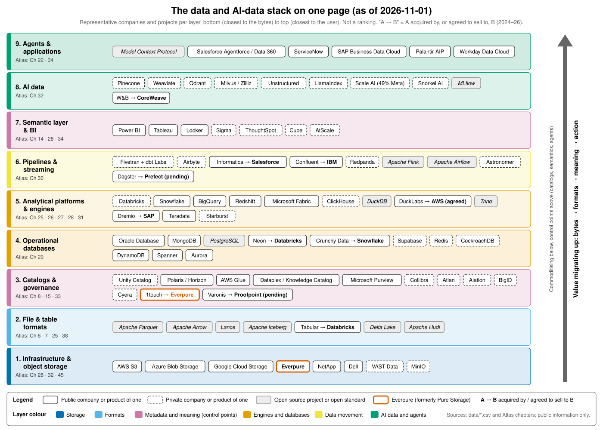

# AI Data Atlas（AI 数据图谱）

**数据库、数据管道、数据平台与 AI 数据栈：技术如何运作、企业如何赚钱，以及这一切如何与存储交汇。**

AI Data Atlas 是一个由 50 章外加两章导读（第 0 部分）组成的知识库。它从字节层面向上解读数据行业：数据库、表格式、目录、数据管道、向量检索和 AI 智能体如何运作；谁在销售这些产品；这些公司如何赚钱、如何被估值；以及行业正走向何方。文中数字截至 **2026-11-01**。

## 适合谁读

本图谱的读者定位是一位加入 **Everpure**（原 Pure Storage；NYSE: P，原代码 PSTG）的企业发展与战略专业人士（CFA、MBA、法律背景，具有半导体和 AI 基础设施并购经验），而 Everpure 正从存储向上层栈延伸，进入数据管理与数据智能领域。本图谱假定读者已熟悉金融与存储，着力培养读者对存储之上各层的熟悉度。配套的 *Everpure Tech Atlas* 已覆盖存储硬件与协议，因此本图谱不再重复讲解；简短的 **存储桥接（Storage bridge）** 方框将两者连接起来。希望在一处同时了解数据业务与数据技术的产品经理、工程师和投资者，也会觉得本图谱有用。

## 全景图

*来自 [0.2](00-start-here/ch00-2-market-map.md) 的一页纸市场地图。价值正沿着技术栈向上迁移：从存储和计算，转向目录、语义上下文与智能体。*

## 如何浏览

先读第 0 部分，然后按某条学习路径阅读，或直接跳到某一部分。

- **第 0 部分 · 从这里开始** —— [0.1 如何使用本图谱](00-start-here/ch00-1-how-to-use.md) 和 [0.2 一页纸市场地图](00-start-here/ch00-2-market-map.md)。
- **第 1 部分 · 数据系统基础** —— 从 [1. 数据栈全景图](01-data-systems-foundations/ch01-data-stack-map.md) 开始：数据模型、数据库内部机制、引擎、文件与表格式、目录。
- **第 2 部分 · 数据管道、数据移动与数据治理** —— 从 [9. 数据管道模式](02-pipelines-and-governance/ch09-pipeline-patterns.md) 开始：数据摄取、流处理、数据转换、数据质量、语义层、数据治理。
- **第 3 部分 · AI 数据栈** —— 从 [16. AI 数据生命周期](03-ai-data-stack/ch16-ai-data-lifecycle.md) 开始：非结构化数据、向量、检索、训练数据、智能体、实时处理。
- **第 4 部分 · 公司深度研究** —— 从 [25. Databricks](04-company-deep-dives/ch25-databricks.md) 开始：Snowflake、超大规模云厂商、数据库、流处理、AI 原生、数据治理与应用厂商。
- **第 5 部分 · 商业与经济** —— 从 [35. 商业模式](05-business-and-economics/ch35-business-models.md) 开始：单位经济效益、可比公司、开源、并购、市场进入、市场规模。
- **第 6 部分 · 历史与未来** —— 从 [42. 数据库史](06-history-and-future/ch42-history-of-databases.md) 开始，最后讨论这一切对一家向上层栈延伸的存储公司意味着什么。
- **第 7 部分 · 对话工具包** —— 从 [46. 与数据从业者对话](07-conversation-toolkit/ch46-talking-with-data-people.md) 开始：尽职调查清单、问题库、一句话讲解与闪卡。

术语定义见[术语表](glossary.md)。

## 三条学习路径

| 如果你有…… | 阅读内容 | 目标 |
|---|---|---|
| **2 小时** | 0.1 和 0.2，然后是第 1、7、8 章，第 25 和 26 章的要点速览（TL;DR），第 27、45 和 49 章 | 在首次会议中从容应对 |
| **2 天** | 第 1–4 部分，然后是第 35–37 章和第 45 章 | 能在白板上讲解任意一层，并读懂数据公司的损益表 |
| **2 周** | 全部内容，外加第 48–50 章中的练习 | 主导合作伙伴、尽职调查与创始人对话 |

完整的路径表（每一步都标明目标）见 [0.1](00-start-here/ch00-1-how-to-use.md#learning-paths)。各章默认以 **L2**（机制）深度撰写；**L1** 为词汇层面，**L3** 实现细节仅出现在"深入阅读"方框中。

## 数据、图表与局限性

图谱中的每个数字都有脚注注明来源和日期，并带有标签：GAAP、非 GAAP、公司披露的年化运行率、媒体报道或估算。共用数字存放在仓库的 `data/*.csv` 文件中（上市可比公司、私募融资轮次、并购交易、财务数据和市场规模），每一行都带有 `source` 和 `as_of` 日期。图表均由 `scripts/make_charts.py` 根据这些文件重新生成，绝不手工绘制。

本版研究仅使用了网络搜索，未直接抓取网页，因此部分事实依据的是搜索结果对所引页面的摘要。我们无法确认的说法均以方括号中的 VERIFY 标记标出。市场数据为截至 2026-11-01 的快照。涉及 Everpure 战略的内容均以"战略团队可能评估的选项"的方式表述，且仅基于公开信息；本文任何内容均不构成投资建议。
