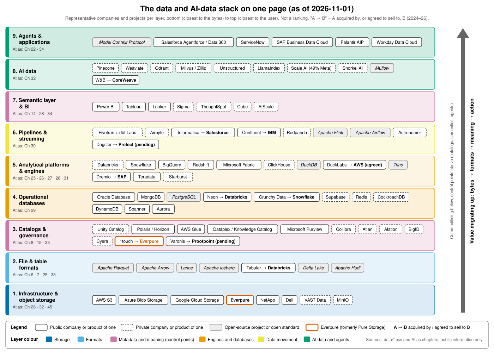

# AI Data Atlas

**Databases, data pipelines, data platforms and the AI-data stack: how the technology works, how the businesses make money, and where it all meets storage.**

This atlas is a GitHub-hosted knowledge base of 50 chapters plus a two-chapter Part 0 orientation, written for a corporate-development and strategy professional (CFA, MBA, legal background, semiconductor and AI-infrastructure M&A experience) joining **Everpure** (formerly Pure Storage; NYSE: P, formerly PSTG) as the company moves up the stack from storage into data management and data intelligence. A companion repo, the *Everpure Tech Atlas*, covers storage hardware and protocols, so this atlas does not re-teach storage; where storage matters, chapters include a short **Storage bridge** box.

It reads on github.com (Mermaid renders natively) and as an MkDocs Material site (`mkdocs serve`, or the GitHub Pages workflow in `.github/workflows/deploy.yml`).



*The one-page market map (Ch 0.2). Value is migrating up the stack, from storage and compute toward catalogs, semantic context and agents.*

## Start here

| If you have… | Read | Goal |
|---|---|---|
| **2 hours** | [0.1 How to use](docs/00-start-here/ch00-1-how-to-use.md) → [0.2 Market map](docs/00-start-here/ch00-2-market-map.md) → [1 Data stack map](docs/01-data-systems-foundations/ch01-data-stack-map.md) → [7 Open table formats](docs/01-data-systems-foundations/ch07-open-table-formats.md) → [8 Catalogs](docs/01-data-systems-foundations/ch08-catalogs-and-metastores.md) → [27 Databricks vs. Snowflake](docs/04-company-deep-dives/ch27-databricks-vs-snowflake.md) → [45 Storage moving up the stack](docs/06-history-and-future/ch45-storage-moving-up-the-stack.md) → [49 Explain it in 30 seconds](docs/07-conversation-toolkit/ch49-explain-in-30-seconds.md) | Hold your own in a first meeting |
| **2 days** | Parts 1–4, then [35](docs/05-business-and-economics/ch35-business-models.md)–[37](docs/05-business-and-economics/ch37-public-comps-valuation.md) and [45](docs/06-history-and-future/ch45-storage-moving-up-the-stack.md) | Whiteboard any layer (L2) and read a data company's P&L |
| **2 weeks** | Everything, plus the drills in [48 Question bank](docs/07-conversation-toolkit/ch48-question-bank.md) and [50 Flashcards & cheat sheets](docs/07-conversation-toolkit/ch50-self-test-cheat-sheets.md) | Lead partnership, diligence and founder conversations |

Depth labels used throughout: **L1** vocabulary, **L2** mechanism (default), **L3** implementation (only in "Going deeper" boxes). Terms are defined in the [glossary](glossary.md).

## Contents and progress

<!-- AUTO:CONTENTS START -->
**52 chapters · 208,622 prose words · 484 visuals · 447 open [VERIFY] markers** (counts from `scripts/qa_report.py`; prose excludes tables, code/Mermaid, captions and footnotes).

| Part | Chapter | Prose words | Visuals | [VERIFY] | Reviewed |
|---|---|---|---|---|---|
| Part 0 | [0.1 How to Use This Atlas](docs/00-start-here/ch00-1-how-to-use.md) | 1,760 | 5 | 0 | ✓ |
| Part 0 | [0.2 The One-Page Market Map](docs/00-start-here/ch00-2-market-map.md) | 2,053 | 4 | 0 | ✓ |
| Part 1 | [1. The Data Stack Map](docs/01-data-systems-foundations/ch01-data-stack-map.md) | 3,429 | 10 | 4 | ✓ |
| Part 1 | [2. Data Models](docs/01-data-systems-foundations/ch02-data-models.md) | 3,230 | 7 | 4 | ✓ |
| Part 1 | [3. How a Database Works Inside](docs/01-data-systems-foundations/ch03-database-internals.md) | 4,485 | 10 | 1 | ✓ |
| Part 1 | [4. Distributed Databases](docs/01-data-systems-foundations/ch04-distributed-databases.md) | 4,408 | 10 | 5 | ✓ |
| Part 1 | [5. Analytical Engines](docs/01-data-systems-foundations/ch05-analytical-engines.md) | 3,437 | 8 | 2 | ✓ |
| Part 1 | [6. File Formats: From CSV to Parquet, Arrow and Lance](docs/01-data-systems-foundations/ch06-file-formats.md) | 2,993 | 7 | 2 | ✓ |
| Part 1 | [7. Open Table Formats: Iceberg, Delta Lake and Hudi](docs/01-data-systems-foundations/ch07-open-table-formats.md) | 3,634 | 9 | 1 | ✓ |
| Part 1 | [8. Catalogs and Metastores: The New Control Point](docs/01-data-systems-foundations/ch08-catalogs-and-metastores.md) | 2,660 | 6 | 8 | ✓ |
| Part 2 | [9. Pipeline Patterns](docs/02-pipelines-and-governance/ch09-pipeline-patterns.md) | 3,503 | 10 | 3 | ✓ |
| Part 2 | [10. Ingestion and Integration](docs/02-pipelines-and-governance/ch10-ingestion-and-integration.md) | 2,758 | 8 | 8 | ✓ |
| Part 2 | [11. Streaming and Event Platforms](docs/02-pipelines-and-governance/ch11-streaming-and-event-platforms.md) | 3,681 | 10 | 5 | ✓ |
| Part 2 | [12. Transformation and Orchestration](docs/02-pipelines-and-governance/ch12-transformation-and-orchestration.md) | 3,319 | 7 | 3 | ✓ |
| Part 2 | [13. Data Quality, Observability and Lineage](docs/02-pipelines-and-governance/ch13-data-quality-observability-lineage.md) | 3,448 | 8 | 5 | ✓ |
| Part 2 | [14. Semantic Layers and BI](docs/02-pipelines-and-governance/ch14-semantic-layers-and-bi.md) | 2,900 | 7 | 5 | ✓ |
| Part 2 | [15. Governance, Security and Privacy](docs/02-pipelines-and-governance/ch15-governance-security-privacy.md) | 4,434 | 8 | 10 | ✓ |
| Part 3 | [16. The AI Data Lifecycle](docs/03-ai-data-stack/ch16-ai-data-lifecycle.md) | 3,660 | 6 | 1 | ✓ |
| Part 3 | [17. Unstructured Data Processing](docs/03-ai-data-stack/ch17-unstructured-data-processing.md) | 3,160 | 10 | 11 | ✓ |
| Part 3 | [18. Embeddings and Vector Search](docs/03-ai-data-stack/ch18-embeddings-and-vector-search.md) | 4,467 | 11 | 6 | ✓ |
| Part 3 | [19. Retrieval Architectures: RAG, Hybrid Search, GraphRAG and Context Engineering](docs/03-ai-data-stack/ch19-retrieval-architectures.md) | 3,785 | 11 | 6 | ✓ |
| Part 3 | [20. The Training-Data Supply Chain](docs/03-ai-data-stack/ch20-training-data-supply-chain.md) | 3,652 | 8 | 20 | ✓ |
| Part 3 | [21. ML Platforms, Feature Stores and LLMOps](docs/03-ai-data-stack/ch21-ml-platforms-feature-stores-llmops.md) | 3,436 | 9 | 0 | ✓ |
| Part 3 | [22. Agents and Data](docs/03-ai-data-stack/ch22-agents-and-data.md) | 4,328 | 10 | 4 | ✓ |
| Part 3 | [23. Real-Time Analytics and HTAP](docs/03-ai-data-stack/ch23-real-time-analytics-htap.md) | 3,366 | 9 | 10 | ✓ |
| Part 3 | [24. Where the Data Stack Meets Compute and Storage](docs/03-ai-data-stack/ch24-data-meets-compute-and-storage.md) | 3,641 | 11 | 3 | ✓ |
| Part 4 | [25. Databricks](docs/04-company-deep-dives/ch25-databricks.md) | 5,346 | 13 | 6 | ✓ |
| Part 4 | [26. Snowflake](docs/04-company-deep-dives/ch26-snowflake.md) | 6,449 | 16 | 29 | ✓ |
| Part 4 | [27. Databricks vs. Snowflake: Head-to-Head](docs/04-company-deep-dives/ch27-databricks-vs-snowflake.md) | 4,026 | 11 | 16 | ✓ |
| Part 4 | [28. Hyperscaler Data Platforms: AWS, Google, Microsoft and Oracle](docs/04-company-deep-dives/ch28-hyperscaler-data-platforms.md) | 5,371 | 10 | 26 | ✓ |
| Part 4 | [29. Operational Database Vendors](docs/04-company-deep-dives/ch29-operational-database-vendors.md) | 4,557 | 11 | 40 | ✓ |
| Part 4 | [30. Data Movement and Streaming Companies](docs/04-company-deep-dives/ch30-data-movement-streaming-companies.md) | 4,371 | 10 | 25 | ✓ |
| Part 4 | [31. Analytical Engine Challengers and Legacy Platforms](docs/04-company-deep-dives/ch31-analytical-engine-challengers-legacy.md) | 4,473 | 8 | 21 | ✓ |
| Part 4 | [32. AI-Native Data Companies](docs/04-company-deep-dives/ch32-ai-native-data-companies.md) | 4,760 | 11 | 24 | ✓ |
| Part 4 | [33. Governance, Catalog and Data-Security Companies](docs/04-company-deep-dives/ch33-governance-catalog-security-companies.md) | 3,647 | 9 | 15 | ✓ |
| Part 4 | [34. Data Platforms of the Application Giants](docs/04-company-deep-dives/ch34-application-giants-data-platforms.md) | 3,827 | 12 | 38 | ✓ |
| Part 5 | [35. Business Models: Consumption, Subscription, Open Core and Managed Cloud](docs/05-business-and-economics/ch35-business-models.md) | 3,881 | 9 | 1 | ✓ |
| Part 5 | [36. Unit Economics and KPIs](docs/05-business-and-economics/ch36-unit-economics-kpis.md) | 4,124 | 11 | 9 | ✓ |
| Part 5 | [37. Public Comps and Valuation](docs/05-business-and-economics/ch37-public-comps-valuation.md) | 3,412 | 15 | 6 | ✓ |
| Part 5 | [38. Open Source as Strategy](docs/05-business-and-economics/ch38-open-source-strategy.md) | 3,316 | 8 | 6 | ✓ |
| Part 5 | [39. M&A History of the Data Industry, 2010–2026](docs/05-business-and-economics/ch39-ma-history.md) | 4,782 | 11 | 1 | ✓ |
| Part 5 | [40. Go-to-Market and Partnerships](docs/05-business-and-economics/ch40-gtm-partnerships.md) | 2,964 | 9 | 7 | ✓ |
| Part 5 | [41. Market Sizing and Growth Drivers](docs/05-business-and-economics/ch41-market-sizing.md) | 1,782 | 7 | 6 | ✓ |
| Part 6 | [42. A History of Databases, 1960s–2026](docs/06-history-and-future/ch42-history-of-databases.md) | 4,723 | 7 | 10 | ✓ |
| Part 6 | [43. The Modern Data Stack: Rise, Unbundling and Rebundling](docs/06-history-and-future/ch43-modern-data-stack.md) | 2,304 | 6 | 5 | ✓ |
| Part 6 | [44. Future Trends, 2026–2032](docs/06-history-and-future/ch44-future-trends.md) | 4,325 | 9 | 11 | ✓ |
| Part 6 | [45. Implications for a Storage Company Moving Up the Stack](docs/06-history-and-future/ch45-storage-moving-up-the-stack.md) | 2,765 | 8 | 15 | ✓ |
| Part 7 | [46. Talking with Data-Platform PMs, Engineers, Partners and Founders](docs/07-conversation-toolkit/ch46-talking-with-data-people.md) | 3,865 | 7 | 0 | ✓ |
| Part 7 | [47. Technical and Business Diligence Checklist for a Data-Infrastructure Target](docs/07-conversation-toolkit/ch47-diligence-checklist.md) | 3,671 | 6 | 1 | ✓ |
| Part 7 | [48. Question Bank: 154 Questions](docs/07-conversation-toolkit/ch48-question-bank.md) | 8,292 | 15 | 0 | ✓ |
| Part 7 | [49. Explain It in 30 Seconds](docs/07-conversation-toolkit/ch49-explain-in-30-seconds.md) | 4,676 | 7 | 0 | ✓ |
| Part 7 | [50. Self-Test and Cheat Sheets](docs/07-conversation-toolkit/ch50-self-test-cheat-sheets.md) | 13,286 | 19 | 2 | ✓ |
<!-- AUTO:CONTENTS END -->

## How the numbers work

- **Every number is labelled**: GAAP, non-GAAP, company-stated run-rate, press-reported, or estimate. Fiscal years are explicit (Snowflake's FY2027 = Feb 2026–Jan 2027).
- **Single source of truth:** [`data/`](data/) holds the canonical CSVs (`public_comps.csv`, `private_funding.csv`, `ma_deals.csv`, `company_financials.csv`, `market_sizes.csv`, plus chapter datasets). Every row carries `source` and `as_of`.
- **Charts regenerate from data:** `python3 scripts/make_charts.py` rebuilds every PNG in `docs/assets/charts/`.
- **Figures are as of 2026-11-01** unless a footnote says otherwise. Facts the integrator re-checked late in the build are collected in [`meta/verified-facts.md`](meta/verified-facts.md).
- **Limitations:** research used web search only (direct page fetches were blocked in the build environment), so footnotes cite the primary URLs surfaced by search. Anything that could not be confirmed carries an inline `[VERIFY: …]` marker, listed in [`meta/open-questions.md`](meta/open-questions.md). Strategy sections use public information only and are framed as options a strategy team might evaluate.

## Repository map

```
README.md            you are here
CLAUDE.md            standing rules and execution mode for the build
PROGRESS.md          build tracker (status, words, visuals, VERIFY counts)
glossary.md          generated copy of docs/glossary.md
mkdocs.yml           MkDocs Material config (Mermaid, search, nav)
docs/                chapters (00–07), glossary, assets/{charts,diagrams}
data/                CSVs: comps, funding rounds, M&A deals, financials, market sizes
scripts/             make_charts.py, wordcount.py, lint_mermaid.sh, check_links.py, qa_report.py, …
meta/                outline, style guide, templates, sources, decisions, open questions, reviews
.github/workflows/   deploy.yml: build MkDocs and publish to GitHub Pages
```

## Quality checks

```bash
python3 scripts/wordcount.py        # prose words per chapter / part / total
scripts/lint_mermaid.sh             # renders every Mermaid block with mmdc
python3 scripts/check_links.py      # internal links and anchors
python3 scripts/qa_report.py        # template compliance, visual density, VERIFY count
python3 scripts/make_charts.py      # regenerate all charts from data/
```

To publish the site: in the repository settings, set **Pages → Source → GitHub Actions**; the workflow builds on pushes to `main` and `claude/**` branches.
