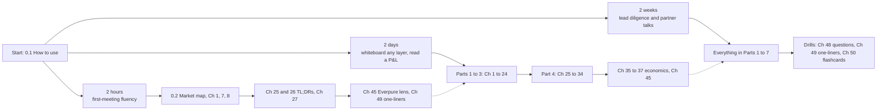
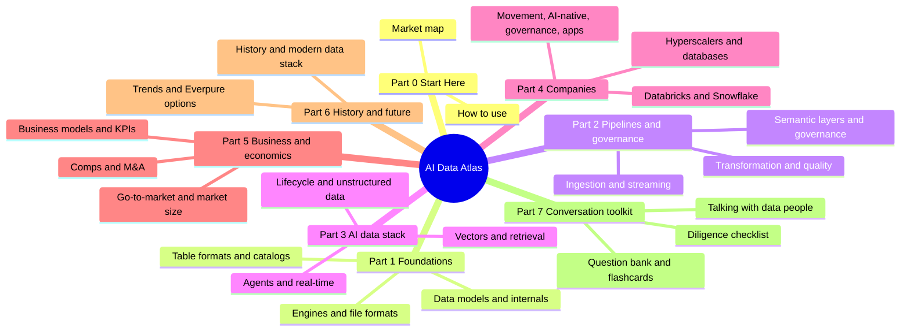

# 0.1 How to Use This Atlas
> **Depth:** L1 · **Reading time:** ~8 min · **Last verified:** 2026-11-01 · **Prerequisites:** none

## TL;DR

- The AI Data Atlas explains the data industry in eight Parts: how databases, pipelines, catalogs and the AI-data stack work (Parts 1–3), who sells them and how they make money (Parts 4–5), where the industry came from and where it is going (Part 6), and how to talk about all of it in a meeting (Part 7).
- It is written for a strategy and corporate-development reader joining Everpure (formerly Pure Storage). It assumes you know finance, M&A and storage hardware. It does not assume you know how a query optimizer or a vector index works.
- Most chapters are written at **L2**, mechanism depth: enough to draw the idea on a whiteboard and judge a trade-off. Implementation detail (**L3**) appears only in short "Going deeper" boxes.
- Every number carries a footnote, a date and a label: **GAAP**, **non-GAAP**, **company-stated run-rate**, **press-reported** or **estimate**. Figures are as of **2026-11-01**. Anything we could not confirm carries a bracketed `VERIFY: …` marker.
- Pick a path by time available: **2 hours** for a first meeting, **2 days** to whiteboard any layer and read a data company's P&L, **2 weeks** to lead partnership, diligence and founder conversations.

## Who this is for

The primary reader is a strategy and corporate-development professional with a CFA, an MBA and a legal background, who has done semiconductor and AI-infrastructure M&A and is joining Everpure as the company moves from storage arrays into data management and data intelligence. That reader can value a business, read a 10-Q and structure a deal. What they need is fluency in the layer *above* storage: why Databricks paid a reported ~$2B for the company behind a table format, why a catalog is worth fighting over, and why every major data platform bought or built a Postgres service in 2025–26.

The atlas therefore skips what the reader already knows. It does not re-teach storage. Where a storage concept matters, a short **Storage bridge** box points to the companion *Everpure Tech Atlas* and moves on. It also leans on the reader's home ground for analogies: memory hierarchies, wafer yield, royalties and annuities, cohort analysis. Those appear as **Bridge** boxes.

Three other readers will get value from it. Product managers moving from infrastructure into data can use Parts 1–3 as a systems primer. Engineers who want the business context for their work can start at Part 4. Investors can read Part 5 (business models, KPIs, comps, M&A) on its own; the [comps](../05-business-and-economics/ch37-public-comps-valuation.md) and [M&A history](../05-business-and-economics/ch39-ma-history.md) chapters are written to be useful without the technical chapters.

## Depth labels (L1/L2/L3)

Each chapter header states its depth. The labels describe how far down an explanation goes, not how hard the chapter is.

| Label | What it means | What you can do afterwards | Where it appears |
|---|---|---|---|
| **L1 – Vocabulary** | Defines the term and uses it correctly in a sentence | Follow a conversation without getting lost | Glossary, TL;DRs, Part 0, [Ch 49](../07-conversation-toolkit/ch49-explain-in-30-seconds.md) one-liners |
| **L2 – Mechanism** (default) | Whiteboard-level: how it works, why one design beats another, what it costs | Draw it, ask the second question, judge a vendor claim | The body of almost every chapter |
| **L3 – Implementation** | Internals, code paths, file layouts, query-engine source | Check an engineer's claim in detail | Only inside `> **Going deeper (L3).**` boxes |

*Figure 0.1.1 — The depth ladder. The atlas is built to get a business reader to L2 everywhere and to L3 nowhere, except in short optional boxes.*

The practical test for L2 is the second question. Anyone can say "Iceberg is an open table format". An L2 reader can ask "who runs your catalog, and how do you handle compaction?", and can tell a good answer from a vague one. Each chapter's **Conversation playbook** lists those second questions and what good answers sound like.

## How chapters are built

Every chapter follows one of three mandatory templates, so you always know where to look.

- **Concept chapters** (Parts 1, 2, 3, 5 and 6) run: TL;DR, Why this matters (business and Everpure lens), How it works, Design choices and trade-offs, Who's who, History and trajectory, Numbers that matter, an optional Storage bridge, Conversation playbook, Going deeper, Key terms and Sources.
- **Company chapters** (Part 4) open with a status line (public or private, headquarters, founding date, latest valuation or market cap with basis and date) and run: TL;DR, Snapshot table, Origin story, Product and technology, How it makes money, Financials, Customers and go-to-market, M&A and investments, Competitive position, bull case, bear case, Relevance to Everpure, Conversation playbook and Sources.
- **Toolkit chapters** (Part 7) are reference material organised by topic, but keep the TL;DR, Key terms and Sources sections.

Four conventions run through all of them. First, **footnotes**: every quantitative or time-sensitive claim has a footnote giving the source, its URL, its publication date and the retrieval date. Primary sources (SEC filings, earnings releases, project documentation, papers) are preferred; press coverage is used for private companies and labelled as such. Second, **labels**: every financial figure says what kind of number it is, using the five labels in the table below. Third, bracketed **`VERIFY: …` markers** flag any fact we could not confirm from a source we could check; each is also logged in `meta/open-questions.md`. Fourth, **as-of dates**: market caps and multiples move daily, so each carries its date, and the chapter header carries a "Last verified" date.

| Label | What it means | Example from the atlas | How much weight to put on it |
|---|---|---|---|
| **GAAP** | Audited or reviewed figure in an SEC filing or earnings release | Snowflake product revenue ~$1.49B, Q2 FY2027[^sf-q2] | High; comparable across filers |
| **non-GAAP** | Company-adjusted figure, usually excluding stock comp and amortisation | Snowflake non-GAAP operating margin 15.3% against GAAP −17.0%[^sf-q2] | Useful, but always check the gap |
| **Company-stated run-rate** | A private or public company's own annualised figure, unaudited | Databricks ">$7B revenue run-rate"[^db-aug26] | Directional; definitions vary |
| **Press-reported** | Reported by business press, not confirmed by the company | Databricks–Tabular at ~$2B (2024)[^ma-csv] | Medium; look for two sources |
| **Estimate** | Our arithmetic or an analyst estimate, method stated | Snowflake at 16.9x EV/NTM revenue[^comps] | Only as good as its inputs |

*Figure 0.1.2 — The five number labels. Read the label before the number: a $7B run-rate and $7B of GAAP revenue are different claims.*

## Learning paths

The atlas runs to 50 chapters plus this Part 0, and few readers need all of it in the first week. The three paths below are cumulative: each assumes the one before.

*Figure 0.1.3 — Three learning paths. Each is a superset of the one before; the dotted arrows show where to pick up if you extend.*

| Path | Step | Read | Goal of this step |
|---|---|---|---|
| **2 hours** | 1 | [1. The Data Stack Map](../01-data-systems-foundations/ch01-data-stack-map.md) | Learn the four workload families and follow one order through every layer |
| | 2 | [0.2 The One-Page Market Map](ch00-2-market-map.md) | Put names on each layer and see where value is moving |
| | 3 | [7. Open Table Formats](../01-data-systems-foundations/ch07-open-table-formats.md) | Understand why Iceberg and Delta turned object storage into a database |
| | 4 | [8. Catalogs and Metastores](../01-data-systems-foundations/ch08-catalogs-and-metastores.md) | See why the catalog, not the format, is the control point |
| | 5 | [25. Databricks — TL;DR](../04-company-deep-dives/ch25-databricks.md#tldr) and [26. Snowflake — TL;DR](../04-company-deep-dives/ch26-snowflake.md#tldr) | Carry the two headline companies' scale, valuation and strategy in your head |
| | 6 | [27. Databricks vs. Snowflake](../04-company-deep-dives/ch27-databricks-vs-snowflake.md) | Compare them on a like-for-like basis and avoid the run-rate trap |
| | 7 | [45. Storage Moving Up the Stack](../06-history-and-future/ch45-storage-moving-up-the-stack.md) | Map the topic onto Everpure's public moves and options |
| | 8 | [49. Explain It in 30 Seconds](../07-conversation-toolkit/ch49-explain-in-30-seconds.md) | Rehearse the one-liners you will need on day one |
| **2 days** | Day 1 | Parts 1–3: [Ch 1](../01-data-systems-foundations/ch01-data-stack-map.md) to [Ch 24](../03-ai-data-stack/ch24-data-meets-compute-and-storage.md) | Whiteboard every layer at L2: engines, formats, pipelines, governance, retrieval, agents |
| | Day 2 | Part 4: [Ch 25](../04-company-deep-dives/ch25-databricks.md) to [Ch 34](../04-company-deep-dives/ch34-application-giants-data-platforms.md) | Know each vendor group's product, money model and competitive position |
| | Day 2 | [35. Business Models](../05-business-and-economics/ch35-business-models.md), [36. Unit Economics](../05-business-and-economics/ch36-unit-economics-kpis.md), [37. Comps and Valuation](../05-business-and-economics/ch37-public-comps-valuation.md) | Read a data company's P&L, KPIs and multiple with the right labels |
| | Day 2 | [45. Storage Moving Up the Stack](../06-history-and-future/ch45-storage-moving-up-the-stack.md) | Connect the whole stack back to Everpure's options |
| **2 weeks** | Week 1 | Parts 0–4 in order, including Going deeper boxes | Build L2 fluency everywhere and L3 where your role needs it |
| | Week 2 | Parts 5–7: [Ch 35](../05-business-and-economics/ch35-business-models.md) to [Ch 47](../07-conversation-toolkit/ch47-diligence-checklist.md) | Add economics, M&A history, history and future, and the diligence checklist |
| | Week 2 | Drills: [48. Question Bank](../07-conversation-toolkit/ch48-question-bank.md), [49. Explain It in 30 Seconds](../07-conversation-toolkit/ch49-explain-in-30-seconds.md), [50. Self-Test and Cheat Sheets](../07-conversation-toolkit/ch50-self-test-cheat-sheets.md) | Test recall with questions and flashcards until you can run a meeting unaided |

*Figure 0.1.4 — The path table. The 2-hour path is about 90 minutes of reading plus time on the diagrams; the 2-day path is roughly 12–14 hours.*

The 2-hour path is built around one argument that recurs through the atlas. Open formats made data portable. Power moved to whoever runs the catalog and the semantic context on top. Agents are now the biggest new consumers of that context. If you can explain that chain and put company names on it, you can hold your own in a first meeting.

The atlas is organised as eight Parts. The mindmap below shows what each Part covers; the Part 4 deep dives are the longest single block.

*Figure 0.1.5 — The eight Parts. Parts 1–3 explain the technology, Part 4 the owners, Part 5 the economics, Part 6 the direction of travel and Part 7 how to use it in conversation.*

## How to read the numbers

Three habits prevent most errors when quoting figures from this atlas.

**Check the fiscal year.** Many data companies do not report on the calendar. Snowflake and MongoDB end their year on January 31, so FY2027 means February 2026 to January 2027. Microsoft ends on June 30, Oracle on May 31, and Everpure on the Sunday nearest February 1. Chapters always spell the months out, because "Q2" means May–July for Snowflake and April–June for Datadog.

**Check what is being measured.** [Annual recurring revenue](../glossary.md#annual-recurring-revenue) (ARR) annualises contracted subscriptions. A [revenue run-rate](../glossary.md#revenue-run-rate) annualises the latest month or quarter of recognised revenue. [Product revenue](../glossary.md#product-revenue) is Snowflake's consumption line, excluding professional services; total revenue includes them. These are not interchangeable, and private companies usually report the most flattering one.

**Check the basis of any multiple.** A worked example shows why. Databricks raised money at a $190B post-money valuation in August 2026 and states a revenue run-rate above $7B, so it is valued at about 27x run-rate.[^db-aug26] Snowflake trades at 16.9x [EV to NTM revenue](../glossary.md#ev-to-ntm-revenue) (as of 2026-10-30).[^comps] The first is a private [post-money valuation](../glossary.md#post-money-valuation) of the equity, divided by an unaudited company-defined run-rate. The second is a public [enterprise value](../glossary.md#enterprise-value) divided by guidance-derived forward revenue. The gap between 27x and 16.9x is real, but part of it is just the different numerators and denominators. [Ch 27](../04-company-deep-dives/ch27-databricks-vs-snowflake.md) and [Ch 37](../05-business-and-economics/ch37-public-comps-valuation.md) make the comparison properly.

> **Bridge: finance.** Treat a company-stated run-rate the way you would treat a management-adjusted EBITDA in a CIM: informative, directionally right, and never a substitute for the audited line. The atlas labels both so you can apply the haircut yourself.

## How the data and charts work

Numbers that appear in more than one chapter live in one place: the CSV files under `data/`. They are the single source of truth, and chapters must quote them as written.

- `data/public_comps.csv` holds 26 public companies with market cap, enterprise value, forward revenue, multiple, growth and margin, each with its basis and as-of date.
- `data/private_funding.csv` holds 110 private rounds with amount, post-money valuation and whether the valuation is company-stated or press-reported.
- `data/ma_deals.csv` holds 143 curated deals from 2010 to October 2026, each with value, value basis (disclosed, press-reported or undisclosed), status, rationale and outcome.
- `data/company_financials.csv` and `data/market_sizes.csv` hold reported financials and analyst market sizes. Chapter-specific files such as `data/ch28_cloud_segments.csv` add series used by one chapter.

Every row in every file has a `source` and an `as_of` column. Charts are never drawn by hand. `scripts/make_charts.py` reads the CSVs and regenerates every PNG in `docs/assets/charts/`, using per-chapter scripts in `scripts/charts/` and a shared colour-blind-safe palette. If a number changes, the CSV is updated and the charts are rebuilt, so text and charts cannot drift apart. Dense layered diagrams, such as the market map in [0.2](ch00-2-market-map.md), are original SVGs in `docs/assets/diagrams/`; flows and timelines are Mermaid diagrams written inline in the chapters.

## Limitations

Read the atlas as a well-sourced briefing, not as an audited reference. Four limitations matter.

**Research was web-search-only.** The research environment allowed web search but blocked direct page fetches for most sites. Facts were therefore taken from search-engine summaries of the cited pages, cross-checked across at least two results where possible, rather than from full reads of each source. Key financial figures were re-checked against SEC filings and earnings releases where search surfaced them. Some lower-priority rows rely on a single secondary summary, and those are labelled press-reported or marked for checking.

**VERIFY markers are open items.** Several hundred markers remain across the atlas; the live count is in the README and comes from `scripts/qa_report.py`. A marker does not mean a claim is wrong. It means we could not confirm it from a source we could check. Before you put such a figure in front of a counterparty, open the primary source yourself.

**Figures are a snapshot as of 2026-11-01.** Market caps, multiples and private marks move daily, and product names change at every vendor conference (Snowflake renamed two AI products in June 2026 alone). Each figure's as-of date tells you how stale it might be.

**Public information only.** Everpure strategy content is framed as options a strategy team might evaluate, based on public information. Nothing here reflects non-public Everpure plans, and nothing here is investment advice.

## Key terms

- [Revenue run-rate](../glossary.md#revenue-run-rate) — the latest period's revenue annualised; for private companies, company-stated and unaudited.
- [Annual recurring revenue](../glossary.md#annual-recurring-revenue) — contracted subscription revenue expressed as an annual figure.
- [Product revenue](../glossary.md#product-revenue) — Snowflake's consumption revenue line, excluding professional services.
- [Non-GAAP operating margin](../glossary.md#non-gaap-operating-margin) — operating margin after company adjustments, usually excluding stock-based compensation.
- [Post-money valuation](../glossary.md#post-money-valuation) — a private company's implied equity value immediately after a funding round.
- [Enterprise value](../glossary.md#enterprise-value) — equity value plus debt minus cash; the numerator of most public multiples.
- [EV to NTM revenue](../glossary.md#ev-to-ntm-revenue) — enterprise value divided by next-twelve-months revenue.
- [Lakehouse](../glossary.md#lakehouse) — open tables on object storage, queried by many engines.
- [Technical catalog](../glossary.md#technical-catalog) — the service that maps table names to metadata and grants access; the atlas's recurring control point.
- **GAAP** — US Generally Accepted Accounting Principles; the label for reported, audited or reviewed figures (glossary entry staged).
- **Fiscal year** — a company's 12-month reporting period, which often does not match the calendar year (glossary entry staged).
- **Depth label** — the atlas's L1/L2/L3 marker for how far down an explanation goes (glossary entry staged).

## Sources

[^sf-q2]: Snowflake Inc. via Business Wire, "Snowflake Reports Financial Results for the Second Quarter of Fiscal 2027," https://secure.businesswire.com/news/home/20260902386235/en/Snowflake-Reports-Financial-Results-for-the-Second-Quarter-of-Fiscal-2027, published 2026-09-02; retrieved 2026-11-01. Q2 FY2027 = May–Jul 2026. Values as recorded in `data/company_financials.csv`.
[^db-aug26]: Databricks, "Databricks Grows >80% YoY, Surpasses $7B Revenue Run-Rate…," https://www.databricks.com/company/newsroom/press-releases/databricks-grows-80-yoy-surpasses-7b-revenue-run-rate-scales, published 2026-08-13; retrieved 2026-11-01. Company-stated, unaudited run-rate; $190B post-money valuation per `data/private_funding.csv`.
[^ma-csv]: AI Data Atlas dataset `data/ma_deals.csv`, Databricks–Tabular row, citing TechCrunch, "Databricks reportedly paid $2 billion in Tabular acquisition," https://techcrunch.com/2024/08/14/databricks-reportedly-paid-2-billion-in-tabular-acquisition, published 2024-08-14; retrieved 2026-11-01. Press-reported; Databricks never disclosed the price.
[^comps]: AI Data Atlas dataset `data/public_comps.csv`, Snowflake row (EV $106.31B, NTM revenue $6.3B guidance-derived estimate, 16.9x), citing https://stockanalysis.com/stocks/snow/statistics/, as of 2026-10-30; retrieved 2026-11-01. Estimate.
