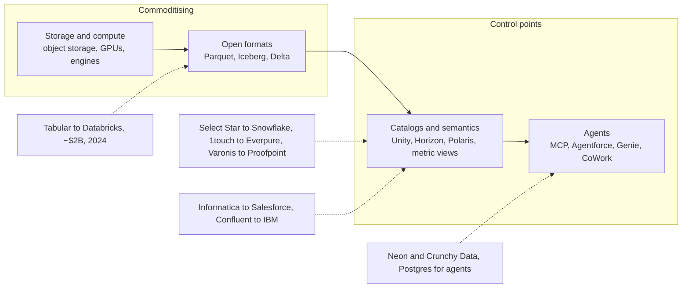

# 0.2 The One-Page Market Map
> **Depth:** L1 · **Reading time:** ~10 min · **Last verified:** 2026-11-01 · **Prerequisites:** [0.1 How to use this atlas](ch00-1-how-to-use.md)

## TL;DR

- The data and AI-data industry can be drawn as **nine layers**, from object storage at the bottom to agents and applications at the top. Every company in this atlas sits in one or more of them, and the biggest ones are trying to occupy all nine.
- The two scaled independents are worth roughly **$300B** between them: Databricks at **$190B post-money** on a **>$7B company-stated run-rate** (August 2026), and Snowflake at a **$107.88B market cap** (2026-10-30).[^db-aug26][^comps] The hyperscalers sit underneath and beside both, and their clouds grew 39–103% in the September 2026 quarter.[^amzn-q3][^msft-q1][^goog-q3]
- **Value is migrating up the stack.** Storage capacity and generic compute are commoditising. Open formats (Iceberg, Delta, Parquet) made data portable, so control has moved to the catalog, the semantic layer and the agent interface that sit above them.
- The middle of the stack was sold off in 2025–26. Informatica went to Salesforce (~$8B), Confluent to IBM (~$11B), Dremio to SAP, DuckLabs to AWS and Neon to Databricks. Private capital concentrated in a few winners instead: VAST Data ($30B), Scale AI (~$29B implied), ClickHouse ($15B) and Cyera ($12B).[^ma][^funding]
- Everpure's public moves sit in layer 1 (storage) and, since the **$125.0M** 1touch acquisition, reach into layer 3 (discovery, classification and semantic context).[^ep-1touch] [Ch 45](../06-history-and-future/ch45-storage-moving-up-the-stack.md) sets out the options.

## The map

The map below is the atlas on one page. Read it bottom to top: each layer depends on the one beneath it, and each layer up is closer to a person or an agent asking a question.

![Layered market map of the data and AI-data stack with nine horizontal bands. From bottom to top: infrastructure and object storage (AWS S3, Azure Blob, Google Cloud Storage, Everpure, NetApp, Dell, VAST Data, MinIO); file and table formats (Parquet, Arrow, Lance, Iceberg, Tabular acquired by Databricks, Delta Lake, Hudi); catalogs and governance (Unity Catalog, Polaris and Horizon, Glue, Dataplex, Purview, Collibra, Atlan, Alation, BigID, Cyera, 1touch acquired by Everpure, Varonis pending sale to Proofpoint); operational databases (Oracle, MongoDB, PostgreSQL, Neon to Databricks, Crunchy Data to Snowflake, Supabase, Redis, CockroachDB, DynamoDB, Spanner, Aurora); analytical platforms and engines (Databricks, Snowflake, BigQuery, Redshift, Fabric, ClickHouse, DuckDB, DuckLabs to AWS, Trino, Starburst, Dremio to SAP, Teradata); pipelines and streaming (Fivetran plus dbt Labs, Airbyte, Informatica to Salesforce, Confluent to IBM, Redpanda, Flink, Airflow, Astronomer, Dagster to Prefect); semantic layer and BI (Power BI, Tableau, Looker, Sigma, ThoughtSpot, Cube, AtScale); AI data (Pinecone, Weaviate, Qdrant, Milvus and Zilliz, Unstructured, LlamaIndex, Scale AI, Snorkel AI, MLflow, Weights and Biases to CoreWeave); and agents and applications (Model Context Protocol, Salesforce Agentforce and Data 360, ServiceNow, SAP Business Data Cloud, Palantir AIP, Workday Data Cloud). A tall arrow on the right shows value migrating upward. Everpure and 1touch are outlined in vermillion](../assets/diagrams/ch00-market-map.svg)

*Figure 0.2.1 — SV-1, the one-page market map. Nine layers, about 80 named companies and projects, and one direction of travel: value is moving from the bytes toward the metadata, meaning and agents above them. Chip borders show public (solid), private (dashed) and open-source (grey) status; "A → B" marks a 2024–26 acquisition.*

Three reading rules help. First, **layers are not markets**. A company appears where its main product sits, but Databricks and Snowflake now ship something in most of the nine layers, and each hyperscaler ships something in nearly all of them. Second, **colour shows the role of a layer**. Purple marks the two "meaning" layers (catalogs and semantics) where the atlas argues control is accumulating. Third, **the arrows tell the consolidation story**. Most "→" labels were added in the 18 months to October 2026, and most point from an independent specialist to a platform.

The table below adds status and the latest mark for each layer, taken from the atlas datasets.

| Layer | Representative companies (status) | Latest valuation or market cap (basis, date) | Deep dive |
|---|---|---|---|
| 1. Infrastructure and object storage | Amazon/AWS, Microsoft/Azure, Alphabet/Google Cloud, Everpure, NetApp, Dell (public); VAST Data, MinIO (private) | Amazon $2,600B, Microsoft $3,880B, Alphabet $3,440B market cap (2026-10-30); Everpure $43.79B, NetApp $42.24B (2026-10-01); VAST $30B post-money (Apr 2026, company-stated)[^comps][^funding] | [28](../04-company-deep-dives/ch28-hyperscaler-data-platforms.md), [32](../04-company-deep-dives/ch32-ai-native-data-companies.md), [45](../06-history-and-future/ch45-storage-moving-up-the-stack.md) |
| 2. File and table formats | Parquet, Arrow, Iceberg, Hudi (Apache projects); Delta Lake (Linux Foundation); Lance (LanceDB, private) | Projects carry no valuation; Tabular → Databricks ~$2B (Jun 2024, press-reported)[^ma] | [6](../01-data-systems-foundations/ch06-file-formats.md), [7](../01-data-systems-foundations/ch07-open-table-formats.md) |
| 3. Catalogs and governance | Unity Catalog (Databricks), Horizon/Polaris (Snowflake/Apache), Glue, Dataplex, Purview; Collibra, Atlan, Alation, BigID, Cyera (private); Varonis (public) | Cyera $12B (Jun 2026, press-reported); Collibra $5.25B (Nov 2021, press-reported); Alation $1.7B (Nov 2022, press-reported); BigID $1B (Mar 2024, company-stated); Atlan $750M (May 2024, company-stated); 1touch → Everpure $125.0M (GAAP); Varonis → Proofpoint ~$6.3B (pending)[^funding][^ma][^ep-1touch] | [33](../04-company-deep-dives/ch33-governance-catalog-security-companies.md) |
| 4. Operational databases | Oracle, MongoDB (public); Supabase, Redis, Cockroach Labs (private); DynamoDB, Aurora, Spanner (hyperscaler services) | Oracle $382.45B (2026-10-23); MongoDB $29.5B (2026-10-20); Supabase $10.65B (Oct 2026, press-reported); Cockroach Labs $5B (Dec 2021, press-reported); Neon → Databricks ~$1B (press-reported); Crunchy Data → Snowflake $164.5M (per 10-Q)[^comps][^funding][^ma] | [29](../04-company-deep-dives/ch29-operational-database-vendors.md) |
| 5. Analytical platforms and engines | Databricks, ClickHouse, Starburst (private); Snowflake, Teradata (public); BigQuery, Redshift, Fabric (hyperscalers) | Databricks $190B post-money (2026-08-13, company-stated); Snowflake $107.88B, 16.9x EV/NTM (2026-10-30, estimate); ClickHouse $15B (Jan 2026, press-reported); Starburst $3.35B (Feb 2022, press-reported); Teradata $3.19B (2026-10-28); Dremio → SAP and DuckLabs → AWS undisclosed[^db-aug26][^comps][^funding][^ma] | [25](../04-company-deep-dives/ch25-databricks.md), [26](../04-company-deep-dives/ch26-snowflake.md), [27](../04-company-deep-dives/ch27-databricks-vs-snowflake.md), [31](../04-company-deep-dives/ch31-analytical-engine-challengers-legacy.md) |
| 6. Pipelines and streaming | Fivetran + dbt Labs, Airbyte, Redpanda, Astronomer (private); Flink, Airflow (Apache projects) | Confluent → IBM ~$11B EV (closed Mar 2026); Informatica → Salesforce ~$8B equity (closed Nov 2025); last standalone marks Fivetran $5.6B (2021) and dbt Labs $4.2B (2022), company-stated; Airbyte $1.5B (2021); Redpanda $1B (Apr 2025); Astronomer $775M (May 2025, press-reported)[^ma][^funding] | [30](../04-company-deep-dives/ch30-data-movement-streaming-companies.md) |
| 7. Semantic layer and BI | Power BI (Microsoft), Tableau (Salesforce), Looker (Google); Sigma, Omni, ThoughtSpot, Cube, AtScale (private) | Sigma $3B (May 2026, press-reported); Omni $1.5B (Apr 2026, company-stated); ThoughtSpot, Cube and AtScale marks not in dataset[^funding] | [14](../02-pipelines-and-governance/ch14-semantic-layers-and-bi.md), [34](../04-company-deep-dives/ch34-application-giants-data-platforms.md) |
| 8. AI data | Pinecone, Weaviate, Qdrant, Zilliz, Unstructured, LlamaIndex, Snorkel AI, Scale AI (private); MLflow (open source) | Scale AI ~$29B implied (Meta paid $14.3B for 49%, Jun 2025, press-reported); Snorkel AI $3.5B (Sep 2026, company-stated); Pinecone $750M (Apr 2023, press-reported); W&B → CoreWeave ~$1.7B (press-reported)[^funding][^ma] | [32](../04-company-deep-dives/ch32-ai-native-data-companies.md) |
| 9. Agents and applications | Palantir, SAP, Salesforce, ServiceNow, Workday (public); Model Context Protocol (open standard) | Palantir $442.43B, SAP $273.8B, Salesforce $188.61B (2026-10-30); ServiceNow $142.4B (2026-10-01); Workday $45.99B (2026-10-16)[^comps] | [22](../03-ai-data-stack/ch22-agents-and-data.md), [34](../04-company-deep-dives/ch34-application-giants-data-platforms.md) |

*Figure 0.2.2 — Layer by company. The largest values sit at the bottom (hyperscalers) and the top (application and agent platforms); the middle layers are where the 2025–26 deals happened. Private marks from 2021–22 have not been re-priced and should be read as stale.*

## Layer by layer

**1. Infrastructure and object storage.** Every modern data platform keeps its durable copy in object storage: AWS S3, Azure Blob Storage or Google Cloud Storage in the cloud, and S3-compatible systems from Everpure (FlashBlade), NetApp, Dell, VAST Data or MinIO on premises. The hyperscalers dominate by volume and are adding database features to the storage API itself, such as S3 Tables and S3 Vectors ([Ch 24](../03-ai-data-stack/ch24-data-meets-compute-and-storage.md)). The storage peers are all moving up: VAST builds its own database and engines, NetApp bought DataPelago, and Everpure bought 1touch ([Ch 28](../04-company-deep-dives/ch28-hyperscaler-data-platforms.md), [Ch 32](../04-company-deep-dives/ch32-ai-native-data-companies.md), [Ch 45](../06-history-and-future/ch45-storage-moving-up-the-stack.md)).

**2. File and table formats.** Apache Parquet lays data out by column on disk; Apache Arrow does the same in memory; Lance targets the random access that AI training and vector search need. On top, an [open table format](../glossary.md#open-table-format) (Apache Iceberg, Delta Lake, Apache Hudi) turns a folder of files into a table with atomic commits and time travel. These are open projects, not companies, so value is captured around them. The "format war" ended when Databricks bought Tabular, the company founded by Iceberg's creators, for a press-reported ~$2B[^ma] and every major platform learned to read and write Iceberg ([Ch 7](../01-data-systems-foundations/ch07-open-table-formats.md), [Ch 25](../04-company-deep-dives/ch25-databricks.md), [Ch 38](../05-business-and-economics/ch38-open-source-strategy.md)).

**3. Catalogs and governance.** A [technical catalog](../glossary.md#technical-catalog) such as Unity Catalog, Snowflake Horizon (and Apache Polaris), AWS Glue, Google Dataplex or Microsoft Purview decides which table is current and who may read it. A [business catalog](../glossary.md#business-catalog) (Collibra, Alation, Atlan) helps people find and trust data. Data-security vendors (Cyera, BigID, Varonis) discover and classify sensitive data. The platforms give their catalogs away to win control, which squeezes the independents; security buyers pay up for classification, as Proofpoint's pending ~$6.3B Varonis deal shows.[^ma] Everpure's 1touch purchase sits here ([Ch 8](../01-data-systems-foundations/ch08-catalogs-and-metastores.md), [Ch 33](../04-company-deep-dives/ch33-governance-catalog-security-companies.md)).

**4. Operational databases.** Oracle and MongoDB are the large public vendors. PostgreSQL is the open-source standard, and the hyperscalers run the most databases of all (Aurora, DynamoDB, Spanner). The 2025–26 story is the Postgres land grab: Databricks bought Neon (~$1B, press-reported) and relaunched it as Lakebase, Snowflake bought Crunchy Data ($164.5M per its 10-Q), and Supabase reached a press-reported $10.65B.[^ma][^funding] The thesis is that agents, not people, now create most new databases ([Ch 29](../04-company-deep-dives/ch29-operational-database-vendors.md), [Ch 22](../03-ai-data-stack/ch22-agents-and-data.md)).

**5. Analytical platforms and engines.** This is the largest independent profit pool. Databricks and Snowflake compete with BigQuery, Redshift and Microsoft Fabric, and with open engines such as ClickHouse, DuckDB and Trino (commercialised by Starburst). The independents are being absorbed: SAP bought Dremio and AWS agreed to buy DuckLabs, the company behind DuckDB. ClickHouse is the breakout challenger at a $15B mark and more than $250M of company-stated ARR. Teradata shows what legacy trades at: about 1.7x EV/NTM revenue on roughly 1% growth, for a $3.19B market cap ([Ch 25](../04-company-deep-dives/ch25-databricks.md), [Ch 26](../04-company-deep-dives/ch26-snowflake.md), [Ch 27](../04-company-deep-dives/ch27-databricks-vs-snowflake.md), [Ch 31](../04-company-deep-dives/ch31-analytical-engine-challengers-legacy.md)).[^funding][^ch-arr][^comps]

**6. Pipelines and streaming.** Ingestion tools (Fivetran, Airbyte, Informatica) copy data in; streaming platforms (Kafka via Confluent, Redpanda, Flink) move events continuously; orchestrators (Airflow via Astronomer, Dagster, Prefect) schedule the work; dbt transforms it. This layer was sold off in 18 months: Salesforce bought Informatica, IBM bought Confluent, Fivetran merged with dbt Labs, and Prefect agreed to buy Dagster. The buyers wanted governed, real-time context for their agents, not pipes ([Ch 30](../04-company-deep-dives/ch30-data-movement-streaming-companies.md), [Ch 11](../02-pipelines-and-governance/ch11-streaming-and-event-platforms.md)).

**7. Semantic layer and BI.** BI tools (Power BI, Tableau, Looker, Sigma, ThoughtSpot) draw the charts; a [semantic layer](../glossary.md#semantic-layer) (Cube, AtScale, dbt's MetricFlow, or the platforms' own semantic and metric views) defines what "revenue" means once, for every tool. Dashboards are commoditising, so the value is moving to the definitions, because an agent that asks for "net revenue by region" needs them to get the right answer. Venture money still flows to warehouse-native BI: Sigma at $3B and Omni at $1.5B in 2026[^funding] ([Ch 14](../02-pipelines-and-governance/ch14-semantic-layers-and-bi.md), [Ch 34](../04-company-deep-dives/ch34-application-giants-data-platforms.md)).

**8. AI data.** This layer prepares data for models. [Vector databases](../glossary.md#vector-database) (Pinecone, Weaviate, Qdrant, Milvus/Zilliz) store embeddings for retrieval; Unstructured and LlamaIndex parse documents; Scale AI and Snorkel AI supply training data; MLflow and Weights & Biases track experiments. [Feature absorption](../glossary.md#feature-absorption) is the main risk: vector search is now a feature of Postgres, MongoDB, Databricks, Snowflake and S3 itself. The large marks went to training-data suppliers, not to the middle-of-stack tools ([Ch 32](../04-company-deep-dives/ch32-ai-native-data-companies.md), [Ch 18](../03-ai-data-stack/ch18-embeddings-and-vector-search.md), [Ch 20](../03-ai-data-stack/ch20-training-data-supply-chain.md)).

**9. Agents and applications.** At the top, the application vendors hold the systems of record and the business meaning of their objects: Salesforce (Agentforce and Data 360), ServiceNow, SAP (Business Data Cloud), Workday (Data Cloud) and Palantir (AIP, built on its ontology). The [Model Context Protocol](../glossary.md#model-context-protocol) (MCP) has become the standard plug between an agent and a data source. These vendors now share data with Databricks and Snowflake through zero-copy links instead of exports, which makes the application layer both a customer and a competitor of the platforms ([Ch 34](../04-company-deep-dives/ch34-application-giants-data-platforms.md), [Ch 22](../03-ai-data-stack/ch22-agents-and-data.md)).

## Where value is migrating

The atlas's central argument is that [value migration](../glossary.md#value-migration) in data runs upward. The flowchart compresses it into four steps with the deals that mark each step.

*Figure 0.2.3 — Value migration. Each step up makes the layer below more interchangeable, and the deals cluster at the control points: whoever runs the catalog, the semantic definitions and the agent interface decides how data is used.*

The mechanism is simple. When data sat in a proprietary warehouse format, the warehouse vendor owned it and could charge for both storage and compute. Open table formats broke that link: any engine can now read the same Iceberg table on the same object store. Compute became a competitive market priced per query, and storage became a commodity priced per terabyte-month. What remained scarce was the layer that every engine must ask before it reads: the catalog that grants commit rights and credentials, and the semantic layer that says what a number means. Agents raise the stakes again, because an agent that acts on data needs governed context, permission and lineage before it acts.

The counter-argument deserves weight. The hyperscalers give catalogs away nearly free, so the "control point" may never earn direct revenue; its value shows up as retained compute spend instead. And storage is not purely a commodity: [data gravity](../glossary.md#data-gravity), sovereignty and the cost of moving petabytes still give whoever holds the bytes leverage. That is why Everpure's public strategy pairs the storage layer with metadata intelligence rather than abandoning one for the other ([Ch 44](../06-history-and-future/ch44-future-trends.md), [Ch 45](../06-history-and-future/ch45-storage-moving-up-the-stack.md)).

> **Bridge: semiconductors.** Open table formats are to data what the JEDEC standard is to DRAM. Once any vendor's module worked in any server, DRAM became an interchangeable, cyclical commodity, and the value pooled in the processor and memory controller that decide what goes where. Once any engine can read any vendor's Iceberg table, storage and engines become interchangeable in the same way, and the value pools in the catalog and semantic layer that decide what data means and who may touch it.

For Everpure, the map suggests three questions a strategy team might evaluate, based on public information. How far up layer 3 can array-level metadata go (Data Intelligence, from 1touch)? Which engine partners turn layer 1 into a certified lakehouse substrate (Databricks' Storage Ecosystem, where Everpure is a named launch partner, plus Dremio and Starburst reference designs)?[^storage-eco] And which small layer-3 or layer-8 capabilities are cheaper to buy than to build? [Ch 45](../06-history-and-future/ch45-storage-moving-up-the-stack.md) develops these options.

## The data industry in 10 diagrams

If you only look at the pictures, look at these ten. Each link goes to the signature visual in its chapter.

1. **A byte's journey** — [Ch 1](../01-data-systems-foundations/ch01-data-stack-map.md#the-journey-of-a-byte-one-order-end-to-end). One customer order passes through six to eight systems before an agent can discuss it, and each hop adds a copy, a delay and a bill.
2. **B-tree vs. LSM-tree** — [Ch 3](../01-data-systems-foundations/ch03-database-internals.md#storage-engine-1-the-btree). Read-optimised and write-optimised engines make opposite trade-offs, and that choice sets the I/O pattern storage has to serve.
3. **Row vs. columnar layout** — [Ch 5](../01-data-systems-foundations/ch05-analytical-engines.md#row-versus-columnar-layout). Storing by column lets an analytical query read three columns instead of fifty, which is the root of every modern warehouse.
4. **Iceberg metadata tree** — [Ch 7](../01-data-systems-foundations/ch07-open-table-formats.md#iceberg-a-tree-of-metadata). A commit writes new files and then swaps one pointer, which is how object storage becomes a transactional database.
5. **The catalog control point** — [Ch 8](../01-data-systems-foundations/ch08-catalogs-and-metastores.md#what-a-technical-catalog-actually-does). Every engine and agent must pass through the catalog, so its owner holds commit rights, credentials and policy.
6. **The Kafka log** — [Ch 11](../02-pipelines-and-governance/ch11-streaming-and-event-platforms.md#the-log-abstraction). A partitioned, replicated append-only log lets any number of consumers read the same events at their own pace.
7. **The AI data lifecycle** — [Ch 16](../03-ai-data-stack/ch16-ai-data-lifecycle.md#the-master-map). Frontier labs run stages one to five to make weights; enterprises run six to eight to wrap those weights in their own data.
8. **HNSW intuition** — [Ch 18](../03-ai-data-stack/ch18-embeddings-and-vector-search.md#hnsw-a-skip-list-made-of-graphs). Vector search takes a few long hops through sparse layers and then a short local search, trading a little recall for large speedups.
9. **The agent access path** — [Ch 22](../03-ai-data-stack/ch22-agents-and-data.md#the-access-path-from-agent-to-bytes). An agent reaches bytes only through MCP, the semantic layer and the catalog's policy engine, so governance is the real product.
10. **The comps scatter** — [Ch 37](../05-business-and-economics/ch37-public-comps-valuation.md#evntm-against-growth-the-regression). Growth explains well under half of the spread in multiples, and Everpure sits below the line its growth would predict.

## Numbers that matter

| Metric | Value | Basis | Period / as of |
|---|---|---|---|
| Databricks valuation | $190B post-money ($5B round) | company-stated | closed 2026-08-13[^db-aug26] |
| Databricks revenue run-rate | >$7B, growing >80% YoY | company-stated run-rate, unaudited | fiscal Q2, May–Jul 2026[^db-aug26] |
| Snowflake product revenue | ~$1.49B, +37% YoY; NRR 126% | GAAP (NRR company-stated) | Q2 FY2027 = May–Jul 2026[^sf-q2] |
| Snowflake FY2027 product revenue guide | $6.07B (+36%), raised from $5.84B | company guidance | FY2027 = Feb 2026–Jan 2027; issued 2026-09-02[^sf-q2] |
| Snowflake multiple | 16.9x EV/NTM revenue; $107.88B market cap | estimate (guidance-derived NTM) | 2026-10-30[^comps] |
| AWS | $46.0B, +39% YoY; $184B annualised run-rate | GAAP segment; run-rate company-stated | Q3 2026 (Jul–Sep)[^amzn-q3] |
| Microsoft Azure | +48% YoY | press-reported summary of company release | Q1 FY2027 = Jul–Sep 2026[^msft-q1] |
| Google Cloud | $30.7B, +103% YoY (includes TPU system sales) | GAAP segment | Q3 2026 (Jul–Sep)[^goog-q3] |
| Oracle | OCI $7.4B, +121%; RPO $664B | press-reported summary of company release | Q1 FY2027 = Jun–Aug 2026[^orcl-q1] |
| MongoDB revenue | $771.8M, +30% YoY | GAAP | Q2 FY2027 = May–Jul 2026[^mdb-q2] |
| Salesforce Data 360 ARR | $2.4B (includes $1.1B Informatica Cloud ARR) | company-stated | Q2 FY2027 = May–Jul 2026[^crm-q2] |
| Database (DBMS) market | $119.7B in 2024 (+13.4%); $161B forecast for 2026 | analyst estimate / forecast (Gartner) | published 2025-05 and 2025-12[^g-dbms24][^g-dbms-fc] |
| Largest 2025–26 deals | Meta–Scale AI $14.3B for 49% (press-reported); IBM–Confluent ~$11B EV; Salesforce–Informatica ~$8B; Proofpoint–Varonis ~$6.3B (pending); ServiceNow–Moveworks $2.85B; Veeam–Securiti $1.725B | disclosed unless noted | announced Jun 2025–Oct 2026[^ma] |
| ClickHouse | $15B valuation; >$250M ARR | press-reported; company-stated ARR | Jan 2026; May 2026[^funding][^ch-arr] |
| Everpure | $43.79B market cap, ~8.5x EV/NTM; FY2027 revenue guide $5.03–5.07B; 1touch $125.0M cash | estimate; company guidance; GAAP | 2026-10-01; 2026-08-26; closed 2026-05-07[^comps][^ep-q2][^ep-1touch] |

*Figure 0.2.4 — Numbers that matter. Every figure carries its label and date; the cloud growth rates are driven mainly by AI compute, not by the data products on this map.*

## Key terms

- [Open table format](../glossary.md#open-table-format) — a metadata layer that turns files on object storage into a transactional table.
- [Technical catalog](../glossary.md#technical-catalog) — the service that maps table names to current metadata and enforces access.
- [Business catalog](../glossary.md#business-catalog) — a search, glossary and stewardship tool that helps people find and trust data.
- [Semantic layer](../glossary.md#semantic-layer) — governed definitions of metrics and dimensions that compile into correct SQL.
- [Vector database](../glossary.md#vector-database) — a database specialised in storing embeddings and finding nearest neighbours.
- [Feature absorption](../glossary.md#feature-absorption) — when a standalone product category becomes a feature of a larger platform.
- [Model Context Protocol](../glossary.md#model-context-protocol) — the open standard for connecting AI agents to tools and data sources.
- [Value migration](../glossary.md#value-migration) — the shift of profit from one layer of an industry to another.
- [Data gravity](../glossary.md#data-gravity) — the pull that large datasets exert on compute and applications because moving them is costly.
- [Lakehouse](../glossary.md#lakehouse) — open tables on object storage, queried by many engines.
- [Hyperscaler](../glossary.md#hyperscaler) — one of the largest public-cloud providers (AWS, Microsoft Azure, Google Cloud, Oracle).
- **Market map** — a diagram that places companies in the layers of an industry stack (glossary entry staged).
- **Control point** — a layer that every other component must pass through, giving its owner pricing and policy power (glossary entry staged).

## Sources

[^db-aug26]: Databricks, "Databricks Grows >80% YoY, Surpasses $7B Revenue Run-Rate…," https://www.databricks.com/company/newsroom/press-releases/databricks-grows-80-yoy-surpasses-7b-revenue-run-rate-scales, published 2026-08-13; retrieved 2026-11-01. Company-stated, unaudited. Valuation per `data/private_funding.csv`.
[^comps]: AI Data Atlas dataset `data/public_comps.csv` (market cap, EV, EV/NTM revenue), citing stockanalysis.com market-cap and statistics pages (e.g., https://stockanalysis.com/stocks/snow/statistics/, https://stockanalysis.com/stocks/p/financials/ratios/, https://stockanalysis.com/stocks/orcl/market-cap/), as of 2026-10-01 to 2026-10-30 per row; retrieved 2026-11-01. Multiples are estimates; NTM revenue is guidance-derived.
[^funding]: AI Data Atlas dataset `data/private_funding.csv`, latest rows for VAST Data (https://www.vastdata.com/press-releases/vast-series-f-financing-at-30-billion-valuation), Cyera (https://www.securityweek.com/cyera-raises-600-million-at-12-billion-valuation/amp/), Collibra (https://www.cnbc.com/2021/11/09/collibra-doubles-valuation-as-investors-chase-next-cloud-winner.html), Alation (https://blocksandfiles.com/2022/11/03/alation-e-round/), BigID, Atlan, Supabase (https://www.nbr.co.nz/tech/supabase-raises-another-us150m/), Cockroach Labs, ClickHouse (https://www.standard-journal.com/ap/business/article_fc7656bf-059e-533c-9dae-7646b95fb9eb.html), Starburst, Fivetran, dbt Labs, Airbyte, Redpanda, Astronomer, Sigma (https://thenextweb.com/news/sigma-computing-series-e-80-million-3-billion-valuation), Omni (https://omni.co/blog/press-release-omni-series-c-funding), Scale AI, Snorkel AI (https://snorkel.ai/press/snorkel-ai-raises-350m-to-scale-the-data-factory-for-frontier-ai/) and Pinecone; dates and valuation basis as stated in each row; retrieved 2026-11-01.
[^ma]: AI Data Atlas dataset `data/ma_deals.csv`, rows for Databricks–Tabular (TechCrunch, 2024-08-14), Databricks–Neon (TechRepublic), Snowflake–Crunchy Data (Snowflake 10-Q, quarter ended 2025-10-31), Salesforce–Informatica (Business Wire, 2025-11-18), IBM–Confluent (IBM release, closed 2026-03-17), Meta–Scale AI (TechCrunch, 2025-06-13), ServiceNow–Moveworks (Business Wire, 2025-12-15), Veeam–Securiti AI, CoreWeave–Weights & Biases, SAP–Dremio (SAP News, https://news.sap.com/2026/07/sap-completes-dremio-acquisition/), AWS–DuckLabs (https://www.aboutamazon.com/news/company-news/aws-ducklabs), Prefect–Dagster and Proofpoint–Varonis (Varonis 8-K exhibit, https://www.sec.gov/Archives/edgar/data/0001361113/000121390026109901/ea030861001ex99-1.htm, 2026-10-15); retrieved 2026-11-01. Value basis (disclosed, press-reported, undisclosed) as recorded per row.
[^ep-1touch]: Everpure, Inc., Form 10-Q for the quarter ended 2026-05-03, https://www.sec.gov/Archives/edgar/data/0001474432/000147443226000061/pstg-20260503.htm, published 2026-06; retrieved 2026-11-01. $125.0M cash consideration (GAAP); announced 2026-02-23, closed 2026-05-07.
[^amzn-q3]: Amazon.com, Inc., Form 8-K Exhibit 99.1 (Q3 2026 results), https://www.sec.gov/Archives/edgar/data/0001018724/000101872426000038/amzn-20260930xex991.htm, published 2026-10-29; retrieved 2026-11-01. GAAP segment revenue; run-rate company-stated.
[^msft-q1]: Runtime Wire, "Microsoft revenue hits $92.3 billion as Azure growth accelerates to 48%," https://runtimewire.com/article/microsoft-revenue-hits-92-3-billion-as-azure-growth-accelerates-to-48, published 2026-10; retrieved 2026-11-01. Press-reported summary of Microsoft's FY2027 Q1 release (Microsoft FY ends Jun 30).
[^goog-q3]: Alphabet Inc., Form 8-K Exhibit 99.1 (Q3 2026 results), https://www.sec.gov/Archives/edgar/data/0001652044/000165204426000080/googexhibit991q32026.htm, published 2026-10-28; retrieved 2026-11-01. GAAP segment revenue.
[^orcl-q1]: StorageNewsletter, "Oracle fiscal 1Q27 financial results," https://storagenewsletter.com/2026/09/23/oracle-fiscal-1q27-financial-results, published 2026-09-23; retrieved 2026-11-01. Press-reported summary of Oracle's release; Oracle FY ends May 31.
[^sf-q2]: Snowflake Inc. via Business Wire, "Snowflake Reports Financial Results for the Second Quarter of Fiscal 2027," https://secure.businesswire.com/news/home/20260902386235/en/Snowflake-Reports-Financial-Results-for-the-Second-Quarter-of-Fiscal-2027, published 2026-09-02; retrieved 2026-11-01. Values as recorded in `data/company_financials.csv`.
[^mdb-q2]: MongoDB, Inc., "MongoDB, Inc. Announces Second Quarter Fiscal 2027 Financial Results," https://investors.mongodb.com/news-releases/news-release-details/mongodb-inc-announces-second-quarter-fiscal-2027-financial, published 2026-09-01; retrieved 2026-11-01. GAAP; FY2027 = Feb 2026–Jan 2027.
[^crm-q2]: Salesforce, Q2 FY2027 results release (investor.salesforce.com) and investor deck, https://s205.q4cdn.com/626266368/files/doc_financials/2027/q2/, published 2026-08-26; retrieved 2026-11-01 (via `meta/verified-facts.md` item 19). ARR company-stated; FY2027 = Feb 2026–Jan 2027.
[^g-dbms24]: Gartner, DBMS market-share abstract (2024 DBMS revenue $119.7B, +13.4%), https://www.gartner.com/en/documents/6494271, published 2025-05; retrieved 2026-11-01. Analyst estimate; full report paywalled.
[^g-dbms-fc]: Gartner, "Forecast: Database Management Systems, Worldwide, 2023–2029, 2025 Update," abstract, https://www.gartner.com/en/documents/7229830, published 2025-12; retrieved 2026-11-01. Analyst forecast.
[^ch-arr]: ClickHouse via Business Wire, "ClickHouse Tops $250M ARR and 4,000 Customers…," https://www.businesswire.com/news/home/20260527813115/en/, published 2026-05-27; retrieved 2026-11-01. Company-stated ARR.
[^ep-q2]: Everpure, Inc., "Everpure Announces Second Quarter Fiscal 2027 Financial Results," https://investor.everpuredata.com/news-and-events/press-releases/press-release-details/2026/Everpure-Announces-Second-Quarter-Fiscal-2027-Financial-Results/default.aspx, published 2026-08-26; retrieved 2026-11-01. FY2027 revenue guide is company guidance; FY2027 ≈ Feb 2026–Jan 2027.
[^storage-eco]: Databricks blog, "Announcing the Databricks Storage Ecosystem: Governing the Enterprise Data Estate Wherever It Lives," https://www.databricks.com/blog/announcing-databricks-storage-ecosystem-governing-enterprise-data-estate-wherever-it-lives, published 2026-06-10; retrieved 2026-11-01 (as cited in Ch 25).
