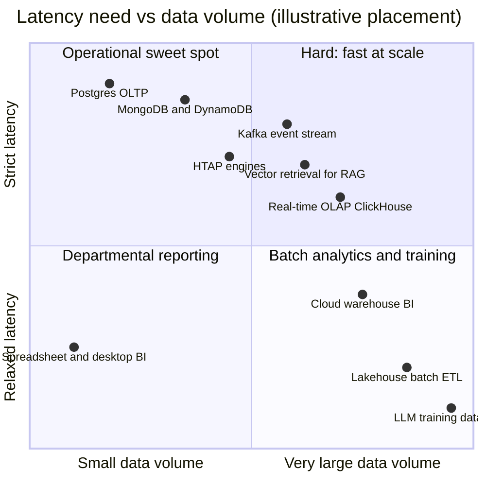
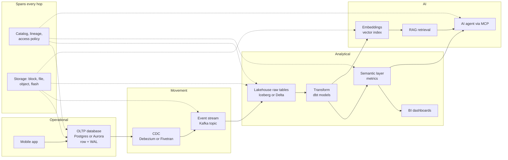
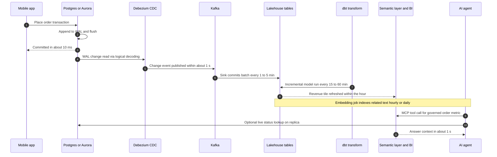
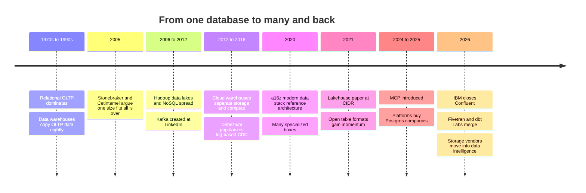

# 1. The Data Stack Map
> **Depth:** L2 · **Reading time:** ~15 min · **Last verified:** 2026-11-01 · **Prerequisites:** none (first chapter)

## TL;DR

- Enterprise data work splits into four workload families: **OLTP** (record each business event, fast and correctly), **OLAP** (scan history to answer questions), **streaming** (move and react to events as they happen) and **AI** (prepare training data, embed and retrieve content, feed context to agents). Each family needs something different from the system underneath it, so each grew its own products and vendors.
- One customer order can pass through six to eight systems before an AI agent can talk about it. At each hop its shape changes (row, change event, columnar file, metric, vector), its delay grows (milliseconds, then seconds, then minutes) and it is copied again.
- The stack split apart because no single engine served every access pattern well. Stonebraker and Çetintemel made this argument in 2005, and the market proved them right for 15 years.[^stonebraker]
- Since about 2020 the stack has been pulling back together. Four forces drive it: the lakehouse (one copy of open tables on object storage), HTAP, Postgres with extensions, and AI agents that need operational and analytical data in one place. Vendors now compete to own the merged layers.
- Storage sits under every hop. The catalog and governance layer spans all of them. Those two horizontal layers are where control and data gravity build up, and they are the most relevant to Everpure.

## Why this matters (business + Everpure lens)

Most data-industry arguments are really arguments about where one layer ends and the next begins. Snowflake versus Databricks, Postgres versus everything else, IBM buying Confluent, Fivetran merging with dbt Labs: each is a bet on which hops will merge and who will own the merged layer. IBM closed its acquisition of Confluent on 2026-03-17 at about $11B enterprise value (disclosed).[^ibm-confluent] Fivetran and dbt Labs completed their all-stock merger on 2026-06-01 with combined ARR "approaching $600M" (company-stated).[^fivetran-dbt] Both deals collapse two hops of the journey described below into one vendor. If you hold a map of the hops, the deal logic is easy to read.

The map matters for a second reason. Budgets follow the data. Every hop is a separate line item: a database licence or managed service, a connector fee charged per row, a streaming cluster, warehouse credits, a BI seat, a vector database, model tokens. A chief data officer's cost-reduction plan is mostly a plan to remove hops or copies. Vendors pitch the same thing as "zero-ETL" or "one copy of data."

For Everpure (formerly Pure Storage; NYSE: P, formerly PSTG), the point is that storage is not one hop. It sits under all of them. The OLTP database's log, the Kafka broker's disks, the lakehouse's object store and the vector index's flash tier are all storage, and each has a different performance profile. Everpure's 2026 moves sit right where the map is changing. It renamed itself on 2026-02-23 and bought 1touch, a data discovery and classification company, for $125.0M in cash (disclosed; closed 2026-05-07).[^everpure-1touch] In June 2026 it launched Data Stream, a feature that vectorizes data for AI pipelines on FlashBlade with NVIDIA GPUs.[^everpure-datastream] Both are attempts to move from the bottom layer into the governance and AI hops. Based on public information, a strategy team would want to know which hops a storage vendor can credibly enter, and which it should partner into. Later chapters return to this in [Ch 24](../03-ai-data-stack/ch24-data-meets-compute-and-storage.md) and [Ch 45](../06-history-and-future/ch45-storage-moving-up-the-stack.md).

## How it works

### Four workload families

A **workload** is the pattern in which software reads and writes data. Four patterns cover nearly all enterprise data work, and they pull system design in opposite directions.

[OLTP](../glossary.md#oltp) (online transaction processing) records business events: an order, a payment, a stock adjustment. Each transaction touches a few rows, has to finish in milliseconds and must never be lost or applied twice. Thousands of users do this at once. Systems: PostgreSQL, MySQL, Oracle Database, SQL Server, Amazon Aurora, MongoDB, DynamoDB. The core design device is the [write-ahead log](../glossary.md#write-ahead-log) (WAL): every change is appended to a sequential log on durable storage before the database confirms success, so a crash cannot lose a confirmed order. [Ch 3](ch03-database-internals.md) and [Ch 4](ch04-distributed-databases.md) go deeper.

[OLAP](../glossary.md#olap) (online analytical processing) answers questions across history, such as "revenue by region by week for three years." Each query reads millions or billions of rows but only a few columns, and a few analysts or dashboards run them. The design devices are columnar storage, compression and parallel scans. Systems: Snowflake, Databricks SQL, BigQuery, Redshift, ClickHouse, DuckDB, plus the [lakehouse](../glossary.md#lakehouse) pattern of [open table formats](../glossary.md#open-table-format) such as Iceberg and Delta on [object storage](../glossary.md#object-storage). See [Ch 5](ch05-analytical-engines.md), [Ch 6](ch06-file-formats.md) and [Ch 7](ch07-open-table-formats.md).

[Event streaming](../glossary.md#event-streaming) moves events between systems continuously and lets software react within seconds: fraud checks, inventory alerts, feeding the warehouse. The core abstraction is an append-only, partitioned log that many readers consume at their own pace. LinkedIn's 2011 Kafka paper describes it, and it remains the template.[^kafka] Systems: Apache Kafka (Confluent, now IBM), Redpanda, Amazon Kinesis, Apache Flink for stream processing. See [Ch 11](../02-pipelines-and-governance/ch11-streaming-and-event-platforms.md).

**AI workloads** are the newest family. There are really three sub-patterns. *Training-data preparation* is throughput-bound, with huge scans and transformations of mostly unstructured data. *Embedding and vector retrieval* turns text, images and records into [embeddings](../glossary.md#embedding) and stores them in a [vector index](../glossary.md#vector-index) for nearest-neighbor lookup in tens of milliseconds. *Agent context* is the newest. An [AI agent](../glossary.md#ai-agent) calls tools to fetch governed, current facts, and the [Model Context Protocol](../glossary.md#model-context-protocol) (MCP) has become the standard interface for those calls. This family matters more than it first appears. A widely cited IDC estimate, sponsored by Box, holds that about 90% of data organizations generated in 2022 was unstructured.[^idc] The classic OLTP-to-OLAP pipeline was never built for that material. See [Ch 16](../03-ai-data-stack/ch16-ai-data-lifecycle.md), [Ch 18](../03-ai-data-stack/ch18-embeddings-and-vector-search.md) and [Ch 22](../03-ai-data-stack/ch22-agents-and-data.md).

| Dimension | OLTP (operational) | OLAP (analytical) | Streaming / event | AI (prep, retrieval, agents) |
|---|---|---|---|---|
| Core question | "Record this event correctly" | "What happened, across all history?" | "What is happening now, and who needs to know?" | "What content is relevant, and what should the model see?" |
| Typical latency target | Single-digit to tens of ms per transaction | Sub-second to minutes per query | Milliseconds to seconds end-to-end | Retrieval tens to hundreds of ms; training prep hours to days |
| Data touched per operation | A few rows | Millions to billions of rows, few columns | One event at a time, continuous | Batch prep: whole corpora; retrieval: top-k chunks |
| Concurrency | Thousands to millions of users | Tens to thousands of queries | Many producers and consumers per topic | Agents can issue many small queries per task |
| Freshness | Is the source of truth | Minutes to a day behind | Seconds behind | Minutes to days behind, unless agents query live systems |
| Typical data volume | GB to tens of TB | TB to PB | TB per day flowing, retention days to weeks | PB for training sets; billions of vectors for retrieval |
| Storage layout | Row-oriented pages, B-tree or LSM indexes, WAL | Columnar files (Parquet), compressed, partitioned | Append-only partitioned log segments | Files and objects for prep; graph or cluster indexes for vectors |
| Dominant cost driver | Provisioned IOPS, memory, high availability | Compute per scan (credits/DBUs), storage at scale | Broker compute, network, cross-zone replication | GPUs for embedding and inference; index memory or flash |
| Representative systems | Postgres, Aurora, MySQL, Oracle, MongoDB, DynamoDB | Snowflake, Databricks, BigQuery, Redshift, ClickHouse | Kafka, Confluent, Redpanda, Kinesis, Flink | Pinecone, pgvector, Elasticsearch, S3 Vectors, LanceDB, MCP servers |

*Figure 1.1 — The four workload families optimize for opposite things: OLTP for small, fast, correct writes; OLAP for wide scans; streaming for continuous movement; AI for relevance over mostly unstructured content.*

*Figure 1.2 — Most workloads sit near the diagonal; the upper-right quadrant (very large data with strict latency) is the expensive frontier where streaming, real-time OLAP and vector retrieval now compete.*

> **Bridge: the memory hierarchy.** Think of the four families as tiers of a cache hierarchy. OLTP is the register file and L1 cache: small, hot, tiny latency budgets, and correctness above everything. The warehouse or lakehouse is DRAM and then NAND: much larger, read in wide sequential sweeps, cheaper per byte, and tolerant of more latency. Archived history in cold object storage is the tape and HDD tier. The ratios match too. A DRAM reference costs about 100 ns, while a random SSD read costs about 150 µs, roughly 1,500 times slower.[^dean] An OLTP commit and a warehouse query differ by a similar factor. As in chip design, data is promoted and demoted between tiers by temperature, and most cost engineering is about keeping hot data small.

### The journey of a byte: one order, end to end

Take an illustrative mid-sized online retailer. All timings and copy counts below are **illustrative estimates** for a typical cloud deployment, not measurements of any specific vendor. A customer taps "Place order" in the mobile app at 10:00:00.000.

*Figure 1.3 — A byte's journey (SV-2): one order passes through operational, movement, analytical and AI layers, while the catalog and storage layers run under every hop.*

**Hop 1 — App to OLTP (about 5–20 ms).** The app calls an order service. The service runs one transaction against Postgres or Aurora (or MongoDB, if the order is stored as a document): insert the order row, insert line items, decrement inventory, record the payment authorization. Before the database answers "committed," it appends the change to the WAL and flushes it to durable storage. Data shape: a few normalized rows in row-oriented pages. Owner: the application team and an operational-database vendor ([Ch 29](../04-company-deep-dives/ch29-operational-database-vendors.md)). Aurora also keeps read replicas, whose lag AWS says is usually well under 100 ms.[^aurora] This is the only hop the customer waits on.

**Hop 2 — OLTP to change data capture (about 0.5–2 s).** [Change data capture](../glossary.md#change-data-capture) (CDC) reads the database's own log instead of querying tables. Debezium's Postgres connector, for instance, reads logical-decoding output from the WAL and turns each committed row change into a change event, by default one Kafka topic per table.[^debezium] Shape changes: a row becomes an *event* with before and after values, an operation type and a log position. Managed tools such as Fivetran do the same job on a schedule. Its docs list 1-minute syncs on Enterprise and Business Critical plans and 5-minute syncs on others.[^fivetran] Owner: data-integration vendors ([Ch 9](../02-pipelines-and-governance/ch09-pipeline-patterns.md), [Ch 10](../02-pipelines-and-governance/ch10-ingestion-and-integration.md)).

**Hop 3 — Stream (milliseconds of added delay, days of retention).** The event lands in a replicated Kafka partition. Downstream readers, such as fraud scoring, the warehouse loader and the inventory service, each read it at their own pace. Kafka's broker latency is small. Confluent's own 2020 benchmark reported 5 ms p99 at 200 MB/s (a vendor-run test).[^confluent-bench] Shape: an immutable, ordered log record. Owner: streaming platforms ([Ch 30](../04-company-deep-dives/ch30-data-movement-streaming-companies.md)).

**Hop 4 — Land in the lakehouse or warehouse (seconds to minutes).** A sink writes events into Iceberg or Delta tables on object storage, or into a warehouse's native tables. This is the first big shape change: row-at-a-time events become *columnar Parquet files* plus table metadata. Committing every event would create millions of tiny files, so writers batch, which is why this hop is a freshness-versus-efficiency dial. Snowflake states 5–10 seconds ingest-to-query for its high-performance Snowpipe Streaming.[^snowpipe] Lakehouse batch commits every one to five minutes are common (illustrative). Owner: Databricks, Snowflake, the hyperscalers ([Ch 25](../04-company-deep-dives/ch25-databricks.md), [Ch 26](../04-company-deep-dives/ch26-snowflake.md), [Ch 28](../04-company-deep-dives/ch28-hyperscaler-data-platforms.md)).

**Hop 5 — Transform (minutes to an hour).** dbt models, which are SQL files arranged as a dependency graph, clean the raw change events. They deduplicate, apply deletes, join the order to customer and product dimensions, and produce tidy fact tables such as `fct_orders`. This is the [ELT](../glossary.md#elt) pattern: load first, transform inside the warehouse. Incremental runs every 15–60 minutes are typical (illustrative). Owner: transformation and orchestration tools ([Ch 12](../02-pipelines-and-governance/ch12-transformation-and-orchestration.md)).

**Hop 6 — Semantic layer and BI (about 1–5 s per dashboard query).** A [semantic layer](../glossary.md#semantic-layer) defines "net revenue" or "active customer" once, so every dashboard and every agent computes them the same way. The order becomes an *aggregate*: one contribution to today's revenue tile. Owner: BI and semantic-layer vendors ([Ch 14](../02-pipelines-and-governance/ch14-semantic-layers-and-bi.md)).

**Hop 7 — Embed and index (minutes to a day).** For AI use, the order's text context is chunked, embedded by a model and written to a vector index. That context includes the product description, the support ticket the customer files later and the return policy that applies. Shape: a *vector* of hundreds to a few thousand numbers per chunk, plus metadata for filtering. Owner: vector-database, search and cloud vendors. Amazon's S3 Vectors, GA since December 2025, advertises up to 2B vectors per index at about 100 ms query latency (company-stated).[^s3-vectors] See [Ch 17](../03-ai-data-stack/ch17-unstructured-data-processing.md) and [Ch 18](../03-ai-data-stack/ch18-embeddings-and-vector-search.md).

**Hop 8 — Retrieval and the agent (about 1–10 s per answer).** Three days later the customer asks a support agent, "Where is my order, and can I return the jacket?" The agent uses [retrieval-augmented generation](../glossary.md#retrieval-augmented-generation) (RAG) to fetch the return-policy chunk from the vector index. It calls an MCP tool for the governed "order status" metric, or queries the OLTP replica for live status, and then composes an answer. Owner: model providers, agent platforms and every data vendor shipping an MCP server ([Ch 19](../03-ai-data-stack/ch19-retrieval-architectures.md), [Ch 22](../03-ai-data-stack/ch22-agents-and-data.md)).

*Figure 1.4 — Timing of the order example (illustrative): the customer waits only on the first hop; every later hop trades freshness for cheaper, wider access.*

| Hop | Data shape | Added latency (illustrative) | Relative cost driver | Who owns the layer |
|---|---|---|---|---|
| 1. App → OLTP | Normalized rows + WAL records | 5–20 ms | Provisioned IOPS, memory, HA replicas | Operational DB vendors, hyperscalers |
| 2. CDC | Change events (before/after, op, log position) | 0.5 s to 5 min | Per-row or per-connector fees | Integration vendors, open source |
| 3. Stream | Ordered, replicated log records | Milliseconds (plus retention) | Brokers, network, cross-zone traffic | Streaming platforms |
| 4. Land | Columnar Parquet files + table metadata | Seconds to minutes | Object storage, ingest compute | Lakehouse and warehouse vendors |
| 5. Transform | Cleaned facts and dimensions | 15–60 min | Warehouse compute per run | Transformation tools |
| 6. Semantic/BI | Metrics and aggregates | 1–5 s per query | Query compute, BI seats | BI and semantic-layer vendors |
| 7. Embed/index | Vectors + metadata | Minutes to a day | GPU or API embedding, index memory/flash | Vector DBs, search, clouds |
| 8. Retrieve/agent | Retrieved chunks + tool results in a prompt | 1–10 s per answer | Model tokens, retrieval queries | Model and agent platforms |

*Figure 1.5 — Each hop changes the data's shape and adds a new owner and a new bill; by the end the order exists in roughly six to eight copies across systems (illustrative).*

> **Bridge: a wafer through the fab.** A byte's journey is like a wafer moving through process steps. Each step (lithography, etch, deposition, test) adds value the next step depends on, adds cost and cycle time, and creates a point where yield can be lost. A schema change that breaks CDC is a bad etch, and every downstream step inherits the defect. Fab economics teach the same two lessons data teams are learning. Fewer handoffs means less cycle time and less yield loss. Metrology, which here means lineage and data-quality checks, pays for itself only if it covers every step.

### Where governance and the catalog sit

Governance is not a hop. It is a horizontal layer that touches every hop. A [data catalog](../glossary.md#data-catalog) records what each table, topic and index is, who owns it and how it was derived (lineage). A policy engine decides who may read which column, for instance hiding the customer's card number from the analyst but not from the payments service. The catalog matters more in open lakehouses: with many engines reading the same Iceberg tables, the catalog becomes the single place where table versions are committed and access is enforced. Today the policy is often re-implemented at several hops: database grants, Kafka ACLs, warehouse roles, vector-store filters. That duplication is the opening for governance vendors, and for storage vendors that classify data at the bottom of the stack. See [Ch 8](ch08-catalogs-and-metastores.md), [Ch 13](../02-pipelines-and-governance/ch13-data-quality-observability-lineage.md) and [Ch 15](../02-pipelines-and-governance/ch15-governance-security-privacy.md).

## Design choices and trade-offs

### Why the stack fragmented

In 2005 Michael Stonebraker and Uğur Çetintemel argued that the traditional row-store relational database, sold as the answer to every problem, would lose to specialized engines built for one access pattern. Their examples were stream processing, column-store warehouses and text search.[^stonebraker] The reasoning is physical. A row layout that makes a 10-row insert cheap makes a 10-billion-row column scan expensive, and the reverse holds too. Locking and logging built for strict correctness slow down bulk analytics. The paper won the ICDE 10-year influential paper award in 2015.[^stonebraker] The next 15 years proved the thesis. Column stores (Vertica, then Redshift and Snowflake), NoSQL (MongoDB, Cassandra, DynamoDB), streaming (Kafka), search (Elasticsearch) and later vector databases each took share from the general-purpose RDBMS. By 2020, a16z's widely circulated reference architecture showed dozens of boxes between source and dashboard.[^a16z] The specialization was rational, but every box added a pipeline, a copy and a contract.

### Why it is re-converging

Four forces are folding the hops back together:

1. **Lakehouse.** The CIDR 2021 lakehouse paper proposed putting warehouse features (ACID transactions, schema, indexing) directly on open files in cheap object storage. One copy can then serve BI, data science and ML.[^lakehouse] Open table formats made that work across engines, which collapses the separate lake-plus-warehouse copies of hops 4–5.
2. **HTAP and zero-ETL.** Gartner coined hybrid transactional/analytical processing ([HTAP](../glossary.md#htap)) in 2014 for systems that run both workloads on fresh data.[^htap] Today's versions are mostly managed replication that hides hops 2–4: Aurora zero-ETL into Redshift, BigQuery replication from Spanner and AlloyDB, Snowflake's Postgres mirroring. See [Ch 23](../03-ai-data-stack/ch23-real-time-analytics-htap.md).
3. **Postgres plus extensions.** Postgres became the default general-purpose database. The 2025 Stack Overflow survey reportedly found that 55.6% of all respondents and 58.2% of professional developers use it (secondary reports; see [Ch 2](ch02-data-models.md)).[^so2025] Extensions such as pgvector (vectors), TimescaleDB (time series) and columnar add-ons let one engine cover workloads that used to need separate systems. Both lakehouse leaders bought Postgres companies in 2025. Databricks bought Neon (about $1B, press-reported) and now reports Lakebase above a $100M revenue run-rate (company-stated). Snowflake bought Crunchy Data.[^databricks-lakebase][^crunchy]
4. **Agents.** An agent answering "where is my order and what is my lifetime value?" needs live operational state and governed history in the same turn. That rewards platforms that hold both behind one access-control model. MCP, introduced by Anthropic in November 2024 and donated to a Linux Foundation fund in December 2025, gives every layer one interface for agents to call.[^mcp]

| Design choice | Specialized best-of-breed stack | Converged platform | Who should prefer which |
|---|---|---|---|
| Performance per workload | Highest: each engine fits its access pattern | Good enough for most; weaker at extremes | Extreme scale or latency → specialized |
| Copies and pipelines | Many; each hop copies data | Fewer; one governed copy where possible | Cost- and compliance-sensitive → converged |
| Freshness | Bounded by slowest pipeline hop | Seconds to minutes via in-platform replication | Agent and operational analytics → converged |
| Vendor leverage | High buyer leverage; swap any box | Higher lock-in, offset by open formats | Firms with strong platform teams → specialized |
| Governance | Re-implemented per system | One policy model if the catalog is shared | Regulated industries → converged |
| Innovation speed | New categories appear as startups | Platforms copy or acquire them | Early adopters → specialized |

*Figure 1.6 — Specialization wins on peak performance and buyer leverage; convergence wins on copies, freshness and governance. The market is moving toward convergence, but not all the way.*

The steelman for specialization still holds. Convergence has been promised before. Oracle's "one database for everything" pitch never ended specialization, and a converged platform that is mediocre at vector search or high-volume streaming will lose those workloads to focused vendors. The likely outcome is a few platforms with open formats at the core, plus specialists at the edges where performance pays.

## Who's who

| Layer (hop) | Representative systems and vendors | Positioning note |
|---|---|---|
| OLTP databases | PostgreSQL (community; managed by AWS, Azure, Google, Neon/Databricks, Supabase, Crunchy/Snowflake), Oracle, SQL Server, MySQL, MongoDB, DynamoDB, Aurora | Postgres is the gravitational center; analytical platforms now sell OLTP too |
| CDC and ingestion | Debezium (open source), Fivetran (now merged with dbt Labs), Airbyte, Qlik/Striim, cloud-native zero-ETL | Being absorbed into platforms and merged with transformation |
| Streaming | Apache Kafka, Confluent (IBM since March 2026), Redpanda, Amazon Kinesis, Apache Flink | Moving onto object storage; consolidating into large-vendor portfolios |
| Lakehouse and warehouse | Databricks, Snowflake, BigQuery, Redshift, Microsoft Fabric, ClickHouse, Starburst/Trino | The center of gravity for analytical and increasingly AI spend |
| Transform and orchestration | dbt, SQLMesh, Apache Airflow, Dagster | Core logic layer; dbt now inside the Fivetran combination |
| Semantic layer and BI | Power BI, Tableau, Looker, dbt Semantic Layer, Cube, AtScale | Semantic layers repositioned as "context for agents" |
| Vector and retrieval | Pinecone, Weaviate, Qdrant, Milvus/Zilliz, Elasticsearch, pgvector, S3 Vectors, LanceDB | Squeezed between platforms and object-storage vector tiers |
| Agents and MCP | Model providers, agent frameworks, MCP servers from data vendors | The newest consumer of every other layer |
| Catalog and governance (spans) | Unity Catalog, Apache Polaris, Snowflake Horizon, AWS Glue/SageMaker Catalog, Collibra, Alation, Atlan, DSPM vendors | Control point of the open lakehouse |
| Storage (under every hop) | Hyperscaler object and block storage, Everpure, NetApp, Dell, VAST Data, others | Moving up into classification and AI data prep |

*Figure 1.7 — Vendor categories by hop. Each later chapter takes one row; Part 4 profiles the companies.*

## History and trajectory

*Figure 1.8 — The stack fragmented from about 2005 to 2020 and has been re-converging since; 2026's deals are convergence deals.*

The trajectory has three phases. In the **monolith era** (1970s–2000s) one relational database ran the business. A separate warehouse received nightly batch copies, so "yesterday" was the freshest analytical answer. In the **specialization era** (about 2005–2020) Stonebraker's thesis played out. Each access pattern got its own engine and its own vendor, and the "modern data stack" of the late 2010s stitched cloud warehouses, managed ingestion, dbt and BI tools together. a16z mapped this in 2020 and refreshed it later.[^a16z] Fragmentation was a good business for venture investors: every box was a startup. The **convergence era** (2020–present) started with the lakehouse. It sped up in 2025–2026 with platform purchases of Postgres companies, IBM–Confluent, Fivetran–dbt, and AI agents that need the whole map at once. [Ch 42](../06-history-and-future/ch42-history-of-databases.md) and [Ch 43](../06-history-and-future/ch43-modern-data-stack.md) tell the full story. [Ch 44](../06-history-and-future/ch44-future-trends.md) assesses how far convergence goes.

## Numbers that matter

| Metric | Value | Basis | Source / date |
|---|---|---|---|
| Share of organizational data that is unstructured | ~90% (2022) | Analyst estimate (IDC, Box-sponsored) | IDC via StorageNewsletter, 2023-09-07[^idc] |
| DRAM reference vs. SSD random read | ~100 ns vs ~150 µs | Engineering rule of thumb (~2012) | Jeff Dean latency table[^dean] |
| Aurora replica lag | Usually well under 100 ms | Vendor documentation | AWS Aurora docs[^aurora] |
| Kafka p99 latency at 200 MB/s | 5 ms | Vendor-run benchmark (2020, Kafka 2.6) | Confluent blog[^confluent-bench] |
| Fivetran fastest sync interval | 1 min (Enterprise+), 5 min (other plans) | Vendor documentation | Fivetran docs[^fivetran] |
| Snowpipe Streaming ingest-to-query | 5–10 s | Vendor documentation (target, not SLA) | Snowflake docs, GA 2025-09-23[^snowpipe] |
| S3 Vectors scale and latency | Up to 2B vectors/index, ~100 ms queries | Company-stated | AWS, 2025-12[^s3-vectors] |
| Postgres usage among developers | 55.6% of all respondents; 58.2% of professional developers (2025) | Survey, press-reported | Stack Overflow survey via secondary source[^so2025] |
| IBM–Confluent | ~$11B enterprise value; closed 2026-03-17 | Disclosed | IBM release via Stock Titan[^ibm-confluent] |
| Fivetran + dbt Labs combined ARR | "Approaching $600M" | Company-stated | Fivetran, 2026-06-01[^fivetran-dbt] |
| Databricks Lakebase (Postgres) | >$100M revenue run-rate | Company-stated run-rate | Databricks, 2026-08-13[^databricks-lakebase] |

*Figure 1.9 — Latency ratios are physical and stable; market figures move quarterly and should be re-checked before use.*

## Storage bridge

> **Storage bridge.** Every hop runs on a different storage profile. OLTP needs low-latency, sync-write block storage for the WAL. Kafka needs sequential-write throughput and, increasingly, object storage for tiered retention. The lakehouse needs high-throughput S3-compatible object storage with good small-object and metadata performance. Vector indexes increasingly live on flash instead of DRAM. Copies multiply across the journey, so storage capacity grows with the number of hops, not just with data volume. This is one root of [data gravity](../glossary.md#data-gravity), a term Dave McCrory introduced around 2010: large datasets pull applications and compute toward them.[^mccrory] See the companion *Everpure Tech Atlas* for media and protocol detail. See [Ch 24](../03-ai-data-stack/ch24-data-meets-compute-and-storage.md) for egress and gravity economics and [Ch 45](../06-history-and-future/ch45-storage-moving-up-the-stack.md) for the strategic options.

## How to read the rest of the atlas

| Part | What it covers | Start with |
|---|---|---|
| Part 0 — Start here | Reading paths and the full market map | [Ch 0.2 Market map](../00-start-here/ch00-2-market-map.md) |
| Part 1 — Data systems foundations | Data models, database internals, analytical engines, file and table formats, catalogs | [Ch 2 Data models](ch02-data-models.md) |
| Part 2 — Pipelines and governance | CDC, ingestion, streaming, transformation, quality, semantic layer, security | [Ch 9 Pipeline patterns](../02-pipelines-and-governance/ch09-pipeline-patterns.md) |
| Part 3 — AI data stack | AI data lifecycle, vectors, RAG, agents, HTAP, compute and storage | [Ch 16 AI data lifecycle](../03-ai-data-stack/ch16-ai-data-lifecycle.md) |
| Part 4 — Company deep dives | Databricks, Snowflake, hyperscalers, operational DBs, streaming, AI-native | [Ch 25 Databricks](../04-company-deep-dives/ch25-databricks.md) |
| Part 5 — Business and economics | Pricing models, KPIs, comps, open source, M&A history, GTM, market size | [Ch 35 Business models](../05-business-and-economics/ch35-business-models.md) |
| Part 6 — History and future | Database history, the modern data stack, trends, storage moving up the stack | [Ch 42 History of databases](../06-history-and-future/ch42-history-of-databases.md) |
| Part 7 — Conversation toolkit | Talking with data people, diligence, question bank, one-liners, flashcards | [Ch 46 Talking with data people](../07-conversation-toolkit/ch46-talking-with-data-people.md) |

*Figure 1.10 — The byte's journey is the spine of the atlas: Parts 1–3 explain the hops, Part 4 the owners, Part 5 the economics, Part 6 the direction of travel. [Ch 39](../05-business-and-economics/ch39-ma-history.md) catalogs the deals and [Ch 48](../07-conversation-toolkit/ch48-question-bank.md) the questions.*

## Conversation playbook

**Three questions for a product manager**

1. "Walk me through how a record gets from your customer's operational database to your product. How many hops and copies are there, and which do you remove?" A good answer names the hops, admits which remain, and quantifies freshness ("under a minute end-to-end on Postgres sources").
2. "Which workload family is your core, and which are you adding?" A good answer separates the engine they built for from the adjacent workloads they now support adequately. That is the convergence pitch, stated honestly.
3. "Where is policy enforced: in your product, in the catalog, or at every hop?" A good answer points to one policy model shared through an open catalog, not a fresh set of roles.

**Three questions for an engineer**

1. "What is your end-to-end freshness from commit to queryable, and what sets it: CDC polling, stream batching or table commits?" Good answers name the bottleneck hop and the small-file trade-off.
2. "How do you handle schema changes and deletes from the source all the way to the vector index?" Good answers mention CDC handling of DDL, merge-on-read deletes in the table format, and re-embedding or tombstoning vectors. Many teams have no answer for the last step, which is itself informative.
3. "Which hops would you collapse first if you had to cut cost by 30%?" Good answers usually target duplicate copies (lake plus warehouse), over-frequent transforms or idle streaming clusters, not the OLTP tier.

**Don't say this**

- "OLAP is just a big OLTP database." The physical layouts are opposites. That is the whole Stonebraker point.
- "Streaming replaces batch." Most analytical data is still transformed in minute-to-hour batches. Streaming feeds them and handles the real-time slice.
- "Vector databases are a new database category that will replace warehouses." Retrieval is one access pattern, and much of it is moving into Postgres, search engines, lakehouses and object storage.
- "Zero-ETL means no pipeline." It means the vendor runs the pipeline for you. The hops still exist and still cost money.
- "Storage is a commodity under the stack." Each hop has a distinct storage profile, and copies multiply across hops.

## Going deeper

> **Going deeper (L3).** Read the 2005 Stonebraker–Çetintemel paper for the original performance argument, and the CIDR 2021 lakehouse paper for the convergence counter-argument.[^stonebraker][^lakehouse] For log-based CDC internals, read Debezium's Postgres connector documentation on replication slots, snapshots and logical decoding.[^debezium] For the log as the central abstraction, read the 2011 Kafka paper, then [Ch 11](../02-pipelines-and-governance/ch11-streaming-and-event-platforms.md). For WAL and MVCC internals, see [Ch 3](ch03-database-internals.md).

## Key terms

- [OLTP](../glossary.md#oltp) — online transaction processing: many small, fast, correct reads and writes that record business events.
- [OLAP](../glossary.md#olap) — online analytical processing: large scans and aggregations across history, usually on columnar storage.
- [Write-ahead log](../glossary.md#write-ahead-log) — a sequential log of changes made durable before a transaction is confirmed; the source CDC reads from.
- [Change data capture](../glossary.md#change-data-capture) — reading a database's log to emit each committed change as an event for downstream systems.
- [Event streaming](../glossary.md#event-streaming) — moving events continuously through a durable, partitioned, append-only log such as Kafka.
- [Lakehouse](../glossary.md#lakehouse) — warehouse features (transactions, schema, governance) on open files in object storage, serving BI and AI from one copy.
- [Open table format](../glossary.md#open-table-format) — a metadata specification (Iceberg, Delta, Hudi) that turns a set of Parquet files into a transactional table.
- [Object storage](../glossary.md#object-storage) — flat, HTTP-addressed storage of immutable objects (S3 and compatibles); the lakehouse's foundation.
- [ELT](../glossary.md#elt) — extract, load, then transform inside the warehouse or lakehouse.
- [Semantic layer](../glossary.md#semantic-layer) — shared business definitions of metrics and entities, used by BI tools and agents alike.
- [Embedding](../glossary.md#embedding) — a numeric vector representing the meaning of a piece of content.
- [Vector index](../glossary.md#vector-index) — a data structure for fast approximate nearest-neighbor search over embeddings.
- [Retrieval-augmented generation](../glossary.md#retrieval-augmented-generation) — fetching relevant content at query time and adding it to a model's prompt.
- [AI agent](../glossary.md#ai-agent) — a model-driven program that plans and calls tools, including data queries, to complete a task.
- [Model Context Protocol](../glossary.md#model-context-protocol) — an open standard (MCP) for exposing tools and data to AI agents.
- [HTAP](../glossary.md#htap) — hybrid transactional/analytical processing: one system serving both OLTP and OLAP on fresh data.
- [Data catalog](../glossary.md#data-catalog) — the registry of data assets, owners, lineage and access policy that spans the stack.
- [Data gravity](../glossary.md#data-gravity) — the tendency of large datasets to attract applications, compute and further data toward them.

## Sources

[^stonebraker]: Michael Stonebraker and Uğur Çetintemel, "'One Size Fits All': An Idea Whose Time Has Come and Gone," *Proceedings of the 21st International Conference on Data Engineering (ICDE 2005)*, Tokyo, pp. 2–11, IEEE, https://doi.org/10.1109/ICDE.2005.1, published 2005-04; award context: Brown University CS, "Ugur Cetintemel Wins IEEE Data Engineering (ICDE) 2015 Influential Paper Award," https://cs.brown.edu/news/2015/02/27/ugur-cetintemel-wins-icde-2015-influential-paper-award/, published 2015-02-27; retrieved 2026-11-01. [VERIFY: DOI resolves to this paper]
[^lakehouse]: Michael Armbrust, Ali Ghodsi, Reynold Xin, Matei Zaharia, "Lakehouse: A New Generation of Open Platforms that Unify Data Warehousing and Advanced Analytics," CIDR 2021, https://www.cidrdb.org/cidr2021/papers/cidr2021_paper17.pdf, published 2021-01; retrieved 2026-11-01.
[^debezium]: Debezium project, "Debezium connector for PostgreSQL" (reference documentation), https://debezium.io/documentation/reference/connectors/postgresql.html, n.d. (living documentation); retrieved 2026-11-01.
[^kafka]: Jay Kreps, Neha Narkhede, Jun Rao (LinkedIn), "Kafka: a Distributed Messaging System for Log Processing," NetDB 2011, Athens, https://people.csail.mit.edu/matei/courses/2015/6.S897/readings/kafka.pdf, published 2011-06; retrieved 2026-11-01.
[^idc]: StorageNewsletter, "What Every Executive Needs to Know About Unstructured Data" (summary of IDC white paper *Untapped Value*, sponsored by Box), https://www.storagenewsletter.com/2023/09/07/what-every-executive-needs-to-know-about-unstructured-data/, published 2023-09-07; retrieved 2026-11-01. Analyst estimate; vendor-sponsored.
[^a16z]: Matt Bornstein, Jennifer Li, Martin Casado, "Emerging Architectures for Modern Data Infrastructure," Andreessen Horowitz, https://a16z.com/2020/10/15/emerging-architectures-for-modern-data-infrastructure/, published 2020-10-15; updated edition at https://a16z.com/emerging-architectures-for-modern-data-infrastructure/, published 2022 [VERIFY: exact date of updated edition]; retrieved 2026-11-01.
[^aurora]: Amazon Web Services, "Replication with Amazon Aurora," Amazon Aurora User Guide, https://docs.aws.amazon.com/AmazonRDS/latest/AuroraUserGuide/Aurora.Replication.html, n.d.; retrieved 2026-11-01.
[^confluent-bench]: Confluent, "Benchmarking Apache Kafka, Apache Pulsar, and RabbitMQ: Which is the Fastest?", https://www.confluent.io/blog/kafka-fastest-messaging-system/, published 2020 [VERIFY: exact publication date]; retrieved 2026-11-01. Vendor-run benchmark.
[^fivetran]: Fivetran, "Sync Overview" (documentation), https://fivetran.com/docs/core-concepts/syncoverview, n.d.; retrieved 2026-11-01.
[^snowpipe]: Snowflake, "Snowpipe Streaming: High-Performance Architecture," https://docs.snowflake.com/en/user-guide/snowpipe-streaming-high-performance-overview, n.d.; and release note "Snowpipe Streaming with high-performance architecture (General availability)," https://docs.snowflake.com/en/release-notes/2025/other/2025-09-23-snowpipe-streaming-high-performance-architecture, published 2025-09-23; retrieved 2026-11-01.
[^s3-vectors]: Amazon Web Services, "Top announcements of AWS re:Invent 2025," AWS News Blog, https://aws.amazon.com/blogs/aws/top-announcements-of-aws-reinvent-2025, published 2025-12; Blocks & Files, "AWS piles on S3 upgrades from vector search to 50 TB objects," https://www.blocksandfiles.com/ai-ml/2025/12/03/aws-piles-on-s3-upgrades-from-vector-search-to-50-tb-objects/1704690, published 2025-12-03; retrieved 2026-11-01. Company-stated.
[^dean]: Jeff Dean (originally Peter Norvig), "Latency numbers every programmer should know," community transcription, https://gist.github.com/rtomayko/2847627, circa 2012; retrieved 2026-11-01. Approximate engineering rule of thumb; modern hardware differs.
[^htap]: Gartner, "Hybrid Transaction/Analytical Processing Will Foster Opportunities for Dramatic Business Innovation" (M. Pezzini, D. Feinberg, N. Rayner, R. Edjlali), published 2014-01-28 (paywalled; cited via Wikipedia, "Hybrid transactional/analytical processing," https://en.wikipedia.org/wiki/Hybrid_transactional/analytical_processing); retrieved 2026-11-01. Secondary source.
[^so2025]: Enstacked, "Stack Overflow Developer Survey 2025 – Part 2," https://enstacked.com/stack-overflow-developer-survey-insights/, published 2025; retrieved 2026-11-01. Secondary summary [VERIFY: 58.2% against survey.stackoverflow.co/2025].
[^databricks-lakebase]: Databricks, "Databricks Grows >80% YoY, Surpasses $7B Revenue Run-Rate…," press release, https://www.databricks.com/company/newsroom/press-releases/databricks-grows-80-yoy-surpasses-7b-revenue-run-rate-scales, published 2026-08-13; Neon price: TechRepublic, "Databricks to acquire Neon," https://www.techrepublic.com/article/news-databricks-neon-acquisition/, published 2025-05; retrieved 2026-11-01. Run-rate company-stated; Neon price press-reported.
[^crunchy]: Snowflake Inc., Form 10-Q for the quarter ended 2025-10-31 (Crunchy Data acquisition, closed 2025-06-06), SEC EDGAR, https://www.sec.gov/Archives/edgar/data/1640147/000164014725000211/snow-20251031.htm, published 2025-12; retrieved 2026-11-01.
[^mcp]: Anthropic, "Introducing the Model Context Protocol," https://www.anthropic.com/news/model-context-protocol, published 2024-11-25; Anthropic, "Donating the Model Context Protocol and establishing the Agentic AI Foundation," https://anthropic.com/news/donating-the-model-context-protocol-and-establishing-of-the-agentic-ai-foundation, published 2025-12-09; retrieved 2026-11-01.
[^ibm-confluent]: IBM, "IBM Completes Acquisition of Confluent…," press release as syndicated by Stock Titan, https://www.stocktitan.net/news/IBM/ibm-completes-acquisition-of-confluent-making-real-time-data-the-lbuwdbharsqe.html, published 2026-03-17; retrieved 2026-11-01. Value per `data/ma_deals.csv` (disclosed, ~$11B enterprise value).
[^fivetran-dbt]: Fivetran, "Fivetran & dbt Labs Complete Merger to Create the Data Infrastructure for Trusted AI Agents," press release, https://www.fivetran.com/press/fivetran-dbt-labs-complete-merger-to-create-the-data-infrastructure-for-trusted-ai-agents, published 2026-06-01; retrieved 2026-11-01. Company-stated ARR.
[^everpure-1touch]: World Wide Technology (reposting Pure Storage release), "Pure Storage rebrands to Everpure and announces intent to acquire 1touch," https://www.wwt.com/news/pure-storage-rebrands-to-everpure-and-announces-intent-to-acquire-1touch, published 2026-02-23; Everpure, Inc., Form 10-Q for the quarter ended 2026-05-03, SEC EDGAR, https://www.sec.gov/Archives/edgar/data/0001474432/000147443226000061/pstg-20260503.htm, published 2026-06; retrieved 2026-11-01.
[^everpure-datastream]: Everpure via PR Newswire, "Everpure Unveils Data-Primacy Architecture for the AI Era," https://www.prnewswire.com/news-releases/everpure-unveils-data-primacy-architecture-for-the-ai-era-302803097.html, published 2026-06-17; retrieved 2026-11-01.
[^mccrory]: InfoQ (Japan), "Data Gravity formula" (on Dave McCrory's 2010 concept and 2012 formalization), https://www.infoq.com/jp/news/2012/07/datagravity-formula, published 2012-07; retrieved 2026-11-01. Secondary source.
