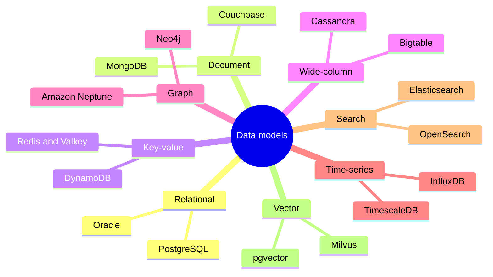
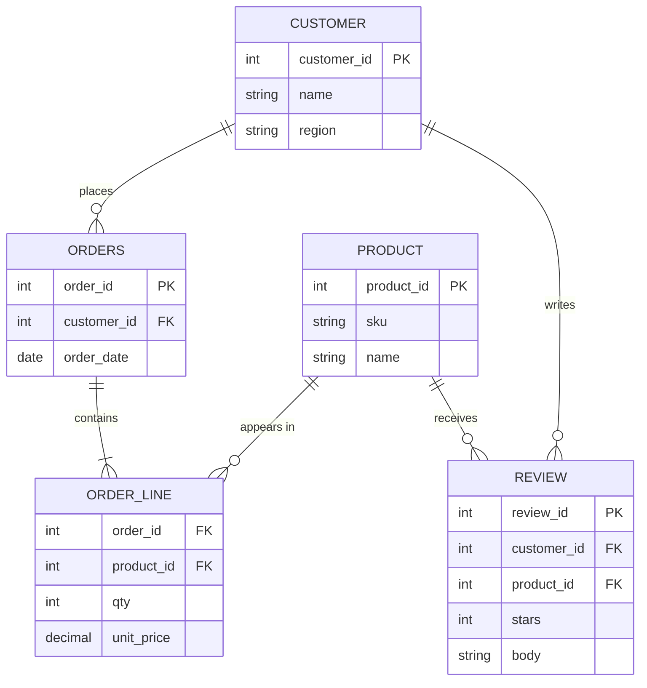
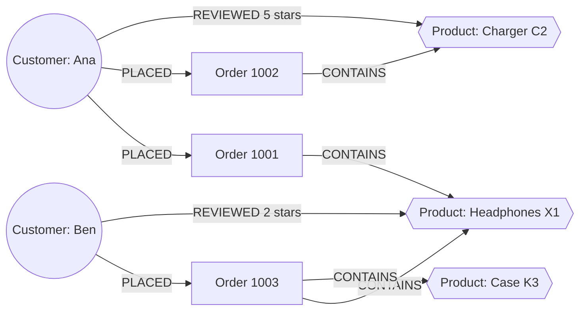
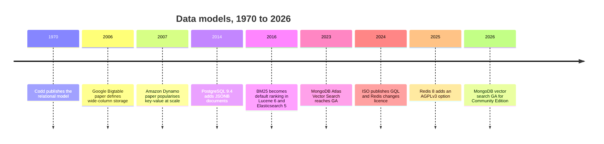

# 2. Data Models
> **Depth:** L2 · **Reading time:** ~14 min · **Last verified:** 2026-11-01 · **Prerequisites:** [Ch 1 — The data stack map](ch01-data-stack-map.md)

## TL;DR

- A **data model** is the shape a database holds data in: tables, documents, key-value pairs, wide rows, graphs, time-stamped points, inverted indexes or vectors. That shape decides which questions are cheap to ask and which are expensive. No model is cheap for everything.
- The [relational model](../glossary.md#relational-model) (Codd, 1970) is still the default. PostgreSQL topped the Stack Overflow developer survey for usage in both 2024 and 2025, and DB-Engines put four relational engines at the top of its July 2026 popularity ranking.[^codd][^so24][^so25][^dbe-jul]
- The NoSQL models (document, key-value, wide-column, graph) each gave up some of the relational model's generality to gain scale, flexibility or traversal speed. Search and vector models do something SQL was never built for: they rank results by relevance or similarity instead of returning exact matches.
- The industry is converging on **multi-model** engines. Postgres runs JSONB documents, pgvector embeddings and PostGIS geometry in one engine, and MongoDB ships vector search in Atlas and, since June 2026, in its self-managed Community Edition.[^pgvector][^mdb-vs] The popular summary is "SQL won", but the more accurate one is that SQL absorbed the other models.
- **Everpure lens:** the data model sets the I/O pattern. Key-value and graph workloads issue small random reads, analytics issues large sequential scans, and vector search falls in between. AI also raises the value of unstructured data and vectors, which Everpure's 2026 Data Intelligence and Data Stream launches target.[^ep-ds]

## Why this matters (business + Everpure lens)

Every database vendor in this atlas sells a data model before it sells a product. MongoDB sells documents, Neo4j sells graphs, Elastic sells inverted indexes, Pinecone sells vectors and Oracle sells relations. When a strategy team asks whether a category can survive on its own, it is really asking whether that model is different enough that a general-purpose engine cannot simply add it as a feature. Chapter 29 picks up that question vendor by vendor ([Ch 29](../04-company-deep-dives/ch29-operational-database-vendors.md)).

AI changes the value of each model. Before large language models, the money was in structured rows: orders, ledgers, inventory. Unstructured content such as contracts, tickets, call transcripts and images was stored cheaply and rarely queried. [Embeddings](../glossary.md#embedding) turn that content into vectors that can be searched by meaning, so unstructured data becomes queryable for the first time. Graph models gain value too, because retrieval systems like GraphRAG use entity relationships to give a model better context ([Ch 19](../03-ai-data-stack/ch19-retrieval-architectures.md)).

For Everpure, the link is concrete. Everpure closed its acquisition of 1touch on 7 May 2026 and relaunched the technology as **Data Intelligence**, which discovers and classifies structured and unstructured data. On 17 June 2026 it announced **Data Stream**, which vectorises selected data for AI pipelines on FlashBlade with NVIDIA GPUs.[^ep-1touch][^ep-ds] Both products sit where data models meet storage. A strategy team should understand which model a customer's data will end up in, and what I/O that model will generate.

## How it works

### The map



*Figure 2.1 — Eight data models and two exemplar products each. Most flagship products now support more than one model, so read this as each product's primary model.*

### Relational: tables, keys, joins

Edgar Codd's 1970 paper proposed storing data as **relations**, which are tables of rows. Rows are linked by values rather than by physical pointers.[^codd] Each row has a [primary key](../glossary.md#primary-key). A [foreign key](../glossary.md#foreign-key) in another table refers to it, and a [join](../glossary.md#join) reassembles related rows at query time. [Normalization](../glossary.md#normalization) stores each fact exactly once, so an update happens in one place and the copies cannot drift apart.

SQL is a [declarative query](../glossary.md#declarative-query) language: you describe the result you want, and the optimizer chooses indexes, join order and algorithms. That separation is why one 1970s idea has run on mainframes, on x86 servers and now on cloud object storage. The query does not change when the hardware does. [Ch 3](ch03-database-internals.md) explains what happens inside the engine.

```sql
SELECT p.name, SUM(ol.qty * ol.unit_price) AS revenue
FROM order_line ol
JOIN orders o   ON o.order_id = ol.order_id
JOIN product p  ON p.product_id = ol.product_id
WHERE o.order_date >= CURRENT_DATE - INTERVAL '30 days'
GROUP BY p.name ORDER BY revenue DESC LIMIT 10;
```

**Good at:** transactions across many entities, integrity constraints and ad hoc questions nobody planned for. **Flagships:** Oracle, MySQL, SQL Server, PostgreSQL. **Avoid when:** the data has no stable schema, joins must cross thousands of machines at low latency, or the main question is a ten-hop relationship walk.

> **Bridge: semiconductors.** Normalization works like de-duplicating a bill of materials. In a clean BOM, a 0402 capacitor's part number and spec live in one master record, and every board that uses it points to that record. If you copy the spec onto each board's BOM, a supplier change means editing hundreds of rows, and one missed row ships the wrong part. Foreign keys are the part-number references, and a join is the BOM explosion.

### Document: JSON and schema-on-read

A [document database](../glossary.md#document-database) stores self-contained JSON-like records. MongoDB stores them as BSON with a 16 MiB cap per document.[^mdb-limits] The schema lives in the application rather than in the database, which is called [schema-on-read](../glossary.md#schema-on-read). Teams can add a field without running a migration.

The key design decision is **embedding versus referencing**. You embed data that is read together and grows within limits, such as an order's line items. You reference data that is shared or grows without limit, such as a product's reviews. MongoDB's modelling guidance makes the same split.[^mdb-limits]

```javascript
db.orders.find({ customer_id: 42 }).sort({ order_date: -1 }).limit(5)
```

**Good at:** reading an entire aggregate in one fetch, evolving schemas, and keeping data in the shape the app already uses. **Flagships:** MongoDB, Couchbase, Amazon DocumentDB. **Avoid when:** many-to-many relationships dominate, or you need ad hoc analytics across entities. A heavily embedded design turns those into application-side joins.

### Key-value: the hash table at datacenter scale

A [key-value store](../glossary.md#key-value-store) does one thing: given a key, it returns a value. Redis keeps the data in memory and adds data structures such as lists, sets and sorted sets. DynamoDB borrows ideas from Amazon's 2007 Dynamo paper but not its leaderless design: each partition has a single leader replica elected through Multi-Paxos. It spreads items across partitions by hashing a [partition key](../glossary.md#partition-key).[^ddb-atc] It caps an item at 400 KB and a partition key at 2,048 bytes.[^ddb][^dynamo]

```text
GET session:7f3a9c      ->  {"user":42,"cart":[...],"ttl":1800}
```

**Good at:** caches, sessions, shopping carts, feature lookups and rate limiters, anywhere the key is known in advance and latency matters most. **Flagships:** Redis, Valkey, DynamoDB, Memcached. **Avoid when:** you need to query by anything other than the key. Every new access pattern then needs a hand-built secondary index.

> **Bridge: semiconductors.** A key-value store is a hash table, which in hardware terms is a CAM or TLB lookup. You present a tag and get the entry back in constant time. You cannot ask a TLB for "all pages owned by process 7 with the dirty bit set" without walking it. Key-value databases have the same property.

Licensing matters in this category. Redis moved away from its BSD licence in March 2024, the Linux Foundation forked it as **Valkey**, and Redis 8 added AGPLv3 as a third licence option in May 2025.[^redis]

### Wide-column: sparse rows sorted by key

Google's 2006 Bigtable paper defined a **wide-column** model: a sparse, sorted map from row key, column and timestamp to a value.[^bigtable] Cassandra combined Bigtable's storage layout with Dynamo-style partitioning, and HBase is an open-source Bigtable clone. You design the table around the query. The partition key chooses the node, and the clustering key sorts rows inside the partition.

```sql
-- Cassandra CQL: one partition per customer, newest orders first
SELECT * FROM orders_by_customer WHERE customer_id = 42 LIMIT 20;
```

**Good at:** very high write rates, multi-region availability, time-ordered events and IoT telemetry. **Flagships:** Cassandra, ScyllaDB, Bigtable, HBase. **Avoid when:** queries are unpredictable. A question that does not start with the partition key becomes a scan of the whole cluster. [Ch 4](ch04-distributed-databases.md) covers the partitioning and replication behind this model.

### Graph: relationships as first-class data

A [property graph](../glossary.md#property-graph) stores **nodes** and **edges**, and both can carry properties. A [graph traversal](../glossary.md#graph-traversal) follows edges directly from node to node, so its cost grows with the number of edges it touches, not with the size of the whole table. The alternative graph model is [RDF](../glossary.md#rdf), which stores subject–predicate–object triples, is queried with SPARQL and is common in life sciences and government knowledge graphs.

Neo4j's Cypher was the de facto property-graph language. In April 2024 ISO published **[GQL](../glossary.md#gql)** (ISO/IEC 39075:2024). It is the first new ISO database language since SQL. Its pattern-matching syntax draws heavily on Cypher's MATCH clause, with input from Oracle's PGQL and the G-CORE research language.[^gql] Neo4j introduced Cypher 25 in release 2025.06 and states that Cypher now covers most mandatory GQL features.[^neo4j]

```cypher
MATCH (:Product {sku:'X1'})<-[:CONTAINS]-(:Order)<-[:PLACED]-(c:Customer)
      -[:PLACED]->(:Order)-[:CONTAINS]->(rec:Product)
WHERE rec.sku <> 'X1'
RETURN rec.name, count(DISTINCT c) AS buyers ORDER BY buyers DESC LIMIT 5;
```

**Good at:** fraud rings, recommendations, network and supply-chain topology, identity resolution and knowledge graphs for GraphRAG. **Flagships:** Neo4j, Amazon Neptune, TigerGraph. **Avoid when:** the workload is mostly aggregation, such as sums by month. Graph engines are slow scanners, and a relational or columnar engine will beat them on that kind of query.

> **Bridge: semiconductors.** Graph traversal is like routing a packet through a network-on-chip. Each router only knows its neighbours, and the packet hops tile to tile. Latency depends on hop count and on whether the next tile is local, not on how many tiles the die has. A relational multi-hop query is more like rebuilding the routing table from scratch at every hop.

### Time-series, search and vector

**Time-series.** A [time-series database](../glossary.md#time-series-database) stores append-mostly measurements keyed by time and by tags such as host or sensor. It compresses runs of similar values and downsamples old data. Typical queries ask for a rate, percentile or moving average over a time window. The flagships take three approaches: InfluxDB is purpose-built, TimescaleDB is a Postgres extension, and Prometheus is a metrics engine with its own PromQL language. **Avoid when:** the data is not time-stamped or must be updated in place.

```text
rate(http_requests_total{service="checkout"}[5m])     # PromQL
```

**Search.** An [inverted index](../glossary.md#inverted-index) maps each term to the list of documents that contain it, the way an index at the back of a book does. Apache Lucene builds these indexes, and Elasticsearch, OpenSearch and Solr all run on Lucene. Results are ranked by [BM25](../glossary.md#bm25), which scores a document higher when a query term is frequent in it but rare across the corpus, with a correction for document length. BM25 replaced classic TF-IDF as the default in Lucene 6 and Elasticsearch 5.[^bm25] **Avoid when:** you need it to be the system of record. Search indexes are typically refreshed in near real time and rebuilt from a primary database.

**Vector.** A vector store holds embeddings, which are arrays of hundreds or thousands of floating-point numbers produced by a model so that similar meanings sit close together. OpenAI's text-embedding-3-small, for example, outputs 1,536 dimensions.[^openai-emb] The query is "find the *k* nearest neighbours of this vector". At scale that needs an [approximate nearest neighbor](../glossary.md#approximate-nearest-neighbor) index such as HNSW, which trades a little recall for orders-of-magnitude speed.[^hnsw] **Avoid when:** you need an exact match, such as a SKU, a date range or an account ID. Vectors measure similarity, not identity, and they are expensive to store. [Ch 18](../03-ai-data-stack/ch18-embeddings-and-vector-search.md) covers the index structures.

```sql
SELECT review_id, body FROM review
ORDER BY embedding <=> $query_embedding LIMIT 10;   -- pgvector cosine distance
```

## Worked example: one domain, four models

Take a retailer with **customers**, **orders**, **products** and **reviews**. The same facts can be modelled four ways, and each model answers a different set of questions cheaply.

**Relational.** There are five normalized tables. Each order line references one product, and each review references one customer and one product.



*Figure 2.2 — The relational version stores each fact once and reassembles orders with joins, so any new question can be answered without changing the schema.*

**Document.** An order document embeds its line items, plus a snapshot of each product's name and price at purchase time. This is deliberate [denormalization](../glossary.md#denormalization), because the invoice must not change if the catalogue changes later. Reviews live in their own collection and reference the product ID, because one popular product can collect hundreds of thousands of reviews and would quickly exceed a 16 MiB document cap.[^mdb-limits]

**Graph.** Customers, orders and products become nodes, and PLACED, CONTAINS and REVIEWED become edges.



*Figure 2.3 — In the graph version, "customers who bought X1 also bought…" is a walk of four edges from one node. Its cost does not grow with the size of the order table.*

**Vector.** Each review body and product description is embedded. A support analyst can now ask "reviews that describe the headphones overheating" and get back reviews that say "gets hot near my ear" or "battery felt warm". Those reviews share no keyword with the query, so a SQL `LIKE` and BM25 would both miss them.

| Question | Relational | Document | Graph | Vector |
|---|---|---|---|---|
| Revenue by product, last 30 days | **Cheap** (join + group) | Moderate (aggregation pipeline over embedded lines) | Expensive (scan-heavy) | Not applicable |
| Show order 1001 with its lines | Moderate (3-table join) | **Cheapest** (one document read) | Moderate (one-hop expansion) | Not applicable |
| "Bought X1, also bought…" | Expensive (self-joins grow with history) | Expensive (application-side joins) | **Cheap** (bounded traversal) | Approximate only (co-embedding) |
| Reviews about overheating, any wording | Fails (keyword only) | Fails without a search index | Fails | **Cheap** (k-NN search) |
| Change a product's price everywhere | **Cheap** (one row) | Snapshots should *not* change. Live price fields need fan-out updates | Cheap (one node property) | Re-embed only if the text changes |
| Enforce "every review has a real customer" | **Built in** (foreign key) | Application code | Partial (schema constraints vary) | Not applicable |

*Figure 2.4 — The same domain modelled four ways. Each model makes a different set of questions cheap, so serious applications end up combining several of them.*

## Design choices and trade-offs

| Model | Data shape | Query pattern | Consistency (typical default) | Scaling | Example vendors | AI relevance |
|---|---|---|---|---|---|---|
| Relational | Normalized tables, fixed schema | Ad hoc SQL, joins, aggregates | Strong, ACID | Scale-up first; distributed SQL for scale-out | Oracle, PostgreSQL, MySQL, SQL Server | System of record; text-to-SQL target; agent databases |
| Document | Nested JSON aggregates | Fetch or update one aggregate by key or index | Strong per document; multi-document transactions optional | Horizontal sharding | MongoDB, Couchbase, DocumentDB | Flexible store for app and LLM metadata; built-in vector search |
| Key-value | Opaque value under a key | Point get or put | Tunable; often eventual across regions | Hash partitioning, near-linear | Redis, Valkey, DynamoDB | Feature store online layer, prompt and semantic caches |
| Wide-column | Sparse rows by partition and clustering key | Partition-key lookups and range scans | Tunable per query | Masterless, multi-region | Cassandra, ScyllaDB, Bigtable, HBase | High-volume event and feature logs |
| Graph | Nodes, edges, properties (or RDF triples) | Multi-hop traversal, pattern match | Strong in single-cluster engines | Hard to shard; mostly scale-up | Neo4j, Neptune, TigerGraph | Knowledge graphs, GraphRAG, entity resolution |
| Time-series | Timestamp plus tags plus value | Window aggregates, downsampling | Append-mostly; relaxed | Time and tag partitioning | InfluxDB, TimescaleDB, Prometheus | GPU and cluster telemetry; model monitoring |
| Search | Tokenized text, inverted index | Keyword relevance (BM25), facets | Near-real-time refresh | Sharded indexes | Elasticsearch, OpenSearch, Solr | Lexical half of hybrid retrieval |
| Vector | Dense float arrays plus metadata | k-NN similarity with filters | Usually eventual index refresh | Index memory is the constraint | Pinecone, Milvus, Weaviate, pgvector | Semantic retrieval for RAG and agents |
| Multi-model | Any of the above in one engine | Mixed SQL, JSON, vector, geo | Inherits host engine | Inherits host engine | Postgres plus extensions, MongoDB Atlas, Oracle | Lowest-friction way to add AI to existing apps |

*Figure 2.5 — Model-fit comparison. The "AI relevance" column is why vector, graph and search, once niche models, are now strategic.*

**Steelmanning the specialists.** The case for "Postgres for everything" is strong. You get one operational surface, one security model and transactions that span rows, JSON and vectors. pgvector 0.8.0 (November 2024) added iterative index scans, so a vector query with a filter can keep searching until it has enough matching results.[^pgvector] The counter-argument is that general engines lose at the extremes. That means billions of vectors at high queries per second, sub-millisecond lookups across many regions, or petabyte-scale log search. Specialist products hold that ground, and their cost profiles are built for it. The usual pattern is that the general engine wins by default, and the specialist wins once one workload's scale or latency justifies a second system.

## Who's who

- **Relational:** Oracle, Microsoft SQL Server, MySQL, PostgreSQL and its many managed variants, plus distributed SQL engines covered in [Ch 4](ch04-distributed-databases.md).
- **Document:** MongoDB is the category leader and is now multi-model. Its Atlas Vector Search reached GA in December 2023, and vector search for self-managed Community Edition reached GA on 30 June 2026.[^mdb-vs]
- **Key-value:** Redis Inc. and the Valkey fork backed by the Linux Foundation, Amazon DynamoDB, and Memcached.[^redis]
- **Wide-column:** Apache Cassandra (with DataStax, acquired by IBM in a deal that closed on 28 May 2025),[^datastax] ScyllaDB, Google Bigtable, Apache HBase.
- **Graph:** Neo4j, Amazon Neptune, TigerGraph. RDF stores such as Stardog and Ontotext GraphDB.
- **Time-series:** InfluxData (InfluxDB), Timescale (TimescaleDB) [VERIFY: Timescale's 2025 rename to TigerData], and Prometheus under the CNCF.
- **Search:** Elastic (Elasticsearch), OpenSearch under the Linux Foundation, Apache Solr. All three run on Lucene.[^bm25]
- **Vector:** pure-play Pinecone, Milvus/Zilliz, Weaviate and Qdrant, plus vector features inside nearly every engine above. See [Ch 18](../03-ai-data-stack/ch18-embeddings-and-vector-search.md) and [Ch 32](../04-company-deep-dives/ch32-ai-native-data-companies.md).

**Market context.** DB-Engines, which Redgate now operates, ranks systems monthly by web mentions, job postings, search interest and Q&A activity. These are popularity signals, not revenue. A secondary report of the July 2026 ranking lists Oracle, MySQL, SQL Server and PostgreSQL first through fourth, then MongoDB, Snowflake and Databricks.[^dbe-jul] In H1 2026, PostgreSQL gained the most score (+21.97 points), followed by Databricks (+16.04) and MongoDB (+11.24).[^dbe-h1] Developer usage shows the same trend. In the Stack Overflow survey, PostgreSQL rose from 48.7% of all respondents in 2024 to a press-reported 55.6% in 2025, ahead of MySQL.[^so24][^so25]

## History and trajectory



*Figure 2.6 — The arc runs from one model (1970), to many specialist models (2006–2016), and back to multi-model engines (2014 onward), with AI accelerating the convergence.*

The arc has three acts. **Act one (1970s–2000s):** relational dominance. Codd's model plus SQL beat the hierarchical and network databases that came before it, because declarative queries separated what you ask from how the data is stored.[^codd] **Act two (mid-2000s–2010s):** web-scale companies ran into the limits of single-node relational databases and published new designs. Bigtable and Dynamo became templates for Cassandra, HBase and DynamoDB, and document stores won over developers with schema flexibility.[^bigtable][^dynamo] **Act three (2014–today):** convergence. PostgreSQL added JSONB in 9.4 (2014), and extensions brought geospatial (PostGIS) and vector (pgvector) support.[^pg-jsonb][^pgvector] Meanwhile, the NoSQL leaders added SQL-like query languages, transactions and vector search.[^mdb-vs]

The "SQL won" story is mostly right about the *interface* and only half right about the *engine*. SQL and relational tables won the system of record. But the winning products absorbed the other models as data types and index types: a JSONB column, a vector column, a graph query standard. The next round of competition is about where these models run. Increasingly that is on open table formats over object storage ([Ch 7](ch07-open-table-formats.md)), with vector and graph indexes built from the same data.

> **Everpure lens: models determine I/O.** Key-value lookups, graph traversals and OLTP index probes issue small random reads, a few KB each, and are bound by latency and IOPS. Analytical scans over columnar files read large sequential ranges and are bound by throughput. Vector search sits between the two. In-memory HNSW indexes avoid storage on the hot path, but flash-resident designs such as DiskANN turn each query into a few dozen random 4 KB reads [VERIFY: typical DiskANN reads per query]. AI workloads also expand the amount of data worth keeping: raw documents, their embeddings, and the metadata that says what each one is. That is the gap Data Intelligence (classification and context) and Data Stream (vectorisation) are positioned to fill.[^ep-ds][^ep-1touch]

## Numbers that matter

| Metric | Value | Basis | Source / date |
|---|---|---|---|
| Max MongoDB document size | 16 MiB | Vendor documentation limit | MongoDB manual[^mdb-limits] |
| Max DynamoDB item size / partition key | 400 KB / 2,048 bytes | Vendor documentation limit | AWS docs[^ddb] |
| PostgreSQL usage, Stack Overflow survey | 48.7% (2024) → 55.6% (2025), all respondents | Survey; 2025 figure press-reported | Stack Overflow 2024, 2025[^so24][^so25] |
| PostgreSQL DB-Engines score gain, H1 2026 | +21.97 points (largest gain) | Popularity index, not revenue | Redgate, 2026-06[^dbe-h1] |
| DB-Engines rank of PostgreSQL / MongoDB | #4 / #5 (July 2026) | Popularity index; secondary report | HelloGitHub, 2026-07[^dbe-jul] |
| GQL standard | ISO/IEC 39075:2024, April 2024 | Standard publication | ISO[^gql] |
| BM25 default parameters | k1 = 1.2, b = 0.75 | Lucene defaults | Apache Lucene[^bm25] |
| Embedding size, text-embedding-3-small | 1,536 dimensions ≈ 6 KB as float32 | Vendor spec; byte size is an estimate (1,536 × 4 bytes) | OpenAI, 2024-01-25[^openai-emb] |
| Raw size of 1M such vectors | ≈ 6.1 GB before index overhead | Estimate (arithmetic) | Derived from[^openai-emb] |
| pgvector HNSW index limit (vector type) | 2,000 dimensions | Project documentation | pgvector[^pgvector] |

*Figure 2.7 — A few hard limits and adoption signals worth memorizing. The vector-size arithmetic is the one most likely to come up in storage conversations.*

## Storage bridge

> **Storage bridge.** The same 1 TB behaves very differently depending on its model. As key-value or graph data, it generates millions of small random reads. As Parquet for analytics, it is streamed in multi-MB sequential chunks. As embeddings, it multiplies the source text several times over, because 1,536 floats take about 6 KB while the paragraph they encode may be under 1 KB. When sizing for a customer's AI project, ask which models the data will land in. See the companion *Everpure Tech Atlas* for media and protocol detail.

## Conversation playbook

**Questions for PMs**
1. "Which of your customers' queries require a second database today, and what would it take to absorb that model natively?"
2. "When customers add vector search, do they buy a specialist vector database, or turn on a feature in the database they already run? What tips the decision?"
3. "How much of the AI data you see is unstructured content waiting to be classified, versus rows that are already modelled?"

**Questions for engineers**
1. "What is the dominant I/O pattern of this workload: point lookups, traversals, scans or k-NN? What is the read size distribution?"
2. "Where is the system of record, and which indexes (search, vector, graph) are derived from it? How stale can they be?"
3. "For vectors: what dimension, precision and index type do you use, and does the index live in RAM or on flash?"

**What good answers sound like:** they name the access pattern before the product. They separate the system of record from derived indexes. They quantify sizes: rows, dimensions, queries per second, p99 latency.

**Don't say this**
- "NoSQL means no schema." The schema still exists. It moves into application code, where it is harder to govern.
- "Graph databases are just joins." Joins over a ten-hop path grow with the size of the table. Traversals grow with the edges actually touched.
- "Vector databases replace search." Production retrieval is usually hybrid: BM25 for exact terms and vectors for meaning ([Ch 19](../03-ai-data-stack/ch19-retrieval-architectures.md)).
- "SQL won, so the other models are dead." SQL won the interface. The other models survived as data types, index types and specialist engines at the extremes.

## Going deeper

> **Going deeper (L3).** Read Codd's 1970 paper for the original case for data independence.[^codd] Read the Bigtable and Dynamo papers for the storage designs behind wide-column and key-value systems.[^bigtable][^dynamo] Malkov and Yashunin's HNSW paper explains why graph-based vector indexes need lots of RAM.[^hnsw] Neo4j's GQL conformance appendix lists the gaps between Cypher and the standard, feature by feature.[^neo4j] For the storage engines underneath every model (B-trees, LSM-trees, MVCC), continue to [Ch 3](ch03-database-internals.md).

## Key terms

- [Relational model](../glossary.md#relational-model): data as tables of rows linked by key values, queried declaratively.
- [Primary key](../glossary.md#primary-key): the column or columns that uniquely identify a row.
- [Foreign key](../glossary.md#foreign-key): a column that references another table's primary key.
- [Join](../glossary.md#join): an operation that combines rows from tables on matching keys.
- [Normalization](../glossary.md#normalization): structuring tables so each fact is stored once.
- [Denormalization](../glossary.md#denormalization): deliberately duplicating data to make reads cheaper.
- [Declarative query](../glossary.md#declarative-query): a query that states the result wanted and leaves the method to the optimizer.
- [Document database](../glossary.md#document-database): a database that stores self-contained JSON-like records.
- [Schema-on-read](../glossary.md#schema-on-read): structure interpreted when data is read, not enforced when it is written.
- [Key-value store](../glossary.md#key-value-store): a database that retrieves an opaque value by its key.
- [Partition key](../glossary.md#partition-key): the attribute hashed to decide which node stores a record.
- [Wide-column store](../glossary.md#wide-column-store): sparse rows grouped by partition key and sorted by clustering key.
- [Property graph](../glossary.md#property-graph): nodes and edges that both carry key-value properties.
- [RDF](../glossary.md#rdf): a graph model of subject–predicate–object triples, queried with SPARQL.
- [Graph traversal](../glossary.md#graph-traversal): following edges from node to node to answer a query.
- [GQL](../glossary.md#gql): the ISO/IEC 39075:2024 standard property-graph query language.
- [Time-series database](../glossary.md#time-series-database): a store tuned for time-stamped, append-mostly measurements.
- [Inverted index](../glossary.md#inverted-index): a map from each term to the documents that contain it.
- [BM25](../glossary.md#bm25): the standard keyword relevance-scoring function in Lucene-based search.
- [Embedding](../glossary.md#embedding): a model-produced vector in which similar meanings lie close together.
- [Approximate nearest neighbor](../glossary.md#approximate-nearest-neighbor): fast similarity search that trades a little recall for speed.
- [Multi-model database](../glossary.md#multi-model-database): one engine that supports several data models.

## Sources

[^codd]: E. F. Codd, "A Relational Model of Data for Large Shared Data Banks," *Communications of the ACM* 13(6), 377–387, https://doi.org/10.1145/362384.362685, published 1970-06; retrieved 2026-11-01 (canonical citation, not live-fetched).
[^so24]: Stack Overflow, "2024 Developer Survey — Technology: Databases," https://survey.stackoverflow.co/2024/technology#1-databases, published 2024-07; figure (48.7% all respondents) as reported by DevClass, https://www.devclass.com/development/2024/08/02/little-sign-of-migration-from-c-or-c-to-rust-in-latest-dev-survey-but-postgresql-is-winning-against-mysql/1622783, published 2024-08-02; retrieved 2026-11-01.
[^so25]: Stack Overflow, "2025 Developer Survey — Technology: Databases," https://survey.stackoverflow.co/2025/technology#1-databases, published 2025-07; 55.6% (all respondents) and 58.2% (professional developers) as reported by Vonng, "StackOverflow 2025 survey: PostgreSQL," https://blog.vonng.com/en/pg/so2025-pg/, published 2025; press-reported, not read from the survey page [VERIFY: exact 2025 percentages against survey.stackoverflow.co]; retrieved 2026-11-01.
[^dbe-jul]: HelloGitHub, "2026 年 7 月数据库排行榜" (report of the DB-Engines July 2026 ranking), https://hellogithub.com/report/db-engines, published 2026-07; secondary report of https://db-engines.com/en/ranking [VERIFY: current positions on db-engines.com]; retrieved 2026-11-01.
[^dbe-h1]: Redgate, "DB-Engines: PostgreSQL leads H1 2026 database growth as data platforms gain momentum," https://www.red-gate.com/our-company/newsroom/press-releases/db-engines-postgresql-leads-h1-2026-database-growth-as-data-platforms-gain-momentum/, published 2026-06; retrieved 2026-11-01.
[^gql]: ISO, "ISO/IEC 39075:2024 Information technology — Database languages — GQL," https://www.iso.org/standard/76120.html, published 2024-04; The New Stack, "GQL: A New ISO Standard for Querying Graph Databases," https://thenewstack.io/gql-a-new-iso-standard-for-querying-graph-databases/, published 2024; retrieved 2026-11-01.
[^neo4j]: Neo4j, "Cypher Manual — GQL conformance," https://neo4j.com/docs/cypher-manual/current/appendix/gql-conformance/, n.d. (2026.06 edition); Neo4j, "Neo4j 2026.02 release notes," https://neo4j.com/release-notes/database/neo4j-2026-02/, published 2026-03-06; retrieved 2026-11-01.
[^mdb-limits]: MongoDB, "MongoDB Limits and Thresholds" and "Data Modeling — Embedded vs. References," https://www.mongodb.com/docs/manual/reference/limits/ and https://www.mongodb.com/docs/manual/data-modeling/, n.d.; retrieved 2026-11-01 (16 MiB figure corroborated by multiple secondary sources; docs not live-fetched).
[^mdb-vs]: Constellation Research, "MongoDB Atlas Vector Search, Atlas Search Nodes generally available," https://www.constellationr.com/insights/news/mongodb-atlas-vector-search-atlas-search-nodes-generally-available, published 2023-12-04; MongoDB, "Now GA: MongoDB Search and Vector Search for Community Edition," https://www.mongodb.com/products/updates/now-ga-mongodb-search-and-vector-search-for-community-edition/, published 2026-06-30; retrieved 2026-11-01.
[^ddb]: Amazon Web Services, "Constraints in Amazon DynamoDB," https://docs.aws.amazon.com/amazondynamodb/latest/developerguide/Constraints.html, n.d.; retrieved 2026-11-01.
[^ddb-atc]: M. Elhemali et al., "Amazon DynamoDB: A Scalable, Predictably Performant, and Fully Managed NoSQL Database Service," USENIX ATC 2022, https://www.usenix.org/conference/atc22/presentation/elhemali, published 2022-07; retrieved 2026-11-01 (canonical citation, not live-fetched).
[^datastax]: AI Data Atlas, `data/ma_deals.csv` (IBM–DataStax, announced 2025-02-25, closed 2025-05-28, terms undisclosed), citing DBTA, "IBM Officially Closes Acquisition of DataStax," https://www.dbta.com/Editorial/News-Flashes/IBM-Officially-Closes-Acquisition-of-DataStax-169711.aspx, published 2025-05/06; retrieved 2026-11-01.
[^dynamo]: G. DeCandia et al., "Dynamo: Amazon's Highly Available Key-value Store," SOSP 2007, https://doi.org/10.1145/1294261.1294281, published 2007-10; retrieved 2026-11-01 (canonical citation, not live-fetched).
[^bigtable]: F. Chang et al., "Bigtable: A Distributed Storage System for Structured Data," OSDI 2006, https://research.google/pubs/bigtable-a-distributed-storage-system-for-structured-data/, published 2006-11; retrieved 2026-11-01 (canonical citation, not live-fetched).
[^redis]: Phoronix, "Redis 8.0 Released: Now Tri-Licensed With AGPLv3," https://www.phoronix.com/news/Redis-8.0-Goes-AGPLv3, published 2025-05-01; SD Times, "Open source wins again! Redis adds GNU AGPL license to its offering," https://sdtimes.com/os/open-source-wins-again-redis-adds-gnu-agpl-license-to-its-offering/, published 2025-05; retrieved 2026-11-01.
[^bm25]: Elastic, "Elasticsearch Reference 5.0 — Similarity module," https://www.elastic.co/guide/en/elasticsearch/reference/5.0/similarity.html, published 2016-10; Apache Lucene, "BM25Similarity" API docs (defaults k1 = 1.2, b = 0.75), https://lucene.apache.org/core/9_0_0/core/org/apache/lucene/search/similarities/BM25Similarity.html, n.d.; retrieved 2026-11-01 (Lucene docs not live-fetched).
[^pgvector]: PostgreSQL Global Development Group, "pgvector 0.8.0 Released!," https://www.postgresql.org/about/news/pgvector-080-released-2952/, published 2024-11; pgvector project README (index dimension limits), https://github.com/pgvector/pgvector, n.d.; retrieved 2026-11-01 (README not live-fetched).
[^pg-jsonb]: PostgreSQL Global Development Group, "PostgreSQL 9.4 release notes," https://www.postgresql.org/docs/release/9.4.0/, published 2014-12-18; retrieved 2026-11-01 (canonical citation, not live-fetched).
[^openai-emb]: OpenAI, "New embedding models and API updates," https://openai.com/index/new-embedding-models-and-api-updates/, published 2024-01-25; retrieved 2026-11-01 (not live-fetched).
[^hnsw]: Y. Malkov and D. Yashunin, "Efficient and robust approximate nearest neighbor search using Hierarchical Navigable Small World graphs," arXiv:1603.09320, https://arxiv.org/abs/1603.09320, published 2016-03; retrieved 2026-11-01 (canonical citation).
[^ep-ds]: Everpure via PR Newswire, "Everpure Unveils Data-Primacy Architecture for the AI Era," https://www.prnewswire.com/news-releases/everpure-unveils-data-primacy-architecture-for-the-ai-era-302803097.html, published 2026-06-17; Computer Weekly, "Everpure aims to bridge AI data gap with Universal Data Intelligence," https://www.computerweekly.com/news/366644438/Everpure-aims-to-bridge-AI-data-gap-with-Universal-Data-Intelligence, published 2026-06; retrieved 2026-11-01.
[^ep-1touch]: Everpure, Inc., Form 10-Q for the quarter ended 2026-05-03, SEC EDGAR, https://www.sec.gov/Archives/edgar/data/0001474432/000147443226000061/pstg-20260503.htm, published 2026-06; Cleary Gottlieb, "Everpure Completes Acquisition of 1touch," https://www.clearygottlieb.com/news-and-insights/news-listing/everpure-completes-acquisition-of-1touch, published 2026-05-11; retrieved 2026-11-01.
