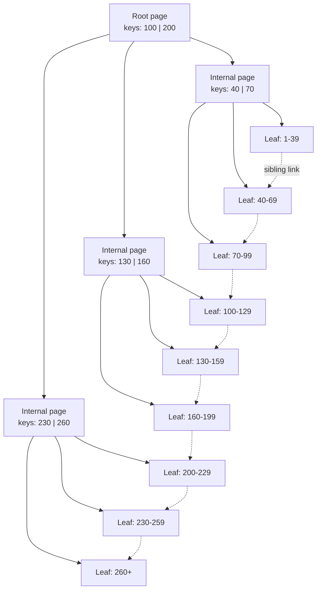
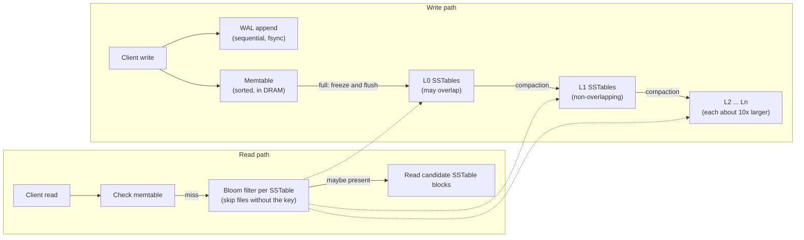
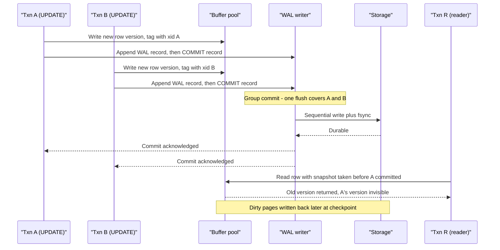
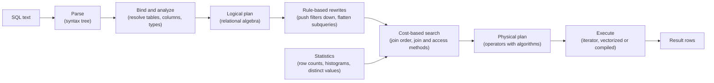
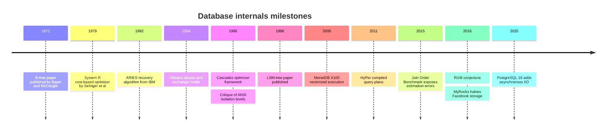

# 3. How a Database Works Inside
> **Depth:** L2 · **Reading time:** ~19 min · **Last verified:** 2026-11-01 · **Prerequisites:** [Chapter 2 — Data models](ch02-data-models.md)

## TL;DR

- A database is two machines bolted together. The **storage engine** decides how bytes sit on disk and in memory. The **query processor** turns a SQL request into a step-by-step plan and runs it. Most performance arguments, and many vendor pitches, are really about one half or the other.
- There are two dominant storage-engine designs. A [B-tree](../glossary.md#b-tree) updates fixed-size pages in place and is tuned for reads (PostgreSQL, MySQL InnoDB, Oracle, SQL Server). An [LSM-tree](../glossary.md#lsm-tree) buffers writes in memory, writes immutable sorted files, and merges them in the background (RocksDB, Cassandra). Neither wins outright. The [RUM conjecture](../glossary.md#rum-conjecture) says you can optimize at most two of read cost, update cost and memory/space overhead.
- Durability comes from the [write-ahead log](../glossary.md#write-ahead-log) (WAL): describe the change in a sequential log, force it to stable media with `fsync`, then update the data pages lazily. Commit latency is therefore dominated by WAL flush latency, which is a storage property.
- Concurrency comes from [MVCC](../glossary.md#mvcc) (multi-version concurrency control): writers create new row versions so readers never wait. PostgreSQL keeps old versions in the table and cleans up with [vacuum](../glossary.md#vacuum); Oracle and InnoDB keep them in an [undo log](../glossary.md#undo-log). The [isolation level](../glossary.md#isolation-level) decides which anomalies the application can see.
- The [query optimizer](../glossary.md#query-optimizer) is a compiler. It rewrites SQL into candidate plans, estimates their cost from statistics, and picks the cheapest. Its biggest weakness is [cardinality estimation](../glossary.md#cardinality-estimation): when row-count guesses are wrong, the chosen plan can be ten or a hundred times slower than the best one.

## Why this matters (business + Everpure lens)

Every product in this atlas sits on these mechanisms. Snowflake, Databricks, MongoDB, the new Postgres-for-agents services and vector databases all make the same handful of choices: B-tree or LSM, in-place or append-only, undo log or version chain, iterator or vectorized execution. When a vendor claims "10x faster ingest," the honest translation is usually "we chose an LSM-style write path and moved the cost to background compaction." Knowing where the cost moved is the difference between a sharp diligence question and a nod.

For a storage company, these internals decide the I/O pattern that lands on the array. A B-tree database issues random 8–16 KB page reads and writes, plus a stream of small sequential WAL writes whose `fsync` latency sits directly on the commit path. An LSM database issues large sequential writes and reads during compaction, often several times the application's own write volume. Those three signatures (random page I/O, latency-sensitive log flushes, compaction bandwidth) explain why database consolidation was the first killer workload for all-flash arrays. They also explain why "faster storage" helps some databases dramatically and others barely at all.

## How it works

### Everything is a page

Databases do not read rows; they read **pages** (also called blocks), fixed-size chunks that are the unit of I/O and caching. PostgreSQL's default page is 8 kB, set at compile time.[^pg-page] InnoDB's default is 16 KB, chosen when the instance is initialized.[^innodb-limits] Rows, index entries and free-space bookkeeping all live inside pages.

The [buffer pool](../glossary.md#buffer-pool) is the database's own DRAM cache of pages. A query asks for page 4,711 of the `orders` table; if it is in the pool (a hit), the read costs nanoseconds to microseconds; if not (a miss), the engine fetches it from storage and evicts something, typically using an LRU-like policy. Modified ("dirty") pages are written back later by background writers and at checkpoints, not at commit. PostgreSQL deliberately keeps a modest buffer pool and leans on the operating system's page cache as a second tier, while InnoDB prefers to own most of the server's memory directly. A database whose working set fits in the buffer pool behaves like an in-memory system; one that does not becomes a storage benchmark.

### Storage engine 1: the B+tree

The B-tree, published by Rudolf Bayer and Edward McCreight in 1972 (first circulated as a 1970 Boeing report), keeps keys sorted in a shallow, wide tree of pages.[^bayer72] Almost every production system uses the **B+tree** variant: internal pages hold only separator keys and child pointers, all data (or row pointers) sits in the leaf pages, and leaves are chained left-to-right so a range scan can walk sideways without returning to the root.



*Figure 3.1 — A B+tree finds any key in three or four page reads; sibling links between leaves make range scans a sequential walk.*

A lookup reads the root, follows one pointer per level, and lands on a leaf. Because each page holds hundreds of keys, the tree is extremely shallow. With an 8 kB page and roughly 16-byte entries, an internal page fans out to about 500 children (estimate). A three-level tree (root, one internal level, leaves) then holds about 500 × 500 × 500 ≈ 125 million keys, and a four-level tree about 60 billion. In practice the root and internal levels stay hot in the buffer pool, so a point lookup on a billion-row table costs about one storage read.

Writes are **in place**. Updating a row means finding its leaf page, modifying it in memory, and eventually writing the whole page back. An insert into a full leaf triggers a **page split**: half the entries move to a new page and a new separator key is pushed into the parent, which may split in turn. Splits keep the tree balanced but leave pages partly empty (often around two-thirds full on random inserts), and they turn a small logical change into one or more full-page writes. That is the B-tree's write tax.

Two flavors matter commercially. InnoDB uses a **clustered** index: the table *is* the primary-key B+tree, with full rows in the leaves, so secondary indexes store the primary key and a lookup through them costs two tree traversals. PostgreSQL stores rows in an unordered **heap** and every index, including the primary key, is a separate B-tree pointing at heap locations (tuple IDs). Neither is strictly better; clustering favors primary-key range scans, while heaps make secondary indexes cheaper and updates simpler.

> **Bridge: semiconductors.** B-tree fan-out is the same design rule as cache-line sizing. A CPU fetches 64 bytes because the cost of a memory access is mostly latency, not bandwidth, so you amortize each trip over as many useful bytes as possible. A B-tree page is a "cache line" for storage: once you pay a device round-trip, you pull 8–16 KB and make hundreds of comparisons on it. Bigger pages raise fan-out and cut tree height, but waste bandwidth when you need one row; that is the same trade-off as a longer cache line increasing false sharing and over-fetch.

### Storage engine 2: the LSM-tree

The log-structured merge-tree was devised in 1991 by Patrick O'Neil, Edward Cheng and Dieter Gawlick and published with Elizabeth O'Neil in 1996.[^oneil96] Its premise: maintaining a B-tree index under a heavy insert stream roughly doubles I/O, because every insert is a random page update. The LSM-tree instead batches changes in memory and writes them out sequentially, merging later.



*Figure 3.2 — An LSM-tree turns random writes into sequential ones, then pays for it with background compaction and multi-file reads.*

A write goes to two places: an append to the WAL for durability, and an insert into the **memtable**, a sorted in-memory structure. When the memtable fills, it is frozen and flushed to disk as an immutable **sorted string table** ([SSTable](../glossary.md#sstable)); the matching WAL segment can then be deleted.[^rocksdb-overview] Nothing on disk is ever modified in place. An update is just a newer version of the key in a newer file; a delete is a "tombstone" marker.

Over time files accumulate, so a background process, [compaction](../glossary.md#compaction), merge-sorts overlapping files into larger ones, drops overwritten versions and tombstones, and pushes data down a hierarchy of levels. In RocksDB's default leveled scheme each level is about ten times larger than the one above it. Cassandra follows the same memtable-commit-log-SSTable pattern, inherited from Google's Bigtable design.[^cassandra]

Reads are the price. A key might live in the memtable or in any of several levels, so a point lookup may probe multiple files. Two devices keep this bearable: a per-file [Bloom filter](../glossary.md#bloom-filter), a compact probabilistic bitmap that answers "definitely not here" or "maybe here" so most files are skipped without I/O, and caching of filters and indexes in DRAM.[^rocksdb-overview] Range scans still have to merge streams from every level.

Engineers describe the costs with three amplification factors. [Write amplification](../glossary.md#write-amplification) is bytes written to storage per byte the application wrote. [Read amplification](../glossary.md#read-amplification) is the I/Os per lookup. [Space amplification](../glossary.md#space-amplification) is bytes stored per byte of live data. Leveled compaction in RocksDB is commonly reported at 20–30x write amplification [VERIFY: confirm 20–30x wording in RocksDB blog 2022-10-31]; an early Facebook model put it at roughly ten times the number of levels.[^rocksdb-align][^fms14] Alternative "tiered" or "universal" compaction writes less but reads more and needs more spare space. The 2016 [RUM conjecture](../glossary.md#rum-conjecture) from Athanassoulis and colleagues formalizes the bind: optimizing any two of read, update and memory overhead penalizes the third.[^rum16] A B-tree sits at the read-optimized corner; an LSM-tree sits nearer the update-optimized corner; a compaction policy is a dial between them.

The pay-off can be large. Facebook reported in 2016 that moving MySQL from InnoDB to the RocksDB-based MyRocks engine cut storage by 50% against compressed InnoDB for the same data, largely because immutable variable-size files compress and pack better than fixed pages.[^myrocks16] Its 2020 VLDB paper reported a 62.3% instance-size reduction for the main user database (company-stated).[^myrocks20]

> **Bridge: NAND flash.** LSM compaction *is* flash-translation-layer garbage collection, moved up one layer. An SSD cannot overwrite a NAND page in place; it writes new data to fresh pages, marks old ones invalid, and later copies the surviving valid pages out of a block so the block can be erased. The LSM engine does the same with files: write new versions elsewhere, mark old ones obsolete, and periodically copy the live keys forward so whole files can be deleted. Both pay write amplification for the privilege of never updating in place, and both trade over-provisioning (spare capacity) against amplification. The amplifications **multiply**: 1 GB of application writes × 20x LSM write amplification × 1.5x device write amplification (illustrative) means 30 GB of NAND program cycles. The upside is that LSM output is large, sequential and deleted whole, which is close to the ideal pattern for an FTL, while a B-tree's scattered 8–16 KB in-place writes are the pattern that drives device-side garbage collection hardest. Choosing an engine is partly choosing which layer does the garbage collection.

### Indexes beyond the primary key

A **primary index** organizes the table by its key. A [secondary index](../glossary.md#secondary-index) is an extra structure on another column (say `orders.customer_id`) that points back to rows, and every secondary index adds write cost because each insert must update it too. A [covering index](../glossary.md#covering-index) includes every column a query needs, so the engine answers from the index alone and never touches the table, which is often the single most effective tuning move. Beyond B-trees, **hash indexes** give constant-time equality lookups but no ranges; [bitmap indexes](../glossary.md#bitmap-index) store one bit-vector per distinct value and suit low-cardinality columns in analytics; and [inverted indexes](../glossary.md#inverted-index) map each word or array element to the rows containing it, which is how full-text search and PostgreSQL's GIN (generalized inverted index) handle JSON and arrays. Vector indexes are the newest family; see [Chapter 18](../03-ai-data-stack/ch18-embeddings-and-vector-search.md).

### The write-ahead log: durability without random writes

The WAL rule is simple: a change to a data page may reach disk only after the log record describing it has been flushed to stable storage.[^pg-wal] At commit, the database forces only the log, a sequential append, rather than the scattered dirty pages. After a crash it replays the log forward ("redo") from the last checkpoint to rebuild any lost page changes, and rolls back transactions that never committed. The log is the source of truth; data files are a cache of it.

Because every commit waits for an `fsync` (or equivalent) of the log, commit latency is roughly the storage device's flush latency. [Group commit](../glossary.md#group-commit) amortizes it: when many transactions commit at once, one flush makes all of them durable. PostgreSQL exposes this through `commit_delay` (off by default) and `commit_siblings` (default 5 concurrent transactions before the delay applies); RocksDB likewise batches multiple writers into one log `fsync`.[^pg-wal-config][^rocksdb-overview] A shared log is also what streaming replication and change data capture tap into, which connects this chapter to [Chapter 9](../02-pipelines-and-governance/ch09-pipeline-patterns.md).

> **Bridge: file-system journaling.** A journaling file system (ext4, XFS, NTFS) applies the same idea to metadata: write intent to a journal, then update in place, and replay the journal after a crash. PostgreSQL's documentation notes that because WAL already restores data-file contents, a journaled file system is not required for the database's own reliability.[^pg-wal] Running both is like insuring the same cargo twice.

> **Going deeper (L3).** The canonical recovery algorithm is IBM's ARIES (Mohan et al., 1992).[^aries92] It has three passes: *analysis* (scan the log from the last checkpoint to find dirty pages and in-flight transactions), *redo* (repeat history so every logged change, committed or not, is re-applied), and *undo* (roll back losers, writing compensation log records so a crash during recovery is itself recoverable). Each page stores the log sequence number (LSN) of its last change, so redo is idempotent. ARIES's "steal, no-force" policy (dirty pages may be written before commit; pages need not be written at commit) is why the buffer pool and the WAL can be tuned independently.

### Transactions, ACID and isolation

[ACID](../glossary.md#acid) is the contract: **atomicity** (all or nothing, provided by the log), **consistency** (constraints hold), **isolation** (concurrent transactions do not see each other's half-finished work) and **durability** (committed means it survives a crash, again the log). Isolation is the expensive one, so databases offer a menu of [isolation levels](../glossary.md#isolation-level), each defined by which anomalies it still permits. The 1995 paper by Berenson, Gray and colleagues showed the ANSI definitions were incomplete and named [snapshot isolation](../glossary.md#snapshot-isolation), which blocks the classic anomalies but still allows [write skew](../glossary.md#write-skew).[^berenson95]

| Isolation level | Dirty read | Non-repeatable read | Phantom | Lost update / write skew | Where it is the default |
|---|---|---|---|---|---|
| Read uncommitted | Possible | Possible | Possible | Possible | Rarely used; PostgreSQL silently treats it as read committed |
| Read committed | Prevented | Possible | Possible | Possible | PostgreSQL, Oracle, SQL Server |
| Repeatable read (ANSI, lock-based) | Prevented | Prevented | Possible | Write skew prevented by locks | MySQL InnoDB uses the name, but plain reads use an MVCC snapshot, so it behaves closer to snapshot isolation |
| Snapshot isolation | Prevented | Prevented | Prevented | Lost update prevented; **write skew possible** | PostgreSQL "repeatable read"; Oracle "serializable" |
| Serializable | Prevented | Prevented | Prevented | Prevented | CockroachDB; PostgreSQL via Serializable Snapshot Isolation when requested |

*Figure 3.3 — Isolation levels are a menu of permitted anomalies; most databases default to read committed, which is weaker than many application developers assume.*

Write skew is the anomaly executives should remember. Two doctors are on call; the rule is that at least one must remain. Each opens a transaction, checks that the other is on call, and signs off. Under snapshot isolation both checks read the same snapshot, both writes touch different rows, both commit, and nobody is on call. Only true serializability catches it.[^pg-iso][^berenson95]

### MVCC: two ways to keep old versions

MVCC lets each transaction read a consistent snapshot while others write, so readers never block writers and writers never block readers.[^pg-mvcc] The design question is where old versions live.

**PostgreSQL** writes a complete new row version (tuple) into the heap on every update and marks the old one with the ID of the transaction that superseded it. Each reader checks those transaction IDs against its snapshot to decide visibility. Old tuples stay in the table until **vacuum** reclaims them. The upside is fast rollback and simple reads of recent data; the downside is table and index bloat, write amplification on updates (indexes may need new entries pointing at the new tuple), and an operational chore that, if neglected, ends in transaction-ID wraparound emergencies.

**Oracle and InnoDB** update the row in place and copy the *old* image into an **undo log**. A reader that needs an older version follows the undo chain backward. Old undo is discarded by a background **purge** once no active transaction needs it; a long-running transaction pins the history and forces readers to reconstruct ever-older versions, and InnoDB will even throttle writes when purge lag grows too large.[^innodb-purge] The table stays compact, but rollback and old-snapshot reads cost more.

### Locking versus optimistic concurrency

MVCC handles read-write conflicts; write-write conflicts still need a policy. **Pessimistic** concurrency, most often [two-phase locking](../glossary.md#two-phase-locking), acquires locks before touching data and holds them until commit, so conflicting transactions wait (and occasionally deadlock, which the engine breaks by aborting one). [Optimistic concurrency control](../glossary.md#optimistic-concurrency-control) lets transactions run without locks and validates at commit; if someone else changed the data, the loser aborts and retries. Optimism wins when conflicts are rare and transactions short; pessimism wins under hot-spot contention, where optimistic systems burn work on retries. Distributed databases such as those in [Chapter 4](ch04-distributed-databases.md) lean optimistic because cross-node lock management is costly.



*Figure 3.4 — A commit waits only for one sequential log flush, shared by every transaction in the group; data pages reach storage later, and MVCC keeps the old version visible to older snapshots.*

### Query processing: from SQL to a running plan

SQL is declarative: it says *what* you want, not *how* to get it. The query processor fills the gap in five stages.



*Figure 3.5 — The optimizer sits in the middle of the query lifecycle and is only as good as the statistics fed into it.*

**Parsing** checks grammar. **Binding** resolves names against the catalog and checks types and permissions. The result is a **logical plan**: an operator tree of scans, filters, joins and aggregates with no algorithms chosen. **Optimization** has two layers. Rule-based rewrites apply transformations that are almost always good, such as pushing filters below joins. Cost-based search then enumerates alternatives (which table to scan first, index or full scan, hash join or nested loop) and estimates each one's cost from statistics. The cheapest becomes the **physical plan**.

The cost-based approach dates to IBM's System R optimizer, described by Patricia Selinger and colleagues in 1979.[^selinger79] Its key ideas still run inside PostgreSQL, Oracle and SQL Server: a cost model combining I/O and CPU, selectivity estimates per predicate, and dynamic programming over join orders (find the best plan for every two-table subset, then build three-table plans from those, and so on), keeping "interesting orders" that a later step can exploit. Goetz Graefe's Volcano (1994) and Cascades (1995) frameworks generalized optimization into a rule-driven, top-down search with memoization; Cascades descendants power SQL Server and many newer engines.[^volcano94][^cascades95]

The weak link is **cardinality estimation**: guessing how many rows each step produces. Estimates rely on simplifying assumptions, notably that columns are independent and values are uniformly distributed. Leis and colleagues' 2015 Join Order Benchmark (113 queries on real IMDB data) found that industrial estimators routinely make large errors, that these errors matter far more than cost-model details, and that they compound across joins.[^leis15]

> **Bridge: compilers.** The optimizer is a compiler. SQL is the source code; the physical plan is the machine code; rewrite rules are compiler passes such as constant folding and loop hoisting; join-order search is instruction scheduling; and table statistics are profile-guided optimization. Like a compiler with a stale profile, an optimizer with stale statistics emits confidently wrong code. `ANALYZE` (refreshing statistics) is the database equivalent of re-running the profiler.

**Execution** comes in three styles. The classic **Volcano/iterator** model, also from Graefe, has each operator expose `next()` and pull one row at a time from its child: simple and composable, but every row pays several virtual function calls.[^volcano94] [Vectorized execution](../glossary.md#vectorized-execution), introduced by MonetDB/X100 in 2005, passes batches of perhaps a thousand values per call so tight loops can use CPU caches and SIMD instructions.[^x100] [Query compilation](../glossary.md#query-compilation), popularized by HyPer in 2011, generates machine code for the whole plan so values stay in registers.[^hyper11] Vectorized and compiled engines dominate analytics, covered in [Chapter 5](ch05-analytical-engines.md); most transactional databases still use iterators because their queries touch few rows.

## Worked example: one join, two plans

A retailer asks for revenue by customer in Norway:

```sql
SELECT c.name, SUM(o.amount)
FROM customers c JOIN orders o ON o.customer_id = c.id
WHERE c.country = 'NO'
GROUP BY c.name;
```

Assume (all illustrative) 1 million customers on 12,500 pages, 50 million orders on 625,000 pages, an index on `orders.customer_id`, and statistics saying 0.5% of customers are in Norway: 5,000 customers with about 50 orders each. Use PostgreSQL-style cost units, where a sequential page read costs 1.0, a random page read 4.0 and processing a row 0.01.[^pg-cost]

| Plan | Steps | Main I/O | Estimated cost (units) |
|---|---|---|---|
| A. Hash join | Scan customers, keep 5,000 Norwegians in a hash table; scan all 50M orders and probe | 637,500 sequential pages; 51M rows processed | ≈ 640,000 I/O + 510,000 CPU ≈ **1.15M** |
| B1. Index nested loop, orders scattered | Scan customers; for each of 5,000, probe the index (~2 pages) and fetch 50 orders from 50 random heap pages | 12,500 sequential + 260,000 random | ≈ 12,500 + 1,040,000 + 12,500 ≈ **1.07M** |
| B2. Index nested loop, orders clustered by customer | Same, but each customer's 50 orders sit on ~1 page | 12,500 sequential + 15,000 random | ≈ 12,500 + 60,000 + 12,500 ≈ **85,000** |
| B1 with a bad estimate | Statistics stale: actually 200,000 Norwegian customers | ≈ 10.4M random pages | ≈ **42M** (about 36x worse than A) |

*Figure 3.6 — The same SQL has plans differing by more than an order of magnitude; physical data layout and cardinality estimates, not the query text, decide which wins.*

Three lessons. First, plan choice depends on facts the SQL does not contain, such as how orders are physically laid out (PostgreSQL tracks this as a column's "correlation"). Second, nested-loop plans are brilliant when the estimate is right and catastrophic when it is wrong, which is why some engines switch strategy at run time. Third, on flash, the 4.0 random-page penalty is arguably too high; teams on fast storage routinely lower `random_page_cost`, which tilts optimizers toward index plans.

An `EXPLAIN` command shows the chosen plan. Read it inside-out: the most indented lines run first; compare estimated `rows` against actual rows (with `EXPLAIN ANALYZE`) to find where estimates go wrong.

```text
HashAggregate  (cost=1153000..1153050 rows=5000)
  ->  Hash Join  (cost=25060..1151000 rows=250000)
        Hash Cond: (o.customer_id = c.id)
        ->  Seq Scan on orders o  (cost=0..1125000 rows=50000000)
        ->  Hash  (cost=25000..25000 rows=5000)
              ->  Seq Scan on customers c  (cost=0..25000 rows=5000)
                    Filter: (country = 'NO')
```

*Illustrative output, not from a real system.*

## Design choices and trade-offs

| Dimension | B-tree / B+tree | LSM-tree |
|---|---|---|
| Write path | In-place page updates; random 8–16 KB writes; page splits | Append to WAL and memtable; large sequential flushes |
| Read path | One root-to-leaf path; ~1 storage read for hot trees | Memtable plus several levels; Bloom filters avoid most probes |
| Write amplification | Moderate: whole page written per small change, plus WAL | High under leveled compaction (often 10–30x), lower with tiered |
| Read amplification | Low and predictable | Higher, especially for range scans and misses |
| Space amplification | Pages often one-third empty after random inserts; MVCC bloat in PostgreSQL | Low with leveled compaction; high with tiered; compresses well |
| SSD wear and I/O pattern | Scattered small overwrites drive device-side garbage collection | Host does the garbage collection; device sees sequential, whole-file deletes, but total bytes written are higher |
| Latency predictability | Stable; spikes at checkpoints | Write stalls when compaction falls behind; tail latency needs tuning |
| Best workloads | Read-heavy OLTP, range queries, mixed workloads | Write-heavy ingest, time series, key-value at scale, metadata stores |
| Representative products | PostgreSQL, MySQL InnoDB, Oracle, SQL Server, MongoDB WiredTiger (default) | RocksDB, Cassandra, ScyllaDB, MyRocks, TiKV, CockroachDB (Pebble) |

*Figure 3.7 — B-trees and LSM-trees sit at different corners of the RUM triangle; the right choice follows the workload's read/write mix and how much write amplification the storage can absorb.*

The steelman for each side matters. B-tree advocates point out that decades of tuning, predictable latency and excellent range scans explain why every major relational database still defaults to one, and that buffer-pool hit rates above 99% make the write tax tolerable. LSM advocates answer that at hyperscale, write volume and storage cost dominate, and MyRocks's halved footprint is real money. The hybrids are telling: InnoDB's change buffer defers secondary-index updates and applies them in batches, an LSM-style idea inside a B-tree engine, while LSM engines pin filters and indexes in memory to claw back read performance. The frontier is tunable engines that move along the RUM curve per workload.

## Who's who

| Engine or system | Storage structure | MVCC / versioning | Positioning note |
|---|---|---|---|
| PostgreSQL | Heap plus separate B-tree, GIN, GiST, BRIN indexes | Tuple versions in heap; vacuum | The default open-source OLTP engine; base of Lakebase, Snowflake Postgres and many forks |
| MySQL InnoDB | Clustered B+tree on primary key | Undo log; purge | Web-scale OLTP workhorse; Oracle-owned |
| Oracle Database | B-tree, heap and index-organized tables | Undo segments | Enterprise incumbent; deepest feature set |
| Microsoft SQL Server | B+tree (rowstore) plus columnstore | Locking by default; optional row versioning | Cascades-family optimizer |
| RocksDB | LSM-tree (leveled or universal) | Sequence numbers per key | Embedded engine inside dozens of systems |
| Apache Cassandra / ScyllaDB | LSM-tree | Timestamped cells, tombstones | Wide-column, write-heavy, multi-region |
| CockroachDB / TiDB (TiKV) | LSM (Pebble / RocksDB) under a distributed SQL layer | MVCC timestamps | Distributed SQL; see Chapter 4 |
| MongoDB WiredTiger | B-tree by default | MVCC snapshots | Document database storage layer |

*Figure 3.8 — Almost every database product is a recombination of the same few storage and concurrency choices.*

Vendors of these systems and their business models are covered in [Chapter 29](../04-company-deep-dives/ch29-operational-database-vendors.md); analytical engines in [Chapter 5](ch05-analytical-engines.md); on-disk file formats in [Chapter 6](ch06-file-formats.md).

## History and trajectory



*Figure 3.9 — The core ideas are decades old; recent progress is mostly about adapting them to flash, many cores and cloud object storage.*

The arc runs in three phases. From the 1970s to the mid-1990s, IBM and academic labs defined the canon: B-trees, cost-based optimization, ARIES logging, isolation theory.[^bayer72][^selinger79][^aries92][^berenson95] From the late 1990s to the 2010s, cheap flash and web-scale write volumes revived the LSM-tree, and analytics pushed execution toward vectorized and compiled models.[^oneil96][^x100][^hyper11] Since the mid-2010s, the work has been about making the canon fit new hardware. PostgreSQL 18, released in September 2025, added an asynchronous I/O subsystem that the project says delivers up to 3x faster reads from storage, replacing reliance on operating-system readahead.[^pg18] Expect more of this: engines written to keep deep NVMe queues full, optimizers that learn from execution feedback, and storage engines that write directly to object storage, the theme of [Chapter 7](ch07-open-table-formats.md). For the longer narrative, see [Chapter 42](../06-history-and-future/ch42-history-of-databases.md).

## Numbers that matter

| Metric | Value | Basis | Source / date |
|---|---|---|---|
| PostgreSQL default page size | 8 kB | Project documentation (compile-time default) | PostgreSQL 18 docs[^pg-page] |
| InnoDB default page size | 16 KB (4–64 KB configurable at init) | Vendor documentation | MySQL 8.4 manual[^innodb-limits] |
| B+tree height for ~100M keys, 8 kB pages | 3–4 levels | Estimate (fan-out ~500) | This chapter |
| RocksDB leveled-compaction write amplification | Often 20–30x | Vendor blog, approximate | RocksDB blog, 2022-10-31[^rocksdb-align] |
| MyRocks vs compressed InnoDB storage | 50% less | Company-stated | Facebook Engineering, 2016-08-31[^myrocks16] |
| MyRocks instance-size reduction (main user DB) | 62.3% | Company-stated, peer-reviewed paper | PVLDB 13(12), 2020[^myrocks20] |
| PostgreSQL 18 asynchronous I/O read speed-up | Up to 3x | Project-stated benchmark | PostgreSQL press release, 2025-09-25[^pg18] |
| PostgreSQL planner `random_page_cost` / `seq_page_cost` defaults | 4.0 / 1.0 | Project documentation | PostgreSQL 18 docs[^pg-cost] |
| Join Order Benchmark size | 113 queries, 3–16 joins each | Academic benchmark | Leis et al., PVLDB 2015[^leis15] |

*Figure 3.10 — The numbers that matter are small and physical: page sizes, tree heights and amplification factors set the I/O bill.*

## Storage bridge

> **Storage bridge.** Databases hit storage in three distinct ways. B-tree engines issue random 8–16 KB page reads on buffer-pool misses, so read latency at moderate queue depth drives query speed. Every commit waits on a small sequential WAL write plus `fsync`, so write-acknowledgement latency at low queue depth directly caps transactions per second, which is why log volumes are the most latency-sensitive I/O in the datacenter. LSM engines add sustained compaction bandwidth, often several times the application's write rate, that competes with foreground I/O. Data reduction interacts with all three: LSM files already compress well, while page-based engines with sparse pages often reduce more on the array. See the companion *Everpure Tech Atlas* for how arrays handle these patterns.

## Conversation playbook

**Three questions for a product manager**

1. "Is your storage engine B-tree or LSM-based, and what workload made you choose it?" A good answer names the read/write mix of target customers and admits the cost they accepted (for example, compaction stalls or slower range scans).
2. "What isolation level do customers get by default, and what anomalies can they hit?" A good answer is specific ("snapshot isolation by default; serializable is available at a throughput cost") rather than "we're fully ACID."
3. "Where does your cost per query come from: I/O, CPU or network?" Good answers connect pricing to the dominant resource and show awareness of amplification.

**Three questions for an engineer**

1. "What is your write amplification end-to-end, including the device?" A good answer quantifies engine and device amplification separately and explains compaction tuning.
2. "How do you handle cardinality-estimation errors?" Good answers mention extended statistics, runtime plan adaptation or feedback loops, plus the queries where they still struggle.
3. "What is your commit latency budget, and how much is storage flush time?" A strong answer knows the `fsync` latency of their platform and how group commit behaves under load.

**Don't say this**

- "LSM-trees are faster than B-trees." They are faster at writes and pay for it in reads, space or background I/O.
- "ACID means transactions can't interfere." Most databases default to read committed, which allows several anomalies.
- "MVCC means no locks." Writers still lock rows against other writers.
- "Faster storage makes every database faster." A database whose working set fits in the buffer pool is CPU- or lock-bound; storage helps commits and cache misses most.
- "The optimizer picks the best plan." It picks the plan it *estimates* is cheapest, and estimates are often wrong.

## Going deeper

- Read Selinger et al. (1979) for the template every cost-based optimizer still follows, then Leis et al. (2015) for how far estimates fall short.[^selinger79][^leis15]
- The RUM paper is a short, readable framework for evaluating any new index or storage engine claim.[^rum16]
- ARIES is long but its introduction alone explains steal/no-force and why LSNs make recovery safe.[^aries92]
- For hands-on intuition, run `EXPLAIN (ANALYZE, BUFFERS)` on PostgreSQL and compare estimated with actual rows at each node.

## Key terms

- [B-tree](../glossary.md#b-tree) — a shallow, wide, sorted tree of pages; the B+tree variant keeps all data in linked leaves.
- [LSM-tree](../glossary.md#lsm-tree) — a storage structure that buffers writes in memory and merges immutable sorted files in the background.
- [Memtable](../glossary.md#memtable) — the in-memory sorted write buffer of an LSM-tree.
- [SSTable](../glossary.md#sstable) — an immutable, sorted on-disk file produced by an LSM flush or compaction.
- [Compaction](../glossary.md#compaction) — background merging of LSM files to discard old versions and bound read cost.
- [Bloom filter](../glossary.md#bloom-filter) — a compact probabilistic structure that says "definitely absent" or "maybe present."
- [Write amplification](../glossary.md#write-amplification) — bytes physically written per byte logically written.
- [Read amplification](../glossary.md#read-amplification) — storage reads performed per logical lookup.
- [Space amplification](../glossary.md#space-amplification) — bytes stored per byte of live data.
- [RUM conjecture](../glossary.md#rum-conjecture) — the claim that read, update and memory overhead cannot all be minimized at once.
- [Page split](../glossary.md#page-split) — dividing a full B-tree page in two and updating its parent.
- [Fan-out](../glossary.md#fan-out) — the number of children per B-tree internal page.
- [Buffer pool](../glossary.md#buffer-pool) — the database's in-memory cache of data pages.
- [Write-ahead log](../glossary.md#write-ahead-log) — a sequential log flushed before data pages, used for durability and recovery.
- [Group commit](../glossary.md#group-commit) — making several transactions durable with a single log flush.
- [Fsync](../glossary.md#fsync) — the system call that forces buffered writes to stable storage.
- [Checkpoint](../glossary.md#checkpoint) — a point at which dirty pages are flushed so recovery can start from there.
- [ARIES](../glossary.md#aries) — IBM's analysis-redo-undo recovery algorithm based on write-ahead logging.
- [ACID](../glossary.md#acid) — atomicity, consistency, isolation, durability.
- [Isolation level](../glossary.md#isolation-level) — the set of concurrency anomalies a database permits.
- [Snapshot isolation](../glossary.md#snapshot-isolation) — each transaction reads a consistent snapshot; prevents most anomalies but allows write skew.
- [Write skew](../glossary.md#write-skew) — two transactions read overlapping data and write disjoint rows, jointly breaking a rule.
- [MVCC](../glossary.md#mvcc) — keeping multiple row versions so readers and writers do not block each other.
- [Vacuum](../glossary.md#vacuum) — PostgreSQL's process for reclaiming dead tuple versions.
- [Undo log](../glossary.md#undo-log) — storage for prior row images used for rollback and old-snapshot reads.
- [Two-phase locking](../glossary.md#two-phase-locking) — acquire locks as needed, release only after commit.
- [Optimistic concurrency control](../glossary.md#optimistic-concurrency-control) — run without locks and validate at commit.
- [Secondary index](../glossary.md#secondary-index) — an index on a non-primary-key column.
- [Covering index](../glossary.md#covering-index) — an index containing every column a query needs.
- [Bitmap index](../glossary.md#bitmap-index) — one bit-vector per distinct value, suited to low-cardinality columns.
- [Inverted index](../glossary.md#inverted-index) — a map from each term or element to the rows containing it.
- [Query optimizer](../glossary.md#query-optimizer) — the component that chooses an execution plan for a query.
- [Cardinality estimation](../glossary.md#cardinality-estimation) — predicting how many rows each plan step produces.
- [Volcano model](../glossary.md#volcano-model) — row-at-a-time iterator execution via `next()` calls.
- [Vectorized execution](../glossary.md#vectorized-execution) — processing batches of values per operator call.
- [Query compilation](../glossary.md#query-compilation) — generating machine code for a query plan.
- [EXPLAIN](../glossary.md#explain) — the SQL command that displays a query's chosen plan.

## Sources

[^bayer72]: R. Bayer and E. McCreight, "Organization and Maintenance of Large Ordered Indexes," *Acta Informatica* 1, 173–189, Springer, https://doi.org/10.1007/BF00288683, published 1972; retrieved 2026-11-01.
[^oneil96]: P. O'Neil, E. Cheng, D. Gawlick, E. O'Neil, "The Log-Structured Merge-Tree (LSM-Tree)," *Acta Informatica* 33(4), 351–385, Springer, https://link.springer.com/article/10.1007/s002360050048 (PDF: https://www.cs.umb.edu/~poneil/lsmtree.pdf), published 1996-06; retrieved 2026-11-01.
[^aries92]: C. Mohan, D. Haderle, B. Lindsay, H. Pirahesh, P. Schwarz, "ARIES: A Transaction Recovery Method Supporting Fine-Granularity Locking and Partial Rollbacks Using Write-Ahead Logging," *ACM TODS* 17(1), 94–162, IBM Research, https://research.ibm.com/publications/aries-a-transaction-recovery-method-supporting-fine-granularity-locking-and-partial-rollbacks-using-write-ahead-logging, published 1992-03; retrieved 2026-11-01.
[^selinger79]: P. G. Selinger, M. M. Astrahan, D. D. Chamberlin, R. A. Lorie, T. G. Price, "Access Path Selection in a Relational Database Management System," *Proc. ACM SIGMOD*, https://dl.acm.org/doi/10.1145/582095.582099, published 1979; retrieved 2026-11-01.
[^volcano94]: G. Graefe, "Volcano — An Extensible and Parallel Query Evaluation System," *IEEE TKDE* 6(1), 120–135, https://15721.courses.cs.cmu.edu/spring2016/papers/graefe-ieee1994.pdf, published 1994-02; retrieved 2026-11-01.
[^cascades95]: G. Graefe, "The Cascades Framework for Query Optimization," *IEEE Data Engineering Bulletin* 18(3), 19–29, https://www.madgik.di.uoa.gr/sites/default/files/2018-06/ieee_deb_v18.3.pp10-18.pdf, published 1995-09; retrieved 2026-11-01.
[^rum16]: M. Athanassoulis, M. Kester, L. Maas, R. Stoica, S. Idreos, A. Ailamaki, M. Callaghan, "Designing Access Methods: The RUM Conjecture," *EDBT 2016*, 461–466, https://stratos.seas.harvard.edu/publications/designing-access-methods-rum-conjecture, published 2016-03; retrieved 2026-11-01.
[^berenson95]: H. Berenson, P. Bernstein, J. Gray, J. Melton, E. O'Neil, P. O'Neil, "A Critique of ANSI SQL Isolation Levels," *Proc. ACM SIGMOD 1995*, 1–10, https://arxiv.org/abs/cs/0701157, published 1995-05; retrieved 2026-11-01.
[^rocksdb-overview]: RocksDB project (Meta), "RocksDB Overview," GitHub wiki, https://github.com/facebook/rocksdb/wiki/RocksDB-Overview, living documentation (n.d.); retrieved 2026-11-01.
[^rocksdb-align]: RocksDB project, "Reduce Write Amplification by Aligning Compaction Output File Boundaries," RocksDB blog, https://rocksdb.org/blog/2022/10/31/align-compaction-output-file.html, published 2022-10-31; retrieved 2026-11-01. The 20–30x figure is approximate and workload-dependent.
[^fms14]: S. Dong (Facebook), "RocksDB" talk, Flash Memory Summit, https://old.flashmemorysummit.com/English/Collaterals/Proceedings/2014/20140805_D12_Dong.pdf, published 2014-08-05; retrieved 2026-11-01.
[^myrocks16]: Facebook Engineering, "MyRocks: A space- and write-optimized MySQL database," https://engineering.fb.com/2016/08/31/core-infra/myrocks-a-space-and-write-optimized-mysql-database/, published 2016-08-31; retrieved 2026-11-01.
[^myrocks20]: Y. Matsunobu, S. Dong, H. Lee, "MyRocks: LSM-Tree Database Storage Engine Serving Facebook's Social Graph," *PVLDB* 13(12), 3217–3230, https://www.vldb.org/pvldb/vol13/p3217-matsunobu.pdf, published 2020-08; retrieved 2026-11-01.
[^cassandra]: Apache Software Foundation, "Storage Engine," Apache Cassandra documentation, https://cassandra.apache.org/doc/latest/cassandra/architecture/storage-engine.html, living documentation (n.d.); retrieved 2026-11-01.
[^pg-mvcc]: PostgreSQL Global Development Group, "13.1. Introduction" (Concurrency Control), PostgreSQL 18 documentation, https://www.postgresql.org/docs/18/mvcc-intro.html, living documentation (v18); retrieved 2026-11-01.
[^pg-iso]: PostgreSQL Global Development Group, "Transaction Isolation," PostgreSQL documentation, https://www.postgresql.org/docs/18/transaction-iso.html, living documentation (v18); retrieved 2026-11-01.
[^pg-wal]: PostgreSQL Global Development Group, "Write-Ahead Logging (WAL)," PostgreSQL documentation, https://www.postgresql.org/docs/18/wal-intro.html, living documentation (v18); retrieved 2026-11-01.
[^pg-wal-config]: PostgreSQL Global Development Group, "Write Ahead Log" runtime configuration (`commit_delay`, `commit_siblings`, `wal_sync_method`), https://www.postgresql.org/docs/18/runtime-config-wal.html, living documentation (v18); retrieved 2026-11-01.
[^pg-page]: PostgreSQL Global Development Group, "Database Page Layout," PostgreSQL 18 documentation, https://www.postgresql.org/docs/18/storage-page-layout.html, living documentation (v18); retrieved 2026-11-01.
[^pg-cost]: PostgreSQL Global Development Group, "Query Planning" runtime configuration (planner cost constants), https://www.postgresql.org/docs/18/runtime-config-query.html, living documentation (v18); retrieved 2026-11-01.
[^pg18]: PostgreSQL Global Development Group, "PostgreSQL 18 Released!", press release, https://www.postgresql.org/about/news/postgresql-18-released-3142/, published 2025-09-25; retrieved 2026-11-01.
[^innodb-limits]: Oracle, "InnoDB Limits," MySQL 8.4 Reference Manual, https://docs.oracle.com/cd/E17952_01/mysql-8.4-en/innodb-limits.html, living documentation (v8.4); retrieved 2026-11-01.
[^innodb-purge]: Oracle, "Purge Configuration," MySQL Reference Manual, https://dev.mysql.com/doc/refman/8.0/en/innodb-purge-configuration.html, living documentation (v8.0); retrieved 2026-11-01.
[^leis15]: V. Leis, A. Gubichev, A. Mirchev, P. Boncz, A. Kemper, T. Neumann, "How Good Are Query Optimizers, Really?", *PVLDB* 9(3), 204–215, https://courses.cs.washington.edu/courses/cse544/20wi/papers/how-good-vldb-2015.pdf, published 2015-11; retrieved 2026-11-01.
[^x100]: P. Boncz, M. Zukowski, N. Nes, "MonetDB/X100: Hyper-Pipelining Query Execution," *CIDR 2005*, https://event.cwi.nl/lsde/papers/vectorwise.pdf, published 2005-01; retrieved 2026-11-01.
[^hyper11]: T. Neumann, "Efficiently Compiling Efficient Query Plans for Modern Hardware," *PVLDB* 4(9), 539–550, https://portal.fis.tum.de/en/publications/efficiently-compiling-efficient-query-plans-for-modern-hardware/, published 2011-06; retrieved 2026-11-01.
