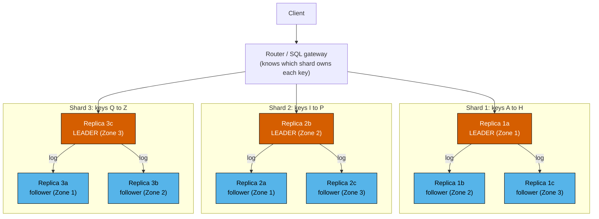
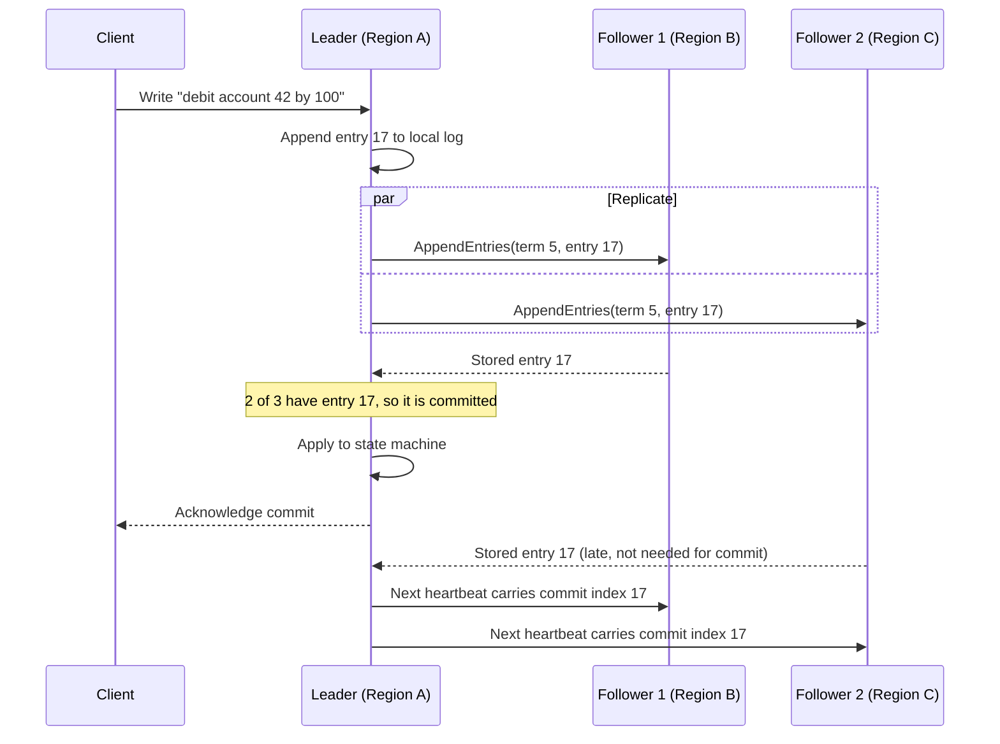
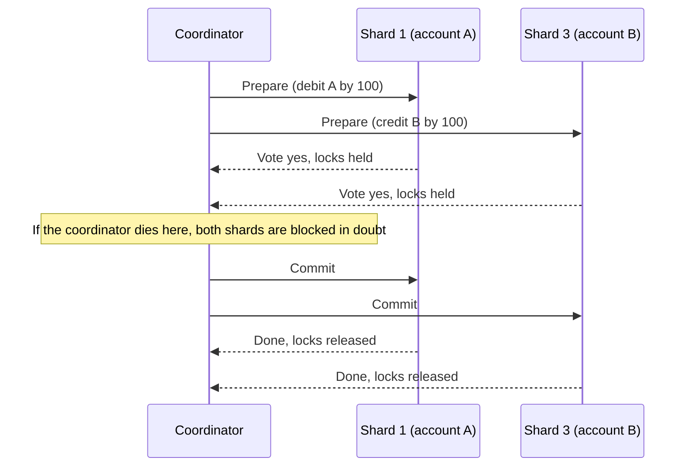
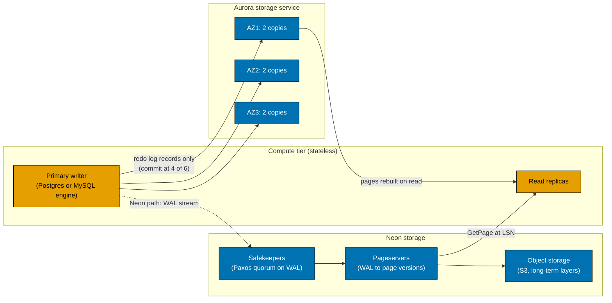
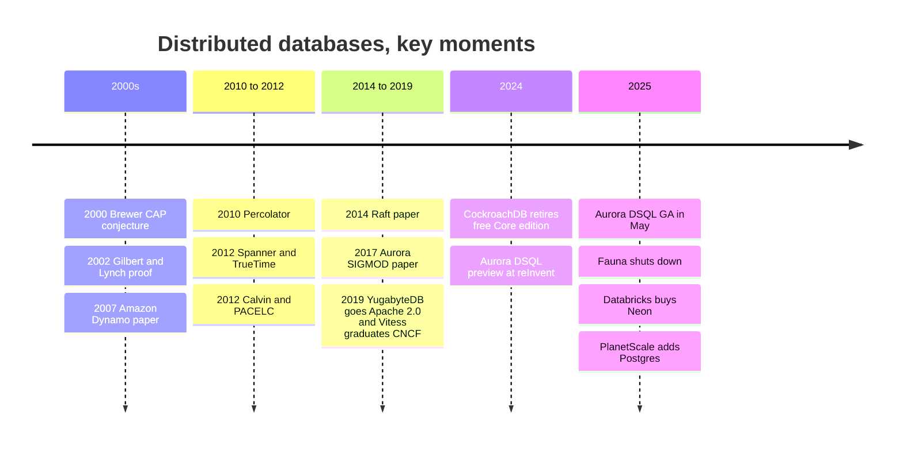

# 4. Distributed Databases
> **Depth:** L2 · **Reading time:** ~11 min · **Last verified:** 2026-11-01 · **Prerequisites:** [Ch 3 — Database Internals](ch03-database-internals.md)

## TL;DR

- A database gets distributed for three reasons. One machine is too small, one machine is a single point of failure, or the data has to live in several places, whether for latency or for legal [data sovereignty](../glossary.md#data-sovereignty). Every distributed design is a trade between those goals and the speed of light.
- Two mechanisms do almost all the work. **[Sharding](../glossary.md#sharding)** splits data so the system can scale. **[Replication](../glossary.md#replication)** copies data so the system can survive failures. Replication is the harder of the two, because copies drift apart ([replication lag](../glossary.md#replication-lag)) unless the system pays to keep them in agreement.
- That agreement is called **[consensus](../glossary.md#consensus)**, and in practice it means [Paxos](../glossary.md#paxos) or [Raft](../glossary.md#raft). A write commits once a majority of replicas has stored it. Five replicas survive two failures, and each write costs one round trip to the nearest majority.
- Transactions that span shards need an atomic-commit protocol on top of consensus. The classic is **[two-phase commit](../glossary.md#two-phase-commit)**, which blocks if the coordinator dies, and a way to order transactions in time. Spanner orders them with GPS and atomic clocks (**[TrueTime](../glossary.md#truetime)**). CockroachDB and YugabyteDB use [hybrid logical clocks](../glossary.md#hybrid-logical-clock). TiDB uses a central timestamp service. Aurora DSQL uses optimistic concurrency plus AWS's microsecond-accurate clock service.
- Business reality: "distributed SQL" or [NewSQL](../glossary.md#newsql) is technically mature but commercially niche next to single-node Postgres. Cockroach Labs ended its free self-hosted Core edition in 2024. Fauna, a Calvin-inspired distributed database service, shut down in 2025, citing capital intensity. Meanwhile the hyperscalers (Spanner, Aurora DSQL) and the "log is the database" disaggregated designs (Aurora, Neon) take a growing share of the value.

## Why this matters (business + Everpure lens)

Payments, ledgers, inventory, identity, telecom subscriber records, gaming wallets and agent memory all need two things at once. The data must stay correct, and the service must stay up through a datacenter outage. Whether a vendor can deliver both, and at what latency, decides real procurement outcomes. It is why banks pay for Spanner or CockroachDB rather than sharding MySQL by hand, and why a "multi-region active-active" claim deserves cross-examination. The CAP theorem, consensus and clock design are the vocabulary of those claims. An executive who can ask "where is the leader, and how many round trips does a commit take?" cuts through most marketing.

For Everpure (formerly Pure Storage; NYSE: P, formerly PSTG), the relevant shift is architectural. Cloud-native operational databases increasingly push durability *down* into a purpose-built storage service. Amazon Aurora pioneered the pattern and Neon (now Databricks Lakebase) copied it. The database tier ships only its [write-ahead log](../glossary.md#write-ahead-log), and storage turns that log into pages. That design makes storage semantics, not the database engine, the source of truth. It is the clearest point where this chapter touches the storage business (see the Storage bridge below, and [Ch 28](../04-company-deep-dives/ch28-hyperscaler-data-platforms.md) and [Ch 29](../04-company-deep-dives/ch29-operational-database-vendors.md) for the vendors).

## How it works

### Why distribute at all

A single well-tuned Postgres server on modern hardware handles a great deal; [Ch 3](ch03-database-internals.md) explains why. There are three reasons to leave it:

1. **Scale.** The working set, write rate or storage outgrows one machine. Writes are the hard part. Reads can be offloaded to replicas, but every write must eventually land on whichever node owns that row.
2. **Availability.** One machine, one rack or one region will fail. Surviving the loss of a whole region requires copies in at least one other region, and usually two (see the majority math below).
3. **Geography and sovereignty.** Users in Frankfurt should not wait on a round trip to Virginia, and some regulators require that certain rows never leave a jurisdiction. That turns *placement* into a schema-level decision.

The constraint underneath all three is physics. Light in optical fibre covers roughly 200 km per millisecond, so a 6,000 km route costs about 60 ms per round trip before any software runs.[^physics] No protocol can beat that. A protocol can only decide *how many* such round trips a commit needs, and *which* users pay for them.

### Partitioning (sharding)

Sharding assigns each row to one of many partitions, and each partition to a node. There are two basic schemes:

- **Hash partitioning** applies a hash function to the key and maps the hash to a shard. Load spreads evenly, but range scans ("all orders for customer 42 last week") touch every shard. Amazon's **Dynamo** paper popularised **[consistent hashing](../glossary.md#consistent-hashing)**, which places nodes and keys on a ring and stores each key on the next node clockwise. Adding a node then moves only about 1/N of the keys rather than reshuffling everything. Dynamo also gives each physical node many "virtual nodes" so load stays even as hardware changes.[^dynamo]
- **Range partitioning** keeps keys sorted and splits them into contiguous ranges. Bigtable, Spanner, CockroachDB, TiKV and YugabyteDB (optionally) all work this way. Range scans stay local, and hot ranges can be split automatically. The cost is that monotonically increasing keys, such as timestamps or auto-increment IDs, send every new write to the *last* range.

That last-range pile-up is a **[hot spot](../glossary.md#hot-spot)**, and hot spots are the most common production failure of sharded systems. One celebrity account, one merchant or one "today" partition can saturate a single node while the rest of the cluster idles. Remedies include hashing or salting the key prefix, splitting hot ranges, and modelling around the hot key (for example, many sub-accounts per merchant). **Resharding**, which means moving data while serving traffic, is where the real engineering effort goes. Systems that split and rebalance ranges automatically, as Spanner and CockroachDB do, remove a large operational burden compared with hand-sharded MySQL. Vitess, YouTube's MySQL sharding layer, exists largely to make that burden manageable.[^vitess]

### Replication

Each shard is copied to several nodes. There are three families of design:

- **Leader–follower (single-leader).** One replica accepts writes and streams its log to followers. This is how Postgres streaming replication and MySQL replication work. Replication can be **synchronous**, where the leader waits for a follower before acknowledging the client (safe, but slower), or **asynchronous**, where the leader acknowledges first and ships later (fast, but a failover can lose acknowledged writes). The gap between leader and follower is **replication lag**. It is why a user can update a profile, refresh the page from a replica, and see the old version.
- **[Multi-leader replication](../glossary.md#multi-leader-replication).** Several replicas, often one per region, accept writes and exchange them. Local writes are fast. The cost is conflicts: two regions can debit the same account at the same moment. "Last writer wins" silently discards one update, which is unacceptable for a ledger.
- **[Leaderless replication](../glossary.md#leaderless-replication)** (Dynamo-style). The client writes to N replicas and treats the write as successful once W acknowledge. It reads from R replicas, and if R + W > N the read set overlaps the latest write set. A common Dynamo configuration was N=3, R=2, W=2. Dynamo also used "sloppy quorums" and hinted handoff to stay writable during failures, at the price of temporarily divergent versions that the application had to reconcile.[^dynamo]

*Figure 4.1 — Sharding provides scale and replication provides survival. Three shards with three replicas each give nine replicas, with each shard's leader placed in a different zone so that write load and failure impact spread evenly.*

> **Bridge: cache coherence (MESI).** Replication lag is the distributed version of a problem chip designers know well. In a multi-core CPU, the MESI protocol keeps cached copies of a line coherent: before a core writes, it must invalidate every other copy, which costs snoop or directory round trips. That is why coherence traffic limits socket counts, and why x86 lets a core's own store sit in a store buffer before other cores see it. The store buffer is asynchronous replication in miniature, and a memory fence is a synchronous commit. Databases face the same choice at milliseconds instead of nanoseconds: pay a round trip on every write for coherent copies, or accept a window in which readers may see stale data.

### Consensus: how replicas agree

Single-leader replication raises an obvious question: who decides who the leader is, and what happens when the leader dies halfway through a write? **Consensus** protocols answer it. They let a group of replicas agree on one ordered log of commands even when some members crash or messages are delayed.

**Paxos** came first. Leslie Lamport's 2001 restatement, *Paxos Made Simple*, describes two phases. In the first, a proposer obtains a promise from a majority of acceptors. In the second, it asks them to accept a value, and a value accepted by a majority is chosen.[^paxos] Production systems run "Multi-Paxos" with a stable leader, so the steady state costs one round trip per write. Spanner shards data across many Paxos groups.[^spanner]

**Raft** (Ongaro and Ousterhout, 2014) was designed to be easier to understand and implement, and it largely succeeded. CockroachDB, TiKV, YugabyteDB and etcd all use it.[^raft] Raft has three parts:

1. **Leader election.** Time is divided into numbered *terms*. Followers that hear nothing from a leader within a randomised timeout become candidates and request votes. A candidate that wins a majority becomes leader for that term, and the randomisation keeps split votes rare.
2. **Log replication.** The leader appends each client command to its log and sends it to followers in AppendEntries messages.
3. **Commit by majority.** Once a majority, counting the leader, has stored the entry, it is *committed*. The leader applies it and answers the client. A candidate can only win election if its log is at least as up-to-date as a majority's, so a new leader always holds every committed entry.

*Figure 4.2 — A Raft commit costs one round trip from the leader to the nearest majority, so the slowest replica does not slow the client. That is why leader placement, not replica count, sets write latency.*

The arithmetic matters. Tolerating *f* crashed replicas takes *2f + 1* of them, so three replicas survive one failure and five survive two. Surviving the loss of a whole region therefore needs at least three regions (or two regions plus a tie-breaking "witness"). Two regions alone cannot keep a majority after either one fails.

> **Bridge: triple modular redundancy.** Fault-tolerant chips for avionics and space use triple modular redundancy (TMR): three copies of a circuit feed a majority voter, so one faulty module is outvoted. Consensus quorums rest on the same 2f + 1 logic, with two differences. First, TMR voters are synchronous and vote on every clock cycle. Consensus has to work over an asynchronous network where a slow replica is indistinguishable from a dead one, which is why it relies on timeouts and terms. Second, TMR masks *wrong* outputs, while Raft and Paxos assume replicas fail only by stopping. Tolerating actively lying (Byzantine) nodes takes 3f + 1 replicas, which is why blockchains are so much more expensive than databases.

### Distributed transactions across shards

Consensus makes *one shard* reliable. A payment that debits account A on shard 1 and credits account B on shard 3 also needs both shards to commit or abort *together*.

**Two-phase commit (2PC)** is the classic answer. A coordinator asks every participant to *prepare*; each one makes the change durable but provisional, holds its locks and votes yes or no. If every vote is yes, the coordinator sends *commit*. The weakness is blocking. If the coordinator crashes after participants vote yes, they cannot safely commit or abort on their own, so they sit "in doubt" with locks held until it recovers. Modern systems remove the blocking by making the coordinator and each participant a consensus group, so a dead machine is simply replaced by a new leader of the same group. Spanner does exactly this: 2PC runs over Paxos groups.[^spanner]

*Figure 4.3 — Two-phase commit adds a round trip and a blocking window. Running each participant and the coordinator as a replicated consensus group, as Spanner does, turns "the coordinator died" from an outage into a leader election.*

The second problem is **ordering in time**. For snapshot reads and serializability, every transaction needs a timestamp that respects real-world order. Machines' clocks disagree, though, and the main systems take four approaches:

- **Spanner's TrueTime.** Each Google datacenter has time masters with GPS receivers and atomic clocks. The TrueTime API returns an *interval* (earliest, latest) rather than a single instant. In the 2012 paper the uncertainty ε swung in a sawtooth between about 1 and 7 ms and averaged about 4 ms.[^spanner] A transaction takes the top of the interval as its commit timestamp, then waits out the uncertainty ("commit wait") before releasing its locks. The result is **[external consistency](../glossary.md#external-consistency)**: if T1 commits before T2 starts in real time, T1's timestamp is smaller, worldwide. The cost is a few milliseconds of waiting per write transaction, plus special hardware.
- **Hybrid logical clocks (HLC).** CockroachDB and YugabyteDB combine ordinary NTP-synchronised physical time with a logical counter that moves forward whenever a node sees a message with a later timestamp.[^hlc] No special hardware is needed. Instead the system assumes a *maximum clock offset* (500 ms by default in CockroachDB). A read that encounters a value inside its uncertainty window may have to restart.[^crdb-clock] The price is occasional retries and a guarantee slightly weaker than Spanner's for transactions that share no data. The benefit is that it runs on any cloud.
- **A central timestamp oracle.** Google's Percolator, built for incremental web indexing, ran 2PC over Bigtable with timestamps from one oracle service.[^percolator] TiDB adopted the model. Its Placement Driver (PD), itself replicated with Raft, hands out strictly increasing timestamps in batches.[^tikv-tso] This is simple and correct, but in a multi-region deployment every transaction makes a round trip to wherever the oracle's leader sits.
- **Deterministic ordering (Calvin).** Calvin (Yale, 2012) agrees on the *order of transaction inputs* first, using one consensus round per batch. Every replica then executes the batch deterministically, with no 2PC.[^calvin] That removes commit-time coordination but needs each transaction's read and write sets known in advance. Its best-known commercial descendant, Fauna, shut its service down in May 2025.[^fauna]

Amazon's **Aurora DSQL** combines several of these ideas. Transactions run optimistically without locks. At commit, a set of *adjudicators* checks for conflicts, and a replicated *journal* makes the commit durable. Snapshot reads use the AWS Time Sync Service, which AWS says is accurate to microseconds.[^dsql-arch] Reads stay local, and coordination happens once, at commit. On a hot key that design converts lock waits into aborts and client retries.

> **Bridge: TrueTime and GPS-disciplined oscillators.** TrueTime is datacenter timing practice turned into a database guarantee. Telecom and exchange datacenters already discipline a quartz or rubidium oscillator to GPS, and they distribute time over PTP (IEEE 1588) with hardware timestamping in the NICs to get sub-microsecond agreement. Spanner's ε sawtooth is oscillator holdover drift: between synchronisation polls the local clock's bound widens at an assumed worst-case drift rate, then snaps back when it resyncs.[^spanner] Better timing hardware shrinks ε directly, and a smaller ε means less commit wait. That link explains why AWS's microsecond-class time service is a building block for Aurora DSQL, and why clock quality has become a database feature.

### CAP, PACELC and consistency models

The **[CAP theorem](../glossary.md#cap-theorem)** began as Eric Brewer's 2000 conjecture and was proved by Gilbert and Lynch in 2002. It says that when the network *partitions*, a replicated system must choose between consistency (every read sees the latest write, formally linearizability) and availability (every request to a live node gets an answer).[^gilbert-lynch] Brewer later stressed that partitions are rare, and that the choice is made only during them.[^brewer12] Daniel Abadi's **[PACELC](../glossary.md#pacelc)** formulation adds the case that matters every day. If there is a Partition, choose Availability or Consistency; Else, choose Latency or Consistency.[^abadi] Even with a perfect network, synchronous agreement costs round trips.

| System | If partitioned (PA / PC) | Else (EL / EC) | What it means in practice |
|---|---|---|---|
| Amazon Dynamo (2007 paper) | PA | EL | Always writable; conflicting versions reconciled later by the application[^abadi] |
| Apache Cassandra (default tunables) | PA | EL | Tunable quorums; lightweight transactions available at extra cost[^abadi] |
| Riak | PA | EL | Dynamo descendant[^abadi] |
| MongoDB (Abadi's classification, default config) | PA | EC | Single primary per shard; behaviour depends heavily on write concern settings[^abadi] |
| Yahoo PNUTS | PC | EL | Per-record master; replicas may serve stale reads[^abadi] |
| VoltDB / H-Store | PC | EC | Strongly consistent, in-memory, partitioned[^abadi] |
| Google Spanner | PC | EC | Paxos majority plus commit wait; minority side becomes unavailable[^spanner] |
| CockroachDB / YugabyteDB | PC | EC | Raft majority per range or tablet; follower reads optional for bounded staleness |
| TiDB | PC | EC | Raft per region plus central timestamp oracle[^tikv-tso] |
| Aurora DSQL | PC | EC | Strong consistency across Regions; cost paid at commit[^dsql-ga] |
| Postgres primary plus async replicas | Choice made at failover | EL | Promoting a lagging replica restores availability but can lose acknowledged writes |

*Figure 4.4 — The interesting column is "Else". Most NewSQL systems are PC/EC: they spend latency on every commit, every day, to avoid anomalies during the rare partition. Classifications are for default configurations; most systems are tunable.*

**Consistency models** describe what readers may observe. From strongest to weakest:

- **[Linearizable](../glossary.md#linearizability):** every operation appears to take effect at one instant between its start and finish, matching real time. Spanner's external consistency extends this to multi-row transactions.
- **Sequential:** all clients see operations in the same order, and each client's own operations stay in program order, but that order need not match real time.
- **Causal:** if one operation could have influenced another (I read your post, then reply), everyone sees them in that order. Unrelated operations may appear in different orders in different places.
- **[Eventual](../glossary.md#eventual-consistency):** if writes stop, replicas converge eventually. Nothing is promised about what a reader sees in the meantime.

Each step down removes coordination, and therefore latency. Most bugs come from developers assuming a stronger model than the system actually provides.

### Disaggregation: "the log is the database"

A different branch of the family tree keeps a *single* writer but distributes the *storage*. Amazon Aurora (SIGMOD 2017) observed that a traditional database writes the same data several times: log, pages, double-write buffer and replicas. Aurora's compute node writes **only redo log records** to a distributed storage service. Storage keeps six copies across three Availability Zones, acknowledges a write once four of the six hold it, and allows reads from three. Storage nodes, not the database, rebuild pages from the log on demand.[^aurora] That quorum survives losing a whole zone plus one more node for reads, without any consensus traffic between database instances. Neon applies the same idea to open-source Postgres. *Safekeepers* store the WAL durably using Paxos, *pageservers* turn it into versioned pages, and cold data goes to object storage such as S3. Compute becomes stateless and can scale to zero, which lets a project branch a database by pointing at an earlier log position.[^neon]

*Figure 4.5 — In disaggregated designs the compute tier ships only its log, and the storage service owns durability, replication and page materialisation. The database's hardest job thus moves into a storage system.*

## Worked example: a payments ledger across three regions

Take a wallet provider with users in the US East, US West and EU West regions. It processes 5,000 payments per second, and each payment debits one account and credits another. Assume round-trip times of roughly 65 ms East–West, 75 ms East–EU and 135 ms West–EU (estimates in line with fibre distances[^physics]). The invariant is simple: no balance may go negative, and no acknowledged payment may be lost.

| Approach | Commit latency seen by an EU user | Region loss: data at risk | Can it protect "no negative balance"? |
|---|---|---|---|
| Single primary in US East, async replicas | ~75 ms (one round trip to the primary) | Everything inside the lag window. At 200 ms lag × 5,000/s ≈ 1,000 acknowledged payments | Yes until failover; after a lossy failover, balances can be wrong |
| Single primary, synchronous replica in US West | ~75 + 65 ≈ 140 ms | None (RPO zero), but availability drops if the replica region is down | Yes |
| Multi-leader, one writer per region | Local, a few ms | Small async window | **No.** Concurrent debits in two regions can overdraw an account; last-writer-wins drops money |
| Leaderless quorum, N=3 across regions, W=2 | ~75 ms (nearest other region) | None for writes that reached W | Not on its own; needs per-key compare-and-set or Paxos-based lightweight transactions |
| Raft or Paxos per shard, leaders in US East (CockroachDB, YugabyteDB, Spanner) | ~75 ms to reach the leader + ~65 ms leader-to-majority ≈ 140 ms; add commit wait on Spanner, plus 2PC round trips when the two accounts sit on different shards | None | Yes, serializable |
| Same, but leaders placed in each account's home region ("regional by row") | Local user: ~65–75 ms (one majority round trip); cross-region transfer: more | None | Yes |
| Optimistic, multi-Region (Aurora DSQL) | Reads local; one cross-region round at commit | None for committed transactions | Yes; hot accounts abort and retry under contention |

*Figure 4.6 — Correctness in three regions costs at least one cross-region round trip per commit. The only question is which users pay it, and whether the failure mode is "slow" or "wrong".*

The executive conclusion: **every option that keeps the ledger correct puts 60–140 ms of physics into the commit path for some users.** The cheaper options are not faster versions of the same thing. They give up the invariant. The engineering skill lies in placement. Put each account's leader near its owner, keep most payments within a region, and treat the merchant who receives 10% of all credits as a modelling problem (split its balance into many sub-accounts) rather than a database problem. A hot account is a hot spot under any protocol.

## Design choices and trade-offs

| Choice | Option A | Option B | Steelman for the "weaker" option |
|---|---|---|---|
| Partitioning | Hash: even load, poor range scans | Range: local scans, hot tails on sequential keys | Hash with consistent hashing makes rebalancing nearly free, which suits key-value workloads |
| Replication timing | Synchronous: no lost writes, slower | Asynchronous: fast, lossy failover | Most businesses tolerate seconds of loss for the rare regional failure in exchange for lower latency and cost every day |
| Write topology | Single leader per shard | Multi-leader or leaderless | Collaborative or append-only data (carts, likes, CRDT documents) merges without conflict and gains local writes |
| Clock | TrueTime (hardware-backed) | HLC or central oracle | HLC runs on any cloud with no special hardware; the oracle is simple and fast within one region |
| Concurrency | Pessimistic locks | Optimistic (DSQL) | Optimistic avoids lock round trips and wins when conflicts are rare |
| Architecture | Shared-nothing distributed SQL | Single writer + disaggregated storage (Aurora, Neon) | One writer covers the great majority of applications; disaggregation adds fast failover, branching and scale-to-zero without distributed-transaction complexity |

*Figure 4.7 — Distributed design is a menu of round trips. Each "stronger" option buys correctness or global scale with latency, cost or operational complexity.*

## Who's who

| System (owner) | Consensus | Clock approach | SQL dialect | License | Deployment | Notable users (public) |
|---|---|---|---|---|---|---|
| Google Spanner | Paxos per split | TrueTime (GPS + atomic clocks) | GoogleSQL; PostgreSQL interface `[VERIFY: current PG-dialect feature coverage]` | Proprietary | Google Cloud managed | Google's F1 advertising backend[^spanner] |
| CockroachDB (Cockroach Labs) | Raft per range | HLC, max-offset bound | PostgreSQL wire-compatible | CockroachDB Enterprise (source-available); free tier for firms under $10M revenue since Nov 2024[^crdb-license] | Self-hosted; CockroachDB Cloud | Netflix (380+ clusters, vendor-reported), Hard Rock Digital[^crdb-netflix] |
| YugabyteDB (Yugabyte) | Raft per tablet | HLC | PostgreSQL-compatible (YSQL) plus Cassandra-like YCQL | Apache 2.0 database since 2019; management tooling under Polyform[^yb-license] | Self-hosted; managed cloud | Kroger, Paramount+ (vendor case studies)[^yb-customers] |
| TiDB (PingCAP) | Raft per region (TiKV) | Central timestamp oracle in PD (Percolator model) | MySQL-compatible | Apache 2.0[^tikv-tso] | Self-hosted; TiDB Cloud | Pinterest (HBase migration, vendor case study)[^tidb-pinterest] |
| Aurora DSQL (AWS) | Replicated journal; optimistic adjudication `[VERIFY: AWS-documented replication protocol]` | AWS Time Sync Service (microsecond-class) | PostgreSQL-compatible subset | Proprietary | AWS serverless; GA May 2025[^dsql-ga] | No flagship public reference found `[VERIFY]` |
| Vitess / PlanetScale | None global; MySQL replication per shard | None global (per-shard MySQL) | MySQL | Vitess Apache 2.0, CNCF-graduated; PlanetScale is a commercial service[^vitess] | Self-hosted Vitess; PlanetScale cloud (also Postgres since 2025)[^planetscale] | YouTube (origin of Vitess)[^vitess] |

*Figure 4.8 — The NewSQL field splits on two axes: whose clock and whose cloud. Spanner and DSQL are hyperscaler-only, while CockroachDB, YugabyteDB and TiDB run anywhere, and Postgres or MySQL compatibility decides most migrations.*

How each one positions itself:

- **Spanner** is the reference design and the only one with hardware-backed global time. It is the natural choice inside Google Cloud and ties the customer to it.
- **CockroachDB** is the most mature cloud-neutral, Postgres-flavoured distributed SQL database, with strong multi-region placement features. The 2024 licence change means large self-hosted users must now pay, and the company argues that this funds development.[^crdb-license]
- **YugabyteDB** competes on deeper Postgres compatibility (it reuses Postgres's query layer) and a permissive licence.
- **TiDB** brings the MySQL ecosystem and adds TiFlash columnar replicas for hybrid transactional-analytical (HTAP) queries (see [Ch 5](ch05-analytical-engines.md)). It is strongest in Asia and among large internet companies.
- **Aurora DSQL** is AWS's serverless entry: no servers to size, optimistic concurrency, and multi-Region strong consistency. AWS markets it as "the fastest distributed SQL database"; that is a company claim.[^dsql-ga] It also states availability design targets of 99.99% in one Region and 99.999% across Regions.[^dsql-ga] Its Postgres compatibility is a subset, so check the feature gaps before planning a migration.
- **Vitess and PlanetScale** shard MySQL rather than replace it. PlanetScale has since added a Postgres service on local-NVMe "Metal" nodes, betting that many teams want a fast single-writer Postgres more than distributed transactions.[^planetscale]
- **Neon and Aurora** stand for the disaggregated single-writer alternative. Neon was acquired by Databricks for about $1B (press-reported, announced May 2025) and now ships as Lakebase.[^neon-deal] The [Postgres renaissance](../03-ai-data-stack/ch22-agents-and-data.md) runs mostly through this branch, not through distributed SQL.

**Adoption reality.** Developers overwhelmingly choose plain Postgres. Secondary write-ups of the 2025 Stack Overflow Developer Survey put PostgreSQL usage at about 55.6% of respondents, the highest of any database.[^so2025] Distributed SQL wins where a single writer truly cannot cope or a regional outage is unacceptable: payments, gaming, telecom, very large SaaS. Elsewhere teams scale vertically, add read replicas and shard late. The funding record shows the strain. Cockroach Labs' last confirmed priced round was $278M at a $5B valuation (press-reported, December 2021), with no later round found.[^crdb-series-f] Fauna's leadership said a global database service was too capital-intensive to keep funding independently (press-reported).[^fauna]

## History and trajectory

*Figure 4.9 — The theory was settled by 2014. Since then the story has been commercial: hyperscalers productised the ideas while independent vendors tightened licences or exited.*

The intellectual arc runs from impossibility results to engineering. CAP (2000–2002)[^gilbert-lynch] first gave the NoSQL wave of Dynamo, Cassandra and Riak permission to drop consistency for availability.[^dynamo] Spanner (2012) then showed that global consistency was affordable with good clocks.[^spanner] Raft (2014) made consensus implementable by ordinary teams, which seeded CockroachDB, TiDB and YugabyteDB.[^raft] Aurora (2017) showed a parallel path: keep one writer and distribute the storage.[^aurora]

The commercial arc is less tidy. Cockroach Labs moved from Apache 2.0 to the Business Source License in 2019. In August 2024 it announced that the free self-hosted Core edition would end. From version 24.3 (November 2024) there is a single Enterprise licence, free for individuals, students and businesses under $10M in annual revenue, with mandatory telemetry for free users.[^crdb-license] YugabyteDB went the other way in 2019 and made the database fully Apache 2.0.[^yb-license] AWS took Aurora DSQL from preview at re:Invent 2024 to GA on 27 May 2025, in eight Regions at launch.[^dsql-ga] The trajectory to watch is consolidation. Hyperscalers bundle distributed SQL into their clouds, data platforms buy Postgres companies (Neon, Crunchy Data; see [Ch 29](../04-company-deep-dives/ch29-operational-database-vendors.md)), and independent vendors must justify their price against "Postgres plus a good failover plan."

## Numbers that matter

| Metric | Value | Basis | Source / date |
|---|---|---|---|
| Replicas needed to survive *f* crash failures | 2f + 1 (3 for 1, 5 for 2) | Protocol property | Raft, 2014[^raft] |
| TrueTime uncertainty ε | ~1–7 ms sawtooth, ~4 ms typical | Paper-reported (2012) | Spanner OSDI 2012[^spanner] |
| Aurora storage quorum | 6 copies / 3 AZs; write 4 of 6, read 3 of 6 | Paper-reported | Aurora SIGMOD 2017[^aurora] |
| CockroachDB default max clock offset | 500 ms | Vendor documentation / blog | Cockroach Labs[^crdb-clock] |
| Fibre propagation | ~200 km per ms (≈1 ms RTT per 100 km) | Estimate (physics) | [^physics] |
| Aurora DSQL GA | 27 May 2025; 8 Regions at launch | Company-stated | AWS[^dsql-ga] |
| Aurora DSQL availability design target | 99.99% single-Region; 99.999% multi-Region | Company-stated | AWS[^dsql-ga] |
| CockroachDB Enterprise Free eligibility | Annual revenue under $10M | Company-stated | Cockroach Labs, 2024[^crdb-license] |
| Cockroach Labs last confirmed round | $278M Series F at $5B post-money (Dec 2021) | Press-reported | CNBC 2021-12-16[^crdb-series-f] |
| Databricks–Neon | ~$1B (announced May 2025) | Press-reported | TechRepublic[^neon-deal] |
| Netflix CockroachDB footprint | 380+ clusters | Vendor-reported | Cockroach Labs, RoachFest 2024[^crdb-netflix] |
| PostgreSQL usage, Stack Overflow 2025 survey | ~55.6% of respondents | Press-reported (secondary write-ups) `[VERIFY: against official survey page]` | [^so2025] |

*Figure 4.10 — The numbers that set behaviour are round trips, quorum sizes and clock bounds, not node counts.*

## Storage bridge

> **Storage bridge.** "The log is the database" designs (Aurora, Neon/Lakebase, and to a degree Aurora DSQL's journal) make the *storage service* responsible for durability, quorum replication, page materialisation, snapshots and backup. These were the jobs enterprise arrays used to perform underneath the database. The database vendor now owns that layer, and it is log-aware and runs on cloud object storage. For a storage company, options a strategy team might evaluate, based on public information, include: log-structured, quorum-replicated block or object services for self-managed Postgres disaggregation; snapshot and branching integration with Postgres-family databases; and positioning on-prem object storage as the "cold layer" target that Neon-style pageservers expect. See the companion *Everpure Tech Atlas* for replication and snapshot mechanics.

## Conversation playbook

**Questions for product managers**

1. "In a three-region deployment, where do leaders live by default, and what does a write cost from the farthest region, in round trips and in milliseconds?"
2. "What fraction of your customers actually run multi-region active-active in production, versus single-region with disaster recovery?"
3. "How does your licence or pricing treat a customer who self-hosts at scale, and what changed in the last two years?"

**Questions for engineers**

1. "What isolation level is the default, and is it strictly serializable or just serializable? Which anomaly can I still see?"
2. "How do you order transactions in time (TrueTime, HLC, oracle or optimistic), and what happens when a node's clock drifts past the bound?"
3. "What happens to an in-flight cross-shard transaction when the coordinator's node dies? Has a Jepsen-style test covered it?"[^jepsen-tidb]

**What good answers sound like.** They give numbers ("one majority round trip, about 65 ms between our US regions, and 2PC adds one more when shards differ"). They admit trade-offs ("hot keys abort and retry under our optimistic model, so we recommend splitting high-contention accounts"). They point to independent testing and to named production references with their topologies.

**Don't say this**

- "CAP means you pick two of three." Partitions are not optional. The real choice is what happens *during* one, and PACELC's latency-versus-consistency trade applies the rest of the time.
- "Active-active multi-region means zero latency penalty." Physics forbids it for strongly consistent writes. Someone pays a cross-region round trip.
- "Spanner needs atomic clocks, so nobody else can be consistent." HLC and oracle systems are consistent too. They differ in the edge-case guarantee for unrelated transactions and in how they pay for it (retries versus commit wait).
- "Distributed SQL is replacing Postgres." Postgres's developer share is still growing. Most "Postgres at scale" today means a single writer on disaggregated storage, not distributed transactions.
- "CockroachDB is open source." Since November 2024 it is source-available under an enterprise licence with a free tier.[^crdb-license]

## Going deeper

> **Going deeper (L3).** Read Spanner §4 (TrueTime and commit wait) alongside the Raft paper's §5 (safety argument).[^spanner][^raft] Then read Aurora's 2018 follow-up on avoiding consensus for I/O and membership changes. For failure-mode reality, Jepsen's analyses (for example TiDB 2.1.7) show how real systems violated their stated guarantees and how vendors fixed them.[^jepsen-tidb] For HLC and the uncertainty-restart mechanism, see Kulkarni et al. and Cockroach Labs' clock-management write-up.[^hlc][^crdb-clock] AWS's "Everything you don't need to know about Aurora DSQL" series explains the adjudicator, journal and time-sync split.[^dsql-arch]

## Key terms

- [Sharding](../glossary.md#sharding) — splitting a dataset into partitions that live on different nodes so capacity scales out.
- [Consistent hashing](../glossary.md#consistent-hashing) — placing nodes and keys on a hash ring so adding or removing a node moves only a small share of keys.
- [Hot spot](../glossary.md#hot-spot) — a shard or key that receives disproportionate traffic and limits the whole cluster.
- [Replication](../glossary.md#replication) — keeping copies of data on several nodes for durability and availability.
- [Replication lag](../glossary.md#replication-lag) — the delay between a write on the leader and its appearance on a replica.
- [Multi-leader replication](../glossary.md#multi-leader-replication) — several replicas accept writes and exchange them, so conflicts must be resolved.
- [Leaderless replication](../glossary.md#leaderless-replication) — clients write to and read from quorums of replicas directly (Dynamo-style).
- [Quorum](../glossary.md#quorum) — the minimum number of replicas that must acknowledge an operation, usually a majority.
- [Consensus](../glossary.md#consensus) — a protocol by which replicas agree on one ordered log despite failures.
- [Paxos](../glossary.md#paxos) — Lamport's consensus protocol; the basis of Spanner and many Google systems.
- [Raft](../glossary.md#raft) — an understandable consensus protocol with leader election, log replication and majority commit.
- [Two-phase commit](../glossary.md#two-phase-commit) — an atomic-commit protocol (prepare, then commit) that blocks if the coordinator fails.
- [TrueTime](../glossary.md#truetime) — Google's clock API that returns a bounded time interval backed by GPS and atomic clocks.
- [External consistency](../glossary.md#external-consistency) — transaction order matches real-time order worldwide; Spanner's guarantee.
- [Hybrid logical clock](../glossary.md#hybrid-logical-clock) — a timestamp combining physical time with a logical counter, used by CockroachDB and YugabyteDB.
- [Timestamp oracle](../glossary.md#timestamp-oracle) — a central service issuing strictly increasing transaction timestamps (Percolator, TiDB).
- [Optimistic concurrency control](../glossary.md#optimistic-concurrency-control) — transactions run without locks and are checked for conflicts at commit.
- [CAP theorem](../glossary.md#cap-theorem) — under a network partition a replicated system must choose consistency or availability.
- [PACELC](../glossary.md#pacelc) — extends CAP: else (no partition), choose latency or consistency.
- [Linearizability](../glossary.md#linearizability) — every operation appears to happen at a single instant consistent with real time.
- [Eventual consistency](../glossary.md#eventual-consistency) — replicas converge if writes stop, with no guarantee in between.
- [NewSQL](../glossary.md#newsql) — distributed databases offering SQL and ACID transactions at horizontal scale (also "distributed SQL").
- [Disaggregated storage](../glossary.md#disaggregated-storage) — separating stateless compute from a shared storage service; in Aurora and Neon, storage consumes the log.
- [Data sovereignty](../glossary.md#data-sovereignty) — legal requirements that certain data stay within a jurisdiction.
- [Write-ahead log](../glossary.md#write-ahead-log) — the append-only record of changes written before data pages; see Ch 3.

## Sources

[^physics]: Estimate from physics: light in silica fibre travels at about two-thirds of c (≈200,000 km/s, i.e., ≈200 km per ms one-way, ≈1 ms round trip per 100 km); real routes add path length and switching delay. Inter-region RTTs in the worked example are estimates, not measured values. Author's estimate; retrieved 2026-11-01.
[^dynamo]: G. DeCandia et al., "Dynamo: Amazon's Highly Available Key-value Store," SOSP 2007, https://www.allthingsdistributed.com/files/amazon-dynamo-sosp2007.pdf, published 2007-10; retrieved 2026-11-01.
[^vitess]: Cloud Native Computing Foundation, "CNCF announces Vitess graduation," https://www.cncf.io/announcements/2019/11/05/cloud-native-computing-foundation-announces-vitess-graduation/, published 2019-11-05; retrieved 2026-11-01. (Vitess originated at YouTube; Apache 2.0.)
[^paxos]: L. Lamport, "Paxos Made Simple," ACM SIGACT News 32(4), https://lamport.azurewebsites.net/pubs/paxos-simple.pdf, published 2001-12; retrieved 2026-11-01.
[^spanner]: J. C. Corbett et al., "Spanner: Google's Globally-Distributed Database," OSDI 2012, https://www.usenix.org/conference/osdi12/technical-sessions/presentation/corbett (paper copy: https://courses.cs.duke.edu/spring15/cps210/readings/spanner-osdi2012.pdf), published 2012-10; retrieved 2026-11-01.
[^raft]: D. Ongaro and J. Ousterhout, "In Search of an Understandable Consensus Algorithm," USENIX ATC 2014, https://www.usenix.org/conference/atc14/technical-sessions/presentation/ongaro, published 2014-06; retrieved 2026-11-01.
[^hlc]: S. Kulkarni et al., "Logical Physical Clocks and Consistent Snapshots in Globally Distributed Databases," University at Buffalo tech report / OPODIS 2014, https://cse.buffalo.edu/tech-reports/2014-04.pdf, published 2014; retrieved 2026-11-01.
[^crdb-clock]: Cockroach Labs, "Clock management in CockroachDB" (blog), https://www.cockroachlabs.com/blog/clock-management-cockroachdb/, published n.d.; and CockroachDB v20.1 docs, "Common errors," https://www.cockroachlabs.com/docs/v20.1/common-errors, n.d.; retrieved 2026-11-01.
[^percolator]: D. Peng and F. Dabek, "Large-scale Incremental Processing Using Distributed Transactions and Notifications," OSDI 2010, https://www.usenix.org/conference/osdi10/large-scale-incremental-processing-using-distributed-transactions-and-notifications, published 2010-10; retrieved 2026-11-01.
[^tikv-tso]: TiKV project, "Timestamp Oracle" (deep dive), https://tikv.org/deep-dive/distributed-transaction/timestamp-oracle/, n.d.; PingCAP docs, "TimeStamp Oracle (TSO) in TiDB," https://docs.pingcap.com/tidb/dev/tso/, n.d.; licence per dbdb.io, https://dbdb.io/db/tidb/revisions/9; retrieved 2026-11-01.
[^calvin]: A. Thomson et al., "Calvin: Fast Distributed Transactions for Partitioned Database Systems," SIGMOD 2012, https://cs.yale.edu/homes/thomson/publications/calvin-sigmod12.pdf, published 2012-05; retrieved 2026-11-01.
[^fauna]: InfoWorld, "Fauna to shut down FaunaDB service in May," https://www.infoworld.com/article/3853569/fauna-to-shut-down-faunadb-service-in-may.html, published 2025-03; Fauna, "Fauna Service End of Life FAQ," https://docs.fauna.com/fauna/current/eol-faq, published 2025; retrieved 2026-11-01.
[^dsql-arch]: AWS Database Blog, "Everything you don't need to know about Amazon Aurora DSQL: Part 2 – Shallow view," https://aws.amazon.com/blogs/database/everything-you-dont-need-to-know-about-amazon-aurora-dsql-part-2-shallow-view, published 2025; retrieved 2026-11-01.
[^dsql-ga]: AWS, "Amazon Aurora DSQL is now generally available" (What's New), https://aws.amazon.com/about-aws/whats-new/2025/05/amazon-aurora-dsql-generally-available, published 2025-05-27; AWS press release via Business Wire, https://www.businesswire.com/news/home/20250527678337/en, published 2025-05-27; retrieved 2026-11-01.
[^gilbert-lynch]: S. Gilbert and N. Lynch, "Brewer's Conjecture and the Feasibility of Consistent, Available, Partition-Tolerant Web Services," ACM SIGACT News 33(2), https://dl.acm.org/doi/10.1145/564585.564601, published 2002-06; retrieved 2026-11-01.
[^brewer12]: E. Brewer, "CAP Twelve Years Later: How the 'Rules' Have Changed," IEEE Computer (republished by InfoQ), https://www.infoq.com/articles/cap-twelve-years-later-how-the-rules-have-changed/, published 2012-05; retrieved 2026-11-01.
[^abadi]: D. Abadi, "Consistency Tradeoffs in Modern Distributed Database System Design," IEEE Computer 45(2), https://www.cs.umd.edu/~abadi/papers/abadi-pacelc.pdf, published 2012-02; retrieved 2026-11-01.
[^aurora]: A. Verbitski et al., "Amazon Aurora: Design Considerations for High Throughput Cloud-Native Relational Databases," SIGMOD 2017, https://pdos.csail.mit.edu/6.824/papers/aurora.pdf, published 2017-05; retrieved 2026-11-01. See also W. Vogels, "Amazon Aurora ascendant," https://www.allthingsdistributed.com/2019/03/amazon-aurora-design-cloud-native-relational-database.html, published 2019-03.
[^neon]: Neon, "Neon architecture" (docs), https://neon.tech/docs/introduction/architecture-overview, n.d.; Neon blog, "Get page at LSN," https://neon.com/blog/get-page-at-lsn, n.d.; retrieved 2026-11-01.
[^crdb-license]: Cockroach Labs, "Enterprise license update," https://cockroachlabs.com/enterprise-license-update, published 2024-08-15; SiliconANGLE, "Cockroach Labs changes self-hosting license to single enterprise model," https://siliconangle.com/2024/08/15/cockroach-labs-changes-self-hosting-license-single-enterprise-model/, published 2024-08-15; The Register, https://www.theregister.com/2024/08/19/cockroachdb_abandons_open_core/, published 2024-08-19; It's FOSS (licence history, telemetry), https://itsfoss.com/news/cockcroachdb-no-open-source/, published 2024-08; retrieved 2026-11-01.
[^crdb-netflix]: Cockroach Labs, "Netflix DBaaS: RoachFest24 recap," https://www.cockroachlabs.com/blog/netflix-dbaas-roachfest24-recap/, published 2024; Cockroach Labs, "Hard Rock Digital" case study, https://cockroachlabs.com/customers/hard-rock-digital, n.d.; retrieved 2026-11-01. Vendor-reported.
[^yb-license]: Yugabyte, "Why We Changed YugabyteDB Licensing to 100% Open Source," https://www.yugabyte.com/blog/why-we-changed-yugabyte-db-licensing-to-100-open-source/, published 2019-07; TDWI, https://tdwi.org/Articles/2019/07/16/YugaByte-Open-Source.aspx, published 2019-07-16; retrieved 2026-11-01.
[^yb-customers]: Yugabyte, "Success stories," https://www.yugabyte.com/success-stories, n.d.; Yugabyte, "Kroger Customer Success Story," https://www.yugabyte.com/wp-content/uploads/2022/08/Kroger-Customer-Success-Story.pdf, published 2022-08; retrieved 2026-11-01. Vendor-reported.
[^tidb-pinterest]: PingCAP, "Pinterest lowers infrastructure costs 80% with TiDB" (case study), https://www.pingcap.com/case-study/pinterest-lowers-infrastructure-costs-80-with-tidb/, n.d.; PingCAP event page, https://www.pingcap.com/event/how-pinterest-used-tidb-to-modernize-their-hbase-workloads/, n.d.; retrieved 2026-11-01. Vendor-reported.
[^planetscale]: PlanetScale, "PlanetScale for Postgres is now GA," https://planetscale.com/blog/planetscale-for-postgres-is-generally-available, published 2025; InfoQ, "PlanetScale Metal Postgres," https://infoq.com/news/2025/10/planetscale-metal-postgres, published 2025-10; retrieved 2026-11-01.
[^neon-deal]: TechRepublic, "Databricks to Acquire Neon in $1 Billion Deal," https://www.techrepublic.com/article/news-databricks-neon-acquisition/, published 2025-05-15; retrieved 2026-11-01 (matches `data/ma_deals.csv`).
[^so2025]: Secondary write-ups of the Stack Overflow 2025 Developer Survey: data-bene.io, "Most Desired Database Three Years Running," https://www.data-bene.io/en/blog/most-desired-database-three-years-running-postgresqls-developer-appeal/, published 2025; Vonng, "PostgreSQL in the 2025 SO survey," https://blog.vonng.com/en/pg/so2025-pg/, published 2025; retrieved 2026-11-01. Official survey page not retrieved; sources disagree on whether 55.6% is all respondents or professionals.
[^crdb-series-f]: CNBC, "Software start-up Cockroach Labs doubles valuation in latest funding," https://www.cnbc.com/2021/12/16/software-start-up-cockroach-labs-doubles-valuation-in-latest-funding.html, published 2021-12-16; retrieved 2026-11-01 (matches `data/private_funding.csv`).
[^jepsen-tidb]: Jepsen (K. Kingsbury), "TiDB 2.1.7," https://jepsen.io/analyses/tidb-2.1.7, published 2019; retrieved 2026-11-01.
