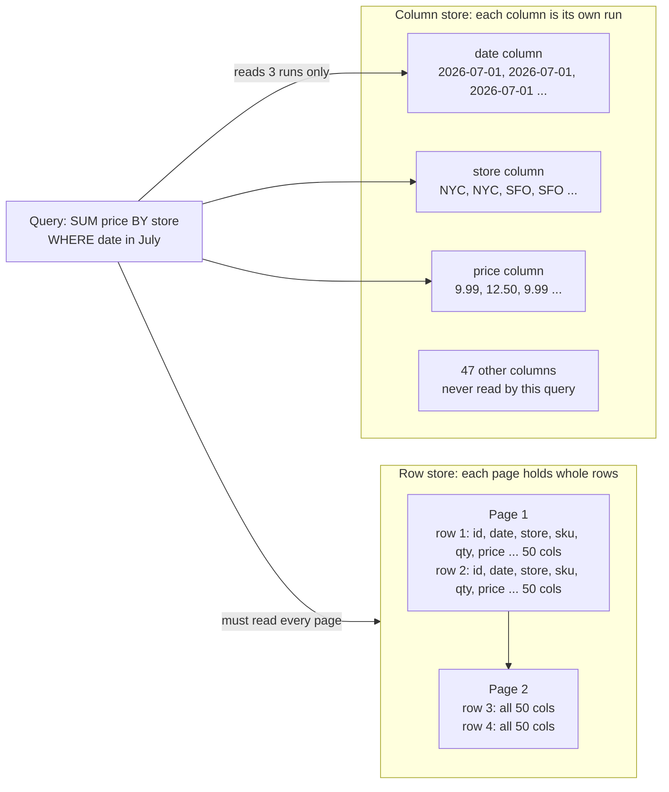
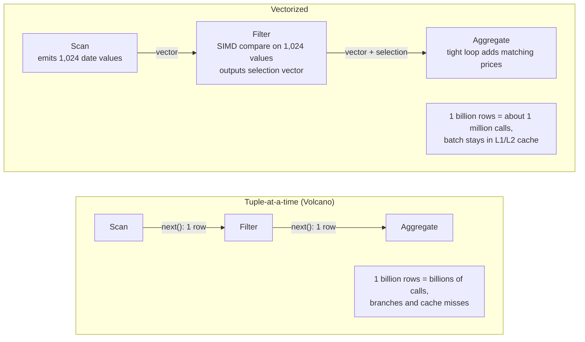
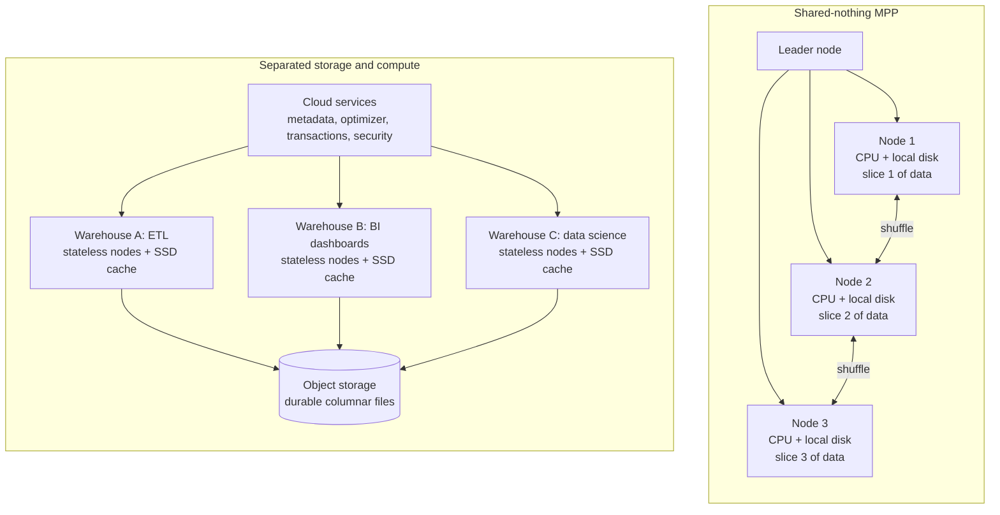
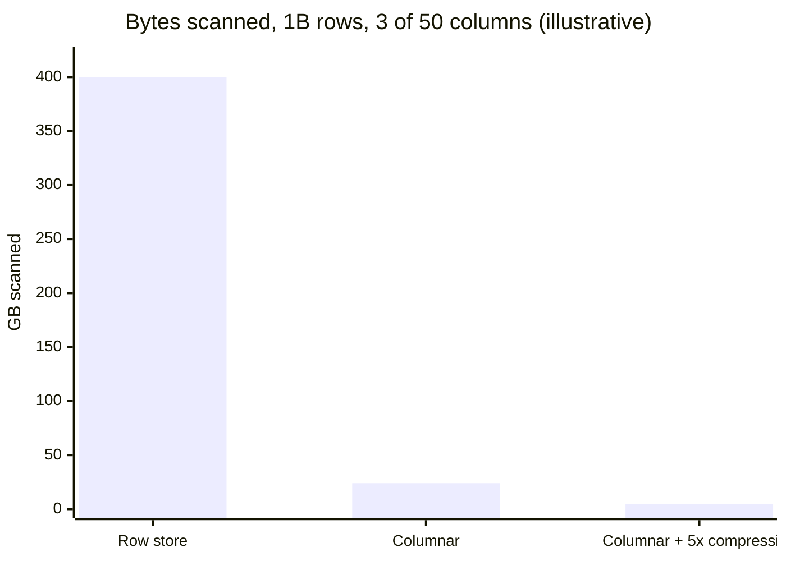
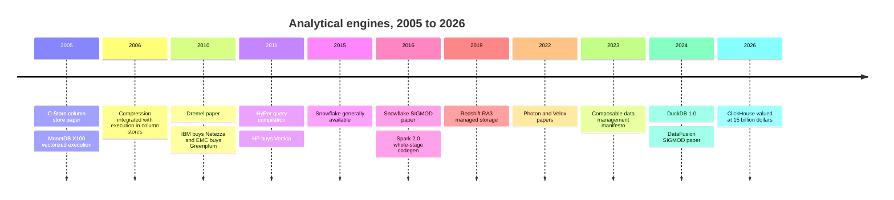

# 5. Analytical Engines
> **Depth:** L2 · **Reading time:** ~15 min · **Last verified:** 2026-11-01 · **Prerequisites:** [Ch 3 — Database Internals](ch03-database-internals.md)

## TL;DR

- Analytical queries touch a few columns across billions of rows. Storing data **column by column** lets the engine read only those columns, and similar values sit next to each other, so they compress well. Together these routinely cut bytes scanned by one to two orders of magnitude (worked example below).
- Modern engines process data in **batches of about a thousand values** (vectorized execution, MonetDB/X100 → DuckDB, ClickHouse, Velox, Photon) or **compile each query to machine code** (HyPer, Spark whole-stage codegen). Both approaches exist to keep the CPU fed from cache instead of stalling on memory.
- The 2000s MPP warehouses (Teradata, Netezza, Greenplum, Redshift classic) were **shared-nothing**: each node owned its slice of the data. That design scales reads well, but resizing the cluster means physically reshuffling the data.
- Snowflake's 2016 design made **object storage the durable disk**, used stateless compute clusters with local SSD caches, and put a separate services layer in charge of metadata. Elastic scaling, isolated concurrency and pay-per-use followed from that one decision. BigQuery, Redshift RA3 and Databricks took the same path.
- Engines are coming apart into reusable parts: **Arrow** for memory format, **Velox/DataFusion** for execution, and Parquet/Iceberg for storage. Performance is becoming a commodity, and the strategic control points move to storage throughput, caching and the catalog.

## Why this matters (business + Everpure lens)

The analytical engine is where most data-platform revenue is metered. Snowflake credits, BigQuery slots and Databricks DBUs all mainly measure compute time spent scanning, joining and aggregating. Engine efficiency drives a vendor's gross margin and decides how much a customer pays per query. Spend therefore follows the engine's design choices more than its marketing.

The shift from shared-nothing MPP to **separated storage and compute** is the most important architectural change in this book for a storage company. Once compute became stateless and data moved to object storage, the bottleneck stopped being a disk's IOPS. It became the **aggregate throughput** of the object tier plus the hit rate of the cache in front of it. That is a storage problem: whoever supplies fast, scalable object storage and a smart cache tier sits on the engine's critical path, whether the engine is Snowflake, Trino or Spark. Everpure's public partner materials already show one version of this pattern: a reference architecture that runs Starburst's engine over Iceberg tables on FlashBlade object storage.[^ep-starburst] Options a strategy team might evaluate, based on public information, include certifications with more engines, cache-tier products, and making on-premises object storage a first-class "database disk" for open table formats ([Ch 7](ch07-open-table-formats.md)).

## How it works

### Row versus columnar layout

A transactional database ([Ch 3](ch03-database-internals.md)) stores each row contiguously on a page, because an order-entry system reads and writes whole rows: fetch customer 42, update the order. Analytics flips that access pattern. "Total revenue by region for Q3" needs three columns (date, region, amount) out of perhaps fifty, across every row in the quarter. In a row store the disk and memory system must drag all fifty columns past the CPU to get the three it needs.

A [columnar](../glossary.md#columnar-storage) engine stores each column in its own contiguous run. The query reads only the date, region and amount runs and skips the other 47 entirely. The idea is old (Sybase IQ, KDB, MonetDB), but the 2005 C-Store paper from Stonebraker, Abadi and colleagues made the modern case. It paired a read-optimized column store with a small write-optimized store and a "tuple mover" that merges the two, and it reported large speedups over commercial row stores on a TPC-H subset.[^cstore] C-Store became Vertica, which HP bought in 2011.[^ma-vertica]

*Figure 5.1 — The same table laid out by row and by column: a three-column query reads every byte of a row store but only three runs of a column store.*

> **Bridge: memory hierarchy.** This is the database version of **array-of-structures versus structure-of-arrays**. A GPU kernel that sums one field across a million structs wastes most of each cache line and DRAM burst if the structs are interleaved (AoS). Lay the field out contiguously (SoA) and every byte fetched is useful, and prefetchers see a clean stride. A column store is SoA on disk, in memory and in cache.

### Compression and encoding

Putting like values together makes them compressible, and column stores apply **lightweight encodings** chosen per column:

- **[Dictionary encoding](../glossary.md#dictionary-encoding)** replaces repeated strings with small integer codes. A "country" column with 200 distinct values needs one byte per row instead of a string.
- **[Run-length encoding](../glossary.md#run-length-encoding) (RLE)** stores "NYC × 40,000" instead of 40,000 copies. It is very effective on sorted or low-cardinality columns.
- **[Delta encoding](../glossary.md#delta-encoding)** stores the difference from the previous value. Timestamps and sequential IDs become small numbers.
- **[Bit-packing](../glossary.md#bit-packing)** stores each value in only as many bits as the largest value needs. Numbers below 1,000 fit in 10 bits, not 32 or 64.

General-purpose codecs (LZ4, Zstandard) are then layered on top. Abadi, Madden and Ferreira's SIGMOD 2006 paper showed that the bigger prize is not the disk saved. Operators can **work directly on compressed data**: summing an RLE run is one multiply, and a filter on a dictionary-encoded column compares integers instead of strings.[^abadi06] How much compression to expect depends on the data. ClickHouse, as a vendor, characterizes typical analytical data at 5–10× in columnar form against 1.5–3× for row-based page compression, with low-cardinality columns going well beyond 30×.[^ch-compress] Treat these as rules of thumb, not guarantees.

### Skipping data: zone maps and late materialization

The cheapest byte is the one never read. Engines store small summaries, such as the minimum and maximum value of each column, for every chunk of data. These summaries are called **[zone maps](../glossary.md#zone-map)** (Snowflake keeps them per *micro-partition*, Parquet per row group). A query filtered to July 2026 checks the summaries and skips every chunk whose date range misses July without opening it. Snowflake's micro-partitions hold 50–500 MB of uncompressed data each, and their metadata includes value ranges per column, which the planner uses for exactly this pruning.[^sf-mp] Pruning works best when data is clustered on the filter column. A table sorted by date prunes beautifully on date and hardly at all on customer ID.

**[Late materialization](../glossary.md#late-materialization)** pushes the same logic inside the query. The engine evaluates the filter on the date column, produces a list of matching row positions, and only then fetches the price and store values at those positions. Wide rows are stitched together ("materialized") as late as possible, often only for the final result.

### Executing the query: vectorization versus compilation

Classic engines use the **Volcano iterator model**: each operator calls `next()` on its child to pull one row at a time. That is elegant, but on modern CPUs the per-row function calls, branch mispredictions and pointer-chasing cost far more than the arithmetic itself. Two answers emerged.

**[Vectorized execution](../glossary.md#vectorized-execution).** The MonetDB/X100 paper (Boncz, Zukowski and Nes, CIDR 2005) kept the iterator structure but passed **vectors** of values, sized to stay resident in CPU cache. It reported raw execution on 100 GB TPC-H one to two orders of magnitude faster than previous technology.[^x100] Each operator becomes a tight loop over an array, which compilers can turn into [SIMD](../glossary.md#simd) instructions and CPUs can pipeline. The paper later received CIDR's first Test of Time award.[^x100-tot] X100 became Vectorwise, and its lineage runs through DuckDB, ClickHouse, Snowflake, Velox and Photon. DuckDB's default vector is 2,048 values.[^duckdb-vec]

*Figure 5.2 — Vectorized engines amortize per-row overhead across a cache-sized batch of about a thousand values; one call does the work of a thousand.*

> **Bridge: SIMD lanes.** A 512-bit vector register holds sixteen 32-bit values, so one instruction compares sixteen dates. Vectorized engines are written so that the inner loop over a batch maps onto those lanes, just as a GPU warp applies one instruction across many threads. Batch size is a cache-sizing decision: large enough to amortize overhead, small enough that the working set stays in L1/L2 rather than spilling to DRAM.

**[Query compilation](../glossary.md#query-compilation).** Thomas Neumann's 2011 HyPer paper took the other route. It generates machine code (via LLVM) for each query, fusing operators into a single loop so that values stay in CPU registers. The paper reports performance that often rivals hand-written C++.[^hyper] Spark 2.0's "whole-stage code generation" applied the idea on the JVM. Databricks reported per-row costs falling, for example, from 15 ns to about 1.1 ns for a filter (company-stated benchmark).[^spark-cg]

Which one wins? A 2018 study built both inside a single system and concluded that neither dominates. Compiled code executes fewer instructions on computation-heavy queries, and vectorized code hides memory latency better, for example in hash joins.[^kersten] The industry has mostly picked vectorization for practical reasons. It is easier to debug and profile, it avoids compile latency on short queries, and it can adapt at run time to each batch. Databricks chose a vectorized C++ design for Photon over extending Spark's code generation, citing exactly this adaptivity.[^photon]

### Scaling out: MPP shared-nothing

When one machine is not enough, **[massively parallel processing](../glossary.md#massively-parallel-processing)** (MPP) engines spread the table across many nodes. In the **[shared-nothing](../glossary.md#shared-nothing)** design of Teradata, Netezza, Greenplum and the original Redshift, each node owns a hash-partitioned slice of the data on its own disks. A query runs in parallel on every slice, and partial results meet at a coordinator. Reads scale nearly linearly, which is why this design dominated the 2000s warehouse market. IBM paid $1.7B for Netezza in 2010 (disclosed), and EMC bought Greenplum the same year (terms undisclosed).[^ma-netezza][^ma-greenplum] Redshift itself was built on licensed ParAccel MPP code.[^ma-paraccel]

The pain sits in the coupling. Joins on non-partition keys force a **[shuffle](../glossary.md#shuffle)**: rows are redistributed across the network so that matching keys land on the same node. Storage and compute come in fixed ratios, so a customer who needs more disk must buy more CPUs, and vice versa. Most painfully, **resizing the cluster means reshuffling the data**: going from 10 to 20 nodes rehashes and moves every row. Concurrency is also shared: a heavy data-science job and the CFO's dashboard compete for the same nodes.

### Separating storage and compute: the Snowflake design

Snowflake's SIGMOD 2016 paper (Dageville et al.) described what it called a multi-cluster, shared-data architecture, built for the cloud from scratch. Development started in late 2012, and the service was generally available from June 2015.[^snowflake16] Its key moves:

1. **Object storage (Amazon S3) is the durable layer.** Table data lives in immutable, columnar files on S3. S3 has higher latency and per-request overhead than local disk, but it offers effectively unlimited capacity, high durability and enormous aggregate throughput.
2. **Compute is stateless "[virtual warehouses](../glossary.md#virtual-warehouse)".** A warehouse is a cluster of cloud instances that can be created, resized or suspended in seconds to minutes. It holds no durable data, so resizing moves no data.
3. **Local SSD is a cache, not the system of record.** Each worker caches the file columns it has recently read. Files are assigned to workers by consistent hashing, so repeated queries hit warm caches, and idle workers can "steal" files from slow peers.
4. **A cloud services layer** handles metadata, transactions, optimization, access control and the min/max statistics used for pruning. It is shared across all customers' warehouses.

*Figure 5.3 — In shared-nothing MPP, data lives inside the compute nodes, so scaling moves data; with separated storage and compute, many independent clusters read one shared copy in object storage.*

Why was this a breakthrough? Three business properties fall out of one architectural decision. **Elasticity:** a 4 a.m. ETL job can run on a large warehouse for 20 minutes and then shut it off. **Concurrency isolation:** finance, marketing and data science each get their own warehouse over the same data, so nobody's query slows anyone else's. **Pay-per-use:** with nothing running, the customer pays only for storage. That last property is what made consumption pricing possible, with all its benefits and volatility ([Ch 26](../04-company-deep-dives/ch26-snowflake.md)).

The design also changed the storage layer's role. Object storage became **the database's disk**, and the engine's performance problem was redefined as hiding object-storage latency. The tools are large sequential reads, many parallel requests, aggressive caching and pruning so that fewer files are fetched at all. **Throughput matters more than IOPS.** S3, for example, documents a baseline of at least 5,500 read requests per second per partitioned prefix and scales further as load is spread out.[^s3perf] Engines therefore issue many parallel range reads across many objects.

The rest of the industry converged on this design. **Google BigQuery** descends from Dremel (VLDB 2010), which combined columnar storage with a multi-level serving tree to scan trillion-row tables in seconds.[^dremel10] Its ten-year retrospective describes the move to disaggregated storage and a **separate in-memory shuffle tier**, so that intermediate results also live outside the compute workers. That design enables BigQuery's serverless, slot-based model.[^dremel20] **Amazon Redshift RA3** (announced December 2019) added "managed storage": local SSD holds hot data, S3 holds the rest, and compute and storage are priced separately.[^ra3-launch][^ra3] **Databricks** runs Photon over Parquet/Delta files in the customer's own object storage.[^photon]

> **Bridge: disaggregated memory.** Separating storage from compute is the datacenter-scale version of what CXL memory pooling does inside a rack: decouple capacity from the processor so that each can scale and be utilized independently, and accept extra latency in exchange. The SSD cache in each virtual warehouse plays the role of a DRAM cache in front of NAND. Hit rate decides whether users see local-disk speed or object-store latency.

### The composable data stack

The latest shift is to open, reusable engine parts. **Apache Arrow** standardizes the in-memory columnar format, so that engines and tools exchange batches without conversion ([Ch 6](ch06-file-formats.md)). **Velox** (Meta, VLDB 2022) is a C++ vectorized execution library, which at publication was integrated or being integrated with more than a dozen systems at Meta, including Presto and Spark.[^velox] **Apache DataFusion** is a Rust query engine built on Arrow and designed to be embedded in new products.[^datafusion] The 2023 "Composable Data Management System Manifesto" argues that the industry should stop rebuilding parsers, optimizers and executors for each system and assemble them from shared components instead.[^manifesto] The implication: fast vectorized execution is no longer a moat on its own.

## Worked example: 1 billion sales rows, 3 of 50 columns

**Illustrative arithmetic, not a benchmark.** Assume a `sales` table with 1 billion rows and 50 columns, averaging 8 bytes per column value uncompressed. The query sums `price` by `store` for one month, so it touches `date`, `store` and `price`.

- **Row store:** every page carries all 50 columns, so the scan reads 1B × 50 × 8 B = **400 GB**. Page compression at 2× (inside the 1.5–3× range above) still leaves about 200 GB.
- **Column store, uncompressed:** read 3 columns: 1B × 3 × 8 B = **24 GB**, 6% of the row-store bytes.
- **Column store with encoding at an assumed 5×** (the low end of the vendor rule of thumb): **4.8 GB**. `store` is dictionary-encoded, `date` is RLE or delta-encoded, and `price` is bit-packed.
- **Plus zone-map pruning:** if the table holds 36 months clustered by date, only about one month of micro-partitions survives, roughly **0.13 GB**.

At an assumed 10 GB/s of scan throughput, those are about 40 seconds, 2.4 seconds, 0.5 seconds and a few hundredths of a second. On a consumption-priced warehouse that is also roughly the cost ratio.

*Figure 5.4 — Column pruning (about 17× fewer bytes) and compression (a further 5×) compound to roughly 80× less data read before any zone-map pruning (illustrative assumptions).*

## Design choices and trade-offs

| Choice | Option A | Option B | When A wins | When B wins |
|---|---|---|---|---|
| Layout | Row | Column | Point lookups, frequent updates (OLTP) | Scans and aggregates over few columns |
| Execution | Vectorized | Compiled (JIT) | Memory-bound work, joins, short queries, adaptivity | Compute-heavy expressions on cache-resident data |
| Architecture | Shared-nothing MPP | Separated storage and compute | Steady, predictable load; lowest latency on local disk | Spiky load, many teams, elastic scaling, pay-per-use |
| Data placement | Proprietary managed storage | Open files (Parquet/Iceberg) in customer bucket | Tight optimization, simpler operations | Avoiding lock-in; many engines on one copy |
| Deployment | Serverless (BigQuery-style slots) | Customer-sized clusters | Bursty and unpredictable queries | Cost predictability, tuning control |

*Figure 5.5 — Every engine design is a bet on workload shape: no option wins on all five axes.*

The strongest case *for* shared-nothing today is that local NVMe is faster and cheaper per query than remote object storage for a stable, hot working set. That is why ClickHouse and real-time engines ([Ch 23](../03-ai-data-stack/ch23-real-time-analytics-htap.md)) keep local storage as an option, and why every separated design relies on SSD caches. The strongest case *against* full separation is cost visibility: elastic compute makes it easy to overspend, and consumption bills are volatile for customers and vendors alike.

| Engine | Execution model | Storage | Elasticity | Open source | Sweet spot |
|---|---|---|---|---|---|
| Snowflake | Vectorized, columnar, push-based[^snowflake16] | Managed columnar files on object storage; Iceberg tables | Per-warehouse resize, suspend, multi-cluster | No (engine); Polaris catalog is Apache | Governed enterprise SQL warehouse, many concurrent teams |
| Google BigQuery | Dremel tree, disaggregated in-memory shuffle[^dremel20] | Google distributed storage, managed columnar | Serverless slots | No | Serverless ad hoc analytics at very large scale |
| Amazon Redshift | MPP with code-generated query segments [VERIFY: current Redshift compilation model] | RA3 managed storage: SSD cache plus S3[^ra3] | Resize, concurrency scaling, serverless | No | AWS-native warehousing |
| Databricks Photon | Vectorized C++ under Spark APIs[^photon] | Delta/Iceberg/Parquet in customer object storage | Elastic clusters, serverless SQL | No (Spark, Delta are open) | Lakehouse ETL plus SQL on open files |
| ClickHouse | Vectorized columnar | MergeTree on local disk or object storage | Self-managed or cloud service | Yes | Real-time, high-concurrency analytics, observability |
| DuckDB | Vectorized, in-process, 2,048-value vectors[^duckdb-vec] | Local files, Parquet/Iceberg on object storage | Single machine | Yes (MIT) | Laptop and embedded analytics |
| Trino | Distributed MPP-style SQL over external data | Any lake or federated source; no storage of its own | Cluster scaling (Starburst offers managed service) | Yes | Federated and lake queries across many sources |
| Apache Druid / Apache Pinot | Segment-based with indexes, columnar | Local segments plus deep storage on object storage | Cluster scaling | Yes | Sub-second, user-facing dashboards on fresh events |
| Velox / DataFusion | Vectorized libraries[^velox][^datafusion] | Whatever the host engine uses | N/A (components) | Yes | Building blocks for new engines |

*Figure 5.6 — Engine landscape: the closed cloud warehouses compete on managed elasticity, the open engines on embeddability and openness. Rows describe architecture, not benchmark rank.*

## Who's who

- **Cloud warehouses:** Snowflake, the reference design for separated storage and compute ([Ch 26](../04-company-deep-dives/ch26-snowflake.md)); Google BigQuery (serverless); Amazon Redshift (MPP heritage, now RA3 and serverless); Microsoft Fabric/Synapse.
- **Lakehouse engines:** Databricks Photon and Spark SQL, which run over open formats in the customer's bucket ([Ch 7](ch07-open-table-formats.md)).
- **Challengers and open engines:** ClickHouse, which raised $400M at a $15B valuation in January 2026 (press-reported),[^clickhouse-val] plus DuckDB/MotherDuck, Trino/Starburst, Dremio, Firebolt, and real-time engines Druid/Imply and Pinot/StarTree ([Ch 31](../04-company-deep-dives/ch31-analytical-engine-challengers-legacy.md), [Ch 23](../03-ai-data-stack/ch23-real-time-analytics-htap.md)).
- **Legacy MPP:** Teradata, Netezza (IBM), Greenplum (Broadcom via VMware), Vertica (OpenText via Micro Focus) [VERIFY: Vertica current owner]. They hold large installed bases but face steady migration to the cloud.
- **Components:** Apache Arrow, Velox, DataFusion. These sit underneath many of the above and are increasingly the shared substrate.

## History and trajectory

*Figure 5.7 — Two decades of engine history: the column store and vectorization ideas came in 2005; the cloud supplied elasticity in 2015; the 2020s are about open, composable components.*

The arc runs in three acts. **Act 1 (2005–2012): columnar and vectorized ideas** came from academia (C-Store, X100) and were commercialized in appliances (Vertica, Vectorwise, Netezza), which incumbents then acquired.[^cstore][^x100][^ma-netezza] **Act 2 (2012–2020): the cloud separates storage from compute.** Snowflake (GA 2015), BigQuery and later Redshift RA3 (2019) turned the warehouse into an elastic service.[^snowflake16][^ra3-launch] **Act 3 (2020–today): openness and composability.** Photon (2022) brought warehouse-grade execution to open files, Velox and DataFusion made the executor a library, and DuckDB reached 1.0 in June 2024.[^photon][^velox][^duckdb10] The trajectory points to engines as interchangeable consumers of open tables on object storage. Value then accrues to the catalog ([Ch 8](ch08-catalogs-and-metastores.md)), governance, and the storage and cache tiers that feed them ([Ch 24](../03-ai-data-stack/ch24-data-meets-compute-and-storage.md)).

## Numbers that matter

| Metric | Value | Basis | Source/date |
|---|---|---|---|
| Typical columnar compression vs row-page compression | 5–10× vs 1.5–3×; >30× on low-cardinality columns | Vendor-stated rule of thumb | ClickHouse, n.d.[^ch-compress] |
| ClickBench 100M-row dataset size | 9.26 GiB in ClickHouse vs ~100 GiB in PostgreSQL | Vendor-stated | ClickHouse, n.d.[^ch-compress] |
| X100 speedup on 100 GB TPC-H | 1–2 orders of magnitude vs prior technology | Author-reported (paper) | CIDR 2005[^x100] |
| Spark 2.0 filter cost per row | 15 ns → ~1.1 ns | Company-stated benchmark | Databricks, 2016-05-23[^spark-cg] |
| DuckDB default vector size | 2,048 values | Documentation | DuckDB docs, n.d.[^duckdb-vec] |
| Snowflake micro-partition size | 50–500 MB uncompressed | Documentation | Snowflake docs, n.d.[^sf-mp] |
| S3 baseline request rate | ≥3,500 writes / ≥5,500 reads per second per partitioned prefix | Documentation | AWS, n.d.[^s3perf] |
| Photon customer speedups | >10× on some workloads | Company-stated (paper) | SIGMOD 2022[^photon] |
| IBM–Netezza price | $1.7B (2010) | Disclosed | WilmerHale, 2010-09-22[^ma-netezza] |
| ClickHouse valuation | $15B (Series D, $400M) | Press-reported | Bloomberg, 2026-01-16[^clickhouse-val] |

## Storage bridge

> **Storage bridge.** Separating storage from compute moved the analytical bottleneck from local disk IOPS to **object-storage throughput**, and made the **cache tier** (local NVMe in each compute cluster, or a shared cache in front of the object store) the main performance lever. On-premises, the equivalent question is whether a fast object store can feed Trino, Spark or Snowflake-style engines at cloud-like aggregate bandwidth with predictable latency. See [Ch 24](../03-ai-data-stack/ch24-data-meets-compute-and-storage.md) and the companion *Everpure Tech Atlas* for the protocol and hardware detail.

## Conversation playbook

**Questions for product managers**

1. "What share of your customers' compute hours goes to scanning versus joining versus waiting on object storage, and how does cache hit rate move that?"
2. "When a customer's data sits in Iceberg on their own bucket, what do you lose in performance versus your managed storage, and how are you closing that gap?"
3. "Which engine components do you build yourselves, and which do you take from Arrow, Velox or DataFusion? Where is your differentiation once execution is commoditized?"

**Questions for engineers**

1. "Is your executor vectorized, compiled or hybrid, and what is your batch size? Why that size?"
2. "How do you prune: zone maps only, or also bloom filters and clustering? What happens to pruning when data is not sorted on the filter column?"
3. "What request size and parallelism do you issue against object storage, and what throughput per node do you need to keep the CPUs busy?"

**What good answers sound like:** specific and measured. for example, a stated request size, the number of requests in flight per node, and a measured cache hit rate on dashboard workloads. Good answers acknowledge trade-offs: compiled code wins on arithmetic-heavy queries, local NVMe beats S3 on a hot working set. They separate scan efficiency from bytes avoided altogether.

**Don't say this**

- "Columnar is always faster." It is worse for point lookups and single-row updates, which is why OLTP stays row-oriented ([Ch 3](ch03-database-internals.md)).
- "Snowflake invented separation of storage and compute." It popularized the cloud-native version; Dremel/BigQuery disaggregated storage at Google earlier.[^dremel20]
- "Object storage is too slow for analytics." With parallel range reads, pruning and caching it is the default substrate; latency is hidden, not avoided.
- "Vectorization means GPUs." It means CPU SIMD and batch processing; GPU engines are a separate topic ([Ch 24](../03-ai-data-stack/ch24-data-meets-compute-and-storage.md)).
- "Compression is about saving disk." In analytics it is mainly about scanning fewer bytes and operating on encoded data.

## Going deeper

> **Going deeper (L3).** Read the original MonetDB/X100 paper for why batch size should match cache size, then Kersten et al. (VLDB 2018) for a controlled comparison of vectorized and compiled engines.[^x100][^kersten] For the cloud architecture, the Snowflake SIGMOD 2016 paper sections on worker caching, consistent hashing and file stealing are short and readable.[^snowflake16] For the composable future, compare Velox's operator interfaces with DataFusion's Rust `ExecutionPlan` trait.[^velox][^datafusion]

## Key terms

- [Columnar storage](../glossary.md#columnar-storage) — storing each column's values contiguously so queries read only the columns they need.
- [Dictionary encoding](../glossary.md#dictionary-encoding) — replacing repeated values with small integer codes plus a lookup table.
- [Run-length encoding](../glossary.md#run-length-encoding) — storing a value once with a count of consecutive repeats.
- [Delta encoding](../glossary.md#delta-encoding) — storing differences between consecutive values instead of the values themselves.
- [Bit-packing](../glossary.md#bit-packing) — storing integers in the minimum number of bits needed.
- [Zone map](../glossary.md#zone-map) — per-chunk min/max (and similar) statistics used to skip data that cannot match a filter.
- [Late materialization](../glossary.md#late-materialization) — deferring the assembly of full rows until after filters have reduced the data.
- [Vectorized execution](../glossary.md#vectorized-execution) — processing data in cache-sized batches of values per operator call.
- [Query compilation](../glossary.md#query-compilation) — generating machine code per query so operators fuse into tight loops.
- [SIMD](../glossary.md#simd) — single instruction, multiple data: one CPU instruction applied to many values at once.
- [Massively parallel processing](../glossary.md#massively-parallel-processing) — spreading a query across many nodes that each work on a slice of the data.
- [Shared-nothing](../glossary.md#shared-nothing) — an architecture in which each node owns its own CPU, memory and disk.
- [Shuffle](../glossary.md#shuffle) — redistributing rows across nodes by key so related rows meet for joins or aggregations.
- [Separation of storage and compute](../glossary.md#separation-of-storage-and-compute) — keeping durable data in shared storage while stateless compute scales independently.
- [Virtual warehouse](../glossary.md#virtual-warehouse) — Snowflake's independently sized, stateless compute cluster.
- [Micro-partition](../glossary.md#micro-partition) — Snowflake's immutable columnar storage unit with per-column metadata.
- [Managed storage](../glossary.md#managed-storage) — vendor-operated tiered storage (SSD cache plus object storage) behind a warehouse, as in Redshift RA3.
- [Composable data stack](../glossary.md#composable-data-stack) — building data systems from shared, interchangeable components such as Arrow, Velox and DataFusion.

## Sources

[^cstore]: M. Stonebraker, D. J. Abadi et al., "C-Store: A Column-oriented DBMS," Proceedings of the 31st VLDB Conference, pp. 553–564, https://dsl.cds.iisc.ac.in/~course/DBMS/papers/cstore.pdf (author copy; DOI 10.1145/3226595.3226638), published 2005; retrieved 2026-11-01.
[^ma-vertica]: TechCrunch, "HP acquires data management and real-time analytics company Vertica," https://techcrunch.com/2011/02/14/hp-acquires-data-management-and-real-time-analytics-company-vertica/, published 2011-02-14; retrieved 2026-11-01 (via `data/ma_deals.csv`).
[^abadi06]: D. J. Abadi, S. R. Madden, M. C. Ferreira, "Integrating Compression and Execution in Column-Oriented Database Systems," SIGMOD 2006, https://courses.cs.duke.edu/spring08/cps399.28/papers/sigmod06-AbadiMaddenEtAl-cstore.pdf (DOI 10.1145/1142473.1142548), published 2006-06; retrieved 2026-11-01.
[^ch-compress]: ClickHouse, "Database compression: encodings, codecs and ratios," https://clickhouse.com/engineering-resources/database-compression, n.d.; retrieved 2026-11-01. Vendor content; ratios are vendor-stated.
[^sf-mp]: Snowflake documentation, "Micro-partitions & Data Clustering," https://docs.snowflake.com/en/user-guide/tables-clustering-micropartitions, n.d.; retrieved 2026-11-01.
[^x100]: P. Boncz, M. Zukowski, N. Nes, "MonetDB/X100: Hyper-Pipelining Query Execution," CIDR 2005, https://cs.brown.edu/courses/cs227/archives/2008/Papers/ColumnStores/MonetDB.pdf, published 2005-01; retrieved 2026-11-01.
[^x100-tot]: CWI, "Test of Time Award for paper on vectorized execution," https://www.cwi.nl/en/news/test-of-time-award-for-paper-on-vectorized-execution/, published 2024-01; retrieved 2026-11-01.
[^duckdb-vec]: DuckDB documentation, "Vector" (internals), https://duckdb.org/docs/internals/vector, n.d.; retrieved 2026-11-01.
[^hyper]: T. Neumann, "Efficiently Compiling Efficient Query Plans for Modern Hardware," PVLDB 4(9): 539–550, https://event.cwi.nl/lsde/papers/hyper.pdf (DOI 10.14778/2002938.2002944), published 2011; retrieved 2026-11-01.
[^spark-cg]: S. Agarwal, D. Liu, R. Xin, "Apache Spark as a Compiler: Joining a Billion Rows per Second on a Laptop," Databricks blog, https://databricks.com/blog/2016/05/23/apache-spark-as-a-compiler-joining-a-billion-rows-per-second-on-a-laptop.html, published 2016-05-23; retrieved 2026-11-01. Per-row figures are company-stated.
[^kersten]: T. Kersten, V. Leis, A. Kemper, T. Neumann, A. Pavlo, P. Boncz, "Everything You Always Wanted to Know About Compiled and Vectorized Queries But Were Afraid to Ask," PVLDB 11(13): 2209–2222, https://ir.cwi.nl/pub/28470/28470.pdf (DOI 10.14778/3275366.3275370), published 2018; retrieved 2026-11-01.
[^photon]: A. Behm et al., "Photon: A Fast Query Engine for Lakehouse Systems," SIGMOD 2022, https://www.databricks.com/wp-content/uploads/2022/07/Photon-A-Fast-Query-Engine-for-Lakehouse-Systems.pdf, published 2022-06; retrieved 2026-11-01. Best Industry Paper per BigDATAwire, https://www.bigdatawire.com/2022/06/30/databricks-scores-acm-sigmod-awards-for-spark-and-photon, 2022-06-30.
[^ma-netezza]: WilmerHale, "Netezza to be acquired for $1.7 billion in cash," https://www.wilmerhale.com/en/insights/news/netezza-to-be-acquired-for-1-7-billion-in-cash-september-22-2010, published 2010-09-22; retrieved 2026-11-01 (via `data/ma_deals.csv`).
[^ma-greenplum]: EMC press release, "EMC to acquire Greenplum," https://corporate.delltechnologies.com/en-us/newsroom/announcements/2010/07/20100706-01.htm, published 2010-07-06; retrieved 2026-11-01 (via `data/ma_deals.csv`).
[^ma-paraccel]: VentureBeat, "Actian buys ParAccel," https://venturebeat.com/2013/04/25/actian-buys-paraccel, published 2013-04-25; retrieved 2026-11-01 (via `data/ma_deals.csv`).
[^snowflake16]: B. Dageville et al., "The Snowflake Elastic Data Warehouse," SIGMOD 2016, https://www.snowflake.com/resource/sigmod-2016-paper-snowflake-elastic-data-warehouse/ (copy: https://www.cs.purdue.edu/homes/csjgwang/CloudNativeDB/SnowflakeSIGMOD16.pdf), published 2016-06; retrieved 2026-11-01.
[^s3perf]: AWS re:Post Knowledge Center, "S3 object key naming pattern and request-rate performance," https://repost.aws/knowledge-center/s3-object-key-naming-pattern, n.d.; retrieved 2026-11-01.
[^dremel10]: S. Melnik et al., "Dremel: Interactive Analysis of Web-Scale Datasets," PVLDB 3(1): 330–339, https://research.google/pubs/pub36632/, published 2010-09; retrieved 2026-11-01.
[^dremel20]: S. Melnik et al., "Dremel: A Decade of Interactive SQL Analysis at Web Scale," PVLDB 13(12): 3461–3472, https://www.vldb.org/pvldb/vol13/p3461-melnik.pdf, published 2020; retrieved 2026-11-01.
[^ra3-launch]: AWS What's New, "Amazon Redshift introduces RA3 nodes with managed storage enabling independent compute and storage scaling," https://aws.amazon.com/about-aws/whats-new/2019/12/amazon-redshift-announces-ra3-nodes-managed-storage/, published 2019-12; retrieved 2026-11-01.
[^ra3]: AWS, "Amazon Redshift RA3 instances with managed storage," https://aws.amazon.com/redshift/features/ra3, n.d.; and Amazon Redshift Management Guide, "Amazon Redshift provisioned clusters," https://docs.aws.amazon.com/redshift/latest/mgmt/working-with-clusters.html, n.d.; retrieved 2026-11-01.
[^velox]: P. Pedreira et al., "Velox: Meta's Unified Execution Engine," PVLDB 15(12): 3372–3384, https://www.vldb.org/pvldb/vol15/p3372-pedreira.pdf, published 2022; retrieved 2026-11-01. See also Meta Engineering, "Velox: an open source execution engine," https://engineering.fb.com/2023/03/09/open-source/velox-open-source-execution-engine/, 2023-03-09.
[^datafusion]: A. Lamb et al., "Apache Arrow DataFusion: A Fast, Embeddable, Modular Analytic Query Engine," SIGMOD 2024, https://doi.org/10.1145/3626246.3653368, published 2024-06; retrieved 2026-11-01.
[^manifesto]: P. Pedreira, O. Erling, K. Karanasos, S. Schneider, W. McKinney, S. R. Valluri, M. Zait, J. Nadeau, "The Composable Data Management System Manifesto," PVLDB 16(10): 2679–2685, https://www.vldb.org/pvldb/vol16/p2679-pedreira.pdf, published 2023; retrieved 2026-11-01.
[^duckdb10]: M. Raasveldt, H. Mühleisen, "Announcing DuckDB 1.0.0," DuckDB blog, https://duckdb.org/2024/06/03/announcing-duckdb-100.html, published 2024-06-03; retrieved 2026-11-01.
[^clickhouse-val]: Bloomberg, "ClickHouse Lands $15 Billion Valuation in AI Database Race," https://bloomberg.com/news/articles/2026-01-16/clickhouse-lands-15-billion-valuation-in-ai-database-race, published 2026-01-16; retrieved 2026-11-01 (via `data/private_funding.csv`).
[^ep-starburst]: Everpure, "Technology Alliance Partners: Starburst," https://www.everpuredata.com/la/partners/technology-alliance-partners/starburst.html, n.d.; retrieved 2026-11-01 (via `meta/research-briefing.md`).
