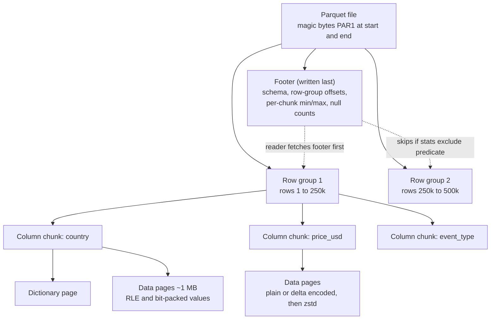
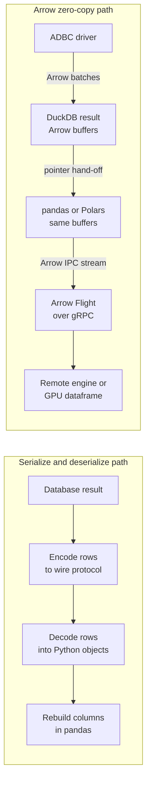
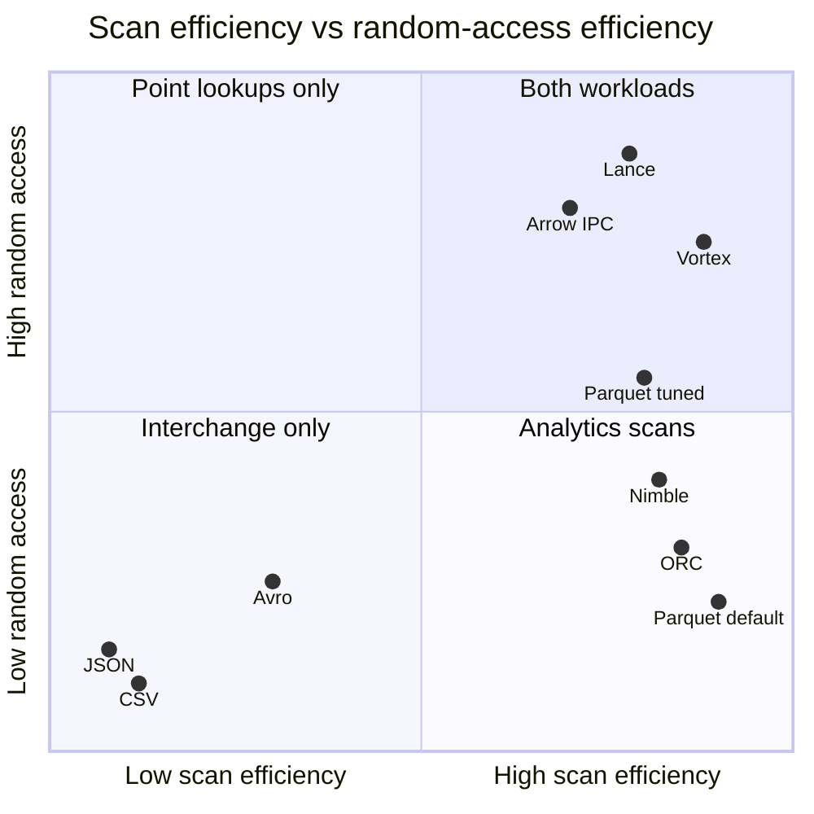
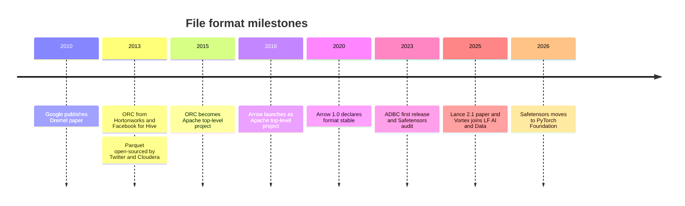

# 6. File Formats: From CSV to Parquet, Arrow and Lance
> **Depth:** L2 · **Reading time:** ~13 min · **Last verified:** 2026-11-01 · **Prerequisites:** [Ch 5 — Analytical engines](ch05-analytical-engines.md)

## TL;DR

- A file format sets how bytes are laid out, and that layout fixes the cost of every later query. Text formats (CSV, JSON) are universal but carry no types, keep no statistics and burn CPU on parsing. Columnar binary formats (Parquet, ORC) let an engine read only the columns and row ranges a query needs.
- **Apache Parquet** is the default analytical file format. Twitter and Cloudera created it in 2013, building on Google's Dremel paper. A Parquet file holds row groups, which hold column chunks, which hold pages, and a footer written last records the schema and min/max statistics.
- **Apache Arrow** is the matching *in-memory* standard. When two engines both speak Arrow, they can pass data without converting it, which removes the serialization tax that used to dominate tool-to-tool hand-offs.
- AI workloads stress the one thing Parquet does poorly: fast random access to individual rows, for example during training shuffles, vector search and multimodal blobs. **Lance**, **Vortex** and **Nimble** are the main challengers. Parquet keeps the ecosystem; the challengers win on specific access patterns.
- For storage, format choice is a workload choice. Parquet scans arrive as large sequential range reads with high throughput. Lance-style ML access arrives as small random reads with high IOPS. Too many small files hurts both.

## Why this matters (business + Everpure lens)

The open table formats in [Ch 7](ch07-open-table-formats.md) (Iceberg, Delta, Hudi) are metadata layers. The data underneath them is almost always Parquet files sitting on object storage. Whoever controls how those files are written also controls scan cost, cloud egress, cache hit rates and, increasingly, how fast a graphics processing unit (GPU) cluster gets fed. Fights over formats look technical, but they decide whether data stays portable across engines. That portability is why Snowflake, Databricks, Google and AWS all ended up reading the same Parquet files ([Ch 5](ch05-analytical-engines.md)).

For Everpure (formerly Pure Storage; NYSE: P), the format is the I/O contract between the data stack and the storage system. A business intelligence (BI) query over Parquet turns into a few large, aligned range reads, where throughput wins. A training job that shuffles samples from a Lance dataset, or a vector index probing embeddings ([Ch 18](../03-ai-data-stack/ch18-embeddings-and-vector-search.md)), turns into many small random reads, where latency and IOPS win. A strategy team might, based on public information, use format adoption as a leading indicator of which I/O profile its customers will need next ([Ch 24](../03-ai-data-stack/ch24-data-meets-compute-and-storage.md)).

## How it works

### Text formats: universal and expensive

CSV and newline-delimited JSON ([NDJSON](../glossary.md#ndjson), one JSON object per line) have no binary layout to learn, and every tool reads them. That portability costs three things. **Parsing CPU**: each number is stored as characters, so every read converts text back into integers and floats, and every quote and escape character has to be checked. **No types or schema**: the reader has to guess whether `"0042"` is a string or a number, and different readers guess differently. **No metadata**: the file has no statistics and no index, so the only way to answer "how many purchases in Germany?" is to read every byte. JSON also repeats every field name on every row, which is why NDJSON files are usually larger than the CSV of the same data.

### Row-oriented binary: Avro and the streaming world

[Apache Avro](../glossary.md#apache-avro) stores records in binary, one whole row after another. An Avro container file opens with a header that embeds the writer's schema as JSON. Data follows in blocks, each ending with a 16-byte sync marker, so a distributed engine can split the file at block boundaries.[^avro-spec] Avro's best feature is **[schema evolution](../glossary.md#schema-evolution)**. The spec sets out how a reader using a newer schema reconciles data written with an older one: added fields with defaults, removed fields and widened types.[^avro-spec]

That property made Avro the natural payload for Kafka. Confluent's [Schema Registry](../glossary.md#schema-registry) stores a version history for each topic and rejects producer changes that would break consumers. Its compatibility modes are backward, forward and full, with BACKWARD as the default, and it now covers Protobuf and JSON Schema as well as Avro.[^confluent-sr] The rule of thumb: rows suit writing one event at a time, and columns suit reading millions of events at once.

### Columnar files: ORC and Parquet

Two columnar formats came out of the Hadoop era in the same year. **[Apache ORC](../glossary.md#apache-orc)** came from Hortonworks, working with Facebook, as part of the 2013 "Stinger" effort to speed up Hive. It became an Apache top-level project in April 2015.[^stinger][^orc-tlp] **[Apache Parquet](../glossary.md#apache-parquet)** came from Twitter and Cloudera. They joined forces in fall 2012, open-sourced it in March 2013 and shipped 1.0 in July 2013.[^twitter-parquet] Parquet's trick for nested data (repetition and definition levels) comes directly from Google's 2010 Dremel paper, which showed how to store nested records in flat columns.[^dremel] Twitter reported that its large datasets shrank by about a third on Parquet. It also reported that scans needing only a few columns ran in a fraction of the old time.[^twitter-parquet]

A Parquet file is a hierarchy:

*Figure 6.1 — A Parquet file is row groups, then column chunks, then pages. The footer at the end is the map that lets a reader skip most of the file.*

- A **[row group](../glossary.md#row-group)** is a horizontal slice of rows, often 128 MB or more.
- Inside each row group, every column gets its own contiguous **[column chunk](../glossary.md#column-chunk)**.
- Each chunk is split into **pages** (about 1 MB by default in the Java writer). Pages are the unit of encoding and compression.[^parquet-defaults]
- Values in a page are **encoded** first and **compressed** second. [Dictionary encoding](../glossary.md#dictionary-encoding) swaps repeated strings for small integers. [Run-length encoding](../glossary.md#run-length-encoding) collapses repeats. A general-purpose codec such as Snappy or [Zstandard](../glossary.md#zstandard) then runs over the result.
- The **footer** holds the schema, the byte offset of every chunk and per-chunk statistics (min, max, null count).

A query engine reads the footer first, usually with one small range request for the file's last few kilobytes. It then uses two tricks. **Projection** fetches only the column chunks the query names. **[Predicate pushdown](../glossary.md#predicate-pushdown)** checks each row group's min/max statistics against the `WHERE` clause and skips row groups that cannot match. If the query is `WHERE event_date = '2026-10-31'` and a row group's dates run from January to March, the engine never reads that row group.

> **Bridge: a table of contents written last.** The footer goes at the end because the writer only knows each chunk's offset and statistics once the chunk has been flushed, much like a book index typeset after the pages are fixed. The cost is that a Parquet file cannot be appended to in place. Every change produces a new file, and that is exactly the gap table formats fill ([Ch 7](ch07-open-table-formats.md)).

> **Bridge: semiconductors and memory.** Row-group and page sizes play the role of DRAM burst length and the cache line. Each read should move enough contiguous bytes to cover fixed per-request overhead (an object-store GET or a disk seek) but not so many that you fetch data you then throw away. The same reasoning aligns a file system's I/O size to the NAND page and erase block. A row group should fit inside one storage I/O unit, which is why the Parquet docs historically tied 512 MB–1 GB row groups to one HDFS block.[^parquet-config]

### Worked example: 1M JSON events → Parquet

For this chapter we generated 1,000,000 synthetic clickstream events (10 fields: ids, timestamp, event type, country, device, price and latency). We wrote them as NDJSON and converted them with PyArrow 26.0 into Parquet with 250k-row row groups. We then timed one query, "revenue by country for purchases", on a 4-vCPU cloud sandbox with warm OS caches.[^sandbox]

| Representation | Size | Ratio vs NDJSON | Query time (best of 3) | Query speed-up |
|---|---|---|---|---|
| NDJSON, Python `json` loop | 204.6 MB | 1.0x | 2.95 s | 1x |
| NDJSON, Arrow multithreaded C++ parser | 204.6 MB | 1.0x | 0.46 s | ~6x |
| Parquet + Snappy, 3 of 10 columns read | 27.1 MB | 7.5x smaller | 0.025 s | ~115x vs Python, ~18x vs Arrow-JSON |
| Parquet + Zstandard, 3 of 10 columns read | 17.2 MB | 11.9x smaller | 0.027 s | ~110x vs Python, ~17x vs Arrow-JSON |

*Figure 6.2 — In this sandbox run (measured, synthetic data), converting 1M JSON events to Parquet shrank them 7.5–12x and made a 3-column query 17–18x faster even against a fast JSON parser. Zstandard trades a little CPU for about 37% fewer bytes than Snappy.*

Three lessons generalize. First, most of the gain comes from *not reading* seven of the ten columns and from not parsing text, not from compression. Second, the choice of codec matters more for storage and egress cost than for speed on local disk: Zstandard was about as fast as Snappy and a third smaller. A published DuckDB benchmark on 11.2M taxi rows found the same pattern for CSV: Zstandard Parquet was 6.8x smaller than CSV and Snappy Parquet 5.1x smaller (vendor-run benchmark).[^motherduck] Third, the whole footer took 5.6 KB, so a remote reader can plan its fetches with a single small GET. Synthetic data with low-cardinality fields compresses better than typical production logs, so treat the ratios as an upper-middle case, not a promise.

### Apache Arrow: one memory layout for everyone

Parquet is how data rests on disk. [Apache Arrow](../glossary.md#apache-arrow) is how it lives in RAM: a language-neutral columnar layout with fixed buffers for values, validity bitmaps and offsets. Before Arrow, moving a result from a database into pandas meant converting every value, row by row, into the receiving program's objects. That serialize/deserialize step often took longer than the query itself. With Arrow, producer and consumer share one layout. Handing over data means passing pointers, or streaming raw buffers over the network unchanged.

*Figure 6.3 — The old path copies and converts data at every hop. The Arrow path keeps one layout from engine to dataframe to network, so a hand-off costs a pointer, not a conversion.*

Three pieces sit around the core format. The **Arrow IPC** format streams those buffers between processes and across the network unchanged. **[Arrow Flight](../glossary.md#arrow-flight)** is a gRPC-based protocol for moving Arrow streams between services, and Flight SQL adds a database-query layer on top. `[VERIFY: Arrow Flight introduction date, believed 2019]` **[ADBC](../glossary.md#adbc)** (Arrow Database Connectivity) is a client API, a columnar counterpart to JDBC/ODBC. Its first libraries shipped in January 2023, and the spec has since reached version 1.1.0.[^adbc] Arrow became an Apache top-level project in February 2016, skipping incubation, and declared its format stable at 1.0 in July 2020.[^arrow-tlp][^arrow-1]

> **Bridge: shared memory and DMA.** Arrow zero-copy works like direct memory access (DMA). A NIC can write into a buffer the CPU then reads without a bounce copy, because both agree on where the bytes live. Arrow is that agreement for analytics software: DuckDB, Polars and a GPU dataframe library can all point at the same buffers. The savings are memory bandwidth and CPU cycles, the same resources DMA saves.

### AI-era formats: when random access matters

Parquet was designed for scans. Fetching row 7,341,002 means locating its row group, decoding at least one ~1 MB page per needed column (often with decompression), and discarding almost everything else. That is fine for BI and costly for workloads such as these:

- **ML training shuffles**: each step reads a random mini-batch of samples.
- **Vector search**: an index returns 100 candidate IDs, and their embeddings and metadata must be fetched one by one.
- **Multimodal data**: images, audio and video sit next to their labels, and large blobs make row groups unwieldy.

**[Lance](../glossary.md#lance)**, from LanceDB, is a columnar file format plus a table layer with versioning, aimed at these jobs. Its 2025 design paper argues that random-access cost comes from *structural encoding*, meaning how nesting and nulls are laid out, rather than from columnar storage itself. Lance 2.1 switches between two encodings depending on value width. The same paper reports that a *tuned* Parquet configuration can do random access more than 60x faster than Parquet's defaults, at some cost in scan speed and RAM. That is the strongest argument in Parquet's defense.[^lance-paper] LanceDB, the company, raised a $30M Series A in June 2025 (press-reported).[^lancedb-funding]

**[Vortex](../glossary.md#vortex)** began at SpiralDB and was contributed in August 2025 to the LF AI & Data Foundation (Linux Foundation) as an incubation project. It covers memory, file and IPC formats and keeps data compressed throughout, with support from Microsoft, Snowflake and Palantir.[^vortex-lf] Its project materials claim random-access reads 100–200x faster than Parquet (vendor-claimed). Spice AI's "Cayenne" accelerator is built on it.[^vortex-repo][^spice] **[Nimble](../glossary.md#nimble)** is Meta's open-source format for very wide ML feature tables, which can have thousands of columns. It uses cascading encodings and keeps metadata light. Third-party trackers still describe it as without a stable release, and an Iceberg reviewer recently held off adding a Nimble file-type enum until the Iceberg spec formally accepts it.[^nimble-presto][^nimble-iceberg] `[VERIFY: Nimble release status and license as of 2026-11]`

The "Parquet is old" debate is mainly academic for now. A 2023 VLDB study (Pavlo, McKinney and colleagues) found no clear winner between Parquet and ORC. It also found both formats inefficient for ML and GPU decoding, and recommended dictionary encoding by default and faster-to-decode integer encodings.[^empirical] The same group's F3 proposal goes further: each file would carry WebAssembly decoders, so new encodings would not break old readers. Its authors argue that Lance and Nimble repeat Parquet's layout mistakes.[^f3] The counterargument: Parquet's real asset is its ecosystem of readers, and its defaults can be tuned.

Model weights and training corpora have their own formats. **[Safetensors](../glossary.md#safetensors)** stores tensors as a JSON header plus raw buffers that can be memory-mapped. It replaced pickle-based checkpoints, which can run arbitrary code when loaded. Trail of Bits audited it in 2023, and Hugging Face contributed it to the PyTorch Foundation in April 2026.[^safetensors-audit][^safetensors-pt] **[WebDataset](../glossary.md#webdataset)** packs training samples into tar shards so reads stay sequential. Shuffling happens at the shard level, with samples shuffled further in a memory buffer.[^webdataset][^dali] TensorFlow's TFRecord is the older record-stream equivalent.

*Figure 6.4 — Qualitative positioning (author's judgment from the cited papers and vendor claims). The AI-era formats try to reach the top-right corner that default Parquet leaves empty.*

### How format choice shapes I/O

On object storage, a Parquet scan is a sequence of HTTP range GETs: one for the footer, then one or more per needed column chunk. Engines coalesce nearby ranges and issue many in parallel, so the storage system sees large, mostly sequential reads where throughput matters most. The opposite failure is the **[small files problem](../glossary.md#small-files-problem)**. Streaming ingest that writes a 2 MB file every few seconds produces millions of files. Each one costs a footer read, a metadata entry and a request, which strains request-rate limits (`[VERIFY: S3 guidance of 5,500 GET/HEAD requests per second per prefix]`) and table-format planning. [Compaction](../glossary.md#compaction) rewrites them into larger files. Current defaults cluster in a narrow band: Iceberg targets 512 MB data files, Databricks auto-tunes Delta files from 256 MB to 1 GB as tables grow, and DuckDB works best with 100k–1M rows per row group.[^iceberg-config][^databricks-size][^duckdb-formats] ML training is the reverse: many small random reads per step, which is why datasets are either sharded for sequential reads (WebDataset) or stored in random-access formats (Lance) on low-latency flash.

## Design choices and trade-offs

| Format | Orientation | Schema | Compression | Random access | Ecosystem | Sweet spot | Governance |
|---|---|---|---|---|---|---|---|
| CSV | Row, text | None (header at best) | External only (gzip) | Poor | Universal | Exports, human hand-offs | De facto (RFC 4180) |
| JSON / NDJSON | Row, text | None, self-describing keys | External only | Poor | Universal | APIs, logs, semi-structured landing | IETF/ECMA standards |
| Avro | Row, binary | Embedded, strong evolution rules | Block codecs | Poor (block seek) | Kafka, streaming, CDC | Event streams, schema-registered topics | Apache |
| ORC | Columnar | Embedded | Encodings + zlib/zstd | Moderate (indexes) | Hive, Trino, some Spark | Hive-era warehouses | Apache |
| Parquet | Columnar (hybrid) | Footer | Encodings + Snappy/zstd | Weak by default, better tuned | Every engine and cloud | Lakehouse analytics, table formats | Apache |
| Arrow (IPC/Feather) | Columnar, in-memory | Embedded | Optional LZ4/zstd | Strong (fixed offsets) | DuckDB, Polars, pandas, Spark, GPUs | Interchange, caching, transport | Apache |
| Lance | Columnar + table layer | Embedded, versioned | Adaptive encodings | Strong (design goal) | LanceDB, Arrow, growing | ML datasets, vectors, multimodal | Vendor-led open source (LanceDB) |
| Vortex / Nimble | Columnar | Embedded | Cascading/adaptive encodings | Strong (Vortex claim) / moderate | Early | Next-gen analytics / wide ML tables | Linux Foundation (Vortex) / Meta-led (Nimble) |

*Figure 6.5 — No format wins every column. Parquet wins on ecosystem, Avro on schema evolution, Arrow on interchange and Lance on random access.*

The steelman for staying on Parquet is that every warehouse, lakehouse engine and table format reads it, and a tuned writer closes much of the random-access gap. The steelman for moving is that AI workloads now drive the new data being written. A format built for random access, blobs and versioning avoids keeping a second copy of the data in a vector database or a pile of tar shards.

## Who's who

- **Apache Parquet / ORC communities**: Parquet is the lakehouse default, and ORC has a smaller footprint today.
- **Apache Arrow PMC**: Dremio (now part of SAP) co-founded the project with Wes McKinney, who later worked at Voltron Data and Posit, along with many contributors.[^arrow-tlp] `[VERIFY: McKinney's current affiliation]`
- **LanceDB**: Lance format plus a vector/multimodal database.
- **SpiralDB**: created Vortex, now under LF AI & Data.
- **Meta**: Nimble, built alongside the Velox engine.
- **Confluent** (Schema Registry), **Hugging Face** (Safetensors) and **NVIDIA** (DALI loaders for WebDataset/TFRecord) are the format-adjacent players.

## History and trajectory

*Figure 6.6 — Analytical formats settled by 2016; the 2023–2026 wave is about AI access patterns and model artifacts.*

Avro dates from the Hadoop project around 2009. `[VERIFY: Avro origin date and Doug Cutting attribution]` Parquet became an Apache top-level project in 2015. `[VERIFY: Parquet TLP date, believed April 2015]` The likely path from here is coexistence. Parquet stays the interchange layer under Iceberg and Delta, while table formats increasingly accept other file types underneath, as the Nimble enum discussion in Iceberg shows.[^nimble-iceberg]

## Numbers that matter

| Metric | Value | Basis | Source / date |
|---|---|---|---|
| Recommended Parquet row group | 512 MB–1 GB | Project guidance (HDFS era) | Apache Parquet docs, n.d.[^parquet-config] |
| parquet-mr default row group / page | 128 MB / 1 MB | Library default | parquet-mr via Hive list[^parquet-defaults] |
| Iceberg target data file size | 512 MB | Default property | Apache Iceberg docs[^iceberg-config] |
| Databricks Delta autotuned file size | 256 MB → 1 GB as table grows | Vendor default | Databricks docs[^databricks-size] |
| DuckDB preferred row-group size | 100k–1M rows | Vendor guidance | DuckDB docs[^duckdb-formats] |
| Twitter size reduction on Parquet | ~1/3 smaller | Company-reported, 2013 | Le Dem / Twitter[^twitter-parquet] |
| Tuned vs default Parquet random access | >60x faster | Preprint by LanceDB authors | arXiv 2025-04-21[^lance-paper] |
| Vortex random access vs Parquet | 100–200x | Vendor-claimed | Vortex repo[^vortex-repo] |
| 1M JSON events → Parquet zstd | 204.6 MB → 17.2 MB (11.9x) | Measured, synthetic, this chapter | Sandbox run 2026-11-01[^sandbox] |
| CSV → Parquet zstd (11.2M taxi rows) | 6.8x smaller | Vendor benchmark | MotherDuck[^motherduck] |

*Figure 6.7 — Sizing guidance converges on files of hundreds of MB to 1 GB. Random-access speed-ups are mostly vendor-run and measured against different Parquet baselines, so compare them with care.*

## Storage bridge

> **Storage bridge.** Parquet analytics turns into large parallel range GETs and rewards streaming throughput and good prefetch. Lance and vector workloads turn into small random reads, where tail latency and IOPS dominate. Compaction is a background rewrite workload that can rival foreground traffic. A storage system serving an AI lakehouse has to handle all three on one namespace. See the companion *Everpure Tech Atlas* for object-store and flash behavior under these patterns.

## Conversation playbook

**Questions for PMs**
1. Which file formats do your customers' largest datasets actually use, and is Lance or Vortex showing up in RFPs?
2. Do you treat compaction and file sizing as a product feature or as the customer's problem?
3. Where in your pipeline does data leave Arrow and get serialized, and what does that cost?

**Questions for engineers**
1. What row-group and page sizes do you write, and did you tune them for scans or for point lookups?
2. How many range requests does a typical query issue per file, and what is your coalescing threshold?
3. For training, do you shuffle at the shard level or at the sample level, and what I/O size reaches storage?

**What good answers sound like:** specific sizes ("512 MB files, 128 MB row groups, zstd level 3"), measured request counts and a clear statement of which workload each layout serves.

**Don't say this**
- "Parquet is a database." It is a file format; the engine and table format do the rest.
- "Columnar is always faster." Not for single-row writes or default-configured point lookups.
- "Arrow is a file format like Parquet." Arrow is mainly an in-memory layout; its IPC files are a by-product.
- "Lance replaces Iceberg." Lance includes a table layer, but most lakehouses still run Iceberg or Delta over Parquet.

## Going deeper

> **Going deeper (L3).** Read the Dremel paper's repetition/definition-level section, then the Parquet Thrift footer definition. Compare it with the Lance 2.1 paper's "mini-block" versus "full-zip" structural encodings, and the F3 proposal's embedded Wasm decoders.[^dremel][^lance-paper][^f3]

## Key terms

- [NDJSON](../glossary.md#ndjson) — newline-delimited JSON, one record per line.
- [Apache Avro](../glossary.md#apache-avro) — row-oriented binary format with embedded schema and evolution rules.
- [Schema evolution](../glossary.md#schema-evolution) — changing a schema while old and new data stay readable.
- [Schema Registry](../glossary.md#schema-registry) — service that versions schemas and enforces compatibility for streams.
- [Apache ORC](../glossary.md#apache-orc) — Hive-era columnar file format.
- [Apache Parquet](../glossary.md#apache-parquet) — default open columnar file format for analytics.
- [Row group](../glossary.md#row-group) — horizontal slice of a Parquet file.
- [Column chunk](../glossary.md#column-chunk) — one column's data within a row group.
- [Dictionary encoding](../glossary.md#dictionary-encoding) — replacing repeated values with integer codes.
- [Run-length encoding](../glossary.md#run-length-encoding) — storing a repeated value once with a count.
- [Zstandard](../glossary.md#zstandard) — general-purpose compression codec with high ratios.
- [Predicate pushdown](../glossary.md#predicate-pushdown) — using statistics to skip data a filter cannot match.
- [Apache Arrow](../glossary.md#apache-arrow) — standard in-memory columnar layout.
- [Arrow Flight](../glossary.md#arrow-flight) — gRPC protocol for streaming Arrow data.
- [ADBC](../glossary.md#adbc) — Arrow-native database client API.
- [Lance](../glossary.md#lance) — random-access-friendly columnar format and table layer for AI data.
- [Vortex](../glossary.md#vortex) — compressed columnar format hosted by LF AI and Data.
- [Nimble](../glossary.md#nimble) — Meta's columnar format for wide ML tables.
- [Safetensors](../glossary.md#safetensors) — safe, memory-mappable tensor file format.
- [WebDataset](../glossary.md#webdataset) — tar-shard format for sequential training reads.
- [Small files problem](../glossary.md#small-files-problem) — overhead from too many small data files.
- [Compaction](../glossary.md#compaction) — rewriting small files into larger ones.

## Sources

[^avro-spec]: Apache Software Foundation, "Apache Avro 1.10.0 Specification" (Object Container Files; Schema Resolution), https://avro.apache.org/docs/1.10.0/spec.pdf, published 2020; retrieved 2026-11-01.
[^confluent-sr]: Confluent, "Schema Evolution and Compatibility for Schema Registry on Confluent Platform," https://docs.confluent.io/platform/current/schema-registry/fundamentals/schema-evolution.html, n.d.; retrieved 2026-11-01.
[^stinger]: SiliconANGLE, "Hortonworks announces three new Apache projects: Stinger, Tez, Hadoop gateway," https://siliconangle.com/2013/02/20/hortonworks-announces-three-new-apache-projects-stinger-tez-hadoop-gateware/, published 2013-02-20; retrieved 2026-11-01.
[^orc-tlp]: Apache ORC, "ORC becomes an Apache Top Level Project," https://orc.apache.org/news/2015/04/22/orc-as-tlp/, published 2015-04-22; retrieved 2026-11-01.
[^twitter-parquet]: Julien Le Dem (Twitter), "Dremel made simple with Parquet," originally Twitter Engineering blog, blog.twitter.com/2013/dremel-made-simple-with-parquet (2013); author mirror https://sympathetic.ink/2013/09/11/Dremel-made-simple-with-Parquet.html, published 2013-09-11; project timeline from "Parquet" presentation, Data IO Philadelphia, https://www.slideshare.net/slideshow/parquet-data-io-philadelphia-2013/27747309, 2013; retrieved 2026-11-01.
[^dremel]: S. Melnik et al., "Dremel: Interactive Analysis of Web-Scale Datasets," Proc. VLDB Endowment 3(1–2), Google Research, https://research.google/pubs/pub36632/, published 2010; retrieved 2026-11-01.
[^parquet-defaults]: parquet-mr configuration defaults (parquet.block.size = 134217728; parquet.page.size = 1048576) as quoted on the Apache Hive user mailing list, https://mail-archive.com/user@hive.apache.org/msg15531.html, n.d. (secondary); corroborated by Apache Sedona docs, https://sedona.apache.org/1.4.1/tutorial/storing-blobs-in-parquet/, n.d.; retrieved 2026-11-01.
[^parquet-config]: Apache Parquet, "Configurations" (row group size guidance), https://parquet.apache.org/docs/file-format/configurations/, n.d.; retrieved 2026-11-01.
[^sandbox]: AI Data Atlas, author's measurement: 1,000,000 synthetic NDJSON events (seeded random generator, 10 fields), converted with PyArrow 26.0.0 (row_group_size = 250,000), query = filter event_type = purchase and sum price_usd by country, best of 3 runs, 4-vCPU x86-64 Linux sandbox, warm page cache; run 2026-11-01. Estimate-grade; not a vendor benchmark.
[^motherduck]: MotherDuck, "CSV vs Parquet benchmark," https://motherduck.com/learn/csv-vs-parquet-benchmark/, n.d.; retrieved 2026-11-01.
[^adbc]: Apache Arrow, "Apache Arrow ADBC 0.1.0 (Libraries) Release," https://arrow.apache.org/blog/2023/01/12/adbc-0.1.0-release, published 2023-01-12; and "ADBC: Arrow Database Connectivity," https://arrow.apache.org/docs/format/ADBC.html, n.d.; retrieved 2026-11-01.
[^arrow-tlp]: Dremio, "The Origin and History of Apache Arrow," https://www.dremio.com/blog/origin-and-history-of-apache-arrow, n.d. (states top-level announcement 2016-02-17); retrieved 2026-11-01.
[^arrow-1]: Apache Arrow, "Apache Arrow 1.0.0 Release," https://arrow.apache.org/blog/2020/07/24/1.0.0-release/, published 2020-07-24; retrieved 2026-11-01.
[^lance-paper]: W. Pace, C. She, L. Xu, W. Jones, A. Lockett, J. Wang, R. Shah (LanceDB), "Lance: Efficient Random Access in Columnar Storage through Adaptive Structural Encodings," arXiv:2504.15247, https://arxiv.org/abs/2504.15247v1, published 2025-04-21; retrieved 2026-11-01.
[^lancedb-funding]: AI Data Atlas, `data/private_funding.csv` (LanceDB Series A, 2025-06-24, $30M), sourced to PitchBook profile https://pitchbook.com/profiles/company/493221-61; lead investor unconfirmed; retrieved 2026-11-01.
[^vortex-lf]: Linux Foundation, "LF AI & Data Foundation Hosts Vortex Project to Power High Performance Data Access for AI and Analytics," https://www.linuxfoundation.org/press/lf-ai-data-foundation-hosts-vortex-project-to-power-high-performance-data-access-for-ai-and-analytics, published 2025-08-06; retrieved 2026-11-01.
[^vortex-repo]: vortex-data, "Vortex" GitHub repository, https://github.com/vortex-data/vortex, n.d. (vendor-claimed benchmarks); retrieved 2026-11-01.
[^spice]: Spice AI, "Introducing Spice Cayenne: The Next-Generation Data Accelerator Built on Vortex," https://spice.ai/blog/introducing-spice-cayenne-data-accelerator, n.d.; retrieved 2026-11-01.
[^nimble-presto]: Presto Foundation, "Nimble, a new file format for large datasets" (talk), https://prestodb.io/videos/nimble-a-new-file-format-for-large-datasets/, n.d.; retrieved 2026-11-01.
[^nimble-iceberg]: Apache Iceberg C++, "feat: add Nimble to FileFormatType," pull request #879, https://github.com/apache/iceberg-cpp/pull/879, n.d.; retrieved 2026-11-01.
[^empirical]: X. Zeng, Y. Hui, J. Shen, A. Pavlo, W. McKinney, H. Zhang, "An Empirical Evaluation of Columnar Storage Formats," PVLDB 17(2): 148–161, https://www.vldb.org/pvldb/vol17/p148-zeng.pdf, published 2023; retrieved 2026-11-01.
[^f3]: X. Zeng et al., "F3: The Open-Source Data File Format for the Future," code and paper links at https://github.com/future-file-format/f3, n.d. (venue listed as SIGMOD 2026 / PACMMOD 2025); retrieved 2026-11-01.
[^safetensors-audit]: Hugging Face, "Audit shows that safetensors is safe and ready to become the default," https://huggingface.co/blog/safetensors-security-audit, published 2023-05; Trail of Bits report dated 2023-05-03, https://www.trailofbits.com/documents/2023-03-eleutherai-huggingface-safetensors-securityreview%20(2).pdf; retrieved 2026-11-01.
[^safetensors-pt]: Phoronix, "Hugging Face Contributes Safetensors To PyTorch Foundation To Secure AI Model Execution," https://www.phoronix.com/news/PyTorch-Safetensors, published 2026-04-08; retrieved 2026-11-01.
[^webdataset]: WebDataset project, PyPI package description, https://pypi.org/project/webdataset/0.1.37, n.d.; retrieved 2026-11-01.
[^dali]: NVIDIA, "DALI: Webdataset reader" documentation, https://docs.nvidia.com/deeplearning/dali/archives/dali_2_2_0/user-guide/dali_dynamic/operations/nvidia.dali.experimental.dynamic.readers.Webdataset.html, n.d.; retrieved 2026-11-01.
[^iceberg-config]: Apache Iceberg, "Configuration" (write.target-file-size-bytes = 536870912), https://iceberg.apache.org/docs/1.6.0/configuration, n.d.; retrieved 2026-11-01.
[^databricks-size]: Databricks, "Configure Delta Lake to control data file size," https://docs.databricks.com/aws/en/tables/tune-file-size, n.d.; retrieved 2026-11-01.
[^duckdb-formats]: DuckDB, "File Formats" performance guide, https://duckdb.org/docs/current/guides/performance/file_formats.html, n.d.; retrieved 2026-11-01.
